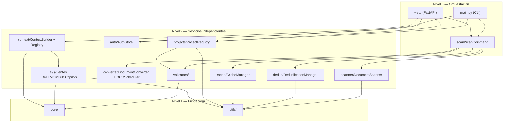

# 🏗️ Arquitectura de doc_organize

**Versión:** Fase 1 (A–D2c) + organización documental (Fase 2) + rediseño Tenant/Role/User
**Última actualización:** 2026-09-11
**Estado:** Implementado, ver `§13` de `.github/prompts/doclink_extractor_plan.md` y
`.ai/sessions/2026-09-11-tenant-role-user-redesign/` (rediseño de auth más reciente)

> Este documento reemplaza una versión anterior que describía una librería de acceso a múltiples
> motores de base de datos (`_drivers/`, `connection/`, `metadata/`, `bulk/`, `migrate/`,
> `comparar/`) — esa era la **encarnación anterior de este mismo repositorio**, antes de un pivote
> completo de dominio. Ese historial se conserva localmente en `.ai/doc_old/` (gitignored, nunca
> entró en el historial de este proyecto) por si hace falta contexto arqueológico, pero **no
> describe `doc_organize` tal como existe hoy**.

---

## Visión general

`doc_organize` escanea, convierte (Docling), deduplica y cachea documentos — por CLI o por una
interfaz web opcional con autenticación multi-usuario/multi-tenant. Se organiza en **3 niveles**,
regla de oro: un módulo de Nivel N solo importa de Nivel N y N-1 (nunca de otro módulo de su mismo
nivel, nunca "hacia arriba").

```
📦 doc_organize
│
├─── NIVEL 1: FUNDACIONAL (sin dependencias del resto del paquete)
│    core/
│    ├── models.py        # Modelos Pydantic v2 (DocumentMetadata, Project, Tenant, Role, User,
│    │                     #   Session, CacheEntry, ScanEvent, DuplicateGroup, ...)
│    ├── exceptions.py     # DocOrganizeError y su jerarquía
│    └── constants.py      # Extensiones soportadas, límites de nombre, parámetros scrypt
│
│    utils/
│    ├── hash_utils.py     # hash_file() — única fuente de verdad SHA-256, async
│    ├── path_utils.py     # safe_path_join() — anti path-traversal
│    ├── logging.py        # get_logger()/configure_logging() — logging estructurado
│    ├── date_format.py    # format_datetime()/format_duration() — filtros Jinja
│    ├── gpu_detector.py   # detect_gpu_status() — soporte de GPU del entorno
│    └── av_detector.py    # detect_av_status() — soporte de audio/vídeo del entorno
│
├─── NIVEL 2: SERVICIOS INDEPENDIENTES (cada uno resuelve una responsabilidad, sin depender
│    │        de sus pares de Nivel 2 — solo de Nivel 1)
│    validators/    # FolderValidator (REQ-001), ProjectValidator (REQ-008)
│    scanner/       # DocumentScanner (REQ-002)
│    converter/     # DocumentConverter + OCRScheduler (REQ-003/004)
│    dedup/         # DeduplicationManager (REQ-005)
│    cache/         # CacheManager, SQLite+WAL (REQ-006)
│    projects/      # ProjectRegistry (REQ-008), JSON + asyncio.Lock
│    auth/          # AuthStore, SQLite+WAL (tenants/roles globales/usuarios/sesiones)
│    ai/            # Clientes IA (LiteLLM Proxy, GitHub Copilot Pro) — clasificación y uso/coste
│    context/       # ContextBuilder/ContextRegistry/Reorganizer/MkDocsGenerator (organización
│                    #   documental por dominios) — único módulo de Nivel 2 que importa OTRO
│                    #   módulo de Nivel 2 (`ai/`, inyección de cliente, ver excepción más abajo)
│
└─── NIVEL 3: ORQUESTACIÓN (coordina Nivel 2, sin cambiar sus contratos)
     scan/          # ScanCommand — compartido por CLI y web, no pertenece a ninguno de los dos
     web/           # FastAPI, extra [web] — nunca importado desde el núcleo
     main.py        # CLI (python -m doc_organize ...)
```



## Excepción documentada: `projects/` importa de `validators/` (Nivel 2 → Nivel 2)

`ProjectRegistry.create_project()` (`projects/project_registry.py`) usa
`ProjectValidator.validate_name()` (`validators/project_validator.py`) para
validar el nombre de proyecto antes de crear la carpeta. Es una excepción
deliberada a "un módulo de Nivel 2 nunca depende de otro módulo de Nivel 2":
`ProjectValidator` es una validación pura de cadena (sin estado, sin I/O,
mismo perfil que `FolderValidator`, su par natural en `validators/`) — no
genera dependencia circular (`validators/` no depende de `projects/`) ni
acoplamiento real de comportamiento. La alternativa (mover la validación a
`core/`) cambiaría el rol de `core/` (hoy solo modelos/excepciones/constantes,
sin lógica de negocio) por evitar una violación que no causa ningún problema
concreto — se documenta la excepción en vez de forzar ese cambio
(maturity-assessment, sesión 2026-09-03).

## Excepción documentada: `context/` importa de `ai/` (Nivel 2 → Nivel 2)

`context/context_builder.py` y `context/taxonomy_manifest_sampler.py` importan tipos de
`ai/` (`DomainClassificationClient`, `TaxonomyClassificationClient`, `SampledDocument`) para
tipar el parámetro de cliente IA que `ContextBuilder.build()` recibe **inyectado** (DIP: quien
llama construye el cliente a partir de la config resuelta y se lo pasa; `context/` nunca
resuelve credenciales ni construye el cliente por su cuenta). Mismo criterio que la excepción
`projects/`→`validators/` de arriba: sin dependencia circular (`ai/` no importa de `context/`),
y la Sub-fase B (IA) de la clasificación por dominios/taxonomía es opcional — `ContextBuilder`
funciona igual de bien sin ningún cliente IA (Sub-fase A, solo reglas).

---

## Por qué `scan/` es su propio módulo (no vive en `main.py` ni en `web/`)

`ScanCommand` orquesta escaneo+caché+dedup+conversión+OCR. Nació dentro de `main.py` (Fase D-1, solo
CLI); al construir el equivalente web (Fase D-2b), habría exigido que `web/` importara de `main.py`
(o viceversa), acoplando dos entry points de orquestación que deben ser independientes. Se extrajo a
`scan/scan_command.py` — módulo Nivel 3 compartido, sin dueño único. `run()` (contrato CLI, Fase
D-1) delega en `run_streaming()` (generador async de `ScanEvent`, Fase D-2b) — mismo pipeline, dos
formas de consumirlo.

## Autenticación web (host no-loopback)

Sesión por cookie (`HttpOnly`, `SameSite=Strict`) tras `POST /login` (usuario+contraseña+tenant) —
**no** un bearer token compartido (diseño descartado, ver `DECISIONS_LOG.md`). `AuthMiddleware`
exige sesión en toda ruta salvo `/login`/`/logout`. Las conexiones WebSocket (`web/routes/scan.py`)
**no** pasan por ese middleware (Starlette no lo intercepta para el scope `"websocket"`) y
autentican la sesión explícitamente en el propio handler
(`web/auth.py::authenticate_session()`/`requires_auth()`).

## Roles y gestión de usuarios (rediseño Tenant/Role/User, sesión 2026-09-11)

> Sustituye por completo la revisión 9 (bootstrap por tenant vía `create_tenant()`). Ver
> `.ai/sessions/2026-09-11-tenant-role-user-redesign/` para el PLAN/AUDIT_PLAN completos y
> `.ai/DECISIONS_LOG.md` (Revisión 16) para el registro de la decisión.

`Role` ya **no** está ligado a un tenant (`name` único **globalmente**, no por tenant) — un
mismo rol puede asignarse a usuarios de tenants distintos. `AuthStore.__aenter__()` (no
`create_tenant()`) aprovisiona de fábrica, en una única transacción y solo para el tenant
`DEFAULT_TENANT_ID` ("default"), un rol global `admin` (`is_admin=True`) y un usuario
`admin`/`admin` con `must_change_password=True` **e** `is_instance_admin=True` — sin
aprovisionamiento manual previo por CLI. `create_tenant()` (tenants adicionales) ya no crea
ningún rol/usuario: los da de alta un `is_instance_admin` desde "Tenants y usuarios" o
`user create` por CLI.

Mientras la cuenta de fábrica conserve su contraseña, `AuthMiddleware` bloquea toda ruta salvo
`/change-password`/`/logout`; además, esa identidad exacta (`tenant="default"`+`username="admin"`)
ni siquiera puede completar `POST /login` en modo no-loopback mientras conserve esa contraseña
(`is_factory_admin_account()`, `auth/auth_store.py`) — se rechaza el login en sí, no solo el
resto de rutas tras entrar.

Dos niveles de administración, ortogonales: `Role.is_admin` (ve todos los proyectos del
tenant *del usuario que lo tiene*) y `User.is_instance_admin` (gestiona *cualquier* tenant,
crea/elimina tenants, y es el único que toca recursos de instancia — `InstanceSecretsStore`,
`TaxonomyTemplateRegistry`). Un rol no-admin solo ve los proyectos de su `project_names`;
`require_project_access` (`web/dependencies.py`), declarada por firma en cada ruta
`{name}`-scoped (`projects`, `scan`, `cache`, `downloads`, `duplicates`, más el handler
WebSocket a mano), es la única puerta de esa comprobación — `AuthStore.can_access_project()`
es la fuente de verdad, nunca reimplementada por ruta. Su acceso de escaneo es implícito (la
carpeta de cada proyecto en `project_names`, `Role.allowed_scan_roots` se retiró). `/api/roles`
y `/api/users` (`web/routes/admin.py`) exigen `require_admin_or_instance_admin`;
`/api/tenants*` (`web/routes/tenants.py`, nuevo) exige `require_instance_admin` — ambas a
nivel de router, no por endpoint. `User` gana `is_blocked` (bloquear invalida todas sus
sesiones activas en la misma transacción, no solo impide logins futuros).

## Multi-tenant

Cada proyecto pertenece a un `tenant_id` (default `"default"` para CLI/loopback). `tenant_id`
**nunca** se lee de un parámetro que el cliente controle — siempre de `get_tenant_id(request)`, que
resuelve desde la sesión ya autenticada. Un usuario del tenant A nunca puede ver/tocar datos del
tenant B, ni manipulando la petición.

## Duplicates Resolver — por qué recalcula en el servidor

`POST /api/projects/{name}/duplicates/resolve` nunca acepta una ruta de archivo directamente del
cliente: recalcula los grupos de duplicados en el propio servidor (re-escaneo vía `folders.json`) y
solo aplica la elección del usuario si coincide con un miembro real de un grupo recién detectado
(correlacionado por una clave derivada del contenido, no por un ID que el cliente controle). Ver
`web/routes/duplicates.py::_group_key()`.

---

## Referencias

- Especificación completa y auditada: `.github/prompts/doclink_extractor_plan.md`
- Referencia técnica generada desde docstrings: `docs/api/index.md`
- Registro de decisiones: `.ai/DECISIONS_LOG.md`
- Convención de niveles: `.github/instructions/architecture.instructions.md`
