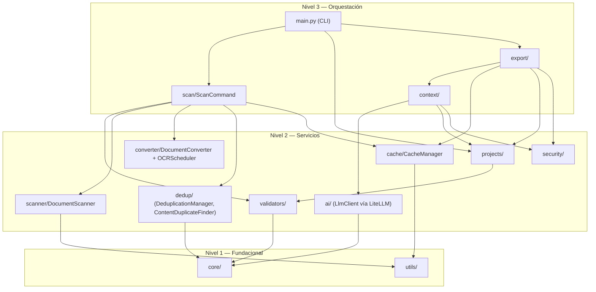

# 🏗️ Arquitectura de doc_organize

**Versión:** 2.2.0 (`pyproject.toml`) — librería pura desde 1.0.0
**Última actualización:** 2026-11-24
**Fuentes vigentes:** `.github/SHARED_INSTRUCTIONS.md` («Arquitectura real»),
`.github/instructions/architecture.instructions.md` (regla #6), `src/doc_organize/__init__.py` (`_EXPORTS`)

> Historial: una versión muy anterior describía otra librería (motores de base de datos: `_drivers/`, `connection/`,
> `metadata/`…), la encarnación previa de este repositorio, conservada solo en `.ai/doc_old/` (gitignored). La versión
> de 2026-09-11 describía la web integrada, `auth/`, roles y multi-tenant: **todo eso se retiró en 1.0.0** y vive en
> doc_organize_web (ver «Histórico» al final y `docs/guides/migracion_web.md`).

---

## Visión general

`doc_organize` escanea, convierte (Docling), deduplica, cachea y organiza documentos en un contexto documental, con
IA opcional vía LiteLLM. Se usa como librería (API pública = `doc_organize.__all__`, importada bajo demanda con
PEP 562 para no cargar Docling hasta usarlo) o con el CLI. No tiene interfaz web ni autenticación:
`tests/unit/test_library_architecture.py` lo garantiza.

Se organiza en **3 niveles**; las dependencias fluyen solo hacia abajo (regla #6): Nivel 3 importa de 2 y 1; Nivel 2
solo de Nivel 1 (salvo excepciones documentadas abajo); Nivel 1 de nada del paquete.

```
📦 doc_organize
│
├── __init__.py      # API pública (_EXPORTS, PEP 562)
│
├─── NIVEL 1: FUNDACIONAL
│    core/
│    ├── models.py        # Modelos Pydantic v2 (DocumentMetadata, Project, CacheEntry, DuplicateGroup, ScanEvent,
│    │                    #   DedupEvent, ContextBuildEvent, Context, TaxonomyManifest, AiSettings, TaskSettings…)
│    ├── exceptions.py    # DocOrganizeError y su jerarquía
│    ├── constants.py     # Extensiones soportadas, límites…
│    └── progress.py      # CancelToken, ProgressEvent, Phase
│
│    utils/               # hash_utils (hash_file), path_utils (safe_path_join), logging, date_format,
│                         #   detectores gpu/av/office/metadata, atomic_write, file_lock, io_retry, memory,
│                         #   folding, text_clean
│
├─── NIVEL 2: SERVICIOS INDEPENDIENTES
│    validators/   # FolderValidator (REQ-001), ProjectValidator (REQ-008)
│    scanner/      # DocumentScanner (REQ-002)
│    converter/    # DocumentConverter (adaptador de Docling) + OCRScheduler (REQ-003/004)
│    dedup/        # DeduplicationManager (REQ-005); content.py: ContentDuplicateFinder (2.2.0)
│    cache/        # CacheManager, SQLite+WAL (REQ-006)
│    projects/     # ProjectRegistry (REQ-008), ProjectLayout, ScannedFoldersStore, ProjectHistoryCleaner
│    security/     # redact_credentials, scan_credentials, neutralize_untrusted_markdown
│    ai/           # LlmClient, settings (settings_from_env), prompts, cache, embeddings, agents (AgentRunner),
│                  #   services, uso: litellm_usage_client; github_copilot_usage_client (obsoleto desde 2.1.0)
│
└─── NIVEL 3: ORQUESTACIÓN
     context/      # ContextBuilder, ContextRegistry, Reorganizer, SiteGenerator, manifiesto por ejes, decisiones,
                   #   cola de revisión, evaluación, dry run, versiones, semántica, frescura, historial,
                   #   offline_site, llms_txt, agentes de taxonomía y revisión, plantillas
     scan/         # ScanCommand, scan_history_store
     export/       # ZIP (streaming), Excel (extra `export`), paquete para IA
     diagnostics.py  # check_environment
     main.py       # CLI (project, scan, deduplicate, export)
```

> `security/` figura como Nivel 2 en `.github/SHARED_INSTRUCTIONS.md`, pero no aparece en la lista de la regla #6 de
> `architecture.instructions.md`; `diagnostics.py` no está asignado a ningún nivel en ninguno de los dos
> (**pendiente** de fijar).



Los consumidores (el CLI y doc_organize_web) reciben progreso por callbacks o iteradores de eventos (`ScanEvent`,
`DedupEvent`, `ContextBuildEvent`, `ContextDeleteEvent`, `ProgressEvent`) y cancelan con `CancelToken`; la librería no
sabe si detrás hay un terminal, un WebSocket o SSE.

## Excepción documentada: `projects/` importa de `validators/` (Nivel 2 → Nivel 2)

`ProjectRegistry.create_project()` (`projects/project_registry.py`) usa `ProjectValidator.validate_name()`
(`validators/project_validator.py`) para validar el nombre de proyecto antes de crear la carpeta. Es una excepción
deliberada: `ProjectValidator` es una validación pura de cadena (sin estado, sin I/O); no hay dependencia circular
(`validators/` no depende de `projects/`). Mover la validación a `core/` cambiaría el rol de `core/` (modelos,
excepciones, constantes, sin lógica de negocio) por evitar una violación que no causa ningún problema concreto
(maturity-assessment, sesión 2026-09-03).

## `context/` importa de `ai/` (Nivel 3 → Nivel 2, permitido)

Antes `context/` figuraba como Nivel 2 y su import de `ai/` era una excepción; hoy `context/` es Nivel 3 (regla #6) y
el import es normal. `ContextBuilder`, `semantic`, `dry_run` y `review_agent` reciben un `LlmClient` **inyectado** (DIP:
quien llama construye el cliente con `AiSettings`, p. ej. desde `settings_from_env()`; `context/` nunca resuelve
credenciales). La IA es opcional: sin cliente, la clasificación por reglas funciona igual.

## Dependencias observadas fuera de la regla (pendiente de decisión)

Verificado en el código a 2.2.0, sin justificación documentada encontrada:

- `dedup/content.py` (Nivel 2) importa `doc_organize.context.decisions` y `doc_organize.context.evaluation`
  (Nivel 3) **de forma perezosa**, dentro de `exclude_from_context()`. Y `doc_organize.ai.llm_client` (Nivel 2) solo
  bajo `TYPE_CHECKING`.
- Imports horizontales entre módulos de Nivel 3: `export/` → `context/` (`llms_txt`, `context_history`,
  `evaluation`) y `context/offline_site.py` → `export/_progress.py`. La regla #6 dice «nunca en horizontal»; no hay
  ciclo de import a nivel de módulo, pero falta decidir si se documentan como excepción o se mueven.

## Por qué `scan/` es su propio módulo (no vive en `main.py`)

`ScanCommand` orquesta escaneo + caché + conversión + OCR (la deduplicación es una acción aparte,
`deduplicate_streaming()`). Nació en `main.py`; se extrajo a `scan/scan_command.py` cuando hubo un segundo consumidor
(entonces la web integrada, hoy doc_organize_web), para no acoplar dos puntos de entrada. `run()` delega en
`run_streaming()` (generador async de `ScanEvent`): mismo pipeline, dos formas de consumirlo.

## IA: un solo cliente (2.0)

`ai/` ya no tiene un cliente por tarea con su `*Config` (1.x): hay un `LlmClient` con `AiSettings` (proxy + clave
general) y `TaskSettings` por tarea (`classify`, `enrich`, `taxonomy_design`, `agent`, `embed`, `dedup`). Siempre a
través de un LiteLLM Proxy; una tarea sin modelo propio usa el alias `doc-organize-<tarea>` (salvo `dedup`, que sin
modelo propio no ejecuta la búsqueda por contenido parecido, CHANGELOG 2.2.0). Las credenciales se redactan antes de
enviar (`security/`). `tests/unit/test_ai_architecture.py` impide que `ai/` importe `auth`/`web`.

---

## Histórico (retirado en 1.0.0, vive en doc_organize_web)

- **Autenticación web**: sesión por cookie (`HttpOnly`, `SameSite=Strict`), `AuthMiddleware`, WebSocket autenticado en
  el handler.
- **Roles, usuarios y multi-tenant**: rediseño Tenant/Role/User (2026-09-11, `DECISIONS_LOG.md` Revisión 16),
  `is_instance_admin`, `require_project_access`, `tenant_id` resuelto desde la sesión. Desde 1.0.0 `Project` no tiene
  `tenant_id` (L-12; un `projects.json` antiguo con ese campo se sigue leyendo y se ignora).
- **Duplicates Resolver web** (`web/routes/duplicates.py::_group_key()`): recalculaba los grupos en el servidor antes
  de aplicar la elección del usuario.
- `MkDocsGenerator` (sustituido por `SiteGenerator`) y los clientes IA por tarea de 1.x (`DomainClassificationClient`,
  `TaxonomyClassificationClient`…).

`src/doc_organize/web` y `src/doc_organize/auth` pueden existir en un checkout local solo con `__pycache__` sin
versionar; no forman parte del paquete.

---

## Referencias

- Instrucciones compartidas: `.github/SHARED_INSTRUCTIONS.md`
- Regla de niveles: `.github/instructions/architecture.instructions.md`
- API pública: `docs/api/publica.md`; referencia generada: `docs/api/`
- Registro de decisiones: `.ai/DECISIONS_LOG.md`
- Especificación original (histórica, Fase 1): `.github/prompts/doclink_extractor_plan.md`
