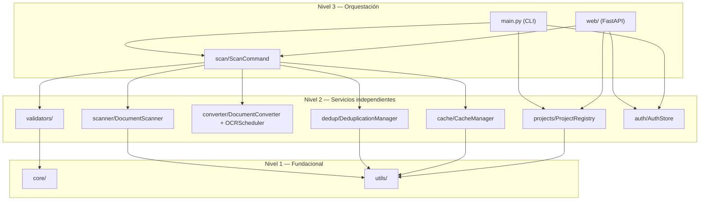

# 🏗️ Arquitectura de doc_organize

**Versión:** Fase 1 (A–D2c)
**Última actualización:** 2026-08-28
**Estado:** Implementado, ver `§13` de `.github/prompts/doclink_extractor_plan.md`

> Este documento reemplaza una versión anterior que describía una librería de acceso a múltiples
> motores de base de datos (`_drivers/`, `connection/`, `metadata/`, `bulk/`, `migrate/`,
> `comparar/`) — esa era la **encarnación anterior de este mismo repositorio**, antes de un pivote
> completo de dominio. Ese historial se conserva localmente en `.ai/doc_old/` (gitignored, nunca
> entró en el historial de este proyecto) por si hace falta contexto arqueológico, pero **no
> describe `doc_organize` tal como existe hoy**.

---

## Visión general

`doc_organize` escanea, convierte (Docling), deduplica y cachea documentos — por CLI o por una
interfaz web opcional con autenticación multi-usuario/multi-tenant. Se organiza en **3 niveles**,
regla de oro: un módulo de Nivel N solo importa de Nivel N y N-1 (nunca de otro módulo de su mismo
nivel, nunca "hacia arriba").

```
📦 doc_organize
│
├─── NIVEL 1: FUNDACIONAL (sin dependencias del resto del paquete)
│    core/
│    ├── models.py        # Modelos Pydantic v2 (DocumentMetadata, Project, Tenant, User, Session,
│    │                     #   CacheEntry, ScanEvent, DuplicateGroup, ...)
│    ├── exceptions.py     # DocOrganizeError y su jerarquía
│    └── constants.py      # Extensiones soportadas, límites de nombre, parámetros scrypt
│
│    utils/
│    ├── hash_utils.py     # hash_file() — única fuente de verdad SHA-256, async
│    ├── path_utils.py     # safe_path_join() — anti path-traversal
│    └── logging.py        # get_logger() — JSON estructurado
│
├─── NIVEL 2: SERVICIOS INDEPENDIENTES (cada uno resuelve una responsabilidad, sin depender
│    │        de sus pares de Nivel 2 — solo de Nivel 1)
│    validators/    # FolderValidator (REQ-001), ProjectValidator (REQ-008)
│    scanner/       # DocumentScanner (REQ-002)
│    converter/     # DocumentConverter + OCRScheduler (REQ-003/004)
│    dedup/         # DeduplicationManager (REQ-005)
│    cache/         # CacheManager, SQLite+WAL (REQ-006)
│    projects/      # ProjectRegistry (REQ-008), JSON + asyncio.Lock
│    auth/          # AuthStore, SQLite+WAL (tenants/usuarios/sesiones)
│
└─── NIVEL 3: ORQUESTACIÓN (coordina Nivel 2, sin cambiar sus contratos)
     scan/          # ScanCommand — compartido por CLI y web, no pertenece a ninguno de los dos
     web/           # FastAPI, extra [web] — nunca importado desde el núcleo
     main.py        # CLI (python -m doc_organize ...)
```



---

## Por qué `scan/` es su propio módulo (no vive en `main.py` ni en `web/`)

`ScanCommand` orquesta escaneo+caché+dedup+conversión+OCR. Nació dentro de `main.py` (Fase D-1, solo
CLI); al construir el equivalente web (Fase D-2b), habría exigido que `web/` importara de `main.py`
(o viceversa), acoplando dos entry points de orquestación que deben ser independientes. Se extrajo a
`scan/scan_command.py` — módulo Nivel 3 compartido, sin dueño único. `run()` (contrato CLI, Fase
D-1) delega en `run_streaming()` (generador async de `ScanEvent`, Fase D-2b) — mismo pipeline, dos
formas de consumirlo.

## Autenticación web (host no-loopback)

Sesión por cookie (`HttpOnly`, `SameSite=Strict`) tras `POST /login` (usuario+contraseña+tenant) —
**no** un bearer token compartido (diseño descartado, ver `DECISIONS_LOG.md`). `AuthMiddleware`
exige sesión en toda ruta salvo `/login`/`/logout`. Las conexiones WebSocket (`web/routes/scan.py`)
**no** pasan por ese middleware (Starlette no lo intercepta para el scope `"websocket"`) y
autentican la sesión explícitamente en el propio handler
(`web/auth.py::authenticate_session()`/`requires_auth()`).

## Multi-tenant

Cada proyecto pertenece a un `tenant_id` (default `"default"` para CLI/loopback). `tenant_id`
**nunca** se lee de un parámetro que el cliente controle — siempre de `get_tenant_id(request)`, que
resuelve desde la sesión ya autenticada. Un usuario del tenant A nunca puede ver/tocar datos del
tenant B, ni manipulando la petición.

## Duplicates Resolver — por qué recalcula en el servidor

`POST /api/projects/{name}/duplicates/resolve` nunca acepta una ruta de archivo directamente del
cliente: recalcula los grupos de duplicados en el propio servidor (re-escaneo vía `folders.json`) y
solo aplica la elección del usuario si coincide con un miembro real de un grupo recién detectado
(correlacionado por una clave derivada del contenido, no por un ID que el cliente controle). Ver
`web/routes/duplicates.py::_group_key()`.

---

## Referencias

- Especificación completa y auditada: `.github/prompts/doclink_extractor_plan.md`
- Referencia técnica generada desde docstrings: `docs/api/index.md`
- Registro de decisiones: `.ai/DECISIONS_LOG.md`
- Convención de niveles: `.github/instructions/architecture.instructions.md`
