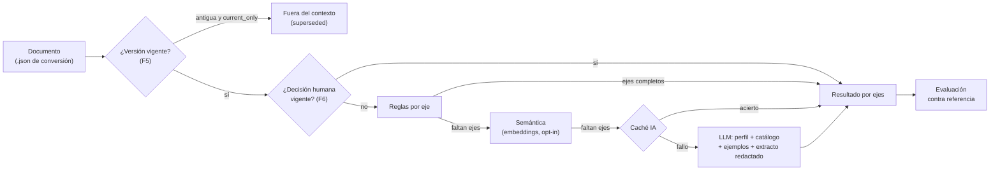

# PLAN + AUDIT_PLAN — Plan único de doc_organize 2.0.0 y doc_organize_web 2.0.0 (2026-11-17)

Skill: `new-feature`. Solo PLAN y AUDIT_PLAN; sin implementar. **Una sola versión**: doc_organize **2.0.0** (MAJOR,
con ruptura) y doc_organize_web **2.0.0**, publicadas a la vez. Se implementan por hitos internos (§Hitos), sin
versiones intermedias.

> - **2026-11-20, 2.0.0**: W2-W9 hechos. rc2 (peticiones de la web en W4-W8) y rc3 (el sitio sin conexión no publica originales ni `.json`, fuga hallada por los E2E de W9). Preproducción con datos reales en `PREPRODUCCION_W9.md` (migraciones, diagnóstico, contexto y entregas correctos; la web sube su plazo de IA a 120 s). Criterio de salida cumplido; publicación simultánea de doc_organize 2.0.0 y doc_organize_web 2.0.0.
> - **2026-11-19, 2.0.0rc1**: M8-M10 hechos. Medición final contra M0 en `MEDICION_M10.md` (exactitud cumple; coste 1,64×, aceptado como referencia). **Puerta de M8.2 no cumplida** con los modelos locales (`MEDICION_M8.md`, `MEDICION_M10.md`): el mantenedor decide publicar el diseñador como herramienta de apoyo. `ai_settings_v1` de la web se borra en la 2.0.0 final.
>
> **Decisiones del mantenedor (2026-11-17)**
>
> - Se acepta 2.0.0 con ruptura, y **todo se fusiona en esa única versión**: las facetas (antes 1.7.0), la hoja de
>   ruta F1-F7 traída de doc_ia (antes 1.8.0-2.6.0), la IA ajustada a cada proyecto (G1-G6) y las dos partes del plan
>   web `2026-11-17-manifest-from-template`.
> - Antecedentes, que se conservan como registro y **este plan sustituye donde se contradigan**:
>   - [`../2026-11-17-taxonomy-facets/PLAN.md`](../2026-11-17-taxonomy-facets/PLAN.md): diseño detallado de facetas
>     (§1-§5b, auditorías C1-C10 y R1-R8) y de F1-F7 (§8). Sus versiones y fases (§9) quedan anuladas.
>   - `doc_organize_web/.ai/sessions/2026-11-17-manifest-from-template/PLAN.md`: parte 1 (manifiesto, versiones del
>     manifiesto) y parte 2 (facetas en la web, revisión 6 la adapta a ejes).
> - Decididas antes: D1 (formato implícito), D3 (historial solo de ejes organizadores), D4 (Excel), D5 (reintento
>   429), D6 (sitio offline: neutralizar + CSP condicionada), D7 (redacción por defecto), D8 (`versions="mark"` en la
>   web), D9 (todas las fases).
> - **Decidido en la adaptación (revisable)**: se revierte la S3 (el modelo recibe nombres, descripciones y perfil;
>   mitigaciones en G2.2); las facetas nacen directamente como **ejes** (no hay `TaxonomyFacet` ni `FacetValue`); en la
>   web los valores de todos los ejes van en **una tabla genérica indexada** (U3).
> - **Decisiones D10-D18 (2026-11-17)**: D10, D11, D12, D13, D14 según la recomendación; **D15: las variables de
>   entorno antiguas se quitan en 2.0.0** (no se leen; si se detectan, error claro que dice cuál usar: U17); **D16 no**:
>   los agentes (G5-G6) son parte de 2.0.0 y no se sacan a 2.1 aunque peligre el criterio de salida (U18); **D17 sí**:
>   la parte 1 de la web sale antes como **doc_organize_web 1.8.0**; **D18 sí**: la redacción de credenciales (F1) se
>   publica como **doc_organize 1.7.0** (hito M3b; era 1.6.1, pero añade API pública: SemVer pide MINOR, decisión 2026-11-18). Los nombres son `redact_credentials`/`credential_findings`, no `*_secrets`: la guarda de arquitectura rechaza nombres públicos con «secret».
>
> El AUDIT_PLAN independiente del final (U1-U18) **manda sobre el cuerpo** donde lo contradiga. La auditoría anterior de
> este plan (B1-B18) queda como registro y sus correcciones están aplicadas.

## Origen

1. **Facetas**: la plantilla de CALIDAD_VD declara ejes (`normative_frameworks`, `management_system`, `evidence`) que
   1.6.0 ignora sin avisar.
2. **Capacidades de doc_ia**: redacción de credenciales, diagnóstico del entorno, sitio sin conexión verificable,
   frescura respecto a los originales, versión vigente, decisiones humanas persistentes y paquete de contexto para IA.
3. **IA por proyecto**: hoy el modelo recibe solo slugs y los primeros 4000 caracteres, con prompts fijos, salida
   `json_object`, cuatro clientes y sin medición ni memoria (`ai/taxonomy_classification_client.py:148-154`;
   `read_conversion_json` descarta los `headings` que guarda el conversor, `domain_classifier.py:45-47` y
   `converter.py:476`).
4. **Web, manifiesto**: el bloque del manifiesto confunde con otros catálogos y no hay forma de deshacer.

## Inputs

| Campo | Valor |
|---|---|
| Objetivo | Una 2.0.0 en la que la taxonomía es una lista de **ejes** (dominio, tipo de material y facetas), la clasificación combina decisiones humanas, reglas, semántica e IA con el conocimiento de cada proyecto, se puede **medir**, y el resultado se publica y entrega de forma segura y verificable |
| Módulos (librería) | `core/models.py`, `context/` (manifiesto v2, clasificadores, builder, sitio, historial, reorganizador, frescura, versiones, decisiones), `ai/` (reescrito), `security/` (nuevo), `evaluation/` (nuevo), `export/` (Excel por ejes, ZIP del sitio, paquete IA), `diagnostics.py` (nuevo) |
| Módulos (web) | Migraciones Alembic, `db/models.py`, `integrations/doc_organize/*`, `jobs/operations/*`, `domain/context/*`, `api/v1/*`, frontend (`features/context`, `features/admin`, `features/documents`, `features/runs`, nuevas páginas), LiteLLM falso de E2E |
| Contratos | Manifiesto v2 (`schema: 2`, `axes:`, perfil en el cuerpo), `context.json` v2, API HTTP de la web 2.0 (OpenAPI regenerado) |
| Restricciones | Sin dependencias nuevas en la librería; librería pura (sin web ni auth); async; Python 3.12-3.14; sin IA y sin decisiones, la clasificación por reglas de dominio y tipo de material es la de 1.6.0 |

## Arquitectura de la clasificación en 2.0



## PLAN

### A. Taxonomía por ejes (antes facetas, §1-§3 del plan de facetas)

#### A1. Modelo y formato

```python
class TaxonomyEntry(BaseModel):
    slug: str
    name: str
    description: str | None = None       # se envía al modelo (G2.2)
    keywords: list[str] = []             # solo para reglas
    examples: list[str] = []

class TaxonomyAxis(BaseModel):
    key: str                             # ^[a-z][a-z0-9_]{0,40}$
    name: str
    description: str | None = None
    multiple: bool = False
    threshold: float | None = None
    rules: bool = True                   # False: solo IA o semántica
    organizes: Literal["folder", "subfolder"] | None = None
    entries: list[TaxonomyEntry]

class TaxonomyManifest(BaseModel):
    schema_version: Literal[2] = 2
    title: str | None
    description: str | None
    axes: list[TaxonomyAxis]
    profile: ProjectProfile | None = None
```

- Dominio = eje con `organizes="folder"`; tipo de material = `organizes="subfolder"`; como mucho uno de cada. La
  reorganización y el `nav` salen de ellos (mismo resultado que 1.6.0).
- Front matter v2 con `schema: 2` y `axes:`. `migrate_manifest_v1(text) -> str` convierte `domains`, `material_types`,
  el bloque `facets:` y el **formato implícito** (D1: claves de nivel superior que son listas de `{slug, name}`), y
  conserva el cuerpo.
- `parse_taxonomy_template` lee v1 migrándolo en memoria. `inspect_taxonomy_front_matter(text) ->
  TaxonomyFrontMatterReport` (`axes`, `implicit_axes`, `ignored_keys`, `legacy_format`).
- Límites: 10 ejes, 150 entradas por eje, descripciones de 500 caracteres; `TaxonomyManifestError` con mensaje.
- Sin manifiesto (`discover`, `domains`): un solo eje `domains`.

#### A2. Reglas por eje

- `AxisRuleScorer` = el `FacetScorer` del plan de facetas (C1-C3): palabra o frase completa tras plegar acentos y
  mayúsculas; confianza por términos distintos encontrados (1 → 0,6; 2 → 0,8; 3+ → 1,0); términos compartidos entre
  entradas del mismo eje descartados.
- **Para los ejes organizadores se mantiene `score_catalog`** (resultado idéntico a 1.6.0, T1 del plan de facetas);
  el nuevo puntuador se usa en los demás ejes. Unificarlos queda para cuando G3 demuestre que no empeora.
- `multiple=True`: valores ≥ umbral, como mucho 5; `multiple=False`: el mejor.
- Ejes de los clasificados **y** de los sin clasificar por umbral (tienen texto); ninguno en los incompletos.

#### A3. Resultados y `context.json` v2

```python
class AxisValue(BaseModel):
    slug: str
    name: str
    confidence: float
    classified_by: Literal["rules", "semantic", "ai", "human"]
    evidence: str | None = None
    evidence_verified: bool | None = None

class DocumentClassification(BaseModel):
    axes: dict[str, list[AxisValue]]
```

- `DomainDocument` y `UnclassifiedDocument` llevan `classification`, `source_sha256` (F4) y, con F5, `version`,
  `version_group`, `is_current`. `domain`, `material_type` y `classified_by` quedan como **propiedades de lectura**
  derivadas (se retiran en 3.0).
- `Context`: `schema_version = 2`, `taxonomy_axes` (sin `keywords`), `ai_provenance`, `ai_stats`, `credential_findings`,
  `stale_decisions`, `orphan_decisions`, `superseded_documents`.
- `load_context` lee v1 migrado; `diff_contexts` migra el anterior antes de comparar. El historial registra solo los
  **ejes organizadores** (D3) y un tipo de cambio por decisión humana (`origin="human"`).

#### A4. Salidas por ejes

- **Sitio**: por cada eje no organizador, una página por eje con una tabla de valores y documentos (no una página por
  valor: U13). Nombres escapados (C7).
- **Excel del contexto** (`write_context_documents_xlsx`, D4): hoja «Documentos» con una columna por eje y hoja «Ejes»
  con recuentos por valor; `_excel_safe`, progreso, cancelación.

### B. Rendimiento de la construcción (§4c del plan de facetas)

- `read_conversion_document(json_path) -> ConversionDocument` (título y `chunks` con `text` y `headings`), **una**
  lectura por documento para todo lo que no es IA (reglas, idioma, propuesta de sin clasificar), con
  `properties_concurrency` lecturas a la vez; solo se retienen resultados, no el texto.
- `ContextBuilder(ai_concurrency=1)` en todas las fases con IA; listas rehechas en el orden original (`context.json`
  idéntico con 1 y con 4); presupuesto reservado al despachar.
- **D5**: reintento ante 429/503 en `_http_client_base` con `Retry-After` (tope 60 s por espera, esperas en tramos
  cortos), reintentos configurables.
- Medición antes y después (objetivos del plan de facetas: sin IA −30 % en red; con IA y 4, ≥ 2,5×).

### C. Seguridad y entorno

- **F1 Redacción de credenciales** (plan de facetas §F1): `doc_organize.security.credentials` (`scan_credentials`,
  `redact_credentials`, funciones puras). Se aplica en el **único punto de salida** hacia la IA (`LlmClient`, D7: por
  defecto) y en la copia del sitio; `Context.credential_findings` sin valores.
- **F2 Diagnóstico** (§F2): `check_environment(check_ai=False)`; con `check_ai=True` comprueba además que cada alias
  de tarea responde y si admite salida `json_schema`.

### D. Originales: frescura y versiones

- **F4 Frescura** (§F4): `source_sha256` desde la caché y `check_context_freshness` (cambiados, nuevos, eliminados,
  `unknown`, `stale_site`).
- **F5 Versión vigente** (§F5): `detect_document_versions` (solo marcadores explícitos; fechas no), `build(versions=
  "all" | "mark" | "current_only")` (librería `all`; web `mark`, D8); decisión `set_current_version` (F6).

### E. IA ajustada a cada proyecto

#### G1. Cliente único y prompts

- `LlmClient(AiSettings)` con `complete_json`, `complete_with_tools`, `embed`; tareas `classify`, `enrich`,
  `taxonomy_design`, `agent`, `embed`; modelo por tarea (alias del proxy recomendados, **no obligatorios**: U10);
  claves virtuales por tarea opcionales (D12); `metadata.tags`; reintentos de B; redacción de C.
- Salida `json_schema` estricta con `enum` de slugs por eje; caída una vez a `json_object`; validación siempre.
- `settings_from_env()` con `DOC_ORGANIZE_LITELLM_BASE_URL`, `_VIRTUAL_KEY`, `_MODEL_<TAREA>`. Las antiguas
  `DOC_ORGANIZE_LITELLM_<CLIENTE>_*` **no se leen** (D15); si alguna está definida, `AiConfigurationError` con la lista
  de variables antiguas encontradas y su equivalente nueva, para que la actualización falle de forma visible y no con
  la IA desactivada en silencio (U17).
- `PromptRegistry`: `ai/prompts/<tarea>.md` empaquetados con `id`/`version`, sobrescribibles en
  `<proyecto>/.doc_organize/prompts/`; prefijo estable (instrucciones + perfil + catálogo → ejemplos → documento) para
  la caché del proveedor; `litellm_prompt_ids` opcional; procedencia en `Context.ai_provenance`.
- `AiResultCache` en `<proyecto>/.doc_organize/ai_cache/`: clave con `source_sha256`, tarea, prompt y versión, modelo,
  `catalog_hash`, `profile_hash`, versión del extractor y `redact_credentials`; `prune_ai_cache`.

#### G1.4. Clasificación de ejes con IA (antes §4/§4b del plan de facetas)

- Una llamada por documento con todos los ejes que faltan.
- `build(ai_scope="off" | "unclassified" | "missing_axes")`: `unclassified` = Sub-fase B de 1.x; `missing_axes` =
  además los clasificados con ejes vacíos (riesgos E1-E5: opt-in, presupuesto y cortes propios, solo ejes vacíos,
  nunca sustituye reglas ni decisiones).
- Enriquecimiento (`enrich=True`) y borrador de taxonomía (con descripciones y perfil inicial) sobre el mismo cliente.

#### G2. Perfil del proyecto y entrada al modelo

- **Perfil** (`ProjectProfile`): secciones `## Contexto del proyecto`, `## Reglas de desempate`, `## Glosario`,
  `## Ejemplos` del cuerpo del manifiesto; plantilla + `profile.md` del proyecto que **añade** (D11); 8 000 caracteres
  y 20 ejemplos como máximo.
- **S3 revertida** con mitigaciones: documento al final entre delimitadores y con la instrucción de que es material;
  catálogo y perfil sin caracteres de control y con longitudes acotadas; `enum` estricto; permisos y auditoría en la
  web.
- **Extracto** `build_document_excerpt` (título, carpeta relativa de hasta 2 niveles, metadatos, esquema de títulos,
  primeros bloques con texto real, bloques con términos del catálogo; 6000 caracteres); `EXCERPT_VERSION` en la caché.
- **Evidencia**: cita literal por valor, verificada contra el extracto; si no aparece, confianza limitada por debajo
  del umbral y a la cola de revisión (D10).
- `render_prompt_preview` sin llamar al modelo.

#### G3. Evaluación

- `evaluate_classification(context, gold) -> EvaluationReport` (por eje: exactitud, precisión y *recall*, confusión,
  cobertura, desglose por `classified_by`), `load_gold_xlsx`, referencia desde decisiones (F6) y `dry_run_classify`
  para comparar prompts, perfiles o modelos con presupuesto.

#### G4. Embeddings

- `EmbeddingIndex` en `<proyecto>/.doc_organize/embeddings/` (módulo `array`, sin numpy), sobre texto redactado;
  sub-fase semántica opt-in (D13, `classified_by="semantic"`); preselección en ejes de más de 25 entradas; ejemplos
  recuperados (3-5 con decisión humana o confianza ≥ 0,9), **excluyendo el propio documento, su grupo de duplicados y,
  al evaluar, el conjunto de referencia**.

#### G5-G6. Agentes

- `AgentRunner` propio (herramientas de solo lectura y locales, tope de pasos y tokens, cancelación).
- `TaxonomyDesignAgent` con `dry_run_classification` (reglas y semántica, sin LLM dentro de la herramienta).
- `ReviewAgent.propose` sobre la cola de F6 (no aplica, D14) y `audit_taxonomy` (estadísticas + propuestas).

### F. Decisiones humanas (F6)

- `ClassificationDecision` (`document_key`, `source_sha256`, `action`: `confirm`, `set_axis(axis, values)`, `exclude`,
  `set_current_version`; `author`, `decided_at`, `reason`), `ClassificationDecisionStore` (JSON del proyecto, escritura
  atómica, historial de revocadas).
- Se aplican antes de reglas e IA (`classified_by="human"`); huella distinta → `stale_decisions`; documento ausente o
  valor que ya no está en el catálogo → `orphan_decisions`/`stale_decisions`.
- `review_queue`: sin clasificar, confianza baja, discrepancia reglas/IA, evidencia no verificada, grupos de versiones
  sin vigente confirmada, decisiones desfasadas, propuestas del revisor.

### G. Publicación y entrega

- **F3 Sitio sin conexión** (§F3 + D6): `generate(offline=True)`, `neutralize_untrusted_markdown` (obligatoria),
  Mermaid empaquetado, `check_site_offline`, `write_site_zip` reproducible con `start_server.py` y `VER_SITIO.md`; CSP
  en `<meta>` solo si el spike lo aprueba.
- **F7 Paquete para IA** (§F7): `write_ai_context_bundle` (`llms.txt`, `.md` con front matter de ejes, versión y
  huella, solo vigentes, redactado) y `generate(llms_txt=True)`.

### H. Lo que se rompe (guía `docs/guides/migracion_2_0.md`)

| Se retira | Sustituto |
|---|---|
| `DomainClassificationClient`, `TaxonomyClassificationClient`, `DocumentEnrichmentClient`, `TaxonomyManifestDraftClient`, sus `LiteLLM*Config` y `*_config_from_env` | `LlmClient`, `AiSettings`, servicios por tarea |
| `TaxonomyCatalogEntry`, `TaxonomyManifest.domains`/`material_types` | `TaxonomyEntry`, `TaxonomyManifest.axes` |
| `ContextBuilder.build(ai_classification_client=…, ai_enrichment_client=…)` | `build(llm=…, ai_scope=…, enrich=…, decisions=…, versions=…, semantic=…)` |
| `TaxonomyClassificationResult`, `DomainClassificationResult` | `DocumentClassification` |
| `Context.ai_documents_*`, `ai_classification_stopped`, `ai_enrichment_*` | `Context.ai_stats` |
| Variables `DOC_ORGANIZE_LITELLM_<CLIENTE>_*` | `DOC_ORGANIZE_LITELLM_*`; las antiguas ya no se leen y su presencia da error con el equivalente (D15) |
| `context.json` v1 y manifiesto v1 como formato de escritura | v2 (los v1 se siguen leyendo) |

`LiteLLMUsageClient` y `GitHubCopilotUsageClient` no cambian.

### I. Web (doc_organize_web 2.0.0)

| Bloque | Contenido |
|---|---|
| **Parte 1 — manifiesto** (plan web, puntos 1-5, sin cambios de diseño) | Bloque del manifiesto solo con su catálogo; «Usar la plantilla como manifiesto»; textos de los catálogos; versiones del manifiesto (`0015`) con `etag`/`If-Match`; «Borrar manifiesto». Las versiones guardadas pueden ser v1: al restaurar se guardan migradas a v2 (U4) |
| **Migraciones 2.0** | `ai_settings`: cuatro familias `litellm_*` → familia `litellm` con modelo, clave opcional y presupuesto **por tarea** (conservando claves y presupuestos distintos); `context_document_axis_values` (tabla **genérica** para todos los ejes: `project_id`, `seq`, `axis`, `slug`, `name`, `confidence`, `classified_by`, `evidence_verified`; índices `(project_id, axis, slug)` y `(project_id, seq)`), con `domain_slug`/`material_type` de `context_documents` como columnas derivadas; `project_contexts.taxonomy_axes` JSON; `taxonomy_templates.markdown` migrado a v2 con copia en `markdown_v1`; ajustes por proyecto (redacción, `versions`, semántica); tablas o ficheros de decisiones según la librería |
| **Integración** | `integrations/doc_organize/*` reescrita sobre `LlmClient`; LiteLLM falso con `json_schema`, herramientas y embeddings |
| **Contexto** | Filtros por eje (`axis=clave:slug` repetible: O dentro del eje, Y entre ejes; patrón validado; máx. 20), recuentos, insignias por valor con marca «IA»/«Semántica»/«Persona», evidencia y procedencia en la ficha, banner de frescura, versiones (filtro «solo vigentes»), casilla de alcance de IA (`ai_scope`) y de semántica, aviso de claves ignoradas y ejes implícitos en editor y manifiesto |
| **IA** | Ajustes por tarea; editor de perfil (plantilla y proyecto) con vista previa del prompt; asistente «Diseñar taxonomía con IA» |
| **Revisión y calidad** | «Revisar clasificación» (cola, acciones, propuestas del revisor); «Calidad» (métricas, confusión, referencia desde Excel, comparar cambios, informe del auditor) |
| **Entrega** | Exportaciones «Excel del contexto», «Sitio sin conexión (ZIP + SHA-256)» y «Paquete para IA»; ajuste de redacción por proyecto |
| **Administración** | «Diagnóstico» (`check_environment`) |

Permisos: plantillas solo con `templates.manage` (administración del tenant); perfil de proyecto, decisiones y
construcción con IA, propietario o editor con destino `rw`; todo con auditoría.

## Hitos de implementación

Rama `feature/2.0` en cada repo desde `develop`, PR por paso hacia ella, y un PR final a `develop` con el rc.
`develop` se fusiona en `feature/2.0` tras cada corrección de 1.6.x. Rama `support/1.6` desde el tag v1.6.0 para
correcciones. Prerreleases PEP 440 (`2.0.0a1`, `a2`…, `rc1`) para que la web las instale desde su rama (U1). Puertas:
`ruff`, `mypy src`, `pytest`, `zensical build --strict` donde haya docs; en la web, sus tests, `vitest` y E2E.

### Librería

| Hito | Contenido | Puerta de salida |
|---|---|---|
| **M0** | Línea base: referencia etiquetada a mano (~150 documentos de CALIDAD_VD) y medición de 1.6.0 (exactitud por eje, tokens, coste, tiempo); prueba de `json_schema` estricto, caché de prefijo y límites de esquema con los modelos reales del proxy; spike de Zensical para F3 (offline, plantilla/CSP, HTML de docling, tamaño, reproducibilidad). `BASELINE.md` y `SPIKE.md` | Línea base y spike registrados |
| **M1** | A1-A4 (ejes, manifiesto v2 y migración, reglas por eje, `context.json` v2, historial, sitio y Excel por ejes) | Sin IA: mismo árbol y misma clasificación de dominio y tipo que 1.6.0; CALIDAD_VD (implícita) migra y clasifica `iso-27001` y `ens` en el documento que menciona los dos; «ensayos sensibles» no da `ens` |
| **M2** | B (lectura única, concurrencia, D5) + F4 | Contador de lecturas; `context.json` idéntico con 1 y 4; medición después |
| **M3** | C (F1, F2) | El valor redactado no sale ni aparece en `context.json`, logs ni informes |
| **M3b** | **doc_organize 1.7.0** (D18; publicada desde `develop`, sin `support/1.6`): `doc_organize.security.credentials` y su aplicación al texto que sale hacia los cuatro clientes actuales (`ContextBuilder(ai_redact_credentials=True)`) y a la copia del sitio; mismo código que M3, sin depender de 2.0. Web: subir a 1.7.0 en `develop` (1.8.x) | Los tests de M3 sobre la API de 1.6; CHANGELOG avisa del cambio de lo que sale hacia la IA |
| **M4** | G1 (cliente, prompts, caché) | Esquema enviado, caída una vez, procedencia, cero llamadas al reconstruir sin cambios |
| **M5** | G1.4 + G2 + enriquecimiento y borrador → **`2.0.0a1`** | Riesgos E1-E5; evidencia; perfil compuesto; vista previa |
| **M6** | G3 + F (decisiones y cola) | Métricas contra casos a mano; decisiones desfasadas y huérfanas |
| **M7** | F5 + G4 → **`2.0.0a2`** | Falsos positivos de versiones = 0 en la lista de nombres de CALIDAD_VD; fugas excluidas en G4 |
| **M8** | G5 + G6 | Topes, cancelación, herramientas sin efectos; la propuesta del diseñador mejora cobertura y conflictos de la plantilla original en `dry_run` |
| **M9** | G (F3 con D6, F7) | Test de aceptación de D6; mismo `site/` → mismo SHA-256; paquete sin valores redactados |
| **M10** | Docs (API, funcional, guía de migración 2.0), `zensical.toml`, CHANGELOG; medición final contra M0 → **`2.0.0rc1`** | Criterio de salida |

### Web

| Hito | Contenido | Depende de |
|---|---|---|
| **W1** | Parte 1 del plan web (manifiesto, `0015`) → **se publica como doc_organize_web 1.8.0** sobre doc_organize 1.6.x (D17), desde `develop`, antes de W2 | — (puede empezar ya) |
| **W2** | Migraciones 2.0 (prueba de ida y vuelta sobre una copia de la BD real) + integración sobre `2.0.0a1` + LiteLLM falso con `json_schema` | M5 |
| **W3** | Contexto por ejes (filtros, insignias, evidencia, procedencia, avisos), ajustes de IA por tarea, editor de perfil y vista previa | W2 |
| **W4** | Frescura, redacción por proyecto, diagnóstico | M2, M3 |
| **W5** | Revisar clasificación y Calidad | M6 |
| **W6** | Versiones y semántica (sobre `2.0.0a2`) | M7 |
| **W7** | Asistente de taxonomía, propuestas del revisor, informe del auditor | M8 |
| **W8** | Exportaciones (Excel del contexto, sitio sin conexión, paquete IA) | M9 |
| **W9** | E2E completos sobre `2.0.0rc1`; preproducción con CALIDAD_VD; release simultánea | M10 |

### Criterio de salida de 2.0.0

- Sin IA ni decisiones: dominio y tipo de material idénticos a 1.6.0 en el corpus de los tests y en CALIDAD_VD.
- Con IA: en la referencia, el eje de dominio no baja respecto a 1.6.0 y sube en los documentos que van a la IA;
  ningún eje empeora más de 2 puntos; coste por documento enviado ≤ 1,5× el de 1.6.0; reconstrucción sin cambios con
  cero llamadas.
- Rendimiento: objetivos de B, o documentados si no se alcanzan.
- Web: migración probada con datos reales; E2E verdes; diagnóstico sin errores en preproducción.

## Decisiones del mantenedor pendientes

| # | Decisión | Recomendación |
|---|---|---|
| D10 | Evidencia no encontrada | Conservar con confianza limitada y a revisión |
| D11 | Perfil en plantilla o también en proyecto | Plantilla + proyecto que añade |
| D12 | Claves virtuales por tarea | Opcionales |
| D13 | Semántica por defecto | Opt-in |
| D14 | Revisor que aplica solo | No |
| D15 | Variables de entorno antiguas | Leer con aviso en 2.0.x; retirar en 3.0 |
| D16 | Si el criterio de salida peligra, ¿se pueden sacar G5-G6 (agentes) de 2.0 a 2.1? | Sí (U11) |
| D17 | ¿La parte 1 de la web (manifiesto, no depende de la librería) puede salir antes como web 1.8.0? | Sí (U2) |
| D18 | ¿Se publica F1 (redacción) como corrección en 1.6.x mientras llega 2.0? | Sí (U2) |

**Decididas (2026-11-17)**:

| # | Decisión |
|---|---|
| D10 | Evidencia no encontrada: se conserva con confianza limitada por debajo del umbral y va a revisión |
| D11 | Perfil de la plantilla + perfil del proyecto que solo añade |
| D12 | Claves virtuales por tarea, opcionales |
| D13 | Semántica opt-in |
| D14 | El revisor solo propone |
| D15 | **Se quitan** las variables antiguas en 2.0.0; su presencia da error con el equivalente nuevo (U17) |
| D16 | **No**: los agentes van en 2.0.0; si no cumplen su puerta, la release espera (U18) |
| D17 | **Sí**: parte 1 de la web como doc_organize_web 1.8.0 |
| D18 | **Sí**: F1 antes de 2.0, como doc_organize **1.7.0** (M3b; 1.6.1 no cumplía SemVer) |

---

## AUDIT_PLAN independiente del plan único (2026-11-17)

Contrastado con doc_organize 1.6.0 (`ai/`, `context/`, `core/models.py`, `converter/converter.py`,
`export/xlsx_export.py`), doc_organize_web (`db/models.py`: `AiSetting`, `ContextDocument`, `ProjectContext`,
`TaxonomyTemplate`; `integrations/doc_organize/ai.py`; `domain/context/templates.py`) y con los dos planes de los
que procede. Los símbolos citados existen (verificado: `_for_each_bounded`, `properties_concurrency`,
`read_conversion_json`, `_excel_safe`, `_write_workbook`, `_file_columns`, `diff_contexts`, `ContextChange`,
`AiClassificationStopReason`, `score_catalog`, `_slugify`, `relative_source_path`, `ProgressEvent`, `checkpoint`).

| # | Gravedad | Hallazgo | Corrección |
|---|---|---|---|
| U1 | **Alta** | **Versión «big bang»**: ~20 capacidades en dos repos en una sola publicación; meses sin entregar nada y sin opinión de usuarios; rama larga | Prerreleases `a1`/`a2`/`rc1` instalables por la web; hitos con puerta propia; todo lo nuevo opt-in salvo redacción y caché. Con D16 = no, el riesgo de retraso por los agentes se acepta (U18) |
| U2 | **Alta** | Mejoras independientes **retenidas** por la fusión: la redacción de credenciales (privacidad) y la parte 1 de la web (no depende de la librería) esperarían a 2.0 | **Resuelto** por D17 (web 1.8.0) y D18 (doc_organize 1.7.0, M3b) |
| U3 | Media | Conflicto entre planes: la parte 2 web eligió **tabla** por rendimiento (100 000 documentos); el plan de facetas (P1-A3) eligió **JSON** para no migrar por eje | Tabla **genérica** `context_document_axis_values` con columna `axis`: indexada (P5/P6 del plan web) y sin columnas por eje. Aplicado en §I |
| U4 | Media | Las versiones del manifiesto (parte 1, `0015`) guardan textos **v1**; restaurar uno tras 2.0 devolvería un manifiesto v1 | La librería lee v1; al restaurar, la web guarda el texto migrado a v2 y conserva el original en la versión. Test |
| U5 | Media | Orden de migraciones de la web: `0015` (parte 1) y las de 2.0 | Con D17, `0015` llega a `develop` con la web 1.8.0 y `feature/2.0` de la web se crea **después**, desde ese `develop`; sus migraciones empiezan en `0016` |
| U6 | Media | La línea base exige **etiquetar a mano** ~150 documentos antes de M1: si no hay responsable, el criterio de salida no se puede medir | M0 con responsable y fecha; la web (W5) no hace falta para eso: Excel con `load_gold_xlsx` |
| U7 | Media | Muchos interruptores nuevos (`ai_scope`, `semantic`, `versions`, `enrich`, `decisions`, `offline`, `llms_txt`): combinaciones sin probar | Matriz de tests de combinaciones relevantes en M10 (al menos: sin IA; `unclassified`; `missing_axes` + semántica + decisiones + `current_only`) |
| U8 | Media | Historial del contexto: con `current_only` y decisiones, documentos «salen» o cambian sin ser cambios del original | Tipos de cambio propios (`superseded`, `origin="human"`), no como eliminados o reclasificados |
| U9 | Media | Operadores: la 2.0 cambia la configuración de IA (familias, variables) y, si usan alias, el proxy | Guía de migración con la lista de alias; F2 `check_ai` en la página «Diagnóstico» tras actualizar; error claro si el modelo no existe en el proxy |
| U10 | Media | Exigir alias `doc-organize-*` en el proxy obligaría a tocar LiteLLM en cada instalación | Alias **recomendados**; la web guarda el modelo real por tarea si no hay alias |
| U11 | Media | G5-G6 (agentes) son lo de más alcance y menos validado | Al final (M8), con puerta propia; no se sacan de 2.0 (D16 = no, ver U18) |
| U12 | Baja | §8.0 del plan de facetas (`"human"` en `FacetValue`) queda sin objeto: no hay `FacetValue` | Anotado en el plan de facetas; `AxisValue` ya incluye los cuatro orígenes |
| U13 | Media | Sitio con «una página por valor» de cada eje: 10 ejes × 150 entradas = 1500 páginas más y el límite del buscador de Zensical (1.4.0) | Una página por eje con tabla de valores y documentos; excluida del buscador si supera el límite (mecanismo de 1.4.0) |
| U14 | Media | Coste de `missing_axes` + perfil + extracto + ejemplos en corpus grandes | Presupuesto por tarea (D12), caché, prefijo estable y límite del criterio de salida (≤ 1,5×) |
| U15 | Baja | La parte 2 web preveía la etapa de progreso `context_facets` y `ai_facets`: ya no existen | Revisión 6 del plan web las sustituye por `context_ai` y `ai_scope` |
| U17 | Media | **D15**: quitar las variables antiguas sin periodo de transición hace que una instalación actualizada sin reconfigurar se quede **sin IA en silencio** (los clientes no encontrarían su configuración) | `settings_from_env()` y la web detectan las antiguas y fallan con un error que dice qué variable nueva usar; F2 (`check_environment`) lo informa; la guía de migración lleva la tabla de equivalencias. La web, al migrar `ai_settings`, no depende de variables (sus ajustes están en BD) |
| U18 | Media | **D16 = no**: los agentes (M8) son lo menos validado y ahora condicionan la fecha de toda la 2.0 | Se acepta el riesgo; M8 tiene puerta propia y margen en el plan; si su puerta falla, se ajustan los agentes (prompts, herramientas, topes), no se publican a medias |
| U16 | Baja | Planes de sesión sin seguimiento en git: la revisión 5 del plan web se perdió en disco (sobrescrita por la revisión 4 a las 21:38) y hubo que reconstruirla | Commit de los planes de sesión en ramas de documentación con PR a `develop` |

### Veredicto: **GO_CONDICIONAL**

1. U1: prerreleases por hito y puertas de salida de cada hito cumplidas antes del siguiente.
2. U2: resuelto (D17, D18); M3b (1.7.0) y W1 (web 1.8.0) publicadas antes de que la web cree su `feature/2.0`.
3. U3 y U4 aplicados en el diseño de W2 y con tests.
4. U6: M0 con responsable y referencia etiquetada antes de M1.
5. U7: matriz de combinaciones en M10.
6. Condiciones vigentes de los planes de origen: plan de facetas C1-C3, C7, S2 y R2 (orden determinista); plan web
   parte 1 (las 17 condiciones), parte 2 P5, P6 y P10 (sobre la tabla genérica); auditoría B1-B18 de este plan.
7. D10-D18 decididas (2026-11-17).
8. Ninguna dependencia nueva ni rastro de web o autenticación en la librería (`test_library_architecture.py`).
9. U17: error con el equivalente nuevo ante variables antiguas, con test, y la guía de migración con la tabla de
   equivalencias.
10. U18: el criterio de salida incluye la puerta de M8 (agentes); el plan de hitos reserva margen para M8.

---

## Registro: AUDIT_PLAN anterior de este plan (B1-B18, 2026-11-17, antes de la fusión)

Sus correcciones están aplicadas en el cuerpo del plan único; se conserva como registro.

| # | Gravedad | Hallazgo | Corrección |
|---|---|---|---|
| B1 | **Alta** | `classified_by` sin `"semantic"` obligaría a otra ruptura al añadir embeddings | `Literal["rules", "semantic", "ai", "human"]` desde 2.0.0 |
| B2 | **Alta** | El historial compararía un contexto v1 con uno v2 y marcaría todo como cambiado | `diff_contexts` migra el anterior antes de comparar; test |
| B3 | **Alta** | Cambiar prompts, entrada y salida a la vez sin medir | Línea base (M0) con referencia etiquetada, evaluación dentro de 2.0 y criterio de salida |
| B4 | **Alta** | Las cuatro familias `litellm_*` de `ai_settings` pueden tener claves y presupuestos distintos | Claves y presupuestos por tarea (D12); migración que los conserva, probada sobre copia real |
| B5 | **Alta** | Librería sin web lista dejaría la web rota | Prerreleases y release simultánea |
| B6 | Media | Plantillas del tenant: su perfil llega al modelo en todos los proyectos que la usan | Permisos y auditoría; el perfil de proyecto solo añade (D11) |
| B7 | Media | `json_schema` estricto no soportado por todos los modelos; límites de esquema | Prueba en M0; caída a `json_object`; validación siempre; F2 informa |
| B8 | Media | Coste por perfil, descripciones y extracto mayor | Prefijo estable, caché propia, límite en el criterio de salida |
| B9 | Media | Caché obsoleta si la clave olvida algo | Clave completa; test de invalidación por componente |
| B10 | Media | LiteLLM falso de E2E sin `json_schema`, herramientas ni embeddings | Ampliado en W2 |
| B11 | Media | Embeddings y caché guardan información derivada del contenido | Misma ubicación y sensibilidad que `Conversión/`; texto redactado |
| B12 | Media | Inyección contra los agentes desde documentos | Herramientas de solo lectura y locales; propuestas; topes; cancelación |
| B13 | Media | Propiedades de compatibilidad ocultan el cambio | Documentadas como obsoletas; fuera en 3.0 |
| B14 | Media | Rama larga diverge | Fusionar `develop` tras cada corrección; pasos pequeños |
| B15 | Baja | Coseno en Python lento en corpus grandes | Suficiente para ~10⁴; medir en M7 |
| B16 | **Alta** | Fuga en la evaluación por ejemplos recuperados | Excluir el propio documento, sus duplicados y la referencia al evaluar |
| B17 | Baja | Temperatura 0 no es determinista | Caché para reproducir; evaluación con caché vacía |
| B18 | Baja | Variables antiguas y nuevas mezcladas | Mandan las nuevas; aviso por cada antigua ignorada (**sustituido por D15/U17**: las antiguas dan error) |
