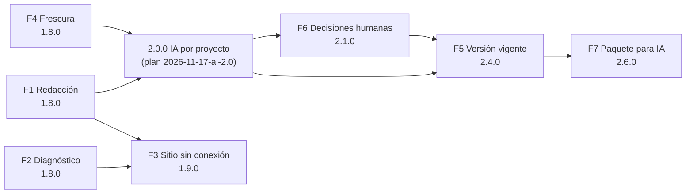

# PLAN + AUDIT_PLAN — Ejes adicionales (facetas) en el manifiesto de taxonomía (2026-11-17)

> **Fusionado en una única versión 2.0.0 (decisión del mantenedor, 2026-11-17)**. Este plan queda como **antecedente
> de diseño** (facetas §1-§5b con sus auditorías, y F1-F7 en §8). Las versiones 1.7.0-1.9.0 y 2.1.0-2.6.0, el §8.0 y
> las fases de §9 quedan **anuladas**: manda el plan único
> [`../2026-11-17-ai-2.0/PLAN.md`](../2026-11-17-ai-2.0/PLAN.md). Allí las facetas son **ejes** (`TaxonomyAxis`,
> `AxisValue`) y no existen `TaxonomyFacet` ni `FacetValue`.

Skill: `new-feature`. Solo PLAN y AUDIT_PLAN; sin implementar. Versión objetivo: **doc_organize 1.7.0** (MINOR,
compatible hacia atrás).

> **Decisiones del mantenedor (2026-11-17)**: D1 sí (formato implícito además del explícito); D2 sí (facetas con IA en
> 1.7.0), **ampliada**: la IA rellena también las facetas de los documentos ya clasificados por reglas (§4b); D3 fuera de
> 1.7.0 (su AUDIT_PLAN al final); **D4 sí**: Excel de los documentos del contexto (§5b). La auditoría independiente
> del final cambia la puntuación de las facetas (§3) y el alcance de la IA (§4) y del Excel (§5): manda sobre el cuerpo
> donde lo contradiga.
>
> **Añadido (2026-11-17)**: §4c, rendimiento de la construcción del contexto (llamadas a la IA en paralelo y un solo
> `.json` leído por documento), con su AUDIT_PLAN al final (condiciones 11-15).
>
> **Añadido (2026-11-17)**: §8, hoja de ruta **1.8.0 – 1.13.0** con capacidades traídas de doc_ia (redacción de
> credenciales, diagnóstico del entorno, sitio sin conexión, frescura del contexto, versión vigente, decisiones
> humanas y paquete de contexto para IA), por fases, cada una con su parte de librería y de web y su AUDIT_PLAN. No
> cambia el alcance de 1.7.0 salvo el ajuste §8.0.
>
> **Decisiones del mantenedor sobre §8 (2026-11-17)**: §8.0 **aplicado** en §2 (`FacetValue.classified_by` admite
> `"human"`); **D7 sí** (redacción de lo que se envía a la IA activada por defecto); **D8 sí** (`versions="mark"` por
> defecto en la web); **D9**: se mantienen todas las fases y su orden; **D6**: (a) neutralizar el HTML en la copia del
> sitio sin conexión, obligatoria, + (b) CSP en `<meta>`, condicionada al spike de F3.
>
> **Decisión del mantenedor (2026-11-17): se acepta doc_organize 2.0.0** (IA ajustada a cada proyecto, con ruptura;
> plan propio en [`../2026-11-17-ai-2.0/PLAN.md`](../2026-11-17-ai-2.0/PLAN.md)). Consecuencias en este plan, que
> **mandan sobre el cuerpo**:
>
> - **1.7.0 queda en facetas por reglas** (§1-§3), sitio (§5), Excel (§5b) y rendimiento (§4c). **§4 y §4b (facetas
>   con IA) pasan a 2.0.0**, donde dominio, tipo de material y facetas son ejes genéricos clasificados en una sola
>   llamada: hacerlo ahora sobre los clientes actuales sería trabajo que 2.0 tira. D2 queda sustituida.
> - **D5 (reintento ante 429) entra en 1.7.0** en `_http_client_base` (lo pide `ai_concurrency` de §4c); 2.0 lo
>   hereda en el cliente único.
> - **§8 reordenado** (§9): F1, F2 y F4 en 1.8.0; F3 en 1.9.0; F6 (2.1.0), F5 (2.4.0) y F7 (2.6.0) pasan a 2.x
>   porque trabajan sobre los ejes genéricos. Se mantienen **todas** las fases (D9); solo cambia el orden donde la
>   2.0 lo obliga.
> - Fases de implementación de 1.7.0 – 1.9.0 en §9 y AUDIT_PLAN independiente del plan actualizado en §10.

## Origen

En doc_organize_web, la plantilla `taxonomia-multi-dimensional-normas-gobernanza-2` (proyecto CALIDAD_VD) declara cinco
ejes en el front matter:

| Clave | Eje | Entradas |
|---|---|---|
| `domains` | Dominios funcionales | 8 |
| `management_system` | Sistema de gestión | 6 |
| `normative_frameworks` | Marcos normativos (`iso-27001`, `ens`, `rgpd`…) | 10 |
| `material_types` | Tipos de material | 10 |
| `evidence` | Evidencias de cumplimiento (opcional) | 4 |

`TaxonomyManifest` (`core/models.py:1157`) solo tiene `title`, `description`, `domains` y `material_types`, y Pydantic
ignora las demás claves **sin avisar**. El contexto se construye solo con dominio y tipo de material: el Eje 3 «Marcos
normativos» nunca aparece. Comprobado cargando la plantilla con `parse_taxonomy_template` en 1.6.0.

## Inputs

| Campo | Valor |
|---|---|
| Objetivo | Que un manifiesto o una plantilla declare **ejes adicionales** («facetas»: marco normativo, sistema de gestión, evidencia…) y que `ContextBuilder` clasifique cada documento en ellos, además de en dominio y tipo de material. Y que una clave que no se usa deje de ignorarse en silencio |
| Módulos | `core/models.py` (`TaxonomyFacet`, `FacetValue`, `TaxonomyManifest.facets`, `DomainDocument.facets`, `UnclassifiedDocument.facets`, `Context.taxonomy_facets`); `context/taxonomy_templates.py` y `taxonomy_manifest.py` (lectura del front matter y avisos); `context/domain_classifier.py` (`score_catalog_all`, `FacetClassifier`); `context/context_builder.py` (`_classify_with_manifest` y `_classify_with_manifest_ai`); `ai/taxonomy_classification_client.py` y `core/models.py` (`TaxonomyClassificationResult.facets`); `context/site_generator.py` (páginas por faceta); `export/xlsx_export.py` (columnas de facetas); `context/context_history.py` (cambios de faceta, opcional); `docs/api/context.md`, `docs/functional/context.md`, `CHANGELOG.md`, `zensical.toml` |
| API pública | Nuevos: `TaxonomyFacet`, `FacetValue`, `TaxonomyManifest.facets`, `DomainDocument.facets`, `UnclassifiedDocument.facets`, `Context.taxonomy_facets`, `TaxonomyClassificationResult.facets`, `inspect_taxonomy_front_matter(text) -> TaxonomyFrontMatterReport`, `ContextBuilder(..., ai_concurrency=1)` (§4c). Sin cambios de firma en `ContextBuilder.build` ni en los clientes (la IA recibe las facetas por un argumento opcional nuevo) |
| Contrato de entrada | Front matter YAML del manifiesto o la plantilla, con un bloque `facets:` (formato explícito) o con claves de nivel superior que sean listas de entradas (formato implícito, el de la plantilla actual) |
| Contrato de salida | Cada `DomainDocument` (y cada `UnclassifiedDocument`) lleva `facets: dict[clave, list[FacetValue]]`; `Context.taxonomy_facets` describe las facetas usadas. Un manifiesto sin facetas produce exactamente el `context.json` de 1.6.0 (más `taxonomy_facets: []` y `facets: {}`) |
| Reglas de negocio | Las facetas **no** cambian carpetas ni dominios: la reorganización sigue siendo dominio/tipo de material. Una faceta puede ser **de varios valores** (un documento puede aplicar ISO 27001 y ENS a la vez) o de uno. No se inventan valores: solo entradas del catálogo de la faceta, con umbral. Determinista sin IA |
| Restricciones técnicas | Sin dependencias nuevas. Async como el resto de `ContextBuilder`. Python 3.12-3.14 |
| Formatos afectados | `taxonomy_manifest.md` y plantillas (lectura), `context.json` (escritura), sitio Zensical, Excel del contexto |
| Ficheros existentes | Sí: los citados; plantilla real en el scratchpad de la sesión para el test de aceptación |

## PLAN

### 1. Formato del front matter

**Explícito** (recomendado para plantillas nuevas):

```yaml
facets:
  normative_frameworks:
    name: Marcos normativos
    multiple: true          # por defecto true
    threshold: 0.5          # opcional; por defecto, el umbral de la construcción
    entries:
      - slug: iso-27001
        name: ISO/IEC 27001
        keywords: [27001, SGSI, anexo A]
```

**Implícito** (compatibilidad con plantillas como la de CALIDAD_VD): una clave de nivel superior distinta de `title`,
`description`, `domains`, `material_types` y `facets`, cuyo valor sea una lista de entradas `{slug, name, …}`, se lee
como faceta con `name` derivado de la clave (`normative_frameworks` → «Normative frameworks»), `multiple: true` y el
umbral de la construcción. **Decisión pendiente del mantenedor (D1)**: aceptar el formato implícito o exigir el
explícito.

**Avisos**: `inspect_taxonomy_front_matter(text)` devuelve `TaxonomyFrontMatterReport` con:
- `facets`: las que se leerán (explícitas e implícitas);
- `ignored_keys`: claves que no se usan (no son lista de entradas ni conocidas), para que la web lo muestre al guardar;
- `implicit_facets`: las leídas por el formato implícito, para sugerir el explícito.

No lanza por claves desconocidas (no rompe plantillas existentes).

**Límites**: como mucho 8 facetas por manifiesto, 100 entradas por faceta y claves `^[a-z][a-z0-9_]{0,40}$` (también
nombre de columna en el Excel y segmento de URL en el sitio). Fuera de límites: `TaxonomyManifestError` con mensaje
claro.

### 2. Modelos

```python
class TaxonomyFacet(BaseModel):
    key: str                       # "normative_frameworks"
    name: str                      # "Marcos normativos"
    multiple: bool = True
    threshold: float | None = None # None = el de la construcción
    entries: list[TaxonomyCatalogEntry]   # min_length=1

class FacetValue(BaseModel):
    slug: str
    name: str
    confidence: float              # 0-1
    classified_by: Literal["rules", "ai", "human"]  # "human" reservado para F6 (1.12.0), sin uso en 1.7.0 (§8.0)

TaxonomyManifest.facets: list[TaxonomyFacet] = []
DomainDocument.facets: dict[str, list[FacetValue]] = {}
UnclassifiedDocument.facets: dict[str, list[FacetValue]] = {}
Context.taxonomy_facets: list[TaxonomyFacet] = []   # sin keywords, para no inflar context.json
TaxonomyClassificationResult.facets: dict[str, list[FacetValue]] = {}
```

Todo con valor por defecto: un `context.json` de 1.6.0 se carga sin cambios.

### 3. Clasificación por reglas

- `score_catalog_all(catalog, haystack, folder_slug, extra_keywords)` devuelve la puntuación de **cada** entrada, con el
  mismo criterio que `score_catalog` (palabras del slug y `keywords` en título y contenido, más la carpeta).
  `score_catalog` pasa a usarla y se queda con la mejor, sin cambiar su resultado (test de regresión).
- `FacetClassifier(facet, threshold)`:
  - `multiple=True`: todas las entradas con puntuación ≥ umbral, ordenadas de mayor a menor, como mucho 5;
  - `multiple=False`: la mejor si llega al umbral.
- `_classify_with_manifest` calcula las facetas de cada documento clasificado **y de los sin clasificar por umbral**
  (tienen texto). Un documento con artefactos incompletos no tiene facetas.
- Coste: una pasada más de puntuación por faceta sobre el texto ya leído; sin E/S extra.

### 4. Clasificación con IA (Sub-fase B)

> **Movido a 2.0.0 (decisión 2026-11-17)**: se conserva como antecedente; el diseño vigente es la clasificación de
> ejes con IA de [`../2026-11-17-ai-2.0/PLAN.md`](../2026-11-17-ai-2.0/PLAN.md) §G1.4. En 1.7.0 la Sub-fase B no
> cambia: las facetas solo las asignan las reglas.

- `TaxonomyClassificationClient.classify(..., candidate_facets: dict[str, FacetSpec] | None = None)`: el prompt añade
  cada faceta con sus slugs y si admite varios valores; el JSON de respuesta gana `"facets": {"clave": ["slug", …]}` con
  confianza por valor.
- **Solo se rellena lo que las reglas dejaron vacío**, con el mismo criterio que hoy dominio y tipo de material: la IA no
  sustituye una faceta que las reglas ya asignaron.
- Valores fuera del catálogo se descartan (validación en el cliente, como hoy con `domain`).
- **Decisión pendiente (D2)**: incluir la IA en 1.7.0 o dejarla para 1.8.0. Recomendación: incluirla, porque es una
  extensión de la llamada que ya existe; sin ella, los documentos que las reglas no reconocen se quedan sin marco
  normativo.

### 4b. Facetas con IA para los documentos clasificados por reglas (D2 ampliada)

> **Movido a 2.0.0 (decisión 2026-11-17)**: en 2.0 es el alcance `ai_scope="missing_axes"` de la clasificación de
> ejes ([`../2026-11-17-ai-2.0/PLAN.md`](../2026-11-17-ai-2.0/PLAN.md) §G1.4). Sus riesgos E1-E5 se trasladan allí.

La Sub-fase B solo envía a la IA los documentos **sin dominio** (C5). Para los que las reglas sí clasificaron, se añade
una **fase propia**, como el enriquecimiento de 1.5.0:

- **Activación**: `ContextBuilder.build(..., ai_facets_enabled: bool = False, ai_facets_client:
  TaxonomyClassificationClient | None = None)`. Opt-in explícito, se guarda en `Context.ai_facets_enabled`. Mismo
  cliente y misma familia que la clasificación de taxonomía (`LiteLLMTaxonomyClassificationConfig`): no hace falta
  configuración nueva.
- **Qué documentos**: los clasificados (por reglas o por la Sub-fase B) a los que les falte **alguna** faceta, contando
  también las de `rules: false` (C8). Los que ya pasaron por la Sub-fase B con facetas no se repiten.
- **Llamada**: `TaxonomyClassificationClient.classify_facets(*, chunks_text, title, candidate_facets)`, método nuevo que
  pide **solo** las facetas (sin dominio ni tipo de material): prompt más corto y la clasificación ya hecha no se toca.
  Solo se envían las facetas que le faltan a ese documento.
- **Qué rellena**: solo las facetas vacías (nunca sustituye lo de las reglas), con `classified_by="ai"`; valores fuera
  del catálogo descartados.
- **Presupuesto y cortes**: los mismos `ai_max_failures` y `ai_max_documents` que la Sub-fase B, con **su propio
  recuento** (cada fase puede enviar hasta `ai_max_documents`), como el enriquecimiento. Al detenerse, el resto queda
  solo con las facetas de las reglas.
- **Estadísticas** en `Context`: `ai_facets_enabled`, `ai_facets_sent`, `ai_facets_applied`, `ai_facets_failed` y
  `ai_facets_stopped` (`AiClassificationStopReason`).
- **Progreso**: fase nueva `context_facets` en `ProgressEvent.phase`, después de la Sub-fase B y antes del
  enriquecimiento; `CancelToken` atendido entre documentos.
- **Concurrencia**: la de §4c (`ai_concurrency`); con el valor por defecto, secuencial como la Sub-fase B de 1.6.0.
- **Para la web**: casilla «Completar las facetas con IA» al construir, con el mismo aviso de que el contenido sale de la
  aplicación, y sus recuentos en el resultado del run.

### 4c. Rendimiento de la construcción del contexto (añadido 2026-11-17)

Análisis de 1.6.0: la construcción **no usa GPU** (no hay nada que la aproveche: py3langid es un modelo pequeño en
CPU y el resto es leer ficheros y hacer llamadas HTTP). La GPU solo cuenta en el escaneo con OCR (`use_gpu`). El
tiempo se va en **esperar** (llamadas a la IA una a una, lecturas en carpetas de red), no en cálculo, así que la mejora
es concurrencia con async/hilos, **no procesos**.

**a) Llamadas a la IA en paralelo**

- `ContextBuilder(..., ai_concurrency: int = 1)`, junto a `properties_concurrency` (constructor, no `build`). `1` =
  secuencial, idéntico a 1.6.0; la web puede pasar 4. `ValueError` si es menor que 1.
- Se aplica a **todas** las fases con IA de 1.7.0: Sub-fase B (`_classify_with_ai` y `_classify_with_manifest_ai`) y
  enriquecimiento (§4b pasa a 2.0.0). Reutiliza `_for_each_bounded`, generalizado para recibir el límite.
- **Presupuesto** (`ai_max_documents`): se reserva al **despachar** cada documento, nunca se envían más que el límite.
- **Corte por errores** (`ai_max_failures`): al alcanzarse, no se despachan más; las llamadas en vuelo terminan y sus
  resultados se aplican. Puede haber hasta `ai_concurrency - 1` fallos por encima del límite: documentado.
- **Determinismo**: el resultado de cada documento se guarda en su sitio y las listas de `classified` se rehacen en el
  orden original, no en el de llegada: el `context.json` es el mismo con 1 y con 4.
- **Progreso**: `index` = documentos terminados (monótono), en orden de llegada; `total` sin cambios.
- **Cancelación**: `checkpoint` antes de despachar cada documento; lo terminado se conserva (como hoy).
- Contadores de `_AiRun` y estadísticas en `Context`: sin carreras (un solo bucle de eventos, sin `await` entre leer y
  escribir el contador).

**b) Un `.json` de conversión leído una sola vez para reglas, idioma y sin clasificar**

- Hoy, en una construcción, el mismo `.json` se lee hasta 4 veces: al clasificar (`DomainClassifier.classify` o
  `_classify_with_manifest`), al describir los sin clasificar, al detectar el idioma (`_apply_document_properties`) y
  otra por cada fase de IA a la que va.
- Se calcula en la **primera lectura** todo lo que no es IA: dominio/tipo, facetas por reglas (§3), idioma y, para los
  sin clasificar, la propuesta de las reglas. Se guarda por `json_path` solo el **resultado** (idioma, título), no el
  texto, para no tener en memoria el texto de 2600 documentos.
- Las fases de IA siguen leyendo el `.json` de los documentos que envían (son pocos y la llamada pesa mucho más).
- La lectura de los `.json` al clasificar pasa a hacerse con `_for_each_bounded` (`properties_concurrency` a la vez),
  como las propiedades en 1.6.0: en carpetas de red es la misma ganancia.

**Descartado**

- **GPU**: nada que acelerar.
- **Procesos (`ProcessPoolExecutor`)**: la parte de CPU (puntuar, detectar idioma) es pequeña; pasar el texto entre
  procesos cuesta más que lo que se gana, y PDFium está bajo un bloqueo global del proceso
  (`document_properties.py`).
- **Subir `properties_concurrency` por defecto**: 4 se queda; con muchos PDF el bloqueo de PDFium limita igualmente.

**Medición** (en la sesión, antes y después): corpus de los tests de rendimiento, en local y en una carpeta de red;
construcción sin IA y con IA contra un servidor falso con 500 ms de latencia. Objetivos: sin IA, −30 % o más en red;
con IA y `ai_concurrency=4`, ≥ 2,5× más rápido en las fases de IA.

### 5. Salidas

- **`context.json`**: `Context.taxonomy_facets` y `facets` en cada documento.
- **Sitio Zensical**: por cada faceta, una sección «Por <faceta>» con una página por valor que lista los documentos
  (enlazando a sus páginas). Las páginas de dominio muestran las facetas de cada documento en su ficha. Sin facetas, el
  sitio es idéntico al de 1.6.0 (test de comparación).
- **Reorganización**: sin cambios (carpetas por dominio/tipo de material). Documentado.
- **Excel**: exportación nueva de los documentos del contexto (§5b).
- **Historial del contexto**: sin cambios en 1.7.0 (solo dominio y tipo de material). Anotado como mejora (D3).

### 5b. Excel de los documentos del contexto (D4)

- `write_context_documents_xlsx(destination, context, *, on_progress=None, cancel_token=None) -> int`, en
  `export/xlsx_export.py`, con el mismo `_write_workbook` (progreso, cancelación y borrado del parcial) y `_excel_safe`
  (anti-inyección de fórmulas) que las demás exportaciones.
- **Hoja «Documentos»**, una fila por documento:
  - clasificados: carpeta, nombre y ruta del original (`_file_columns`), título, tipo de documento, dominio (slug y
    nombre), tipo de material (slug y nombre), confianza del dominio, quién lo clasificó (reglas o IA), autor, idioma,
    palabras clave;
  - **una columna por faceta** (en el orden de `Context.taxonomy_facets`), con los nombres de los valores separados por
    «; »;
  - sin clasificar (`unclassified_details`): las mismas columnas, con el dominio vacío y su motivo.
- **Hoja «Facetas»**: una fila por faceta y valor, con el nº de documentos de cada uno; sirve para revisar de un vistazo
  si una faceta etiqueta de más (F2).
- Sin facetas, la hoja «Documentos» no tiene esas columnas y la hoja «Facetas» queda vacía con su cabecera.
- `MissingDependencyError` sin el extra `export`, como el resto. Doctest como las demás.
- **Para la web**: una opción más en la exportación del proyecto («Excel del contexto»).

### 6. Compatibilidad y versión

- MINOR **1.7.0**: todo campo nuevo con valor por defecto; `context.json` de 1.6.0 se lee; manifiestos sin facetas
  producen el mismo resultado de clasificación.
- Mensaje para consumidores (doc_organize_web): nuevas columnas o JSON para guardar `facets`, filtros por faceta, y el
  aviso de `ignored_keys` al guardar una plantilla.

### 7. Tests

- **Modelos**: carga de `context.json` de 1.6.0; serialización con facetas.
- **Lectura**: formato explícito, implícito (la plantilla real de CALIDAD_VD lee sus 3 facetas), mezcla de los dos,
  claves ignoradas en `ignored_keys`, límites (9 facetas, 101 entradas, clave inválida) con mensaje.
- **Reglas**: `score_catalog` sin cambios (regresión con los catálogos de los tests actuales); faceta múltiple devuelve
  varios valores ordenados y como mucho 5; faceta simple solo el mejor; umbral por faceta.
- **Builder**: facetas en clasificados y en sin clasificar por umbral; ninguna en incompletos; sin facetas, el
  `context.json` es igual al de 1.6.0 salvo los campos vacíos nuevos.
- **IA**: el prompt incluye las facetas; la respuesta rellena solo lo vacío; valores fuera del catálogo descartados;
  JSON sin `facets` (modelo antiguo) no rompe.
- **Sitio**: páginas «Por <faceta>»; sin facetas, mismo árbol que 1.6.0.
- **Facetas con IA para clasificados (§4b)**: solo se envían documentos con facetas vacías y solo esas facetas; nunca
  sustituye lo de las reglas; presupuesto y corte por errores propios; cancelación entre documentos; estadísticas en
  `Context`; desactivado por defecto (sin llamadas).
- **Excel (§5b)**: columnas por faceta en el orden de `taxonomy_facets`; filas de sin clasificar con su motivo; hoja
  «Facetas» con recuentos; celdas con `=`, `+`, `-` o `@` neutralizadas; cancelación borra el parcial.
- **Rendimiento (§4c)**: `ai_concurrency=1` produce las mismas llamadas, en el mismo orden, que 1.6.0; con 4, el
  `context.json` es idéntico al de 1 (cliente falso con latencias aleatorias); nunca más de `ai_concurrency` llamadas
  a la vez; `ai_max_documents` nunca se supera; corte por `ai_max_failures` sin despachar más; cancelación con llamadas
  en vuelo; progreso monótono; `ValueError` con 0; cada `.json` se lee una sola vez sin IA (contador sobre
  `read_conversion_json`); idioma y propuesta de reglas iguales a 1.6.0.
- **Aceptación**: la plantilla de CALIDAD_VD con un corpus pequeño de ejemplo clasifica `iso-27001` y `ens` en un
  documento que menciona las dos.

## AUDIT_PLAN

### Riesgos funcionales

| # | Riesgo | Mitigación |
|---|---|---|
| F1 | El formato implícito convierte en faceta una clave que el autor puso para otra cosa (p. ej. una lista de `references` con `slug` y `name`) | Solo listas cuyos elementos tienen `slug` y `name`; `implicit_facets` en el informe para que la web lo muestre y el autor confirme; D1 permite exigir el explícito |
| F2 | Facetas de varios valores con palabras clave genéricas («seguridad») asignan muchos valores a casi todo | Umbral por faceta, máximo 5 valores por documento y palabras clave específicas en la guía; las confianzas quedan en el resultado para revisarlas |
| F3 | El usuario espera que las facetas creen carpetas o dominios | Documentado: solo etiquetan; la reorganización no cambia |
| F4 | `context.json` crece con muchas facetas | `taxonomy_facets` sin `keywords`; `FacetValue` compacto; medir con 2600 documentos × 3 facetas (objetivo: < +30 %) |
| F5 | El historial no registra cambios de faceta | Aceptado en 1.7.0 (D3) |

### Riesgos técnicos

| # | Riesgo | Mitigación |
|---|---|---|
| T1 | Cambiar `score_catalog` altera la clasificación actual | `score_catalog_all` nueva; `score_catalog` se reescribe sobre ella con test de regresión de resultados idénticos |
| T2 | Prompt de IA más largo: más tokens y respuestas peor formadas | Solo slugs de las facetas (sin descripciones), un aviso de tamaño en el log; validación estricta y JSON sin `facets` aceptado |
| T3 | Rendimiento: más puntuaciones por documento | Sin E/S extra; medir con el corpus de los tests de rendimiento (objetivo: < +10 % en clasificación) |
| T4 | LSP/ISP: `TaxonomyClassificationClient.classify` gana un argumento | Opcional con valor por defecto; las llamadas actuales no cambian |
| T5 | Consumidores con modelos estrictos (`extra="forbid"`) al leer `context.json` | La web lee con los modelos de la librería; documentado en el CHANGELOG |

### Riesgos de seguridad

| # | Riesgo | Mitigación |
|---|---|---|
| S1 | Claves de faceta usadas como segmento de URL en el sitio o nombre de columna | Patrón `^[a-z][a-z0-9_]{0,40}$` y slugs saneados con `_slugify`, como los dominios |
| S2 | YAML malicioso (muchas facetas o entradas para agotar memoria) | Límites de 8 facetas y 100 entradas, más el tamaño máximo que ya aplica la web (256 KB) |
| S3 | Inyección en el prompt desde nombres de entradas | Solo se envían slugs saneados, no nombres ni descripciones |

### Simplificaciones posibles

- **Solo formato explícito** (D1 = no): menos ambigüedad, pero la plantilla de CALIDAD_VD hay que reescribirla.
- **Sin IA en 1.7.0** (D2): menos riesgo; las facetas solo por reglas.
- **Sin sitio**: solo `context.json` y Excel; la web las mostraría igualmente. Ahorra la parte más grande de la salida.

### Veredicto: **GO_CONDICIONAL**

Condiciones:

1. D1 (formato implícito), D2 (IA en 1.7.0) y D3 (historial) decididos por el mantenedor antes de implementar.
2. T1: `score_catalog` con resultados idénticos a 1.6.0 (test de regresión).
3. Sin facetas, el `context.json` y el sitio son los de 1.6.0 salvo los campos nuevos vacíos.
4. Test de aceptación con la plantilla real de CALIDAD_VD.
5. Límites de facetas y entradas con mensajes claros (S2).

---

## AUDIT_PLAN de D3: cambios de faceta en el historial del contexto

**Hoy**: `diff_contexts` (`context/context_history.py`) compara por documento `(dominio, tipo de material)`;
`ContextChange` tiene `previous_domain`/`domain` y `previous_material_type`/`material_type`; la web lo guarda en su API
(`ContextChangeOut`) y en el Excel del historial (`_context_change_row`).

| Aspecto | Incluirlo en 1.7.0 | Dejarlo fuera |
|---|---|---|
| Modelo | `ContextChange.previous_facets`/`facets` (`dict[str, list[str]]`) y un tipo de cambio nuevo o `reclassified` también por faceta | Sin cambios |
| Ruido | Las facetas de varios valores cerca del umbral cambian a menudo entre construcciones (un documento gana o pierde «ISO 9001» por una palabra): el historial se llenaría de «cambios» que no lo son | — |
| Tamaño | Cada cambio lleva sus facetas; el historial gira a los 5 MB y llegaría antes | — |
| Consumidores | La web tendría que ampliar `ContextChangeOut`, la página del historial y el Excel en la misma versión | Nada que adaptar |
| Valor | Saber cuándo un documento ganó o perdió un marco normativo | Se ve comparando el contexto actual; lo básico (entra, sale, cambia de dominio o tipo) sigue igual |

**Recomendación: dejarlo fuera de 1.7.0** y retomarlo cuando las facetas lleven un tiempo en uso y se sepa cuánto
varían. Si se incluye más adelante, solo contar como cambio la **entrada o salida** de un valor con confianza alta, no
las oscilaciones junto al umbral. Veredicto de D3: **NO_GO para 1.7.0**, GO para revisarlo en 1.8.0 con datos reales.

---

## AUDIT_PLAN independiente del plan (2026-11-17)

Contrastado con `context/domain_classifier.py` (`score_catalog`), `context_builder.py`, `ai/taxonomy_classification_client.py`,
`context/site_generator.py`, `export/xlsx_export.py` y la plantilla real de CALIDAD_VD, puntuada con la función de 1.6.0.

### Prueba con la plantilla real

| Texto | Puntuaciones de `normative_frameworks` con `score_catalog` |
|---|---|
| «Política de calidad ISO 9001 del departamento» | `iso-9001` 0,60 · `iso-20000` 0,40 · `iso-22301` 0,20 · `iso-14001` 0,20 · `iso-27001` 0,17 |
| «Procedimiento de ensayos sensibles de laboratorio» | **`ens` 0,40** · `lssi-ce` 0,20 |
| «Declaración de aplicabilidad del SGSI conforme a ISO/IEC 27001 y al Esquema Nacional de Seguridad» | `iso-27001` 0,67 · **`ens` 0,20** · todas las ISO 0,20 |

### Hallazgos

| # | Gravedad | Hallazgo | Corrección |
|---|---|---|---|
| C1 | **Alta** | `score_catalog` busca **subcadenas**: «ens» encaja en «ensayos» y «sensibles» (0,40 sin hablar del ENS) | Las facetas no reutilizan `score_catalog`: puntúan por **palabra o frase completa** (límites de palabra tras plegar acentos y mayúsculas) |
| C2 | **Alta** | La puntuación es **aciertos / nº de palabras**: añadir palabras clave **baja** la nota. El documento del ENS da 0,20 a `ens` (1 de 5) y no pasa el umbral | Para facetas, una entrada encaja si aparece **alguno** de sus términos discriminantes; la confianza crece con los términos distintos encontrados (1 → 0,6; 2 → 0,8; 3+ → 1,0), no se divide por el total |
| C3 | **Alta** | Términos **compartidos** entre entradas de la misma faceta («iso», «seguridad», «gestión») reparten puntos a todas: cualquier documento ISO puntúa en las cinco ISO | Términos que aparecen en dos o más entradas de la faceta no cuentan como discriminantes (se calculan al cargar el manifiesto). El slug cuenta como frase completa («iso 27001», «27001»), no por palabras sueltas |
| C4 | Media | La plantilla real define `ens` con `keywords: [ENS, españa, seguridad, administración pública]` y sin «Esquema Nacional de Seguridad»: con C1-C3 seguiría sin reconocerlo | Documentar en la guía cómo escribir buenas palabras clave para facetas (frases propias, siglas); el test de aceptación usa la plantilla corregida además de la original, y comprueba que la original **no** produce falsos positivos |
| C5 | **Alta** | La IA (Sub-fase B) solo recibe los documentos que las reglas dejan **sin dominio**. «La IA rellena las facetas que las reglas dejaron vacías» no se cumple para los documentos clasificados por reglas sin facetas, salvo con llamadas nuevas (coste) | Alcance de D2: las facetas por IA solo en los documentos que **ya** van a la IA (sin llamadas extra ni presupuesto nuevo). Documentado. Rellenar facetas de los clasificados por reglas sería otra opción (`ai_facets_for_classified`, con su propio presupuesto) para 1.8.0 |
| C6 | Media | El plan da por hecha una «hoja de documentos del contexto» en el Excel: **no existe**. La librería solo exporta caché, errores de escaneo e historial del contexto | Fuera de 1.7.0, o una exportación nueva `write_context_documents_xlsx` (documento, dominio, tipo, facetas) si el mantenedor la quiere: decisión D4 |
| C7 | Media | El sitio escapa los nombres de dominio porque Zensical no filtra el HTML incrustado (`_render_index`); el plan no lo dice para los nombres de faceta y de sus valores | Escapar nombres de faceta y de valores igual que los de dominio; test con un nombre con HTML |
| C8 | Media | La faceta implícita `evidence` («solo cuando el documento demuestra prueba objetiva») no es reconocible por palabras: se etiquetarían como evidencia documentos que solo hablan de evidencias | Umbral por faceta (`threshold`) y, en la guía, recomendar `multiple: false` y un umbral alto para facetas de este tipo, o dejarlas solo a la IA (`rules: false`, opción nueva de faceta) |
| C9 | Baja | `TaxonomyManifestDraftClient` (borrador con IA) no propone facetas | Aceptable en 1.7.0; anotado |
| C10 | Baja | En modo sin manifiesto (`discover`, `domains`) no hay facetas | Correcto: `facets` vacío; documentado |

### Cambios en el plan

- **§3 Clasificación por reglas**: sustituir «`score_catalog_all` con el mismo criterio que `score_catalog`» por un
  **puntuador propio de facetas** (`FacetScorer`): términos = slug como frase, slug sin prefijo compartido (`27001`),
  `keywords` y nombre; búsqueda por palabra completa con acentos plegados; términos compartidos entre entradas
  descartados; confianza por nº de términos distintos encontrados. `score_catalog` no se toca (T1 desaparece como
  riesgo).
- **§4 IA**: alcance de C5.
- **§5 Excel**: según D4.
- **§1 Formato**: opción `rules: false` por faceta (C8).

### Veredicto: **GO_CONDICIONAL**

Condiciones (sustituyen a las del primer AUDIT_PLAN):

1. C1-C3: puntuador de facetas por palabra completa, sin dividir por el nº de términos y sin términos compartidos, con
   tests que reproducen la tabla de arriba: «ensayos sensibles» no da `ens`; «ISO 9001» no da las otras ISO;
   «Esquema Nacional de Seguridad» da `ens` con la plantilla corregida.
2. C5: facetas por IA solo en los documentos que ya van a la IA; documentado.
3. C7: nombres de faceta y valores escapados en el sitio, con test.
4. D4 (Excel de documentos del contexto) decidido por el mantenedor.
5. Sin facetas, `context.json` y el sitio son los de 1.6.0 salvo los campos nuevos vacíos.
6. Límites de facetas, entradas y claves con mensajes claros (S2).
7. D3 fuera de 1.7.0.

---

## AUDIT_PLAN de las ampliaciones (§4b y §5b, 2026-11-17)

| # | Gravedad | Riesgo | Mitigación |
|---|---|---|---|
| E1 | **Alta** | **Coste y tiempo**: con 2600 documentos clasificados, la fase §4b puede enviar hasta `ai_max_documents` documentos más (hoy 500 por defecto en la web) | Opt-in explícito, presupuesto propio, solo documentos con facetas vacías y solo esas facetas; los recuentos en el resultado. La guía avisa del coste |
| E2 | **Alta** | **Privacidad**: más contenido sale de la aplicación (el de documentos que antes no iban a la IA) | Mismo aviso que la Sub-fase B y el enriquecimiento; desactivado por defecto; registrado en `Context.ai_facets_enabled` y en la auditoría de la web |
| E3 | Media | Facetas con palabras clave genéricas dejan muchos documentos con facetas «vacías» que no lo son (la faceta no aplica): la IA recibe documentos de más | La IA puede responder «ninguno» y el documento no se vuelve a enviar en esa construcción; la guía recomienda revisar en la hoja «Facetas» del Excel antes de activar la IA |
| E4 | Media | Una faceta `multiple: true` vacía por reglas y que la IA rellena con varios valores de baja confianza | Umbral de la faceta también para las confianzas de la IA; como mucho 5 valores |
| E5 | Media | Orden de fases: si el enriquecimiento va antes, consume su presupuesto aparte; si va después, la cancelación puede dejar facetas a medias | Orden fijo Sub-fase B → facetas → enriquecimiento, cada una con su recuento; la cancelación conserva lo hecho (como hoy) |
| E6 | Baja | Excel con muchas facetas y documentos (2600 × 8 columnas) | `openpyxl` en modo de escritura en flujo, como las demás exportaciones; medir con 2600 documentos |
| E7 | Baja | Fórmulas en celdas (nombres de valores o títulos que empiezan por `=`) | `_excel_safe` en todas las celdas de texto, como hoy |
| E8 | Baja | LSP/ISP: `ContextBuilder.build` y `TaxonomyClassificationClient` ganan parámetros y un método | Todos opcionales; `classify` no cambia; `classify_facets` es un método nuevo del mismo cliente (misma responsabilidad: clasificar en la taxonomía) |

### Veredicto: **GO_CONDICIONAL**

Condiciones añadidas a las 7 anteriores:

8. E1 y E2: §4b desactivada por defecto, con presupuesto propio y estadísticas en `Context`; tests de que con ella
   desactivada no hay llamadas.
9. §4b nunca sustituye facetas de las reglas y solo envía las vacías (test).
10. §5b con `_excel_safe`, progreso y cancelación como las demás exportaciones (tests, incluido el de fórmulas).

---

## AUDIT_PLAN de §4c: rendimiento de la construcción (2026-11-17)

| # | Gravedad | Riesgo | Mitigación |
|---|---|---|---|
| R1 | **Alta** | **Límites del proveedor (429)**: con varias llamadas a la vez aparecen respuestas 429. Hoy `_http_client_base` no reintenta ninguna respuesta HTTP (L-3b) y `_AiRun.record_failure` trata el 429 como error genérico: suma a `failed`, **no** cuenta para `ai_max_failures` y la fase sigue. Fallo **silencioso**: esos documentos se quedan sin lo que aporta la IA y solo se ve en los recuentos | `ai_concurrency=1` por defecto; la guía recomienda 2-4. **Decisión pendiente (D5)**: reintento ante 429/503 en `_http_client_base` (respetar `Retry-After`, si no espera doble en cada intento con tope, espera compartida entre llamadas en vuelo) en 1.7.0 — recomendado, porque sin él el paralelismo puede perder documentos sin aviso — o en 1.8.0 |
| R2 | **Alta** | **Resultado distinto según el orden de llegada** (listas de `classified`, `organized_path`, historial con «cambios» falsos) | Resultados por documento y listas rehechas en el orden original; test de `context.json` idéntico con 1 y 4 y latencias aleatorias |
| R3 | Media | `ai_max_failures` se supera hasta en `ai_concurrency - 1` | Documentado; el motivo de corte (`AiClassificationStopReason`) no cambia |
| R4 | Media | Cancelación con llamadas en vuelo: se pierde su resultado o se aplica a medias | `TaskGroup` cancela las tareas; un resultado solo se aplica completo tras la respuesta; test |
| R5 | Media | Cambiar el orden de lectura del `.json` (§4c b) altera idioma o propuesta de reglas | Mismas funciones (`detect_language`, `score_domain`) sobre el mismo texto; test de regresión contra 1.6.0 |
| R6 | Media | Memoria si se guardara el texto de cada `.json` | Solo se guardan resultados (idioma, título), no el texto |
| R7 | Baja | Más presión sobre la carpeta de red al leer `.json` en paralelo | Mismo límite que las propiedades (`properties_concurrency`, 4) |
| R8 | Baja | LSP/compatibilidad: `ContextBuilder` gana un parámetro | Opcional, por defecto el comportamiento de 1.6.0 |

### Veredicto: **GO_CONDICIONAL**

Condiciones añadidas:

11. R2: `context.json` idéntico con `ai_concurrency` 1 y 4 (test con latencias aleatorias).
12. `ai_concurrency=1` por defecto y sin cambio de comportamiento respecto a 1.6.0 (mismas llamadas y orden).
13. `ai_max_documents` nunca se supera; R3 documentado.
14. Cada `.json` leído una sola vez en la construcción sin IA (test con contador) y sin texto retenido en memoria.
15. Medición antes/después registrada en la sesión; si los objetivos no se cumplen, se documenta y no bloquea.
16. D5 (reintento ante 429 en 1.7.0 o 1.8.0) decidido por el mantenedor antes de implementar §4c.

---

## 8. Hoja de ruta 1.8.0 – 2.6.0 (reordenada por 2.0.0): capacidades de doc_ia en doc_organize y doc_organize_web (2026-11-17)

**Origen**: análisis de `doc_ia` (v0.13.1), el proyecto que documenta proyectos con instrucciones IA y tooling
determinista. Varias de sus herramientas resuelven problemas que doc_organize también tiene con un corpus de documentos:
credenciales en el texto convertido, distribución del sitio sin servidor, versiones de un mismo documento, decisiones
humanas que deben sobrevivir a la siguiente construcción y saber si lo publicado sigue al día con los originales.

**Regla de todas las fases**: lo nuevo entra como **API pública de la librería** (modelos Pydantic, funciones o clases
con docstring y doctest, entrada en `zensical.toml`) y la web la consume como un cliente más (CLAUDE.md: «lo que la web
necesite se pide como API nueva de la librería»). Nada de esto vuelve a meter web, autenticación o `auth.db` en la
librería (`tests/unit/test_library_architecture.py`). Cada fase es una versión MINOR con valores por defecto que
reproducen la versión anterior, y se abre con su propia sesión `/new-feature` (PLAN detallado + AUDIT_PLAN contra el
código de ese momento); lo de aquí es el alcance y los riesgos conocidos, no el diseño cerrado.

### Correspondencia doc_ia → doc_organize

| doc_ia | Qué resuelve allí | En doc_organize | Fase |
|---|---|---|---|
| `scripts/redact_secrets.py` | Credenciales en documentos convertidos antes de versionarlos | Credenciales en el texto que se envía a la IA y que se publica en el sitio | **F1** (1.8.0) |
| `scripts/check_env.py` | Comprueba zensical, docling, markitdown, plugins, pandoc | Diagnóstico de extras, versión de Zensical, GPU/OCR y configuración de IA | **F2** (1.8.0) |
| `build_docs_zip.py`, plugin `offline`, shim `iframe-worker`, Mermaid local, `start-server.py`, `VER_DOCUMENTACION.md`, ZIP reproducible + `.sha256` | Sitio que se abre con doble clic, sin red, verificable | ZIP del sitio del contexto para entregar a quien no tiene acceso a la web | **F3** (1.9.0) |
| `doc_trace.py baseline` / `changes` / `drift` / `stamp` | Saber qué páginas han quedado desfasadas respecto a sus fuentes | Saber qué documentos del contexto (y del sitio) han cambiado en origen desde la última construcción | **F4** (1.8.0) |
| `snapshot_sources.py` (patrón `{ver}`, `replace`, historial en `sources.json`) | Elegir la versión vigente de un documento y seguir su evolución | Agrupar `Manual_v1.2.docx` / `Manual_v1.3.docx`, marcar la vigente y no clasificar las antiguas como documentos distintos | **F5** (2.4.0) |
| Arquetipo 13 «Registro de Decisiones de Cobertura» (`docs/decisiones/`, `doc_trace.py decisions`) | Las personas deciden, el agente aplica y cita; decisiones desfasadas detectadas | Revisión humana de la clasificación que persiste entre construcciones y avisa cuando el documento cambia | **F6** (2.1.0) |
| `doc_trace.py llms` (`llms.txt`) + carpeta `md/` como contexto IA + chunking de `convert_to_md.py` | Dar a los chats de IA un índice y el texto del proyecto | Exportar el contexto como paquete para chats y agentes (Claude Projects, NotebookLM, Copilot) | **F7** (2.6.0) |

**Evaluadas y fuera de esta hoja de ruta**:

| doc_ia | Motivo |
|---|---|
| Arquetipos, `/document-project`, kit, bootstrap de configuración IA | Son el producto de doc_ia (documentar proyectos de software en el chat), no una capacidad de una librería de organización documental |
| `web_captures.py` (origen WEB, Arquetipo 15) y `db_trace.py` (origen BD) | Sin equivalente en un corpus de documentos de oficina |
| Motores `markitdown` / `pandoc` de `convert_to_md.py` | doc_organize convierte solo con docling. Podría acelerar XLSX o abrir DOC/ODT/RST, pero cambia la salida (`.json` con `chunks`) de la que depende todo el contexto. **Candidata para 1.14.0**, solo tras medir con el corpus real |
| `doc_trace.py matrix` (criterios de aceptación ↔ tests) | Es proceso de desarrollo del repositorio, no API. Se puede adoptar en el propio repo de doc_organize aparte |

### 8.0 Ajuste en 1.7.0 para no romper después — **aplicado en §2 (decisión 2026-11-17)**

- `FacetValue.classified_by` era `Literal["rules", "ai"]` en §2. F6 añadirá `"human"`. Ampliar un `Literal` es compatible
  para leer, pero un consumidor con `match` exhaustivo se rompería: **declararlo ya en 1.7.0 como
  `Literal["rules", "ai", "human"]`** (sin usar `"human"` todavía), igual que `DomainDocument.classified_by`, que ya es
  `str`. Coste nulo; evita un cambio de contrato en 1.12.0.

### Orden y dependencias (reordenado por 2.0.0, 2026-11-17)



- **F1 antes de 2.0**: 2.0 manda al modelo más texto por documento (extracto representativo) y más documentos
  (`missing_axes`); la redacción tiene que existir antes.
- **F4 antes de 2.0**: la caché de resultados de IA de 2.0 se indexa por la huella del original (`source_sha256`).
- **F6 después de 2.0**: sus acciones (`set_axis`) se definen sobre los ejes genéricos; hacerlo en 1.x obligaría a
  rehacerlas. Va en 2.1.0 junto con la evaluación (G3), que usa las decisiones como conjunto de referencia.
- **F5 después de F6**: la decisión `set_current_version` se añade al almacén de decisiones que ya existe.
- **F7 al final**: su front matter lleva los ejes y solo las versiones vigentes.
- Las versiones de las cabeceras F1-F7 de abajo son las **nuevas**.

---

### F1 — Redacción de credenciales en el texto convertido (1.8.0)

**Problema**: los documentos de oficina llevan a veces contraseñas, tokens o `client_secret` en claro (anexos técnicos,
actas con accesos). Hoy ese texto va tal cual a la IA (clasificación, enriquecimiento, facetas de 1.7.0) y al sitio.
`app/core/redact.py` de la web solo quita **rutas** de los mensajes; no busca credenciales.

**Librería**

- Módulo nuevo `doc_organize.security.secrets`, adaptado de `doc_ia/scripts/redact_secrets.py`:
  - `scan_secrets(text) -> list[SecretFinding]`: `line`, `rule`, nunca el valor.
  - `redact_secrets(text) -> RedactionResult` (`text`, `findings`), idempotente, sustituye solo el **valor** por
    `«REDACTADO»` y conserva la clave.
  - Las mismas exclusiones que doc_ia: marcadores (`xxxx`, `***`, `${VAR}`, `<…>`), URL sin credenciales, valores ya
    redactados; en las reglas por palabra clave el valor debe tener algún carácter que no sea letra.
  - Reglas: claves privadas PEM, `AKIA…`, `ghp_…`, `sk-…`, JWT, `password`/`contraseña`/`clave`, `token`,
    `client_secret`, cadenas de conexión con usuario y contraseña. Lista cerrada y versionada, sin reglas del usuario
    en esta fase.
- **IA**: `ContextBuilder(..., ai_redact_secrets: bool = True)`. Todo texto que sale hacia un cliente de IA (Sub-fase B,
  §4b, enriquecimiento, borrador de manifiesto) pasa por `redact_secrets`. **Por defecto activado (D7, decidido
  2026-11-17)**: es la única
  excepción a «el valor por defecto reproduce la versión anterior», porque cambia lo que sale y no el resultado
  guardado. Se documenta en el CHANGELOG.
- **Sitio**: `SiteGenerator.generate(..., redact_secrets: bool = True)` redacta la **copia** de la carpeta reorganizada
  antes del build (igual que hoy añade `search: exclude`); los `.md` y `.json` de `Conversión/` no se tocan.
- **Informe**: `Context.secret_findings: list[DocumentSecretFindings]` (documento, nº de hallazgos por regla, sin
  línea si se publica el contexto, sin valor nunca).

**Web**

- Ajuste por proyecto «Redactar credenciales antes de enviar a la IA y publicar el sitio» (activado, solo un
  administrador puede desactivarlo, evento en la auditoría).
- Aviso en la ficha del documento y en el resultado del run: «N credenciales redactadas en M documentos».
- La API devuelve los recuentos, nunca fragmentos de texto alrededor del hallazgo.

**Tests**: catálogo de positivos y negativos de doc_ia (`tests/test_redact_secrets.py`) portado; idempotencia; el texto
enviado al cliente de IA falso no contiene el valor; la copia del sitio redactada y `Conversión/` intacta; con
`ai_redact_secrets=False` se envía el texto original.

**AUDIT_PLAN F1**

| # | Gravedad | Riesgo | Mitigación |
|---|---|---|---|
| S-F1-1 | **Alta** | Falsa sensación de seguridad: una contraseña solo de letras no se detecta | Documentado como «red de seguridad, no garantía» (igual que doc_ia); el aviso de privacidad de la IA no cambia |
| S-F1-2 | Media | Falsos positivos redactan contenido legítimo (un «token» de un manual de redes) | Solo se redacta lo que sale de la aplicación y la copia del sitio; el original y `Conversión/` intactos |
| S-F1-3 | Media | El informe filtra el secreto (contexto alrededor, línea en el sitio) | `SecretFinding` sin valor ni fragmento; test que busca el valor en `context.json`, logs y respuesta de la API |
| S-F1-4 | Baja | Coste de las regex en 2600 documentos | Solo sobre el texto que ya se lee (§4c b); medir |

Veredicto: **GO**, con S-F1-3 como condición.

---

### F2 — Diagnóstico del entorno (1.8.0)

**Problema**: los fallos de entorno (falta el extra `site`, Zensical fuera del rango probado, sin CUDA para el OCR,
modelos de docling sin descargar) aparecen a mitad de un escaneo o de un build. doc_ia los adelanta con
`check_env.py` y una guarda de versión de Zensical.

**Librería**

- `check_environment(*, check_ai: bool = False) -> EnvironmentReport`, con una entrada por comprobación (`name`,
  `status` ok/aviso/error, `detail`, `remedy`):
  - extras instalados (`site`, `export`, OCR, audio/vídeo) y sus versiones;
  - Zensical dentro del **rango probado** (constante en la librería, como la guarda de doc_ia) y que el `build` funciona
    en una carpeta temporal;
  - GPU/CUDA disponible para `use_gpu`; modelos de docling presentes;
  - `check_ai=True`: los clientes de IA configurados responden (sin enviar contenido).
- Sin red salvo `check_ai`. Sin efectos en el proyecto.

**Web**

- `GET /api/v1/admin/diagnostics` (solo administrador) y una página «Diagnóstico» en la administración.
- `/health` no cambia (sigue siendo barato); el diagnóstico es bajo demanda.

**AUDIT_PLAN F2**: riesgo bajo. Única condición: el diagnóstico no expone rutas del contenedor ni claves (pasa por
`PathRedactor` en la web) y `check_ai` no envía texto de documentos. Veredicto: **GO**.

---

### F3 — Sitio del contexto sin conexión, en ZIP verificable (1.9.0)

**Problema**: el sitio solo se ve dentro de la web (`/site/<token>/`, CSP `sandbox`). Quien no tiene cuenta (auditor,
cliente) no puede recibirlo. Además el tema carga **Mermaid desde unpkg.com** (docstring de `SiteGenerator`), así que
no funciona sin red y hace una petición a un tercero.

**Librería**

- `SiteGenerator.generate(..., offline: bool = False)`. Con `True`, la configuración que escribe añade lo que doc_ia
  usa con Zensical: `use_directory_urls = false`, plugin `offline` (índice de búsqueda en JS), shim `iframe-worker`
  local y **Mermaid empaquetado** en la librería (sin unpkg). **Spike** antes del PLAN: confirmar que la versión de
  Zensical soportada acepta todo esto en `zensical.toml` y la guarda de plugins (doc_ia lo usa vía `mkdocs.yml`).
- `check_site_offline(site_dir) -> OfflineSiteReport`, adaptado del validador de `build_docs_zip.py`: sin scripts
  remotos, enlaces a ficheros (no a carpetas, incluido el logo: caso real de doc_ia 0.11.4), índice de búsqueda en JS.
- `write_site_zip(destination, project, context, *, on_progress=None, cancel_token=None) -> SiteZipResult`
  (`stats`, `sha256`):
  - **reproducible** (orden alfabético, fechas fijas, permisos fijos: mismo `site/` → mismo SHA-256, como doc_ia 0.13.0);
  - incluye `start_server.py` (solo `127.0.0.1`, puerto libre) y `VER_SITIO.md` (cómo abrirlo en Windows, macOS y
    Linux) adaptados de doc_ia;
  - en streaming, con progreso y cancelación como `write_project_zip`; rechaza un `site/` que no pase
    `check_site_offline`.
- **Contenido no confiable en el sitio sin conexión (D6)**. Abierto desde `file://` o con `start_server.py` no hay CSP
  `sandbox` como en la web: un script incrustado en un documento podría leer el índice de búsqueda (todo el texto del
  corpus) y enviarlo fuera, mostrar un formulario falso o, en `127.0.0.1`, hacer peticiones a servicios locales.
  - **(a) Neutralización, obligatoria** con `offline=True`: antes del build se procesa la **copia** de los `.md` de la
    carpeta reorganizada (`Conversión/` no se toca):
    - el HTML fuera de bloques y spans de código se escapa (`<script>` → `&lt;script&gt;`), incluidos atributos
      `on*`, `<iframe>`, `<object>`, `<embed>`, `<form>` y `<style>`;
    - los comentarios `<!-- … -->` se conservan (docling emite `<!-- image -->`; no ejecutan nada);
    - los enlaces e imágenes Markdown con esquema `javascript:`, `vbscript:` o `data:` (salvo `data:image/` en imágenes)
      se convierten en texto;
    - las imágenes remotas (`http(s)://`) se sustituyen por su texto alternativo y un enlace, para que abrir una
      página no avise a un tercero (píxel de seguimiento);
    - lista blanca opcional de etiquetas inofensivas sin atributos (`<br>`, `<sup>`, `<sub>`, `<b>`, `<i>`, `<u>`,
      tablas): se activa solo si el spike demuestra que docling emite mucho HTML legítimo.
    - Función pública `neutralize_untrusted_markdown(text) -> NeutralizeResult` (`text`, recuentos por tipo), usada
      por `SiteGenerator` y documentada; idempotente.
    - En la web (sitio servido con `sandbox`) no se aplica por defecto: el sitio no cambia de aspecto.
  - **(b) CSP en `<meta>`, condicionada al spike**: cada página del sitio sin conexión lleva
    `<meta http-equiv="Content-Security-Policy" content="default-src 'self'; script-src 'self'; connect-src 'none';
    img-src 'self' data:; frame-src 'none'; form-action 'none'">` (ajustable a lo que necesite el tema). Se incluye
    solo si el spike confirma que (1) Zensical permite sobrescribir la plantilla o inyectarla al construir, (2) el
    tema y la búsqueda funcionan con ella (scripts en línea del tema, `iframe-worker`) y (3) `'self'` se respeta en
    `file://` en Edge, Chrome y Firefox. Si no se cumple alguna, F3 sale solo con (a) y se documenta.
  - Aviso en `VER_SITIO.md`: el sitio contiene texto de documentos de terceros, neutralizado.

**Web**

- Botón «Descargar sitio sin conexión (ZIP)» en el contexto, como job con progreso; la huella SHA-256 se muestra y se
  guarda en la auditoría.
- Aviso al descargar (ver S-F3-1).

**AUDIT_PLAN F3**

| # | Gravedad | Riesgo | Mitigación |
|---|---|---|---|
| S-F3-1 | **Alta** | **Contenido no confiable sin aislamiento**: en la web el sitio va con CSP `sandbox`; abierto desde disco (`file://`) el HTML incrustado de documentos de terceros (`<script>`, `on*`) se ejecuta en el navegador del destinatario y puede leer el índice de búsqueda (todo el corpus) | **D6 decidida (2026-11-17)**: (a) neutralización obligatoria de la copia + (b) CSP en `<meta>` condicionada al spike (ver Librería). Test de aceptación: un documento con `<script>`, ``, `<iframe>`, `[x](javascript:…)` y una imagen remota no produce nada activo en `site/` (búsqueda en el HTML generado y en el índice de búsqueda) |
| S-F3-1b | Media | La neutralización rompe HTML legítimo de los documentos (se ve como texto) | Spike: medir el HTML que emite docling en un corpus real; lista blanca de etiquetas sin atributos solo si hace falta; comentarios conservados |
| S-F3-1c | Media | La CSP de (b) rompe el tema o la búsqueda, o no se respeta en `file://` | (b) solo si el spike lo confirma en Edge, Chrome y Firefox; si no, F3 sale con (a) sola y se documenta |
| R-F3-2 | Media | Tamaño: con 2600 documentos el índice de búsqueda en JS puede pesar decenas de MB y hacer lento el doble clic | Medir en el spike; si no es usable, `start_server.py` como vía principal y el doble clic como alternativa (al revés que doc_ia) |
| R-F3-3 | Media | Reproducibilidad: Zensical puede escribir fechas o rutas absolutas en `site/` | Spike con dos builds seguidos (doc_ia lo comprobó con su versión); si cambia, se documenta y el SHA-256 solo identifica el ZIP |
| R-F3-4 | Baja | Mermaid empaquetado aumenta el tamaño de la rueda | Solo se copia al sitio con `offline=True`; medir |
| S-F3-5 | Baja | Credenciales en el sitio entregado | F1 activo (`redact_secrets=True` en el sitio) como requisito |

Veredicto: **GO_CONDICIONAL**: spike de Zensical aprobado (offline, plantilla/CSP, HTML de docling, tamaño y
reproducibilidad); (a) implementada con su test de aceptación; (b) incluida o descartada según el spike, con el motivo
registrado; F1 implementada antes.

---

### F4 — Frescura del contexto (1.8.0; antes 1.10.0)

**Problema**: tras un escaneo nuevo no se sabe si el contexto (y el sitio) sigue al día: qué originales han cambiado,
cuáles son nuevos y cuáles han desaparecido desde la última construcción. `diff_contexts` compara **dos contextos ya
construidos**; falta la comparación **antes** de reconstruir. Es el `baseline` / `changes` / `drift` de doc_trace.

**Librería**

- `DomainDocument.source_sha256` y `UnclassifiedDocument.source_sha256` (de `CacheEntry.sha256_hash`, sin leer el
  fichero otra vez), opcionales: un `context.json` anterior se lee con `None`.
- `check_context_freshness(project, context, cache) -> FreshnessReport`:
  - `changed`, `added`, `removed` (originales), `unknown` (documentos sin huella, de contextos anteriores);
  - `stale_site`: el sitio se construyó con un contexto anterior al actual;
  - no lee originales ni `.json`: solo la caché y el contexto (barato, se puede llamar en cada carga de la página).
- Sin cambios en `build`.

**Web**

- Banner en el proyecto: «El contexto está desactualizado: 12 cambiados, 3 nuevos, 1 eliminado» con enlace a la lista y
  botón «Reconstruir».
- Campo en `GET /projects/{id}` (o endpoint propio si pesa) con los recuentos.

**AUDIT_PLAN F4**

| # | Gravedad | Riesgo | Mitigación |
|---|---|---|---|
| R-F4-1 | Media | La caché no está al día (no se ha escaneado): el informe dice «al día» cuando no lo está | El informe lleva la fecha del último escaneo y la web la muestra junto al banner |
| R-F4-2 | Media | Contextos anteriores sin huella: todo aparece como `unknown` | Mensaje propio («reconstruye una vez para activar la comprobación»), no como cambio |
| R-F4-3 | Baja | Coste con 2600 documentos | Diccionario por ruta; sin E/S; test de tiempo |

Veredicto: **GO**.

---

### F5 — Versión vigente de los documentos (2.4.0; antes 1.11.0)

**Problema**: un corpus real tiene `Manual_Calidad_v1.2.docx`, `Manual_Calidad_v1.3.docx` y `Manual_Calidad v2.pdf`.
La deduplicación solo une ficheros **idénticos**; las versiones se clasifican, publican y envían a la IA como
documentos distintos. doc_ia (`snapshot_sources.py`) elige la versión más alta **dentro de un mismo patrón**
(comparación numérica: `1.2.50 > 1.2.9`), conserva el historial y deja que el **usuario** decida cuando un documento se
reestructura en otro.

**Librería**

- `detect_document_versions(entries) -> list[VersionGroup]` (`stem` normalizado, `members` con su versión, `current`):
  - solo **marcadores explícitos de versión** en el nombre: `v1.2`, `_v{n}`, `ver 3`, `rev2`, `versión 1.4`,
    `ed. 2`; comparación numérica por componentes;
  - mismo directorio y misma extensión por defecto (opción para agrupar entre extensiones: `.docx` y su `.pdf`, la
    regla de doc_ia de usar solo el formato indicado);
  - las **fechas no son versiones** por defecto (`Acta_2023` y `Acta_2024` son documentos distintos).
- `ContextBuilder.build(..., versions: Literal["all", "current_only", "mark"] = "all")`:
  - `all`: igual que 1.10.0;
  - `mark`: todos se clasifican y llevan `version`, `version_group`, `is_current`;
  - `current_only`: solo la vigente se clasifica, se publica y va a la IA; las demás quedan en
    `Context.superseded_documents` con su vigente.
- Decisión del usuario sobre la vigente: entra por F6 (`VersionDecision`), no aquí.

**Web**

- Página «Versiones» del proyecto: grupos detectados, vigente marcada, filtro «solo vigentes» en la lista de documentos.
- Opción de construcción «Versiones: todas / marcar / solo vigentes», con **«marcar» por defecto (D8, decidido
  2026-11-17)** hasta medir los falsos positivos con datos reales. La librería mantiene `all` por defecto (compatible
  con 1.10.0).
- Columna «Versión» y «Vigente» en el Excel del contexto (§5b).

**AUDIT_PLAN F5**

| # | Gravedad | Riesgo | Mitigación |
|---|---|---|---|
| R-F5-1 | **Alta** | Agrupación falsa: documentos distintos con nombres parecidos (`Anexo_v1_Contrato_A`, `Anexo_v1_Contrato_B`) | Solo el marcador de versión se quita del nombre; el resto debe coincidir exacto tras normalizar; `mark` por defecto en la web hasta tener datos |
| R-F5-2 | Media | Versión más alta ≠ vigente (borrador `v3` sin aprobar) | La vigente la confirma el usuario (F6); la detección solo propone |
| R-F5-3 | Media | `current_only` cambia lo publicado y el historial del contexto (documentos que «salen») | Opt-in; `diff_contexts` marca los que salen por versión como tipo propio, no como eliminados |
| R-F5-4 | Baja | Nombres con números que no son versión (`ISO_9001_v2015`) | Tests con la lista de nombres del corpus de CALIDAD_VD; patrón conservador |

Veredicto: **GO_CONDICIONAL**: lista de nombres reales del corpus como test de aceptación (falsos positivos = 0) y
`mark` como valor por defecto en la web.

---

### F6 — Decisiones humanas sobre la clasificación (2.1.0; antes 1.12.0)

**Problema**: hoy, si una persona no está de acuerdo con la clasificación (dominio, tipo de material, facetas,
vigencia), solo puede cambiar el manifiesto o las reglas. La siguiente construcción vuelve a decidir sola. doc_ia lo
resuelve con el Arquetipo 13: las personas deciden en una ficha, el agente aplica la decisión y la cita, y
`doc_trace decisions` avisa de las decisiones que ya no corresponden a lo que hay.

**Librería**

- `ClassificationDecision`:
  - `document_key` (ruta relativa) y `source_sha256` (huella del original al decidir, F4);
  - `action`: `confirm`, `set_domain`, `set_material_type`, `set_facets`, `exclude`, `set_current_version` (F5);
  - `value`, `author`, `decided_at`, `reason`.
- `ClassificationDecisionStore`: fichero JSON del proyecto (junto a `context.json`, escritura atómica), `add`, `revoke`,
  `list`; historial de decisiones revocadas.
- `ContextBuilder.build(..., decisions: ClassificationDecisionStore | None = None)`:
  - las decisiones se aplican **antes** de las reglas y la IA; lo decidido no se envía a la IA;
  - resultado con `classified_by="human"` (y `FacetValue.classified_by="human"`, ver §8.0);
  - **decisión desfasada**: si `source_sha256` ya no coincide, no se aplica y se informa en
    `Context.stale_decisions` (la persona revisa de nuevo);
  - decisiones sobre documentos que ya no existen: `Context.orphan_decisions`.
- `review_queue(context) -> list[ReviewItem]`: sin clasificar, confianza baja (por debajo del umbral más un margen),
  discrepancia reglas/IA (`rules_domain` ≠ `ai_domain`), grupos de versiones sin vigente confirmada, decisiones
  desfasadas.

**Web**

- Página «Revisar clasificación»: cola de `review_queue` con acciones (confirmar, cambiar dominio/tipo/facetas,
  excluir, elegir vigente), motivo obligatorio al cambiar.
- Quién y cuándo en la auditoría de la web (la librería guarda el `author` que le pasan; no conoce usuarios).
- Indicador «Decidido por una persona» en la ficha del documento y en el sitio.
- Columna «Clasificado por» en el Excel con el valor `human`.

**AUDIT_PLAN F6**

| # | Gravedad | Riesgo | Mitigación |
|---|---|---|---|
| R-F6-1 | **Alta** | Una decisión antigua se aplica a un documento que ya no es el mismo | Huella del original obligatoria; si no coincide, la decisión no se aplica y va a `stale_decisions` (test) |
| R-F6-2 | Media | Concurrencia: dos personas deciden a la vez, o deciden durante una construcción | La librería lee las decisiones una vez al empezar `build`; escritura atómica; en la web, bloqueo por proyecto como el de los runs |
| R-F6-3 | Media | Una decisión apunta a un dominio o valor de faceta que el manifiesto ya no tiene | No se aplica; va a `stale_decisions` con el motivo |
| R-F6-4 | Media | Relación con el historial del contexto: un cambio por decisión humana parece un cambio de clasificación | `ContextChange` con origen `human` (cambio aditivo, revisar el AUDIT_PLAN de D3) |
| S-F6-5 | Baja | `author` y `reason` con texto que se publica en el sitio | Escapados como los nombres de dominio (C7) |

Veredicto: **GO_CONDICIONAL**: F4 (huella) implementada antes; `stale_decisions` y `orphan_decisions` con tests;
§8.0 aplicado en 1.7.0.

---

### F7 — Paquete de contexto para IA (2.6.0; antes 1.13.0)

**Problema**: el uso más frecuente del contexto fuera de la web es dárselo a un chat de IA (Claude Projects,
NotebookLM, Copilot, un agente). doc_ia usa `llms.txt` (índice generado desde el `nav`) y la carpeta `md/` con el texto
convertido como contexto. doc_organize tiene todo eso (dominios, facetas, enriquecimiento, `.md`) pero no lo exporta en
un formato pensado para ese uso.

**Librería**

- `write_ai_context_bundle(destination, project, context, *, include_text=True, current_only=True, redact=True,
  max_file_chars=None, on_progress=None, cancel_token=None) -> ExportStats`. ZIP con:
  - `llms.txt` (formato llmstxt.org): título del proyecto, descripción, una sección por dominio con una línea por
    documento (título, enlace al `.md`, descripción del enriquecimiento si la hay);
  - `documentos/<dominio>/<doc>.md` con front matter: título, dominio, tipo de material, facetas, versión, ruta del
    original, `source_sha256`, quién lo clasificó;
  - `context.json` reducido (sin rutas absolutas);
  - opcional `llms-full.txt` (todo el texto en un fichero) hasta un tamaño máximo.
- `redact=True` usa F1; `current_only=True` usa F5. Escritura en streaming, progreso y cancelación como
  `write_project_zip`.
- `SiteGenerator.generate(..., llms_txt: bool = False)`: el mismo `llms.txt` en la raíz del sitio.

**Web**

- Opción «Paquete para IA» en la exportación del proyecto, con el aviso de que el contenido sale de la aplicación.

**AUDIT_PLAN F7**

| # | Gravedad | Riesgo | Mitigación |
|---|---|---|---|
| S-F7-1 | **Alta** | El paquete es todo el corpus en texto: fuga si se comparte mal | Mismo aviso y auditoría que la exportación ZIP del proyecto; `redact=True` sin opción de desactivar en la web salvo administrador |
| R-F7-2 | Media | Valor real de `llms.txt`: los estudios de 2026 dicen que los buscadores de IA casi no lo piden | El destino aquí no son buscadores, son chats y agentes a los que el usuario sube el paquete; se documenta así y no como SEO |
| R-F7-3 | Media | Tamaño: `llms-full.txt` de 2600 documentos supera el contexto de cualquier modelo | Opcional y con tope; documentar que el uso normal es subir la carpeta o filtrar por dominio |
| R-F7-4 | Baja | Rutas de los originales revelan estructura interna | Ruta relativa a la ubicación, nunca absoluta (como `_file_columns`) |

Veredicto: **GO_CONDICIONAL**: F1 y F5 implementadas antes; S-F7-1 con test de que el valor redactado no aparece en el
ZIP.

---

### Resumen de la hoja de ruta

| Versión | Fase | Librería (API nueva) | Web | Depende de |
|---|---|---|---|---|
| 1.7.0 | Facetas **por reglas** (§1-§3, §5, §5b) + §4c + D5 + §8.0 | `FacetValue.classified_by` admite `"human"` | Facetas en la ficha, filtros, Excel | — |
| 1.8.0 | F1 Redacción de credenciales | `scan_secrets`, `redact_secrets`, `ai_redact_secrets`, `Context.secret_findings` | Ajuste por proyecto, avisos | — |
| 1.8.0 | F2 Diagnóstico | `check_environment` | Página «Diagnóstico» | — |
| 1.8.0 | F4 Frescura | `source_sha256`, `check_context_freshness` | Banner «contexto desactualizado» | — |
| 1.9.0 | F3 Sitio sin conexión | `generate(offline=True)`, `check_site_offline`, `write_site_zip`, `neutralize_untrusted_markdown` | Descarga del sitio con SHA-256 | F1, F2, spike Zensical |
| 2.0.0 | IA por proyecto (G1 + G2) | Ver plan `2026-11-17-ai-2.0` | Ver plan `2026-11-17-ai-2.0` | F1, F4 |
| 2.1.0 | F6 Decisiones humanas (+ G3) | `ClassificationDecision` (`set_axis`…), `ClassificationDecisionStore`, `review_queue` | Página «Revisar clasificación» | 2.0.0, F4 |
| 2.4.0 | F5 Versión vigente | `detect_document_versions`, `build(versions=…)`, decisión `set_current_version` | Página «Versiones», filtro | F6 |
| 2.6.0 | F7 Paquete para IA | `write_ai_context_bundle`, `generate(llms_txt=True)` | Exportación «Paquete para IA» | F1, F5, 2.0.0 |

**Decisiones del mantenedor** (antes del PLAN detallado de cada fase):

- **D6** (F3): HTML incrustado en el sitio sin conexión. **Decidido (2026-11-17)**: (a) neutralizar la copia,
  obligatoria, + (b) CSP en `<meta>`, condicionada al spike de F3.
- **D7** (F1): `ai_redact_secrets=True` por defecto, aunque cambie lo que sale hacia la IA respecto a 1.7.0.
  **Decidido (2026-11-17): sí.**
- **D8** (F5): `versions="mark"` por defecto en la web hasta tener datos de falsos positivos. **Decidido (2026-11-17):
  sí.**
- **D9** (orden): **Decidido (2026-11-17)**: se mantienen todas las fases (F1-F7). **Revisado el mismo día al aceptar
  2.0.0**: el orden cambia solo donde 2.0 lo obliga (tabla de arriba); ninguna fase se elimina.

### Veredicto de la hoja de ruta: **GO_CONDICIONAL**

1. §8.0 aplicado en 1.7.0 (hecho en el PLAN; falta implementarlo con el resto de 1.7.0).
2. Cada fase con su sesión `/new-feature` propia y AUDIT_PLAN contra el código del momento; este apartado no sustituye
   a ese PLAN.
3. D6-D9 decididas (2026-11-17); en F3, el spike decide si entra (b).
4. Ninguna fase añade web, autenticación ni dependencias de la web a la librería (`test_library_architecture.py`).
5. Cada fase entrega `docs/api/` y `docs/functional/` actualizados, entrada en `zensical.toml` y
   `zensical build --strict` limpio.

---

## 9. Fases de implementación 1.7.0 – 1.9.0 (2026-11-17)

Cada paso es un commit (Conventional Commits) en una rama desde `develop`, con PR a **`develop`**. Puertas de cada
paso: `ruff check`, `ruff format`, `mypy src`, `pytest` y, en los pasos con docs, `zensical build --strict`. La web va
en su repo, con su sesión, después de publicar la versión de la librería que consume. Las fases 2.x están en
[`../2026-11-17-ai-2.0/PLAN.md`](../2026-11-17-ai-2.0/PLAN.md) §Fases.

### 1.7.0 — Facetas por reglas, Excel y rendimiento

| Paso | Librería | Tests clave |
|---|---|---|
| L1.7-1 | Modelos: `TaxonomyFacet`, `FacetValue` (`classified_by: Literal["rules", "ai", "human"]`), `TaxonomyManifest.facets`, `DomainDocument.facets`, `UnclassifiedDocument.facets`, `Context.taxonomy_facets`; lectura explícita e implícita (D1); `inspect_taxonomy_front_matter`; límites (S2) | `context.json` de 1.6.0 se carga; plantilla de CALIDAD_VD lee sus 3 facetas; `ignored_keys`; 9 facetas / 101 entradas / clave inválida |
| L1.7-2 | `FacetScorer` (palabra completa, sin dividir por nº de términos, sin términos compartidos: C1-C3) y `FacetClassifier`; integración en `_classify_with_manifest` (clasificados y sin clasificar por umbral) | Tabla de la prueba real del AUDIT_PLAN independiente; `score_catalog` intacto |
| L1.7-3 | Medición **antes** (§4c, corpus de rendimiento, local y red) registrada en la sesión; lectura única del `.json` (§4c b) con lectura concurrente acotada | Contador sobre `read_conversion_json`: una lectura por documento sin IA; idioma y propuesta de reglas iguales a 1.6.0 |
| L1.7-4 | `ContextBuilder(ai_concurrency=1)` en Sub-fase B y enriquecimiento (§4c a); **D5**: reintento ante 429/503 en `_http_client_base` con `Retry-After` (tope 60 s por espera), espera doble con tope si no hay cabecera, y reintentos configurables | `context.json` idéntico con 1 y 4 (latencias aleatorias); nunca más de N en vuelo; `ai_max_documents`; cancelación con llamadas en vuelo; 429 con y sin `Retry-After` |
| L1.7-5 | Sitio: sección «Por <faceta>» con nombres escapados (C7); Excel `write_context_documents_xlsx` (§5b) | Sin facetas, mismo sitio que 1.6.0; HTML en nombres escapado; fórmulas neutralizadas; cancelación borra el parcial |
| L1.7-6 | Medición **después**; `docs/api/context.md`, `docs/functional/context.md`, guía de palabras clave para facetas (C4, C8), `zensical.toml`, CHANGELOG; release 1.7.0 | `zensical build --strict` limpio |

| Paso | Web (doc_organize_web) |
|---|---|
| W1.7-1 | Subir a doc_organize 1.7.0. Alembic: `context_documents.facets` **JSON** (por defecto `{}`) y `project_contexts.taxonomy_facets` JSON (ver P1-A3) |
| W1.7-2 | API: facetas en el documento y en el resumen del contexto; filtros por faceta en el listado; `inspect_taxonomy_front_matter` al guardar una plantilla (`ignored_keys`, `implicit_facets` como avisos) |
| W1.7-3 | Frontend: facetas en la ficha y filtros, **con un componente genérico** (clave, nombre, valores) reutilizable para los ejes de 2.0 (P1-A8); aviso de claves ignoradas en el editor de plantillas; exportación «Excel del contexto»; ajuste de administración `ai_concurrency` (1-4) |
| W1.7-4 | E2E con la plantilla de CALIDAD_VD y el LiteLLM falso (429 simulados) |

### 1.8.0 — Redacción (F1), diagnóstico (F2) y frescura (F4)

| Paso | Librería | Tests clave |
|---|---|---|
| L1.8-1 | `doc_organize.security.secrets`: `scan_secrets`, `redact_secrets` como **funciones puras** reutilizables por el cliente de 2.0 (P1-A10) | Catálogo portado de doc_ia; idempotencia; el valor nunca aparece en `SecretFinding` |
| L1.8-2 | `ContextBuilder(ai_redact_secrets=True)` (D7) en todo texto hacia la IA; `SiteGenerator.generate(redact_secrets=True)` sobre la copia; `Context.secret_findings` | El cliente falso no recibe el valor; `Conversión/` intacta; valor ausente de `context.json` y logs |
| L1.8-3 | `check_environment(check_ai=False)` (F2) | Extras ausentes; Zensical fuera de rango; sin red salvo `check_ai` |
| L1.8-4 | `source_sha256` en documentos y `check_context_freshness` (F4) | Cambiados, nuevos, eliminados, `unknown` de contextos anteriores; sin E/S de originales |
| L1.8-5 | Docs, CHANGELOG (cambio de lo que sale hacia la IA por D7), release 1.8.0 | — |

Web W1.8: ajuste de redacción por proyecto (solo administración puede desactivarlo, con auditoría) y avisos con
recuentos; `GET /api/v1/admin/diagnostics` y página «Diagnóstico»; recuentos de frescura en el proyecto y banner
«contexto desactualizado».

**Si una de las tres se retrasa**, sale la versión con las otras dos (MINOR cada una); la única restricción es que F1 y
F4 estén publicadas antes de empezar 2.0 (P1-A6).

### 1.9.0 — Sitio sin conexión (F3)

| Paso | Librería | Tests clave |
|---|---|---|
| L1.9-0 | **Spike** (`SPIKE.md` en la sesión): plugin `offline` y `use_directory_urls` en `zensical.toml`; sobrescritura de plantilla o inyección de `<meta>` CSP; HTML que emite docling en un corpus real; tamaño del índice con ~2600 documentos; dos builds seguidos idénticos. Veredicto sobre (b) | — |
| L1.9-1 | `neutralize_untrusted_markdown` (D6 a) | `<script>`, `onerror=`, `<iframe>`, `javascript:`, imagen remota; comentarios conservados; idempotencia |
| L1.9-2 | `generate(offline=True)` con Mermaid empaquetado (sin unpkg) y `check_site_offline` | Ningún script remoto; enlaces a ficheros; índice en JS |
| L1.9-3 | `write_site_zip` reproducible + `start_server.py` + `VER_SITIO.md` | Mismo `site/` → mismo SHA-256; cancelación; rechaza un `site/` no válido |
| L1.9-4 | (b) CSP en `<meta>` **solo si el spike lo aprueba** | Edge, Chrome, Firefox: tema y búsqueda funcionan; petición externa bloqueada |
| L1.9-5 | Docs, CHANGELOG, release 1.9.0 | — |

Web W1.9: job «Descargar sitio sin conexión» con progreso, SHA-256 visible y en la auditoría, y aviso al descargar.

---

## 10. AUDIT_PLAN independiente del plan actualizado (2026-11-17)

Contrastado con el código de 1.6.0 (doc_organize) y de doc_organize_web (`db/models.py`,
`integrations/doc_organize/ai.py`, `domain/context/templates.py`). Todos los símbolos que cita el plan existen
(`_for_each_bounded`, `properties_concurrency`, `read_conversion_json`, `_excel_safe`, `_write_workbook`,
`_file_columns`, `diff_contexts`, `ContextChange`, `AiClassificationStopReason`, `score_catalog`, `_slugify`,
`relative_source_path`, `ProgressEvent`, `checkpoint`).

### Hallazgos

| # | Gravedad | Hallazgo | Corrección |
|---|---|---|---|
| P1-A1 | **Alta** | La opción de faceta `rules: false` (C8) deja la faceta **siempre vacía** en 1.7.0, porque la IA de facetas pasa a 2.0 | No se admite en 1.7.0: una faceta con `rules: false` se informa en `ignored_keys` con el motivo («requiere 2.0»). En 2.0 es un atributo del eje |
| P1-A2 | **Alta** | Condiciones del AUDIT_PLAN que ya no aplican: 2 (C5, alcance de la IA), 8 y 9 (§4b) | Retiradas; se trasladan al plan 2.0 (E1-E5 → riesgos de G1.4). Condición 16 (D5) resuelta: D5 en 1.7.0 |
| P1-A3 | Media | «Columnas o JSON» para las facetas en la web: con columnas, 2.0 obligaría a una migración de esquema por eje | `context_documents.facets` como **JSON**; 2.0 lo convierte en `axes` con una migración de datos, sin columnas nuevas por eje |
| P1-A4 | Media | 2.0 cambia el formato del manifiesto: las plantillas guardadas en 1.7-1.9 (formato explícito **e implícito**) tienen que migrar sin pérdida | Condición cruzada: `migrate_manifest_v1` de 2.0 cubre los dos formatos de facetas; test con la plantilla de CALIDAD_VD y con todas las incluidas |
| P1-A5 | Media | D5 cambia el comportamiento de **todos** los clientes de `_http_client_base`, también los de uso (LiteLLM, GitHub). Un `Retry-After` largo bloquearía un run sin poder cancelarse (la base no recibe el `CancelToken`) | Tope de 60 s por espera y de reintentos totales; las esperas se hacen en tramos cortos y, en `ContextBuilder`, el `checkpoint` se comprueba antes de cada documento. Documentado en el CHANGELOG |
| P1-A6 | Media | 1.8.0 junta tres fases (F1, F2, F4): un retraso en una bloquea las otras | Se publican por separado si hace falta; la única dependencia dura es F1 + F4 antes de 2.0 |
| P1-A7 | Baja | §8.0 (`"human"` en el `Literal`) solo protege a consumidores de 1.x: en 2.0 `FacetValue` se sustituye por `AxisValue` | Se mantiene (coste nulo) con la expectativa corregida: la ruptura de 2.0 es explícita y con guía de migración |
| P1-A8 | Media | La interfaz de facetas que la web haga en 1.7.0 se rehace en 2.0 si se escribe por faceta | Componente genérico (clave, nombre, valores) en W1.7-3, que en 2.0 muestra todos los ejes |
| P1-A9 | Media | `ai_concurrency` en la web sin reintento ni presupuesto por segundo puede provocar 429 en cadena del proxy compartido | D5 en 1.7.0 + valor por defecto 1 en la librería y máximo 4 en la web |
| P1-A10 | Media | F1 se integra en `ContextBuilder` (1.8.0) y 2.0 reescribe los clientes | `redact_secrets` es función pura sin dependencias de los clientes; 2.0 la llama en su único punto de salida (G1.3) |
| P1-A11 | Baja | El enlace a `../2026-11-17-ai-2.0/PLAN.md` desde la cabecera | Se crea en esta misma sesión |

### Veredicto: **GO_CONDICIONAL**

Condiciones vigentes para 1.7.0 (sustituyen a las anteriores donde se contradigan): 1, 3, 4, 5, 6, 7 del AUDIT_PLAN
independiente; 10 (Excel); 11-15 (§4c); y además:

17. P1-A1: `rules: false` no se admite en 1.7.0 y se informa.
18. P1-A3 / P1-A8: facetas en la web como JSON y con componente genérico.
19. P1-A5: reintento con topes y comportamiento documentado para todos los clientes.
20. P1-A4: condición cruzada con el plan 2.0 (`migrate_manifest_v1` cubre los formatos de 1.7.0).
