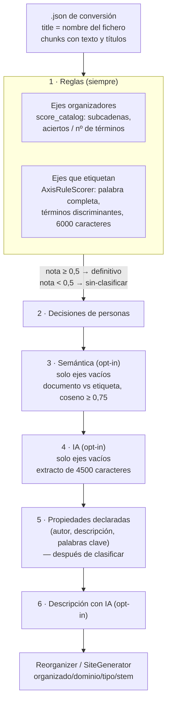
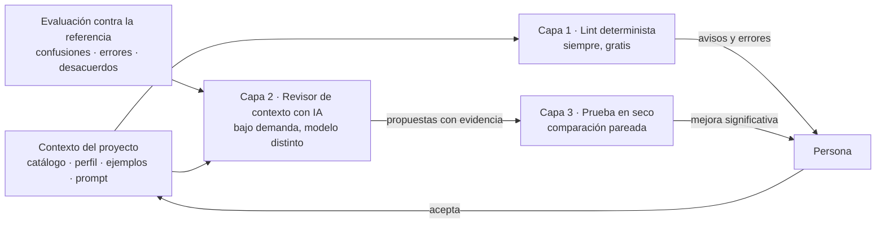

# Precisión de la organización documental (Contexto): análisis y propuestas de mejora

> Fecha: 2026-11-27 · Estado: **análisis auditado (§9, GO_CONDICIONAL), sin implementar** · Para: el desarrollador que implemente las mejoras
>
> Versiones analizadas: **doc_organize 2.5.0** (`develop`, `ae63f52`) y **doc_organize_web 3.1.0** (`e04de0a`).
> Las rutas `src/...` son de doc_organize y las `backend/...` / `frontend/...` de doc_organize_web.

## 0. Resumen ejecutivo

**El problema está medido, con una referencia mejorable.** En la medición final de la 2.0 (M10; corpus real CALIDAD_VD,
213 documentos, muestra de 150) la clasificación acierta el **dominio en el 25 %** de los documentos y el **tipo de
material en el 23 %** (`.ai/sessions/2026-11-17-ai-2.0/MEDICION_M10.md`). Con 8 dominios y 10 tipos, elegir al azar
daría 12,5 % y 10 %. Las reglas aciertan el 20-22 % y deciden más del 80 % de los documentos; la IA acierta el 35-39 %
en M10 (43 % de dominio en M5), pero solo ve los 38 documentos que las reglas no resuelven. **Ojo**: esa referencia la propuso Claude a partir del
nombre del fichero, la ruta y un extracto, y el mantenedor revisó una a una 39 filas y aceptó las otras 111
(`BASELINE.md`); además, la muestra está estratificada por lo que asignaron las reglas. Sirve para ver el orden de
magnitud, no para afinar decisiones (auditoría A1, §9).

> **Auditada el 2026-11-27 (§9)**: veredicto GO_CONDICIONAL. Donde §9 contradiga al resto del documento, manda §9; la
> hoja de ruta de §6 ya es la auditada.

**Causas, por peso estimado** (sin medir aún por separado: F0 lo mide con ablaciones):

1. **El puntuador de los ejes que organizan carpetas (`score_catalog`) tiene tres defectos conocidos** que la 2.0
   corrigió solo en los ejes que etiquetan: busca **subcadenas** («ley» encaja en «leyenda», «norma» en «normal»),
   **divide por el número de palabras clave** (añadir palabras clave baja la nota) y cuenta los **términos
   compartidos** entre entradas. Además mira el texto entero con el mismo peso que el título, y en empate gana la
   primera entrada del catálogo. Se mantuvo a propósito «para que la reorganización sea la de 1.x»
   (`axis_rules.py:4`), con la unificación aplazada hasta poder medirla (`PLAN.md` de la 2.0, A2, `:119-123`).
2. **La cascada no revisa nunca lo que deciden las reglas.** La semántica y la IA solo rellenan ejes vacíos; un valor
   de las reglas con nota ≥ 0,5 es definitivo, aunque sea un falso positivo, y **no entra en la cola de revisión**.
   Con este diseño, aunque la IA acertara siempre, la exactitud de dominio no pasaría de ~34-36 %.
3. **Se ignoran las señales más fuertes**: el «título» que usan las reglas es el nombre del fichero; el título
   declarado no se lee nunca, y el asunto y las palabras clave declaradas se leen **después** de clasificar; la carpeta solo cuenta
   si se llama exactamente como el slug y solo para el dominio; los códigos de fichero («PR-», «POL-», «IT-») no se
   usan para el tipo de material.
4. **La fase semántica y la IA están infrautilizadas**: la semántica compara el documento con una etiqueta corta
   (umbral 0,75 probablemente inalcanzable) en vez de con documentos ya clasificados; el prompt pide el valor
   **antes** de razonar, no envía palabras clave ni ejemplos de cada entrada, y el modelo medido era un modelo de
   código de 14B.
5. **doc_organize_web hace que parezca más preciso de lo que es y usa los modos más débiles por defecto**: los
   documentos que quedan en `sin-clasificar` (modo plantilla o manifiesto) se cuentan como clasificados y se muestran
   como un dominio «Sin Clasificar» con la etiqueta «Confirmado»; el catálogo por defecto es «Por carpetas» (copia la
   carpeta inmediata, sin reglas de contenido); la semántica viene desactivada; y la prueba en seco no reproduce la
   construcción real (umbral fijo 0,5, sin semántica).

**Propuestas principales** (detalle en §5, hoja de ruta en §6):

| # | Propuesta | Impacto esperado | Esfuerzo |
|---|---|---|---|
| P1 | Puntuador nuevo para los ejes organizadores (palabra completa, peso por campo, suma sin dividir, abstención por margen; raíces y BM25 si la medición lo pide) | Alto (hipótesis: a medir con ablaciones en F0) | L |
| P2 | Señales de ruta, nombre de fichero, título real y metadatos declarados, con prefijos de código y globs por entrada en el manifiesto | Alto en tipo de material (hipótesis) | L |
| P3 | Enrutar por margen de confianza: la semántica y la IA también revisan lo dudoso de las reglas (`ai_scope="low_margin"`/`"all"`) | Alto | M |
| P4 | Semántica por vecinos etiquetados (kNN **solo** con decisiones de personas) y umbral calibrado | Medio | M |
| P5 | Prompt y esquema: razonar antes de responder, palabras clave, ejemplos y criterios de exclusión; modelo adecuado | Medio | M |
| P6 | Nota y margen separados, umbral por eje calibrado y cola de revisión que detecta errores silenciosos | Medio (y hace visible el error) | M |
| P7 | Aprender de las decisiones de personas (palabras clave sugeridas, ejemplos, clasificador ligero) | Medio, creciente | M-L |
| P8 | Diseño de la taxonomía: distinguir externo/interno, descripciones con exclusiones, revisar plantillas | Medio (no medible con la referencia actual) | S |
| P9 | Evaluación reproducible: F1 por clase, intervalos de confianza, comparación pareada, protocolo de medición (§9.3) | Habilita todo lo demás | M |
| P10 | doc_organize_web: exponer y configurar lo anterior | Necesario para que llegue al usuario | M |
| P11 | Auditoría del contexto que recibe la IA en tres capas: lint determinista, revisor con IA anclado en errores medidos, validación por prueba en seco (§8) | Medio; evita contextos rotos o contradictorios | M (capa 1) · L (capas 2-3) |
| P12 | Adaptación por proyecto **sin** reentrenar el modelo: ejemplos de decisiones, clasificador ligero por proyecto, optimización del contexto (§8) | Medio, creciente con las decisiones | S-M |

**¿Entrenar la IA por proyecto?** No reentrenar el modelo de lenguaje; sí adaptar por proyecto con contexto,
ejemplos y un clasificador ligero sobre embeddings (§8.2). **¿Debe la IA auditar su contexto?** Sí como proponente
anclado en errores medidos, con la medición y una persona como árbitros, y nunca como control de seguridad (§8.3).

**Antes de cambiar nada**: recuperar la referencia de M0 (150 documentos, fuera del repositorio por privacidad) y
montar el benchmark de P9. Con 150 documentos el intervalo de confianza al 95 % de una exactitud del 25 % es de
**±7 puntos**: las mejoras medidas en la 2.0 (+1,4 puntos en dominio y +0,7 en tipo, M10) no se distinguen del
ruido.

---

## 1. Alcance y fuentes

- Código de `src/doc_organize/context/` (constructor, reglas, semántica, decisiones, evaluación, cola de revisión,
  prueba en seco), `src/doc_organize/ai/` (extracto, servicios, prompts, embeddings, cliente) y el conversor (de dónde
  sale el título).
- Documentación funcional: `docs/functional/context.md` y `docs/functional/revision_clasificacion.md`.
- Mediciones reales: `.ai/sessions/2026-11-18-m0-linea-base/BASELINE.md` y
  `.ai/sessions/2026-11-17-ai-2.0/MEDICION_M5.md`, `MEDICION_M8.md`, `MEDICION_M10.md`, `PREPRODUCCION_W9.md`.
- Plan de la 2.0 y del eje de facetas (`.ai/sessions/2026-11-17-ai-2.0/PLAN.md`,
  `.ai/sessions/2026-11-17-taxonomy-facets/PLAN.md`), donde están documentados los defectos C1-C3.
- doc_organize_web: integración (`backend/app/integrations/doc_organize/context.py`), operación de la cola, servicio de
  dominio, API y frontend (§4.10 y §5 P10).
- Pruebas propias (§A): reproducción de los defectos del puntuador con la plantilla empaquetada `sgi-integrado` y un
  prototipo del puntuador propuesto.
- Investigación en internet sobre clasificación híbrida (reglas, embeddings y LLM), calibración y evaluación (§B).

---

## 2. Cómo funciona hoy



Puntos de entrada y comportamiento relevante:

| Pieza | Dónde | Qué hace |
|---|---|---|
| Orquestación | `src/doc_organize/context/context_builder.py:359` (`build`) | Versiones (descarta las sustituidas) → reglas → decisiones → semántica → IA → propiedades → descripción → marca de versiones → rutas |
| Reglas, ejes organizadores | `src/doc_organize/context/domain_classifier.py:269-328` (`score_catalog`, `catalog_scores`) | Nota = términos encontrados como **subcadena** / nº de términos (slug + palabras clave); +0,25 si la carpeta inmediata se llama como el slug (solo dominio) |
| Reglas, tipo de material | `src/doc_organize/context/domain_classifier.py:356-370` | Igual, sin ninguna señal de ruta (`folder_slug=""`) |
| Reglas, ejes que etiquetan | `src/doc_organize/context/axis_rules.py:39-103` | Palabra o frase completa, términos compartidos descartados, nota por términos distintos (1 → 0,6; 2 → 0,8; 3+ → 1,0), solo título + 6000 caracteres |
| Umbral | `context_builder.py:75` (`_DEFAULT_THRESHOLD = 0.5`), `TaxonomyAxis.threshold` | Uno para todo. El manifiesto admite `threshold` por eje, pero **en dominio y tipo las reglas lo ignoran** y usan el global (`context_builder.py:724-725`, `:749`); solo lo usan los ejes que etiquetan, la IA y la cola |
| Placeholder | `context_builder.py:749-753` | Con manifiesto, un eje por debajo del umbral queda en `sin-clasificar` (el documento se reorganiza igual) |
| Decisiones | `src/doc_organize/context/decisions.py:152` (`apply_decisions`) | Se aplican tras las reglas; bloquean los ejes decididos |
| Semántica | `src/doc_organize/context/semantic.py:76` (`classify_semantic`) | Solo ejes vacíos; vector del extracto vs vector de «eje: nombre. descripción. palabras clave»; umbral 0,75 y margen 0,03 |
| IA | `context_builder.py:831` (`_classify_with_manifest_ai`), `missing()` en `:866-873` | Solo documentos con dominio **o** tipo en `sin-clasificar` (y, con `missing_axes`, ejes que etiquetan vacíos). Nunca cambia un valor existente (`:1081`, `:1089`, `:1098`) |
| Petición a la IA | `src/doc_organize/ai/services.py:199-280`, `src/doc_organize/ai/prompts/classify.md` | Catálogo con nombre y descripción; esquema estricto con `values[{value, confidence, evidence}]` por eje y `reasoning` **al final**; temperatura 0 (`src/doc_organize/ai/llm_client.py:306`) |
| Extracto | `src/doc_organize/ai/excerpt.py:39-93` | Título, carpeta (2 niveles), esquema de títulos, comienzo y fragmentos con términos del catálogo, 4500 caracteres |
| Título | `src/doc_organize/converter/converter.py:431` | `"title": markdown_path.stem`: el **nombre del fichero**, no el título del documento |
| Propiedades | `context_builder.py:549-550`, `src/doc_organize/context/document_properties.py` | Autor, descripción/asunto y palabras clave del original, leídas **después** de clasificar; `dc:title` y `/Title` no se leen |
| Cola de revisión | `src/doc_organize/context/review_queue.py:85-192` | Decisiones desfasadas y huérfanas, versiones sin confirmar, sin clasificar (**solo si falta el dominio**), desacuerdo reglas/IA, cita sin verificar, confianza < umbral, propuestas del revisor |
| Evaluación | `src/doc_organize/context/evaluation.py:203`, `dry_run.py:69` | Exactitud, cobertura, precisión, recall y confusiones por eje; prueba en seco sin guardar |

---

## 3. Evidencia medida

### 3.1 Exactitud en CALIDAD_VD (referencia de 150 documentos)

Plantilla de usuario `taxonomia-multi-dimensional-normas-gobernanza-2` (8 dominios, 10 tipos de material, 5 ejes),
umbral el guardado en el contexto (0,5 por defecto; los informes no lo dan), IA con `qwen2.5-coder:14b` local vía LiteLLM, `ai_scope="unclassified"`.

| Versión | Eje | Exactitud | Reglas | IA (sus documentos) | Cobertura |
|---|---|---|---|---|---|
| 1.7.1 solo reglas | dominio | 0,19 | 0,19 | — | 0,89 |
| 1.7.1 solo reglas | tipo de material | 0,19 | 0,19 | — | 1,00 |
| 1.6.0 reglas + IA (M0) | dominio | 0,23 | 0,22 | 0,33 | 1,00 |
| 1.6.0 reglas + IA (M0) | tipo de material | 0,22 | 0,20 | 0,33 | 1,00 |
| 2.0 reglas + IA (M10) | dominio | 0,247 | 0,22 | 0,39 | 1,00 |
| 2.0 reglas + IA (M10) | tipo de material | 0,227 | 0,20 | 0,35 | 1,00 |

Fuentes: `BASELINE.md` (M0), `MEDICION_M5.md`, `MEDICION_M10.md`. 38 de 213 documentos van a la IA.

**Calidad de la referencia** (auditoría A1, A17): la etiquetó Claude con el título (nombre del fichero), la ruta y un
extracto, sin ver lo que asignó doc_organize; el mantenedor revisó 39 filas una a una (las correcciones movieron la
exactitud de dominio de 0,227 a 0,233) y aceptó 111 tal cual. La muestra está estratificada por el dominio que
asignaron las reglas y por «sin clasificar», así que la exactitud absoluta habría que reponderarla por el tamaño de
cada estrato. Consecuencias: se desconoce el acuerdo entre personas (el techo alcanzable); comparar una IA con
etiquetas de otro LLM favorece lo que se le parece; y las señales de nombre y ruta (P2) son las mismas que usó quien
etiquetó, lo que puede inflar su efecto. P9 y §9 dicen cómo corregirlo.

### 3.2 Confusiones más frecuentes (M0)

- **Dominio**: `cumplimiento-legal → riesgos-amenazas` (22), `tecnologia-sistemas → riesgos-amenazas` (12),
  `gobernanza-liderazgo → riesgos-amenazas` (11), `cumplimiento-legal ↔ gobernanza-liderazgo` (10 y 7-10).
  **`riesgos-amenazas` se queda 83 de 213 documentos**: «riesgo», «amenaza» o «tratamiento» salen en casi cualquier
  texto de seguridad.
- **Tipo de material**: **ninguna norma, ley o guía oficial se reconoce como `referencial-normativo`**
  (→ `procedimiento-control` 25, `manual-sgsi` 19, `analisis-riesgo` 14). Las palabras clave de ese tipo («norma»,
  «ley», «ISO») salen en todos los documentos internos, y los textos normativos usan las de los demás tipos.

### 3.3 Otras mediciones

- `check_taxonomy_rules` sobre el `taxonomy_manifest.md` del proyecto (2 ejes; **otro catálogo**, no el de la
  medición de §3.1): dominios 91,5 % de cobertura con **62 conflictos** (29 % de los documentos con las dos mejores
  entradas a menos de 0,1); tipos 93 % con 48 conflictos (`MEDICION_M8.md`). Con la plantilla medida (5 ejes): tipos
  87,8 % de cobertura y 107 conflictos (`MEDICION_M10.md`).
- El diseñador de la taxonomía (agente) no consigue mejorar la plantilla sin crear empates, con ningún modelo
  probado; con `qwen3.8:27b` concluye que «los conflictos son intrínsecos a un corpus de guías genéricas»
  (`MEDICION_M10.md`). Con el puntuador actual, que premia las entradas con pocas palabras clave y mira el texto
  entero, mejorar la taxonomía tocando solo palabras clave es casi imposible (§4.1).
- Precedente en el propio código: en los ejes que etiquetan, limitar las reglas al **título y comienzo** (6000
  caracteres) subió F1 de 0,27 a 0,34 (y de 0,43 a 0,50 con palabras clave específicas) en CALIDAD_VD
  (`src/doc_organize/context/axis_rules.py:25-28`). Los ejes organizadores siguen leyendo el texto entero.

### 3.4 Lectura estadística

- Con 150 documentos y una exactitud del 25 %, el error típico es √(0,25·0,75/150) ≈ 0,035: **intervalo al 95 % de
  ±7 puntos**. Las mejoras de la 2.0 (+1,4 puntos en dominio y +0,7 en tipo en M10; +2,0 en dominio en M5) no son significativas; hay que comparar configuraciones sobre
  los mismos documentos con una prueba pareada (McNemar) o bootstrap (P9).
- **Techo del diseño actual**: si las reglas deciden ~82 % de los documentos con un 22 % de acierto, aunque la IA
  acertara el 100 % del resto la exactitud de dominio sería ≈ 0,82·0,22 + 0,18·1 ≈ **0,36** (≈ 0,34 con la proporción real de la referencia, donde las reglas deciden ~127 de
  150). Mejorar solo la IA no
  basta: hay que mejorar las reglas **y** dejar que la IA o la semántica revisen lo dudoso (P1 + P3).
- La IA se mide en los documentos más difíciles (los que las reglas no resolvieron): su 35-43 % (según eje y medición) no es comparable con
  el 22 % de las reglas, y probablemente subestima lo que haría sobre todo el corpus.

---

## 4. Diagnóstico detallado

### 4.1 El puntuador de los ejes organizadores (`score_catalog`)

`src/doc_organize/context/domain_classifier.py:303-328`:

```python
keywords = slug.replace("-", " ").split() + extra_keywords.get(slug, [])
hits = sum(1 for keyword in keywords if keyword in haystack)   # subcadena sobre título + texto entero
score = hits / len(keywords)                                    # fracción de términos encontrados
if folder and fold_accents(slug) == folder:                     # carpeta inmediata == slug, exacto
    score = min(1.0, score + _PATH_SIGNAL_BONUS)
```

| Defecto | Efecto | Reproducido en §A |
|---|---|---|
| **Subcadena** | «ley» ⊂ «leyenda», «norma» ⊂ «normal»/«normativa», «politica» ⊂ «geopolitica», «roles» ⊂ «controles» | Sí |
| **Fracción de términos** | Cada palabra clave que no aparece **baja** la nota: describir mejor una entrada la empeora. Las entradas con pocos términos ganan | Sí: 0,50 → 0,17 al pasar de 1 a 5 palabras clave |
| **Términos compartidos** | «seguridad», «gestión», «riesgo» puntúan en varias entradas a la vez → empates (62 conflictos en 213 con el manifiesto del proyecto; 107 en tipo con la plantilla medida) | — |
| **Texto entero, sin pesos** | Una mención de pasada en la página 40 vale lo mismo que el título. Los documentos largos (y las hojas de cálculo convertidas) tocan casi todas las entradas | Sí: el procedimiento de incidentes largo acaba en `continuidad` |
| **Frecuencia ignorada** | 1 mención = 50 menciones | — |
| **Sin morfología** | El slug `incidencia` no encaja con «incidente»; los plurales solo funcionan por la subcadena | Sí |
| **Empate → orden del catálogo** (`:298`) | Sesgo sistemático hacia las primeras entradas (p. ej. `gobernanza`, `riesgos`) en vez de dejarlo a la semántica, la IA o una persona | — |
| **Bonus de carpeta exacto y solo en dominio** | «01 Políticas», «PR - Procedimientos» o «Seguridad/Incidentes» no suman; el tipo de material no tiene señal de ruta | — |

La 2.0 ya resolvió los tres primeros para los ejes que etiquetan (`AxisRuleScorer`, auditoría C1-C3 del plan de
facetas) y dejó los organizadores igual: «Unificarlos queda para cuando G3 demuestre que no empeora»
(`.ai/sessions/2026-11-17-ai-2.0/PLAN.md:119-123`). G3 (`dry_run_classify` + referencia) ya existe: es el momento.

Ojo: aplicar `AxisRuleScorer` tal cual a los ejes organizadores **no basta**. En la prueba de §A da 1,0 a `riesgos`,
`continuidad` y `tecnologia` para el procedimiento largo: la palabra completa quita falsos positivos, pero sin pesos
por campo ni frecuencia sigue sin saber de qué **trata** el documento.

### 4.2 La cascada nunca revisa a las reglas

- `missing()` en `context_builder.py:866-873` solo manda a la IA los documentos con dominio o tipo en
  `sin-clasificar`; `_missing()` en `semantic.py:220-227` hace lo parecido para la semántica (pide solo el eje
  organizador vacío y siempre los ejes que etiquetan vacíos, sin depender de `ai_scope`).
- `_apply_manifest_ai` (`context_builder.py:1081`, `:1089`, `:1098`) nunca sustituye un valor existente. Es una regla
  de negocio explícita («IA es fallback, nunca primera pasada», `docs/functional/context.md` §2).
- La cola de revisión (`review_queue.py:186-192`) solo marca un valor de las reglas si su nota es < umbral. Un falso
  positivo con nota 0,5-1,0 es **invisible**: ni la IA lo ve ni entra en la cola. El desacuerdo reglas/IA
  (`:167-178`) solo aparece si la IA llegó a ver el documento, lo que con manifiesto solo pasa si el **otro** eje
  organizador quedó vacío.
- Además, un **tipo de material** en `sin-clasificar` con dominio asignado no genera ninguna entrada en la cola:
  `unclassified` solo se marca si falta el dominio (`review_queue.py:163-166`). Otro error silencioso, en el eje que
  peor funciona.
- Consecuencia: la nota de las reglas, que no es una probabilidad (es una fracción de palabras clave), decide sola
  el 80 % del corpus. El 78 % de esas decisiones es erróneo en CALIDAD_VD y nadie lo ve hasta abrir la carpeta.

### 4.3 Señales fuertes que no se usan

| Señal | Estado | Valor para |
|---|---|---|
| **Nombre del fichero** | Es el «título» (`converter.py:431`), pero se trata como texto corrido | Tipo de material (códigos «PR-SGSI-05», «POL-», «IT-», «FR-», «REG-», «MAN-»), dominio |
| **Título real** | No se extrae: ni el primer título del documento, ni `dc:title` (OOXML) ni `/Title` (PDF) | Ambos ejes |
| **Asunto, descripción y palabras clave declaradas** | Se leen (`document_properties.py`) **después** de clasificar (`context_builder.py:549-550`) | Ambos ejes |
| **Ruta completa** | Solo la carpeta inmediata y solo si es igual al slug (dominio). La IA ve 2 niveles en el extracto | Dominio (y tipo si la estructura lo refleja) |
| **Estructura** | No se usa: proporción de tablas, formularios, tabla de control de versiones, firmas | Tipo de material (registro/evidencia/formulario frente a procedimiento o política) |
| **Extensión** | Las reglas no la usan; la IA la recibe en el extracto («Tipo de fichero», `context_builder.py:214-216`) | Tipo de material (`.xlsx` rara vez es una política) |
| **Origen externo** | No existe como concepto | Separar normas/leyes/guías oficiales de documentos internos (la confusión principal de §3.2) |

### 4.4 Confianza no comparable entre fases

- Reglas: fracción de palabras clave (0-1, organizadores) o escalones 0,6/0,8/1,0 (etiquetas).
- Semántica: coseno en bruto.
- IA: confianza **verbalizada** por el modelo (`services.py:295`), mal calibrada en general (§B) y con temperatura 0.
- Las tres se comparan con el **mismo** umbral (0,5 por defecto) en la cola de revisión, en `EXAMPLE_MIN_CONFIDENCE`
  (0,9, `semantic.py:41`) para elegir ejemplos. Un 0,6 de las reglas, un 0,6 de coseno y un
  0,6 de la IA no significan lo mismo.
- No se guarda el **margen** (diferencia con la segunda entrada), que es el mejor indicador barato de duda.

### 4.5 Fase semántica

- Compara el extracto (hasta 4000 caracteres) con un texto corto por entrada («Dominios: Calidad. descripción.
  palabras clave», `semantic.py:47-56`). Es clasificación *zero-shot* por similitud con la etiqueta, la variante más
  débil: las similitudes documento-etiqueta son bajas y apretadas.
- Umbral por defecto **0,75** y margen **0,03** (`semantic.py:35-37`), sin calibrar contra la referencia. Hipótesis
  a comprobar: con bge-m3 y textos asimétricos casi ningún documento llega a 0,75 (ver
  `Context.ai_stats.semantic_classification.assigned`); y 0,03 de margen es poco para decidir.
- `ai_hints` (`semantic.py:140-196`) **ya calcula los vecinos más parecidos ya clasificados con fiabilidad**, pero
  solo los usa como ejemplos para la IA, no para clasificar. Votar entre esos vecinos (kNN) es la forma más fiable de
  usar embeddings cuando hay algunos documentos etiquetados (§B).
- Solo rellena ejes vacíos (como la IA, §4.2) y no aparece en ninguna medición de exactitud.

### 4.6 IA

- **Esquema**: por eje, `values[{value, confidence, evidence}]` y `reasoning` al final (`services.py:243-264`). Con
  salida estructurada el modelo genera en ese orden: **elige el valor antes de razonar**, y la justificación es
  posterior. Poner un campo de análisis antes del valor suele mejorar la exactitud (§B).
- **Catálogo** (`render_catalog`, `services.py:177-196`): nombre y descripción; **no** envía las palabras clave ni
  `TaxonomyEntry.examples`. Ese campo (`src/doc_organize/core/models.py:1663`) no lo usa ninguna fase: es un campo
  muerto que el usuario puede rellenar sin efecto.
- **Descripciones sin exclusiones**: la plantilla dice qué entra, rara vez qué no entra ni cómo desempatar con la
  entrada vecina (el perfil del proyecto tiene `tie_breakers`, pero es global y opcional).
- **Modelo**: las mediciones se hicieron con `qwen2.5-coder:14b` (modelo de código, local, 14B) y `qwen3.5:9b`
  fallaba por agotar los tokens razonando (`MEDICION_M10.md`). La exactitud de la IA depende mucho del modelo; no hay
  medición con un modelo generalista de más capacidad.
- **Extracto**: 4500 caracteres bien elegidos (`excerpt.py`), pero el título es el nombre del fichero y los metadatos
  declarados no van (se leen después).
- **Confianza**: un solo muestreo a temperatura 0; sin *logprobs* ni autoconsistencia.

### 4.7 Taxonomía

- Las entradas se solapan por diseño en un SGI: un procedimiento de gestión de riesgos de proveedores es a la vez
  `riesgos` y `cadena-suministro`. Sin reglas de desempate el sistema elige por palabras sueltas.
- Los tipos de material mezclan **origen** (externo: norma, ley, guía) con **función** (política, procedimiento,
  registro). Un documento normativo externo habla de procedimientos y políticas: con reglas léxicas siempre se
  confunde (§3.2). En gestión documental se separan ambos criterios (§B).
- La plantilla empaquetada `sgi-integrado` tiene palabras clave que, con búsqueda por subcadena, generan falsos
  positivos («ley» ⊂ «leyenda», «norma» ⊂ «normal», «politica» ⊂ «geopolitica») y otras demasiado genéricas para
  distinguir entradas («articulo», «instruccion», «politica»)
  (`src/doc_organize/context/taxonomy_templates_builtin/sgi-integrado.md`).
- `check_taxonomy_rules` avisa de palabras clave sin uso, pero no de las peligrosas (cortas, subcadena de palabras
  comunes, presentes en más del X % del corpus).

### 4.8 Las decisiones de personas no enseñan

Una decisión corrige **ese** documento y lo bloquea (`decisions.py:152`). No se usa para:

- sugerir palabras clave que distinguen esa entrada (términos frecuentes en sus documentos y raros en los demás);
- clasificar documentos parecidos (kNN, §4.5): hoy solo sirven de ejemplo a la IA si `semantic=True`;
- entrenar un clasificador ligero cuando haya suficientes;
- recalibrar umbrales.

`gold_from_decisions` (`decisions.py:114`) ya convierte las decisiones en referencia: el material para medir y
aprender existe.

### 4.9 Evaluación

`AxisEvaluation` (`evaluation.py:70-95`) da exactitud, cobertura, precisión y recall globales y las 10 confusiones
más frecuentes. Falta: precisión/recall/F1 **por valor** y F1 macro (con clases desequilibradas, como `riesgos` con
83 documentos, la exactitud engaña), intervalos de confianza, comparación pareada entre dos ejecuciones, exactitud por
tramo de confianza (para calibrar umbrales) y un benchmark versionado: los scripts de M0
(`.ai/sessions/2026-11-18-m0-linea-base/measure_*.py`) están en una carpeta de sesión y la referencia fuera del repo.

### 4.10 doc_organize_web

La web 3.1.0 fija doc_organize 2.5.0 (`backend/pyproject.toml:21`). Llama a `ContextBuilder.build` en
`backend/app/integrations/doc_organize/context.py:1005-1170` (`build_context`) desde la operación de la cola
`backend/app/jobs/operations/context.py:318-364` (`run_build`); no reetiqueta nada, pero decide qué modos se usan y
cómo se ven los resultados.

| # | Hallazgo | Dónde | Efecto en la precisión |
|---|---|---|---|
| W-a | **`sin-clasificar` cuenta como clasificado.** Con plantilla o manifiesto, la librería pone los documentos por debajo del umbral en el dominio `sin-clasificar` con estado `CONFIRMED` (`src/doc_organize/context/context_builder.py:565`). La web no trata ese slug en ningún sitio: los cuenta en `documents_count` (`domain_slug is not None`), deja `unclassified_reason` vacío y la página de resultados lo pinta como un dominio más con la etiqueta «Confirmado» | `backend/app/jobs/operations/context.py:74`, `:87`, `:160-161`, `:398-400`; `frontend/src/features/context/ContextDomains.tsx:94-118` | El usuario ve «0 sin clasificar» y una carpeta «Sin Clasificar» confirmada. La guía (`docs/guides/contexto.md:178-188`) dice que lo que no llega al umbral queda «Sin clasificar», cierto solo sin manifiesto. La cola de revisión sí los recoge (eje de carpeta vacío) |
| W-b | **Catálogo por defecto «Por carpetas» (`discover`)** | `frontend/src/features/context/useContext.ts:41`, `:404` | Clasifica por la carpeta inmediata con confianza 1,0: sin contenido, sin ejes que etiquetan, sin decisiones (quedan desfasadas `no_manifest`), sin semántica y sin efecto del umbral. Si las ejecuciones usaron este modo, la «organización» repite las carpetas de origen |
| W-c | **Ajustes que se pierden**: IA desactivada, `ai_scope="unclassified"` y umbral 0,5 en cada carga de la página; la web no guarda el umbral (sí lo guarda `context.json`, `Context.ai_fallback_threshold`) ni lo muestra en el resumen | `useContext.ts:45`; `frontend/src/features/context/BuildCard.tsx:59`, `:122-132` | Dos construcciones seguidas pueden usar ajustes distintos sin que se note |
| W-d | **Semántica desactivada por defecto** (ajuste guardado por proyecto) y apagada si no hay LiteLLM, con aviso en el registro del trabajo y en la página del proyecto; **sin** aviso de que solo funciona con plantilla o manifiesto; `ai_examples` no se pasa y los ejemplos de la IA dependen de la semántica | `backend/app/db/models.py:337-339`; `backend/app/jobs/operations/context.py:323-335`; `ProjectDetailPage.tsx:202` | La IA no recibe nunca ejemplos parecidos por defecto |
| W-e | **La prueba en seco no reproduce la construcción**: umbral fijo 0,5, sin semántica | `backend/app/integrations/doc_organize/evaluation.py:144`, `:223`; `backend/app/jobs/operations/quality.py:67-80` | Se comparan alternativas en condiciones distintas de las reales |
| W-f | **`check_taxonomy_rules` y el diseñador** con umbral fijo 0,5 | `backend/app/integrations/doc_organize/agents.py:79-92`, `:105` (`DesignRequest.threshold`); `backend/app/jobs/operations/agents.py:53-60`, `:115` | El informe de cobertura y conflictos no corresponde al umbral usado |
| W-g | **Evaluar contra «decisiones» es en parte circular**: las decisiones se aplican en la construcción evaluada, así que lo decidido por una persona siempre «acierta» | `backend/app/jobs/operations/quality.py:37-51` | La exactitud global se infla; solo el desglose `accuracy_by_classified_by` (plegado) lo separa |
| W-h | **Página de resultados**: la confianza de reglas e IA solo está en el plegable «Cómo se clasificó» (`ContextDomains.tsx:380-428`), no en los ejes que etiquetan, y las insignias excluyen el eje de carpeta; el resumen no dice umbral, alcance de IA ni quién clasificó; solo se corrige desde la página de Revisión | `frontend/src/features/context/Axes.tsx:75-103`, `ContextSummary.tsx` | Los errores silenciosos de las reglas (§4.2) no se ven ni se corrigen desde donde se ven |
| W-i | Otros: prompts del proyecto sin interfaz; caché de IA sin botón para vaciarla; `ai_max_failures=3` fijo; `ai_concurrency=1`; tope de 500 documentos de IA por construcción; las propuestas del revisor no se pasan a `review_queue(proposals=)` | `backend/app/integrations/doc_organize/ai.py:66`, `:252`; `backend/app/core/config.py:110` | Menor; afectan a coste, velocidad y comodidad |

No hay en la web ni en su repositorio datos reales de clasificación, ADR ni incidencias sobre precisión. El único
problema de calidad documentado es el de `.ai/sessions/2026-11-22-ia-alcance-construir/PLAN.md` de la web (ejes que
etiquetan vacíos en documentos clasificados por reglas), que llevó a exponer `ai_scope="missing_axes"` (ya existente en la librería) en la web 2.1.

---

## 5. Propuestas

Cada propuesta indica qué cambiar, dónde, compatibilidad y cómo medirla. **Toda propuesta que cambie el resultado se
mide antes con `dry_run_classify` contra la referencia de M0** (P9) y entra primero como opción; pasa a ser el valor
por defecto solo si mejora sin empeorar ningún eje más de lo que permita el intervalo de confianza.

### P1 · Puntuador nuevo para los ejes organizadores

**Qué**: una estrategia de reglas `v2` para dominio y tipo de material que sustituya a `score_catalog`:

1. **Palabra o frase completa** tras plegar acentos y mayúsculas (como `FoldedText.contains`).
2. **Raíces en español** (Snowball, paquete `snowballstemmer`, puro Python y sin dependencias) para que
   «incidencia/incidente/incidentes» o «procedimiento/procedimientos» encajen. Aplicar a texto y términos.
3. **Peso por campo**: nombre de fichero y título real ×3, títulos de sección ×2, primeros ~2000 caracteres ×1,5,
   resto ×1 (o el resto recortado, como `TAG_AXIS_TEXT_CHARS` en las etiquetas).
4. **Saturación por frecuencia** tipo BM25: `tf / (tf + k)` con `k ≈ 1,2`; la décima mención casi no suma.
5. **No dividir por el número de términos**: la nota de una entrada es la suma de sus términos encontrados (las frases
   de varias palabras valen más). Añadir palabras clave buenas ya no penaliza.
6. **Términos discriminantes**: descartar los que comparten dos o más entradas del eje (como `AxisRuleScorer`) o
   ponderarlos por IDF entre entradas.
7. **Decisión por margen, con nota y margen separados** (corregido por la auditoría, A3): el resultado es
   `RuleDecision(slug | None, score, margin, abstained)`, donde `score` es la nota absoluta normalizada de la entrada
   ganadora y `margin` su ventaja relativa sobre la segunda (p. ej. `(s1 - s2) / s1`). **No** usar `s1 / (s1 + s2)`
   como confianza: el ganador siempre tendría ≥ 0,5, el umbral 0,5 nunca rechazaría y cambiarían de significado
   `TaxonomyAxis.threshold`, `EXAMPLE_MIN_CONFIDENCE` (0,9, `semantic.py:41`), los conflictos (< 0,1) de
   `check_taxonomy_rules` y `rules_confidence` en la web. Por debajo de una nota mínima o de un margen mínimo, la regla
   se **abstiene** (`sin-clasificar`, va a la semántica, la IA o la cola) en vez de ganar la primera del catálogo. Los
   umbrales se definen por versión de reglas, y antes de P1 hay que revisar todos los consumidores de la confianza.
8. **Palabras clave negativas** opcionales por entrada (`exclude_keywords`) que **restan** en vez de vetar (p. ej.
   nota ×0,5 si aparecen en el título o el comienzo), como la consulta `boosting` de Elasticsearch: «BOE» o «UNE-EN
   ISO» en el título penalizan los tipos internos sin hacerlos imposibles.
9. **Puntuar por fragmento y agregar** (variante a medir): puntuar cada fragmento del `.json` con el título delante y
   quedarse con el máximo o la media de los *k* mejores (MaxP), en vez de un único texto. En recuperación de pasajes
   supera a puntuar el texto entero o el primer fragmento, y evita que una mención en un anexo decida la carpeta.
10. **Pesos y `k` calibrados** con la referencia (P9), no fijados a ojo: Elastic insiste en que no hay valores
    universales para BM25.

**Prototipo**: `proto_scorer.py` (junto a este documento, §A.2) implementa 1, 3, 4, 5, 6 y 7 en ~55 líneas (raíz por truncado en vez de
Snowball). Resultado honesto (§A.2, corregido tras la auditoría V7): en el caso corto acierta dominio y tipo (donde
`score_catalog` acierta el dominio por los pelos y deja el tipo sin clasificar); en el caso largo con el **mismo** texto
que `demo_scoring.py`, **se abstiene** en el dominio (margen 0,57 < 0,6) en vez de equivocarse como `score_catalog`, y
acierta el tipo con el margen justo (0,60). Solo acierta el dominio del caso largo si las menciones de pasada quedan
fuera de la ventana inicial (relleno artificial).
Es una ilustración, no una medición: validarlo contra la referencia.

**Dónde**:

- Nuevo módulo `src/doc_organize/context/organizing_rules.py` (o ampliar `axis_rules.py` con una clase hermana) que
  devuelva `RuleDecision` (punto 7). No forzar una interfaz común `score() -> list[(slug, score)]` con v1: sus notas
  no son comparables y se rompería la sustitución (LSP); cada versión trae sus umbrales.
- `context_builder.py:701-793` (`_classify_with_manifest`) y `:657-699` (sin manifiesto) eligen la estrategia.
- `taxonomy_check.py:268` (`_scorer`) y el agente diseñador (`taxonomy_agent.py` y su prompt, que hoy explica la regla
  de la fracción) deben usar la misma estrategia que la construcción.

**API y compatibilidad**: parámetro nuevo `ContextBuilder.build(rules_version: Literal["1", "2"] = "1")`, en **un
solo sitio** (no también en el manifiesto, para no tener precedencias ambiguas, A20). Se guarda en `Context` para
saber con qué se construyó. Cambiar el valor por defecto es un cambio de comportamiento visible: hacerlo en una MINOR con aviso en el
CHANGELOG si P9 demuestra la mejora, o en 3.0. La regla «Fuente de clasificación: el `.json`» no cambia.

**Medir**: exactitud y F1 macro por eje en la referencia, con `rules_version="1"` y `"2"`, solo reglas y con IA;
conflictos y cobertura con `check_taxonomy_rules`.

### P2 · Ruta, nombre de fichero, título real y metadatos declarados

**Qué**:

1. **Leer las propiedades antes de clasificar** y pasarlas a las reglas, a la semántica y al extracto de la IA. No
   es solo cambiar el orden (A16): hoy se escriben sobre el `DomainDocument`, que nace al clasificar
   (`context_builder.py:1296-1306`); hay que leerlas antes a un mapa por ruta (con la misma concurrencia) y añadir
   `title` (`dc:title`, `/Title`) a `DocumentProperties`. Cambia la regla de negocio «Fuente de clasificación: el
   `.json`» (`docs/functional/context.md` §2): pasa a ser «el `.json` y las propiedades declaradas del original».
2. **Título real sin reconvertir**: tomarlo del primer encabezado de los `chunks` (los `headings` ya están en el
   `.json`) o de las propiedades. Solo si eso no basta, añadir `document_title` al `.json` en el conversor.
3. **Patrones por entrada en el manifiesto** (opcionales), **sin expresiones regulares** (A10: `re` no tiene límite de
   tiempo y el coste del ReDoS está en la búsqueda, no en `compile`; en la web, manifiestos de varios usuarios corren
   en un worker compartido):

   ```yaml
   - slug: procedimiento
     name: Procedimiento
     code_prefixes: ["PR-", "PG-", "IT-"]       # prefijo del nombre del fichero, sin distinguir mayúsculas
     path_globs: ["**/procedimientos/**"]        # fnmatch sobre la ruta relativa plegada
     exclude_keywords: ["boe", "une-en iso"]
   ```

   Un prefijo o glob que encaja es una señal fuerte (p. ej. nota mínima 0,8 o peso ×4). Validar longitud y número al
   cargar el manifiesto y documentarlo en `docs/functional/context.md`.
4. **Ruta completa con coincidencia aproximada**: comparar cada carpeta de la ruta relativa (no solo la inmediata y
   no solo con el slug) con slug, nombre y palabras clave de cada entrada, para dominio **y** tipo, con peso
   decreciente según la profundidad. `rapidfuzz` ya es dependencia.
5. **Indicios estructurales para el tipo de material** (fase 2): proporción de fragmentos que son tablas, campos de
   formulario y casillas, tabla de control de cambios («Resumen de revisiones», «Elaborado/Revisado/Aprobado por»),
   extensión. ISO 9001 §7.5 distingue «mantener» (documentos vivos: política, procedimiento) de «conservar»
   (registros, evidencias): lenguaje prescriptivo con control de versiones indica documento; datos rellenados con
   fechas y firmas indican registro. Docling ya detecta tablas, pares clave-valor y casillas; requiere que el conversor
   marque el tipo de cada fragmento en el `.json` (`kind: table|text|list|key_value`). Hasta reconvertir, la extensión
   sirve de indicio débil.
6. **Lista maestra de documentos**: casi todo SGI mantiene un listado con código, título, tipo y proceso de cada
   documento. Importarla (Excel o CSV, mismo mecanismo que `load_gold_xlsx`) da etiquetas fiables de tipo y dominio
   para los documentos que figuran en ella, y los códigos (prefijo → tipo, área → dominio) para generar
   `code_prefixes`. Se aplica como **señal de reglas** de máxima prioridad, no como decisión (A14: una decisión
   importada no tendría huella del original, chocaría con «decisión desfasada» y, si la lista sirve también de
   referencia, la evaluación sería circular).
7. **Formatos en blanco** (fase 3): registrar las plantillas vacías de los formularios («PA02-F01») y clasificar como
   registro lo que comparta su texto fijo (lo que Microsoft Purview llama *document fingerprinting*). Encaja con la
   deduplicación por contenido de la 2.2, que ya compara textos.

**Dónde**: `document_properties.py`, `context_builder.py:505-550`, `converter.py:425-437`, modelo
`TaxonomyEntry` (`core/models.py:1642`), lector del manifiesto (`taxonomy_front_matter.py`), `excerpt.py` (añadir
«Nombre de fichero», «Título declarado», «Asunto» y «Palabras clave declaradas» a la cabecera; sube
`EXCERPT_VERSION`).

**Compatibilidad**: campos nuevos opcionales en el manifiesto y en el `.json`; manifiestos y conversiones antiguos se
leen igual. Cambiar `EXCERPT_VERSION` invalida la caché de IA (esperado).

**Medir**: exactitud del tipo de material en la referencia (es el eje que más debería subir) y cuántos documentos
resuelve cada señal.

### P3 · Enrutar por confianza: la semántica y la IA también revisan a las reglas

**Qué**: que lo dudoso de las reglas no sea definitivo.

1. Nuevo `ai_scope="low_margin"`: además de `sin-clasificar`, van a la semántica y a la IA los documentos cuyo valor
   de reglas en un eje organizador tiene **margen** bajo (configurable, p. ej. `ai_review_margin=0.3`) o que caen en un
   conflicto de `check_taxonomy_rules` (el conflicto es el mismo margen bajo: no son dos criterios). Para ellos la IA
   puede **sustituir** el valor de las reglas; se guarda la propuesta de las reglas **por eje** (hoy solo existe para
   el dominio, `rules_domain`; en tipo de material se perdería, A9) y, si difieren, el documento entra en la cola como
   `rules_ai_disagreement` en ese eje.
2. `ai_scope="all"`: la IA clasifica todos los documentos y las reglas pasan a ser un indicio (se envía al modelo la
   propuesta de las reglas como pista, o no, según lo que mida P9). Con la caché de resultados reconstruir no vuelve a
   pagar; con un modelo local el coste es tiempo (CALIDAD_VD: 213 × ~24 s ≈ 1,4 h con `ai_concurrency=1`).
3. **Fusión de evidencias**: tratar reglas, semántica e IA como «votantes» que pueden abstenerse, cada uno con su
   precisión estimada (el enfoque de las funciones de etiquetado de Snorkel), en vez de que gane la primera fase que
   llega al umbral. **Cuidado con los votantes correlacionados** (A4): si la IA recibe la propuesta de las reglas como
   pista y las mismas palabras clave, y el kNN usa vecinos clasificados por reglas, su «acuerdo» es eco de las reglas.
   Medir la IA con y sin pista de reglas; vecinos solo de decisiones humanas. Cuando coinciden, confianza alta; cuando discrepan, a la cola. Más adelante, una regresión
   logística sobre (nota de reglas, margen, coseno, confianza de la IA, cita verificada) entrenada con la referencia y
   las decisiones da una confianza calibrada. Es el patrón de FrugalGPT: cada etapa puntúa su resultado y solo se
   escala lo que no es fiable.

**Reglas de negocio afectadas** (hay que actualizarlas en `docs/functional/context.md` §2 y en la web):
«IA es fallback, nunca primera pasada» y «la IA solo rellena ejes vacíos». Se mantienen con `ai_scope="unclassified"`
(por defecto) y se relajan solo con los nuevos valores. «Las personas mandan» no cambia: lo decidido sigue bloqueado.

**Dónde**: `AiScope` (`core/models.py`), `missing()` en `context_builder.py:866`, `_apply_manifest_ai`
(`:1060-1107`), `_missing()` en `semantic.py:220`, `review_queue.py`, `AiStats` (recuento de sustituciones).

**Medir**: exactitud con `unclassified`, `low_margin` y `all`; documentos enviados, tokens y tiempo; cuántas
sustituciones de la IA eran correctas.

### P4 · Semántica por vecinos etiquetados y umbral calibrado

**Qué**:

1. **kNN con documentos fiables**: para cada documento, los *k* vecinos más parecidos **solo entre los decididos por
   una persona y los de la muestra aleatoria de auditoría** (A4). No usar los «de alta confianza» de `_trusted`
   (`semantic.py:199-204`): hoy son valores de reglas con nota ≥ 0,9, que fallan en su mayoría, y el kNN repetiría sus
   errores con apariencia de confirmación. Voto ponderado por similitud. Asignar si la proporción
   de votos y la similitud media superan umbrales. Con pocos ejemplos por clase, combinar con el prototipo (centroide
   de los documentos de cada entrada) y con la similitud a la etiqueta.
2. **Texto de la entrada más rico**: añadir `examples` (hoy sin uso) y la descripción con exclusiones, en frases
   completas (mejora la clasificación por similitud con la etiqueta). bge-m3 ya no necesita prefijo de instrucción.
   Tener en cuenta que por el endpoint de embeddings de LiteLLM (compatible con OpenAI) probablemente solo llega el
   vector denso de bge-m3, no su parte léxica ni la multivector (sin verificar).
3. **Embeddings por fragmento** (opcional): similitud máxima o media de los *n* mejores fragmentos frente a un solo
   vector del extracto, para documentos largos.
4. **Calibrar umbral y margen por eje** con la referencia (curva cobertura-exactitud, P9) y guardar los valores
   en el manifiesto (`semantic_threshold` por eje). Los cosenos no se trasladan entre modelos (anisotropía): fijarlos
   con la distribución del propio corpus (pares de la misma clase frente a pares al azar) y recalibrar al cambiar de
   modelo. Exponer la distribución de similitudes en `ai_stats` para diagnosticar.
5. Hacer que la semántica participe en la revisión de P3 (no solo en ejes vacíos).

**Dónde**: `semantic.py` (`classify_semantic`, `best_values`, `entry_text`, `ai_hints`), `EmbeddingIndex` (sin
cambios de formato).

**Medir**: exactitud de los valores con `classified_by="semantic"` y cobertura que aporta la fase.

### P5 · Prompt, esquema y modelo de la IA

**Qué**:

1. **Razonar antes de responder**: por eje, un campo `analysis` (1-3 frases: qué es el documento y por qué encaja o
   no en las candidatas) y la cita **antes** de `values` en el esquema; o `reasoning` al principio del objeto. La
   literatura reciente encuentra caídas fuertes con el razonamiento después de la respuesta, sobre todo en modelos
   pequeños como el medido (§B). OpenAI documenta que la salida estructurada respeta el orden de las propiedades, pero
   hay informes de reordenación en modos compatibles: **comprobar con el proxy y el modelo reales** que el orden se
   conserva (`probe_litellm.py` de M0 sirve de base). Medir el coste en tokens de salida (hoy ~260 por documento).
2. **Catálogo más útil**: enviar por entrada las palabras clave (como «términos típicos») y `examples`, y una nota de
   alcance «Incluye / No incluye / No confundir con …» (campo nuevo `excludes` en `TaxonomyEntry`, o convención en la
   descripción). Es lo que recomienda la guía de clasificación de Anthropic («what sets each one apart») y lo que
   hacen los esquemas de clasificación de gestión documental (§B).
3. **Señales explícitas en el extracto**: nombre del fichero, título declarado, asunto, palabras clave declaradas,
   ruta relativa (más de 2 niveles si no hay datos personales) y, con P3, la propuesta de las reglas como pista.
4. **Decisión jerárquica para el tipo de material**: primero «¿externo (norma, ley, guía oficial) o interno?», luego
   el tipo (ver P8); se puede hacer en el mismo esquema con un campo previo.
5. **Modelo**: medir con un modelo generalista de instrucciones (no de código) y con más capacidad que 14B; para los
   que razonan, desactivar el razonamiento o subir `TaskSettings.max_tokens`. Documentar en la guía del proxy el
   modelo recomendado para `classify`.
6. **Confianza**: la confianza verbalizada tiende a la sobreconfianza (valores de 0,8-1,0 en múltiplos de 0,05).
   Para los documentos dudosos (margen bajo o cita sin verificar), autoconsistencia: 3-5 muestras con temperatura > 0
   y voto; o *logprobs* del token del valor si el proveedor los da (LiteLLM los reenvía en modelos compatibles). En
   todo caso, **calibrar** contra la referencia (P6). Configurable por coste.
7. **Ejemplos recuperados de decisiones de personas**: los 3-5 documentos más parecidos ya decididos, con su
   clasificación, aunque `semantic=False` (hoy dependen de la semántica). En la receta de Anthropic (68 casos
   sintéticos) pasar a 5 ejemplos recuperados subió la precisión de 0,74 a 0,94, pero eran ejemplos **con texto**; hoy
   un ejemplo es solo «nombre del fichero → valores» (`_example_line`, `semantic.py:214-217`), así que esa cifra no se
   traslada (A7). Añadir un fragmento corto de cada ejemplo, con presupuesto de tokens (Ollama corta a 4096 por
   defecto). **Para medirlo** hace falta un protocolo por pliegues (§9.3): `dry_run_classify` excluye la referencia de
   los ejemplos, y CALIDAD_VD no tiene decisiones.
8. **Orden del catálogo**: los modelos tienen sesgo por la posición de las opciones. Medir con el orden del manifiesto
   y con un orden distinto (p. ej. alfabético o barajado con semilla fija, para que la caché siga valiendo).
9. Subir `version` del prompt `classify` (de 4 a 5) y `EXCERPT_VERSION` cuando cambien (la caché se invalida sola).

**Dónde**: `src/doc_organize/ai/prompts/classify.md`, `services.py` (`render_catalog`, `classification_request`,
`_choices`), `excerpt.py`, `core/models.py` (`TaxonomyEntry`).

**Medir**: exactitud de la IA en sus documentos y en todos (con P3), tokens y tiempo por documento, citas
verificadas.

### P6 · Confianza comparable, umbral por eje y errores visibles

**Qué**:

1. Guardar en cada `AxisValue` el **margen** frente a la segunda entrada y la **fuente de la nota** (ya está
   `classified_by`).
2. Umbrales **por eje y por fase** calibrados con la referencia (el manifiesto ya admite `threshold` por eje,
   `core/models.py:1698`); ofrecer una función `calibrate_thresholds(context, gold) -> dict` que proponga el umbral de
   cada eje para una precisión objetivo (curva cobertura-riesgo) y diga qué cobertura automática se consigue. Medir el
   error de calibración (ECE) de cada fase; para recalibrar las confianzas de la IA y los cosenos basta un
   *temperature scaling* o una regresión isotónica sobre la referencia.
3. Cola de revisión: motivo nuevo `low_margin` (valor de reglas con margen bajo) y una **muestra aleatoria de
   auditoría** (p. ej. 5 % o 20 documentos por construcción) para estimar la exactitud real sin referencia; el
   resultado de revisar esa muestra alimenta la referencia. Se descarta un motivo `rules_only` (valor de reglas sin
   confirmar): metería ~80 % de los documentos en la cola (A18).
4. Ordenar la cola por incertidumbre (margen) dentro de cada prioridad: es lo que más rinde por documento revisado
   (aprendizaje activo, §B). Las decisiones que salen de esta cola son una muestra **sesgada** hacia lo difícil: para
   estimar la exactitud, solo la muestra aleatoria (A13); marcar el origen de cada decisión.
5. **Aplicar `TaxonomyAxis.threshold` también en los ejes organizadores** (V3): hoy el manifiesto lo admite y
   `docs/api/context.md` lo documenta, pero el corte a `sin-clasificar` de dominio y tipo usa siempre el umbral global
   (`context_builder.py:724-725`, `:749`). Corrección pequeña; es un cambio de comportamiento para quien ya lo
   declare, así que va con aviso.
6. **`unclassified` por eje organizador** (V4): la cola marca «sin clasificar» solo si falta el dominio
   (`review_queue.py:163-166`); un tipo de material vacío con dominio asignado no aparece. Añadir el motivo también
   para el eje de subcarpeta.

**Dónde**: `AxisValue` (`core/models.py`), `review_queue.py`, `evaluation.py`.

### P7 · Aprender de las decisiones

**Qué**:

1. `suggest_keywords(context, decisions) -> dict[entrada, list[término]]`: términos (palabras y bigramas, con raíz)
   frecuentes en los documentos decididos de una entrada y raros en los demás (log-odds con prior o χ²). Alimenta al
   diseñador de la taxonomía (en `MEDICION_M8.md` ya se apuntaba como «opción 2») y a la web.
2. Las decisiones como vecinos del kNN de P4 y como ejemplos de la IA aunque `semantic=False` (hoy los ejemplos
   dependen de la semántica).
3. Clasificador ligero (regresión logística sobre los embeddings ya guardados, o SetFit) cuando haya ≥ 8-10
   decisiones por entrada; se activa por eje y se mide como una fase más (`classified_by="model"` o `"semantic"`).
4. Recalibrar umbrales (P6) con cada lote de decisiones.

### P8 · Diseño de la taxonomía

**Qué** (cambios en plantillas y guía, casi sin código):

1. **Eje «origen»** (`externo`/`interno`, o `referencial`/`propio`) separado del tipo de material, decidido sobre todo
   por patrones (P2: «BOE», «UNE», «ISO/IEC», «CCN-STIC», editor en metadatos) y por la IA. Ataca directamente la
   confusión principal de §3.2. **Tras la auditoría (A14)**: empezar como campo previo «externo/interno» en el esquema
   de la IA (P5.4) y como señal de reglas (prefijos, «BOE», «UNE»), sin eje nuevo; un eje nuevo exige reetiquetar la
   referencia y, como eje que etiqueta, no cambia por sí solo el tipo de material. El impacto no se puede estimar con
   la referencia actual.
2. **Descripciones con inclusión y exclusión** y reglas de desempate entre entradas vecinas (`riesgos` frente a
   `cumplimiento-legal`, `gobernanza` frente a `cumplimiento-legal`).
3. **Revisar las plantillas empaquetadas**: quitar palabras clave que son subcadena de palabras comunes («ley», «norma») o
   demasiado genéricas («articulo», «instruccion»), usar frases propias («declaración de aplicabilidad», «análisis de riesgos»),
   añadir `examples`.
4. **Lint del manifiesto**: ampliar `check_taxonomy_rules` (que ya informa de términos compartidos y palabras clave
   sin uso) con avisos para palabras clave de menos de 4 caracteres, términos presentes en más del 50 % del corpus y
   entradas sin descripción. Se fusiona con la capa 1 de P11 en un solo lint (A18).
5. Guía «Cómo escribir una buena taxonomía» en `docs/guides/` (ver C4 del plan de facetas, que ya lo pedía).

### P9 · Evaluación reproducible (primero)

**Qué**:

1. Ampliar `AxisEvaluation` con precisión/recall/F1 **por valor**, F1 macro, matriz de confusión completa y exactitud
   por tramo de confianza (para calibrar). Compatibilidad: campos nuevos con valor por defecto.
2. `compare_evaluations(a, b)`: diferencia pareada documento a documento (McNemar o bootstrap) con intervalo de
   confianza, para decidir si un cambio mejora de verdad.
3. Mover los scripts de M0 (`prepare_reference.py`, `measure_baseline.py`, `measure_rules_only.py`,
   `measure_with_ai.py`) a `scripts/benchmark/` con una entrada única: `python scripts/benchmark/run.py --project-root
   … --gold … --config rules_v2.toml`, que escribe un informe Markdown con las tablas de este documento.
4. **Casos de regresión en `tests/`**: 10-15 casos sintéticos que fijen los defectos de §A (subcadena, fracción,
   empate, mención de pasada, título que manda) con el resultado esperado por versión de reglas. Más útil y estable
   que un corpus sintético con un umbral de exactitud (simplificación de la auditoría).
5. **Referencia real**: recuperar la de M0 (está fuera del repo; pedirla al mantenedor); que una persona etiquete a
   ciegas ≥ 50 documentos para medir el acuerdo (A1); ampliarla con la muestra aleatoria de auditoría de P6 (no con
   decisiones de la cola, que están sesgadas). CALIDAD_VD solo tiene 213 documentos: para llegar a ≥ 300 (±5 puntos)
   y validar antes de cambiar valores por defecto hace falta **un segundo corpus** (A2).
6. **Protocolo de medición** escrito antes de F1: ver §9.3.

### P10 · doc_organize_web

Las primeras cuatro son correcciones que no dependen de nada nuevo en la librería (salvo W1, que conviene apoyar en
ella); el resto acompaña a cada fase de la librería.

| # | Qué | Dónde | Hallazgo |
|---|---|---|---|
| W1 | **Tratar `sin-clasificar` como sin clasificar**: recuentos, etiqueta «Por debajo del umbral» en vez de «Confirmado», motivo visible y filtro; corregir `docs/guides/contexto.md:178-188`. En la librería: exportar `UNCLASSIFIED_SLUG` en la API pública (hoy solo está en `core/constants.py`) y no marcar ese dominio como `CONFIRMED` (`context_builder.py:565`; p. ej. `Domain.placeholder=True` o un `DomainStatus` propio), para que ningún consumidor tenga que conocer el slug | `backend/app/jobs/operations/context.py:74`, `:87`, `:160-161`, `:398-400`; `ContextDomains.tsx:94-118` | W-a |
| W2 | **Catálogo por defecto**: proponer plantilla o manifiesto cuando el proyecto tenga uno; explicar en la interfaz que «Por carpetas» solo copia la estructura de origen; avisar de que decisiones y semántica no funcionan en ese modo | `useContext.ts:41`, `:404`, `TaxonomyStep.tsx` | W-b |
| W3 | **Guardar los ajustes de la construcción por proyecto** (umbral, alcance de IA, ejemplos; la semántica ya se guarda) y mostrarlos en el resumen; ofrecer perfiles «Rápido» (solo reglas), «Equilibrado» (reglas + IA en lo dudoso) y «Preciso» (IA en todo) | `BuildCard.tsx`, `ContextSummary.tsx`, `ProjectContext` | W-c |
| W4 | **Herramientas de calidad con los mismos ajustes que la construcción**: la prueba en seco, `check_taxonomy_rules` y el diseñador toman el umbral, la semántica y los ejemplos de la última construcción (o los que se elijan), no 0,5 fijo; avisar de que la semántica solo funciona con plantilla o manifiesto | `backend/app/integrations/doc_organize/evaluation.py:144`; `agents.py:79-92`; `jobs/operations/context.py:323-335` | W-d, W-e, W-f |
| W5 | **Evaluación honesta**: con la referencia «decisiones», evaluar siempre con `decisions=False` en la prueba en seco (excluir lo que puso una persona dejaría la evaluación vacía, A13); avisar de que las decisiones salen de una cola ordenada por incertidumbre (muestra sesgada) y estimar la exactitud solo con la muestra aleatoria (W7); mostrar F1 por valor, matriz de confusión e intervalo de confianza (P9); comparar dos ejecuciones con la diferencia pareada | `backend/app/jobs/operations/quality.py`, `EvaluationCard.tsx`, `CompareCard.tsx` | W-g |
| W6 | **Corregir donde se ve el error**: confianza y margen de cada valor, quién lo puso, filtro «solo reglas sin confirmar» y botón «Corregir» en la página de resultados; corrección en bloque (varios documentos → mismo valor) para acumular decisiones rápido | `Axes.tsx`, `ContextDomains.tsx`, `ReviewRow.tsx` | W-h |
| W7 | **Muestra de auditoría**: «Revisar 20 al azar» tras cada construcción; lo revisado estima la exactitud real y alimenta la referencia (P6.3) | Página de Revisión | §4.2 |
| W8 | Exponer lo nuevo de la librería según se publique: `rules_version` (P1), `ai_scope="low_margin"`/`"all"` (P3), umbrales por eje y calibración (P4, P6), palabras clave sugeridas y avisos del lint en el editor del manifiesto (P7, P8), importar la lista maestra (P2.6), `code_prefixes`, `path_globs` y `exclude_keywords` en el editor de plantillas | `ManifestCard.tsx`, `BuildCard.tsx`, plantillas en la BD | — |
| W9 | Menores: editor avanzado de los prompts del proyecto, botón para vaciar la caché de IA, pasar las propuestas del revisor a `review_queue(proposals=)` | — | W-i |

---

## 6. Hoja de ruta propuesta

Versión auditada (§9). Reglas comunes a todas las fases:

- **Nada cambia el comportamiento por defecto antes de F5** (A5): todo entra como opción o como `rules_version="2"`.
- Cada fase se mide con el **protocolo de §9.3** (partición, no inferioridad, abstención, ruido de la IA,
  presupuesto); cada cambio se mide por separado (ablación), no en lote.
- La web publica cada paso cuando la librería lo tenga en una versión instalable, con su inventario de migraciones y
  esquemas (A12).

| Fase | Contenido | Puerta |
|---|---|---|
| **F0 · Medir bien** (M) | **Referencia**: recuperar la de M0; que una persona etiquete a ciegas ≥ 50 documentos para medir el acuerdo (kappa); reponderar por estratos; pedir un **segundo corpus**. **Protocolo** de §9.3 por escrito. P9.1-P9.2 (métricas por valor, comparación pareada) y benchmark en `scripts/`. **Diagnósticos con scripts, sin tocar la librería**: ablaciones de v1 (palabra completa, sin dividir por el nº de términos, solo título y comienzo, empate → abstención) y la IA sobre **toda** la referencia con un modelo generalista, con y sin catálogo mejorado (A15). Librería: exportar `UNCLASSIFIED_SLUG` y marcar el dominio marcador. Web: W1, W4, W5 | Acuerdo humano medido; cada causa de §4 con su peso medido. Si la IA sobre todo el corpus gana claramente, se adelanta P3 y se recorta P1 |
| **F1 · Añadir sin cambiar nada** (M) | P2.1-P2.2 (propiedades a un mapa antes de clasificar, título real desde los `chunks`); P5.1-P5.3 medidos con la IA sobre toda la referencia; lint unificado (P8.4 + capa 1 de P11) y huella del contexto enviado; P8.3 en las plantillas empaquetadas. Web: W2, W3 | No inferioridad (−3 puntos, bootstrap pareado) en todos los ejes y mejora en alguno |
| **F2 · Margen y reglas v2** (L) | P6.1 (`RuleDecision`, margen y propuesta de las reglas **por eje**, A3, A9) con P1 reducido (palabra completa, pesos por campo, suma sin dividir, abstención por margen) como `rules_version="2"`; P2.3 (prefijos y globs); P3 `low_margin` | Precisión sobre lo asignado mejor con cobertura comparable (riesgo-cobertura) |
| **F3 · Aprender de las decisiones** (M) | P5.7 / P7 / P12.1 (ejemplos de decisiones con texto, palabras clave sugeridas) con el protocolo por pliegues; W7 (muestra aleatoria, origen de cada decisión marcado), W6 | Mejora medida por pliegues |
| **F4 · Lo caro** (L) | Solo con ≥ 300 documentos etiquetados de dos corpus: P4 / P12.2 (kNN o regresión logística por proyecto), capas 2-3 de P11, P2.5 / P2.7 (estructura, formatos), P3 `all`, P8.1 como campo externo/interno del esquema | Mejora en el tramo reservado y en el segundo corpus |
| **F5 · Por defecto** | Cambiar valores por defecto (`rules_version="2"`, quizá `ai_scope`) en una MINOR con aviso o en 3.0; guía de migración. Web: W8 | Puerta en el tramo reservado **y** en el segundo corpus |

---

## 7. Riesgos y compatibilidad

- **Reorganización distinta**: cambiar el puntuador o el enrutado mueve documentos de carpeta en `organizado/` y
  cambia el sitio. El historial (`CONTEXT_HISTORY.jsonl`) lo registra; la web debería avisar antes de reconstruir con
  otra versión de reglas. Por eso todo entra como opción y se activa por proyecto.
- **Decisiones de personas**: no se ven afectadas (bloquean sus ejes en cualquier versión).
- **Caché de IA y embeddings**: cambiar prompt, extracto o texto de la entrada invalida la caché (esperado); el
  índice de embeddings guarda por texto, así que solo se piden los textos nuevos. Ojo (A8): la clave es la petición
  completa, así que si el catálogo lleva las palabras clave, **cada edición del manifiesto** invalida toda la caché
  de IA; la pista de reglas y los ejemplos de decisiones la invalidan con cada cambio de reglas o decisión nueva (con
  `all` y un modelo local, ~1,4 h por reconstrucción). Separar las partes estables del prompt, documentar la clave y
  medir la tasa de aciertos de la caché. La autoconsistencia (P5.6) necesita el índice de muestra en la clave, o la
  caché devolvería siempre la misma respuesta.
- **Coste**: P3 con `all` y P5.6 multiplican llamadas. Mantener `ai_max_documents` y presupuesto por tarea; medir
  tokens y tiempo en cada fase.
- **Seguridad**: los patrones del manifiesto vienen del usuario (y de la web): prefijos y globs, nunca expresiones
  regulares (ReDoS, A10), con tamaño y número limitados. El texto añadido al extracto (metadatos) pasa por la misma
  limpieza y redacción de credenciales.
- **Privacidad al usar otro modelo** (A11): un revisor «de otro modelo» (capa 2 de P11) o un modelo más capaz para
  `classify` suele ser comercial cuando el de clasificar es local; solo con la misma clase de privacidad que el modelo
  actual o con consentimiento explícito del proyecto. Enviar rutas de más de 2 niveles, solo con opción explícita.
- **Esquemas de la web** (A12): la web valida `classified_by` con `Literal["rules", "semantic", "ai", "human"]`
  (`backend/app/api/v1/schemas/context.py:291`, `:308`); un valor nuevo (p. ej. `"model"`) o un `ai_scope` nuevo
  rompe su API si no se publica a la vez. Cada fase necesita su inventario de migraciones y esquemas en la web.
- **API pública (SemVer)**: parámetros y campos nuevos con valor por defecto que conserva el comportamiento; cambiar
  un valor por defecto se anuncia en el CHANGELOG y en `docs/api/publica.md`. `tests/unit/test_library_architecture.py`
  no se ve afectado.
- **Privacidad de la referencia**: sigue fuera del repositorio (nombres de documentos reales); el corpus de CI es
  sintético.

---

## 8. ¿Entrenar la IA por proyecto? ¿Debe la IA auditar el contexto que recibe?

> Añadido el 2026-11-27 a petición del mantenedor. Fuentes en §8.6.

### 8.1 Qué recibe hoy la IA de cada proyecto y qué se controla

| Pieza del contexto | De dónde sale | Control actual |
|---|---|---|
| Instrucciones (`classify.md`) | Empaquetadas o `<raíz>/.doc_organize/prompts/classify.md` del proyecto (`src/doc_organize/ai/prompts/__init__.py`) | Huella SHA-256 y versión en `Context.ai_provenance` |
| Catálogo: nombre y descripción de cada valor | Manifiesto o plantilla (`render_catalog`, `src/doc_organize/ai/services.py:177`) | Validación de formato (`TaxonomyManifestError`); `check_taxonomy_rules` y `audit_taxonomy` miran las **reglas** y el resultado, no lo que lee la IA. **No queda huella** de qué catálogo se envió |
| Perfil: contexto, reglas de desempate, glosario, ejemplos | Cuerpo del manifiesto + `<raíz>/.doc_organize/profile.md` (`src/doc_organize/context/project_profile.py`) | Limpieza de caracteres de control. **Se corta en silencio a 8000 caracteres** (`src/doc_organize/ai/profile_text.py:33`). Los slugs que cita (ejemplos, desempates) **no se validan** contra el catálogo. **No queda huella** de qué perfil se envió |
| Ejemplos de documentos parecidos | Vecinos por embeddings, solo con `semantic=True` (`src/doc_organize/context/semantic.py:140`) | Se excluyen el propio documento, sus duplicados y la referencia |
| Extracto del documento | `build_document_excerpt` | Delimitadores contra inyección; redacción de credenciales en `LlmClient` |
| Todo lo anterior | — | Vista previa sin llamar a nadie (`render_prompt_preview`); caché con la petición completa como clave |

Ya hay una IA que revisa el contexto: el **diseñador de la taxonomía** (`TaxonomyDesignAgent`,
`src/doc_organize/context/taxonomy_agent.py`). Pero optimiza **cobertura y empates de las reglas**, no la exactitud.
En CALIDAD_VD, con `qwen3.5:9b`, hizo justo lo que se espera al optimizar una métrica intermedia: «sube la cobertura
con palabras clave genéricas que crean empates» (`MEDICION_M8.md`); con `qwen3.8:27b` sus ediciones fueron razonables
pero terminó sin cambios (`MEDICION_M10.md`). Es la ley de Goodhart en pequeño, y la mejor prueba interna de
cómo **no** plantear una auditoría por IA.

### 8.2 Pregunta 1 · ¿Hay que entrenar la IA por proyecto?

**Respuesta: no hay que reentrenar el modelo de lenguaje (fine-tuning) por proyecto. Sí hay que adaptar la
clasificación a cada proyecto, en este orden: mejor contexto, ejemplos recuperados de las decisiones, un clasificador
ligero entrenado por proyecto sobre embeddings, y optimización del contexto contra la referencia. El fine-tuning solo
se plantearía, si acaso, por plantilla compartida entre muchos proyectos y con datos suficientes.**

Razones, de más a menos peso:

1. **El error no está en el modelo de lenguaje.** Las reglas deciden más del 80 % de los documentos con un 20 % de
   acierto (§3); la IA solo ve el resto. Ajustar el modelo no toca el problema principal; P1-P3 sí.
2. **No hay datos para ajustar un modelo.** Un proyecto acumula decenas o pocos cientos de decisiones repartidas entre
   ~18 valores de dos ejes organizadores, más los ejes que etiquetan: unas pocas por valor. Las cifras publicadas para
   que entrenar compense están por encima: 60-75 ejemplos por clase para que una regresión logística sobre embeddings
   supere a GPT-4 sin ejemplos (Banco de Inglaterra, 2025); modelos pequeños ajustados que se estabilizan hacia las 200
   etiquetas (Bucher y Martini, 2024); en clasificación de tipo de documento (RVL-CDIP, 16 clases), un Mistral-7B
   ajustado pasa de 72,5 % con 10 ejemplos por clase a 82-83 % con 100 (Scius-Bertrand et al., 2024).
3. **La taxonomía cambia.** Editar el manifiesto (renombrar, partir o fusionar valores) invalida unos pesos ajustados;
   con contexto y ejemplos, el cambio vale en la siguiente construcción. No se encontraron estudios que cuantifiquen
   ese coste de reentrenar, pero en este producto el catálogo se edita a menudo (diseñador, decisiones, plantillas).
4. **Operación.** Servir un adaptador LoRA por cliente exige vLLM (varios adaptadores sobre un modelo base, elegidos
   por petición; su documentación desaconseja cargarlos en caliente en producción) o similar; LoRAX está archivado
   desde octubre de 2026. El despliegue actual es Ollama detrás de LiteLLM: Ollama solo admite adaptadores para
   algunas familias, cada adaptador es un modelo aparte y no se elige por petición. Habría que migrar el servidor y
   versionar, evaluar y desplegar un modelo por cliente.
5. **Privacidad.** El Comité Europeo de Protección de Datos (Dictamen 28/2024) recuerda que los datos personales de
   entrenamiento pueden quedar «absorbidos» en los parámetros, y que si el tratamiento fue ilícito se puede ordenar
   borrar o reentrenar el modelo. Una petición de supresión sobre un LoRA por cliente puede obligar a reentrenarlo; los
   ejemplos en el prompt y un clasificador ligero se rehacen sin ese documento en segundos (los ejemplos sí viajan al
   proveedor si el modelo es comercial: ver la capa de privacidad de §8.4).
6. **Reproducibilidad.** Hoy un contexto se explica por prompt, catálogo, perfil, ejemplos y modelo (con caché y
   procedencia). Un modelo por proyecto añade una pieza opaca más.

**Lo que dice la evidencia a favor de entrenar** (para no descartarlo a la ligera): los modelos ajustados ganan a los
LLM **sin ejemplos** en muchas tareas, también en tipo de documento con solo 10 ejemplos por clase (72,5 % frente al
61,8 % de GPT-4 en RVL-CDIP), y cientos de adaptadores LoRA superan de media a su modelo base y a GPT-4 en sus tareas
(LoRA Land). Pero casi todas esas comparaciones son contra el LLM **sin ejemplos**, no contra uno con buen contexto y
ejemplos recuperados; y con el mismo tamaño de modelo, ajuste fino y ejemplos en el prompt generalizan de forma
parecida (Mosbach et al., 2023). Además, los LLM abiertos de 7-12B siguen mal las definiciones de cada categoría si no
reciben ejemplos (Halterman y Keith, 2026), que es muy probablemente el caso medido: qwen2.5 14B y, por lo que
consta, sin ejemplos (solo llegan con la semántica activada, y ni los scripts de medición ni los informes de M5/M10 la
usan). Conclusión: **no ahora**; primero los niveles baratos, medidos, y criterios claros para
reabrirlo.

**Escalera de adaptación por proyecto** (subir de peldaño solo si la medición del anterior se estanca):

| Nivel | Qué es | Datos que necesita | Coste | Estado |
|---|---|---|---|---|
| 0 | **Contexto del proyecto**: descripciones con «incluye / no incluye», reglas de desempate, glosario | Conocimiento de una persona | Nulo | Existe; mejorarlo con P5.2 y P8 |
| 1 | **Ejemplos recuperados** de las decisiones de personas (3-5 vecinos por documento) en el prompt | Decenas de decisiones | Unos cientos de tokens por llamada | Parcial: hoy solo con `semantic=True`, y mezcla decisiones con valores de alta confianza (P5.7) |
| 2 | **Clasificador ligero por proyecto**: regresión logística (o kNN) sobre los embeddings ya guardados, por eje; da probabilidades calibrables | Desde ~10 decisiones por valor como **segunda opinión** (sus desacuerdos con el LLM señalan qué revisar); para que decida solo, decenas por valor (60-75 por clase en el estudio del Banco de Inglaterra) | Segundos de CPU, sin GPU; se reentrena en cada construcción | Nuevo (P7.3). Es «entrenar por proyecto» en el sentido barato |
| 3 | **Optimizar el contexto contra la referencia**: probar variantes de descripciones, desempates y selección de ejemplos con `dry_run_classify` y quedarse con la que mejora (el enfoque de DSPy/MIPROv2/GEPA, sin tocar pesos; la guía de DSPy deja el ajuste fino como «última palanca») | Referencia del proyecto, partida en una parte para optimizar y otra reservada para medir | Llamadas de prueba | Nuevo (§8.4, capa 2 y 3) |
| 4 | **SetFit** (ajuste contrastivo de un modelo de embeddings pequeño + cabeza) | Decenas por valor | Minutos de CPU/GPU | Opcional, si el nivel 2 se queda corto |
| 5 | **Fine-tuning (LoRA) de un LLM** | Cientos por valor, taxonomía estable | Alto, operación continua | No recomendado por proyecto; ver criterios abajo |

**Cuándo replantear el fine-tuning** (criterio propio, a confirmar con datos): una **plantilla** (no un proyecto)
usada por muchos proyectos y estable durante meses; varios cientos de documentos etiquetados por valor reunidos con
consentimiento de los clientes; los niveles 0-3 estancados por debajo del objetivo; y un motivo de coste o de
ejecución local que haga rentable un modelo pequeño ajustado frente a uno grande con buen contexto. Aun así, sería un
adaptador por plantilla, no por proyecto.

### 8.3 Pregunta 2 · ¿Debe la propia IA auditar el contexto que se le manda?

**Respuesta: sí a que una IA revise el contexto y proponga mejoras, con tres condiciones: que trabaje sobre pruebas
externas (errores medidos, documentos mal clasificados), no sobre su propia opinión; que lo decida la medición contra
la referencia y una persona, no la IA; y que la seguridad y la privacidad de lo enviado no dependan de ella, sino de
controles deterministas.**

Razones:

1. **Autocorregirse sin información externa no funciona de forma fiable.** Sin señal externa, los LLM no corrigen su
   propio razonamiento y a veces lo empeoran (Huang et al., ICLR 2024); una revisión de la literatura no encuentra
   pruebas de que la autocorrección funcione cuando la crítica la hace el propio LLM con un prompt, salvo en tareas
   muy favorables, y sí cuando hay una señal externa fiable (Kamoi et al., TACL 2024). Aquí la señal externa existe:
   la evaluación contra la referencia, las confusiones de `audit_taxonomy`, las decisiones de personas y los
   desacuerdos entre reglas e IA. Pedir al modelo que revise el perfil «en abstracto» es autocorrección sin señal.
2. **El juez prefiere lo suyo.** Los modelos reconocen su propio texto y lo prefieren, y cuanto mejor lo reconocen
   más lo prefieren (Panickssery et al., 2024); además tienen sesgos de posición y de longitud (Zheng et al., 2023).
   Si el mismo modelo escribe la descripción y juzga si es clara, la aprobará. Anthropic recomienda evaluar con un
   modelo distinto del que generó la salida; y tanto su *prompt improver* como el optimizador de OpenAI usan el LLM
   para **proponer** y casos de prueba etiquetados para **decidir**.
3. **Goodhart, ya observado.** El diseñador optimizó una métrica intermedia y la mejoró empeorando lo que importa
   (§8.1). Cualquier auditor por IA debe medirse con la exactitud en la referencia, no con su propio criterio ni con
   cobertura.
4. **La seguridad no se delega en quien se puede manipular.** El perfil lo escribe una persona del proyecto (de
   confianza), pero los ejemplos y el extracto salen de documentos de terceros: son la vía de entrada de una inyección
   indirecta. OWASP (LLM01:2025) pide validar la salida con código determinista y separar el contenido no confiable, y
   (LLM07:2025) que los controles de seguridad estén fuera del LLM: el prompt no es un control. Pedir al mismo modelo
   que decida si su contexto es seguro es circular. Lo que ya hay va en esa línea (enum cerrado validado por código,
   delimitadores, redacción determinista de credenciales) y debe seguir así; para datos personales, un detector
   separado (Presidio, que avisa de que no lo encuentra todo) antes de enviar a un modelo comercial; para inyección,
   opcionalmente Llama Prompt Guard 2 (evaluado en español; analiza 512 tokens, hay que trocear el extracto).
5. **Hay cosas que una IA no necesita revisar.** Un slug inexistente citado en el perfil, un perfil cortado, dos
   descripciones casi idénticas o una entrada sin descripción se detectan con código, gratis y sin error.

### 8.4 Propuesta: auditoría del contexto en tres capas (P11)



**Capa 1 · Lint determinista del contexto** (nuevo `check_ai_context(manifest, profile, prompts) ->
AiContextReport`, sin IA; se ejecuta al guardar el manifiesto o el perfil y al construir):

| Comprobación | Nivel |
|---|---|
| Slugs citados en «Ejemplos» y «Reglas de desempate» del perfil que no existen en el catálogo | Error |
| Perfil por encima de `PROFILE_MAX_CHARS` (hoy se corta en silencio): decir cuánto y qué sección se pierde | Error (o aviso con el recorte explícito) |
| Entradas sin descripción, o con descripción que solo repite el nombre | Aviso |
| Pares de entradas del mismo eje con descripciones muy parecidas (coseno de sus embeddings, o similitud de texto con `rapidfuzz` si no hay embeddings) | Aviso, con la pareja |
| Pares de entradas que se confunden en la evaluación o en `audit_taxonomy` y no tienen regla de desempate ni «no incluye» que las separe | Aviso |
| Tamaño del prompt de sistema (tokens estimados) frente al contexto del modelo configurado (Ollama corta en silencio a 4096 por defecto, `MEDICION_M8.md`) | Aviso: la librería no conoce el `num_ctx` real detrás de LiteLLM; se compara con un valor configurado (A19) |
| Credenciales o datos personales en el perfil o en el manifiesto (`scan_credentials` ya existe; datos personales con detector opcional) | Aviso |
| Instrucciones dirigidas al modelo dentro del perfil que contradicen el prompt («ignora…», «responde siempre…») | Aviso |
| Prompt del proyecto (`.doc_organize/prompts/`) distinto del empaquetado y con versión antigua | Aviso |

**Capa 2 · Revisor del contexto con IA** (nueva tarea o nuevo modo del diseñador; bajo demanda, no en cada
construcción):

- **Entrada**: el catálogo y el perfil tal como los ve el modelo (`render_prompt_preview`), el informe de la capa 1,
  la evaluación contra la referencia (confusiones por pareja de valores, P9) y, por cada confusión frecuente, 3-5
  documentos mal clasificados con su extracto y lo que respondió la IA.
- **Salida**: propuestas concretas y acotadas, cada una con la evidencia que la motiva: reescribir la descripción de
  una entrada, añadir un «no incluye», añadir una regla de desempate entre dos valores, añadir un término al
  glosario, añadir o quitar un ejemplo del perfil. Nada de reescribir todo el manifiesto.
- **Modelo**: distinto del de `classify` cuando se pueda (otro alias en LiteLLM), para no premiar su propio estilo.
- **Nunca aplica nada** (D14), como el revisor y el diseñador actuales.

Es el patrón con respaldo en la literatura sobre guías de anotación: matriz de confusión por clase → atribuir cada
error a su causa (definición imprecisa, reglas contradictorias, falta de ejemplo) → revisar la definición → comprobar
con datos reservados; el LLM señala los casos que las definiciones no cubren y propone redacción, y una persona la
escribe o la aprueba (Co-DETECT, «When F1 Is Not Enough»). No se encontraron evaluaciones de LLM que detecten solapes
en un catálogo **sin** datos: por eso la capa 2 parte siempre de errores medidos.

**Capa 3 · Validación por medida y persona**: cada propuesta (o lote) se prueba con `dry_run_classify` sobre la
referencia del proyecto, con la comparación pareada de P9. **La referencia se parte**: la capa 2 solo ve los errores
de una parte (p. ej. 2/3) y la validación se mide en la otra, que el revisor nunca ve; si no, se sobreajusta el
contexto a la referencia. Solo se presenta como recomendada si mejora en la parte reservada sin empeorar ningún eje
más allá del intervalo de confianza; una persona la acepta y se guarda en el manifiesto o en `profile.md`. Con poca
referencia (< ~100 documentos), la propuesta se muestra como «sin validar». **Al cambiar de modelo de `classify` se
vuelve a validar**: parte de las correcciones de una guía no se trasladan de un modelo a otro.

**Trazabilidad de lo enviado** (complemento necesario para auditar después): añadir a `Context.ai_provenance` la
huella del catálogo y del perfil tal como se enviaron (SHA-256 del mensaje de sistema renderizado) y el número de
ejemplos por documento. Hoy solo se guarda la del prompt y el modelo, así que no se puede saber con qué perfil se
clasificó un contexto antiguo.

### 8.5 Propuesta: adaptación por proyecto sin reentrenar el modelo (P12)

1. **Ejemplos de decisiones siempre** (nivel 1): recuperar los 3-5 vecinos más parecidos **entre decisiones de
   personas** aunque `semantic=False` (necesita embeddings, no la fase semántica); con pocas decisiones, completar con
   los ejemplos escritos en el perfil. Medir con 0, 3 y 5 ejemplos.
2. **Clasificador ligero por proyecto** (nivel 2): `ProjectClassifier.fit(decisions, embeddings)` por eje,
   regresión logística con validación cruzada. Con ~10 decisiones por valor entra como **segunda opinión**: no asigna,
   pero sus desacuerdos con el LLM o las reglas mandan el documento a la cola. Solo asigna por sí mismo cuando la
   validación cruzada supera a la fase semántica y al LLM en ese eje (la literatura apunta a decenas de ejemplos por
   valor). Participa como un votante más en la fusión de P3.3 (`classified_by` nuevo o `semantic` con detalle). No
   guarda texto, solo coeficientes; se reentrena en cada construcción y se borra con el proyecto.
3. **Optimización del contexto** (nivel 3): es la capa 2 + 3 de P11 aplicada de forma sistemática; si se quiere
   automatizar más, un bucle tipo DSPy que pruebe variantes de instrucciones y de selección de ejemplos contra la
   referencia, con presupuesto de llamadas.
4. **Sin fine-tuning por proyecto**. Registrar la decisión en `.ai/DECISIONS_LOG.md` con los criterios de §8.2 para
   reabrirla.

**Encaje en la hoja de ruta (§6)**: la capa 1 de P11 (fusionada con P8.4) y la trazabilidad van en **F1**; P12.1 en
**F3** (necesita el protocolo por pliegues para medirse); P12.2 y las capas 2-3 de P11 en **F4**, cuando haya
≥ 300 documentos de referencia de dos corpus. P12.1 es la misma pieza que P5.7 y P7.2, y P12.3 la misma que las capas
2-3 de P11: se implementan una sola vez (A18).
En la web: avisos de la capa 1 en el editor del manifiesto y del perfil, y un panel «Revisar el contexto con IA» que
muestre cada propuesta con su evidencia y el resultado de la prueba en seco (junto a `AgentPanel` en
`ManifestCard.tsx`).

### 8.6 Fuentes

Consultadas el 2026-11-27. (✓) = texto o documentación abiertos; el resto, por el resumen o el abstract. (P) =
preprint o documento de trabajo sin revisión por pares.

**Entrenar o no por proyecto**

- Regresión logística sobre embeddings frente a GPT-4 sin ejemplos; 60-75 ejemplos por clase (Banco de Inglaterra,
  WP 1127, 2025) (✓)(P):
  <https://www.bankofengland.co.uk/working-paper/2025/improving-text-classification-logistic-regression-llms-tens-of-shot-classifiers>
  · <https://arxiv.org/abs/2408.03414>
- Modelos pequeños ajustados frente a LLM sin ejemplos; meseta hacia 200 etiquetas (Bucher y Martini, 2024) (✓)(P):
  <https://arxiv.org/abs/2406.08660>
- Tipo de documento en RVL-CDIP: GPT-4 sin ejemplos 61,8 %; Mistral-7B ajustado 72,5 % (10/clase) y 82-83 % (100/clase)
  (Scius-Bertrand et al., 2024) (✓)(P): <https://arxiv.org/abs/2412.13859>
- Modelos pequeños ajustados frente a LLM con pocos ejemplos (Edwards y Camacho-Collados, LREC-COLING 2024):
  <https://arxiv.org/abs/2403.17661>
- Ajuste fino frente a ejemplos en el prompt con el mismo tamaño de modelo (Mosbach et al., Findings ACL 2023):
  <https://arxiv.org/abs/2305.16938>
- Ejemplos recuperados por similitud (KATE): <https://arxiv.org/abs/2101.06804>
- Many-shot ICL (Agarwal et al., NeurIPS 2024) (✓): <https://arxiv.org/abs/2404.11018>
- LoRA Land (P): <https://arxiv.org/abs/2405.00732> · LoRA aprende menos y olvida menos (TMLR 2024):
  <https://arxiv.org/abs/2405.09673>
- Servir varios adaptadores: vLLM (✓) <https://docs.vllm.ai/en/latest/features/lora.html> · S-LoRA (P)
  <https://arxiv.org/abs/2311.03285> · LoRAX, archivado (✓) <https://github.com/predibase/lorax> · Ollama `ADAPTER` (✓)
  <https://docs.ollama.com/modelfile>
- Optimizar instrucciones y ejemplos contra una métrica: DSPy, elegir optimizador (✓)
  <https://dspy.ai/current/diving-deeper/choosing-an-optimizer/> · MIPRO <https://arxiv.org/abs/2406.11695> · GEPA
  <https://arxiv.org/abs/2507.19457> · OPRO <https://arxiv.org/abs/2309.03409> · APE <https://arxiv.org/abs/2211.01910>
- Datos personales en modelos entrenados (EDPB, Dictamen 28/2024, ap. 31 y 114) (✓):
  <https://edpb.europa.eu/system/files/2024-12/edpb_opinion_202428_ai-models_en.pdf>

**Que la IA audite su contexto**

- Los LLM no se autocorrigen sin información externa (Huang et al., ICLR 2024): <https://arxiv.org/abs/2310.01798>
- Cuándo funciona la autocorrección (Kamoi et al., TACL 2024): <https://arxiv.org/abs/2406.01297>
- Self-Refine: <https://arxiv.org/abs/2303.17651>
- LLM como juez y sus sesgos (Zheng et al., NeurIPS 2023): <https://arxiv.org/abs/2306.05685>
- Autopreferencia del evaluador (Panickssery et al., NeurIPS 2024): <https://arxiv.org/abs/2404.13076>
- Anthropic, evaluar con un modelo distinto y casos de prueba (✓):
  <https://platform.claude.com/docs/en/test-and-evaluate/develop-tests> · *prompt improver* (✓)
  <https://claude.com/blog/prompt-improver>
- OpenAI, optimizador de prompts con datos etiquetados (✓):
  <https://developers.openai.com/api/docs/guides/prompt-optimizer>
- LLM abiertos de 7-12B y libros de códigos (Halterman y Keith, Political Analysis 2026):
  <https://arxiv.org/abs/2407.10747>
- Revisión de guías de anotación a partir de errores por clase («When F1 Is Not Enough», nov. 2026) (P):
  <https://arxiv.org/abs/2611.08846> · Co-DETECT (P): <https://arxiv.org/abs/2507.05010> · TnT-LLM (P):
  <https://arxiv.org/abs/2403.12173>
- OWASP Top 10 para LLM 2025: inyección (✓) <https://genai.owasp.org/llmrisk/llm01-prompt-injection/> · fuga del
  prompt de sistema (✓) <https://genai.owasp.org/llmrisk/llm072025-system-prompt-leakage/> · revelación de información
  sensible (✓) <https://genai.owasp.org/llmrisk/llm022025-sensitive-information-disclosure/>
- Defensa por diseño frente a inyección (CaMeL) (P): <https://arxiv.org/abs/2503.18813>
- Detectores separados: Llama Prompt Guard 2 (✓) <https://huggingface.co/meta-llama/Llama-Prompt-Guard-2-86M> · Llama
  Guard 4 (✓) <https://huggingface.co/meta-llama/Llama-Guard-4-12B> · Presidio (✓)
  <https://presidio.dataprivacystack.org/>

---

## 9. Auditoría de la propuesta (AUDIT_PLAN)

> 2026-11-27. **Manda sobre el resto del documento donde lo contradiga.** Las correcciones ya están aplicadas en el
> cuerpo; esta sección deja constancia de qué se encontró y qué se hizo.

### 9.1 Cómo se hizo

Dos revisiones independientes, sin acceso a las conclusiones del autor más allá del propio documento:

1. **Comprobación de hechos**: ~190 afirmaciones contrastadas con el código de doc_organize (`ae63f52`) y
   doc_organize_web (`e04de0a`) y con las mediciones internas; cálculos rehechos; los dos scripts de §A ejecutados.
2. **Auditoría de diseño** con la convención AUDIT_PLAN del repo (`.claude/commands/new-feature.md`): riesgos
   funcionales, técnicos (LSP/ISP), de seguridad, simplificaciones y veredicto.

El autor verificó en el código los hallazgos de severidad Alta y los que cambiaban propuestas (A1, A3, A4, A7, A10,
A12, A17, V3, V4, V7) antes de aceptarlos.

### 9.2 Hallazgos y disposición

**Diseño** (A = auditoría de diseño):

| ID | Sev. | Hallazgo | Disposición | Dónde |
|---|---|---|---|---|
| A1 | Alta | La referencia no está «etiquetada a mano»: la propuso Claude (nombre, ruta, extracto); el mantenedor revisó 39 de 150. Comparar una IA con etiquetas de otro LLM la favorece, y P2 usa las mismas señales que quien etiquetó | Aceptado | §0, §3.1, P9.5, §9.3 |
| A2 | Alta | Se calibraría y mediría con los mismos 150 documentos en todas las fases; ≥ 300 no caben en CALIDAD_VD (213) | Aceptado | P9.5-P9.6, §9.3, §6 |
| A3 | Alta | `s1/(s1+s2)` como confianza siempre ≥ 0,5: anula el umbral y cambia el significado de umbrales, `EXAMPLE_MIN_CONFIDENCE`, conflictos y la web; interfaz común con v1 viola LSP | Aceptado | P1.7 (`RuleDecision` con nota y margen separados), P1 «Dónde» |
| A4 | Alta | Votantes correlacionados: kNN con vecinos de reglas de alta confianza, IA con pista de reglas | Aceptado | P3.3, P4.1 |
| A5 | Media | F1 cambiaba v1 por defecto (empate, recorte), contra «todo entra como opción» | Aceptado | §6 (regla común; empate y recorte pasan a v2 o a ablación de F0) |
| A6 | Media | Puertas no decidibles: sin ablación, P5 solo actúa sobre 38 documentos, sin margen de no inferioridad, la abstención no mueve la exactitud, coste sin cifra, ruido de la IA, ~1 h por prueba | Aceptado | §6, §9.3 |
| A7 | Media | Ejemplos de decisiones no medibles (la prueba en seco excluye la referencia; CALIDAD_VD sin decisiones) y hoy son solo «nombre → valores» | Aceptado | P5.7, §9.3 (pliegues), §6 (pasa a F3) |
| A8 | Media | Caché de IA invalidada por cada edición de catálogo o decisión; autoconsistencia incompatible con la clave actual | Aceptado | §7 |
| A9 | Media | La propuesta de las reglas solo se guarda para el dominio | Aceptado | P3.1, §6 F2 |
| A10 | Media | Regex del manifiesto: `re` sin límite de tiempo; el coste está en la búsqueda | Aceptado | P2.3 (`code_prefixes`, `path_globs`), §7 |
| A11 | Media | «Otro modelo» para revisar o clasificar suele ser comercial: privacidad | Aceptado | §7 |
| A12 | Media | Sin inventario de migraciones; la web valida `classified_by` con un `Literal` cerrado | Aceptado | §7, §6 |
| A13 | Media | Con referencia «decisiones», excluir lo humano deja la evaluación vacía; decisiones de la cola, muestra sesgada | Aceptado | W5, P6.4 |
| A14 | Media | P8 no medible; P8.3 toca otra plantilla; P8.1 como eje nuevo exige reetiquetar; lista maestra como decisión es circular | Aceptado | Tabla de §0, P8.1, P2.6 |
| A15 | Media | Causas ordenadas «por peso» sin atribución medida; la IA acierta solo el 39 % | Aceptado | §6 F0 (ablaciones e IA sobre toda la referencia) |
| A16 | Media | Leer propiedades antes no es «solo el orden»; cambia la regla «Fuente de clasificación»; el título real sale de los `chunks` | Aceptado | P2.1-P2.2 |
| A17 | Baja | Esfuerzos optimistas; el prototipo no sostiene «Alto»; línea base útil = clase mayoritaria; referencia estratificada | Aceptado | Tabla de §0, §3.1 |
| A18 | Baja | Redundancias (P5.7 = P7.2 = P12.1; P7.3 = P12.2; P12.3 = capas 2-3 de P11; P8.4 ≈ capa 1); `rules_only` saturaría la cola | Aceptado | P6.3, P8.4, §8.5 |
| A19 | Baja | `num_ctx` de Ollama no se conoce desde la librería (aviso, no error); Presidio y Prompt Guard pesados; tramo reservado de 50 documentos poco potente | Aceptado | §9.3; capas 2-3 de P11 a F4 |
| A20 | Baja | `rules_version` en dos sitios | Aceptado | P1 (solo en `build`) |
| S8 | — | Simplificación propuesta: reducir §8 a una entrada en `DECISIONS_LOG.md` + capa 1 | **Parcial** | §8 se mantiene porque responde a una pregunta del mantenedor; su parte operativa a corto plazo es la capa 1 y la entrada en `DECISIONS_LOG.md` (P12.4); el resto, F3-F4 |

**Hechos** (V = comprobación de hechos). Ningún hallazgo de severidad Alta; las conclusiones principales se
sostienen (~190 afirmaciones correctas, los cálculos de ±7 puntos y del techo son correctos):

| ID | Sev. | Hallazgo | Disposición |
|---|---|---|---|
| V1 | Media | «Etiquetados a mano» (lo mismo que A1) | Corregido |
| V2 | Media | La IA acierta 35-39 % en M10 (43 % era de M5) | Corregido |
| V3 | Media | **Nuevo**: `TaxonomyAxis.threshold` se ignora en dominio y tipo | Corregido en §2 y añadido como P6.5 |
| V4 | Media | **Nuevo**: la cola no marca un tipo de material vacío si el dominio tiene valor | Añadido a §4.2 y como P6.6 |
| V5 | Media | La web sí avisa cuando apaga la semántica (no es «en silencio») | Corregido (W-d, W4) |
| V6 | Media | La confianza de reglas e IA sí se ve, en un plegable | Corregido (W-h) |
| V7 | Media | El caso «largo» del prototipo usaba otro texto (relleno); con el mismo texto el prototipo **se abstiene** en dominio | Corregido (P1, §A.2); el script incluye ahora los tres casos |
| V8-V28 | Baja | Erratas y matices: título declarado nunca leído, atribuciones de citas, orden de versiones, 0,43 → 0,50, conflictos de otro catálogo, cifras de mejora por eje, matiz de la semántica, líneas desplazadas, extensión que sí recibe la IA, Excel, «soa», términos compartidos ya informados, umbral en `context.json`, líneas del diseñador, `missing_axes`, semántica ya guardada por proyecto, líneas del prototipo, versión del prompt, 0,94/0,97, modelo del diseñador | Corregidos |
| V29 | — | El umbral de las mediciones no consta en los informes | Pendiente de confirmar con el mantenedor (§3.1 lo dice) |

### 9.3 Protocolo de medición (obligatorio antes de F1)

1. **Referencia**: recuperar la de M0; una persona etiqueta a ciegas ≥ 50 documentos (estratificados por valor) y se
   mide el acuerdo con la referencia (kappa de Cohen por eje). Resultados siempre en tres vistas: toda la
   referencia, solo filas revisadas por personas, y reponderada por estratos.
2. **Partición**: un **tramo bloqueado** (~1/3, estratificado por valor de la referencia, semilla fija, lista
   guardada) que solo se usa en las puertas de §6; el resto, para calibrar con validación cruzada estratificada (5
   pliegues). Con 213 documentos el tramo bloqueado es pequeño (IC ±12 puntos): por eso las puertas de F4-F5 exigen el
   segundo corpus.
3. **Métricas** por eje: exactitud, F1 macro, **precisión sobre lo asignado y cobertura** (curva riesgo-cobertura:
   una abstención no cuenta igual que un error), y confusiones por pareja.
4. **Comparación**: bootstrap pareado (≥ 1000 remuestreos) sobre los mismos documentos; **no inferioridad** = el
   límite inferior del IC del diferencial no baja de −3 puntos en ningún eje; mejora = el IC del diferencial excluye
   el 0.
5. **Ablación**: un cambio por ejecución; los lotes solo para confirmar.
6. **IA sobre toda la referencia**: un modo de evaluación (script o `ai_scope` de prueba) que manda a la IA todos los
   documentos de la referencia, para medir P5 sin depender de los ~38 que hoy le llegan.
7. **Ruido de la IA**: repetir 2-3 veces la configuración base sin caché; si la variación entre repeticiones es
   comparable al efecto, no se decide.
8. **Ejemplos y decisiones por pliegues**: en cada pliegue, las etiquetas de los otros pliegues hacen de decisiones
   (ejemplos, kNN, clasificador ligero); nunca las del propio pliegue.
9. **Modelo**: mientras la referencia sea en su mayoría de Claude, no medir con modelos Claude, o dar esos resultados
   aparte.
10. **Presupuesto**: con IA local cada prueba en seco tarda ~1 h (la prueba en seco no usa caché por defecto);
    planificar cuántas ejecuciones tiene cada fase y registrar modelo, prompt, catálogo, perfil y semilla de cada
    una.

### 9.4 Simplificaciones adoptadas

1. **P1 reducido** primero: palabra completa, pesos por campo, suma sin dividir y abstención por margen. Raíces
   (Snowball), BM25 calibrado, MaxP y `exclude_keywords`, solo si la medición los pide.
2. **Prefijos de código y globs** en lugar de expresiones regulares.
3. **Título real desde los `chunks`**, sin reconvertir; P2.5, P2.7 y P4.3 pospuestos a F4.
4. **Fusiones**: P12.1 = P5.7 = P7.2; P12.2 = P7.3; P12.3 = capas 2-3 de P11; un solo lint (P8.4 + capa 1 de P11);
   la capa 2 de P11 como modo del diseñador existente con la exactitud como objetivo.
5. **Externo/interno** como campo del esquema y señal de reglas, no como eje nuevo.
6. **Pospuestos**: `rules_only` (descartado), ECE y *temperature scaling*, autoconsistencia y *logprobs*, SetFit,
   Presidio y Prompt Guard (extras opcionales).
7. **CI**: 10-15 casos de regresión en lugar de un corpus sintético con umbral de exactitud.

**Lo mínimo con mayor efecto**: referencia fiable y protocolo (F0) → ablaciones de v1 e IA sobre toda la referencia
con un modelo generalista → P1 reducido con abstención por margen y P3 `low_margin` → P2.1-P2.3 → P5.1-P5.3 → W1, W4
y W5 en la web.

### 9.5 Veredicto

**GO_CONDICIONAL.** El diagnóstico se sostiene (defectos de `score_catalog`, cascada que no revisa a las reglas,
señales sin usar, techo de ~34-36 %), pero la medición en la que se apoyan las decisiones es más débil de lo que decía
la primera versión. Condiciones, ya incorporadas al documento:

1. Origen real de la referencia declarado y acuerdo humano medido antes de decidir nada (A1).
2. Protocolo de §9.3 escrito y aplicado desde F0 (A2, A6).
3. `RuleDecision` con nota y margen separados y propuesta de reglas por eje antes de P1/P3 (A3, A9).
4. Nada cambia el comportamiento por defecto antes de F5 (A5).
5. Ejemplos y vecinos solo de decisiones de personas o de la muestra aleatoria (A4).
6. Patrones sin expresiones regulares y control de privacidad al usar otro modelo (A10, A11).
7. Inventario de migraciones y esquemas de la web en cada fase (A12).

**Primer paso recomendado**: F0 completa (referencia revisada, protocolo, ablaciones e IA sobre toda la referencia).
Su resultado decide si la palanca principal es P1 (reglas) o P3 (enrutado a la IA), y puede reordenar F1-F2.

---

## A. Pruebas realizadas

Scripts junto a este documento (`demo_scoring.py`, `proto_scorer.py`); se ejecutan desde la raíz del repo con el
`.venv` del proyecto, p. ej. `.venv/Scripts/python.exe .ai/sessions/2026-11-27-precision-contexto/proto_scorer.py`.
Texto sintético; plantilla empaquetada `sgi-integrado` (sin datos reales).

### A.1 Defectos de `score_catalog` (`demo_scoring.py`)

```text
1) «PR-SGSI-05 Procedimiento de gestión de incidentes», texto corto
  [domains]        score_catalog: incidencia 0,50 (justo el umbral)             -> incidencia
  [material_types] score_catalog: normativa-legal 0,38, politica 0,33, procedimiento 0,33 -> sin-clasificar
                   («Procedimiento» está en el título; «normativa-legal» gana por «normativa» ⊃ «norma» y «artículo»)

2) Mismo documento, largo (menciona de pasada riesgos, continuidad, infraestructura, proveedores)
  [domains]        score_catalog: continuidad 0,57, riesgos 0,43, tecnologia 0,43, incidencia 0,33 -> continuidad  ✗
                   AxisRuleScorer: riesgos 1,0, continuidad 1,0, tecnologia 1,0, incidencia 0,8              ✗
  [material_types] score_catalog: politica 0,33, procedimiento 0,33 -> sin-clasificar

3) Subcadenas: «ley» ⊂ «leyenda» True · «norma» ⊂ «funcionamiento normal» True · «politica» ⊂ «geopolitica» True
   (y «soa» ⊂ «persona asociada» False: no todo término corto da falso positivo)

4) Más palabras clave, peor nota (texto: «gestión del incidente de seguridad», entrada «incidencia»):
  sin palabras clave -> 0,00 (el slug «incidencia» no encaja con «incidente»)
  [incidente] -> 0,50 · [incidente + 4 más] -> 0,17
```

### A.2 Prototipo del puntuador propuesto (`proto_scorer.py`)

Palabra completa con raíz por truncado (6 letras), términos compartidos descartados, pesos título ×3 / comienzo ×1,5
/ resto ×1, saturación `tf/(tf+1,2)`, frases largas con más peso, decisión por `s1/(s1+s2) ≥ 0,6` (en la propuesta
corregida, P1.7, nota y margen van separados):

```text
corto                       [domains]        incidencia 6,39, gobernanza 0,68                 -> incidencia      (0,90) ✓
                            [material_types] procedimiento 2,05, normativa-legal 0,68         -> procedimiento   (0,75) ✓
largo (mismo texto que A.1) [domains]        incidencia 5,03, continuidad 3,80, riesgos 3,41  -> sin-clasificar  (0,57) se abstiene
                            [material_types] procedimiento 2,05, normativa-legal 1,36         -> procedimiento   (0,60) ✓ por los pelos
largo con relleno           [domains]        incidencia 5,48, continuidad 2,53, riesgos 2,27  -> incidencia      (0,68) ✓
                            [material_types] procedimiento 2,30, normativa-legal 0,91         -> procedimiento   (0,72) ✓
```

**Lectura honesta** (corregida tras la auditoría, V7): la primera versión de este anexo solo mostraba el caso «largo
con relleno», que mete ~1400 caracteres de relleno para sacar las menciones de pasada de la ventana inicial, y lo
presentaba como el mismo documento que A.1. Con el mismo texto, el prototipo **no acierta el dominio: se abstiene**
(lo que es mejor que el error de `score_catalog`, porque iría a la IA o a la cola) y el tipo sale con el margen justo.
Son tres casos sintéticos sobre una plantilla que no es la medida: ilustran los defectos, no sostienen ninguna cifra
de mejora. Eso lo dirán las ablaciones de F0 sobre la referencia.

Núcleo del prototipo (para orientar la implementación, no para copiarlo tal cual):

```python
FIELD_WEIGHTS = {"title": 3.0, "start": 1.5, "body": 1.0}
K = 1.2

def score_axis(axis, fields: dict[str, tuple[str, ...]]):          # campos ya tokenizados, plegados y con raíz
    phrases = {e.slug: entry_phrases(e) for e in axis.entries}      # slug, nombre y palabras clave como frases
    owners = Counter(p for ps in phrases.values() for p in ps)
    scores = {}
    for slug, ps in phrases.items():
        scores[slug] = sum(
            FIELD_WEIGHTS[field] * tf / (tf + K) * len(p)
            for p in ps if owners[p] == 1                           # solo términos discriminantes
            for field, tokens in fields.items() if (tf := count(tokens, p))
        )
    (s1, v1), (_, v2) = sorted(scores.items(), key=lambda s: -s[1])[:2]
    margin = v1 / (v1 + v2) if v1 else 0.0
    return (s1, margin) if v1 >= MIN_SCORE and margin >= MIN_MARGIN else (None, margin)
```

---

## B. Referencias externas

Investigación hecha el 2026-11-27. Solo se abrieron directamente las marcadas con (✓); el resto procede de
resúmenes y abstracts. Los preprints no tienen revisión por pares: tratarlos como orientación, no como prueba.

**Reglas léxicas** (P1, P8)

- BM25: saturación de la frecuencia, IDF y normalización por longitud; los parámetros se ajustan con datos propios.
  <https://www.elastic.co/blog/practical-bm25-part-2-the-bm25-algorithm-and-its-variables> ·
  <https://www.elastic.co/blog/practical-bm25-part-3-considerations-for-picking-b-and-k1-in-elasticsearch>
- BM25F, peso por campo (título, encabezados, cuerpo):
  <https://staff.city.ac.uk/~sbrp622/papers/foundations_bm25_review.pdf>
- Puntuar por el mejor pasaje (MaxP) frente al documento entero: <https://arxiv.org/abs/1905.09217>
- Palabras clave negativas que restan (`boosting`):
  <https://www.elastic.co/docs/reference/query-languages/query-dsl/query-dsl-boosting-query>
- Evidencia principal y de apoyo con confianza graduada (tipos de información confidencial de Purview):
  <https://learn.microsoft.com/purview/sit-sensitive-information-type-learn-about>
- Términos discriminantes por log-odds con prior («Fightin' Words»), para sugerir palabras clave:
  <https://languagelog.ldc.upenn.edu/myl/Monroe.pdf> · <https://convokit.cornell.edu/documentation/fightingwords.html>
- Stemmer Snowball para español: <https://snowballstem.org/algorithms/spanish/stemmer.html>

**Embeddings** (P4, P7)

- bge-m3 (denso, disperso y multivector; 8192 tokens; sin instrucción): <https://huggingface.co/BAAI/bge-m3> (✓) ·
  <https://arxiv.org/abs/2402.03216>
- Clasificación con regresión logística sobre embeddings (así evalúan MTEB/MMTEB):
  <https://arxiv.org/abs/2210.07316> · <https://arxiv.org/abs/2502.13595>
- Regresión logística con decenas de ejemplos frente a LLM (Banco de Inglaterra, 2025):
  <https://www.bankofengland.co.uk/working-paper/2025/improving-text-classification-logistic-regression-llms-tens-of-shot-classifiers>
- SetFit, ajuste con pocos ejemplos: <https://arxiv.org/abs/2209.11055> · <https://github.com/huggingface/setfit>
- Clasificación por similitud con la descripción de la etiqueta: <https://arxiv.org/abs/2212.10391>
- Calibración de umbrales de coseno (preprint): <https://arxiv.org/abs/2601.16907>

**LLM** (P5)

- Guía y receta de clasificación de Anthropic (criterios que distinguen cada categoría; ejemplos recuperados y
  razonamiento: de 0,74 a 0,94 con 5 ejemplos recuperados y a 0,97 añadiendo razonamiento, en 68 casos sintéticos):
  <https://platform.claude.com/docs/en/about-claude/use-case-guides/ticket-routing> (✓) ·
  <https://platform.claude.com/cookbook/capabilities-classification-guide> (✓)
- Razonamiento antes o después de la respuesta en salida estructurada («Structure Tax», AACL-IJCNLP 2026):
  <https://aclanthology.org/2026.aacl-long.209.pdf> (✓)
- Salida estructurada y orden de las propiedades: <https://developers.openai.com/api/docs/guides/structured-outputs> (✓)
  · informe de reordenación en un modo compatible:
  <https://discuss.ai.google.dev/t/does-gemini-openai-compatible-mode-structured-outputs-preserve-key-ordering/87378>
- Efecto del JSON restringido en el razonamiento y la clasificación: <https://aclanthology.org/2024.emnlp-industry.91>
- Ejemplos más parecidos como demostraciones (KATE): <https://arxiv.org/abs/2101.06804>
- Sesgo por la posición de las opciones: <https://arxiv.org/abs/2309.03882>
- Confianza verbalizada y autoconsistencia: <https://arxiv.org/abs/2306.13063> · <https://arxiv.org/abs/2305.14975> ·
  <https://arxiv.org/abs/2203.11171>
- LLM como juez o verificador: <https://arxiv.org/abs/2306.05685>
- Caché de prefijo: <https://platform.claude.com/docs/en/build-with-claude/prompt-caching>

**Cascadas, supervisión débil y revisión** (P3, P6, P7)

- FrugalGPT, escalar solo lo no fiable: <https://arxiv.org/abs/2305.05176>
- Snorkel, funciones de etiquetado que se abstienen: <https://arxiv.org/abs/1711.10160> · con prompts de LLM:
  <https://arxiv.org/abs/2205.02318>
- Aprendizaje activo (incertidumbre, margen), librería small-text: <https://arxiv.org/abs/2107.10314>
- Detección de etiquetas erróneas (Cleanlab): <https://arxiv.org/abs/1911.00068>

**Evaluación** (P9)

- Errores típicos y comparaciones pareadas en evaluaciones de modelos: <https://arxiv.org/abs/2411.00640>
- Clasificación con rechazo y curvas cobertura-riesgo: <https://arxiv.org/abs/1705.08500>
- Calibración (ECE, *temperature scaling*): <https://proceedings.mlr.press/v70/guo17a.html>
- Pruebas de regresión de prompts en CI: <https://promptfoo.dev/docs/integrations/ci-cd/>

**Gestión documental y tipo de documento** (P2, P8)

- ISO 15489 y clasificación funcional con notas de alcance: <https://www.iso.org/standard/62542.html> ·
  <https://www.naa.gov.au/information-management/describe-information/classifying-information>
- ISO 9001:2015 §7.5, información documentada («mantener» frente a «conservar»):
  <https://www.quality.org/knowledge/%E2%80%8Biso-90012015-documented-information>
- Ejemplo real de control documental con códigos, formatos y tabla de revisiones (Universidad de Murcia, PA02):
  <https://um.es/documents/793464/1506869/PA02_Control_de_los_documentos_2016_10_24.pdf/2ea03955-74e9-4f39-89aa-6203267088c2> (✓)
- Propiedades core de OOXML (título, asunto, palabras clave, categoría):
  <https://python-docx-oss.readthedocs.io/en/latest/dev/analysis/features/coreprops.html>
- Detección de formularios rellenados a partir de su plantilla (*document fingerprinting*):
  <https://learn.microsoft.com/purview/document-fingerprinting>
- Docling (tablas, pares clave-valor, casillas): <https://arxiv.org/abs/2408.09869>
- Tipo de documento con texto y maquetación (LayoutLM, RVL-CDIP): <https://arxiv.org/abs/1912.13318>

---

## C. Mapa de ficheros

| Fichero | Qué tocar | Propuestas |
|---|---|---|
| `src/doc_organize/context/domain_classifier.py` | Puntuador v1 (se conserva); empate | P1, F1 |
| `src/doc_organize/context/axis_rules.py` / nuevo `organizing_rules.py` | Puntuador v2 | P1 |
| `src/doc_organize/context/context_builder.py` | Orden propiedades/clasificación, estrategia de reglas, enrutado | P1, P2, P3 |
| `src/doc_organize/context/semantic.py` | kNN, umbrales por eje, revisión | P4 |
| `src/doc_organize/ai/services.py`, `ai/prompts/classify.md` | Esquema con análisis previo, catálogo con palabras clave/ejemplos/exclusiones | P5 |
| `src/doc_organize/ai/excerpt.py` | Nombre de fichero, título, metadatos | P2, P5 |
| `src/doc_organize/context/document_properties.py` | Leer título | P2 |
| `src/doc_organize/converter/converter.py` | `document_title`, tipo de fragmento | P2 |
| `src/doc_organize/core/models.py` | `TaxonomyEntry` (`code_prefixes`, `path_globs`, `exclude_keywords`, `excludes`), `RuleDecision`, `AxisValue.margin`, `AiScope`, `AxisEvaluation` | P1-P6, P9 |
| `src/doc_organize/context/taxonomy_front_matter.py`, `taxonomy_check.py` | Campos nuevos, lint, misma estrategia que la construcción | P1, P2, P8 |
| `src/doc_organize/context/review_queue.py` | Motivos nuevos, orden por incertidumbre, muestra de auditoría | P6 |
| `src/doc_organize/context/evaluation.py`, `dry_run.py` | Métricas por valor, comparación pareada | P9 |
| `src/doc_organize/context/taxonomy_templates_builtin/*.md` | Palabras clave, descripciones, ejemplos | P8 |
| `src/doc_organize/core/constants.py`, `src/doc_organize/__init__.py` | Exportar `UNCLASSIFIED_SLUG`; dominio marcador no `CONFIRMED` | W1 |
| Nuevo `src/doc_organize/context/ai_context_check.py` | Lint determinista del contexto de la IA (`check_ai_context`) | P11 capa 1 |
| `src/doc_organize/ai/profile_text.py`, `context/project_profile.py` | Avisar del recorte del perfil; validar slugs citados | P11 capa 1 |
| `src/doc_organize/core/models.py` (`PromptProvenance`) | Huella del catálogo y del perfil enviados | P11 trazabilidad |
| `src/doc_organize/context/taxonomy_agent.py` o agente nuevo, `ai/prompts/` | Revisor del contexto con IA, objetivo = exactitud en la referencia | P11 capa 2 |
| `src/doc_organize/context/semantic.py`, nuevo `context/project_classifier.py` | Ejemplos de decisiones sin fase semántica; clasificador ligero por proyecto | P12 |
| `docs/functional/context.md`, `revision_clasificacion.md`, `docs/api/*`, `zensical.toml` | Reglas de negocio y API nuevas | Todas |
| **doc_organize_web** `backend/app/integrations/doc_organize/context.py` | Parámetros nuevos de `build` | W3, W8 |
| `backend/app/jobs/operations/context.py` | Recuentos y proyección de `sin-clasificar`; aviso de semántica | W1, W4 |
| `backend/app/integrations/doc_organize/evaluation.py`, `agents.py`, `backend/app/jobs/operations/quality.py` | Ajustes reales en prueba en seco, comprobación de reglas y diseñador; evaluación sin circularidad | W4, W5 |
| `frontend/src/features/context/` (`useContext.ts`, `BuildCard.tsx`, `TaxonomyStep.tsx`, `ContextDomains.tsx`, `Axes.tsx`, `ContextSummary.tsx`, `ReviewRow.tsx`, `EvaluationCard.tsx`, `CompareCard.tsx`, `ManifestCard.tsx`) | Catálogo por defecto, ajustes guardados, confianza y corrección en resultados, métricas | W2-W8 |
| `docs/guides/contexto.md` (web) | Sin clasificar en modo plantilla/manifiesto; modos y perfiles | W1, W2 |
