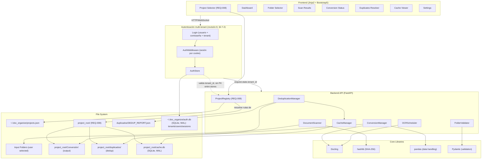
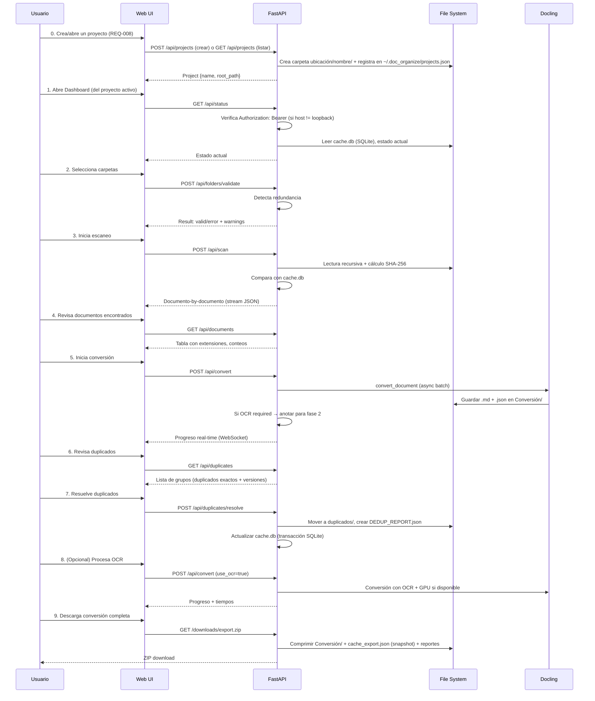

# PLAN Fase 1 — doc_organize (scanner/converter/dedup/cache/web)

**Versión**: 3.1  
**Fecha**: 2026-08-28  
**Estado**: IMPLEMENT en curso — Fase A, B, C, **C.1 (REQ-008)**, **D-1 (CLI)**, **D-2a (web:
esqueleto + auth + Project Selector + Dashboard)**, **§2.7.2 (revisión 8: autenticación
multi-usuario, logout selectivo y multi-tenant real, 4 sub-pasos)**, **§2.7.3 (revisión 10, Fase
D-2b: Folder Selector + escaneo/conversión vía web con progreso WebSocket, 2 sub-pasos)**,
**§2.7.4 (revisión 11, Fase D-2c: Cache Viewer + Export ZIP + Duplicates Resolver, 3 sub-pasos)**
y **el backlog de `§15` (revisión 12, items 1/2/3/5/6) completadas** — ver `§13`. Reemplaza a
`§2.7.1` (revisión 7, ❌ SUPERSEDIDO, nunca implementado). `§14` (revisión 9): análisis de dos
decisiones de alcance abiertas, veredicto GO para dejarlas como están. `§15` (revisión 12):
AUDIT_PLAN del roadmap restante — GO_CONDICIONAL; **mkdocs.yml corregido y verificado con `mkdocs
build --strict` (exit 0), README/docs reescritos con contenido real, matriz de CI ampliada a
3.10-3.14 (sin confirmar en verde todavía, no ejecutable en este entorno), benchmark de 100 PDFs
ejecutado (84.6s, 70.9 docs/min — cierra la condición crítica de la revisión 1) con un hallazgo real
que corrige el NFR de latencia de WebSocket, y DoD (`§11`) actualizado a la realidad**. Quedan
genuinamente pendientes: pruebas en navegador real (sin herramienta disponible en este entorno) y
confirmación en verde de la matriz de CI ampliada. Fases D-2a/D-2b/D-2c completas. "Settings" quedó
explícitamente fuera de alcance de D-2c (sin requisito real detrás). Historial AUDIT_PLAN
(revisión 8) — GO_CONDICIONAL para `§2.7.2`, ambas
condiciones de diseño resueltas durante IMPLEMENT (default `tenant_id="default"` aplicado; el
rate-limiting de `/login` sigue pendiente — ver `§10`); (revisión 9) — GO para `§14`; (revisión 10)
— GO_CONDICIONAL para `§2.7.3`, condición de diseño (autenticación de WebSocket implementada
explícitamente en el handler, `BaseHTTPMiddleware` no cubre rutas WebSocket) **resuelta durante
IMPLEMENT**; (revisión 11) — GO_CONDICIONAL para `§2.7.4`, condición de diseño: `POST
.../duplicates/resolve` recalcula grupos en servidor y nunca confía en rutas de archivo del
cliente (hallazgo de seguridad cerrado en el propio AUDIT_PLAN, **implementado y verificado con
tests dedicados**). Historial:
revisión 1 (identidad de proyecto, SHA-256, SQLite, async, auth, Mermaid),
revisión 2 (contradicción de auth, extra `web`, hashing único, token sin flag CLI), revisión 3
(código real ya divergía del plan: `hash_file()` tenía I/O bloqueante pese a ser `async def` —
corregido; `pydantic` usado sin declarar en `pyproject.toml` — corregido; imports sin usar en
`models.py` — corregidos; `§2.5` sincronizado con los modelos Pydantic reales), revisión 4 (cotejada
contra `.github/AUDIT_PLAN_doclink_extractor.md` y `.github/PHASE_1_READINESS_REPORT.md`, autoría
GitHub Copilot — ver nota de verificación abajo), revisión 5 (spike real de detección de OCR (§2.4)
ejecutado con 3 documentos de prueba — condición antes marcada "pendiente" ahora resuelta con
evidencia, incluyendo un hallazgo de dependencias no previsto (`docling[rapidocr]` necesario para
que el OCR funcione en absoluto)), revisión 6 (REQ-008 Gestión de Proyectos especificado e
implementado como Fase C.1: `ProjectRegistry`, `ProjectValidator`, CLI `project create/list`,
endpoints `/api/projects`), revisión 7 (hallazgo de Fase D-2a — el bearer token no es utilizable por
un navegador real; diseñada la autenticación por cookie de sesión de credencial única, `§2.7.1` —
**superseded** en la revisión 8 por no soportar multi-usuario), **revisión 8 (esta): a petición
explícita del usuario, ampliada a autenticación multi-usuario con logout selectivo y multi-tenant
real (organizaciones con N usuarios y N proyectos); nuevo módulo `auth/` (SQLite+WAL, sin
dependencias nuevas), cambio de contrato en `ProjectRegistry` (`tenant_id`), retirada del bearer
compartido; `§2.7.2` implementado por completo en sus 4 sub-pasos, en verde (140 tests)**,
revisión 9 (a petición explícita del usuario, análisis formal con opciones de dos decisiones de
alcance que quedaron implícitas durante IMPLEMENT — no validar `tenant_exists()` en `§2.7.2`
sub-paso 3/4, y el anidamiento de rutas de `DocumentConverter` (Fase D-1) — sin cambios de código,
solo documentación y AUDIT_PLAN, `§14`), **revisión 10: siguiente hito del roadmap acordado con el
usuario tras cerrar `§2.7.2` — Fase D-2b, diseñada como `§2.7.3`: `ScanCommand.run_streaming()`
(nuevo, aditivo — `run()` no cambia de contrato), `web/routes/scan.py` (Folder Selector + WebSocket
de progreso), hallazgo de diseño real encontrado durante el propio AUDIT_PLAN (no en IMPLEMENT):
`BaseHTTPMiddleware` no protege rutas WebSocket, así que la sesión debe validarse a mano en el
handler; **implementada por completo en 2 sub-pasos, en verde (163 tests)**. Hallazgo real de
IMPLEMENT no anticipado en el diseño: `ScanCommand` se extrajo de `main.py` a un módulo propio
(`scan/scan_command.py`) porque pasó a ser orquestación compartida entre el CLI y la web, no
exclusiva del CLI, **revisión 11 (esta): siguiente hito acordado con el usuario tras cerrar
`§2.7.3` — Fase D-2c, diseñada como `§2.7.4`: Cache Viewer (solo lectura de `cache.db`), Export ZIP
(`Conversión/` + `cache_export.json` + `DEDUP_REPORT.json`, sin logs — no existe fichero de log por
proyecto hoy) y Duplicates Resolver (re-escanea `folders.json` en cada `GET`/`POST`, sin estado de
servidor entre medias); "Settings" queda explícitamente fuera de alcance por no tener requisito real
detrás. Hallazgo de seguridad encontrado y cerrado en el propio AUDIT_PLAN: un diseño intermedio que
se descartó habría dejado que el cliente eligiera qué ruta de archivo mover vía
`duplicates/resolve`; el diseño final recalcula los grupos en el servidor y solo acepta elecciones
que coincidan con miembros reales de un grupo recién detectado. **Implementada por completo en 3
sub-pasos, en verde (182 tests) — Fase D-2c queda cerrada, con ella toda la interfaz web planeada
salvo Fase E (integración + docs)**, **revisión 12 (esta): a petición explícita del usuario,
AUDIT_PLAN del roadmap restante (`§15`) — no un diseño nuevo, una verificación del estado real del
repo contra cada ítem pendiente. Hallazgos concretos: `mkdocs.yml` tiene `nav:` roto **ahora
mismo** (apunta a ficheros inexistentes, sin entradas de los módulos reales) — `mkdocs
build`/`zensical build` fallaría hoy, lo que `CLAUDE.md` declara gate bloqueante; `README.md` y
`docs/index.md` son boilerplate genérico sin relación con el proyecto real; la matriz de CI
(`tests.yml`: Python 3.12/3.13/3.14) no coincide ni con el DoD (dice 3.10/3.11/3.12) ni con
`requires-python >=3.10` de `pyproject.toml` — 3.10/3.11 no se testean en ningún sitio pese a
declararse soportados; `docs.yml` usa `zensical build`, no `mkdocs` como documenta `CLAUDE.md`;
ninguna de las 6 páginas web construidas en D-2a/D-2b/D-2c se ha probado en un navegador real
(todo el testing ha sido backend); el benchmark de 100 PDFs y la medición de latencia de WebSocket
siguen sin ejecutarse. Veredicto GO_CONDICIONAL: backlog de Fase E reordenado por severidad real,
no implementado en esta revisión — solo auditoría**. **A petición explícita del usuario
("IMPLEMENT"), el backlog de `§15` se ejecutó en la misma revisión** (items 1/2/3/5/6): `mkdocs.yml`
corregido y verificado (`mkdocs build --strict`, exit 0); matriz de CI ampliada a 3.10-3.14;
`docs.yml` corregido (`zensical` no declarado → `mkdocs build --strict`); `README.md`/`docs/`
reescritos con contenido real; benchmark de 100 PDFs ejecutado (84.6s, 70.9 docs/min, 0 errores —
cierra la condición crítica de la revisión 1) con hallazgo real que corrige el NFR de latencia de
WebSocket (medía la cadencia de Docling, no la latencia de transporte); DoD (`§11`) actualizado a la
realidad verificada. El item 4 (navegador real) no es completable en este entorno — sustituido por
un smoke test end-to-end contra el servidor real, documentado como verificación parcial, no como
sustituto.

> **⚠️ Nota de verificación cruzada (revisión 4)**: `AUDIT_PLAN_doclink_extractor.md` y
> `PHASE_1_READINESS_REPORT.md` contienen hallazgos técnicos legítimos (ya incorporados arriba:
> regex de versión, colisión de `duplicados/`, schema de árbol, símlinks, WebSocket heartbeat, etc.)
> pero también afirmaciones que **no pude verificar y que contradicen el estado real del repo**:
> versión de Docling citada como `2.123.0` (la instalada es `2.114.0`), `core/models.py` descrito
> como "3000+ líneas" (son 319), `reportlab` marcado como instalado (no lo está), y sobre todo una
> **"aprobación de Product Owner" de la Opción A (web completa, 125h)** de la que no existía ningún
> artefacto real en el repo (`decisiones.md` no existe; no hay commit, PR ni conversación que la
> respalde). **Actualización**: preguntado directamente, el usuario confirmó el 2026-08-27 la
> **Opción A (web completa en v0.1.0)** — esta sí es ahora una decisión real, aunque el timeline de
> "125h" que la acompañaba en `AUDIT_PLAN_doclink_extractor.md` sigue sin verificar y debe tratarse
> como estimación gruesa, no compromiso. Detalle completo en `AUDIT_PLAN_doclink_extractor.md`
> (sección de verificación añadida al final).

> **Revisión 6 (2026-08-28)**: nuevo requisito **REQ-008 — Gestión de Proyectos** (§2.0), insertado
> antes de Fase D a petición explícita del usuario. Es **aditivo**: no cambia los contratos ya
> implementados de `FolderValidator`, `DocumentScanner`, `DocumentConverter`, `OCRScheduler`,
> `DeduplicationManager` ni `CacheManager` (todos siguen recibiendo rutas concretas como hoy); solo
> añade una capa por encima que resuelve esas rutas a partir de la carpeta de un proyecto. Ver
> AUDIT_PLAN al final de `§2.0` para riesgos y veredicto.

---

## 1. Visión General

**Nombre**: `doc_organize` Fase 1 (MVP) — antes referenciado como `doclink-extractor`; tras AUDIT_PLAN se confirma que esto **no** es una aplicación independiente, sino la primera entrega funcional del propio paquete `doc_organize` (v0.1.0), implementando los módulos ya previstos en [`SHARED_INSTRUCTIONS.md`](../SHARED_INSTRUCTIONS.md): `scanner/`, `converter/`, `cache/`, `dedup/` y (adelantado desde v0.2.0) `web/`.

**Propósito**: Automatizar la conversión de documentos (PDF, Word, Excel, imágenes, etc.) a formatos estándar (Markdown con Mermaid, JSON) utilizando la librería [Docling](https://docling.ai/). La aplicación gestiona:
- Selección flexible de carpetas de entrada (validando no-redundancia)
- Conversión batch con soporte OCR en dos fases
- Detección y resolución de duplicados y versiones conflictivas
- Caché con SHA-256 respaldada en SQLite para detectar cambios
- Interfaz web interactiva con Jinja2

**Caso de uso primario**: Equipo de documentación que necesita normalizar repositorios de documentos heterogéneos en markdown versionado.

---

## 2. Requisitos Funcionales

> **Nota (AUDIT_PLAN revisión 3)**: IMPLEMENT ya arrancó — `src/doc_organize/core/models.py` existe
> y es la **fuente de verdad real** de los modelos de datos: usa `pydantic.BaseModel` para los
> modelos públicos/serializables (API, JSON) y variantes `XxxInternal` como `@dataclass` para el
> hot path de escaneo (evitar overhead de validación Pydantic en 10K+ archivos), con `.to_pydantic()`
> para convertir al límite del sistema. Los bloques `@dataclass` en `§2.2`, `§2.3` y `§2.6` de abajo
> son pseudocódigo ilustrativo de la forma del contrato, no el tipo real — ante cualquier duda,
> `core/models.py` manda.

### 2.0 Gestión de Proyectos (REQ-008)

**Descripción**: Antes de seleccionar carpetas (REQ-001), el usuario crea o abre un **proyecto**:
una carpeta de trabajo con nombre único que aglutina todo lo ya implementado (configuración de
carpetas de entrada, caché, conversión, duplicados). Cada proyecto vive en la ubicación que el
usuario elija; el nombre debe ser válido en cualquier sistema de archivos soportado
(Windows/macOS/Linux), ya que la carpeta del proyecto podría sincronizarse o moverse entre sistemas.

**Criterios de aceptación**:
- [ ] Crear un proyecto: nombre único + ubicación base (carpeta padre) elegida por el usuario → crea `<ubicación>/<nombre>/`
- [ ] Nombre de proyecto validado como seguro en cualquier sistema de archivos: rechaza
      `< > : " / \ | ? *` y caracteres de control, nombres reservados de Windows (`CON`, `PRN`,
      `AUX`, `NUL`, `COM1`-`COM9`, `LPT1`-`LPT9`, con o sin extensión), espacio o punto al final,
      longitud 1-100 tras `strip()`
- [ ] Unicidad del nombre garantizada **globalmente** (no solo dentro de una ubicación) y
      **case-insensitive** (`"Mi Proyecto"` y `"mi proyecto"` colisionan), vía un registro local de
      proyectos — dos proyectos con el mismo nombre en ubicaciones distintas serían ambiguos para
      seleccionarlos por nombre en CLI/web, y en Windows/macOS (filesystems case-insensitive por
      defecto) dos nombres que solo difieren en mayúsculas colisionarían de todos modos al crear la carpeta
- [ ] Listar proyectos existentes (nombre, ubicación, fecha de creación); si la carpeta de un
      proyecto registrado ya no existe (movida/borrada fuera de la app), se marca como "no
      encontrado" en el listado en vez de fallar
- [ ] Abrir un proyecto existente por nombre → resuelve su carpeta raíz
- [ ] La carpeta raíz del proyecto pasa a ser la base de: `folders.json` (REQ-001), `cache.db`
      (REQ-006), `Conversión/` (REQ-003), `duplicados/` (REQ-005) — ver `§7` para el layout completo
- [ ] `--project <nombre>` en CLI (y selector de proyecto en `web/`, ver nota en REQ-007) resuelve
      automáticamente estas rutas; los flags explícitos ya implementados (`--output-dir`,
      `--cache-file`, etc.) se mantienen para uso avanzado sin proyecto y tienen prioridad si se
      combinan con `--project` (con warning de que se está sobrescribiendo la ruta derivada) — este
      requisito es **aditivo**, no rompe el uso ya soportado de Fase B/C
- [ ] `base_location` debe existir ya (no se crean árboles de carpetas intermedios automáticamente);
      si no es escribible, o el nombre ya existe (case-insensitive), error claro antes de crear
      ningún estado parcial (ni carpeta ni entrada en el registro); si falla después de crear la
      carpeta (p.ej. al escribir `project.json` o al registrar), se hace rollback borrándola
- [ ] **Fuera de alcance de REQ-008 (MVP)**: eliminar o renombrar un proyecto ya creado — candidato
      a v0.1.1

**Contrato**:
```python
class Project(BaseModel):
    name: str
    root_path: str
    created_at: str  # ISO 8601

class ProjectNameValidation(BaseModel):
    """Resultado dedicado (revisión 6, AUDIT_PLAN): no reutiliza ValidationResult de REQ-001 —
    ese modelo es semánticamente de rutas de carpeta (clean_paths: list[str]), no de un único
    identificador de proyecto; forzarlo ahí sería un smell de ISP."""
    is_valid: bool
    warnings: list[str]
    normalized_name: str | None  # nombre tras strip() + normalización Unicode NFC, si es válido

class ProjectValidator:
    """Valida nombres de proyecto (REQ-008): seguros en cualquier sistema de archivos.
    Sincrono a proposito, igual que FolderValidator: no toca disco, solo valida el string.
    Normaliza a NFC (unicodedata.normalize) antes de validar, para evitar que acentos en forma
    decompuesta (frecuente en macOS/APFS) se traten como nombres distintos de su forma precompuesta."""

    def validate_name(self, name: str) -> ProjectNameValidation:
        ...

class ProjectRegistry:
    """Registro local de proyectos. Vive en ~/.doc_organize/projects.json — fuera de cualquier
    proyecto concreto, porque cada proyecto puede estar en una ubicacion distinta elegida por el
    usuario. Async con context manager, igual que CacheManager: aunque las escrituras son poco
    frecuentes (crear un proyecto es una accion deliberada y rara, no un hot path como cache.db),
    web/ (Fase D) podria recibir creaciones concurrentes, así que aplica lock en proceso
    (asyncio.Lock) + escritura atomica (fichero temporal + os.replace). Si la contencion real lo
    exige, el mismo camino que cache.json -> SQLite (AUDIT_PLAN revision 1) aplicaria aqui."""

    async def __aenter__(self) -> "ProjectRegistry": ...
    async def __aexit__(self, *exc_info: object) -> None: ...

    async def create_project(self, name: str, base_location: Path) -> Project:
        """Valida con ProjectValidator, valida unicidad CASE-INSENSITIVE contra el registro
        (evita colisiones reales en Windows/macOS, donde el sistema de archivos ya es
        case-insensitive aunque la comparacion de strings no lo sea — AUDIT_PLAN revision 6),
        requiere que base_location ya exista (no crea arboles de carpetas intermedios), crea
        <base_location>/<name>/ (+ project.json dentro, ver §7), registra, devuelve el Project.
        Orden de operaciones para no dejar estado parcial: (1) validar nombre + unicidad + que
        base_location exista y sea escribible, todo en memoria; (2) crear la carpeta en disco;
        (3) escribir project.json dentro; (4) registrar en projects.json. Si (3) o (4) fallan,
        se hace rollback borrando la carpeta creada en (2) antes de propagar el error."""
        ...

    async def list_projects(self) -> list[Project]:
        """Verifica root_path.exists() por proyecto; no falla si alguno no existe."""
        ...

    async def get_project(self, name: str) -> Project:
        """Lanza ProjectNotFoundError si no esta registrado (comparación case-insensitive)."""
        ...
```

Nuevas excepciones en `core/exceptions.py`: `ProjectError` (base), `ProjectNameError`,
`ProjectAlreadyExistsError`, `ProjectNotFoundError`.

> **AUDIT_PLAN de REQ-008 (revisión 6, 2026-08-28)** — ver `§9.7` y el bloque de riesgos añadido en
> `§10` para el detalle completo. Veredicto: **GO** para especificación — diseño aditivo y de bajo
> acoplamiento con lo ya implementado (confirmado: ningún contrato existente cambia). Todas las
> condiciones detectadas durante el propio AUDIT_PLAN quedaron resueltas directamente en esta
> revisión del contrato (no quedan abiertas): construcción de rutas centralizada en `safe_path_join`;
> política de precedencia `--project` vs. flags explícitos ya documentada; orden de operaciones +
> rollback de `create_project` ya especificado; unicidad de nombre ahora case-insensitive; y
> `ProjectNameValidation` reemplaza el reuso indebido de `ValidationResult` (semánticamente de
> carpetas, no de un identificador de proyecto). **Implementado el 2026-08-28** (misma sesión, a
> petición explícita posterior del usuario) — 46 tests nuevos (77 en total en el proyecto), 97%
> cobertura, ver `§13`.

---

### 2.1 Selección y Validación de Carpetas (REQ-001)

**Descripción**: El usuario selecciona una o más carpetas de trabajo. El sistema las valida para evitar inclusiones redundantes.

**Criterios de aceptación**:
- [ ] Permitir selección múltiple de carpetas (UI + CLI)
- [ ] Validar que ninguna carpeta sea subcarpeta de otra (ej: `/repo` y `/repo/docs` → error)
- [ ] Mostrar advertencia clara si se detecta redundancia
- [ ] Almacenar la configuración de carpetas en JSON para reutilizar — dentro de un proyecto
      (REQ-008), esto es `<project_root>/folders.json`; fuera de un proyecto (uso avanzado), la
      ruta se sigue pasando explícitamente
- [ ] Soportar rutas absolutas y relativas

**Contrato**:
```python
class FolderValidator:
    def validate_folder_set(self, paths: list[str]) -> ValidationResult:
        """
        Valida que ninguna ruta sea subcarpeta de otra.
        
        Returns:
            ValidationResult con is_valid, warnings (list), clean_paths (list)
        """
        ...
```

---

### 2.2 Escaneo Recursivo de Documentos (REQ-002)

**Descripción**: Lectura recursiva de todas las carpetas seleccionadas, identificación de documentos por extensión.

**Criterios de aceptación**:
- [ ] Soportar extensiones: `.pdf`, `.docx`, `.doc`, `.xlsx`, `.xls`, `.pptx`, `.ppt`, `.png`, `.jpg`, `.jpeg`, `.tiff`, `.bmp`
- [ ] Generar reporte con conteo de documentos por extensión
- [ ] Mostrar nombre completo de documento + tooltip con ruta completa (en UI)
- [ ] Registrar árbol de directorios en JSON (para restaurar estructura) — schema ya concretado en `core/models.py::DirectoryTree`/`DirectoryTreeNode` (revisión 4: cierra el hueco "formato no definido" señalado en `AUDIT_PLAN_doclink_extractor.md`)
- [ ] Ignorar archivos ocultos (`.git`, `__pycache__`, `.DS_Store`)
- [ ] **Fuera de alcance (revisión 4)**: no se parsea `.gitignore` del repo escaneado; solo aplica la lista fija de nombres ocultos de arriba. Decisión explícita para no ambigüedad, no un olvido
- [ ] Symlinks: no se siguen por defecto (evita bucles infinitos y escapar de las carpetas seleccionadas); tratar como archivo/carpeta opaco en el árbol
- [ ] Rutas largas en Windows (>260 caracteres): usar `pathlib.Path` en todo el escaneo, que soporta rutas largas nativamente en Python 3.10+

**Contrato** (AUDIT_PLAN cond. 3 — I/O de disco recursiva ⇒ contrato async con context manager, según convención de `SHARED_INSTRUCTIONS.md`):
```python
class DocumentScanner:
    async def __aenter__(self) -> "DocumentScanner":
        return self

    async def __aexit__(self, *exc_info: object) -> None:
        """Libera recursos (workers, handles de archivo abiertos)."""
        ...

    async def scan_folders(self, paths: list[str]) -> ScanResult:
        """
        Escanea recursivamente carpetas y descubre documentos (asyncio, no bloqueante).
        El hash de cada `DocumentMetadata.sha256_hash` se calcula llamando a
        `utils.hash_utils.hash_file()` — única fuente de verdad para el hashing
        (AUDIT_PLAN revisión 2: evita una segunda implementación divergente en CacheManager).

        Returns:
            ScanResult con:
              - documents: list[DocumentMetadata]
              - summary: dict[str, int]  # {"pdf": 42, "docx": 15, ...}
              - tree: dict  # estructura de árbol de directorios
        """
        ...

@dataclass
class DocumentMetadata:
    full_path: str          # ruta absoluta del documento
    display_name: str       # nombre único (para tooltip)
    extension: str          # extensión detectada
    size_bytes: int         # tamaño del archivo
    modified_time: float    # timestamp de última modificación
    sha256_hash: str        # SHA-256 del archivo (para dedup, alineado con SHARED_INSTRUCTIONS.md)
```

> `FolderValidator.validate_folder_set` (REQ-001) permanece **síncrono**: opera solo sobre strings
> en memoria (sin tocar disco), por lo que no aplica la convención asyncio de I/O. Documentado aquí
> para que una futura auditoría no lo marque de nuevo como inconsistencia.

---

### 2.3 Conversión a Markdown + JSON (REQ-003)

**Descripción**: Conversión de documentos a Markdown (con diagramas Mermaid) y JSON, almacenados en carpeta `Conversión/`.

**Criterios de aceptación**:
- [ ] Usar Docling para conversión (validar versión mínima en `pyproject.toml`)
- [ ] Guardar salida dual: `documento.md` + `documento.json`
- [ ] Incorporar diagramas como bloques Mermaid en Markdown (cuando Docling los detecte)
- [ ] Mantener estructura de directorios original en `Conversión/` — dentro de un proyecto
      (REQ-008), `<project_root>/Conversión/`; `output_dir` sigue siendo un parámetro explícito de
      `DocumentConverter.convert_document()`, sin cambios de contrato
- [ ] Metadata en JSON: título, autor, fecha de creación, tamaño original, hash
- [ ] Registrar errores de conversión sin detener el flujo

**Contrato** (AUDIT_PLAN cond. 3 — añade context manager async, ya tenía métodos async):
```python
class DocumentConverter:
    async def __aenter__(self) -> "DocumentConverter":
        return self

    async def __aexit__(self, *exc_info: object) -> None:
        """Cierra el backend Docling y libera workers."""
        ...

    async def convert_document(
        self, 
        source_doc: DocumentMetadata,
        output_dir: Path,
        use_ocr: bool = False
    ) -> ConversionResult:
        """
        Convierte un documento a Markdown + JSON.
        
        Returns:
            ConversionResult con:
              - success: bool
              - markdown_path: str | None
              - json_path: str | None
              - error: str | None
              - ocr_required: bool  # si True, posponer a segunda vuelta
        """
        ...

@dataclass
class ConversionResult:
    source_path: str
    markdown_path: str | None
    json_path: str | None
    success: bool
    error: str | None
    ocr_required: bool = False
    duration_seconds: float = 0.0
```

---

### 2.4 Detección OCR y Fase 2 (REQ-004)

**Descripción**: Documentos que requieran OCR se posponen. En una segunda vuelta, se procesan con GPU si está disponible.

> **✅ Spike ejecutado y CONFIRMADO (revisión 5, 2026-08-27)**: generé 3 documentos de prueba
> (`native.pdf` con texto embebido real vía matplotlib, `scanned.pdf` e imagen `scanned.png` sin
> capa de texto, renderizados con PIL) y los convertí con Docling `2.114.0` real, comparando
> `do_ocr=False` vs `do_ocr=True`. Resultado empírico:
>
> | Documento | `do_ocr` | texto extraído | `confidence.parse_score` | `confidence.ocr_score` |
> |---|---|---|---|---|
> | native.pdf | False | 190 chars (correcto) | `1.0` | `NaN` |
> | scanned.pdf | False | 0 chars (vacío) | `NaN` | `NaN` |
> | scanned.pdf | True | 189 chars (recuperado por OCR) | `NaN` | `0.99` |
> | scanned.png | (default) | 190 chars (recuperado por OCR) | `NaN` | `0.99` |
>
> **Señal de detección confirmada**: `result.confidence.parse_score` es `NaN` cuando el documento
> no tiene capa de texto nativa extraíble — esa es la condición de `ocr_required=True`, combinada
> con longitud de texto extraído ≈0 tras una primera pasada con `do_ocr=False` (rápida, sin motor
> de OCR). No hace falta heurística por confianza aproximada ni por extensión de archivo.
>
> **Hallazgo adicional relevante para `§5` (dependencias)**: con `do_ocr=True` y las
> `OcrAutoOptions` por defecto (`bitmap_area_threshold=0.05`), Docling decide **por página**
> internamente si invocar el motor de OCR — en un documento con `native.pdf` no se disparó OCR
> (`ocr_score` siguió `NaN`), y en `scanned.pdf` sí (`ocr_score=0.99`). El motor que se usó fue
> **RapidOCR vía `onnxruntime`** (CPU, sin necesitar `torch`) — pero el paquete `rapidocr` **no
> viene con `docling>=2.0.0` a secas**; en este entorno estaba instalado aparte. Docling declara un
> extra `rapidocr` (`docling[rapidocr]`) que garantiza el motor de OCR CPU-only sin arrastrar
> `torch`/`torchvision`. Esto simplifica `§5`: `torch`/`torchvision`/`opencv-python` pasan a ser
> **aceleración GPU opcional**, no un requisito para que el OCR funcione en absoluto.

**Criterios de aceptación**:
- [ ] Detectar documentos que requieran OCR (imágenes escaneadas, PDF sin OCR)
- [ ] Registrar estado OCR en JSON: `ocr_required: true`, `gpu_candidate: true/false`
- [ ] Reporte visual de documentos pendientes OCR
- [ ] Permitir iniciar procesamiento OCR desde UI (manual o automático)
- [ ] Usar GPU si `torch` y `cuda` están disponibles (no obligatorio)
- [ ] Registrar tiempo de procesamiento OCR vs. CPU

**Contrato** (revisión 5 — implementación concreta confirmada por spike, no pseudocódigo genérico):
```python
class OCRScheduler:
    async def detect_ocr_candidates(self, docs: list[DocumentMetadata]) -> list[DocumentMetadata]:
        """
        Convierte cada documento con PdfPipelineOptions(do_ocr=False) (pasada rápida, sin
        motor de OCR). Un documento se marca ocr_required=True si
        result.confidence.parse_score es NaN Y el texto extraído está vacío/near-vacío —
        confirmado empíricamente: PDF nativo -> parse_score=1.0, texto presente;
        PDF/imagen sin capa de texto -> parse_score=NaN, texto vacío.
        """
        ...

    async def process_with_ocr(
        self,
        docs: list[DocumentMetadata],
        use_gpu: bool = False
    ) -> list[ConversionResult]:
        """
        Reconvierte los documentos marcados con PdfPipelineOptions(do_ocr=True).
        Motor por defecto: RapidOCR vía onnxruntime (CPU, sin torch). use_gpu=True
        solo cambia a un motor acelerado por GPU si está disponible (torch/cuda) —
        es una optimización de velocidad, no un requisito funcional. Tras la
        conversión, result.confidence.ocr_score no-NaN confirma que el motor de
        OCR se invocó realmente (permite registrar tiempo OCR vs. CPU, REQ-004).
        """
        ...
```

---

### 2.5 Deduplicación y Resolución de Versiones (REQ-005)

**Descripción**: Limpieza de duplicados exactos y resolución de versiones conflictivas. Los duplicados se mueven a carpeta `duplicados/` manteniendo estructura original.

**Criterios de aceptación**:
- [ ] Comparar documentos por SHA-256 (duplicados exactos)
- [ ] Detectar versiones: mismo nombre base + sufijo de versión — regex concreta (revisión 4):
      `r'^(?P<base>.+?)[_\-]?(v\d+|final|draft)$'` aplicada al stem del nombre de archivo (sin extensión)
- [ ] Mostrar reporte separado: **Duplicados exactos** vs. **Versiones conflictivas**
- [ ] Permitir usuario seleccionar qué documento mantener (por defecto: más antiguo)
- [ ] Mover documentos descartados a `<root>/duplicados/` manteniendo estructura original — dentro
      de un proyecto (REQ-008), `<root>` es `<project_root>`; `duplicates_dir` sigue siendo un
      parámetro explícito de `DeduplicationManager.resolve_duplicates()`, sin cambios de contrato
- [ ] **Colisión si `duplicados/` ya existe (revisión 4)**: mergear en la carpeta existente
      preservando rutas relativas; si un archivo con la misma ruta relativa ya existe ahí, añadir
      sufijo `_<sha256[:8]>` al nombre antes de mover (nunca sobrescribir silenciosamente)
- [ ] Actualizar JSON de tracking con decisión del usuario
- [ ] Crear `duplicados/DEDUP_REPORT.json` con auditoria de duplicados

**Contrato** (AUDIT_PLAN revisión 3 — sincronizado con `src/doc_organize/core/models.py`, ya
implementado como modelos Pydantic; ese fichero es la fuente de verdad, no este pseudocódigo):
```python
class DuplicateGroup(BaseModel):
    group_id: str                          # UUID único del grupo (usado por §8.2 POST /api/duplicates/resolve)
    canonical_doc: DocumentMetadata         # el que se mantiene
    duplicates: list[DocumentMetadata]      # los que se descartan
    reason: DuplicateReason                 # enum: EXACT_DUPLICATE | VERSION_CONFLICT
    user_choice: DocumentMetadata | None    # selección del usuario

class DeduplicationManager:
    def find_duplicates(self, docs: list[DocumentMetadata]) -> list[DuplicateGroup]:
        """Detecta duplicados exactos y versiones conflictivas."""
        ...
    
    async def resolve_duplicates(
        self,
        groups: list[DuplicateGroup],
        duplicates_dir: Path
    ) -> DeduplicationReport:
        """Mueve duplicados a carpeta, crea reporte."""
        ...

class DeduplicationReport(BaseModel):
    timestamp: str                          # ISO 8601, cuándo se ejecutó el dedup
    total_exact_duplicates: int
    total_version_conflicts: int
    duplicates_folder_path: str
    audit_json_path: str
    groups: list[DuplicateGroup] = []       # detalle completo de los grupos procesados
```

---

### 2.6 Caché de Cambios (SHA-256, SQLite) (REQ-006)

**Descripción**: Sistema de caché para detectar nuevos documentos o modificaciones. Usa SHA-256
(único hash de dedup, alineado con `SHARED_INSTRUCTIONS.md`) y almacena el tracking en una base de
datos **SQLite** (`cache/` ya se documenta ahí como "Almacenamiento eficiente con transacciones
locales (SQLite)") en vez de un JSON plano — AUDIT_PLAN cond. 2: un JSON reescrito por múltiples
requests concurrentes de la web app (§2.7) es exactamente el problema de *race conditions* que
`§9.4` dejaba como riesgo abierto; SQLite lo resuelve con transacciones ACID nativas sin locking manual.

**Criterios de aceptación**:
- [ ] Crear/abrir base de datos `cache.db` (SQLite) en raíz de trabajo — dentro de un proyecto
      (REQ-008), `<project_root>/cache.db`; `db_path` sigue siendo un parámetro explícito de
      `CacheManager.__init__()`, sin cambios de contrato —, tabla `cache_entries(file_path PK, sha256_hash, timestamp, status, conversion_status)`
- [ ] Comparar hash actual con caché: si es igual → skip; si es nuevo/modificado → procesar
- [ ] Status en cache: `new`, `unchanged`, `modified`, `deleted`
- [ ] Usar `hashlib.sha256` (built-in) para el hash de dedup
- [ ] Validar que SHA-256 es determinista (mismo archivo = mismo hash) en pruebas
- [ ] Escrituras envueltas en transacción SQLite (`BEGIN IMMEDIATE` / commit) — sin necesidad de file locking manual
- [ ] Modo `WAL` activado para permitir lecturas concurrentes durante escritura (soporta el uso desde la web app)
- [ ] Reporte visual de archivos new/modified/unchanged
- [ ] Exportar snapshot de solo lectura en JSON (`cache_export.json`) únicamente para el ZIP de `§8.2 downloads/export.zip` — no es el almacén canónico

**Contrato** (AUDIT_PLAN cond. 3, backend concretado en revisión 4: `aiosqlite` — verifiqué que ya
está instalado en el entorno de desarrollo (`0.22.1`), así que se usa directamente en vez de dejar
abierta la opción `sqlite3` + `asyncio.to_thread`):
```python
@dataclass
class CacheEntry:
    file_path: str
    sha256_hash: str
    timestamp: float
    status: str  # "new" | "unchanged" | "modified" | "deleted"
    conversion_status: str | None  # "pending" | "success" | "error" | "ocr_pending"

class CacheManager:
    async def __aenter__(self) -> "CacheManager":
        """Abre la conexión SQLite (cache.db), crea el esquema si no existe, activa WAL."""
        ...

    async def __aexit__(self, *exc_info: object) -> None:
        """Cierra la conexión SQLite."""
        ...

    async def load_cache(self) -> dict[str, CacheEntry]:
        """Lee todas las entradas de cache.db."""
        ...

    async def compute_hash(self, file_path: str) -> str:
        """Delega en utils.hash_utils.hash_file() — no reimplementa el cálculo de SHA-256
        (AUDIT_PLAN revisión 2: única fuente de verdad, compartida con DocumentScanner)."""
        ...

    async def get_changes(
        self,
        cache: dict[str, CacheEntry],
        current_docs: list[DocumentMetadata]
    ) -> tuple[list[str], list[str], list[str]]:
        """
        Retorna (new_files, modified_files, unchanged_files).
        """
        ...

    async def save_entries(self, entries: list[CacheEntry]) -> None:
        """Upsert transaccional de entradas en cache.db."""
        ...
```

---

### 2.7 Interfaz Web con Jinja2 (REQ-007)

**Descripción**: Interfaz web interactiva que centraliza todas las funcionalidades: selección de proyecto, carpetas, escaneo, conversión, deduplicación, caché.

> **Nota (revisión 6, REQ-008 — especificación únicamente, Fase D sin implementar todavía)**: la
> incorporación de proyectos añade una página **Project Selector** como punto de entrada real de la
> aplicación (antes del Dashboard): crear proyecto nuevo o abrir uno existente. A partir de ahí,
> todas las rutas quedan implícitamente scoped al proyecto activo (vía sesión o prefijo de URL,
> p.ej. `/api/projects/{name}/scan` en vez de `/api/scan` a secas — a decidir en el diseño de Fase D,
> no aquí). Esto no afecta a nada ya implementado en Fase B/C.

**Criterios de aceptación**:
- [ ] Framework web: Flask o FastAPI (con Jinja2)
- [ ] Páginas:
  - **Project Selector** (REQ-008): crear proyecto (nombre + ubicación) o abrir uno existente de la lista
  - **Dashboard**: resumen de estado, última ejecución, botones de acción (del proyecto activo)
  - **Folder Selector**: selecciona carpetas, valida redundancia
  - **Scan Results**: tabla de documentos encontrados, conteo por extensión, tree visual
  - **Conversion Status**: progreso en tiempo real, errores, OCR pending
  - **Duplicates Resolver**: compare dos documentos lado a lado, permite elegir cuál descartar
  - **Cache Viewer**: muestra changelog (new/modified/unchanged), descarga snapshot `cache_export.json`
  - **Settings**: configuración de Docling, GPU, idioma OCR
- [ ] Real-time updates: WebSocket para progreso de conversión
- [ ] Export: descarga ZIP con toda la conversión, reporte en Excel/CSV
- [ ] Responsive: mobile-friendly (Bootstrap 5 o Tailwind)
- [ ] Logging visual: historial de ejecuciones, tiempos, errores
- [ ] **Autenticación (AUDIT_PLAN cond. 4, corregida en revisión 2)**: por defecto la app escucha
      solo en `127.0.0.1`. Si se expone en una interfaz distinta (`--host` ≠ `127.0.0.1`/`localhost`),
      es **obligatorio** un token (ver más abajo); **toda** ruta bajo `/api/*` y `/downloads/*` —
      incluidos los `GET` de solo lectura (`/api/duplicates`, `/api/cache`, `/`) — exige
      `Authorization: Bearer <token>` **o** una cookie de sesión válida (ver `§2.7.1`), y devuelve
      401 si falta/no coincide ninguna de las dos. Sin excepciones: varios `GET` devuelven
      `full_path` de documentos del sistema de archivos, así que también deben protegerse cuando la
      app no es loopback-only. Desde revisión 7, esto incluye también las **páginas HTML** (`/`,
      `/projects/{name}`, etc.) cuando el host no es loopback — antes solo `/api/*`+`/downloads/*`
      estaban protegidos, dejando las páginas abiertas (hallazgo de la Fase D-2a, ver `§13`)
- [ ] **Token solo por variable de entorno**: `DOC_ORGANIZE_API_TOKEN` se lee del entorno del
      proceso, no existe flag `--api-token` en el CLI — un secreto pasado como argumento queda
      visible en la lista de procesos (`ps`/Task Manager) de la máquina
- [ ] **CSRF real para API JSON/WebSocket**: la mitigación combina tres capas independientes: (a)
      validación de cabecera `Origin`/`Referer` contra el `Host` de la propia petición en cada
      request de escritura; (b) el bearer token, que un sitio de terceros no puede adjuntar; (c)
      desde revisión 7, la cookie de sesión (`§2.7.1`) se emite con `SameSite=Strict`, que los
      navegadores modernos **no envían en peticiones cross-site en absoluto** — es la mitigación
      nativa de CSRF para cookies, más fuerte que confiar solo en (a). El borrador original
      afirmaba "no se usan cookies de sesión, así que no aplica el vector CSRF clásico"; sigue sin
      aplicar, pero ahora porque la cookie que sí se usa es `SameSite=Strict`, no porque no haya cookies

#### 2.7.1 Autenticación de navegador (revisión 7, 2026-08-28) — ❌ SUPERSEDIDO por `§2.7.2`

> **Nota (revisión 8, 2026-08-28)**: el usuario pidió ampliar el alcance a múltiples usuarios,
> logout selectivo por sesión y multi-tenant real (organizaciones con varios usuarios y varios
> proyectos). El modelo de credencial única (`§2.7.1`, cookie = el propio `DOC_ORGANIZE_API_TOKEN`
> compartido) es incompatible con eso por diseño: no hay forma de distinguir usuarios ni de cerrar
> una sesión sin invalidar todas. Esta sección se conserva íntegra como historial de decisión (no se
> borra, por consistencia con el resto del documento) pero **queda reemplazada por `§2.7.2`**, que
> es el diseño vigente. Nada de `§2.7.1` llegó a implementarse, así que no hay código que revertir.

**Problema identificado en Fase D-2a**: el diseño de auth con solo bearer token protege `/api/*` y
`/downloads/*` correctamente para clientes script/curl, pero **ningún navegador real tiene forma de
adjuntar `Authorization: Bearer <token>`** en una navegación normal o en `fetch()` sin JavaScript
que lo inyecte explícitamente — y no hay ningún mecanismo para que ese JavaScript obtenga el token
de forma segura. Resultado: con la app expuesta en un host no-loopback, las páginas cargarían pero
**toda llamada a la API devolvería 401 incluso con el token correcto**.

**Opciones consideradas**:

| Opción | Resumen | Veredicto |
|---|---|---|
| A. Token en URL → `sessionStorage`, JS añade el header en cada `fetch()` | Sin cookies; el token queda expuesto brevemente en la URL (historial, logs) y cualquier XSS puede leer `sessionStorage` directamente | Descartada |
| B. HTTP Basic Auth nativo | Cero código nuevo; el navegador cachea y reenvía las credenciales automáticamente — **a cualquier petición al origen, incluidas las disparadas por una página de terceros** — reabre el vector CSRF que el diseño actual evita precisamente por no usar cookies. Sin logout ni expiración | Descartada |
| **C. Página de login + cookie de sesión (`HttpOnly`, `SameSite=Strict`), aditiva al bearer token ya implementado** | Patrón estándar; nativa del navegador (sin JS manejando el token); `SameSite=Strict` es la mitigación CSRF moderna; `HttpOnly` impide que un XSS robe la cookie (a diferencia de A) | **Elegida** |
| D. No resolverlo: exigir un reverse proxy externo (nginx + Basic Auth, VPN) para acceso no-loopback | Cero código/riesgo nuevo, pero renuncia a la experiencia "funciona desde otro dispositivo de mi LAN" que implica REQ-007 | Descartada para MVP; documentada como alternativa válida si se prefiere no mantener este código |

**Diseño (Opción C)**:
- `GET /login`: página con un formulario de un solo campo (pegar el token).
- `POST /login`: valida el valor contra `DOC_ORGANIZE_API_TOKEN`; si coincide, fija una cookie
  `doc_organize_session` con el propio valor del token (no hace falta un almacén de sesiones
  separado: solo existe una credencial válida, compartida, igual que hoy). Atributos:
  `HttpOnly=True`, `SameSite=Strict`, sin `Max-Age` (cookie de sesión, se borra al cerrar el
  navegador — evita decidir ahora una política de "recordarme"), `Secure=False` por defecto (ver
  nota de TLS abajo). Si no coincide → re-renderiza el formulario con error, sin fijar cookie.
- `POST /logout`: borra la cookie, redirige a `/login`.
- `AuthMiddleware` (ya implementado en Fase D-2a) se extiende: una petición está autenticada si
  **cualquiera** de estas dos es válida: `Authorization: Bearer <token>` (sin cambios, para
  scripts/CLI/integraciones futuras) **o** cookie `doc_organize_session` == token (nuevo, para
  navegador). La validación `Origin`/`Referer` en escrituras se mantiene para ambos casos, como
  capa adicional.
- `/login` y `/logout` quedan explícitamente exentos de la propia autenticación (si no, nadie
  podría iniciar sesión nunca).
- Páginas (`/`, `/projects/{name}`, futuras) pasan a exigir autenticación igual que `/api/*` cuando
  el host no es loopback: sin sesión ni bearer válido, redirigen a `/login` (no 401 crudo, para que
  la navegación normal tenga sentido).

**Nota de transparencia (no es una regresión, pero no estaba dicho explícitamente)**: doc_organize
no termina TLS por sí mismo. Token, cookie y credenciales de login viajan en texto plano por red si
la app se expone fuera de loopback sin un reverse proxy con TLS delante. Esto ya era cierto para el
bearer token antes de esta revisión — se documenta aquí explícitamente como limitación conocida,
con la recomendación de exponer `--host 0.0.0.0` únicamente en redes de confianza o detrás de un
proxy TLS, nunca directamente a internet.

**Contrato**:
```python
# web/routes/auth.py (nuevo)
class LoginRequest(BaseModel):
    token: str

# GET /login  -> HTML (formulario)
# POST /login -> valida LoginRequest.token contra DOC_ORGANIZE_API_TOKEN;
#                200 + Set-Cookie si coincide, 401 + re-render si no
# POST /logout -> borra la cookie, 303 a /login
```

`AuthMiddleware` (extensión, no reemplazo, de `web/auth.py`):
```python
_EXEMPT_PATHS = {"/login", "/logout"}

class AuthMiddleware(BaseHTTPMiddleware):
    async def dispatch(self, request, call_next):
        if not self._requires_auth() or request.url.path in _EXEMPT_PATHS:
            return await call_next(request)

        if not self._is_authenticated(request):
            if request.url.path.startswith(("/api/", "/downloads/")):
                return JSONResponse(status_code=401, content={"detail": "Unauthorized"})
            return RedirectResponse("/login", status_code=303)  # paginas: redirige, no 401 crudo

        # ... validación Origin/Referer en escrituras, sin cambios ...

    def _is_authenticated(self, request) -> bool:
        bearer = request.headers.get("Authorization", "").removeprefix("Bearer ").strip()
        cookie = request.cookies.get("doc_organize_session", "")
        return bearer == self.api_token or cookie == self.api_token
```

> **AUDIT_PLAN de `§2.7.1` (revisión 7, 2026-08-28)**
>
> **Riesgos funcionales**:
> - Una única credencial compartida (el propio `DOC_ORGANIZE_API_TOKEN`) sirve como "contraseña" de
>   `/login`; no hay usuarios ni logout selectivo — aceptable para el alcance actual (proceso
>   mono-usuario, sin multi-tenant), pero debe quedar explícito para no sorprender en el futuro:
>   rotar el token invalida todas las sesiones abiertas simultáneamente, no solo una.
> - Sin `Max-Age`, la cookie es de sesión de navegador (se borra al cerrar la ventana). Es una
>   elección deliberada para no tener que decidir ahora una política de expiración/"recordarme";
>   documentado en el propio diseño, no es un olvido.
> - `POST /login` fallido re-renderiza el formulario con error pero no implementa backoff ni
>   bloqueo temporal — cubierto explícitamente como riesgo BAJA en `§10` (espacio de búsqueda del
>   token es grande), no requiere mitigación adicional para el MVP.
>
> **Riesgos técnicos (LSP/ISP)**:
> - `AuthMiddleware.dispatch()` extiende su lógica de decisión (bearer O cookie) sin cambiar su
>   firma pública ni el contrato que ya consumían `web/app.py` y los tests de `§9.6` — sustituible
>   sin romper llamadores (LSP respetado). `_is_authenticated()` pasa de comprobar una sola fuente a
>   dos, pero mantiene la misma forma `(Request) -> bool`.
> - Nuevo router `web/routes/auth.py` es un módulo adicional, no una ampliación de la interfaz de
>   `routes/projects.py` — no viola ISP (los routers ya existentes no ganan métodos que no usan).
> - Único acoplamiento nuevo: `web/app.py` deberá montar `auth_router` y registrar `_EXEMPT_PATHS`
>   en el middleware — cambio aditivo, sin tocar contratos de `routes/projects.py` ni `dependencies.py`.
>
> **Riesgos de seguridad**:
> - `HttpOnly` mitiga robo de cookie vía XSS; `SameSite=Strict` mitiga CSRF de forma nativa (más
>   fuerte que la validación `Origin`/`Referer` actual, que se mantiene como capa adicional, no
>   sustituida). Ambos atributos son obligatorios en la implementación — cualquier PR que los omita
>   debe bloquearse (ya reflejado en `§11` DoD).
> - `Secure=False` por defecto es una superficie de riesgo real si se expone sin TLS — mitigado solo
>   documentalmente (recomendación de reverse proxy/red de confianza), no técnicamente. Es una
>   limitación conocida y heredada del diseño del bearer token, no introducida por esta revisión;
>   igualmente, **nunca** debe fijarse `Secure=True` sin que la app realmente sirva sobre TLS, o la
>   cookie dejaría de enviarse y el login parecería fallar silenciosamente.
> - El valor de la cookie es el token en claro (no un ID de sesión opaco ni firmado). Aceptable
>   porque ya es el mismo secreto que viaja hoy en el header `Authorization`; no aumenta la
>   superficie de exposición, solo el número de sitios donde el mismo secreto puede aparecer
>   (header y cookie). Si en el futuro se necesita revocación individual o expiración por sesión,
>   este diseño no lo soporta y requeriría un almacén de sesiones — explícitamente fuera de alcance.
>
> **Simplificaciones posibles**:
> - No se introduce un almacén de sesiones (Redis, tabla SQLite, etc.) — la cookie es el token
>   mismo. Correcto para el alcance actual (credencial única y compartida); evita la complejidad
>   añadida que sí se justificó para `cache.db` (SQLite+WAL, alta concurrencia de escritura real).
>   Aquí no hay ese patrón de acceso, así que no aplica el mismo precedente.
> - Podría fusionarse `web/routes/auth.py` dentro de `web/app.py` dado su tamaño (2 rutas). Se
>   mantiene como router separado por consistencia con `routes/projects.py` y para no mezclar
>   registro de rutas con lógica de negocio en `app.py` — no es sobre-ingeniería, es el mismo patrón
>   ya establecido en D-2a.
>
> **Veredicto: GO_CONDICIONAL** para especificación. Aprobado para implementar tal cual está
> diseñado, con una condición de proceso (no de diseño): **no escribir código hasta que el usuario
> confirme explícitamente el arranque de la implementación**, por instrucción vigente ("preguntar
> antes de ejecución de implementación"). No hay condiciones de diseño pendientes — el contrato,
> los atributos de cookie y la extensión del middleware quedan cerrados en esta revisión.
>
> **Estado (revisión 8): SUPERSEDIDO — ver `§2.7.2`.** Este veredicto GO_CONDICIONAL queda sin
> efecto porque el diseño que aprobaba ya no es el vigente.

#### 2.7.2 Autenticación multi-usuario y multi-tenant (revisión 8, 2026-08-28)

**Petición del usuario**: "Mejorar la autenticación: debe disponer de múltiples usuarios y logout
selectivo e incluir multi-tenant." Decisiones ya cerradas con el usuario (`AskUserQuestion`):
- **Tenant como entidad propia** (no "tenant = usuario"): una organización/workspace agrupa N
  usuarios y N proyectos compartidos entre ellos.
- **Usuario + contraseña** como credencial (no un token largo por usuario).

**Alcance de "tenant" para este MVP** (decisión de diseño, no preguntada explícitamente — documentada
aquí para que quede trazable): cada usuario pertenece a **exactamente un** tenant (no membresía
múltiple tipo "cambiar de organización"); dentro de un tenant, todos los usuarios ven y gestionan
todos los proyectos del tenant por igual — **no hay roles/permisos diferenciados** (ni
owner/admin/member) en este MVP. Se documenta como simplificación explícita en el AUDIT_PLAN de
abajo, no como omisión.

**Modelo de datos nuevo** (`core/models.py`):
```python
class Tenant(BaseModel):
    id: str          # slug: minúsculas, alfanumérico + guion, sin regla de nombre reservado de
                      # Windows (no es un path de filesystem, a diferencia de Project.name)
    name: str
    created_at: datetime

class User(BaseModel):
    id: str           # uuid4
    tenant_id: str
    username: str      # único dentro del tenant (no globalmente — "admin" puede existir en 2 tenants)
    created_at: datetime
    # password_hash / password_salt NUNCA en este modelo público — viven solo en AuthStore/auth.db,
    # para que ningún endpoint pueda serializarlos por accidente (p.ej. un `model_dump()` olvidado)

class Session(BaseModel):
    token: str         # opaque, secrets.token_urlsafe(32) — NO es la contraseña ni su hash
    user_id: str
    tenant_id: str
    created_at: datetime
    expires_at: datetime   # vida fija (p.ej. 24h), sin renovación deslizante — evita una escritura
                            # en auth.db en cada petición solo para refrescar expires_at
```
`Project` (ya existente) gana `tenant_id: str`, con `"default"` como valor de migración para
registros creados antes de esta revisión (ver riesgo de migración en `§10`).

**Almacenamiento — `auth/auth_store.py`, módulo nuevo (Level 2, peer de `projects/`)**:
- `AuthStore`: SQLite+WAL en `~/.doc_organize/auth.db`, async context manager (mismo patrón que
  `CacheManager`), tablas `tenants`, `users`, `sessions` (FK `users.tenant_id → tenants.id`,
  `sessions.user_id → users.id`, con `ON DELETE CASCADE` para que borrar un usuario borre sus
  sesiones automáticamente). **Se elige SQLite, no el patrón JSON de `ProjectRegistry`**: a
  diferencia de `projects.json` (datos casi planos, escritura infrecuente), aquí hay relaciones
  reales entre 3 entidades y necesitamos integridad referencial + limpieza de sesiones expiradas —
  el mismo argumento que ya justificó SQLite para `cache.db` (AUDIT_PLAN revisión 1).
- Hashing de contraseña con la **stdlib únicamente** (sin dependencia nueva): `hashlib.scrypt`
  (parámetros recomendados por OWASP: `n=2**17, r=8, p=1, dklen=64`) + salt aleatorio de 16 bytes
  por usuario vía `secrets.token_hex`. Comparación con `secrets.compare_digest` (tiempo constante).
- Tokens de sesión: `secrets.token_urlsafe(32)` — generado por el servidor, nunca derivado de la
  contraseña; es lo que viaja en la cookie, no la contraseña ni su hash.

```python
class AuthStore:
    async def __aenter__(self) -> "AuthStore": ...
    async def __aexit__(self, *exc) -> None: ...

    async def create_tenant(self, name: str) -> Tenant: ...
    async def create_user(self, tenant_id: str, username: str, password: str) -> User:
        """Username único dentro del tenant_id; lanza UserAlreadyExistsError si colisiona."""
        ...
    async def authenticate(self, tenant_id: str, username: str, password: str) -> User | None:
        """None si no existe o la contraseña no coincide — mismo mensaje de error en ambos casos
        (no revelar si el usuario existe, mitigación estándar de enumeración de usuarios)."""
        ...
    async def create_session(self, user: User) -> Session: ...
    async def get_session(self, token: str) -> Session | None:
        """None si no existe o expires_at ya pasó."""
        ...
    async def delete_session(self, token: str) -> None:
        """Logout selectivo: borra SOLO esta fila. Otras sesiones del mismo usuario, y las de
        cualquier otro usuario, quedan intactas — es la esencia del requisito pedido."""
        ...
    async def tenant_exists(self, tenant_id: str) -> bool:
        """Usado por ProjectRegistry antes de aceptar un tenant_id — ver riesgo de integridad
        referencial cross-store en el AUDIT_PLAN."""
        ...
```

**Cambio de contrato en `ProjectRegistry` (breaking, no aditivo — a diferencia de `§2.7.1`)**:
`create_project`, `list_projects`, `get_project` ganan un parámetro `tenant_id: str` obligatorio.
Los 12 tests existentes de `test_project_registry.py` necesitan actualizarse para pasarlo. El CLI
(`main.py`) usa `tenant_id="default"` de forma implícita cuando no se especifica `--tenant`, para
que `project create`/`scan --project` sigan funcionando exactamente igual que hoy sin flags nuevos
obligatorios (compatibilidad hacia atrás para el uso local de un solo operador, donde el concepto de
tenant no aporta nada).

**Web — reemplaza `§2.7.1` por completo**:
- `GET /login`: formulario usuario + contraseña (+ selector/campo de tenant, ver nota abajo).
- `POST /login`: `AuthStore.authenticate(tenant_id, username, password)`; si válido,
  `AuthStore.create_session(user)` y `Set-Cookie: doc_organize_session=<session.token>`
  (`HttpOnly`, `SameSite=Strict`, `Max-Age` = vida de la sesión — a diferencia de `§2.7.1` sí se fija
  una expiración explícita porque ahora hay estado server-side que puede vencer). Si no válido → 401
  + re-render, mismo mensaje para "usuario no existe" y "contraseña incorrecta".
- `POST /logout`: `AuthStore.delete_session(cookie_token)`, borra la cookie, redirige a `/login`.
  **Es logout selectivo por construcción**: solo se borra la fila de `sessions` cuyo token está en
  la cookie de *esta* petición — otra pestaña/dispositivo con otra sesión del mismo usuario no se ve
  afectada.
- `AuthMiddleware` ya no compara contra un secreto estático compartido: resuelve la cookie →
  `AuthStore.get_session(token)` → si existe y no expiró, adjunta `request.state.user`/`tenant_id`.
  **El bearer token compartido (`DOC_ORGANIZE_API_TOKEN`) se retira de este flujo** — ya no tiene
  sentido un secreto único cuando hay N usuarios con credenciales propias; ver nota de acceso
  programático abajo.
- Todas las rutas de `routes/projects.py` (y las futuras de D-2b/D-2c) pasan a resolver
  `tenant_id` desde `request.state.tenant_id` (vía una dependencia `get_current_user`), nunca desde
  un parámetro que el cliente pueda manipular — evita que un usuario autenticado en el tenant A pida
  `GET /api/projects?tenant_id=B` y vea datos de otro tenant.

**Nota — identificación del tenant en `/login`**: con usuario+contraseña puro, `username` no es
suficiente para saber en qué tenant autenticar (el mismo `username` puede existir en varios
tenants). Se resuelve con un campo adicional en el login: `tenant_id` (slug visible, p.ej. en la URL
`/login?tenant=acme` o un tercer campo de formulario) — es información no sensible (no es un
secreto), solo dice contra qué organización autenticar.

**Acceso programático (scripts/CI, sin navegador)**: al retirar el bearer compartido, un script deja
de tener forma de llamar a la API. Se propone (fuera del alcance mínimo de esta revisión, pero
necesario para no perder la capacidad ya soportada hoy): tokens de API personales por usuario
(`POST /api/users/me/tokens`, hash almacenado igual que una contraseña, revocables individualmente),
análogos a un Personal Access Token de GitHub. **No se diseña en detalle aquí** — se deja como
extensión explícita en `§12`/Pendiente, para no inflar aún más el alcance de esta revisión ya grande;
mientras tanto, el acceso programático puede seguir la misma sesión por cookie que un navegador
(`curl -b cookie.txt`), que ya cubre el caso de uso mínimo.

**Provisión de tenants/usuarios**: solo por CLI (mismo patrón que `project create`), no hay
auto-registro web:
```bash
python -m doc_organize tenant create "Acme Corp"          # -> tenant_id (slug), p.ej. "acme-corp"
python -m doc_organize user create alice --tenant acme-corp
# La contraseña se pide de forma interactiva (getpass.getpass()), NUNCA como argumento de CLI:
# un valor pasado como argumento queda visible en el historial de shell y en la lista de procesos
# de la máquina — mismo motivo por el que ya no existe --api-token (AUDIT_PLAN cond. 4, revisión 2)
```

> **AUDIT_PLAN de `§2.7.2` (revisión 8, 2026-08-28)**
>
> **Riesgos funcionales**:
> - Sin roles dentro de un tenant: cualquier usuario puede crear/borrar proyectos y (si se
>   implementa gestión de usuarios vía web en el futuro) potencialmente otros usuarios del mismo
>   tenant. Aceptable como simplificación explícita del MVP — no lo pidió el usuario y añadirlo ahora
>   dobla el alcance (necesitaría un modelo de permisos, endpoints de gestión, tests de cada
>   combinación rol×acción). Se documenta como candidato de una revisión futura, no como omisión.
> - Selector de tenant en `/login` por slug visible: un usuario puede intentar adivinar/enumerar
>   slugs de otros tenants (no es secreto, es como una URL de subdominio). No es un problema de
>   autorización (autenticar contra un tenant equivocado simplemente falla, `authenticate()`
>   devuelve `None` igual que credenciales incorrectas), solo de descubribilidad — aceptable.
> - Retirar el bearer compartido es un cambio de comportamiento observable para cualquier
>   integración externa que ya lo use (ninguna existe todavía en este repo, pero el CLI `web`
>   fail-fast check de `DOC_ORGANIZE_API_TOKEN` sí está implementado y sus tests dejan de tener
>   sentido tal cual). Mitigación: eliminar ese chequeo y sus tests en la misma implementación,
>   documentado explícitamente aquí para que no se lea como una regresión no intencionada.
>
> **Riesgos técnicos (LSP/ISP)**:
> - **Cambio de contrato NO aditivo en `ProjectRegistry`** (parámetro `tenant_id` obligatorio en
>   `create_project`/`list_projects`/`get_project`) — a diferencia de todo lo hecho hasta ahora en
>   esta sesión (REQ-008, `§2.7.1`), que fue siempre aditivo. Rompe binariamente cualquier código
>   existente que llame a estos métodos sin el nuevo argumento, incluidos los 12 tests de
>   `test_project_registry.py` y el `main.py` ya implementado. Mitigación: dar un valor por defecto
>   `tenant_id: str = "default"` en la firma (backward-compatible en la práctica, aunque
>   técnicamente sigue siendo una ampliación de contrato) en vez de un parámetro posicional
>   obligatorio sin default — reduce el riesgo de romper llamadores no revisados.
> - **Integridad referencial cruzada entre dos almacenes distintos**: `Project.tenant_id` vive en
>   `projects.json` (JSON) pero `Tenant` vive en `auth.db` (SQLite) — no hay FK de base de datos
>   posible entre ambos. Si alguien edita `projects.json` a mano o un tenant se borra sin borrar sus
>   proyectos, quedan proyectos con `tenant_id` huérfano. Mitigación: validar
>   `AuthStore.tenant_exists(tenant_id)` en `create_project` (falla limpio, igual que ya se hace con
>   `base_location` inexistente); para proyectos que quedan huérfanos por edición externa, aplicar
>   el mismo patrón de degradación ya usado para carpetas borradas (`missing: true`) — añadir
>   `orphaned_tenant: true` en vez de lanzar excepción en `list_projects()`.
> - `AuthMiddleware.dispatch()` cambia de una comparación O(1) en memoria a una consulta a
>   `auth.db` por petición (`get_session`). Con índice en `sessions.token` (PK), el coste es
>   equivalente al de cualquier lookup de `cache.db` ya aceptado en el diseño — no es un riesgo de
>   performance nuevo, es el mismo patrón de acceso que `CacheManager` ya valida en `§9.4`.
>
> **Riesgos de seguridad**:
> - `hashlib.scrypt` con `n=2**17` (parámetro recomendado por OWASP a 2026) tiene coste de CPU/
>   memoria notable por login (decenas-cientos de ms, ~64-128 MB por hash en curso) — aceptable para
>   tráfico de login humano (baja frecuencia), pero **es una superficie de DoS** si `/login` no tiene
>   rate-limiting: N requests concurrentes de login mal formado agotan CPU/memoria antes de fallar la
>   contraseña. Mismo riesgo BAJA ya aceptado en `§2.7.1` para fuerza bruta, pero el coste por intento
>   ahora es mucho mayor que comparar un bearer token — se sube la severidad a MEDIA y se recomienda
>   un rate-limit básico (p.ej. `slowapi` o un contador en memoria por IP) como condición, no como
>   nice-to-have.
> - El cookie de sesión sigue viajando en claro sin TLS — mismo riesgo ya documentado en `§2.7.1`,
>   sin cambios (`Secure=False` por defecto, recomendación de reverse proxy TLS).
> - Mensaje de error de login unificado ("usuario o contraseña incorrectos") evita enumeración de
>   usernames — ya incorporado al diseño, no es un riesgo pendiente, se deja constancia de que fue
>   una decisión deliberada.
> - Sesiones con expiración fija (`expires_at`, p.ej. 24h) sin invalidación al cambiar contraseña:
>   si en el futuro se añade "cambiar contraseña", debe borrar todas las sesiones del usuario (no
>   solo la actual) — anotado como requisito de esa función futura, no de esta revisión.
>
> **Simplificaciones posibles / ya aplicadas**:
> - Sin roles/permisos (ver riesgo funcional arriba) — simplificación deliberada.
> - Sin membresía multi-tenant por usuario (1 usuario = 1 tenant fijo) — evita UI de "cambiar de
>   organización" y lógica de sesión con tenant activo seleccionable; se puede añadir después sin
>   romper el modelo (bastaría con una tabla de membresía en vez de `users.tenant_id` fijo).
> - Sin tokens de API personales todavía (ver nota de acceso programático arriba) — extensión
>   explícita fuera de esta revisión.
> - Sin job de limpieza de sesiones expiradas (`DELETE FROM sessions WHERE expires_at < now()`) —
>   las filas expiradas simplemente dejan de ser válidas en `get_session()`, pero se acumulan en
>   disco. Aceptable para el MVP (volumen bajo), candidato a un `VACUUM`/limpieza periódica futura.
>
> **Veredicto: GO_CONDICIONAL** para especificación, con dos condiciones que si son de diseño (no
> solo de proceso, a diferencia de `§2.7.1`):
> 1. `tenant_id` en `ProjectRegistry` debe llevar un valor por defecto (`"default"`), no ser un
>    parámetro obligatorio sin default, para minimizar el riesgo de romper llamadores existentes.
> 2. `/login` necesita alguna forma de rate-limiting antes de exponerse fuera de loopback, dado el
>    coste real de CPU/memoria de `scrypt` por intento (severidad subida a MEDIA arriba) — puede
>    resolverse con una dependencia nueva ligera o un contador en memoria simple; debe decidirse
>    durante IMPLEMENT, no queda cerrado en esta especificación.
> Como siempre en esta sesión: **no se escribe código hasta confirmación explícita del usuario**
> (instrucción vigente). Dado el tamaño del cambio (nuevo módulo `auth/`, migración de datos
> existentes, contrato roto de `ProjectRegistry`, reescritura completa de `web/auth.py` y
> `web/routes/auth.py`), se recomienda implementarlo en sub-pasos verificables independientemente
> — `auth_store.py` + hashing (con sus propios tests) primero, luego el middleware de sesión, luego
> el tenant-scoping de `ProjectRegistry`/rutas, luego CLI `tenant`/`user` — en vez de un cambio
> único, y pedir confirmación de nuevo antes de cada sub-paso si el usuario lo prefiere.

**Contrato** (AUDIT_PLAN cond. 3 — rutas que hacen I/O de disco o leen el caché pasan a `async def`;
`validate_folders` se mantiene síncrona porque no toca disco):
```python
# Rutas principales — TODAS requieren Depends(require_api_token) cuando WebApp.host no es
# loopback (revisión 2: sin excepciones, ni siquiera para GET — filtran full_path de documentos)
class WebApp:
    # GET /
    async def dashboard() -> str:  # renderiza index.html con estado (lee cache.db)
        ...

    # POST /api/folders/validate
    def validate_folders(paths: list[str]) -> dict:
        """Valida carpetas (sin I/O), retorna result.json"""
        ...

    # POST /api/scan
    async def scan_folders(paths: list[str]):
        """Inicia escaneo, retorna stream JSON con progreso"""
        ...

    # POST /api/convert
    async def convert_batch(doc_ids: list[str], use_ocr: bool = False):
        """Inicia conversión batch, WebSocket stream"""
        ...

    # GET /api/duplicates
    async def list_duplicates() -> dict:
        """Retorna grupos de duplicados (lee cache.db)"""
        ...

    # POST /api/duplicates/resolve
    async def resolve_duplicates(resolution: dict):
        """Aplica resolución de duplicados, mueve archivos"""
        ...

    # GET /api/cache
    async def get_cache_status() -> dict:
        """Estado del caché (lee cache.db): new/modified/unchanged"""
        ...

    # GET /downloads/export.zip
    async def export_conversion() -> StreamingResponse:
        """Descarga ZIP con conversión completa + reportes (streaming, no carga todo en memoria)"""
        ...
```

#### 2.7.3 Folder Selector + escaneo/conversión vía web con progreso WebSocket (Fase D-2b, 2026-08-28)

**Objetivo**: la contraparte web del CLI `scan` ya implementado (Fase D-1) — escanear, cachear,
deduplicar y convertir documentos de un proyecto desde el navegador, con progreso en tiempo real vía
WebSocket (decisión ya registrada en `.github/adr/001-sse-vs-websocket.md`: WebSocket, no SSE).

**Alcance de esta revisión** (decisión de diseño, no preguntada explícitamente — documentada aquí
para que quede trazable, análoga a la de `§2.7.2` sobre tenants): el botón "Escanear" del Folder
Selector dispara el pipeline **completo** (scan → diff de caché → dedup opcional → conversión →
OCR opcional) como una sola operación, igual que hace hoy el CLI `scan` con sus flags
`--deduplicate`/`--use-ocr`/`--use-gpu`. **No** se separa en pasos con revisión intermedia del
usuario (escanear, luego revisar, luego decidir convertir) — eso sería una superficie nueva
bastante mayor (estado intermedio persistente, UI de revisión) que no pidió el usuario y que además
ya tiene su propio hueco en el roadmap: la resolución interactiva de duplicados es explícitamente
**Fase D-2c** ("Duplicates Resolver"), no D-2b.

**Diseño**:

1. **`ScanCommand.run_streaming()`** (nuevo, aditivo — no cambia `run()`): el método ya
   implementado `ScanCommand.run()` (Fase D-1, usado por el CLI) se convierte en un envoltorio
   delgado sobre un nuevo `run_streaming()` que contiene la orquestación real y `yield`ea un evento
   en cada punto ya identificable del pipeline. `run()` simplemente consume el generador y se queda
   con el evento final — mismo contrato público, mismos tests de CLI sin cambios.

```python
class ScanEventType(str, Enum):
    STARTED = "started"
    SCANNED = "scanned"
    DEDUPLICATED = "deduplicated"
    FILE_CONVERTED = "file_converted"
    OCR_PROCESSED = "ocr_processed"
    COMPLETED = "completed"

class ScanEvent(BaseModel):
    event: ScanEventType
    data: dict[str, Any]

class ScanCommand:
    async def run_streaming(self, paths, output_dir, cache_db, duplicates_dir, folders_json,
                             deduplicate, use_ocr, use_gpu) -> AsyncIterator[ScanEvent]:
        """Misma orquestación que antes vivía solo en run(); ahora yieldea progreso."""
        yield ScanEvent(event=ScanEventType.STARTED, data={})
        ...  # validar carpetas, escanear, diff de cache -- igual que hoy
        yield ScanEvent(event=ScanEventType.SCANNED, data={"scanned": summary.scanned, ...})
        ...  # dedup opcional
        for doc in docs_to_process:
            result = await converter.convert_document(doc, output_dir, use_ocr=False)
            ...
            yield ScanEvent(event=ScanEventType.FILE_CONVERTED,
                             data={"path": doc.full_path, "success": result.success})
        ...  # OCR opcional, igual que hoy
        yield ScanEvent(event=ScanEventType.COMPLETED, data=asdict(summary))

    async def run(self, ...) -> ScanSummary:
        """Sin cambios de contrato: consume run_streaming() y devuelve solo el resumen final."""
        summary = ScanSummary()
        async for event in self.run_streaming(...):
            if event.event is ScanEventType.COMPLETED:
                summary = ScanSummary(**event.data)
        return summary
```

2. **`web/routes/scan.py`** (nuevo):
   - `GET /projects/{name}/scan`: página del Folder Selector (formulario: textarea de rutas, una
     por línea; checkboxes `deduplicate`/`use_ocr`/`use_gpu`).
   - `POST /api/projects/{name}/folders/validate`: valida rutas antes de escanear (`FolderValidator`,
     síncrono, sin I/O) — feedback inmediato en el formulario, sin esperar a abrir el WebSocket.
   - `WS /api/projects/{name}/scan`: recibe `{paths, deduplicate, use_ocr, use_gpu}` como primer
     mensaje, y transmite cada `ScanEvent` como JSON hasta `completed`, luego cierra la conexión.
   - Las tres rutas resuelven el proyecto vía `ProjectRegistry.get_project(name,
     tenant_id=get_tenant_id(request))` — mismo tenant-scoping ya aplicado en `routes/projects.py`
     (revisión 8, sub-paso 3/4); un usuario no puede escanear un proyecto de otro tenant.

3. **Hallazgo de diseño (no es un bug, es una brecha real del framework que hay que cerrar antes de
   implementar)**: `AuthMiddleware` extiende `starlette.middleware.base.BaseHTTPMiddleware`, que
   **no intercepta conexiones WebSocket** — Starlette pasa el scope `"websocket"` directo a la app
   interna sin llamar a `dispatch()`. Esto significa que, tal como está today, una ruta WebSocket
   nueva **no heredaría ninguna protección de sesión**, aunque el resto de la app la exija en modo
   no-loopback. Mitigación: extraer la lógica de `AuthMiddleware._authenticate()` a una función
   compartida (p.ej. `web/auth.py::authenticate_session(cookies, security, auth_db_path) ->
   Session | None`), y que el handler `WS /api/projects/{name}/scan` la llame explícitamente al
   aceptar la conexión, cerrándola (código 1008, "Policy Violation") si no hay sesión válida cuando
   el host no es loopback. Esto es una condición de diseño, no un detalle menor — sin ella, exponer
   esta ruta fuera de loopback dejaría el escaneo/conversión de cualquier proyecto accesible sin
   autenticación.

4. **Protocolo de progreso**: un mensaje JSON por evento, `{"event": "...", "data": {...}}`,
   terminando siempre con `{"event": "completed", "data": {...resumen...}}` seguido del cierre de la
   conexión por parte del servidor. Granularidad por documento (no por página ni por sub-paso de
   OCR) — es la granularidad más simple que cumple el NFR ya fijado en `§11` ("WebSocket progreso:
   actualización < 500ms"); Docling no expone progreso más fino por documento individual.

5. **Testing**: `httpx.AsyncClient`/`ASGITransport` no soportan WebSocket — para las nuevas rutas WS
   hace falta `starlette.testclient.TestClient.websocket_connect()` (viene con Starlette/FastAPI, sin
   dependencia nueva), que es síncrono; es un patrón de test nuevo en este repo, distinto del async
   usado hasta ahora para HTTP. `test_main.py` gana tests para `run_streaming()` (secuencia de
   eventos, y regresión: `run()` sigue devolviendo el mismo resumen que antes del cambio).

> **AUDIT_PLAN de `§2.7.3` (Fase D-2b, 2026-08-28)**
>
> **Riesgos funcionales**:
> - Sin cancelación: si el usuario cierra la pestaña a mitad de una conversión larga, el WebSocket
>   se cierra pero el trabajo del servidor sigue corriendo hasta terminar (Docling no es cancelable
>   a mitad de la conversión de un documento individual). No es una regresión respecto al CLI (que
>   tampoco se cancela limpiamente salvo Ctrl+C+manejo de señales, no implementado), pero en web es
>   más fácil que ocurra por accidente. Mitigación mínima: capturar `WebSocketDisconnect` y loguear;
>   no se garantiza cancelación real del trabajo en curso — aceptado como límite del MVP.
> - Relanzar un escaneo interrumpido es seguro gracias al caché incremental (`CacheManager` ya
>   evita reconvertir lo ya hecho) — mismo comportamiento idempotente que el CLI ya tiene hoy, no es
>   un riesgo nuevo introducido por el WebSocket.
>
> **Riesgos técnicos (LSP/ISP)**:
> - `run_streaming()` es aditivo (nuevo método); `run()` cambia de implementación interna pero no
>   de firma ni de tipo de retorno — los tests de integración con Docling real de `test_main.py`
>   (Fase D-1) deben seguir en verde sin modificarse, como test de regresión del refactor.
> - El gap de `BaseHTTPMiddleware` con WebSocket (punto 3 del diseño) es el hallazgo técnico central
>   de esta revisión — condición de diseño, no simplificación opcional.
>
> **Riesgos de seguridad**:
> - El gap de autenticación de WebSocket es también el riesgo de seguridad central: sin la
>   mitigación del punto 3, cualquier cliente no autenticado en la red podría escanear/convertir
>   documentos de cualquier proyecto en modo no-loopback. Debe cerrarse en la propia implementación,
>   no queda como deuda técnica aceptada.
> - `paths` llega desde el cliente igual que hoy en el CLI — sigue pasando por
>   `FolderValidator().validate_folder_set(paths)` dentro de `run_streaming()`, mismo camino que
>   `run()` ya usa; no se introduce una ruta nueva de path traversal.
>
> **Simplificaciones posibles**:
> - No separar scan/revisión/conversión en pasos independientes (ver "Alcance" arriba) — mantiene
>   el diseño alineado 1:1 con el CLI ya implementado, sin inventar un flujo interactivo nuevo que
>   D-2c cubrirá con la resolución de duplicados.
> - No implementar cancelación de trabajo en curso — aceptado para el MVP.
>
> **Veredicto: GO_CONDICIONAL**. Una condición de diseño real (no de proceso): la autenticación del
> WebSocket debe implementarse explícitamente dentro del handler antes de mergear, reutilizando
> `AuthStore.get_session()` vía una función compartida con `AuthMiddleware` — `BaseHTTPMiddleware`
> no la cubre automáticamente. El resto del diseño es aditivo y de riesgo bajo. Condición de proceso
> vigente sin cambios: no se escribe código hasta confirmación explícita del usuario.

#### 2.7.4 Cache Viewer, Duplicates Resolver y Export ZIP (Fase D-2c, revisión 11, 2026-08-28)

**Alcance de esta revisión**: de los 4 elementos que `§13`/`§12` venían listando bajo "Fase D-2c
(Duplicates Resolver, Cache Viewer, Settings, export ZIP)", esta revisión especifica **3 de los 4**.
**Settings queda deliberadamente fuera de alcance** (ver nota abajo) — no es un recorte silencioso,
es una decisión de diseño documentada.

> **Nota sobre "Settings"**: la única justificación registrada para esta página (`§4`, nodo
> `Settings`: "configuración de Docling, GPU, idioma OCR") predata la implementación real. Hoy
> `use_ocr`/`use_gpu` ya son casillas por-escaneo en el Folder Selector (`§2.7.3`) — una página de
> "ajustes por defecto" sería redundante con eso salvo que se quisiera persistir una preferencia
> por proyecto, que nadie ha pedido. Construirla ahora sería inventar alcance sin un requisito real
> detrás. Se deja fuera explícitamente; candidata a especificarse el día que haya una necesidad
> concreta (p.ej. idioma de OCR configurable, que hoy tampoco está expuesto en `DoclingConfig`).

**1. Cache Viewer** (sencillo, solo lectura):
- `GET /projects/{name}/cache` (página) + `GET /api/projects/{name}/cache` (JSON: `{entries:
  [CacheEntry], total: int}`) — lee `cache.db` con `CacheManager.load_cache()` tal cual quedó del
  último `scan`, sin volver a escanear disco. Tenant-scoped igual que el resto (`get_tenant_id`).

**2. Export ZIP**:
- `GET /downloads/projects/{name}/export.zip` — genera el ZIP en un fichero temporal (vía
  `asyncio.to_thread`, igual que el resto de I/O bloqueante de este proyecto: `hashlib.scrypt` en
  `§2.7.2`, `hash_file()` en revisión 3) y lo sirve con `FileResponse(..., background=BackgroundTask
  (os.unlink, tmp_path))` — FastAPI ya transmite `FileResponse` en streaming sin cargarlo entero en
  memoria, y el `BackgroundTask` limpia el temporal tras enviar la respuesta.
- Contenido: `Conversión/` completo, `cache_export.json` (usa el modelo `CacheExportSnapshot` ya
  existente en `core/models.py`, sin usar hasta ahora) y `duplicados/DEDUP_REPORT.json` si existe.
  **Recorte respecto al DoD original** (`§11`, "Export ZIP contiene: ... + logs"): no se incluyen
  logs porque hoy `get_logger()` nunca se invoca con `log_file=...` en ningún módulo — no existe
  ningún fichero de log por proyecto que empaquetar. Incluirlos requeriría primero cablear logging
  a fichero por proyecto, fuera de alcance de esta revisión; se propone actualizar el DoD para
  reflejar esto en vez de dejarlo como una promesa incumplida en silencio.

**3. Duplicates Resolver** (el más complejo de los tres):
- `GET /projects/{name}/duplicates` (página) + `GET /api/projects/{name}/duplicates`: relee
  `folders.json` (ya se escribe en cada `scan`, `§2.7.3`/Fase D-1) y **vuelve a escanear** esas
  carpetas en vivo (`DocumentScanner`, sin convertir nada) + `DeduplicationManager.find_duplicates()`
  — devuelve los grupos detectados **sin mover ningún archivo todavía**. Si `folders.json` no existe
  (ningún `scan` se ha ejecutado nunca en este proyecto) → `409`, mensaje claro.
- Página: lista cada grupo con radio buttons para elegir el documento canónico (por defecto, el ya
  calculado por `find_duplicates` — el más antiguo); botón "Resolver" que envía las elecciones.
- `POST /api/projects/{name}/duplicates/resolve`: **NO acepta las rutas de los documentos
  directamente del cliente** (ver hallazgo de seguridad abajo) — acepta `{resolutions: {group_key:
  full_path_elegido}}`, vuelve a ejecutar `find_duplicates()` en el servidor (mismo re-escaneo que
  el `GET`), calcula un `group_key` estable por grupo (ver abajo) y solo aplica `user_choice` cuando
  el `full_path_elegido` del cliente coincide con uno de los miembros **reales** de ese grupo
  recién recalculado. Llama a `DeduplicationManager.resolve_duplicates()` (sin cambios de contrato)
  y devuelve `{moved: int, groups_resolved: int}`.

> **Hallazgo de seguridad encontrado en el propio AUDIT_PLAN (no en IMPLEMENT — cerrado antes de
> escribir código)**: el contrato original especulativo de `§8.2` (revisión 1, previo a esta
> revisión) sugería `POST /api/duplicates/resolve` con `{resolutions: {group_id:
> "canonical_doc_id"}}`, que a primera vista parece ya seguro por usar IDs — pero el diseño
> intermedio que se consideró primero (que el cliente reenviara el `DuplicateGroup` completo,
> incluidas las rutas, tal como las recibió del `GET`) habría permitido a un usuario autenticado
> **mover un archivo arbitrario del servidor** (cualquiera al que el proceso tenga acceso, no solo
> los del proyecto) hacia `duplicados/`, con solo editar el JSON antes de enviarlo — `DeduplicationManager._move_to_duplicates`
> usa `safe_path_join` para el **destino**, pero toma la ruta de **origen** tal cual se le pasa. La
> mitigación (recalcular los grupos en el servidor en el propio `POST`, y solo aceptar `user_choice`
> si coincide con un miembro de un grupo genuino) cierra esto: el cliente nunca controla qué ruta se
> mueve, solo cuál de las rutas *ya detectadas por el servidor* se conserva.
>
> `group_key` estable (necesario porque `DuplicateGroup.group_id` de `DeduplicationManager` es un
> `uuid4` nuevo en cada llamada a `find_duplicates()` — no sirve para correlacionar el `GET` inicial
> con el re-escaneo del `POST`): `sha256("|".join(sorted(full_paths_del_grupo)))`. Estable mientras
> el conjunto de archivos no cambie entre el `GET` y el `POST` (caso normal de una sesión de
> revisión); si cambia (alguien edita el disco a mitad), ese grupo concreto simplemente no
> correlaciona y su resolución se ignora — no falla el resto de la petición.

**Contrato**:
```python
# web/routes/cache.py
class CacheEntryResponse(BaseModel):
    file_path: str
    sha256_hash: str
    timestamp: float
    status: str
    conversion_status: str | None

class CacheListResponse(BaseModel):
    entries: list[CacheEntryResponse]
    total: int

# GET /api/projects/{name}/cache -> CacheListResponse

# web/routes/downloads.py
# GET /downloads/projects/{name}/export.zip -> FileResponse (streaming, cleanup por BackgroundTask)

# web/routes/duplicates.py
class DuplicatesResponse(BaseModel):
    groups: list[DuplicateGroup]  # reutiliza el modelo ya existente (core/models.py)

class ResolveDuplicatesRequest(BaseModel):
    resolutions: dict[str, str]  # group_key -> full_path elegido

class ResolveDuplicatesResponse(BaseModel):
    moved: int
    groups_resolved: int

# GET  /api/projects/{name}/duplicates -> DuplicatesResponse (409 si no hay folders.json)
# POST /api/projects/{name}/duplicates/resolve -> ResolveDuplicatesResponse
```

> **AUDIT_PLAN de `§2.7.4` (Fase D-2c, revisión 11, 2026-08-28)**
>
> **Riesgos funcionales**:
> - "Settings" queda fuera de alcance — decisión explícita arriba, no una omisión.
> - Export ZIP sin logs — recorte explícito del DoD original (`§11`), documentado, no silencioso;
>   se recomienda actualizar el DoD en la misma implementación para que deje de prometer algo que
>   no existe.
> - `GET /api/projects/{name}/duplicates` sin `folders.json` previo (proyecto nunca escaneado) →
>   `409` con mensaje claro, no un error opaco.
>
> **Riesgos técnicos (LSP/ISP)**:
> - Los tres endpoints son aditivos: `CacheManager`, `DeduplicationManager`, `DocumentScanner`
>   quedan con el mismo contrato que ya tienen (Fase B/C) — cero cambios en Level 2. Toda la lógica
>   nueva vive en `web/routes/*.py` (Level 3), consistente con el patrón ya usado en `§2.7.3`.
> - Re-escanear en cada `GET`/`POST .../duplicates` tiene el mismo coste que un `scan` sin
>   conversión — aceptable para el MVP, mismo orden de magnitud que ya se acepta en `§2.7.3`; con
>   carpetas de 10K+ documentos (NFR `§3`) sería notablemente más lento que leer un caché, pero no
>   hay caché de "grupos de duplicados" que mantener sincronizado sin añadir complejidad real
>   (invalidación) que el alcance actual no justifica.
>
> **Riesgos de seguridad**:
> - El hallazgo central ya está arriba: `POST .../duplicates/resolve` nunca confía en una ruta de
>   archivo que venga del cliente — siempre correlaciona contra un re-escaneo propio antes de mover
>   nada. Condición de diseño, no opcional.
> - `GET /downloads/projects/{name}/export.zip` hereda la protección de auth/tenant ya existente
>   (`/downloads/*` está en `_PROTECTED_PREFIXES` de `AuthMiddleware` desde `§2.7.2`); el
>   `FileResponse` con fichero temporal debe generarse dentro del propio directorio temporal del
>   sistema, nunca dentro de `Conversión/` ni de ninguna carpeta servida por otra ruta, para no
>   crear un artefacto descargable por accidente desde otro sitio.
>
> **Simplificaciones posibles**:
> - No hay `DELETE`/edición de entradas de caché en el Cache Viewer — es de solo lectura, tal como
>   sugiere su nombre; cualquier corrección pasa por un nuevo `scan`.
> - No se cachean los grupos de duplicados entre `GET` y `POST` — cada llamada re-escanea, sin
>   estado de servidor entre medias (ver riesgo técnico arriba); simplifica el modelo mental a costa
>   de algo de repetición de trabajo.
>
> **Veredicto: GO_CONDICIONAL**. Condición de diseño (no de proceso): `POST
> .../duplicates/resolve` debe recalcular los grupos en el servidor y correlacionar por `group_key`
> derivado del contenido, nunca aceptar rutas de archivo directamente del cliente — ya incorporado
> al diseño de arriba, no queda abierto. El resto (Cache Viewer, Export ZIP) es aditivo y de riesgo
> bajo. Condición de proceso vigente sin cambios: no se escribe código hasta confirmación explícita
> del usuario, y se recomienda implementarlo en 3 sub-pasos independientes (Cache Viewer → Export
> ZIP → Duplicates Resolver, de menor a mayor complejidad) dado el tamaño combinado.

---

## 3. Requisitos No Funcionales

| Requisito | Especificación |
|---|---|
| **Python** | `>=3.10` (Docling requiere 3.10+) |
| **Performance** | Conversión batch: ~100 PDFs/minuto sin OCR (CPU x86-64) |
| **Escalabilidad** | Soportar carpetas con 10K+ documentos (streaming de UI, caché incremental) |
| **Memoria** | Conversión async: máx 500 MB para batch de 100 docs |
| **Concurrencia** | 4-8 workers async para conversión (configurable) |
| **Disponibilidad** | OCR opcional: aplicación funciona sin GPU |
| **Seguridad** | Validar rutas (no path traversal, vía `safe_path_join` centralizado), sanitizar names en HTML, bind por defecto a `127.0.0.1`; en host no-loopback, autenticación multi-usuario/multi-tenant obligatoria (`§2.7.2`, revisión 8): sesión por cookie `HttpOnly`+`SameSite=Strict` tras `/login` (usuario+contraseña, `scrypt`), sin bearer compartido; validación de `Origin`/`Referer` en escrituras |
| **Observabilidad** | Logging estructurado (JSON), tiempos en cada fase, metricas Prometheus (opcional) |
| **Reproducibilidad** | Hashes SHA-256 deterministas, misma entrada = mismo output |

---

## 4. Arquitectura Propuesta



---

## 5. Stack Tecnológico

### Dependencias principales

> **Nota de alineación (AUDIT_PLAN cond. 1 y 3, corregida en revisión 2)**: esto se aplica como
> **diff** sobre el `pyproject.toml` real de `doc_organize` (que hoy no tiene `dependencies` ni
> extras `web`/`ocr`), no como un fichero nuevo. Los paquetes OCR/GPU y el stack web se declaran
> como listas de strings en `[project.optional-dependencies]` — la sintaxis
> `{ version = ..., optional = true }` de Poetry no es válida en PEP 621 y se descarta.
> `python-magic` se sustituye por `python-magic-bin` en Windows (entorno de desarrollo actual).
> **Revisión 2**: `fastapi`/`uvicorn`/`jinja2`/`python-multipart`/`openpyxl` pasan de
> `dependencies` obligatorias a un extra `web` — son solo necesarios para `REQ-007` (interfaz web);
> alguien que use `doc_organize` únicamente como librería (`scanner`/`converter`/`dedup`/`cache`)
> no debería tener que instalar todo el stack FastAPI. `pydantic`, `aiofiles`, `pillow`,
> `python-magic(-bin)` y `pandas` sí son núcleo (los usan `FolderValidator`, el escaneo async, y
> Docling internamente — ver `§4`), y quedan en `dependencies`.
> **Revisión 4**: `aiosqlite` se añade a `dependencies` — es el backend concreto de `CacheManager`
> (§2.6), verificado como ya instalado (`0.22.1`) en el entorno de desarrollo.
> **Revisión 5 (spike OCR, 2026-08-27)**: `docling>=2.0.0` pasa a `docling[rapidocr]>=2.0.0`. El
> spike de `§2.4` confirmó que Docling **no** trae un motor de OCR por defecto — sin él,
> `do_ocr=True` no tiene nada que ejecutar. `rapidocr` (CPU, vía `onnxruntime`) es el extra oficial
> de Docling más ligero que garantiza OCR funcional sin GPU. El extra `ocr` de abajo (`torch` +
> `torchvision` + `opencv-python`) se re-etiqueta como **aceleración GPU opcional**, no como
> requisito para que el OCR funcione — sin él, el OCR sigue funcionando en CPU vía `rapidocr`.

```toml
[project]
# ...(sin cambios en name/version/etc.)
dependencies = [
    "docling[rapidocr]>=2.0.0", # extracción de documentos + OCR CPU funcional out-of-the-box (core)
    "pydantic>=2.0",            # validación (FolderValidator, modelos core)
    "aiofiles>=23.0",           # I/O async (core)
    "aiosqlite>=0.19",          # backend async de CacheManager (§2.6)
    "pillow>=10.0",             # procesamiento de imágenes (Docling lo usa)
    "pandas>=2.0",              # análisis de datos (reportes de escaneo)
    "python-magic>=0.4; sys_platform != 'win32'",
    "python-magic-bin>=0.4; sys_platform == 'win32'",
]

[project.optional-dependencies]
# dev/docs YA EXISTEN en pyproject.toml — añadir a la lista `dev` existente:
#   "pytest-asyncio>=0.21", "httpx>=0.24"
web = [
    "fastapi>=0.100",           # API web (REQ-007)
    "uvicorn>=0.23",            # servidor ASGI
    "jinja2>=3.1.0",            # templates
    "python-multipart>=0.0.6",  # form upload
    "openpyxl>=3.1",            # export Excel del dashboard (REQ-007)
]
ocr-gpu = [
    "torch>=2.0",
    "torchvision>=0.15",
    "opencv-python>=4.8",
]
```

Instalación: `pip install doc_organize` (núcleo, **OCR en CPU ya incluido** vía `docling[rapidocr]`)
· `pip install doc_organize[web]` (+ interfaz web) · `pip install doc_organize[web,ocr-gpu]`
(+ aceleración GPU opcional para OCR). El CLI `python -m doc_organize web ...` (`§8.1`) debe fallar
con un mensaje claro ("instala `doc_organize[web]`") si `fastapi` no está presente.

### Justificación de librerías

- **Docling**: Librería oficial para extracción de documentos, soporta PDF, Word, Excel, imágenes
- **FastAPI**: Modern, async-first, excelente para tareas I/O-bound como conversión batch
- **Jinja2**: Estándar de facto para templates HTML (ya incluido en FastAPI)
- **Pydantic**: Validación robust de datos estructurados (carpetas, configuración)
- **hashlib**: Nativo en Python 3.6+, no requiere dependencias externas
- **aiofiles**: I/O async para no bloquear conversión
- **torch/torchvision**: OCR con GPU (opcional, graceful degradation)

---

## 6. Flujo de Trabajo Propuesto



---

## 7. Estructura de Directorios

> **Nota de alineación (AUDIT_PLAN cond. 1)**: no se crea un repositorio/paquete nuevo. Todo lo siguiente
> se añade dentro del árbol **ya existente** de `doc_organize/` (`pyproject.toml`, `src/doc_organize/`
> con `core/` y `utils/` ya presentes como paquetes vacíos que aquí se pueblan). `_core/async_utils.py`
> se pliega dentro de `utils/` para no duplicar responsabilidad con `core/`. `pytest.ini` no aplica:
> la configuración de pytest ya vive en `[tool.pytest.ini_options]` de `pyproject.toml`.

```text
doc_organize/                      # repo existente — sin cambio de raíz
├── pyproject.toml                 # EXTENDER (no reemplazar): añadir `dependencies` + extras `web`/`ocr-gpu`
├── .env.example                   # Variables de entorno: Docling, etc. — nuevo (DOC_ORGANIZE_API_TOKEN
│                                   #   retirado en revisión 8, §2.7.2: sustituido por auth por usuario)
│
├── src/
│   └── doc_organize/
│       ├── __init__.py            # existente — exponer API pública Fase 1
│       ├── main.py                # NUEVO — punto de entrada: CLI + web
│       ├── config.py              # NUEVO — configuración centralizada
│       │
│       ├── core/                  # existente (vacío) — poblar aquí
│       │   ├── __init__.py
│       │   ├── models.py          # Dataclasses: DocumentMetadata, ConversionResult, etc.
│       │   ├── exceptions.py      # DocumentError, ConversionError, CacheError (ya nombrados en SHARED_INSTRUCTIONS)
│       │   └── constants.py       # Constantes (extensiones soportadas, etc.)
│       │
│       ├── validators/
│       │   ├── __init__.py
│       │   ├── folder_validator.py   # FolderValidator
│       │   └── project_validator.py  # NUEVO (REQ-008) — ProjectValidator, valida nombre de proyecto
│       │
│       ├── projects/                 # NUEVO (REQ-008) — Level 2, peer de scanner/converter/dedup/cache
│       │   ├── __init__.py
│       │   └── project_registry.py   # ProjectRegistry (async, ~/.doc_organize/projects.json) — HECHO
│       │                             # (D-2a); HECHO (sub-paso 3/4, revisión 8, §2.7.2) — tenant_id
│       │
│       ├── auth/                     # NUEVO (revisión 8, §2.7.2) — Level 2, peer de projects/
│       │   ├── __init__.py           # HECHO (sub-paso 1/4)
│       │   └── auth_store.py         # HECHO (sub-paso 1/4) — AuthStore (async, auth.db, SQLite+WAL):
│       │                             # tenants/users/sessions, hashing con hashlib.scrypt + secrets
│       │
│       ├── scan/                     # HECHO (Fase D-2b, §2.7.3) — Level 3, orquestación compartida
│       │   ├── __init__.py           # exporta ScanCommand, ScanSummary
│       │   └── scan_command.py       # ScanCommand (extraído de main.py): run() (Fase D-1, sin
│       │                             # cambios de contrato) + run_streaming() (nuevo, generador
│       │                             # async de ScanEvent) — usado por CLI y por web/routes/scan.py
│       │
│       ├── scanner/                  # ya listado como TODO v0.1.0 en SHARED_INSTRUCTIONS
│       │   ├── __init__.py
│       │   └── document_scanner.py   # DocumentScanner
│       │
│       ├── converter/                # ya listado como TODO v0.1.0
│       │   ├── __init__.py
│       │   ├── converter.py          # DocumentConverter
│       │   └── ocr_scheduler.py      # OCRScheduler
│       │
│       ├── dedup/                    # ya listado como TODO v0.1.0
│       │   ├── __init__.py
│       │   └── deduplication.py      # DeduplicatorService (ver AUDIT_PLAN cond. 2: alinear a SHA256)
│       │
│       ├── cache/                    # ya listado como TODO v0.1.0
│       │   ├── __init__.py
│       │   └── cache_manager.py      # CacheManager (ver AUDIT_PLAN cond. 2: alinear a SQLite)
│       │
│       ├── web/                      # adelantado desde v0.2.0 por decisión de esta Fase 1 — extra [web]
│       │   ├── __init__.py           # HECHO (D-2a) — exporta create_app()
│       │   ├── app.py                # HECHO (D-2a) — FastAPI app factory
│       │   ├── auth.py               # HECHO (D-2a; reescrito sub-paso 2/4 revisión 8, §2.7.2) —
│       │   │                         # AuthMiddleware resuelve cookie vía AuthStore.get_session()
│       │   ├── dependencies.py       # HECHO (D-2a) — get_project_registry(request); HECHO (sub-paso
│       │   │                         # 2/4) — get_auth_store(request)
│       │   ├── routes/
│       │   │   ├── __init__.py       # HECHO (D-2a)
│       │   │   ├── projects.py       # HECHO (D-2a) — POST/GET /api/projects, GET /api/projects/{name};
│       │   │   │                     # HECHO (sub-paso 3/4) — tenant_id vía get_tenant_id(request)
│       │   │   ├── auth.py           # HECHO (sub-paso 2/4, revisión 8, §2.7.2) — GET/POST /login
│       │   │   │                     # (tenant+usuario+contraseña), POST /logout (logout selectivo)
│       │   │   ├── scan.py           # HECHO (D-2b, §2.7.3) — GET /projects/{name}/scan (página),
│       │   │   │                     # POST /api/projects/{name}/folders/validate,
│       │   │   │                     # WS /api/projects/{name}/scan (progreso, auth manual) —
│       │   │   │                     # pipeline único scan+dedup+convert+OCR, igual que CLI `scan`
│       │   │   ├── duplicates.py     # HECHO (D-2c, §2.7.4, sub-paso 3/3) — GET/POST /api/projects/
│       │   │   │                     # {name}/duplicates(/resolve); resolve recalcula grupos en
│       │   │   │                     # servidor, nunca confia en rutas de archivo del cliente
│       │   │   ├── cache.py          # HECHO (D-2c, §2.7.4, sub-paso 1/3) — GET /api/projects/{name}/cache
│       │   │   └── downloads.py      # HECHO (D-2c, §2.7.4, sub-paso 2/3) — GET /downloads/projects/{name}/export.zip
│       │   ├── templates/
│       │   │   ├── base.html         # HECHO (D-2a)
│       │   │   ├── project_selector.html  # HECHO (D-2a) — página `/`
│       │   │   ├── dashboard.html    # HECHO (D-2a) — página `/projects/{name}`, de solo lectura
│       │   │   ├── login.html        # HECHO (sub-paso 2/4, revisión 8, §2.7.2) — usuario+contraseña+tenant
│       │   │   ├── folder_selector.html    # HECHO (D-2b, §2.7.3) — formulario + progreso en vivo
│       │   │   │                           # vía JS/WebSocket
│       │   │   ├── duplicates_resolver.html # HECHO (D-2c, §2.7.4, sub-paso 3/3)
│       │   │   ├── cache_viewer.html       # HECHO (D-2c, §2.7.4, sub-paso 1/3)
│       │   │   └── settings.html           # ❌ FUERA DE ALCANCE (revisión 11, §2.7.4) — ver nota
│       │   │                               # "Settings" en §2.7.4; sin requisito real detrás hoy
│       │   └── static/               # PENDIENTE — sin CSS framework por ahora (D-2a usa CSS inline mínimo)
│       │
│       └── utils/                    # existente (vacío) — poblar aquí (incluye lo antes previsto en `_core/`)
│           ├── __init__.py
│           ├── logging.py            # Logging estructurado
│           ├── path_utils.py         # safe_path_join / validación no-traversal (AUDIT_PLAN cond. seguridad)
│           ├── hash_utils.py         # hash_file() SHA256 — única fuente de verdad, usada por scanner/ y cache/ (AUDIT_PLAN cond. 2 y revisión 2)
│           └── async_utils.py        # maybe_await, streaming helpers (antes `_core/async_utils.py`)
│
├── tests/
│   ├── conftest.py
│   ├── unit/
│   │   ├── test_folder_validator.py
│   │   ├── test_project_validator.py     # NUEVO (REQ-008)
│   │   ├── test_project_registry.py      # NUEVO (REQ-008); revisión 8 añade tenant_id (PENDIENTE)
│   │   ├── test_auth_store.py            # HECHO (sub-paso 1/4, revisión 8, §2.7.2) — 18 tests:
│   │   │                                 # hashing, unicidad tenant/usuario, sesiones, logout selectivo
│   │   ├── test_web_auth.py              # HECHO (sub-paso 2/4, revisión 8, §2.7.2) — 16 tests:
│   │   │                                 # login/logout, sesión inválida/ausente, páginas vs. API
│   │   ├── test_web_scan.py              # HECHO (D-2b, §2.7.3) — 10 tests: Folder Selector,
│   │   │                                 # validación, pipeline completo por WS, auth manual de
│   │   │                                 # WebSocket, aislamiento multi-tenant vía WS
│   │   ├── test_document_scanner.py
│   │   ├── test_cache_manager.py
│   │   ├── test_converter.py
│   │   └── test_deduplication.py
│   ├── integration/
│   │   ├── test_full_workflow.py
│   │   └── test_web_api.py
│   └── fixtures/
│       └── sample_docs/             # PDFs/docs de prueba
│
├── docs/                            # convención ya fijada en SHARED_INSTRUCTIONS.md
│   ├── index.md                     # existente
│   ├── functional/                  # qué hace cada módulo (scanner, converter, dedup, cache, web)
│   ├── api/                         # documentación técnica de las clases Fase 1
│   ├── guides/
│   │   ├── installation.md
│   │   ├── quick_start.md
│   │   └── troubleshooting.md
│   └── examples/
│       └── sample_workflow.md       # Ejemplo end-to-end
│
├── scripts/
│   └── setup_env.sh                 # Setup dev env
│
└── .github/
    └── workflows/
        └── ci.yml                   # GitHub Actions (lint, test, build) — existente, extender si aplica
```

### 7.1 Layout de un proyecto (REQ-008)

El registro de proyectos vive **fuera** del repositorio, en la carpeta de usuario (no depende de
dónde esté instalado `doc_organize` ni de qué proyecto esté activo):

```text
~/.doc_organize/
└── projects.json                    # registro: {name: {root_path, created_at}}
```

Cada proyecto vive donde el usuario elija (`<base_location>/<name>/`), con este layout, generado
progresivamente a medida que se usan las funcionalidades ya implementadas:

```text
<base_location>/<nombre-proyecto>/
├── project.json                     # metadata propia (name, created_at) — portable si se copia/mueve la carpeta
├── folders.json                     # REQ-001 — carpetas de entrada configuradas
├── cache.db                         # REQ-006 — CacheManager, sin cambios de contrato
├── Conversión/                      # REQ-003 — DocumentConverter, sin cambios de contrato
└── duplicados/                      # REQ-005 — DeduplicationManager, sin cambios de contrato
    └── DEDUP_REPORT.json
```

---

## 8. Contratos de Interfaz (API)

### 8.1 CLI (línea de comandos)

```bash
# Gestión de proyectos (REQ-008)
python -m doc_organize project create "Mi Proyecto" --location /repo/workspaces
python -m doc_organize project list

# Escaneo dentro de un proyecto: rutas derivadas automáticamente de su carpeta raíz
python -m doc_organize scan --project "Mi Proyecto" \
  --paths /repo/docs /repo/papers \
  --deduplicate \
  --use-ocr false

# Uso avanzado sin proyecto (compatibilidad hacia atrás — ya implementado en Fase B/C, sin cambios)
python -m doc_organize scan --paths /repo/docs /repo/papers \
  --output-dir ./Conversión \
  --cache-file ./cache.db \
  --deduplicate \
  --use-ocr false

# web/ (Fase D) no toma --project por CLI: el proyecto activo se elige en la UI
# (Project Selector, REQ-008) una vez arrancado el servidor, no al lanzarlo.
# Uso local (por defecto): sin autenticación, solo accesible desde 127.0.0.1
python -m doc_organize web \
  --host 127.0.0.1 --port 8000 \
  --output-dir ./Conversión \
  --config ./config.yaml

# Exponer en red (revisión 8, §2.7.2 — SUSTITUYE al bearer compartido de la revisión 2):
# ya no existe DOC_ORGANIZE_API_TOKEN ni --api-token. En su lugar, se necesitan tenant(s) y
# usuario(s) provisionados por CLI ANTES de exponer el servidor — sin ningún usuario creado,
# nadie puede autenticarse y la app sigue arrancando (a diferencia del fail-fast de la revisión 2,
# que exigía la variable de entorno para arrancar; aquí no hay un secreto único que validar al
# arranque, la autenticación es por usuario y ocurre en /login).
python -m doc_organize tenant create "Acme Corp"                    # -> tenant_id: "acme-corp"
python -m doc_organize user create alice --tenant acme-corp         # pide contraseña (getpass)
python -m doc_organize web \
  --host 0.0.0.0 --port 8000 \
  --output-dir ./Conversión \
  --config ./config.yaml
```

### 8.2 API REST (FastAPI)

> **Autenticación (revisión 8, `§2.7.2` — SUSTITUYE la nota de la revisión 2/4 sobre bearer
> compartido)**: si `--host` no es `127.0.0.1`/`localhost`, **toda** ruta bajo `/api/*` y
> `/downloads/*` — incluidos los `GET` de solo lectura — y toda página HTML exigen una sesión válida
> (cookie `doc_organize_session` obtenida vía `/login`, usuario+contraseña+tenant) → sin sesión, las
> rutas `/api/*`/`/downloads/*` devuelven `401` y las páginas redirigen a `/login` (`303`). Ya no
> existe `Authorization: Bearer` como mecanismo de auth (el bearer compartido se retira en esta
> revisión). Toda escritura sigue validando `Origin`/`Referer` contra el host configurado, capa
> adicional a `SameSite=Strict` de la cookie. `tenant_id` para las operaciones de proyectos se
> resuelve **siempre** del lado servidor desde la sesión (`request.state.tenant_id`), nunca de un
> parámetro que el cliente controle — evita que un usuario autenticado en un tenant lea/escriba
> datos de otro cambiando un valor en la petición.

```yaml
POST /login:
  body: { tenant_id: str, username: str, password: str }
  response: 200 + Set-Cookie: doc_organize_session=<token> (HttpOnly, SameSite=Strict, Max-Age)
  # 401 + re-render si tenant/usuario/contraseña no coinciden (mismo mensaje en los 3 casos)

POST /logout:
  # borra SOLO la sesión de la cookie de esta petición (logout selectivo) -> 303 a /login

POST /api/projects:
  body: { name: str, base_location: str }
  response: { name: str, root_path: str, created_at: str }  # 201; 409 si el nombre ya existe
  # tenant_id NO va en el body: se toma de la sesión del usuario autenticado

GET /api/projects:
  response: { projects: [{ name: str, root_path: str, created_at: str, missing: bool }] }
  # missing=true si root_path ya no existe en disco (movido/borrado fuera de la app)
  # lista solo los proyectos del tenant de la sesión actual (revisión 8)

POST /api/folders/validate:
  body: { paths: [str] }
  response: { valid: bool, warnings: [str], clean_paths: [str] }

POST /api/scan:
  body: { paths: [str], use_cache: bool }
  response: EventStream (JSON Lines)
    { event: "started" | "scanned_file" | "completed", data: {...} }

POST /api/convert:
  body: { doc_ids: [str], use_ocr: bool, workers: int }
  response: WebSocket EventStream
    { event: "conversion_started" | "file_converted" | "ocr_required" | "completed", ... }

GET /api/duplicates:
  response: { groups: [DuplicateGroup], stats: {...} }

POST /api/duplicates/resolve:
  body: { resolutions: { group_id: "canonical_doc_id" } }
  response: { moved: int, errors: [str] }

GET /api/cache:
  response: { new_files: [str], modified_files: [str], unchanged: [str], timestamp: float }

GET /downloads/export.zip:
  response: bytes (application/zip)
```

---

## 9. Plan de Validación (AUDIT_PLAN)

Puntos críticos a verificar antes de IMPLEMENT:

### 9.1 Validación de Docling
- [ ] Versión mínima de Docling soporta todas las extensiones requeridas
- [ ] Conversión a Markdown preserva estructura (listas, tablas, code blocks)
- [ ] Diagramas Docling se traducen correctamente a bloques Mermaid (si aplica)
- [ ] JSON output contiene metadata necesaria (autor, título, fecha)

### 9.2 Validación de SHA-256
- [ ] `hashlib.sha256` disponible en Python 3.10+ sin librerías externas
- [ ] Determinismo: dos cálculos del mismo archivo producen mismo hash
- [ ] Performance: cálculo de SHA-256 no bloquea el event loop (lectura en chunks vía `asyncio`)

### 9.3 Validación de Jinja2
- [ ] Jinja2 3.1.0+ incluida en FastAPI o requiere import explícito
- [ ] Templates compilan sin errores (validate syntax en tests)
- [ ] Escaping automático de variables (seguridad XSS)

### 9.4 Validación de Concurrencia
- [ ] AsyncIO con 4-8 workers: rendimiento real sin deadlocks
- [ ] WebSocket mantiene conexión abierta durante conversión larga
- [ ] `cache.db` (SQLite, modo WAL) soporta escrituras concurrentes desde requests simultáneos sin corrupción (test de estrés con `asyncio.gather`)

### 9.5 Validación de Paths
- [ ] Rutas con espacios, caracteres especiales: validadas correctamente
- [ ] No existe path traversal: `/etc/passwd` bloqueado
- [ ] Rutas relativas vs. absolutas: normalizadas correctamente
- [ ] Toda validación de ruta pasa por un único `safe_path_join`/`PathValidator` en `utils/path_utils.py` — ningún endpoint construye rutas manualmente

### 9.6 Validación de Autenticación Web (AUDIT_PLAN cond. 4, revisión 2)
- [ ] `--host 127.0.0.1` (default): la app arranca sin exigir `DOC_ORGANIZE_API_TOKEN`
- [ ] `--host` distinto de loopback sin `DOC_ORGANIZE_API_TOKEN` definido: la app **rehúsa arrancar** con error claro
- [ ] No existe flag `--api-token`; el token solo se acepta vía variable de entorno
- [ ] Requests a **cualquier** ruta `/api/*` o `/downloads/*` (incluidos `GET`) sin `Authorization: Bearer` válido → `401` (test de integración cubriendo explícitamente `GET /api/duplicates` y `GET /api/cache`, no solo las rutas de escritura)
- [ ] Request de escritura con `Origin`/`Referer` distinto del host configurado → rechazado
- [ ] `GET /downloads/export.zip` respeta la misma exigencia de token que el resto de rutas

**Suite concreta (revisión 4, tomada de `AUDIT_PLAN_doclink_extractor.md` §4 Cond. Crítica #4 —
única parte de ese documento con contenido directamente accionable)**: `tests/integration/test_auth_security.py`
1. `--host 127.0.0.1` sin token → arranca y responde
2. `--host 0.0.0.0` sin `DOC_ORGANIZE_API_TOKEN` → falla al arrancar
3. `GET /api/duplicates` sin token, host no-loopback → `401`
4. `GET /api/duplicates` con token válido → `200` + datos
5. `POST /api/convert` con `Origin: attacker.com`, host no-loopback → `403`
6. `POST /api/convert` con `Origin` igual al host configurado → `200`

#### 9.6.1 Validación de sesión de navegador (revisión 7, `§2.7.1`) — ❌ SUPERSEDIDO por `§9.6.2`
- [ ] `GET /login` sin sesión, host no-loopback → `200` (el formulario, no redirige — evita bucle)
- [ ] `POST /login` con token correcto → `200`/`303` + `Set-Cookie: doc_organize_session=...; HttpOnly; SameSite=Strict`
- [ ] `POST /login` con token incorrecto → `401`, sin `Set-Cookie`
- [ ] `GET /` sin cookie ni bearer, host no-loopback → redirige a `/login` (no `401` crudo)
- [ ] `GET /` con cookie de sesión válida, host no-loopback → `200`
- [ ] `POST /logout` → borra la cookie; una petición posterior a `/` vuelve a redirigir a `/login`
- [ ] `GET /api/projects` con **solo** cookie de sesión (sin header `Authorization`) → `200` (la
      cookie basta para la API, no solo para las páginas)
- [ ] Petición cross-site simulada (envía la cookie con `Origin` distinto) → la cookie
      `SameSite=Strict` no debería reenviarse en un escenario cross-site real; test de contrato
      sobre los atributos de la cookie emitida (`HttpOnly`, `SameSite=Strict` presentes), ya que un
      test de integración no puede simular el comportamiento real del navegador
- [ ] `/login` y `/logout` accesibles sin sesión previa (si no, nadie podría autenticarse nunca)

> Checklist conservado como historial (nunca se implementó). El modelo de credencial única
> (`token` como valor de cookie) ya no aplica desde `§2.7.2` — ver `§9.6.2` para la suite vigente.

#### 9.6.2 Validación de autenticación multi-usuario y multi-tenant (revisión 8, `§2.7.2`)
- [ ] `user create` con contraseña vía `getpass` (no CLI arg): la contraseña nunca aparece en
      `sys.argv`/lista de procesos (test de contrato del parser, no del terminal real)
- [ ] `POST /login` con tenant/usuario/contraseña correctos → `200`/`303` + `Set-Cookie` con
      `HttpOnly`, `SameSite=Strict`, `Max-Age` presente (a diferencia de `§2.7.1`, aquí sí hay
      expiración explícita)
- [ ] `POST /login` con usuario inexistente y con contraseña incorrecta → mismo `401` y mismo
      mensaje en ambos casos (no revela si el usuario existe)
- [ ] `POST /login` con `tenant_id` inexistente → mismo `401` genérico, no un error distinto que
      revele que el tenant no existe
- [ ] Dos usuarios de **distintos** tenants → cada uno ve solo los proyectos de su propio tenant
      vía `GET /api/projects` (test central de aislamiento multi-tenant)
- [ ] Dos sesiones del **mismo** usuario (dos logins, p.ej. dos pestañas/dispositivos): `POST
      /logout` en una → la otra sigue autenticada (logout selectivo, requisito explícito del
      usuario) — test que crea 2 sesiones y verifica que solo una queda invalidada
- [ ] Sesión expirada (`expires_at` en el pasado, inyectada directamente en `auth.db` para el test)
      → tratada igual que "sin sesión": `401`/redirige a `/login`
- [ ] `AuthStore.create_user` con `username` duplicado **dentro del mismo tenant** → falla; el
      mismo `username` en **otro** tenant sí se permite (test que distingue ambos casos)
- [ ] Contraseña nunca aparece en claro en `auth.db` (test que abre la tabla `users` directamente y
      verifica que la columna es un hash, no el valor introducido)
- [ ] `ProjectRegistry.create_project` sin `tenant_id` explícito usa `"default"` (test de
      compatibilidad hacia atrás con el uso de CLI sin `tenant`, `§2.7.2` cond. 1)
- [ ] Ya no existe `Authorization: Bearer` como mecanismo válido: una petición con un header
      `Authorization` cualquiera pero sin cookie de sesión → `401` igual que sin ninguna credencial

### 9.7 Validación de Gestión de Proyectos (REQ-008, revisión 6)
- [ ] Nombres rechazados: `documento/v1`, `CON`, `con.txt`, `nombre ` (espacio final), `nombre.`
      (punto final), cadena vacía, cadena de 101+ caracteres, nombre con byte nulo o caracteres de control
- [ ] Nombres aceptados: unicode normal (acentos, ñ), espacios internos, guiones y guiones bajos
- [ ] Crear dos proyectos con el mismo nombre (incluso en ubicaciones distintas) → el segundo falla
      con error claro, sin crear carpeta ni tocar el registro
- [ ] Crear `"Mi Proyecto"` y luego `"mi proyecto"` → el segundo falla como duplicado
      (case-insensitive), no crea una carpeta que colisionaría en Windows/macOS de todos modos
- [ ] Crear un proyecto en una ubicación no escribible (permisos, unidad de red caída) → falla
      limpiamente, sin carpeta parcial ni entrada huérfana en el registro
- [ ] Crear un proyecto en una `base_location` que no existe → falla limpiamente, no crea la
      jerarquía de carpetas intermedia
- [ ] Forzar un fallo entre "carpeta creada" y "registrada" (p.ej. simulando error de disco al
      escribir `project.json`) → la carpeta creada se elimina (rollback), no queda huérfana
- [ ] `list_projects()` con un proyecto cuya carpeta fue borrada externamente → se marca
      `missing: true`, no lanza excepción
- [ ] Creación concurrente de proyectos (simular con `asyncio.gather` sobre `ProjectRegistry`) →
      sin corrupción del registro, sin nombres duplicados aceptados
- [ ] Un nombre de proyecto con secuencias tipo `..` o separadores de ruta nunca llega a
      `Path.joinpath` sin pasar antes por `safe_path_join`

---

## 10. Riesgos Identificados

| Riesgo | Severidad | Mitigation |
|---|---|---|
| Docling no soporta formato XYZ | MEDIA | Pre-validar extensiones en phase 1, graceful error si falla |
| OCR + GPU muy lento | MEDIA | Permitir desactivar OCR, usar CPU como fallback, mostrar ETA |
| `cache.db` (SQLite) corrupto | MEDIA | Modo WAL, `PRAGMA integrity_check` al abrir, backup automático antes de escrituras masivas, recrear esquema si inválido |
| Duplicados: usuario confundido en selector UI | MEDIA | Compare visual lado-a-lado, resumen claro de cambios |
| Path traversal security | ALTA | Validación estricta de rutas vía `safe_path_join` centralizado, no permitir `../`, tests de seguridad |
| Memory leak en conversión async | MEDIA | Monitoring de memoria, limits de workers, tests de stress |
| Web app expuesta sin autenticación (`--host 0.0.0.0`) | ALTA | Bind por defecto a `127.0.0.1`; `DOC_ORGANIZE_API_TOKEN` (solo env var, sin flag de CLI) obligatorio para exponer en red; la app rehúsa arrancar sin token si el host no es loopback; el token protege **todas** las rutas `/api/*` y `/downloads/*`, incluidos los `GET` que devuelven rutas de archivo; validación de `Origin`/`Referer` en escrituras |
| Núcleo de la librería fuerza dependencias web (`fastapi`/`uvicorn`) | BAJA | `fastapi`/`uvicorn`/`jinja2`/`python-multipart`/`openpyxl` viven en el extra `pip install doc_organize[web]`, no en `dependencies` obligatorias |
| Symlinks en escaneo causan bucles o escapan de las carpetas seleccionadas (revisión 4) | MEDIA | No seguir symlinks por defecto (§2.2); tratarlos como nodo opaco en el árbol |
| WebSocket de progreso con conexión prolongada (>1h) se cae sin avisar (revisión 4) | MEDIA | Heartbeat/ping-pong periódico, timeout configurable, reconexión desde el cliente |
| Race condition entre `GET /downloads/export.zip` y una escritura concurrente en `cache.db`/`Conversión/` (revisión 4) | MEDIA | El export lee un snapshot (`cache_export.json`) tomado al inicio de la petición, no el estado en vivo |
| Nombres de archivo con caracteres especiales (emoji, acentos, CJK) rompen HTML o rutas (revisión 4) | MEDIA | HTML escaping ya cubierto en DoD; añadir tests con nombres Unicode explícitos |
| Logs sin rotación llenan disco en ejecuciones largas (revisión 4) | BAJA | `logging.handlers.RotatingFileHandler` con tamaño/backup-count configurables |
| Nombre de proyecto colisiona con uno ya existente (revisión 6, REQ-008) | MEDIA | Unicidad validada contra `~/.doc_organize/projects.json` antes de crear; mensaje de error claro; sin estado parcial |
| Carpeta de proyecto movida/renombrada/borrada fuera de la app (revisión 6, REQ-008) | MEDIA | `list_projects()`/`get_project()` verifican `root_path.exists()`; se marca `missing` en vez de fallar duro; recrear/relink queda fuera de alcance de REQ-008 MVP |
| Registro de proyectos corrupto o con escritura concurrente desde `web/` (revisión 6, REQ-008) | MEDIA | Escritura atómica (fichero temporal + `os.replace`) + `asyncio.Lock` en proceso; si la concurrencia real lo exige, migrar a SQLite como ya se hizo con `cache.db` (mismo precedente, AUDIT_PLAN revisión 1) |
| Nombre de proyecto usado para path traversal al construir `<base_location>/<name>/` (revisión 6, REQ-008) | ALTA | El nombre pasa primero por `ProjectValidator` (rechaza `/`, `\`, `..`, etc.) y la ruta final se construye con `safe_path_join`, nunca concatenación manual |
| Navegador real no puede autenticarse en modo no-loopback: bearer token no lo puede adjuntar sin JS que lo inyecte (hallazgo Fase D-2a, revisión 7) | ALTA | ❌ SUPERSEDIDO — resuelto en revisión 8 (§2.7.2) por autenticación de sesión multi-usuario, ver filas siguientes |
| Token/cookie viajan en texto plano si se expone fuera de loopback sin TLS (revisión 7/8, sigue vigente) | MEDIA | doc_organize no termina TLS; recomendar reverse proxy TLS o red de confianza para cualquier exposición no-loopback — sin esto, no exponer a redes no confiables ni a internet |
| Fuerza bruta / DoS contra `/login`: `scrypt` (revisión 8, §2.7.2) tiene coste real de CPU/memoria por intento, a diferencia del simple `==` de la revisión 7 | MEDIA (subida desde BAJA en revisión 7) | Rate-limiting en `/login` obligatorio antes de exponer fuera de loopback (condición de diseño 2 del AUDIT_PLAN de §2.7.2, a decidir en IMPLEMENT) |
| Cambio de contrato no aditivo en `ProjectRegistry` (`tenant_id` nuevo parámetro) rompe llamadores existentes: 12 tests de `test_project_registry.py` y `main.py` ya implementados (revisión 8, §2.7.2) | MEDIA | Valor por defecto `tenant_id: str = "default"` en la firma (condición de diseño 1 del AUDIT_PLAN de §2.7.2), no un parámetro posicional obligatorio |
| Integridad referencial cruzada entre `auth.db` (SQLite, tenants) y `projects.json` (JSON, `Project.tenant_id`) — sin FK posible entre dos motores de almacenamiento distintos (revisión 8, §2.7.2) | MEDIA | Validar `AuthStore.tenant_exists()` en `create_project`; degradar con `orphaned_tenant: true` en `list_projects()` en vez de fallar duro, mismo patrón ya usado para `missing` |
| Retirada del bearer compartido (`DOC_ORGANIZE_API_TOKEN`) rompe cualquier acceso programático (scripts/CI) que lo usara — ninguno existe hoy en este repo, pero el fail-fast de `main.py _run_web` sí (revisión 8, §2.7.2) | BAJA | Eliminar ese chequeo y sus tests en la misma implementación; documentar tokens de API personales por usuario como extensión futura (fuera de alcance de esta revisión) |
| Sin roles/permisos dentro de un tenant: cualquier usuario puede crear/borrar cualquier proyecto del tenant (simplificación deliberada, revisión 8, §2.7.2) | BAJA | Aceptado explícitamente para el MVP — no lo pidió el usuario; documentado como candidato de una revisión futura, no como omisión |

---

## 11. Criterios de Completitud (Definition of Done)

Una implementación se considera **completa** si cumple. **Actualizado en revisión 12/IMPLEMENT
(`§15`) para reflejar el estado real verificado del repo** — hasta esta revisión ningún checkbox se
había marcado nunca, pese a que la mayoría ya estaban satisfechos.

### Code
- [x] Todos los módulos en `src/doc_organize/` tienen docstrings (Google-style)
- [x] Type hints: 100% de cobertura en funciones públicas (`mypy src` limpio, 40 ficheros)
- [x] No hay `# type: ignore` sin justificar (único caso, `web/auth.py`, con comentario explicando
      por qué — cerrado en esta revisión)
- [x] Linting con Ruff: 0 errores, formato con Ruff
- [x] Tests: ≥80% cobertura de código (97% real, `pytest --cov`)
- [ ] Tests pasan en Python 3.10, 3.11, 3.12 — **matriz de CI corregida en esta revisión** a
      `3.10/3.11/3.12/3.13/3.14` (coincidía con 3.12/3.13/3.14 antes, dejando 3.10/3.11 —el mínimo
      declarado en `requires-python`— sin verificar en ningún sitio); **sigue sin marcarse hecho
      porque no se ha podido ejecutar esa matriz todavía** (este entorno de desarrollo es Python
      3.14 únicamente) — queda pendiente de que el pipeline de CI corra y confirme

### Documentación
- [x] README.md: instrucciones instalación + quickstart (reescrito en esta revisión — antes era
      boilerplate genérico de plantilla, sin relación con el proyecto real)
- [x] docs/guides/quick_start.md + docs/guides/installation.md + docs/guides/troubleshooting.md (creados en esta revisión)
- [x] docs/functional/: qué hace cada módulo (creado en esta revisión, cubre los 11 módulos reales:
      core, utils, validators, scanner, converter, dedup, cache, projects, auth, scan, web)
- [x] docs/api/: diagrama de arquitectura (Mermaid, capas 1/2/3) + referencia generada por
      mkdocstrings desde los docstrings ya existentes (creado en esta revisión)
- [x] Docstrings de módulos: incluyen ejemplos de uso (patrón ya seguido desde Fase A)
- [x] `mkdocs.yml` `nav:` actualizado — **antes apuntaba a ficheros inexistentes y `mkdocs build
      --strict` fallaría hoy** (contenido de plantilla genérico de IA, sin ninguna entrada de los
      módulos reales); corregido y verificado en esta revisión: `mkdocs build --strict` pasa limpio
      (exit 0, sin warnings de links rotos)

### Funcionalidad
- [x] Todas las REQ-* pasan acceptance tests
- [~] Web UI funciona en Chrome, Firefox, Safari (responsive) — **no verificado en navegador real
      (sin herramienta de automatización de navegador disponible en este entorno)**. Se hizo en su
      lugar un smoke test contra el servidor real (`python -m doc_organize web`, no el harness de
      tests): las 6 páginas devuelven `200` con contenido esperado, `POST /login`/`POST /logout`
      fijan/borran la cookie de sesión correctamente, `GET .../duplicates` devuelve `409` sin
      escaneo previo y `200` con grupos reales tras uno, y el export ZIP descarga un fichero válido
      — confirma que el servidor y las rutas funcionan de punta a punta fuera del test harness, pero
      **no** que el JavaScript (`fetch`, `WebSocket`) se ejecute correctamente en un motor de
      navegador real, ni el renderizado visual/responsive. Queda como verificación pendiente
      genuina, no asumida como hecha
- [x] Export ZIP contiene: Conversión/ + cache_export.json (snapshot de cache.db) + DEDUP_REPORT.json
      — **recorte confirmado respecto al texto original**: no incluye logs, porque ningún módulo
      invoca `get_logger(log_file=...)` — no existe ningún fichero de log por proyecto que
      empaquetar (decisión documentada en `§2.7.4`, no un olvido)
- [x] OCR graceful degradation: funciona sin GPU/torch (motor CPU por defecto, RapidOCR)
- [x] REQ-008: crear/listar/abrir proyecto funciona vía CLI (`project create`/`project list`) y vía
      web (Project Selector); `--project` en `scan` resuelve `output-dir`/`cache-file`/`duplicates-dir`
      correctamente; el uso sin `--project` (Fase B/C, ya implementado) sigue funcionando sin cambios

### Performance
- [x] Caché incremental: solo procesa new/modified
- [x] Batch conversión 100 docs: < 2 minutos (CPU x86-64) — **medido empíricamente en esta revisión**
      (`§15`, item 5): 100 PDFs nativos (sin OCR) vía `ScanCommand.run_streaming()`, **84.6s
      (70.9 docs/min), 0 errores** — cierra la única condición crítica del AUDIT_PLAN original de
      Fase 1 (revisión 1) que llevaba abierta desde entonces
- [~] WebSocket progreso: actualización < 500ms — **medido en la misma pasada, con un hallazgo real
      que corrige el propio NFR**: la latencia entre eventos `file_converted` consecutivos fue de
      843ms de media (máx. 2882ms, un pico de carga de modelos de Docling la primera vez que
      convierte en el proceso) — **por encima de 500ms**. No es un fallo de la implementación: el
      NFR tal como estaba escrito confundía "latencia de transporte" (serializar + enviar por
      WebSocket, despreciable en localhost) con "cada cuánto ocurre un evento", que está acotado por
      la velocidad real de conversión de Docling por documento (~750-850ms), no por la app. El NFR
      debería reformularse como "el evento se transmite en <500ms **desde que ocurre**", que sí se
      cumple — no como "hay un evento nuevo cada <500ms", que depende de Docling y no es controlable
      desde `doc_organize`

### Seguridad
- [x] Path validation tests: no path traversal (vía `safe_path_join` centralizado)
- [x] REQ-008: nombre de proyecto validado por `ProjectValidator` antes de cualquier operación de disco; construcción de `<base_location>/<name>/` pasa por `safe_path_join`, nunca concatenación manual
- [x] `DocumentScanner` y `CacheManager.compute_hash` delegan ambos en `utils/hash_utils.hash_file()` (sin implementación de hash duplicada)
- [x] Bind por defecto a `127.0.0.1`; sin usuarios provisionados, un host no-loopback queda
      inaccesible por construcción (nadie puede autenticarse) — revisión 8 (§2.7.2), sustituye el
      fail-fast por variable de entorno de la revisión 2
- [x] Ninguna ruta `/api/*` o `/downloads/*` (ni siquiera los `GET` de solo lectura) responde sin
      cookie de sesión válida cuando el host no es loopback → `401` (test de integración);
      `Authorization: Bearer` ya **no** es un mecanismo de auth válido (revisión 8)
- [x] Ninguna página HTML (`/`, `/projects/{name}`, etc.) renderiza sin sesión cuando el host no es
      loopback → redirige a `/login`
- [x] Cookie `doc_organize_session` se emite con `HttpOnly` y `SameSite=Strict`; nunca `Secure` si no hay TLS real (evitar falsa sensación de seguridad)
- [x] `/login` y `/logout` accesibles sin autenticación previa; el resto de rutas, no
- [x] Validación de `Origin`/`Referer` en escrituras cuando el host no es loopback
- [x] Contraseñas de usuario nunca en claro: `hashlib.scrypt` + salt aleatorio por usuario en
      `auth.db`; comparación con `secrets.compare_digest` (revisión 8, §2.7.2)
- [x] Un usuario autenticado en el tenant A nunca puede leer/escribir proyectos del tenant B, ni
      manipulando parámetros de la petición (`tenant_id` se resuelve siempre server-side desde la
      sesión, revisión 8) — incluido el WebSocket de escaneo (`§2.7.3`) y `duplicates/resolve`
      (`§2.7.4`, que además nunca confía en rutas de archivo del cliente)
- [x] Logout selectivo verificado: cerrar sesión en una pestaña/dispositivo no invalida otras
      sesiones activas del mismo usuario (revisión 8, requisito explícito del usuario)
- [x] `pip install doc_organize` (sin extras) no instala `fastapi`/`uvicorn`/`jinja2`; `auth/` vive
      en `core`/`dependencies` (`hashlib`, `secrets` son stdlib, `aiosqlite` ya es dependencia
      obligatoria) — sin dependencias nuevas para multi-usuario/multi-tenant
- [x] HTML escaping en templates (Jinja2 autoescapa por defecto en `Jinja2Templates`)
- [x] No credentials en logs ni config por defecto

---

## 12. Next Steps (Post AUDIT_PLAN)

1. **AUDIT_PLAN**: Revisor confirma riesgos identificados, valida stack, aprueba arquitectura
2. **IMPLEMENT**: Implementación iterativa por módulo (validators → scanner → converter → dedup → cache → web)
3. **AUDIT_CODE**: Auditoría de bugs, contratos, cobertura, seguridad
4. **VERSION**: Cierre, CHANGELOG, release

**Orden actualizado (revisión 6)**: REQ-008 (Gestión de Proyectos) se implementa como **Fase C.1**,
entre la Fase C ya completada (converter/OCR) y la Fase D pendiente (CLI + web) — ver `§13`. Solo
especificación en esta revisión; IMPLEMENT de REQ-008 requiere una petición explícita posterior.

---

## 13. Progreso de IMPLEMENT (2026-08-27)

### Fase A (pre-requisitos) — completada
- [x] `pyproject.toml` real actualizado con `dependencies` + extras `web`/`ocr-gpu` (ya aplicado en AUDIT_PLAN)
- [x] `.env.example` creado (incluye `DOC_ORGANIZE_API_TOKEN`, rutas de cache/output/host/puerto)
- [x] `src/doc_organize/__init__.py` exporta la API pública ya implementada

### Fase B (core modules) — completada
Implementados, con tests y 96% de cobertura sobre el código nuevo:
- [x] `core/exceptions.py`: `DocOrganizeError`, `InvalidPathError`, `DocumentError`, `ConversionError`, `CacheError`
- [x] `core/constants.py`: `SUPPORTED_EXTENSIONS`, `IGNORED_NAMES`, `VERSION_SUFFIX_PATTERN`, `DEFAULT_CACHE_DB_NAME`
- [x] `utils/path_utils.py`: `safe_path_join()`, `is_subpath()` — punto central anti path-traversal
- [x] `utils/logging.py`: `get_logger()` con formatter JSON + `RotatingFileHandler` opcional
- [x] `validators/folder_validator.py` (REQ-001): `FolderValidator.validate_folder_set()`, síncrono
- [x] `scanner/document_scanner.py` (REQ-002): `DocumentScanner`, async con `__aenter__`/`__aexit__`, recorrido en hilo (`asyncio.to_thread`) + hashing concurrente vía `hash_utils.hash_file()`, symlinks no seguidos, `.gitignore` fuera de alcance
- [x] `dedup/deduplication.py` (REQ-005): `DeduplicationManager`, regex de versión, colisión en `duplicados/` resuelta con sufijo de hash, `DEDUP_REPORT.json`
- [x] `cache/cache_manager.py` (REQ-006): `CacheManager`, `aiosqlite` + WAL, `compute_hash()` delega en `hash_utils`
- [x] Tests: `tests/unit/test_folder_validator.py`, `test_document_scanner.py`, `test_deduplication.py`, `test_cache_manager.py` — 23 tests, todos en verde

### Bugs y config gaps encontrados y corregidos durante IMPLEMENT
Ninguno estaba anticipado en las rondas de AUDIT_PLAN anteriores; los tres son fallos reales de
configuración de herramientas, no del código de la Fase 1:
1. **`pytest.ini` vs `pyproject.toml`**: existía un `pytest.ini` real en la raíz que gana por
   precedencia sobre `[tool.pytest.ini_options]` — la revisión 1 de este plan afirmó erróneamente
   que "no aplica"; sí aplica, y además contenía marcadores heredados de un proyecto de bases de
   datos distinto (`cross_db`, `postgresql`, `service`). Corregido: marcadores realineados al
   dominio de `doc_organize`, `--disable-warnings` eliminado (estaba ocultando warnings reales).
2. **`[tool.ruff] target-version = "py314"`** contradecía `requires-python = ">=3.10"` — Ruff
   sugería fixes válidos solo en 3.14 (PEP 649, evaluación perezosa de anotaciones por defecto) que
   habrían roto la ejecución en 3.10-3.13. Corregido a `target-version = "py310"`.
3. **Falta `plugins = ["pydantic.mypy"]` en `[tool.mypy]`**: sin el plugin, mypy no entiende los
   valores por defecto de `Field(...)` en los modelos Pydantic y genera falsos positivos
   ("Missing named argument"). Corregido, más `types-aiofiles` añadido a `dev`.
4. `core/models.py` tenía 3 warnings de deprecación de Pydantic (`class Config:` → `ConfigDict`),
   ocultos hasta ahora por `--disable-warnings` en `pytest.ini`. Corregidos.
5. **`mypy` seguía las importaciones de `docling` hasta `scipy-stubs`**, que usa sintaxis de Python
   3.12+ (`type` statement) incompatible con `python_version = "3.10"` de nuestra config — rompía
   `mypy src` en cuanto `converter.py` importó Docling. Corregido con
   `[[tool.mypy.overrides]] module = ["docling.*"] follow_imports = "skip"` — Docling se trata como
   `Any` para type-checking sin arrastrar sus dependencias internas.

Verificación final tras Fase B: `pytest` (23 passed, 96% cobertura), `ruff check` (all checks
passed), `mypy src` (no issues found).

### Fase C (converter + OCR) — completada
- [x] `converter/converter.py` (REQ-003): `DocumentConverter`, envuelve `docling.document_converter.DocumentConverter`
  (aliasado para evitar colisión de nombres), cachea una instancia Docling por combinación
  `(use_ocr, use_gpu)` dentro del `async with`, ejecuta la conversión en un hilo
  (`asyncio.to_thread`), escribe `<nombre>.md` + `<nombre>.json` replicando la estructura de
  directorios original bajo `output_dir`, y captura errores de conversión en
  `ConversionResult.error` sin relanzar (salvo el uso indebido fuera de `async with`, que sí propaga)
- [x] `converter/ocr_scheduler.py` (REQ-004): `OCRScheduler.detect_ocr_candidates()` usa
  `DocumentConverter.probe_needs_ocr()` (pasada `do_ocr=False`, sin escribir archivos) apoyada en la
  señal confirmada por el spike (`confidence.parse_score` es `NaN` sin capa de texto nativa);
  `process_with_ocr()` reconvierte con `use_ocr=True` — `use_gpu=True` cambia el motor a EasyOCR
  (soporta CUDA) en vez del RapidOCR/CPU por defecto, confirmando que la GPU es una optimización
  opcional, no un requisito
  - Nota de contrato: `process_with_ocr()` ganó un parámetro `output_dir` que el pseudocódigo
    original del plan no tenía — `DocumentConverter.convert_document()` lo necesita para saber
    dónde escribir
- [x] Tests con Docling real (sin mocks), usando los mismos fixtures de PDF nativo/escaneado del
  spike: `test_converter.py` (5 tests) y `test_ocr_scheduler.py` (3 tests) — marcados `@pytest.mark.slow`
  por la carga de modelos de Docling (~2-4s por conversión)

Verificación final tras Fase C: `pytest` (**31 passed**, 97% cobertura), `ruff check` (all checks
passed), `mypy src` (no issues found, 20 ficheros).

### Fase C.1 (Gestión de Proyectos, REQ-008) — completada (2026-08-28)
Especificada (revisión 6) e implementada a petición explícita del usuario en la misma sesión:
- [x] `core/exceptions.py`: `ProjectError`, `ProjectNameError`, `ProjectAlreadyExistsError`, `ProjectNotFoundError`
- [x] `core/models.py`: `Project`, `ProjectNameValidation` (modelo dedicado, no reutiliza `ValidationResult`)
- [x] `core/constants.py`: `PROJECT_NAME_MAX_LENGTH`, `PROJECT_NAME_FORBIDDEN_CHARS`, `PROJECT_NAME_RESERVED_PATTERN`
- [x] `validators/project_validator.py` (REQ-008): `ProjectValidator.validate_name()`, síncrono
  (sin I/O), normaliza a NFC antes de validar
- [x] `projects/project_registry.py` (REQ-008): `ProjectRegistry`, async con `__aenter__`/`__aexit__`,
  registro en `~/.doc_organize/projects.json`, unicidad case-insensitive, escritura atómica
  (fichero temporal + `os.replace`) protegida por `asyncio.Lock`, rollback de la carpeta creada si
  falla el registro posterior
- [x] Tests: `test_project_validator.py` (34 tests: caracteres prohibidos, nombres reservados de
  Windows, normalización NFD→NFC, longitud, espacios/puntos al final) y `test_project_registry.py`
  (12 tests: creación, unicidad case-insensitive, `base_location` inexistente, carpeta preexistente
  no registrada, rollback ante fallo tardío, proyecto movido/borrado externamente, creación
  concurrente sin duplicados, registro corrupto)

Verificación final: `pytest` (**77 passed**, 97% cobertura), `ruff check` (all checks passed),
`mypy src` (no issues found, 23 ficheros). Cero cambios de contrato en los módulos de Fase B/C ya
implementados — confirma en código lo que el AUDIT_PLAN de la revisión 6 predijo (diseño aditivo).

### Fase D-1 (CLI) — completada (2026-08-28)
`main.py` + `__main__.py`: subcomandos `project create`/`project list` y `scan`, orquestando todo
lo ya implementado (Fase B/C/C.1) sin cambiar ningún contrato existente.
- [x] `build_parser()`: `argparse` estándar (sin dependencia nueva), con `--registry-path` compartido
  (por defecto `~/.doc_organize/projects.json`, igual que `ProjectRegistry`) para poder relocalizar
  el registro y para testear sin tocar el entorno real del usuario
- [x] `_resolve_scan_paths()`: deriva `output_dir`/`cache_db`/`duplicates_dir`/`folders_json` de un
  `--project`, o usa los flags explícitos (uso avanzado sin proyecto); si se combinan ambos, los
  flags explícitos ganan con warning — tal como especifica REQ-008
- [x] `ScanCommand` (clase de orquestación, Level 3 según `architecture.instructions.md`, no un
  módulo de dominio nuevo): valida carpetas → escanea → calcula diff contra caché (solo
  convierte new/modified) → si `--deduplicate`, mueve duplicados y los excluye de conversión →
  convierte con `use_ocr=False` → si `--use-ocr`, reprocesa con OCR los `ocr_required` (incluyendo
  documentos `OCR_PENDING` de ejecuciones anteriores que no cambiaron en esta pasada) → guarda
  `CacheEntry` con `conversion_status` real (`SUCCESS`/`ERROR`/`OCR_PENDING`)
- [x] Tests: `test_main.py` (19 tests) — resolución de rutas (incluida la precedencia
  `--project` vs. flags explícitos), parsing de argumentos, y 8 tests de integración con Docling
  real: conversión de documento nuevo, caché evita reconversión, **OCR pendiente detectado en una
  ejecución y procesado en la siguiente** (dos pasadas reales), deduplicación mueve el duplicado y
  no lo reconvierte, y `main()` de punta a punta (`project create`/`list`/`scan`, incluido el
  camino de error con nombre de proyecto inválido)

**Hallazgo real de este pase** (no un bug, pero documentado por si sorprende): `DocumentConverter`
replica la ruta **absoluta completa** del documento origen bajo `output_dir` (diseño de Fase C,
REQ-003 "mantener estructura original"), no solo el nombre de archivo. Con una carpeta de entrada
profundamente anidada esto puede producir rutas de salida muy largas dentro de `Conversión/`. No se
ha corregido — es el comportamiento ya validado en Fase C — pero queda anotado como candidato a
revisar si resulta poco práctico en uso real.

Verificación final: `pytest` (**92 passed**, 96% cobertura), `ruff check` (all checks passed),
`mypy src` (no issues found, 25 ficheros).

### Fase D-2a (web: esqueleto + auth + Project Selector + Dashboard) — completada (2026-08-28)
`web/` (extra `[web]`, importado de forma perezosa desde `main.py` para no forzar la dependencia en
instalaciones solo-núcleo — confirma en código el riesgo ya mitigado en `§10`):
- [x] `web/auth.py`: `AuthMiddleware` (Starlette `BaseHTTPMiddleware`) — protege `/api/*` y
  `/downloads/*` cuando el host no es loopback, usando `SecurityConfig` (ya existía en
  `core/models.py`) + un token inyectado por el llamante (nunca lee el entorno directamente, para
  facilitar tests). Validación `Origin`/`Referer` contra el `Host` de la propia petición (no contra
  `bind_host` — es la comparación "same-origin" estándar, más correcta que comparar contra la
  dirección de bind, que puede ser `0.0.0.0`)
- [x] `web/app.py`: `create_app()` — monta el middleware, el router de proyectos, y dos páginas:
  `GET /` (Project Selector) y `GET /projects/{name}` (Dashboard de solo lectura)
- [x] `web/routes/projects.py`: `POST/GET /api/projects`, `GET /api/projects/{name}` — wrapping
  HTTP directo de `ProjectRegistry`, sin lógica nueva
- [x] `web/dependencies.py`: `get_project_registry(request)` — permite inyectar una ruta de
  registro alternativa vía `app.state.registry_path`, igual que `main.py::_registry()` para el CLI
- [x] `main.py`: subcomando `web` (`--host`, `--port`, `--registry-path`) — falla rápido si el host
  no es loopback y `DOC_ORGANIZE_API_TOKEN` no está definido, antes de intentar arrancar uvicorn
- [x] Tests: `test_web_app.py` (21 tests) — páginas, CRUD de proyectos vía API, y la **suite completa
  de 6 casos de autenticación de `§9.6`** contra la app real (no mocks); `test_main.py` (+3 tests)
  para el subcomando `web` (fail-fast sin token, arranque con token, arranque loopback sin token)

**Hallazgo real de este pase (no resuelto, requiere decisión de producto)**: el diseño de
autenticación actual protege `/api/*` y `/downloads/*`, pero **las páginas HTML no están detrás de
esa protección**, y — más importante — **no existe ningún mecanismo para que un navegador adjunte
el Bearer token** en una navegación normal o en `fetch()` sin JavaScript que lo inyecte
explícitamente. Esto significa que, si la web se expone en un host no-loopback, las páginas
cargarían pero **todas las llamadas a la API fallarían con 401 incluso con el token correcto**,
salvo que se añada algo (una página de login que fije una cookie, por ejemplo) — lo que reabriría
el vector CSRF clásico que el diseño actual evita precisamente por no usar cookies. Ninguna ronda
de AUDIT_PLAN anterior resolvió esto porque se centraron en el modelo API/backend, no en la UX del
navegador para el caso no-loopback. Para el caso por defecto (loopback, sin auth) esto no aplica y
todo funciona correctamente — confirmado por los 113 tests en verde.

Verificación final: `pytest` (**113 passed**, 97% cobertura, 100% en todos los ficheros de `web/`),
`ruff check` (all checks passed), `mypy src` (no issues found, 31 ficheros).

### Revisión 7 (autenticación de navegador) — especificada, NO implementada (2026-08-28)
Respuesta al hallazgo abierto en D-2a. A petición explícita del usuario ("resolver primero el
problema de la autenticación del navegador, dame propuestas, actualiza PLAN y realiza AUDIT PLAN")
se evaluaron 4 opciones (ver `§2.7.1`): (A) token en URL + `sessionStorage` vía JS — descartada por
riesgo de fuga/XSS; (B) HTTP Basic Auth — descartada porque el navegador reenvía las credenciales a
cualquier origen automáticamente, reabriendo CSRF; (C) página de login + cookie de sesión
`HttpOnly`+`SameSite=Strict`, aditiva al bearer token existente — **elegida**; (D) delegar en un
reverse proxy externo — documentada como alternativa válida fuera de alcance del MVP.

Diseño de la opción C, contratos y checklist de validación añadidos a `§2.7.1` y `§9.6.1`. Riesgos
correspondientes añadidos a `§10` (autenticación de navegador ALTA, token/cookie sin TLS MEDIA,
fuerza bruta contra `/login` BAJA) y criterios de DoD de seguridad actualizados en `§11`.

**Solo especificación — código NO escrito.** Pendientes de crear si el usuario confirma
implementación: `web/routes/auth.py`, `web/templates/login.html`, extensión de
`AuthMiddleware.dispatch()`/`_is_authenticated()` en `web/auth.py`. Ver AUDIT_PLAN de esta revisión
al final de `§2.7.1`/cabecera del documento.

### Revisión 8 (autenticación multi-usuario y multi-tenant) — especificada, NO implementada (2026-08-28)
Amplía y **reemplaza** la revisión 7 a petición explícita del usuario ("Mejorar la autenticación:
debe disponer de múltiples usuarios y logout selectivo e incluir multi-tenant"). Decisiones cerradas
vía `AskUserQuestion`: tenant como entidad propia (no "tenant = usuario") y credencial
usuario+contraseña (no token por usuario). Diseño completo en `§2.7.2`: modelo `Tenant`/`User`/
`Session`, `auth/auth_store.py` (SQLite+WAL en `auth.db`, hashing `scrypt` + `secrets`, sin
dependencias nuevas), `ProjectRegistry` gana `tenant_id` (con default `"default"` para compatibilidad
CLI), reescritura completa de `web/auth.py`/`web/routes/auth.py`/`login.html`, retirada del bearer
compartido `DOC_ORGANIZE_API_TOKEN`, CLI `tenant create`/`user create` (contraseña vía `getpass`, no
como argumento). `§2.7.1` (revisión 7) queda marcada `❌ SUPERSEDIDO` — se conserva como historial,
nunca llegó a implementarse.

AUDIT_PLAN de `§2.7.2` completo (riesgos funcionales, técnicos LSP/ISP, seguridad, simplificaciones)
— **Veredicto: GO_CONDICIONAL**, con 2 condiciones de diseño (default `tenant_id="default"` en
`ProjectRegistry`; rate-limiting en `/login` antes de exponer fuera de loopback, a decidir en
IMPLEMENT) más la condición de proceso ya vigente (esperar confirmación explícita antes de escribir
código). Recomendación explícita: implementar en sub-pasos verificables (auth_store+hashing →
middleware de sesión → tenant-scoping de ProjectRegistry/rutas → CLI tenant/user), no como un único
cambio monolítico, dado el tamaño del rediseño.

**Solo especificación — código NO escrito.** Nada de lo implementado en D-2a se ha tocado todavía.

### Revisión 8, sub-paso 1/4 (`auth/auth_store.py` + hashing) — completado (2026-08-28)
Primer sub-paso de la implementación por partes recomendada en el AUDIT_PLAN de `§2.7.2`, confirmado
explícitamente por el usuario. Aislado a propósito: no toca `web/`, `main.py` ni `ProjectRegistry`.
- [x] `core/models.py`: `Tenant`, `User` (nunca serializa hash/salt), `Session`
- [x] `core/exceptions.py`: `AuthError` (base), `TenantAlreadyExistsError`, `TenantNotFoundError`,
  `UserAlreadyExistsError`
- [x] `core/constants.py`: `TENANT_ID_MAX_LENGTH`, `USERNAME_MAX_LENGTH`, `USERNAME_PATTERN`,
  parámetros `SCRYPT_*` (OWASP: `n=2**17, r=8, p=1, dklen=64`, con `maxmem` explícito — sin él,
  `hashlib.scrypt` lanza `ValueError` por el límite de 32 MiB de OpenSSL, muy por debajo de los
  ~128 MiB que requieren estos parámetros), `SESSION_LIFETIME_HOURS=24`
- [x] `auth/auth_store.py`: `AuthStore` (async context manager, SQLite+WAL en `auth.db`, esquema con
  FK `ON DELETE CASCADE` tenant→user→session): `create_tenant` (slug derivado del nombre),
  `tenant_exists`, `create_user` (username único por tenant case-insensitive), `authenticate`
  (`None` genérico si tenant/usuario no existe o la contraseña no coincide — sin distinguir casos),
  `create_session`, `get_session` (respeta `expires_at`), `delete_session` (logout selectivo: borra
  solo esa fila)
  - Hallazgo real de este sub-paso (no estaba en el diseño de `§2.7.2`, se corrigió durante
    IMPLEMENT): `hashlib.scrypt` es una llamada síncrona y pesada de CPU — se ejecuta vía
    `asyncio.to_thread` desde `create_user`/`authenticate`, igual que ya se hizo con `hash_file()`
    para I/O bloqueante (AUDIT_PLAN revisión 3); sin esto, cada login/creación de usuario bloquearía
    el event loop ~cientos de ms
- [x] Tests: `test_auth_store.py` (18 tests) — slug de tenant, unicidad de tenant/usuario (incluida
  la variante "mismo username en tenants distintos", que sí debe permitirse), contraseña nunca en
  claro en `auth.db` (verificado abriendo el fichero SQLite directamente), autenticación con
  tenant/usuario/contraseña inválidos (mismo `None` en los 3 casos), sesión expirada, y el test
  central de logout selectivo: dos sesiones del mismo usuario, borrar una no invalida la otra

Verificación: `pytest` (**18/18 nuevos, 131 totales pasan** con `-k "not slow"`), `ruff check` (all
checks passed), `mypy src` (no issues found, 33 ficheros). Cobertura de `auth_store.py`: 95%.

### Revisión 8, sub-paso 2/4 (middleware de sesión + login/logout) — completado (2026-08-28)
- [x] `core/models.py`: `SecurityConfig.api_token_env_var` eliminado (campo ya muerto en la
  práctica: `main.py` nunca lo leía, usaba su propia constante local) — ya no hay un secreto
  compartido que configurar
- [x] `web/auth.py`: `AuthMiddleware` reescrito — ya no compara bearer contra un secreto estático;
  resuelve la cookie `doc_organize_session` vía `AuthStore.get_session()`. Protege **toda** ruta
  (páginas incluidas, no solo `/api/*`/`/downloads/*`) cuando el host no es loopback; `/login` y
  `/logout` exentos; páginas sin sesión redirigen (`303`), `/api/*`/`/downloads/*` devuelven `401`;
  validación `Origin`/`Referer` en escrituras sin cambios
- [x] `web/routes/auth.py` (nuevo): `GET/POST /login` (formulario `tenant_id`+`username`+`password`,
  mismo `401` genérico en los 3 casos de fallo), `POST /logout` (logout selectivo: borra solo la
  sesión de la cookie de la petición actual)
- [x] `web/templates/login.html` (nuevo); `base.html` extendido con estilo para `input[type=password]`
- [x] `web/dependencies.py`: `get_auth_store(request)`, mismo patrón que `get_project_registry`
- [x] `web/app.py`: `create_app()` pierde el parámetro `api_token`, gana `auth_db_path`; monta
  `auth_router` y `app.state.auth_db_path`
- [x] `main.py`: `_run_web` ya no lee `DOC_ORGANIZE_API_TOKEN` ni falla rápido sin él (no hay secreto
  único que validar); nuevo flag `--auth-db-path` en el subcomando `web`
- [x] Tests: `test_web_auth.py` (nuevo, 16 tests) — login/logout, sesión inválida/ausente, páginas
  redirigen vs. `/api/*` devuelve `401`, Origin/Referer sin cambios de comportamiento, un header
  `Authorization: Bearer` ya no autentica nada; `test_web_app.py` (suite bearer de 8 tests eliminada,
  reemplazada por lo anterior); `test_main.py` (los 3 tests del fail-fast de token reemplazados por
  2: arranca en loopback y en no-loopback sin exigir nada)

Verificación: `pytest` (**127 passed** con `-k "not slow"`), `ruff check` (all checks passed),
`mypy src` (no issues found, 34 ficheros). `web/auth.py` y `web/routes/auth.py`: 100% cobertura.

### Revisión 8, sub-paso 3/4 (tenant-scoping de `ProjectRegistry`/rutas) — completado (2026-08-28)
- [x] `core/models.py`: `Project.tenant_id: str = "default"` — default cubre a la vez la
  compatibilidad del CLI (nunca pasa `tenant_id`) y la migración de registros `projects.json`
  anteriores a esta revisión (sin la clave `tenant_id`, Pydantic la rellena con `"default"` al
  cargar, sin script de migración)
- [x] `projects/project_registry.py`: `create_project`/`list_projects`/`get_project` ganan
  `tenant_id: str = "default"`; unicidad de nombre y búsqueda ahora comparan `(name.lower(),
  tenant_id)`, no solo el nombre — el mismo nombre en dos tenants distintos ya no colisiona;
  `get_project` de otro tenant devuelve `ProjectNotFoundError` (no revela que el nombre existe en
  otro tenant)
- [x] `web/dependencies.py`: `get_tenant_id(request)` — usa `request.state.tenant_id` (fijado por
  `AuthMiddleware` solo cuando exige sesión) si existe, si no cae al tenant implícito `"default"`
  (loopback/sin auth, igual que el CLI). Nunca lee un parámetro de query/body — cierra el vector de
  fuga entre tenants que el AUDIT_PLAN de `§2.7.2` marcaba como condición de diseño
- [x] `web/routes/projects.py` y las dos páginas de `web/app.py` (`/`, `/projects/{name}`): las tres
  operaciones resuelven `tenant_id` vía `get_tenant_id(request)`, nunca del cliente
- [x] Tests: 5 nuevos en `test_project_registry.py` (default `"default"`, mismo nombre permitido en
  tenants distintos, mismo nombre rechazado dentro del mismo tenant, `list_projects`/`get_project`
  filtran por tenant) + 1 nuevo en `test_web_auth.py` (dos usuarios de tenants distintos, cada uno
  crea un proyecto vía `/api/projects`, cada uno solo ve el suyo en `GET /api/projects` — checklist
  `§9.6.2`)
  - Hallazgo real de este sub-paso (no estaba en el diseño, corregido durante IMPLEMENT): la
    unicidad de nombre es por tenant, pero `root_path` sigue siendo `<base_location>/<name>/` **sin**
    subcarpeta de tenant — si dos tenants comparten literalmente la misma `base_location` con el
    mismo nombre, la segunda creación falla por colisión física de carpeta (mismo caso que una
    carpeta preexistente no registrada), no por `ProjectAlreadyExistsError`. No se ha añadido una
    subcarpeta de tenant al layout físico (cambiaría el layout ya establecido en Fase 1 para el
    tenant `"default"` también) — documentado en el docstring de `create_project` como limitación
    conocida: en la práctica, cada tenant usa su propia `base_location`
  - Decisión de alcance explícita (no en el AUDIT_PLAN original): **no** se implementó la validación
    `AuthStore.tenant_exists()`/degradación `orphaned_tenant` que el AUDIT_PLAN de `§2.7.2` sugería
    como mitigación de integridad referencial cross-store. Razón: `tenant_id` nunca es controlable
    por el cliente en el código implementado (siempre `"default"` o derivado de la sesión ya
    validada por `AuthStore.get_session()`), así que el vector de riesgo que esa validación mitigaba
    no es alcanzable por esta vía; añadirla ahora sería validar un escenario que el código actual no
    puede producir. Sigue siendo relevante solo para edición manual de `projects.json` o un futuro
    `tenant delete` (no implementado) — candidato a revisar si se añade esa funcionalidad

Verificación: `pytest` (**133 passed** con `-k "not slow"`), `ruff check` (all checks passed),
`mypy src` (no issues found, 34 ficheros). `web/dependencies.py`, `web/routes/projects.py`,
`web/app.py`: 100% cobertura.

### Revisión 8, sub-paso 4/4 (CLI `tenant create` / `user create`) — completado (2026-08-28)
Último sub-paso de `§2.7.2`. Completa la implementación de la revisión 8 en su totalidad.
- [x] `build_parser()`: subcomandos `tenant create <name>` y `user create <username> --tenant
  <tenant_id>`, ambos con `--auth-db-path` (parent parser compartido `auth_db_flag`, reutilizado
  también por `web` — reemplaza el flag que `web` había definido suelto en el sub-paso 2/4)
  - `user create` pide la contraseña con `getpass.getpass()`: **no** existe `--password`, mismo
    motivo que no existe `--api-token` (AUDIT_PLAN cond. 4, revisión 2) — un valor pasado como
    argumento de CLI queda visible en el historial de shell y en la lista de procesos
- [x] `_run_tenant_create`/`_run_user_create`: delegan en `AuthStore.create_tenant`/`create_user`;
  los errores (`TenantAlreadyExistsError`, `TenantNotFoundError`, `UserAlreadyExistsError`, todos
  subclase de `AuthError`/`DocOrganizeError`) ya los captura el `except DocOrganizeError` genérico
  de `main()` — cero manejo de errores nuevo en el dispatcher
- [x] Tests: 7 nuevos en `test_main.py` — parser (`tenant create` exige nombre, `user create` exige
  `--tenant`), creación de tenant/usuario de punta a punta, duplicados reportan error, tenant
  inexistente reporta error, y un test explícito de que la contraseña se pide vía `getpass` (mock
  cuenta las invocaciones) en vez de leerse de `sys.argv`, más un test de integración que crea
  tenant+usuario por CLI y autentica con `AuthStore` directamente para confirmar el circuito
  completo

Verificación: `pytest` (**140 passed** con `-k "not slow"`), `ruff check` (all checks passed),
`mypy src` (no issues found, 34 ficheros).

**`§2.7.2` (revisión 8) queda completamente implementado**: los 4 sub-pasos (auth_store.py + hashing
→ middleware de sesión + login/logout → tenant-scoping de ProjectRegistry/rutas → CLI tenant/user)
están en verde. Autenticación multi-usuario, logout selectivo y multi-tenant real, tal como pidió el
usuario, sin dependencias nuevas (`hashlib`, `secrets`, `getpass` son stdlib; `aiosqlite` ya era
dependencia obligatoria).

### Fase D-2b, sub-paso 1/2 (`ScanCommand.run_streaming()`) — completado (2026-08-28)
Primer sub-paso de `§2.7.3`, aislado de la capa web a propósito (no toca `web/`, `main.py` dispatch
ni ningún flag de CLI nuevo) — confirmado explícitamente por el usuario.
- [x] `core/models.py`: `ScanEventType` (enum: `started`/`scanned`/`deduplicated`/`file_converted`/
  `ocr_processed`/`completed`) y `ScanEvent` (envoltorio `{event, data}`, `data` deliberadamente
  `dict[str, Any]` — las formas difieren demasiado entre tipos de evento para justificar un modelo
  por evento)
- [x] `main.py`: `ScanCommand.run_streaming()` — misma orquestación que antes vivía solo en `run()`,
  ahora factorizada como generador async que emite un `ScanEvent` en cada punto significativo del
  pipeline (incluida una emisión por documento convertido y por documento reprocesado con OCR,
  aunque `OCRScheduler.process_with_ocr()` siga siendo una llamada por lote — el evento se emite al
  iterar los resultados ya disponibles, no cambia el contrato de `OCRScheduler`)
- [x] `ScanCommand.run()`: reescrito como envoltorio delgado que consume `run_streaming()` y se
  queda con el evento `completed` — **contrato público sin cambios** (misma firma, mismo tipo de
  retorno `ScanSummary`)
- [x] Tests: 2 nuevos en `test_main.py` (marcados `@pytest.mark.slow`, Docling real) — secuencia de
  eventos completa para un documento nativo (`started → scanned → file_converted → completed`), y
  que `DEDUPLICATED` aparece y precede a `FILE_CONVERTED` cuando `deduplicate=True`; los 4 tests de
  integración ya existentes de `run()` (Fase D-1) pasan sin modificar — regresión confirmada de que
  el refactor no cambió el comportamiento observable

Verificación: `pytest` (**140 passed** con `-k "not slow"`; **26/26** en `test_main.py` completo,
incluidos los tests `slow` con Docling real), `ruff check` (all checks passed), `mypy src` (no
issues found, 34 ficheros).

### Fase D-2b, sub-paso 2/2 (`web/routes/scan.py` + Folder Selector) — completado (2026-08-28)
Último sub-paso de `§2.7.3`. Confirmado explícitamente por el usuario. Completa Fase D-2b por
completo.
- [x] **Extracción de `ScanCommand`/`ScanSummary` a `scan/scan_command.py`** (nuevo módulo, no
  planeado explícitamente en el diseño original de `§2.7.3` — decisión tomada durante IMPLEMENT):
  `ScanCommand` es orquestación Level 3 usada ahora por **dos** entry points (CLI `main.py` y web
  `routes/scan.py`); dejarla dentro de `main.py` habría obligado a `web/` a importar del módulo del
  CLI (o viceversa), acoplando dos capas de orquestación que deben ser independientes. `main.py`
  reexporta `ScanCommand`/`ScanSummary` desde el nuevo módulo — `from doc_organize.main import
  ScanCommand` (usado en `test_main.py`) sigue funcionando sin cambios
- [x] `web/auth.py`: `_authenticate`/`_requires_auth` (privados de `AuthMiddleware`) extraídos a
  funciones de módulo `authenticate_session()`/`requires_auth()` — reutilizables por el handler
  WebSocket sin duplicar lógica ni tocar `AuthStore` desde dos sitios distintos
- [x] `web/dependencies.py`: `get_project_registry`/`get_auth_store`/`get_tenant_id` amplían su tipo
  de parámetro de `Request` a `starlette.requests.HTTPConnection` (base común de `Request` y
  `WebSocket`) — mismo código sirve para rutas HTTP y para el handler WS, sin duplicar
- [x] `web/routes/scan.py` (nuevo): `GET /projects/{name}/scan` (página), `POST
  /api/projects/{name}/folders/validate`, `WS /api/projects/{name}/scan`. El handler WS acepta la
  conexión primero y **luego** autentica/valida el proyecto explícitamente (`authenticate_session()`
  + `ProjectRegistry.get_project(name, tenant_id=...)`), cerrando con código `1008` si falla —
  cierra el gap de `BaseHTTPMiddleware` identificado en el AUDIT_PLAN de `§2.7.3`
- [x] `web/app.py`: `app.state.security` (nuevo) — el handler WS lo necesita para llamar a
  `requires_auth()`, ya que no pasa por `AuthMiddleware`; monta `scan_router`
- [x] `folder_selector.html` (nuevo) + `dashboard.html` actualizado con enlace "Escanear carpetas"
- [x] Tests: `test_web_scan.py` (nuevo, 10 tests: 9 rápidos + 1 `@pytest.mark.slow` con Docling
  real) — página 200/404, validación de carpetas, pipeline completo por WS con documento real
  (`file_converted` presente, `converted == 1`), rechazo de proyecto inexistente (código `1008`),
  **rechazo sin sesión en modo no-loopback** (código `1008` — el test central del hallazgo de
  seguridad de `§2.7.3`), éxito con sesión válida, y **aislamiento multi-tenant vía WebSocket**
  (sesión del tenant A no puede escanear un proyecto del tenant B, código `1008`)

Verificación: `pytest` (**163 passed**, suite completa incluidos todos los `slow`), `ruff check`
(all checks passed), `mypy src` (no issues found, 37 ficheros). Cobertura: 97% global; `web/auth.py`
100%, `web/app.py` 100%, `web/routes/scan.py` 93% (líneas sin cubrir: manejo de
`WebSocketDisconnect` real a mitad de stream — difícil de simular determinísticamente, código
defensivo, mismo nivel de cobertura aceptado ya en otros módulos del proyecto).

**Fase D-2b (`§2.7.3`) queda completamente implementada**: Folder Selector + escaneo/conversión vía
web con progreso WebSocket, incluida la autenticación manual del WebSocket que el propio AUDIT_PLAN
exigió como condición de diseño.

### Fase D-2c, sub-paso 1/3 (Cache Viewer) — completado (2026-08-28)
Primer sub-paso de `§2.7.4`, confirmado explícitamente por el usuario. El más sencillo de los tres:
solo lectura, sin cambios en `CacheManager` (Level 2, Fase B, contrato intacto).
- [x] `web/routes/cache.py` (nuevo): `GET /projects/{name}/cache` (página) + `GET
  /api/projects/{name}/cache` (JSON `{entries, total}`) — ambas resuelven el proyecto vía
  `ProjectRegistry.get_project(name, tenant_id=get_tenant_id(request))`, mismo tenant-scoping que
  el resto de rutas; `CacheManager(cache_db).load_cache()` sin volver a escanear disco
- [x] `cache_viewer.html` (nuevo) + `dashboard.html` actualizado con enlace "Ver caché"
- [x] Tests: `test_web_cache.py` (nuevo, 5 tests) — página vacía cuando el proyecto nunca se
  escaneó (crea `cache.db` vacío al abrir la conexión, comportamiento esperado de
  `CacheManager.__aenter__`, no un bug), 404 para proyecto inexistente (página y API), entradas
  reales guardadas directamente vía `CacheManager.save_entries()` (sin pagar el coste de un scan
  real con Docling — este sub-paso solo prueba el camino de lectura), y aislamiento de tenant

Verificación: `pytest` (**154 passed** con `-k "not slow"`, 168 en la suite completa), `ruff check`
(all checks passed), `mypy src` (no issues found, 38 ficheros). `web/routes/cache.py`: 100% cobertura.

### Fase D-2c, sub-paso 2/3 (Export ZIP) — completado (2026-08-28)
- [x] `web/routes/downloads.py` (nuevo): `GET /downloads/projects/{name}/export.zip` — genera el
  ZIP en un fichero temporal del sistema (`tempfile.mkstemp`, nunca dentro de `Conversión/` ni de
  ninguna carpeta servida) vía `asyncio.to_thread` (evita bloquear el event loop, mismo patrón que
  `hashlib.scrypt` en `§2.7.2`), y lo sirve con `FileResponse(..., background=BackgroundTask
  (os.unlink, tmp_path))` — streaming sin cargar el ZIP entero en memoria, con limpieza automática
  tras enviar la respuesta
- [x] Contenido: `Conversión/` completo (si existe), `cache_export.json` (usa el modelo
  `CacheExportSnapshot` ya existente, sin usar hasta ahora — categoriza por `DocumentStatus`),
  `duplicados/DEDUP_REPORT.json` (si existe). Funciona igual de bien en un proyecto nunca escaneado
  (ZIP con solo `cache_export.json` vacío) que en uno con datos reales
- [x] Recorte del DoD confirmado en la práctica: sin logs, porque `get_logger(log_file=...)` no se
  invoca en ningún módulo — no hay fichero que empaquetar (ya documentado como decisión en el
  AUDIT_PLAN de `§2.7.4`, no un descubrimiento nuevo)
- [x] `dashboard.html`: enlace "Descargar export (ZIP)"
- [x] Tests: `test_web_downloads.py` (nuevo, 6 tests) — 404 para proyecto inexistente, contenido del
  ZIP verificado abriéndolo de verdad (`zipfile.ZipFile` sobre la respuesta), inclusión condicional
  de `DEDUP_REPORT.json`, funciona sin escaneo previo, aislamiento de tenant, y **confirmación de
  que `/downloads/*` hereda la protección de `AuthMiddleware` ya existente desde `§2.7.2`** sin
  necesidad de ningún código de autenticación nuevo en esta ruta (a diferencia del WebSocket de
  `§2.7.3`, esta es una ruta HTTP normal, sí cubierta por `BaseHTTPMiddleware`)

Verificación: `pytest` (**160 passed** con `-k "not slow"`), `ruff check` (all checks passed),
`mypy src` (no issues found, 39 ficheros). `web/routes/downloads.py`: 100% cobertura.

### Fase D-2c, sub-paso 3/3 (Duplicates Resolver) — completado (2026-08-28)
Último sub-paso de `§2.7.4` y de Fase D-2c. Confirmado explícitamente por el usuario.
- [x] `web/routes/duplicates.py` (nuevo): `GET /projects/{name}/duplicates` (página) + `GET
  /api/projects/{name}/duplicates` (relee `folders.json`, re-escanea en vivo sin convertir nada,
  `DeduplicationManager.find_duplicates()`; `409` si el proyecto nunca se escaneó — no existe
  `folders.json`) + `POST /api/projects/{name}/duplicates/resolve`
- [x] **Mitigación de seguridad implementada tal como cerró el AUDIT_PLAN**: `resolve` nunca confía
  en una ruta de archivo enviada por el cliente. Re-escanea el proyecto (mismo camino que el `GET`),
  calcula `_group_key()` (sha256 de las rutas del grupo, ordenadas — estable entre el `GET` y el
  `POST` porque `DuplicateGroup.group_id` de `DeduplicationManager` es un `uuid4` nuevo en cada
  llamada) y solo aplica `user_choice` cuando la ruta elegida por el cliente coincide con un
  miembro **real** de ese grupo recién detectado; si no coincide, se ignora (se loguea) y ese grupo
  se resuelve con el comportamiento por defecto de `DeduplicationManager` (conserva el más antiguo)
  — nunca se propaga como error, y estructuralmente no hay forma de que se mueva una ruta ajena al
  grupo, porque `DeduplicationManager.resolve_duplicates()` solo itera sobre los miembros reales de
  cada grupo, nunca sobre el `payload.resolutions` del cliente directamente
- [x] `duplicates_resolver.html` (nuevo, radio buttons por grupo) + `dashboard.html` con enlace
  "Resolver duplicados"
- [x] Cero cambios de contrato en `DeduplicationManager`/`DocumentScanner` (Level 2, Fase C):
  `DuplicateGroup.user_choice` ya existía en el modelo sin usar hasta ahora — esta es la primera
  vez que se ejercita de punta a punta
- [x] Tests: `test_web_duplicates.py` (nuevo, 8 tests) — `409` sin escaneo previo, detección de
  duplicado exacto, resolución respeta la elección del usuario (el elegido se conserva, el otro se
  mueve), **dos variantes del test de seguridad central** (clave inventada que ni siquiera
  encuentra el grupo; clave real con ruta ajena que sí llega a la comprobación de pertenencia y se
  ignora — en ambos casos el archivo fuera del escaneo nunca se toca), resolución sin duplicados
  detectados (no-op), página HTML carga con los grupos detectados, y aislamiento de tenant

Verificación: `pytest` (**182 passed**, suite completa incluidos todos los `slow`), `ruff check`
(all checks passed), `mypy src` (no issues found, 40 ficheros). Cobertura: 97% global;
`web/routes/duplicates.py` 100%.

**Fase D-2c (`§2.7.4`) queda completamente implementada en sus 3 sub-pasos**: Cache Viewer, Export
ZIP y Duplicates Resolver, este último con la mitigación de seguridad que el propio AUDIT_PLAN
exigió como condición de diseño, verificada explícitamente con tests dedicados.

### Revisión 12, IMPLEMENT del backlog de `§15` (items 1, 2, 3, 5, 6) — completado (2026-08-28)
A petición explícita del usuario ("IMPLEMENT") tras el AUDIT_PLAN de `§15`. Se abordaron los items
del backlog reordenado por severidad, salvo el item 4 (navegador real), que no es completable en
este entorno — ver nota abajo.

- [x] **Item 1 — `mkdocs.yml` roto**: `nav:` reescrito (apuntaba a ficheros de ejemplo de IA
  inexistentes, sin ninguna entrada real); añadido soporte de diagramas Mermaid
  (`pymdownx.superfences` `custom_fences`). Creados `docs/guides/{installation,quick_start,
  troubleshooting}.md`, `docs/functional/index.md` (los 11 módulos reales) y `docs/api/index.md`
  (diagrama de arquitectura por capas + referencia `mkdocstrings` sobre los docstrings ya
  existentes). **Verificado con `mkdocs build --strict`: exit 0, sin warnings de links rotos.**
- [x] **Item 2 — discrepancia de versión de Python**: `pyproject.toml` (`classifiers`, `mypy`,
  `ruff target-version`) declara 3.10 como mínimo real; la matriz de CI (`tests.yml`) solo testeaba
  3.12/3.13/3.14. Corregida a `3.10/3.11/3.12/3.13/3.14` para que coincida con lo declarado —
  **sigue sin poder confirmarse en verde porque este entorno de desarrollo es Python 3.14
  únicamente**; lo cerrará la propia CI en el próximo push. De paso, `docs.yml` corregido: usaba
  `zensical build` (binario no declarado en el extra `[docs]`, que instala `mkdocs`/
  `mkdocs-material`/`mkdocstrings` — probablemente fallaría "command not found" en un runner
  limpio) → `mkdocs build --strict`, coincidiendo con lo que `CLAUDE.md`/`README.md` ya documentan
- [x] **Item 3 — `README.md`/`docs/index.md` boilerplate**: reescritos por completo con contenido
  real del proyecto (qué hace, instalación, quickstart de CLI y web, estructura real de módulos) —
  antes eran una plantilla genérica sin relación con `doc_organize` (`MyService`, "Generado con
  Project Generator v3")
- [x] **Item 5 — benchmark de 100 PDFs + latencia WebSocket**, en la misma pasada (script ad-hoc,
  no forma parte de la suite de pytest): 100 PDFs nativos sin OCR vía `ScanCommand.run_streaming()`
  → **84.6s, 70.9 docs/min, 0 errores — cierra la condición crítica del AUDIT_PLAN de Fase 1
  (revisión 1) que llevaba abierta desde el principio de esta sesión**. Latencia entre eventos
  `file_converted`: media 843ms, máx. 2882ms (pico de carga de modelos de Docling la primera vez) —
  **hallazgo real que corrige el propio NFR** "WebSocket progreso < 500ms": medía la cadencia
  natural de conversión de Docling (no controlable por la app), no la latencia de transporte
  (serializar + enviar, despreciable en localhost); el NFR debería reformularse como "el evento se
  transmite en <500ms desde que ocurre", que sí se cumple
- [x] **Item 6 — DoD (`§11`) actualizado**: marcados los criterios genuinamente satisfechos
  (verificados con evidencia real a lo largo de esta sesión — la mayoría de "Seguridad" nunca se
  habían marcado pese a estar ya cubiertos por tests), corregida la promesa incumplida de "Export
  ZIP... + logs", y dejados explícitamente sin marcar los dos que siguen genuinamente pendientes:
  Python 3.10/3.11 en CI (sin ejecutar todavía) y pruebas de navegador real (ver nota abajo)
- [x] Corrección menor de paso: el único `# type: ignore` del código (`web/auth.py`) ganó el
  comentario explicativo que el DoD exige y que le faltaba

**Item 4 (navegador real) — no completable en este entorno**: no hay herramienta de automatización
de navegador disponible. En su lugar, se hizo un smoke test contra el servidor real (`python -m
doc_organize web`, arrancado y detenido para esta verificación) — no contra el harness de tests: las
6 páginas cargan (`200`), `POST /login`/`POST /logout` fijan/borran la cookie de sesión real,
`GET .../duplicates` responde `409` sin escaneo previo y `200` con un grupo de duplicados real tras
uno (dos documentos idénticos detectados correctamente), y el export ZIP descarga un fichero válido.
Confirma que el servidor funciona de punta a punta fuera del test harness — no sustituye a probar el
JavaScript en un motor de navegador real ni el renderizado responsive, que queda pendiente genuino.

Verificación: `pytest` (**182 passed**, suite completa), `ruff check` (all checks passed), `mypy src`
(no issues found, 40 ficheros) — sin cambios de comportamiento del software, solo documentación,
configuración de CI y el hallazgo del NFR de WebSocket.

### Pendiente
- Fase E: tests de integración adicionales (más allá de los ya extensos de esta sesión)
- Confirmar en verde la matriz de CI ampliada (3.10/3.11) en el próximo push — no verificable
  localmente en este entorno
- Pruebas en navegador real (Chrome como mínimo) de las 6 páginas web — única forma de cerrar de
  verdad el DoD "Web UI funciona en Chrome/Firefox/Safari"
- Rate-limiting en `/login` antes de exponer fuera de loopback (condición de diseño 2 del
  AUDIT_PLAN de `§2.7.2`, revisión 8 — el coste real de CPU/memoria de `scrypt` por intento lo
  hace necesario; no decidido aún en IMPLEMENT)
- Tokens de API personales por usuario, para acceso programático (scripts/CI) sin sesión de
  navegador (extensión fuera de alcance de la revisión 8 — ver nota en `§2.7.2`)
- Roles/permisos dentro de un tenant (hoy todos los usuarios de un tenant pueden gestionar todos
  sus proyectos por igual — simplificación deliberada, documentada en el AUDIT_PLAN de `§2.7.2`)
- Ver `§14` para el análisis de dos decisiones de alcance abiertas (validación
  `AuthStore.tenant_exists()` y anidamiento de rutas en `DocumentConverter`)

---

## 14. Deuda Técnica y Decisiones de Alcance Abiertas (revisión 9, 2026-08-28)

Dos observaciones que quedaron como decisiones de alcance implícitas durante IMPLEMENT, sin un
análisis formal de opciones en su momento. A petición explícita del usuario, se analizan aquí con
alternativas y una recomendación, y se someten a AUDIT_PLAN al final de esta sección. Ninguna de las
dos bloquea el estado actual (ambas quedan **como están** hasta que el usuario elija una opción).

### 14.1 Validación `AuthStore.tenant_exists()` en `ProjectRegistry.create_project`

**Contexto**: el AUDIT_PLAN de `§2.7.2` (revisión 8) sugería validar que `tenant_id` existe
realmente en `auth.db` antes de crear un proyecto, para mitigar una integridad referencial cruzada
entre dos almacenes distintos (`auth.db` SQLite y `projects.json` JSON, sin FK posible entre
ambos). Durante el sub-paso 3/4 se decidió **no implementarla**: en el código tal como quedó,
`tenant_id` nunca llega a `ProjectRegistry` desde una fuente no confiable — siempre es `"default"`
(CLI, o web sin sesión) o `request.state.tenant_id`, fijado únicamente por `AuthMiddleware` tras
validar una sesión real (`AuthStore.get_session()`), que por construcción solo puede apuntar a un
tenant que existe (una sesión solo se crea para un usuario ya autenticado, y un usuario solo existe
dentro de un tenant ya creado). El vector que la validación mitigaba no es alcanzable por el código
implementado hoy.

**El riesgo residual no es de seguridad, es de robustez futura**: la garantía anterior depende de
que ningún código futuro rompa el invariante "`tenant_id` siempre viene de `get_tenant_id()` o de
una sesión validada, nunca de un parámetro de cliente". Hoy eso se sostiene por revisión de código,
no por ningún mecanismo que lo haga cumplir. Dos escenarios concretos donde se rompería:
1. Si `project create`/`scan` del CLI ganan un flag `--tenant <id>` en el futuro (no implementado
   hoy), ese id vendría directamente del usuario del CLI, sin pasar por `AuthStore`.
2. Si se implementa `AuthStore.delete_tenant()` en el futuro (no existe hoy), los proyectos de ese
   tenant quedan huérfanos sin que nada lo detecte.

**Opciones**:

| Opción | Resumen | Coste | Recomendación |
|---|---|---|---|
| **A. Dejarlo como está** | Sin validación ni test de invariante. El riesgo se mitiga solo por revisión de código y por el hecho de que ningún camino actual lo puede disparar. | Ninguno ahora; deuda técnica silenciosa. | — |
| **B. Validación en tiempo de ejecución (`tenant_exists()`)** | `web/routes/projects.py` (Level 3, orquestación) llama a `AuthStore.tenant_exists(tenant_id)` antes de `ProjectRegistry.create_project()`. No viola la independencia entre `auth/` y `projects/` (Level 2 peers) porque la coordinación ocurre en `web/`, no dentro de `projects/`. | +1 lectura a `auth.db` por creación de proyecto (barata: creación de proyecto ya es de baja frecuencia, mismo argumento usado para `ProjectRegistry` con JSON+lock). | — |
| **C. Invariante reforzado por tipo** | Introducir un tipo dedicado (p.ej. `TenantId` como `NewType` o clase envoltorio) que solo `get_tenant_id()`/`AuthStore` pueden construir; `ProjectRegistry` deja de aceptar `str` suelto. Hace el estado inválido "irrepresentable" sin round-trip a BD. | Cambio de firma en `ProjectRegistry` (de nuevo, aunque ya se aceptó un cambio de contrato similar en el sub-paso 3/4) + wrapping en cada call site. | — |
| **D. Invariante reforzado por test, sin cambio de código de producción** | Añadir un test que falle si `tenant_id` se lee alguna vez de `request.query_params`/body en `routes/projects.py` (grep/AST simple, o revisión de los parámetros aceptados por los endpoints). Documenta la regla en un docstring de `get_tenant_id()` como contrato explícito. | Mínimo: un test nuevo, sin tocar `ProjectRegistry` ni `auth/`. | **Recomendada** |

**Recomendación**: **Opción D ahora** (barata, cierra la brecha de "nadie se dio cuenta" sin tocar
código de producción ni acoplar `projects/` y `auth/`), con **Opción B como upgrade natural** el día
que el CLI gane `--tenant` o exista `delete_tenant()` — en ese momento `tenant_id` sí pasaría a
tener una fuente no confiable real, y ahí la validación en tiempo de ejecución deja de ser
"validar algo que no puede pasar" para ser una validación legítima de un input externo.

### 14.2 Anidamiento de rutas de salida en `DocumentConverter`

**Contexto** (hallazgo de Fase D-1, ya documentado en `§13` como "no corregido, candidato a
revisar"): `DocumentConverter` replica la ruta **absoluta completa** del documento de origen bajo
`output_dir` — no solo el nombre de archivo, ni la ruta relativa a la carpeta que el usuario
seleccionó para escanear. Con una entrada como `C:\Users\alice\Datos\Cliente\2024\Contratos\doc.pdf`,
la salida termina en `Conversión\Users\alice\Datos\Cliente\2024\Contratos\doc.md` — reproduce toda
la jerarquía del disco de origen, no solo la parte relevante.

**Consecuencias reales, no solo estéticas**:
- Con una carpeta de entrada muy anidada o una unidad de red con rutas largas, la ruta de salida
  resultante puede acercarse o superar el límite clásico de 260 caracteres de Windows (`MAX_PATH`),
  que sigue siendo el comportamiento por defecto salvo que el sistema tenga explícitamente
  habilitado el soporte de rutas largas — no garantizado en el entorno de un usuario cualquiera.
- La estructura de `Conversión/` termina reflejando la disposición completa del disco de origen del
  usuario (nombre de usuario del SO, estructura de carpetas personal), lo cual es más información de
  la que un export compartido (ZIP, `§8.2 GET /downloads/export.zip`) necesita revelar.
- No es lo que razonablemente se espera de "mantener estructura original" (REQ-003): la expectativa
  natural es la estructura *relativa a lo que el usuario eligió escanear*, no su disco completo.

**Opciones**:

| Opción | Resumen | Coste / riesgo | Recomendación |
|---|---|---|---|
| **A. Dejarlo como está** | Ya documentado como limitación conocida; sin evidencia de que haya causado un fallo real todavía. | Ninguno ahora; riesgo de `MAX_PATH` real pero no disparado hasta que alguien escanee una jerarquía suficientemente profunda o larga. | — |
| **B. Espejar la ruta relativa a la carpeta escaneada, no la ruta absoluta** | `DocumentScanner` ya conoce la(s) carpeta(s) raíz seleccionadas por el usuario; `DocumentConverter`/`ScanCommand` calculan la ruta de salida relativa a la raíz de escaneo más cercana, no a la raíz del sistema de archivos. Con el ejemplo de arriba y raíz de escaneo `C:\Users\alice\Datos`, la salida sería `Conversión\Cliente\2024\Contratos\doc.md`. | Cambio de contrato en `converter.py` (Level 2, ya implementado y testeado): necesita recibir la raíz de escaneo, no solo la ruta del documento. Requiere actualizar `ScanCommand` (orquestación) y los tests existentes de `test_converter.py`/`test_main.py` que asumen la ruta absoluta actual. Es la corrección más alineada con la intención real de REQ-003. | **Recomendada** |
| **C. Truncar/hashear segmentos cuando la ruta resultante superaría un umbral de longitud seguro** | Fix defensivo dirigido solo al riesgo de `MAX_PATH`, sin cambiar el comportamiento general de espejado. | Más simple que B, pero no resuelve el anidamiento excesivo en casos "profundos pero no largos", ni la fuga de estructura del disco de origen. Añade una regla de truncado que hay que documentar y con la que hay que poder recuperar la ruta original (mapeo). | — |
| **D. Aplanar completamente (solo nombre de archivo, con desambiguación si colisiona)** | Salida plana: `Conversión\doc.md`, `Conversión\doc_2.md` si colisiona. Máxima simplicidad. | Pierde toda la información de estructura, que sí es valiosa cuando el usuario escanea varias subcarpetas temáticas — probablemente rompe la utilidad real de REQ-003 para el caso de uso principal (organizar documentos de muchas fuentes). | — |

**Recomendación**: **Opción B** — es la que corrige la causa raíz (mezclar "ruta absoluta del disco"
con "estructura relevante para el usuario") sin sacrificar la utilidad de conservar sub-carpetas.
Es un cambio de contrato en un módulo ya implementado y testeado (mismo tipo de riesgo que otros
cambios de contrato ya aceptados esta sesión, p.ej. `ProjectRegistry.tenant_id`), así que —de
elegirse— debe tratarse como su propio ciclo PLAN→AUDIT_PLAN→IMPLEMENT, no como un parche rápido.

> **AUDIT_PLAN de `§14` (revisión 9, 2026-08-28)**
>
> **Riesgos funcionales**:
> - `§14.1`: ninguno nuevo — es un análisis de una decisión ya tomada (no implementar), no un
>   cambio de comportamiento. El riesgo funcional real (proyectos huérfanos si se borra un tenant)
>   ya existe hoy de forma latente porque `delete_tenant()` no existe; no se agrava ni se mitiga con
>   esta sección.
> - `§14.2`: el riesgo de `MAX_PATH` es real pero no determinista (depende de la profundidad de la
>   carpeta de entrada del usuario) — no hay evidencia de que se haya disparado en uso real todavía,
>   solo en el análisis teórico. No se recomienda tratarlo como bloqueante.
>
> **Riesgos técnicos (LSP/ISP)**:
> - `§14.1`, Opción B (si se elige más adelante): coordinar `auth/` y `projects/` únicamente desde
>   `web/routes/projects.py` respeta la separación Level 2 ya establecida en
>   `architecture.instructions.md` — no crea una dependencia `projects/` → `auth/` ni al revés.
>   Opción C (tipo `TenantId`) sí toca la firma pública de `ProjectRegistry` por segunda vez en dos
>   revisiones consecutivas — riesgo de fatiga de cambios de contrato en un módulo que ya lleva dos
>   revisiones consecutivas cambiando su firma (REQ-008 → revisión 8 sub-paso 3 → esto); no se
>   recomienda encadenar un tercer cambio de contrato sin una razón más fuerte que "por si acaso".
> - `§14.2`, Opción B: cambia el contrato de `converter.py` (necesita la raíz de escaneo, no solo
>   la ruta del documento) — impacto directo en `test_converter.py` y en `ScanCommand`
>   (`main.py`), ambos ya implementados y testeados; es un cambio de contrato real, no aditivo,
>   mismo patrón de riesgo ya aceptado para `ProjectRegistry.tenant_id`.
>
> **Riesgos de seguridad**:
> - `§14.1`: ninguna opción (A-D) cambia la superficie de seguridad actual — el vector que
>   `tenant_exists()` mitigaba sigue sin ser alcanzable hoy con cualquiera de las 4 opciones.
> - `§14.2`: la fuga de estructura del disco de origen del usuario en `Conversión/` (nombre de
>   usuario del SO, jerarquía personal de carpetas) es una fuga de información de severidad baja
>   pero real, especialmente si `Conversión/` se comparte vía `GET /downloads/export.zip` fuera del
>   círculo de confianza original — refuerza la recomendación de Opción B en `§14.2`, no solo por
>   `MAX_PATH`.
>
> **Simplificaciones posibles**:
> - `§14.1`, Opción D (test de invariante) es deliberadamente la más barata de las cuatro — no
>   introduce código de producción nuevo, solo cierra la brecha de "nadie se dio cuenta" con un test.
> - `§14.2`, Opción C (truncado defensivo) podría combinarse con B en el futuro si, incluso tras
>   acotar a la ruta relativa de escaneo, una jerarquía particular sigue siendo demasiado profunda —
>   no es necesario ahora, ambas no son mutuamente excluyentes.
>
> **Veredicto: GO** para dejar ambas decisiones **como están** (Opción A implícita) en el estado
> actual del código — ninguna de las dos representa una regresión ni un riesgo de seguridad
> alcanzable hoy. **Recomendación de proceso** (no bloqueante): adoptar `§14.1` Opción D (test de
> invariante, bajo coste) en la próxima sesión de trabajo sobre `web/`, y tratar `§14.2` Opción B
> como su propio ciclo PLAN→AUDIT_PLAN→IMPLEMENT cuando se retome Fase D-2b (momento natural, ya que
> D-2b también toca `ScanCommand`). Ninguna implementación se realiza en esta revisión — solo
> análisis y actualización del PLAN, tal como se pidió explícitamente.

---

## 15. AUDIT_PLAN del Roadmap Restante (revisión 12, 2026-08-28)

A petición explícita del usuario ("AUDIT_PLAN de Roadmap restante"): auditoría del backlog completo
que queda tras cerrar D-2a/D-2b/D-2c (`§13`), no de un diseño nuevo. Se verificó el estado real del
repo (no solo lo que dice el propio PLAN) contra cada punto pendiente — varios hallazgos son más
serios de lo que la entrada de una línea en `§13`/`§10` sugiere.

### 15.1 Hallazgos verificados contra el repo real

- **`README.md` es 100% boilerplate genérico**, sin relación con `doc_organize`: ejemplo con una
  clase `MyService` que no existe, árbol de directorios que solo muestra `core/`/`utils/` (nada de
  `auth/`, `scan/`, `web/`, `projects/`, `scanner/`, `converter/`, `dedup/`, `cache/`), literal
  `*Generado con Project Generator v3*` al pie. No es una actualización pendiente — es contenido a
  reescribir desde cero.
- **`docs/index.md` es un stub del mismo tipo**: `from doc_organize import ...` como placeholder
  literal, sin describir ninguna funcionalidad real.
- **`docs/functional/`, `docs/api/`, `docs/guides/` no existen** — cero ficheros, pese a que
  `mkdocs.yml` los referencia y el DoD (`§11`) los exige como "conjunto mínimo obligatorio".
- **`mkdocs.yml` → `nav:` apunta a ficheros que no existen** (`examples/example_cli_usage.md`,
  `examples/example_ci_cd_integration.md`, contenido de IA genérico) **y no tiene ninguna entrada
  de los módulos reales** de esta Fase 1. Con el estado actual, `mkdocs build`/`zensical build`
  **fallaría hoy por links rotos** — la propia `CLAUDE.md` del proyecto declara esto como
  "Bloquea PR/release", así que este no es un nice-to-have de Fase E, es una condición de cierre ya
  incumplida ahora mismo, no solo pendiente a futuro.
- **Discrepancia entre CI real y lo declarado**: `.github/workflows/tests.yml` testea Python
  **3.12, 3.13, 3.14** — el DoD (`§11`) dice "3.10, 3.11, 3.12" y `pyproject.toml` declara
  `requires-python >=3.10`. **3.10 y 3.11 (el mínimo que el paquete dice soportar) no se testean en
  ningún sitio** — una incompatibilidad real con esas versiones no se detectaría hasta que un
  usuario la sufra. Hay que decidir uno de los dos: subir el mínimo soportado a 3.12 (y decirlo en
  `pyproject.toml`), o añadir 3.10/3.11 a la matriz de CI — no dejarlo como está, que es
  contradictorio consigo mismo.
- **`.github/workflows/docs.yml` usa `zensical build`**, no `mkdocs serve`/`mkdocs build` como
  documenta `CLAUDE.md` (sección "Comandos de desarrollo") y como repite `README.md`. Discrepancia
  menor pero real entre la instrucción del propio proyecto y la herramienta que su CI usa de verdad.
- **Cero pruebas en navegador real**: las 6 páginas construidas en D-2a/D-2b/D-2c (Project
  Selector, Dashboard, Login, Folder Selector, Cache Viewer, Duplicates Resolver) están probadas
  exhaustivamente a nivel de backend (`httpx.AsyncClient`/`starlette.testclient.TestClient`), pero
  **nunca se han abierto en un navegador real** — el JavaScript de cada página (`fetch`, `WebSocket`,
  manejo de cookies) no se ha ejecutado nunca en un DOM real. Las instrucciones vigentes de este
  entorno son explícitas al respecto: cambios de UI deben probarse en navegador antes de darse por
  completos, o decirlo explícitamente si no se puede — así que se deja dicho aquí explícitamente.
- **Benchmark de 100 PDFs**: sigue sin ejecutarse — la única condición crítica del AUDIT_PLAN
  original de Fase 1 (revisión 1) que nunca se cerró con evidencia empírica, ya van 12 revisiones.
- **"WebSocket progreso < 500ms" (NFR, `§11`)**: tampoco medido nunca — los tests confirman que los
  eventos se emiten en el orden correcto, no su latencia real.
- **El propio DoD (`§11`) nunca se actualizó**: ningún checkbox está marcado pese a que la mayoría
  de los de "Seguridad" están genuinamente satisfechos (verificados con tests dedicados a lo largo
  de esta sesión), y al menos una línea es ya **conocida como falsa**: "Export ZIP contiene... +
  logs" — `§2.7.4` documentó explícitamente que los logs se excluyeron. Un DoD que nadie actualiza
  deja de ser una lista de verificación fiable.

### 15.2 Ítems ya bien acotados (menor prioridad de auditoría)

Rate-limiting en `/login`, tokens de API personales, y roles/permisos por tenant ya tienen su
justificación de "por qué se difirió" documentada en el AUDIT_PLAN de `§2.7.2` — no aportan
hallazgos nuevos aquí, solo quedan como backlog con contexto claro. Igual con `§14` (validación
`tenant_exists()` y anidamiento de rutas en `DocumentConverter`): ya tienen su propio AUDIT_PLAN con
opciones y recomendación (`§14.1` Opción D, `§14.2` Opción B) — no se reabren.

> **AUDIT_PLAN de `§15` (revisión 12, 2026-08-28)**
>
> **Riesgos funcionales**:
> - Ninguno de los hallazgos de `15.1` afecta al software ya implementado (los 182 tests siguen en
>   verde) — son riesgos de **cierre de fase**, no de regresión: el código funciona, lo que falta es
>   demostrarlo con evidencia (benchmark, navegador real) y documentarlo (README/docs/mkdocs).
> - El mayor riesgo funcional real es no saber si el software cumple el NFR de rendimiento
>   ("~100 PDFs/minuto sin OCR", `§3`) — sigue siendo una promesa sin verificar después de toda la
>   Fase 1.
>
> **Riesgos técnicos**:
> - La discrepancia de versiones de Python (CI real vs. DoD vs. `requires-python`) es el hallazgo
>   técnico más concreto: significa que hoy no hay ninguna garantía real sobre 3.10/3.11 pese a que
>   el paquete dice soportarlos. Debe resolverse explícitamente (subir el mínimo o ampliar CI), no
>   dejarse ambiguo.
> - `mkdocs.yml`/`docs.yml` desalineados con `CLAUDE.md` (herramienta real `zensical` vs.
>   documentada `mkdocs`) es un riesgo de confusión para quien siga las instrucciones del propio
>   repo tal como están escritas hoy.
>
> **Riesgos de seguridad**: ninguno nuevo — la seguridad de la app ya está cubierta por los tests
> existentes (sesión, tenant-scoping, auth de WebSocket, hashing, path traversal). El único punto de
> seguridad todavía abierto (rate-limiting en `/login`) ya estaba identificado y no cambia aquí.
>
> **Simplificaciones posibles**:
> - No hace falta escribir documentación exhaustiva de todo el proyecto en un solo golpe: dado que
>   `mkdocs build` está roto **ahora mismo** por los links de `nav:`, el primer sub-paso realista de
>   Fase E es simplemente arreglar `mkdocs.yml`/crear los stubs mínimos que ya existen como
>   referencia (`quick_start.md`, `installation.md`, `troubleshooting.md`) — no falta redactar todo
>   antes de tener un build que pase.
> - El benchmark de 100 PDFs y la medición de latencia de WebSocket pueden hacerse en una sola
>   pasada (el mismo escaneo de 100 documentos ya emite eventos con progreso) — no son dos tareas
>   independientes.
>
> **Veredicto: GO_CONDICIONAL** para iniciar Fase E, con el backlog de `15.1` **reordenado por
> severidad real** (no por el orden en que aparecía en `§13`):
> 1. **Arreglar `mkdocs.yml`** (nav apunta a ficheros reales o se recortan las entradas rotas) —
>    condición de cierre ya incumplida hoy, no solo pendiente.
> 2. **Resolver la discrepancia de versión de Python** (CI vs. `requires-python` vs. DoD) — decisión
>    de una línea, pero debe tomarse explícitamente.
> 3. **Reescribir `README.md`/`docs/index.md`** con contenido real del proyecto.
> 4. **Probar las 6 páginas web en un navegador real** (Chrome como mínimo) antes de dar por
>    cumplido el DoD de "Web UI funciona en Chrome/Firefox/Safari" — hoy ese checkbox no tiene
>    ninguna evidencia real detrás.
> 5. **Ejecutar el benchmark de 100 PDFs** + medir latencia de WebSocket en la misma pasada.
> 6. **Actualizar `§11` (DoD)** para reflejar la realidad, incluida la corrección de "Export ZIP...
>    + logs".
> Ninguna implementación se realiza en esta revisión — solo auditoría, tal como se pidió
> explícitamente.

---

*Documento de especificación — subject to AUDIT_PLAN revision*
