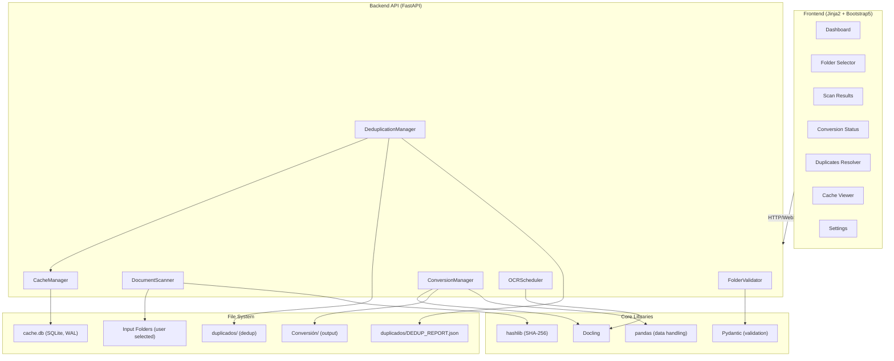
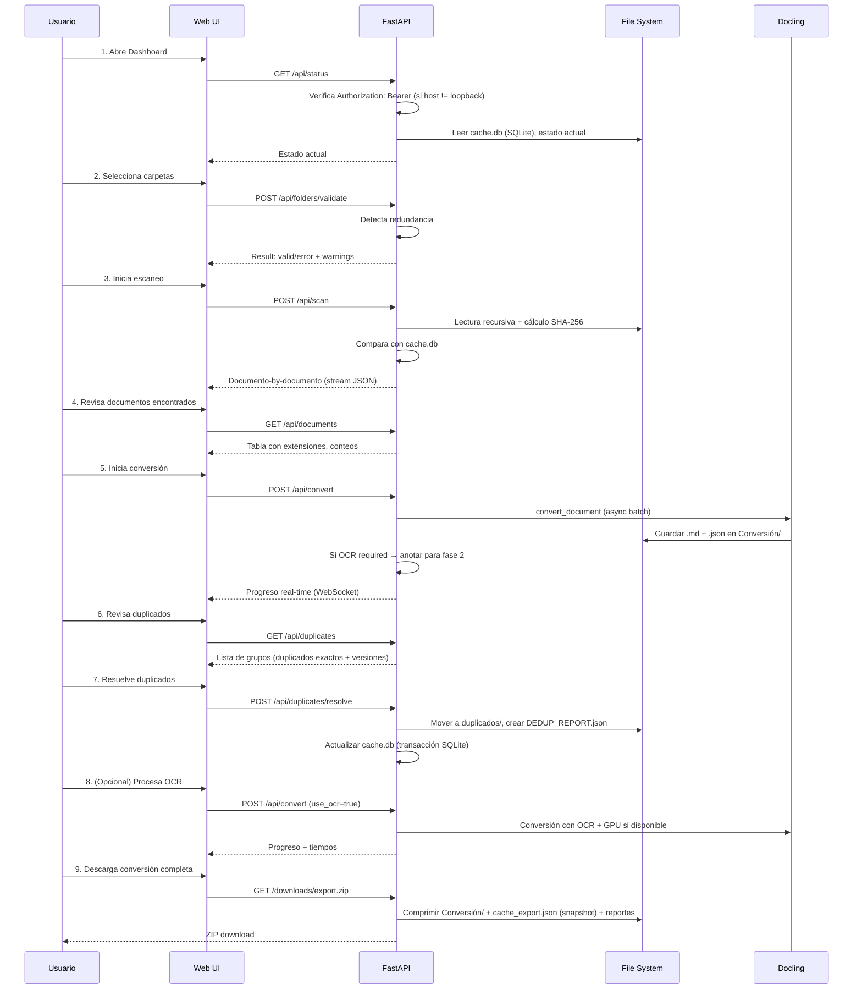

# PLAN Fase 1 — doc_organize (scanner/converter/dedup/cache/web)

**Versión**: 1.2-DRAFT  
**Fecha**: 2026-08-27  
**Estado**: AUDIT_PLAN (revisión 2) — Veredicto GO_CONDICIONAL, condiciones 1-6 y revisión 2 (contradicción de auth, extra `web`, hashing único, token sin flag CLI) resueltas. Listo para IMPLEMENT salvo objeción.

---

## 1. Visión General

**Nombre**: `doc_organize` Fase 1 (MVP) — antes referenciado como `doclink-extractor`; tras AUDIT_PLAN se confirma que esto **no** es una aplicación independiente, sino la primera entrega funcional del propio paquete `doc_organize` (v0.1.0), implementando los módulos ya previstos en [`SHARED_INSTRUCTIONS.md`](../SHARED_INSTRUCTIONS.md): `scanner/`, `converter/`, `cache/`, `dedup/` y (adelantado desde v0.2.0) `web/`.

**Propósito**: Automatizar la conversión de documentos (PDF, Word, Excel, imágenes, etc.) a formatos estándar (Markdown con Mermaid, JSON) utilizando la librería [Docling](https://docling.ai/). La aplicación gestiona:
- Selección flexible de carpetas de entrada (validando no-redundancia)
- Conversión batch con soporte OCR en dos fases
- Detección y resolución de duplicados y versiones conflictivas
- Caché con SHA-256 respaldada en SQLite para detectar cambios
- Interfaz web interactiva con Jinja2

**Caso de uso primario**: Equipo de documentación que necesita normalizar repositorios de documentos heterogéneos en markdown versionado.

---

## 2. Requisitos Funcionales

> **Nota (AUDIT_PLAN revisión 3)**: IMPLEMENT ya arrancó — `src/doc_organize/core/models.py` existe
> y es la **fuente de verdad real** de los modelos de datos: usa `pydantic.BaseModel` para los
> modelos públicos/serializables (API, JSON) y variantes `XxxInternal` como `@dataclass` para el
> hot path de escaneo (evitar overhead de validación Pydantic en 10K+ archivos), con `.to_pydantic()`
> para convertir al límite del sistema. Los bloques `@dataclass` en `§2.2`, `§2.3` y `§2.6` de abajo
> son pseudocódigo ilustrativo de la forma del contrato, no el tipo real — ante cualquier duda,
> `core/models.py` manda.

### 2.1 Selección y Validación de Carpetas (REQ-001)

**Descripción**: El usuario selecciona una o más carpetas de trabajo. El sistema las valida para evitar inclusiones redundantes.

**Criterios de aceptación**:
- [ ] Permitir selección múltiple de carpetas (UI + CLI)
- [ ] Validar que ninguna carpeta sea subcarpeta de otra (ej: `/repo` y `/repo/docs` → error)
- [ ] Mostrar advertencia clara si se detecta redundancia
- [ ] Almacenar la configuración de carpetas en JSON para reutilizar
- [ ] Soportar rutas absolutas y relativas

**Contrato**:
```python
class FolderValidator:
    def validate_folder_set(self, paths: list[str]) -> ValidationResult:
        """
        Valida que ninguna ruta sea subcarpeta de otra.
        
        Returns:
            ValidationResult con is_valid, warnings (list), clean_paths (list)
        """
        ...
```

---

### 2.2 Escaneo Recursivo de Documentos (REQ-002)

**Descripción**: Lectura recursiva de todas las carpetas seleccionadas, identificación de documentos por extensión.

**Criterios de aceptación**:
- [ ] Soportar extensiones: `.pdf`, `.docx`, `.doc`, `.xlsx`, `.xls`, `.pptx`, `.ppt`, `.png`, `.jpg`, `.jpeg`, `.tiff`, `.bmp`
- [ ] Generar reporte con conteo de documentos por extensión
- [ ] Mostrar nombre completo de documento + tooltip con ruta completa (en UI)
- [ ] Registrar árbol de directorios en JSON (para restaurar estructura)
- [ ] Ignorar archivos ocultos (`.git`, `__pycache__`, `.DS_Store`)

**Contrato** (AUDIT_PLAN cond. 3 — I/O de disco recursiva ⇒ contrato async con context manager, según convención de `SHARED_INSTRUCTIONS.md`):
```python
class DocumentScanner:
    async def __aenter__(self) -> "DocumentScanner":
        return self

    async def __aexit__(self, *exc_info: object) -> None:
        """Libera recursos (workers, handles de archivo abiertos)."""
        ...

    async def scan_folders(self, paths: list[str]) -> ScanResult:
        """
        Escanea recursivamente carpetas y descubre documentos (asyncio, no bloqueante).
        El hash de cada `DocumentMetadata.sha256_hash` se calcula llamando a
        `utils.hash_utils.hash_file()` — única fuente de verdad para el hashing
        (AUDIT_PLAN revisión 2: evita una segunda implementación divergente en CacheManager).

        Returns:
            ScanResult con:
              - documents: list[DocumentMetadata]
              - summary: dict[str, int]  # {"pdf": 42, "docx": 15, ...}
              - tree: dict  # estructura de árbol de directorios
        """
        ...

@dataclass
class DocumentMetadata:
    full_path: str          # ruta absoluta del documento
    display_name: str       # nombre único (para tooltip)
    extension: str          # extensión detectada
    size_bytes: int         # tamaño del archivo
    modified_time: float    # timestamp de última modificación
    sha256_hash: str        # SHA-256 del archivo (para dedup, alineado con SHARED_INSTRUCTIONS.md)
```

> `FolderValidator.validate_folder_set` (REQ-001) permanece **síncrono**: opera solo sobre strings
> en memoria (sin tocar disco), por lo que no aplica la convención asyncio de I/O. Documentado aquí
> para que una futura auditoría no lo marque de nuevo como inconsistencia.

---

### 2.3 Conversión a Markdown + JSON (REQ-003)

**Descripción**: Conversión de documentos a Markdown (con diagramas Mermaid) y JSON, almacenados en carpeta `Conversión/`.

**Criterios de aceptación**:
- [ ] Usar Docling para conversión (validar versión mínima en `pyproject.toml`)
- [ ] Guardar salida dual: `documento.md` + `documento.json`
- [ ] Incorporar diagramas como bloques Mermaid en Markdown (cuando Docling los detecte)
- [ ] Mantener estructura de directorios original en `Conversión/`
- [ ] Metadata en JSON: título, autor, fecha de creación, tamaño original, hash
- [ ] Registrar errores de conversión sin detener el flujo

**Contrato** (AUDIT_PLAN cond. 3 — añade context manager async, ya tenía métodos async):
```python
class DocumentConverter:
    async def __aenter__(self) -> "DocumentConverter":
        return self

    async def __aexit__(self, *exc_info: object) -> None:
        """Cierra el backend Docling y libera workers."""
        ...

    async def convert_document(
        self, 
        source_doc: DocumentMetadata,
        output_dir: Path,
        use_ocr: bool = False
    ) -> ConversionResult:
        """
        Convierte un documento a Markdown + JSON.
        
        Returns:
            ConversionResult con:
              - success: bool
              - markdown_path: str | None
              - json_path: str | None
              - error: str | None
              - ocr_required: bool  # si True, posponer a segunda vuelta
        """
        ...

@dataclass
class ConversionResult:
    source_path: str
    markdown_path: str | None
    json_path: str | None
    success: bool
    error: str | None
    ocr_required: bool = False
    duration_seconds: float = 0.0
```

---

### 2.4 Detección OCR y Fase 2 (REQ-004)

**Descripción**: Documentos que requieran OCR se posponen. En una segunda vuelta, se procesan con GPU si está disponible.

**Criterios de aceptación**:
- [ ] Detectar documentos que requieran OCR (imágenes escaneadas, PDF sin OCR)
- [ ] Registrar estado OCR en JSON: `ocr_required: true`, `gpu_candidate: true/false`
- [ ] Reporte visual de documentos pendientes OCR
- [ ] Permitir iniciar procesamiento OCR desde UI (manual o automático)
- [ ] Usar GPU si `torch` y `cuda` están disponibles (no obligatorio)
- [ ] Registrar tiempo de procesamiento OCR vs. CPU

**Contrato**:
```python
class OCRScheduler:
    def detect_ocr_candidates(self, docs: list[DocumentMetadata]) -> list[DocumentMetadata]:
        """Identifica documentos que requieren OCR."""
        ...
    
    async def process_with_ocr(
        self,
        docs: list[DocumentMetadata],
        use_gpu: bool = False
    ) -> list[ConversionResult]:
        """Procesa documentos con OCR en GPU si disponible."""
        ...
```

---

### 2.5 Deduplicación y Resolución de Versiones (REQ-005)

**Descripción**: Limpieza de duplicados exactos y resolución de versiones conflictivas. Los duplicados se mueven a carpeta `duplicados/` manteniendo estructura original.

**Criterios de aceptación**:
- [ ] Comparar documentos por SHA-256 (duplicados exactos)
- [ ] Detectar versiones: mismo nombre base + sufijo de versión (`v1`, `v2`, `final`, `draft`, etc.)
- [ ] Mostrar reporte separado: **Duplicados exactos** vs. **Versiones conflictivas**
- [ ] Permitir usuario seleccionar qué documento mantener (por defecto: más antiguo)
- [ ] Mover documentos descartados a `<root>/duplicados/` manteniendo estructura original
- [ ] Actualizar JSON de tracking con decisión del usuario
- [ ] Crear `duplicados/DEDUP_REPORT.json` con auditoria de duplicados

**Contrato** (AUDIT_PLAN revisión 3 — sincronizado con `src/doc_organize/core/models.py`, ya
implementado como modelos Pydantic; ese fichero es la fuente de verdad, no este pseudocódigo):
```python
class DuplicateGroup(BaseModel):
    group_id: str                          # UUID único del grupo (usado por §8.2 POST /api/duplicates/resolve)
    canonical_doc: DocumentMetadata         # el que se mantiene
    duplicates: list[DocumentMetadata]      # los que se descartan
    reason: DuplicateReason                 # enum: EXACT_DUPLICATE | VERSION_CONFLICT
    user_choice: DocumentMetadata | None    # selección del usuario

class DeduplicationManager:
    def find_duplicates(self, docs: list[DocumentMetadata]) -> list[DuplicateGroup]:
        """Detecta duplicados exactos y versiones conflictivas."""
        ...
    
    async def resolve_duplicates(
        self,
        groups: list[DuplicateGroup],
        duplicates_dir: Path
    ) -> DeduplicationReport:
        """Mueve duplicados a carpeta, crea reporte."""
        ...

class DeduplicationReport(BaseModel):
    timestamp: str                          # ISO 8601, cuándo se ejecutó el dedup
    total_exact_duplicates: int
    total_version_conflicts: int
    duplicates_folder_path: str
    audit_json_path: str
    groups: list[DuplicateGroup] = []       # detalle completo de los grupos procesados
```

---

### 2.6 Caché de Cambios (SHA-256, SQLite) (REQ-006)

**Descripción**: Sistema de caché para detectar nuevos documentos o modificaciones. Usa SHA-256
(único hash de dedup, alineado con `SHARED_INSTRUCTIONS.md`) y almacena el tracking en una base de
datos **SQLite** (`cache/` ya se documenta ahí como "Almacenamiento eficiente con transacciones
locales (SQLite)") en vez de un JSON plano — AUDIT_PLAN cond. 2: un JSON reescrito por múltiples
requests concurrentes de la web app (§2.7) es exactamente el problema de *race conditions* que
`§9.4` dejaba como riesgo abierto; SQLite lo resuelve con transacciones ACID nativas sin locking manual.

**Criterios de aceptación**:
- [ ] Crear/abrir base de datos `cache.db` (SQLite) en raíz de trabajo, tabla `cache_entries(file_path PK, sha256_hash, timestamp, status, conversion_status)`
- [ ] Comparar hash actual con caché: si es igual → skip; si es nuevo/modificado → procesar
- [ ] Status en cache: `new`, `unchanged`, `modified`, `deleted`
- [ ] Usar `hashlib.sha256` (built-in) para el hash de dedup
- [ ] Validar que SHA-256 es determinista (mismo archivo = mismo hash) en pruebas
- [ ] Escrituras envueltas en transacción SQLite (`BEGIN IMMEDIATE` / commit) — sin necesidad de file locking manual
- [ ] Modo `WAL` activado para permitir lecturas concurrentes durante escritura (soporta el uso desde la web app)
- [ ] Reporte visual de archivos new/modified/unchanged
- [ ] Exportar snapshot de solo lectura en JSON (`cache_export.json`) únicamente para el ZIP de `§8.2 downloads/export.zip` — no es el almacén canónico

**Contrato** (AUDIT_PLAN cond. 3 — íntegramente async, backend `sqlite3` vía `asyncio.to_thread` o `aiosqlite`):
```python
@dataclass
class CacheEntry:
    file_path: str
    sha256_hash: str
    timestamp: float
    status: str  # "new" | "unchanged" | "modified" | "deleted"
    conversion_status: str | None  # "pending" | "success" | "error" | "ocr_pending"

class CacheManager:
    async def __aenter__(self) -> "CacheManager":
        """Abre la conexión SQLite (cache.db), crea el esquema si no existe, activa WAL."""
        ...

    async def __aexit__(self, *exc_info: object) -> None:
        """Cierra la conexión SQLite."""
        ...

    async def load_cache(self) -> dict[str, CacheEntry]:
        """Lee todas las entradas de cache.db."""
        ...

    async def compute_hash(self, file_path: str) -> str:
        """Delega en utils.hash_utils.hash_file() — no reimplementa el cálculo de SHA-256
        (AUDIT_PLAN revisión 2: única fuente de verdad, compartida con DocumentScanner)."""
        ...

    async def get_changes(
        self,
        cache: dict[str, CacheEntry],
        current_docs: list[DocumentMetadata]
    ) -> tuple[list[str], list[str], list[str]]:
        """
        Retorna (new_files, modified_files, unchanged_files).
        """
        ...

    async def save_entries(self, entries: list[CacheEntry]) -> None:
        """Upsert transaccional de entradas en cache.db."""
        ...
```

---

### 2.7 Interfaz Web con Jinja2 (REQ-007)

**Descripción**: Interfaz web interactiva que centraliza todas las funcionalidades: selección de carpetas, escaneo, conversión, deduplicación, caché.

**Criterios de aceptación**:
- [ ] Framework web: Flask o FastAPI (con Jinja2)
- [ ] Páginas:
  - **Dashboard**: resumen de estado, última ejecución, botones de acción
  - **Folder Selector**: selecciona carpetas, valida redundancia
  - **Scan Results**: tabla de documentos encontrados, conteo por extensión, tree visual
  - **Conversion Status**: progreso en tiempo real, errores, OCR pending
  - **Duplicates Resolver**: compare dos documentos lado a lado, permite elegir cuál descartar
  - **Cache Viewer**: muestra changelog (new/modified/unchanged), descarga snapshot `cache_export.json`
  - **Settings**: configuración de Docling, GPU, idioma OCR
- [ ] Real-time updates: WebSocket para progreso de conversión
- [ ] Export: descarga ZIP con toda la conversión, reporte en Excel/CSV
- [ ] Responsive: mobile-friendly (Bootstrap 5 o Tailwind)
- [ ] Logging visual: historial de ejecuciones, tiempos, errores
- [ ] **Autenticación (AUDIT_PLAN cond. 4, corregida en revisión 2)**: por defecto la app escucha
      solo en `127.0.0.1`. Si se expone en una interfaz distinta (`--host` ≠ `127.0.0.1`/`localhost`),
      es **obligatorio** un token (ver más abajo); **toda** ruta bajo `/api/*` y `/downloads/*` —
      incluidos los `GET` de solo lectura (`/api/duplicates`, `/api/cache`, `/`) — exige
      `Authorization: Bearer <token>` y devuelve 401 si falta o no coincide. Sin excepciones: varios
      `GET` devuelven `full_path` de documentos del sistema de archivos, así que también deben
      protegerse cuando la app no es loopback-only
- [ ] **Token solo por variable de entorno**: `DOC_ORGANIZE_API_TOKEN` se lee del entorno del
      proceso, no existe flag `--api-token` en el CLI — un secreto pasado como argumento queda
      visible en la lista de procesos (`ps`/Task Manager) de la máquina
- [ ] **CSRF real para API JSON/WebSocket**: al no haber formularios HTML clásicos, el "CSRF token"
      del borrador original se sustituye por: (a) validación de cabecera `Origin`/`Referer` contra
      el host configurado en cada request de escritura, y (b) el propio bearer token, que un sitio
      de terceros no puede adjuntar. No se usan cookies de sesión, así que no aplica el vector CSRF clásico

**Contrato** (AUDIT_PLAN cond. 3 — rutas que hacen I/O de disco o leen el caché pasan a `async def`;
`validate_folders` se mantiene síncrona porque no toca disco):
```python
# Rutas principales — TODAS requieren Depends(require_api_token) cuando WebApp.host no es
# loopback (revisión 2: sin excepciones, ni siquiera para GET — filtran full_path de documentos)
class WebApp:
    # GET /
    async def dashboard() -> str:  # renderiza index.html con estado (lee cache.db)
        ...

    # POST /api/folders/validate
    def validate_folders(paths: list[str]) -> dict:
        """Valida carpetas (sin I/O), retorna result.json"""
        ...

    # POST /api/scan
    async def scan_folders(paths: list[str]):
        """Inicia escaneo, retorna stream JSON con progreso"""
        ...

    # POST /api/convert
    async def convert_batch(doc_ids: list[str], use_ocr: bool = False):
        """Inicia conversión batch, WebSocket stream"""
        ...

    # GET /api/duplicates
    async def list_duplicates() -> dict:
        """Retorna grupos de duplicados (lee cache.db)"""
        ...

    # POST /api/duplicates/resolve
    async def resolve_duplicates(resolution: dict):
        """Aplica resolución de duplicados, mueve archivos"""
        ...

    # GET /api/cache
    async def get_cache_status() -> dict:
        """Estado del caché (lee cache.db): new/modified/unchanged"""
        ...

    # GET /downloads/export.zip
    async def export_conversion() -> StreamingResponse:
        """Descarga ZIP con conversión completa + reportes (streaming, no carga todo en memoria)"""
        ...
```

---

## 3. Requisitos No Funcionales

| Requisito | Especificación |
|---|---|
| **Python** | `>=3.10` (Docling requiere 3.10+) |
| **Performance** | Conversión batch: ~100 PDFs/minuto sin OCR (CPU x86-64) |
| **Escalabilidad** | Soportar carpetas con 10K+ documentos (streaming de UI, caché incremental) |
| **Memoria** | Conversión async: máx 500 MB para batch de 100 docs |
| **Concurrencia** | 4-8 workers async para conversión (configurable) |
| **Disponibilidad** | OCR opcional: aplicación funciona sin GPU |
| **Seguridad** | Validar rutas (no path traversal, vía `safe_path_join` centralizado), sanitizar names en HTML, bind por defecto a `127.0.0.1`, `DOC_ORGANIZE_API_TOKEN` (solo env var) obligatorio si se expone en otra interfaz y exigido en toda ruta `/api/*`+`/downloads/*` incl. `GET`, validación de `Origin`/`Referer` en escrituras |
| **Observabilidad** | Logging estructurado (JSON), tiempos en cada fase, metricas Prometheus (opcional) |
| **Reproducibilidad** | Hashes SHA-256 deterministas, misma entrada = mismo output |

---

## 4. Arquitectura Propuesta



---

## 5. Stack Tecnológico

### Dependencias principales

> **Nota de alineación (AUDIT_PLAN cond. 1 y 3, corregida en revisión 2)**: esto se aplica como
> **diff** sobre el `pyproject.toml` real de `doc_organize` (que hoy no tiene `dependencies` ni
> extras `web`/`ocr`), no como un fichero nuevo. Los paquetes OCR/GPU y el stack web se declaran
> como listas de strings en `[project.optional-dependencies]` — la sintaxis
> `{ version = ..., optional = true }` de Poetry no es válida en PEP 621 y se descarta.
> `python-magic` se sustituye por `python-magic-bin` en Windows (entorno de desarrollo actual).
> **Revisión 2**: `fastapi`/`uvicorn`/`jinja2`/`python-multipart`/`openpyxl` pasan de
> `dependencies` obligatorias a un extra `web` — son solo necesarios para `REQ-007` (interfaz web);
> alguien que use `doc_organize` únicamente como librería (`scanner`/`converter`/`dedup`/`cache`)
> no debería tener que instalar todo el stack FastAPI. `pydantic`, `aiofiles`, `pillow`,
> `python-magic(-bin)` y `pandas` sí son núcleo (los usan `FolderValidator`, el escaneo async, y
> Docling internamente — ver `§4`), y quedan en `dependencies`.

```toml
[project]
# ...(sin cambios en name/version/etc.)
dependencies = [
    "docling>=2.0.0",           # extracción de documentos (core)
    "pydantic>=2.0",            # validación (FolderValidator, modelos core)
    "aiofiles>=23.0",           # I/O async (core)
    "pillow>=10.0",             # procesamiento de imágenes (Docling lo usa)
    "pandas>=2.0",              # análisis de datos (reportes de escaneo)
    "python-magic>=0.4; sys_platform != 'win32'",
    "python-magic-bin>=0.4; sys_platform == 'win32'",
]

[project.optional-dependencies]
# dev/docs YA EXISTEN en pyproject.toml — añadir a la lista `dev` existente:
#   "pytest-asyncio>=0.21", "httpx>=0.24"
web = [
    "fastapi>=0.100",           # API web (REQ-007)
    "uvicorn>=0.23",            # servidor ASGI
    "jinja2>=3.1.0",            # templates
    "python-multipart>=0.0.6",  # form upload
    "openpyxl>=3.1",            # export Excel del dashboard (REQ-007)
]
ocr = [
    "torch>=2.0",
    "torchvision>=0.15",
    "opencv-python>=4.8",
]
```

Instalación: `pip install doc_organize` (solo núcleo) · `pip install doc_organize[web]` (+ interfaz
web) · `pip install doc_organize[web,ocr]` (todo). El CLI `python -m doc_organize web ...` (`§8.1`)
debe fallar con un mensaje claro ("instala `doc_organize[web]`") si `fastapi` no está presente.

### Justificación de librerías

- **Docling**: Librería oficial para extracción de documentos, soporta PDF, Word, Excel, imágenes
- **FastAPI**: Modern, async-first, excelente para tareas I/O-bound como conversión batch
- **Jinja2**: Estándar de facto para templates HTML (ya incluido en FastAPI)
- **Pydantic**: Validación robust de datos estructurados (carpetas, configuración)
- **hashlib**: Nativo en Python 3.6+, no requiere dependencias externas
- **aiofiles**: I/O async para no bloquear conversión
- **torch/torchvision**: OCR con GPU (opcional, graceful degradation)

---

## 6. Flujo de Trabajo Propuesto



---

## 7. Estructura de Directorios

> **Nota de alineación (AUDIT_PLAN cond. 1)**: no se crea un repositorio/paquete nuevo. Todo lo siguiente
> se añade dentro del árbol **ya existente** de `doc_organize/` (`pyproject.toml`, `src/doc_organize/`
> con `core/` y `utils/` ya presentes como paquetes vacíos que aquí se pueblan). `_core/async_utils.py`
> se pliega dentro de `utils/` para no duplicar responsabilidad con `core/`. `pytest.ini` no aplica:
> la configuración de pytest ya vive en `[tool.pytest.ini_options]` de `pyproject.toml`.

```text
doc_organize/                      # repo existente — sin cambio de raíz
├── pyproject.toml                 # EXTENDER (no reemplazar): añadir `dependencies` + extras `web`/`ocr`
├── .env.example                   # Variables de entorno: Docling, DOC_ORGANIZE_API_TOKEN, etc. — nuevo
│
├── src/
│   └── doc_organize/
│       ├── __init__.py            # existente — exponer API pública Fase 1
│       ├── main.py                # NUEVO — punto de entrada: CLI + web
│       ├── config.py              # NUEVO — configuración centralizada
│       │
│       ├── core/                  # existente (vacío) — poblar aquí
│       │   ├── __init__.py
│       │   ├── models.py          # Dataclasses: DocumentMetadata, ConversionResult, etc.
│       │   ├── exceptions.py      # DocumentError, ConversionError, CacheError (ya nombrados en SHARED_INSTRUCTIONS)
│       │   └── constants.py       # Constantes (extensiones soportadas, etc.)
│       │
│       ├── validators/
│       │   ├── __init__.py
│       │   └── folder_validator.py   # FolderValidator
│       │
│       ├── scanner/                  # ya listado como TODO v0.1.0 en SHARED_INSTRUCTIONS
│       │   ├── __init__.py
│       │   └── document_scanner.py   # DocumentScanner
│       │
│       ├── converter/                # ya listado como TODO v0.1.0
│       │   ├── __init__.py
│       │   ├── converter.py          # DocumentConverter
│       │   └── ocr_scheduler.py      # OCRScheduler
│       │
│       ├── dedup/                    # ya listado como TODO v0.1.0
│       │   ├── __init__.py
│       │   └── deduplication.py      # DeduplicatorService (ver AUDIT_PLAN cond. 2: alinear a SHA256)
│       │
│       ├── cache/                    # ya listado como TODO v0.1.0
│       │   ├── __init__.py
│       │   └── cache_manager.py      # CacheManager (ver AUDIT_PLAN cond. 2: alinear a SQLite)
│       │
│       ├── web/                      # adelantado desde v0.2.0 por decisión de esta Fase 1
│       │   ├── __init__.py
│       │   ├── app.py                # FastAPI app definition
│       │   ├── routes/
│       │   │   ├── __init__.py
│       │   │   ├── folders.py        # POST /folders/*, GET /documents
│       │   │   ├── conversion.py     # POST /convert, GET /status
│       │   │   ├── duplicates.py     # GET /duplicates, POST /duplicates/resolve
│       │   │   ├── cache.py          # GET /cache, exports
│       │   │   └── downloads.py      # GET /downloads/export.zip
│       │   ├── templates/
│       │   │   ├── base.html
│       │   │   ├── index.html        # Dashboard
│       │   │   ├── folder_selector.html
│       │   │   ├── scan_results.html
│       │   │   ├── conversion_status.html
│       │   │   ├── duplicates_resolver.html
│       │   │   ├── cache_viewer.html
│       │   │   └── settings.html
│       │   └── static/
│       │       ├── css/
│       │       │   └── style.css     # Customizaciones (Bootstrap 5 base)
│       │       └── js/
│       │           └── app.js        # WebSocket, interactividad
│       │
│       └── utils/                    # existente (vacío) — poblar aquí (incluye lo antes previsto en `_core/`)
│           ├── __init__.py
│           ├── logging.py            # Logging estructurado
│           ├── path_utils.py         # safe_path_join / validación no-traversal (AUDIT_PLAN cond. seguridad)
│           ├── hash_utils.py         # hash_file() SHA256 — única fuente de verdad, usada por scanner/ y cache/ (AUDIT_PLAN cond. 2 y revisión 2)
│           └── async_utils.py        # maybe_await, streaming helpers (antes `_core/async_utils.py`)
│
├── tests/
│   ├── conftest.py
│   ├── unit/
│   │   ├── test_folder_validator.py
│   │   ├── test_document_scanner.py
│   │   ├── test_cache_manager.py
│   │   ├── test_converter.py
│   │   └── test_deduplication.py
│   ├── integration/
│   │   ├── test_full_workflow.py
│   │   └── test_web_api.py
│   └── fixtures/
│       └── sample_docs/             # PDFs/docs de prueba
│
├── docs/                            # convención ya fijada en SHARED_INSTRUCTIONS.md
│   ├── index.md                     # existente
│   ├── functional/                  # qué hace cada módulo (scanner, converter, dedup, cache, web)
│   ├── api/                         # documentación técnica de las clases Fase 1
│   ├── guides/
│   │   ├── installation.md
│   │   ├── quick_start.md
│   │   └── troubleshooting.md
│   └── examples/
│       └── sample_workflow.md       # Ejemplo end-to-end
│
├── scripts/
│   └── setup_env.sh                 # Setup dev env
│
└── .github/
    └── workflows/
        └── ci.yml                   # GitHub Actions (lint, test, build) — existente, extender si aplica
```

---

## 8. Contratos de Interfaz (API)

### 8.1 CLI (línea de comandos)

```bash
python -m doc_organize scan --paths /repo/docs /repo/papers \
  --output-dir ./Conversión \
  --cache-file ./cache.db \
  --deduplicate \
  --use-ocr false

# Uso local (por defecto): sin token, solo accesible desde 127.0.0.1
python -m doc_organize web \
  --host 127.0.0.1 --port 8000 \
  --output-dir ./Conversión \
  --config ./config.yaml

# Exponer en red: DOC_ORGANIZE_API_TOKEN es obligatorio (AUDIT_PLAN cond. 4, revisión 2)
# No existe flag --api-token: un secreto pasado como argumento queda visible en la lista
# de procesos de la máquina. La app lee el token únicamente de esta variable de entorno
# y rehúsa arrancar si --host no es loopback y la variable no está definida.
export DOC_ORGANIZE_API_TOKEN="..."
python -m doc_organize web \
  --host 0.0.0.0 --port 8000 \
  --output-dir ./Conversión \
  --config ./config.yaml
```

### 8.2 API REST (FastAPI)

> **Autenticación (AUDIT_PLAN cond. 4, revisión 2)**: si `--host` no es `127.0.0.1`/`localhost`,
> **toda** ruta bajo `/api/*` y `/downloads/*` — incluidos los `GET` de solo lectura, que también
> devuelven `full_path` de documentos — exige cabecera `Authorization: Bearer <token>` (token leído
> por el servidor desde `DOC_ORGANIZE_API_TOKEN`, sin flag de CLI) → `401 Unauthorized` si falta o no
> coincide. Además, toda escritura valida que `Origin`/`Referer` coincida con el host configurado
> (mitiga cross-site requests sin depender de CSRF-token clásico, que no aplica a esta API
> JSON/WebSocket sin cookies de sesión).

```yaml
POST /api/folders/validate:
  body: { paths: [str] }
  response: { valid: bool, warnings: [str], clean_paths: [str] }

POST /api/scan:
  body: { paths: [str], use_cache: bool }
  response: EventStream (JSON Lines)
    { event: "started" | "scanned_file" | "completed", data: {...} }

POST /api/convert:
  body: { doc_ids: [str], use_ocr: bool, workers: int }
  response: WebSocket EventStream
    { event: "conversion_started" | "file_converted" | "ocr_required" | "completed", ... }

GET /api/duplicates:
  response: { groups: [DuplicateGroup], stats: {...} }

POST /api/duplicates/resolve:
  body: { resolutions: { group_id: "canonical_doc_id" } }
  response: { moved: int, errors: [str] }

GET /api/cache:
  response: { new_files: [str], modified_files: [str], unchanged: [str], timestamp: float }

GET /downloads/export.zip:
  response: bytes (application/zip)
```

---

## 9. Plan de Validación (AUDIT_PLAN)

Puntos críticos a verificar antes de IMPLEMENT:

### 9.1 Validación de Docling
- [ ] Versión mínima de Docling soporta todas las extensiones requeridas
- [ ] Conversión a Markdown preserva estructura (listas, tablas, code blocks)
- [ ] Diagramas Docling se traducen correctamente a bloques Mermaid (si aplica)
- [ ] JSON output contiene metadata necesaria (autor, título, fecha)

### 9.2 Validación de SHA-256
- [ ] `hashlib.sha256` disponible en Python 3.10+ sin librerías externas
- [ ] Determinismo: dos cálculos del mismo archivo producen mismo hash
- [ ] Performance: cálculo de SHA-256 no bloquea el event loop (lectura en chunks vía `asyncio`)

### 9.3 Validación de Jinja2
- [ ] Jinja2 3.1.0+ incluida en FastAPI o requiere import explícito
- [ ] Templates compilan sin errores (validate syntax en tests)
- [ ] Escaping automático de variables (seguridad XSS)

### 9.4 Validación de Concurrencia
- [ ] AsyncIO con 4-8 workers: rendimiento real sin deadlocks
- [ ] WebSocket mantiene conexión abierta durante conversión larga
- [ ] `cache.db` (SQLite, modo WAL) soporta escrituras concurrentes desde requests simultáneos sin corrupción (test de estrés con `asyncio.gather`)

### 9.5 Validación de Paths
- [ ] Rutas con espacios, caracteres especiales: validadas correctamente
- [ ] No existe path traversal: `/etc/passwd` bloqueado
- [ ] Rutas relativas vs. absolutas: normalizadas correctamente
- [ ] Toda validación de ruta pasa por un único `safe_path_join`/`PathValidator` en `utils/path_utils.py` — ningún endpoint construye rutas manualmente

### 9.6 Validación de Autenticación Web (AUDIT_PLAN cond. 4, revisión 2)
- [ ] `--host 127.0.0.1` (default): la app arranca sin exigir `DOC_ORGANIZE_API_TOKEN`
- [ ] `--host` distinto de loopback sin `DOC_ORGANIZE_API_TOKEN` definido: la app **rehúsa arrancar** con error claro
- [ ] No existe flag `--api-token`; el token solo se acepta vía variable de entorno
- [ ] Requests a **cualquier** ruta `/api/*` o `/downloads/*` (incluidos `GET`) sin `Authorization: Bearer` válido → `401` (test de integración cubriendo explícitamente `GET /api/duplicates` y `GET /api/cache`, no solo las rutas de escritura)
- [ ] Request de escritura con `Origin`/`Referer` distinto del host configurado → rechazado
- [ ] `GET /downloads/export.zip` respeta la misma exigencia de token que el resto de rutas

---

## 10. Riesgos Identificados

| Riesgo | Severidad | Mitigation |
|---|---|---|
| Docling no soporta formato XYZ | MEDIA | Pre-validar extensiones en phase 1, graceful error si falla |
| OCR + GPU muy lento | MEDIA | Permitir desactivar OCR, usar CPU como fallback, mostrar ETA |
| `cache.db` (SQLite) corrupto | MEDIA | Modo WAL, `PRAGMA integrity_check` al abrir, backup automático antes de escrituras masivas, recrear esquema si inválido |
| Duplicados: usuario confundido en selector UI | MEDIA | Compare visual lado-a-lado, resumen claro de cambios |
| Path traversal security | ALTA | Validación estricta de rutas vía `safe_path_join` centralizado, no permitir `../`, tests de seguridad |
| Memory leak en conversión async | MEDIA | Monitoring de memoria, limits de workers, tests de stress |
| Web app expuesta sin autenticación (`--host 0.0.0.0`) | ALTA | Bind por defecto a `127.0.0.1`; `DOC_ORGANIZE_API_TOKEN` (solo env var, sin flag de CLI) obligatorio para exponer en red; la app rehúsa arrancar sin token si el host no es loopback; el token protege **todas** las rutas `/api/*` y `/downloads/*`, incluidos los `GET` que devuelven rutas de archivo; validación de `Origin`/`Referer` en escrituras |
| Núcleo de la librería fuerza dependencias web (`fastapi`/`uvicorn`) | BAJA | `fastapi`/`uvicorn`/`jinja2`/`python-multipart`/`openpyxl` viven en el extra `pip install doc_organize[web]`, no en `dependencies` obligatorias |

---

## 11. Criterios de Completitud (Definition of Done)

Una implementación se considera **completa** si cumple:

### Code
- [ ] Todos los módulos en `src/doc_organize/` tienen docstrings (Google-style)
- [ ] Type hints: 100% de cobertura en funciones públicas
- [ ] No hay `# type: ignore` a menos que sea justificado en comentario
- [ ] Linting con Ruff: 0 errores, formato con Ruff
- [ ] Tests: ≥80% cobertura de código (pytest)
- [ ] Tests pasan en Python 3.10, 3.11, 3.12

### Documentación
- [ ] README.md: instrucciones instalación + quickstart
- [ ] docs/guides/quick_start.md + docs/guides/installation.md + docs/guides/troubleshooting.md (conjunto mínimo obligatorio)
- [ ] docs/functional/: qué hace cada módulo (scanner, converter, dedup, cache, web)
- [ ] docs/api/: diagramas de arquitectura + responsabilidades técnicas
- [ ] Docstrings de módulos: incluyen ejemplos de uso
- [ ] `mkdocs.yml` `nav:` actualizado con las nuevas entradas

### Funcionalidad
- [ ] Todas las REQ-* pasan acceptance tests
- [ ] Web UI funciona en Chrome, Firefox, Safari (responsive)
- [ ] Export ZIP contiene: Conversión/ + cache_export.json (snapshot de cache.db) + DEDUP_REPORT.json + logs
- [ ] OCR graceful degradation: funciona sin GPU/torch

### Performance
- [ ] Caché incremental: solo procesa new/modified
- [ ] Batch conversión 100 docs: < 2 minutos (CPU x86-64)
- [ ] WebSocket progreso: actualización < 500ms

### Seguridad
- [ ] Path validation tests: no path traversal (vía `safe_path_join` centralizado)
- [ ] `DocumentScanner` y `CacheManager.compute_hash` delegan ambos en `utils/hash_utils.hash_file()` (sin implementación de hash duplicada)
- [ ] Bind por defecto a `127.0.0.1`; app rehúsa arrancar en host no-loopback sin `DOC_ORGANIZE_API_TOKEN`
- [ ] Ninguna ruta `/api/*` o `/downloads/*` (ni siquiera los `GET` de solo lectura) responde sin `Authorization: Bearer` válido cuando el host no es loopback → `401` (test de integración)
- [ ] Validación de `Origin`/`Referer` en escrituras cuando el host no es loopback
- [ ] `pip install doc_organize` (sin extras) no instala `fastapi`/`uvicorn`/`jinja2`
- [ ] HTML escaping en templates
- [ ] No credentials en logs ni config por defecto

---

## 12. Next Steps (Post AUDIT_PLAN)

1. **AUDIT_PLAN**: Revisor confirma riesgos identificados, valida stack, aprueba arquitectura
2. **IMPLEMENT**: Implementación iterativa por módulo (validators → scanner → converter → dedup → cache → web)
3. **AUDIT_CODE**: Auditoría de bugs, contratos, cobertura, seguridad
4. **VERSION**: Cierre, CHANGELOG, release

---

*Documento de especificación — subject to AUDIT_PLAN revision*
