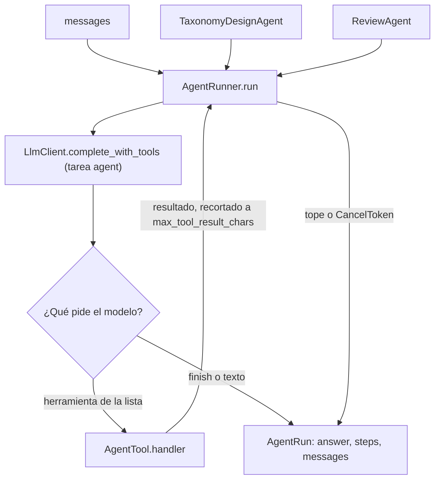

# Agentes (2.0.0)

Un **agente** es una conversación con el modelo (tarea `agent` de `AiSettings`) en la que el modelo puede pedir
**herramientas**: el runner las ejecuta y le devuelve el resultado, hasta que el modelo da su respuesta o se llega a un
tope. `AgentRunner` es el bucle que usan los agentes de doc_organize y sirve también para los tuyos.

## 1. Arquitectura y Diseño



```python
from doc_organize import AgentLimits, AgentRunner, AgentTool

count = AgentTool(
    name="count_documents",
    description="Número de documentos del proyecto por carpeta",
    parameters={"type": "object", "properties": {"folder": {"type": "string"}}},
    handler=lambda arguments: {"documents": contar(arguments.get("folder"))},
)
runner = AgentRunner(llm, [count], limits=AgentLimits(max_steps=8, max_tokens=40_000))
run = await runner.run([
    {"role": "system", "content": "Respondes sobre el proyecto usando las herramientas."},
    {"role": "user", "content": "¿Cuántos documentos hay en Procedimientos?"},
])
print(run.stop_reason, run.answer, run.total_tokens)
```

### Seguridad

Los agentes leen texto que viene de los documentos, y un documento puede intentar dar instrucciones al modelo
(inyección). Por eso el bucle está acotado:

- **Solo las herramientas que se le dan**. Un nombre que no está en la lista vuelve al modelo como error y no ejecuta
  nada; unos argumentos que no son un objeto JSON, también. Las herramientas deben ser **de solo lectura y locales**:
  el runner no puede comprobarlo, así que es responsabilidad de quien las define. Los agentes de doc_organize solo
  proponen; nunca aplican cambios (D14).
- **Topes** (`AgentLimits`): llamadas al modelo (`max_steps`), tokens acumulados de entrada y salida (`max_tokens`;
  estimados por tamaño si el proxy no los informa), herramientas ejecutadas (`max_tool_calls`) y caracteres de cada
  resultado que vuelve al modelo (`max_tool_result_chars`; el resto se corta y se le avisa). Al llegar a un tope, el
  agente para con `stop_reason` y **no lanza** excepción.
- **Cancelación**: `run(messages, cancel_token=token)` con el mismo `CancelToken` de `ContextBuilder.build`;
  `token.cancel()` (se puede llamar desde otro hilo) para el agente antes de la siguiente llamada al modelo o
  herramienta: `stop_reason == "cancelled"`. Cancelar la tarea de asyncio también
  funciona.
- **Redacción**: todo lo que se envía, también los resultados de las herramientas, pasa por `LlmClient`, que redacta
  credenciales (D7).

Dos ayudas para modelos pequeños, que tienden a quedarse en bucle o a no terminar:

- Una llamada **idéntica a la anterior** (mismo nombre y argumentos) a una herramienta `idempotent` (por defecto) no se
  ejecuta: vuelve como error para que el modelo haga otra cosa. Las herramientas que cambian algo (deshacer en un
  borrador) se declaran con `idempotent=False`.
- Con `answer_schema`, cuando quedan dos pasos se le dice al modelo que deje de explorar y responda con `finish`.

Si una herramienta lanza `ValueError`, `TypeError` o `KeyError`, el error vuelve al modelo como resultado (puede
corregir los argumentos). Cualquier otra excepción es un fallo del programa y se propaga.

## 2. API Reference

### Autodoc

::: doc_organize.context.taxonomy_agent
    options:
      show_root_heading: false
      members:
        - TaxonomyDesignAgent
        - TaxonomyDesignProposal

::: doc_organize.context.taxonomy_check
    options:
      show_root_heading: false
      members:
        - check_taxonomy_rules
        - RulesCorpus
        - TaxonomyRulesReport
        - AxisRulesReport
        - NearMiss

::: doc_organize.context.review_agent
    options:
      show_root_heading: false
      members:
        - ReviewAgent
        - ReviewProposal
        - ReviewResult
        - audit_taxonomy
        - TaxonomyAudit
        - AuditFinding

#### Referencia del runner

::: doc_organize.ai.agents
    options:
      show_root_heading: false
      members:
        - AgentRunner
        - AgentTool
        - AgentLimits
        - AgentRun
        - AgentStep
        - AgentToolCall

### Contratos

#### Respuesta estructurada

Con `answer_schema`, el runner añade la herramienta `finish`: el modelo da su respuesta llamándola, y sus argumentos son
la respuesta. `parse_answer` la valida; si lanza `ValueError`, `TypeError` o `KeyError`, se le pide al modelo que la
corrija (`AgentLimits.answer_retries`, una vez por defecto), y si sigue sin valer, `stop_reason == "invalid_answer"`.
Si el modelo contesta con texto en lugar de llamar a `finish`, se le recuerda.

Algunos modelos locales escriben la llamada como JSON en el texto (`{"name": "count", "arguments": {...}}`) en lugar
de usar `tool_calls`. El runner la reconoce si **todas** las llamadas del texto son de herramientas que existen (si no,
el texto es la respuesta), y lo marca en `AgentStep.calls_in_text`.

```python
runner = AgentRunner(
    llm, tools,
    answer_schema={"type": "object", "properties": {"total": {"type": "integer"}}, "required": ["total"]},
    parse_answer=lambda data: int(data["total"]),
)
```

#### Motivos de parada

| `stop_reason` | Qué pasó |
|---|---|
| `finished` | El modelo respondió (`run.answer`) |
| `max_steps`, `max_tokens`, `max_tool_calls` | Se llegó a ese tope |
| `cancelled` | Se canceló con el `CancelToken` |
| `invalid_answer` | La respuesta no cumplía `answer_schema` tras los reintentos |

`run.steps` trae cada llamada al modelo con las herramientas que pidió (y sus errores) y `run.messages` la conversación
completa, para auditarla. Guarda el texto **sin redactar** (lo que se envió al modelo sí iba redactado): no lo registres
ni lo guardes donde no guardarías los documentos. Para mostrar el progreso mientras trabaja, `run(..., on_step=callback)` llama a
`callback(step, max_steps)` tras cada paso (también `TaxonomyDesignAgent.propose(on_step=)` y
`ReviewAgent.propose(on_step=)`); un fallo del callback se registra y no para el agente.

El tope de tokens de **cada respuesta** del modelo es `TaskSettings.max_tokens` de la tarea `agent` (4096 por
defecto); `AgentLimits.max_tokens` es el del agente entero.

## 3. Componentes y Clases

### Diseñador de la taxonomía

`TaxonomyDesignAgent` mejora un manifiesto (el del proyecto o una plantilla) o diseña uno desde cero. Mira los
documentos y **prueba** cada variante con las reglas contra todos ellos, hasta proponer la que más documentos cubre con
menos conflictos. `draft_taxonomy`, en cambio, propone un borrador en una sola llamada a partir de una muestra, sin
comprobarlo.

```python
from doc_organize import TaxonomyDesignAgent

proposal = await TaxonomyDesignAgent(llm).propose(documents, base=manifest, instructions="Separa calidad de medio ambiente")
if proposal.manifest is not None:
    print(proposal.base_report.to_markdown())  # la de partida, por reglas
    print(proposal.report.to_markdown())       # la propuesta
    print(proposal.improves, proposal.rationale)
    texto = proposal.markdown()                # para revisarla y, si se acepta, save_taxonomy_manifest
```

El agente trabaja sobre un **borrador** que empieza siendo el manifiesto de partida. Con `edit_draft` aplica cambios
pequeños (añadir, cambiar o quitar entradas y palabras clave) y recibe el informe por reglas, y con `undo_edit` deshace
el último. Así un modelo local no tiene que escribir el manifiesto entero: al terminar llama a `finish` solo con la
justificación, y la propuesta es el borrador, siempre válido y ya comprobado.

Sus herramientas no escriben nada (el borrador vive en memoria) y no llaman a ningún modelo:

| Herramienta | Qué hace |
|---|---|
| `overview` | Documentos por carpeta (hasta dos niveles), el borrador y su informe por reglas |
| `search_documents` | Documentos cuyo título o texto contiene una palabra o frase, o los de una carpeta (20 por página) |
| `read_document` | El comienzo del texto de un documento (hasta 2000 caracteres) |
| `edit_draft` | Aplica cambios al borrador (`add`, `update` con `keywords`, `add_keywords` o `remove_keywords`, `remove`); si uno no es válido, no aplica ninguno. Devuelve el informe y si mejora el de partida |
| `undo_edit` | Deshace la última edición |
| `restore_best` | Vuelve al mejor borrador comprobado que mejoraba el de partida |
| `set_draft` | Sustituye el borrador por un manifiesto completo (para empezar sin manifiesto de partida) |

La propuesta **conserva los ejes** del de partida (mismas claves, `organizes` y `multiple`) y su título, descripción y
perfil. **Nunca se guarda sola**: si el agente no termina (tope, cancelación o respuesta no válida),
`proposal.manifest` es `None` y `proposal.run.stop_reason` dice por qué; `proposal.draft` conserva el último borrador
para no perder lo avanzado. `proposal.best` es el mejor borrador comprobado que mejoraba el de partida (más cobertura
menos conflictos), aunque el agente terminara con otro: un modelo pequeño puede empeorar al final. Por eso, si el
agente llama a `finish` con un borrador que no mejora habiendo tenido uno que sí, se le pide una vez que lo recupere
(`restore_best`) o corrija el actual. El prompt es `taxonomy_agent` de la tarea `agent`, sustituible en
`<raíz>/.doc_organize/prompts/taxonomy_agent.md`.

### Revisor de la clasificación

`ReviewAgent` recorre la cola de revisión (`review_queue`) y, para cada documento, **propone** una decisión:
confirmar la clasificación, cambiar un eje, excluir el documento o confirmar la versión vigente, con su justificación y
una cita del texto. **Nunca la aplica** (D14): una persona la acepta convirtiéndola en decisión y guardándola.

```python
from doc_organize import ClassificationDecisionStore, ReviewAgent, RulesCorpus, review_queue

review = await ReviewAgent(llm).propose(context, corpus=await RulesCorpus.load(documents), max_items=20)
for proposal in review.proposals:
    print(proposal.document_key, proposal.action, proposal.axes, proposal.rationale, proposal.evidence)

queue = review_queue(context, proposals=review.proposals)  # las propuestas, en la cola como `reviewer_proposal`
decision = review.proposals[0].to_decision(author="ana")  # si la persona la acepta
await ClassificationDecisionStore(project.root_path).add(decision)
```

Cada `ReviewProposal` tiene un `id` estable (para guardarla fuera de la librería y aceptarla o descartarla después);
en la cola, el elemento `reviewer_proposal` lo lleva en `proposal_id`.

Sus herramientas: `list_queue` (su parte de la cola, con los motivos), `get_document` (clasificación actual, con
quién, confianza y cita, y el comienzo del texto) y `propose_decision`. Cada propuesta se valida antes de aceptarla:
el documento tiene que estar en su parte de la cola, los valores en el catálogo (uno solo en los ejes que organizan y
en los de un valor) y la acción ser una decisión válida. Las propuestas valen aunque el agente no termine. El prompt es
`review_agent` de la tarea `agent`.

### Auditor de la taxonomía

`audit_taxonomy(context)` resume, **sin IA**, cómo ha quedado clasificado un contexto: por eje, documentos con valor,
recuento por valor, quién clasificó, valores de confianza baja y citas sin verificar. Y propone qué revisar en el
catálogo, de más a menos documentos afectados:

| Propuesta | Cuándo |
|---|---|
| `empty_entry` | Una entrada sin documentos: ¿sobra, o le faltan palabras clave que usen los documentos? |
| `dominant_entry` | Una entrada con la mitad o más de los documentos de su eje: ¿demasiado general? |
| `rules_ai_confusion` | La IA corrigió a menudo un dominio de las reglas por otro: sus descripciones se confunden |
| `low_confidence`, `unverified_evidence` | Muchos valores dudosos en un eje (ver la cola) |
| `unclassified` | Documentos sin clasificar |

```python
print(audit_taxonomy(context).to_markdown())
```

### Comprobar un manifiesto por reglas

`check_taxonomy_rules(manifest, corpus)` clasifica los documentos con un manifiesto candidato igual que la fase de
reglas de `ContextBuilder.build` (mismos puntuadores, umbral y texto), sin guardar nada ni llamar a la IA. Por eje da:

- **cobertura**: documentos con algún valor;
- **conflictos** (ejes de un valor): documentos en los que las dos mejores entradas quedan a menos de 0,1
  (`CONFLICT_MARGIN`), y las reglas eligen casi por azar;
- **entradas vacías** y **términos compartidos** entre entradas;
- **palabras clave sin uso** (`unused_keywords`): las que no aparecen en ningún documento (en los ejes que organizan,
  además, bajan la puntuación de su entrada);
- de algunos documentos en conflicto, **qué términos encajan** en cada entrada empatada (`conflict_terms`), y de
  algunos sin cubrir, la entrada que **más se acercó** al umbral con los términos que encajan y los que faltan
  (`near_misses`).

`RulesCorpus.load(documents)` lee los textos una vez, para comprobar muchas variantes. `report.improves_on(base)` es
`True` si ningún eje pierde cobertura ni gana conflictos y alguno mejora.

```python
corpus = await RulesCorpus.load(documents)
print(check_taxonomy_rules(manifest, corpus).to_markdown())
```

## 4. Dependencias y Requisitos

| Dependencia | Propósito | Requerida | Comportamiento sin ella |
|---|---|---|---|
| `LlmClient` con la tarea `agent` de `AiSettings` | Cada llamada al modelo del bucle | Sí (salvo `audit_taxonomy` y `check_taxonomy_rules`, que no usan IA) | — |
| Modelo con contexto amplio (16 000 tokens o más) | Reenviar la conversación entera en cada llamada | Sí | Con Ollama (4096 por defecto), se recorta el principio sin error y el modelo responde sin las instrucciones (ver abajo) |

### Contexto del modelo

Un agente reenvía la conversación entera en cada llamada, así que necesita un modelo con **contexto amplio**
(16 000 tokens o más; el diseñador de la taxonomía, unos 32 000). Ollama usa por defecto un contexto de 4096 tokens y
**recorta el principio** de lo que no cabe (las instrucciones), sin error: el modelo responde, pero sin saber qué
tiene que hacer. Con Ollama, sube el contexto del modelo que use la tarea `agent`: `num_ctx` en `litellm_params` del
modelo en la configuración del LiteLLM Proxy, o `OLLAMA_CONTEXT_LENGTH` en el servidor de Ollama.

`AgentLimits.keep_tool_results` reenvía enteros solo los últimos resultados de herramientas y sustituye los anteriores
por un aviso breve, para que cada llamada no crezca sin límite (el diseñador usa 3). `run.messages` los guarda
siempre enteros.

## 5. Ejemplos Relacionados

- [Ejemplo: Agentes que proponen sin aplicar](../examples/agents.md): comprueba un manifiesto con `check_taxonomy_rules` sin IA y ejecuta `TaxonomyDesignAgent` contra un proxy falso, que edita, deshace y prueba un borrador y devuelve una propuesta sin escribir nada en disco
