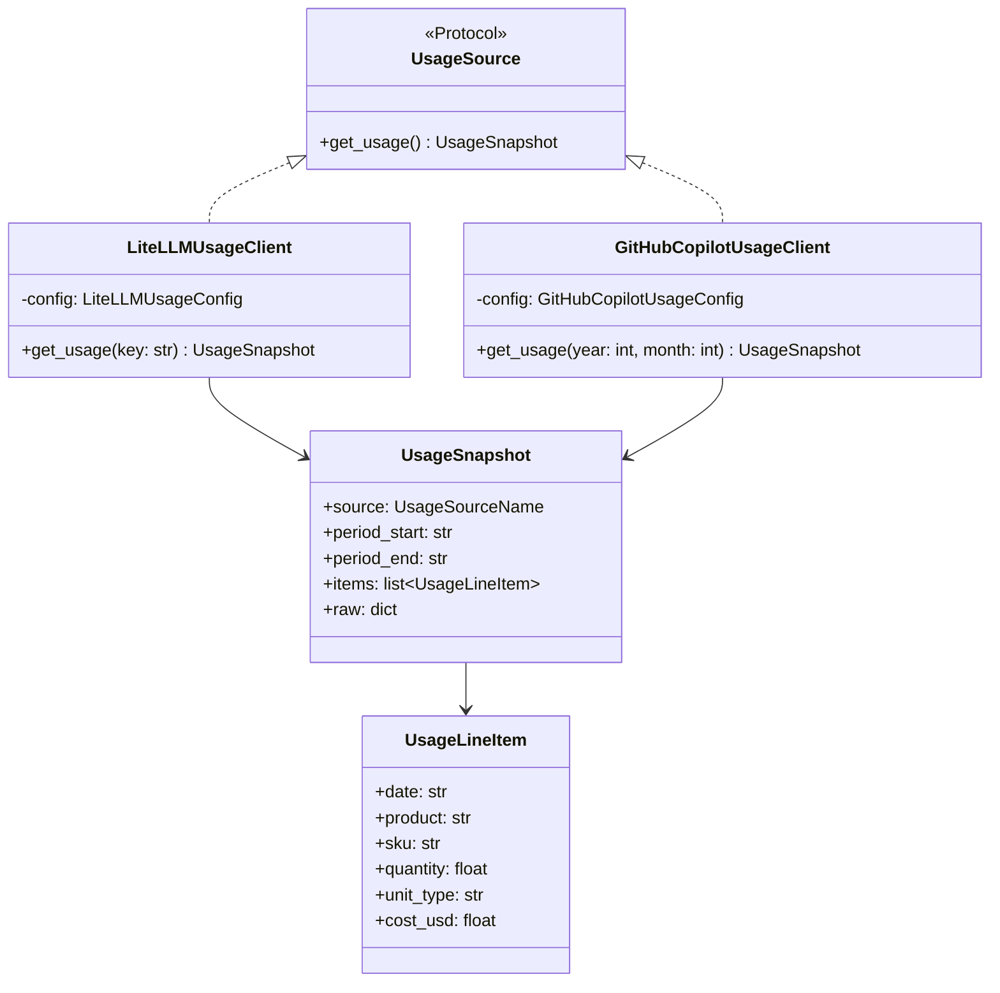

# Monitorización de Uso/Coste de IA — Referencia Técnica

API Reference del paquete `doc_organize.ai` (extra `ai`, requiere `httpx`).

Desde 2.1.0 el uso y el coste de IA se consultan en **LiteLLM** (`LiteLLMUsageClient`), que enruta todas las tareas de
IA desde la 2.0. El cliente de GitHub Copilot sigue disponible pero está obsoleto y se retira en 3.0 (ver
[GitHubCopilotUsageClient](#githubcopilotusageclient)).

## 1. Arquitectura y Diseño



`UsageSource` es un `typing.Protocol` (`@runtime_checkable`): ninguno de los dos
clientes hereda de él, lo cumplen estructuralmente (ISP) — cada uno añade solo los
parámetros opcionales propios de su fuente sobre la firma común `get_usage()`.

### Notas Internas

- **Testing sin red real**: ambos constructores aceptan `transport: httpx.AsyncBaseTransport | None` para inyectar `httpx.MockTransport` en tests (`tests/unit/test_litellm_usage_client.py`, `tests/unit/test_github_copilot_usage_client.py`) — sin dependencias externas, mismo criterio que el resto de la suite.
- **`UsageSource` es estructural, no por herencia**: cualquier tercer cliente futuro (Bedrock, Vertex, ...) solo necesita implementar `get_usage()` invocable sin argumentos; campos específicos de una fuente van en `UsageSnapshot.raw`, nunca como campo top-level nuevo no opcional (evita romper `UsageSnapshot` para consumidores existentes).
- **Sin proxying de inferencia**: deliberado — ver PLAN/AUDIT_PLAN de la sesión 2026-09-07. Si en el futuro se añade `chat_completion()`, debe ir en una clase/módulo aparte para no violar ISP sobre los consumidores que solo necesitan `get_usage()`.

## 2. API Reference

### Autodoc

*No aplica para este módulo.*

### Contratos

#### Entrada

| Config | Campos | Impacto si falta |
|---|---|---|
| `LiteLLMUsageConfig` | `base_url`, `virtual_key` (obligatorios); `timeout_s` (30.0), `retries`, `retry_backoff_s`, `rate_limit_retries`, `max_retry_wait_s` | `ValidationError` de Pydantic al construir |
| `GitHubCopilotUsageConfig` (obsoleto) | `username`, `personal_access_token` (obligatorios); `timeout_s` (30.0), `retries`, `retry_backoff_s`, `rate_limit_retries`, `max_retry_wait_s` | `ValidationError` de Pydantic al construir |

**Reintentos (0.14.0, L-3b)**: todas las `*Config` de `doc_organize.ai` tienen `retries` (`int >= 0`, por defecto `0`:
sin reintentos, como hasta 0.13.0) y `retry_backoff_s` (`float >= 0`, por defecto `0.5`). Solo se reintenta un timeout
o un error de red/transporte (`httpx.TransportError`), con espera `retry_backoff_s * 2**n` (0.5, 1, 2...). Al agotar
los reintentos se lanza la misma `*ConnectionError` de siempre. Ojo: reintentar un `POST` de clasificación que hizo
timeout puede cobrarse dos veces si el proxy sí lo recibió.

**429 y 503 (2.0.0, D5)**: `rate_limit_retries` (por defecto `3`) reintentos ante una respuesta 429 (límite de
peticiones) o 503 (servicio saturado). Se espera lo que pida `Retry-After` (segundos o fecha HTTP) o, si no lo trae,
`retry_backoff_s * 2**n`; cada espera tiene un tope de `max_retry_wait_s` (por defecto 60 s). La espera es **compartida**
por todas las llamadas del mismo cliente: con `ContextBuilder(ai_concurrency=4)`, mientras dura nadie más envía. Al
agotarlos se lanza el `*Error` de siempre. `rate_limit_retries=0` deja el comportamiento de 1.x. Ninguna otra respuesta
HTTP se reintenta (ni 401/403, ni 500).

Ninguna config lee variables de entorno en su constructor. Usa las factories:

```python
from doc_organize.ai import litellm_usage_config_from_env, github_copilot_usage_config_from_env

litellm_config = litellm_usage_config_from_env()          # DOC_ORGANIZE_LITELLM_BASE_URL / _VIRTUAL_KEY
copilot_config = github_copilot_usage_config_from_env()   # DOC_ORGANIZE_GITHUB_USERNAME / _PAT (obsoleto: DeprecationWarning)
```

Ambas lanzan `ValueError` si falta alguna variable de entorno.

#### Salida

```python
class UsageLineItem(BaseModel):
    date: str
    product: str
    sku: str | None
    quantity: float
    unit_type: str
    cost_usd: float | None

class UsageSnapshot(BaseModel):
    source: UsageSourceName  # "litellm" | "github_copilot" (este último, obsoleto: se retira en 3.0)
    period_start: str
    period_end: str
    items: list[UsageLineItem]
    raw: dict[str, Any]
```

## 3. Componentes y Clases

### LiteLLMUsageClient

```python
class LiteLLMUsageClient:
    def __init__(self, config: LiteLLMUsageConfig, *, transport: httpx.AsyncBaseTransport | None = None) -> None

    async def __aenter__(self) -> "LiteLLMUsageClient"
    async def __aexit__(self, *args) -> None

    async def get_usage(self, *, key: str | None = None) -> UsageSnapshot
```

Context manager async para consultar el spend de un LiteLLM Proxy externo (`GET /key/info`).

#### get_usage (Async)

| Parámetro | Tipo | Descripción |
|---|---|---|
| `key` | `str \| None` | Virtual key (o su hash SHA-256) cuyo spend consultar. Por defecto, la del Bearer (`config.virtual_key`) |

| Retorno | Tipo | Descripción |
|---|---|---|
| | `UsageSnapshot` | Snapshot con una única `UsageLineItem` (spend acumulado, `unit_type="usd"`) |

**Operación**:
- Sin `key` (o con la misma clave del Bearer): `GET {base_url}/key/info`, `Authorization: Bearer {config.virtual_key}`.
  Desde 0.14.0 (L-3e) **no** se envía `?key=`: LiteLLM consulta entonces la clave del header (`info_key_fn`:
  `key = key or user_api_key_dict.api_key`), y la clave no aparece en la URL que `httpx` escribe en INFO
  (`HTTP Request: GET ...`). Hasta 0.13.0 la clave propia iba en la query y acababa en los logs.
- Con otra `key`: `GET {base_url}/key/info?key={key}`. Esa URL **sí** queda en los logs de `httpx` y en los de acceso
  de cualquier proxy intermedio; pasa el hash SHA-256 de la clave (LiteLLM lo acepta) en vez de la clave en claro.
  Consultar otra clave exige ser su dueño, de su equipo o administrador del proxy (si no, 403).
- `Authorization` siempre usa `config.virtual_key` (la credencial esperada por LiteLLM en ese header)

**Excepciones**:
- `UsageSourceAuthError` — HTTP 401/403
- `UsageSourceConnectionError` — timeout o error de red
- `UsageSourceError` — cualquier otro HTTP de error

---

### GitHubCopilotUsageClient

!!! warning "Obsoleto desde 2.1.0"
    `GitHubCopilotUsageClient`, `GitHubCopilotUsageConfig` y `github_copilot_usage_config_from_env()` emiten
    `DeprecationWarning` y se retiran en 3.0, igual que `UsageSourceName.GITHUB_COPILOT`. El uso y el coste de IA se
    consultan en LiteLLM (`LiteLLMUsageClient`). Ver [Hacia 3.0](../guides/migracion_3_0.md).

```python
class GitHubCopilotUsageClient:
    def __init__(self, config: GitHubCopilotUsageConfig, *, transport: httpx.AsyncBaseTransport | None = None) -> None

    async def __aenter__(self) -> "GitHubCopilotUsageClient"
    async def __aexit__(self, *args) -> None

    async def get_usage(self, *, year: int | None = None, month: int | None = None) -> UsageSnapshot
```

Context manager async para consultar el consumo de premium requests de Copilot Pro.

#### get_usage (Async)

| Parámetro | Tipo | Descripción |
|---|---|---|
| `year` | `int \| None` | Año a consultar. Por defecto, el año actual |
| `month` | `int \| None` | Mes (1-12) a consultar. `None` devuelve el año completo |

| Retorno | Tipo | Descripción |
|---|---|---|
| | `UsageSnapshot` | Una `UsageLineItem` por cada elemento de `usageItems[]` |

**Operación**:
- `GET https://api.github.com/users/{config.username}/settings/billing/premium_request/usage`
- Headers: `Authorization: Bearer {config.personal_access_token}`, `Accept: application/vnd.github+json`, `X-GitHub-Api-Version: 2022-11-28`

**Excepciones**: igual que `LiteLLMUsageClient.get_usage()`.

## 4. Dependencias y Requisitos

| Dependencia | Propósito | Requerida | Comportamiento sin ella |
|---|---|---|---|
| `httpx` (extra `ai`) | Cliente HTTP async de ambos clientes | Sí | `doc_organize.ai` no se puede importar |
| `core.models.UsageLineItem`, `UsageSnapshot`, `UsageSourceName`, `LiteLLMUsageConfig`, `GitHubCopilotUsageConfig` | Modelos Pydantic v2 | Sí (interna) | — |
| `core.exceptions.UsageSourceError`, `UsageSourceAuthError`, `UsageSourceConnectionError` | Excepciones | Sí (interna) | — |
| `utils.logging` | Logging | Sí (interna) | — |

## 5. Ejemplos Relacionados

- [Ejemplo: Consultar el gasto de IA en LiteLLM](../examples/ai-usage.md): `LiteLLMUsageClient` contra un proxy falso (`httpx.MockTransport`): el gasto de la propia clave, otra clave por su hash, y los errores `UsageSourceAuthError` (401/403) y `UsageSourceConnectionError` tras los reintentos.
