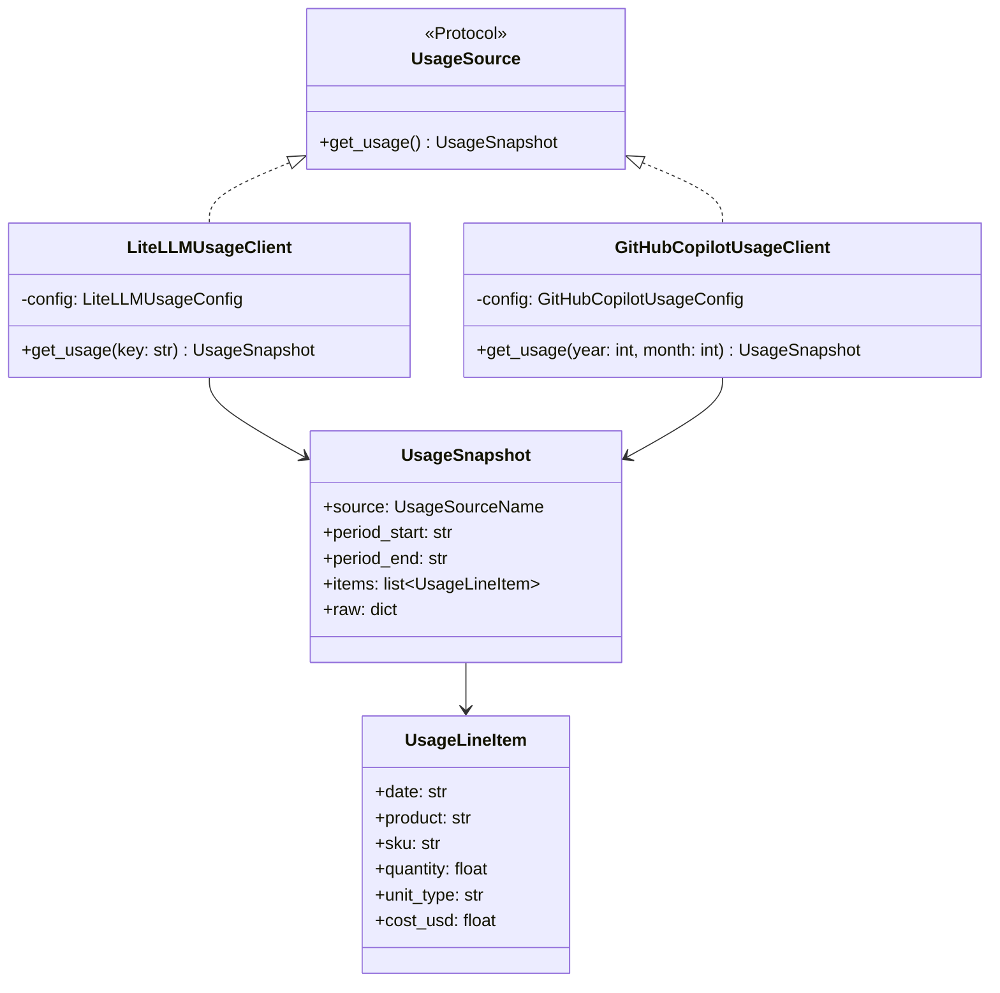

# Monitorización de Uso/Coste de IA — Referencia Técnica

API Reference del paquete `doc_organize.ai` (extra `ai`, requiere `httpx`).

## Arquitectura



`UsageSource` es un `typing.Protocol` (`@runtime_checkable`): ninguno de los dos
clientes hereda de él, lo cumplen estructuralmente (ISP) — cada uno añade solo los
parámetros opcionales propios de su fuente sobre la firma común `get_usage()`.

## API Pública

### LiteLLMUsageClient

```python
class LiteLLMUsageClient:
    def __init__(self, config: LiteLLMUsageConfig, *, transport: httpx.AsyncBaseTransport | None = None) -> None

    async def __aenter__(self) -> "LiteLLMUsageClient"
    async def __aexit__(self, *args) -> None

    async def get_usage(self, *, key: str | None = None) -> UsageSnapshot
```

Context manager async para consultar el spend de un LiteLLM Proxy externo (`GET /key/info`).

#### get_usage (Async)

| Parámetro | Tipo | Descripción |
|---|---|---|
| `key` | `str \| None` | Virtual key cuyo spend consultar. Por defecto, `config.virtual_key` |

| Retorno | Tipo | Descripción |
|---|---|---|
| | `UsageSnapshot` | Snapshot con una única `UsageLineItem` (spend acumulado, `unit_type="usd"`) |

**Operación**:
- `GET {base_url}/key/info?key={key}`, `Authorization: Bearer {config.virtual_key}`
- `Authorization` siempre usa `config.virtual_key` (la credencial esperada por LiteLLM en ese header); `key` solo cambia qué virtual key se consulta

**Excepciones**:
- `UsageSourceAuthError` — HTTP 401/403
- `UsageSourceConnectionError` — timeout o error de red
- `UsageSourceError` — cualquier otro HTTP de error

---

### GitHubCopilotUsageClient

```python
class GitHubCopilotUsageClient:
    def __init__(self, config: GitHubCopilotUsageConfig, *, transport: httpx.AsyncBaseTransport | None = None) -> None

    async def __aenter__(self) -> "GitHubCopilotUsageClient"
    async def __aexit__(self, *args) -> None

    async def get_usage(self, *, year: int | None = None, month: int | None = None) -> UsageSnapshot
```

Context manager async para consultar el consumo de premium requests de Copilot Pro.

#### get_usage (Async)

| Parámetro | Tipo | Descripción |
|---|---|---|
| `year` | `int \| None` | Año a consultar. Por defecto, el año actual |
| `month` | `int \| None` | Mes (1-12) a consultar. `None` devuelve el año completo |

| Retorno | Tipo | Descripción |
|---|---|---|
| | `UsageSnapshot` | Una `UsageLineItem` por cada elemento de `usageItems[]` |

**Operación**:
- `GET https://api.github.com/users/{config.username}/settings/billing/premium_request/usage`
- Headers: `Authorization: Bearer {config.personal_access_token}`, `Accept: application/vnd.github+json`, `X-GitHub-Api-Version: 2022-11-28`

**Excepciones**: igual que `LiteLLMUsageClient.get_usage()`.

---

## Contratos

### Entrada

| Config | Campos | Impacto si falta |
|---|---|---|
| `LiteLLMUsageConfig` | `base_url`, `virtual_key`, `timeout_s` | `ValidationError` de Pydantic al construir |
| `GitHubCopilotUsageConfig` | `username`, `personal_access_token`, `timeout_s` | `ValidationError` de Pydantic al construir |

Ninguna config lee variables de entorno en su constructor. Usa las factories:

```python
from doc_organize.ai import litellm_usage_config_from_env, github_copilot_usage_config_from_env

litellm_config = litellm_usage_config_from_env()          # DOC_ORGANIZE_LITELLM_BASE_URL / _VIRTUAL_KEY
copilot_config = github_copilot_usage_config_from_env()   # DOC_ORGANIZE_GITHUB_USERNAME / _PAT
```

Ambas lanzan `ValueError` si falta alguna variable de entorno.

### Salida

```python
class UsageLineItem(BaseModel):
    date: str
    product: str
    sku: str | None
    quantity: float
    unit_type: str
    cost_usd: float | None

class UsageSnapshot(BaseModel):
    source: UsageSourceName  # "litellm" | "github_copilot"
    period_start: str
    period_end: str
    items: list[UsageLineItem]
    raw: dict[str, Any]
```

## Dependencias

| Dependencia | Propósito |
|---|---|
| `httpx` (extra `ai`) | Cliente HTTP async de ambos clientes |
| `core.models.UsageLineItem`, `UsageSnapshot`, `UsageSourceName`, `LiteLLMUsageConfig`, `GitHubCopilotUsageConfig` | Modelos Pydantic v2 |
| `core.exceptions.UsageSourceError`, `UsageSourceAuthError`, `UsageSourceConnectionError` | Excepciones |
| `utils.logging` | Logging |

## Notas Internas

- **Testing sin red real**: ambos constructores aceptan `transport: httpx.AsyncBaseTransport | None` para inyectar `httpx.MockTransport` en tests (`tests/unit/test_litellm_usage_client.py`, `tests/unit/test_github_copilot_usage_client.py`) — sin dependencias externas, mismo criterio que el resto de la suite.
- **`UsageSource` es estructural, no por herencia**: cualquier tercer cliente futuro (Bedrock, Vertex, ...) solo necesita implementar `get_usage()` invocable sin argumentos; campos específicos de una fuente van en `UsageSnapshot.raw`, nunca como campo top-level nuevo no opcional (evita romper `UsageSnapshot` para consumidores existentes).
- **Sin proxying de inferencia**: deliberado — ver PLAN/AUDIT_PLAN de la sesión 2026-09-07. Si en el futuro se añade `chat_completion()`, debe ir en una clase/módulo aparte para no violar ISP sobre los consumidores que solo necesitan `get_usage()`.

## Ejemplos Relacionados

*Pendiente — sin consumidor real todavía que ejemplificar (ver Alcance en la documentación funcional).*
