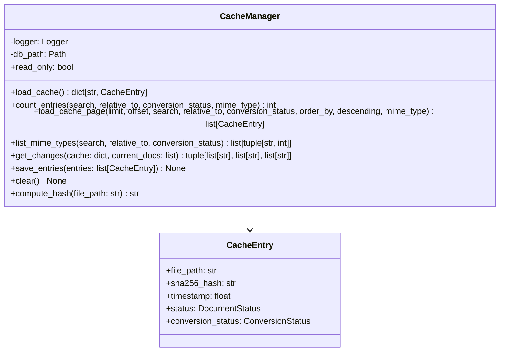

# Cache — Referencia Técnica

API Reference para gestión de caché transaccional.

## Arquitectura



## API Pública

### CacheManager

```python
class CacheManager:
    def __init__(self, db_path: str | Path = "cache.db", *, read_only: bool = False) -> None
    async def __aenter__(self) -> Self
    async def __aexit__(self, *exc_info: object) -> None
    
    async def load_cache(self) -> dict[str, CacheEntry]
    
    async def count_entries(
        self,
        search: str | None = None,
        *,
        relative_to: str | Path | None = None,
        conversion_status: ConversionStatus | str | None = None,
        mime_type: str | Sequence[str] | None = None,       # 1.6.0
    ) -> int
    
    async def load_cache_page(
        self,
        limit: int,
        offset: int,
        search: str | None = None,
        *,
        relative_to: str | Path | None = None,
        conversion_status: ConversionStatus | str | None = None,
        order_by: CacheOrderBy = "file_path",
        descending: bool = False,
        mime_type: str | Sequence[str] | None = None,       # 1.6.0
    ) -> list[CacheEntry]
    
    async def list_mime_types(                              # 1.6.0
        self,
        search: str | None = None,
        *,
        relative_to: str | Path | None = None,
        conversion_status: ConversionStatus | str | None = None,
    ) -> list[tuple[str, int]]
    
    def get_changes(
        self,
        cache: dict[str, CacheEntry],
        current_docs: list[DocumentMetadata],
    ) -> tuple[list[str], list[str], list[str]]
    
    async def save_entries(
        self,
        entries: list[CacheEntry]
    ) -> None

    async def clear(self) -> None                          # vacía cache_entries (forzar rescan)
    async def compute_hash(self, file_path: str) -> str    # delega en utils.hash_utils.hash_file()
```

Context manager para gestión de caché SQLite (WAL mode).

#### Solo lectura (`read_only=True`, desde 0.12.0)

Para leer la caché que escribe otro proceso (p. ej. la API de doc_organize_web mientras el worker escanea):

- Abre con la URI `file:...?mode=ro`: no ejecuta `PRAGMA journal_mode=WAL`, no crea la tabla ni migra columnas.
- `CacheNotFoundError` (subclase de `CacheError`) si el fichero no existe; no se crea.
- `CacheError` si la caché no tiene el esquema actual (ábrela una vez en escritura para migrarla) o si se llama a
  `save_entries`/`clear`.

```python
from doc_organize import CacheManager, CacheNotFoundError, ConversionStatus

async with CacheManager(layout.cache_db, read_only=True) as cache:
    total = await cache.count_entries("informe", relative_to="/mnt/datos/2024", conversion_status=ConversionStatus.ERROR)
```

#### load_cache

Carga todas las entradas del caché en memoria.

| Retorno | Tipo | Descripción |
|---|---|---|
| | `dict[str, CacheEntry]` | Mapeo `file_path` → `CacheEntry` |

**Operación**:
- Lee tabla `cache_entries` desde SQLite
- Retorna diccionario para búsqueda O(1)

---

#### count_entries (Async)

Cuenta entradas de `cache_entries`, opcionalmente filtradas por `search`.

| Parámetro | Tipo | Descripción |
|---|---|---|
| `search` | `str \| None` | Subcadena a buscar en `file_path` (nombre o carpeta). `None` cuenta todas |
| `relative_to` | `str \| Path \| None` | Raíz escaneada (0.12.0): solo cuenta las entradas que cuelgan de ella y `search` se aplica a la ruta relativa a esa raíz (buscar `mnt` no encuentra el prefijo del montaje) |
| `conversion_status` | `ConversionStatus \| str \| None` | Solo las entradas con ese estado (p. ej. `"error"`) (0.12.0) |
| `mime_type` | `str \| Sequence[str] \| None` | Solo las entradas con ese tipo MIME exacto o con alguno de la lista (1.6.0). `None` o lista vacía no filtra; las entradas sin tipo (escaneadas antes de 1.5.0) nunca coinciden |

| Retorno | Tipo | Descripción |
|---|---|---|
| | `int` | Número de entradas que coinciden |

**Operación**:
- `SELECT COUNT(*)` sobre `cache_entries`, con `WHERE file_path LIKE ?` si `search`
- Comparación insensible a mayúsculas/tildes (función SQL `py_lower` registrada por conexión)
- Útil para calcular el número de páginas de un listado paginado

---

#### load_cache_page (Async)

Lee una página de `cache_entries`, ordenada por `file_path` (o por `order_by`, desde 1.2.0) para paginación estable.

| Parámetro | Tipo | Descripción |
|---|---|---|
| `limit` | `int` | Número máximo de entradas a devolver |
| `offset` | `int` | Entradas a saltar desde el principio del orden |
| `search` | `str \| None` | Subcadena a buscar en `file_path`. `None` no filtra |
| `relative_to` | `str \| Path \| None` | Igual que en `count_entries` (0.12.0) |
| `conversion_status` | `ConversionStatus \| str \| None` | Igual que en `count_entries` (0.12.0) |
| `order_by` | `CacheOrderBy` | Columna de orden (1.2.0): `"file_path"` (por defecto), `"timestamp"`, `"conversion_status"`, `"status"`, `"size_bytes"` o `"error_retry_count"`; desde 1.6.0 también `"mime_type"`, `"created_time"` y `"owner_name"` |
| `descending` | `bool` | Orden descendente de `order_by` (1.2.0). Por defecto `False` |
| `mime_type` | `str \| Sequence[str] \| None` | Igual que en `count_entries` (1.6.0) |

| Retorno | Tipo | Descripción |
|---|---|---|
| | `list[CacheEntry]` | Entradas de la página solicitada |

| Excepción | Cuándo |
|---|---|
| `ValueError` | `order_by` no es una de las columnas de `CacheOrderBy` (nunca se pasa un nombre libre al SQL) |

**Orden** (1.2.0):

- Los empates se resuelven siempre por `file_path` ascendente, también con `descending=True`. El orden es total y
  determinista: las páginas de varias cachés (una por carpeta) se pueden juntar con el mismo criterio.
- Los `NULL` van al final en los dos sentidos: `size_bytes` de entradas anteriores a 1.1.0 y `conversion_status` sin
  valor. En una caché anterior a 1.1.0 abierta con `read_only=True` (sin la columna `size_bytes`), ordenar por
  `size_bytes` deja todas las entradas empatadas y quedan por `file_path`.
- `status` y `conversion_status` se ordenan por el texto de su valor (`"error"` < `"ocr_pending"` < `"success"`).
- Metadatos de 1.5.0 (1.6.0): `mime_type` por su texto; `created_time` es la fecha de creación en Windows y macOS y
  `None` en Linux (allí todas empatan y quedan por ruta); `owner_name` sin distinguir mayúsculas («ana» y «Ana»
  empatan y quedan por ruta). Las entradas escaneadas antes de 1.5.0 no tienen estos valores y van al final.
- `CacheOrderBy` se importa de `doc_organize.cache`.

```python
from doc_organize.cache import CacheManager

async with CacheManager(project / "cache.db", read_only=True) as cache:
    mayores = await cache.load_cache_page(50, 0, order_by="size_bytes", descending=True)
    pdfs = await cache.load_cache_page(50, 0, mime_type="application/pdf", order_by="created_time", descending=True)
```

---

#### list_mime_types (Async, 1.6.0)

Tipos MIME presentes en la caché con su número de entradas, de más a menos (y por tipo si empatan). Pensado para el
desplegable del filtro por tipo de una lista, sin leer la caché entera. Admite `search`, `relative_to` y
`conversion_status` como `count_entries`. Las entradas sin tipo no aparecen; una caché anterior a 1.5.0 devuelve `[]`.

```python
tipos = await cache.list_mime_types(relative_to="/mnt/datos/2024")  # [("application/pdf", 1520), ("text/plain", 40)]
```

**Operación de `load_cache_page`**:
- Con `order_by="file_path"`: `SELECT ... ORDER BY file_path LIMIT ? OFFSET ?`, con el mismo filtro `search` que
  `count_entries`
- Con otra columna: se ordenan solo las claves (`rowid`) en una subconsulta con los mismos filtros y se leen las filas
  de la página. No hay índices nuevos ni migración: cada conexión fija `PRAGMA temp_store=MEMORY`, que no cambia el
  fichero, para que SQLite no vuelque la ordenación a disco. Con 100 000 entradas, una página con offset alto tarda
  ~80–150 ms en cualquier orden (disco local, Windows, Python 3.14), frente a ~1 s sin ese PRAGMA. Medido de nuevo en
  1.6.0 con las columnas nuevas: `mime_type` 113 ms, `created_time` 87 ms, `owner_name` 151 ms (pasa por `py_lower`);
  `list_mime_types` 34 ms y `count_entries(mime_type=…)` 15 ms
- No sustituye a `load_cache()`: sigue siendo la fuente completa que usan `get_changes()` y la exportación ZIP; `load_cache_page()` es solo para listas largas en la vista web

---

#### get_changes (Síncrono)

Clasifica documentos en new, modified, unchanged.

| Parámetro | Tipo | Descripción |
|---|---|---|
| `cache` | `dict[str, CacheEntry]` | Resultado de `load_cache()` |
| `current_docs` | `list[DocumentMetadata]` | Documentos actuales (escaneados) |

| Retorno | Tipo | Descripción |
|---|---|---|
| `new_files` | `list[str]` | Rutas (`full_path`) de documentos nuevos (no en caché) |
| `modified_files` | `list[str]` | Rutas de documentos cuyo SHA-256 cambió |
| `unchanged_files` | `list[str]` | Rutas de documentos sin cambios |

**Clasificación**:
1. Si `file_path` no en caché → `new`
2. Si en caché pero SHA-256 distinto → `modified`
3. Si en caché y SHA-256 igual → `unchanged`

---

#### save_entries (Async)

Guarda/actualiza entradas en caché (upsert transaccional).

| Parámetro | Tipo | Descripción |
|---|---|---|
| `entries` | `list[CacheEntry]` | Entradas a guardar |

**Operación**:
- `INSERT OR REPLACE` transaccional en tabla `cache_entries`
- Retorna cuando transacción está confirmada

**Excepciones**:
- `CacheError` — Errores de base de datos, o caché abierta con `read_only=True`

---

#### clear (Async)

Vacía `cache_entries` por completo (no es un upsert): la siguiente `get_changes()` trata todos los documentos como
nuevos. Lanza `CacheError` en solo lectura.

---

## Contratos

### Entrada

| Parámetro | Validación | Impacto si falla |
|---|---|---|
| Base de datos accesible | Validación al abrir | `CacheError` |
| Documento con SHA-256 | Validación previa (Scanner) | Entrada incompleta en caché |

### Salida

```python
class CacheEntry(BaseModel):
    file_path: str
    sha256_hash: str
    timestamp: float  # fecha de modificación del fichero (Unix) cuando se escaneó
    status: DocumentStatus
    conversion_status: ConversionStatus | None = None
    error_message: str | None = None
    error_retry_count: int = 0
    size_bytes: int | None = None  # 1.1.0 (G25); None en entradas anteriores
    created_time: float | None = None  # 1.5.0: los cuatro, como en DocumentMetadata; None en entradas anteriores
    mime_type: str | None = None
    file_permissions: str | None = None
    owner_name: str | None = None
```

Los metadatos de fichero de 1.5.0 (ver [Scanner](scanner.md#metadatos-de-fichero-150)) se guardan con cada documento
convertido y, desde ese mismo escaneo, también se actualizan en los documentos sin cambios de contenido, sin
reconvertirlos.

`timestamp` y `size_bytes` permiten construir un `DocumentMetadata` desde la caché
(`DocumentMetadata.from_cache_entry`, ver [Scanner](scanner.md#documentmetadata-desde-la-cache-110-g25)) y no rehashear
lo que no cambió (`ScanOptions.reuse_unchanged_hashes`). Un `CacheEntry` serializado antes de 1.1.0 (sin
`size_bytes`) se sigue leyendo.

## Schema SQLite

```sql
CREATE TABLE cache_entries (
    file_path TEXT PRIMARY KEY,
    sha256_hash TEXT NOT NULL,
    timestamp REAL NOT NULL,
    status TEXT NOT NULL,
    conversion_status TEXT,
    error_message TEXT,
    error_retry_count INTEGER NOT NULL DEFAULT 0,
    size_bytes INTEGER,  -- 1.1.0
    created_time REAL,   -- 1.5.0
    mime_type TEXT,      -- 1.5.0
    file_permissions TEXT,  -- 1.5.0
    owner_name TEXT      -- 1.5.0
);
```

Al abrirla en escritura, una caché anterior gana las columnas que le falten (`ALTER TABLE ... ADD COLUMN`, migración
aditiva). En solo lectura no se migra: una caché sin `size_bytes` o sin las columnas de 1.5.0 se abre igual y esas
columnas se leen como `None`.

**Pragmas**:
- `PRAGMA journal_mode=WAL` — Write-Ahead Logging para concurrencia

> Corregido en 1.1.0: hasta esta versión, esta página listaba también `PRAGMA synchronous=NORMAL`, que el código nunca
> ha fijado, y omitía las columnas `error_message` y `error_retry_count`.

## Dependencias

| Dependencia | Propósito |
|---|---|
| `core.constants.DEFAULT_CACHE_DB_NAME` | Nombre DB por defecto ("cache.db") |
| `core.models.CacheEntry`, `DocumentMetadata` | Modelos |
| `core.exceptions.CacheError` | Excepciones |
| `utils.hash_utils.hash_file()` | Única fuente de verdad para SHA-256 |
| `utils.logging` | Logging |

## Notas Internas

- **No computa SHA-256**: Delega en `utils.hash_utils.hash_file()`
- **Clasificación local**: `get_changes()` es operación en memoria (CPU, no disco)
- **Limpieza manual**: Entradas obsoletas persisten hasta limpieza manual
- **Escala**: Soporta ~100k-1M entradas sin problemas de rendimiento

## Exportación a Excel

`doc_organize.export.write_cache_xlsx()` (subcomando `export cache-xlsx`, extra `export`) escribe un Excel con
**todas** las entradas de una o varias `cache.db`, ordenadas por `file_path`. Los valores que empiezan por un carácter
disparador de fórmula (`=`, `+`, `-`, `@`) se neutralizan para evitar inyección de fórmulas al abrir el fichero en
Excel o LibreOffice. Ver [Exportación](export.md).

## Ejemplos Relacionados

- [Detectar cambios con caché](../examples/cache-changes.md)
