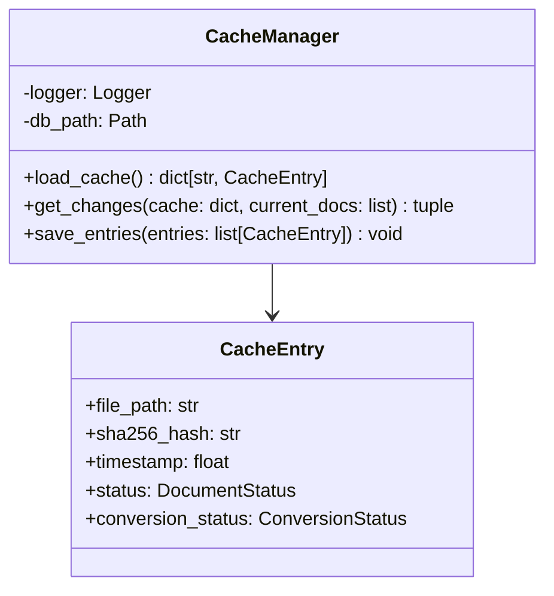

# Cache — Referencia Técnica

API Reference para gestión de caché transaccional.

## Arquitectura



## API Pública

### CacheManager

```python
class CacheManager:
    async def __aenter__(self) -> 'CacheManager'
    async def __aexit__(self, *args) -> None
    
    async def load_cache(self) -> dict[str, CacheEntry]
    
    def get_changes(
        self,
        cache: dict[str, CacheEntry],
        current_docs: list[DocumentMetadata]
    ) -> tuple[list, list, list]
    
    async def save_entries(
        self,
        entries: list[CacheEntry]
    ) -> None
```

Context manager para gestión de caché SQLite (WAL mode).

#### load_cache

Carga todas las entradas del caché en memoria.

| Retorno | Tipo | Descripción |
|---|---|---|
| | `dict[str, CacheEntry]` | Mapeo `file_path` → `CacheEntry` |

**Operación**:
- Lee tabla `cache_entries` desde SQLite
- Retorna diccionario para búsqueda O(1)

---

#### get_changes (Síncrono)

Clasifica documentos en new, modified, unchanged.

| Parámetro | Tipo | Descripción |
|---|---|---|
| `cache` | `dict[str, CacheEntry]` | Resultado de `load_cache()` |
| `current_docs` | `list[DocumentMetadata]` | Documentos actuales (escaneados) |

| Retorno | Tipo | Descripción |
|---|---|---|
| `new` | `list[DocumentMetadata]` | Documentos nuevos (no en caché) |
| `modified` | `list[DocumentMetadata]` | Documentos cuyo SHA-256 cambió |
| `unchanged` | `list[DocumentMetadata]` | Documentos sin cambios |

**Clasificación**:
1. Si `file_path` no en caché → `new`
2. Si en caché pero SHA-256 distinto → `modified`
3. Si en caché y SHA-256 igual → `unchanged`

---

#### save_entries (Async)

Guarda/actualiza entradas en caché (upsert transaccional).

| Parámetro | Tipo | Descripción |
|---|---|---|
| `entries` | `list[CacheEntry]` | Entradas a guardar |

**Operación**:
- `INSERT OR REPLACE` transaccional en tabla `cache_entries`
- Retorna cuando transacción está confirmada

**Excepciones**:
- `CacheError` — Errores de base de datos

---

## Contratos

### Entrada

| Parámetro | Validación | Impacto si falla |
|---|---|---|
| Base de datos accesible | Validación al abrir | `CacheError` |
| Documento con SHA-256 | Validación previa (Scanner) | Entrada incompleta en caché |

### Salida

```python
@dataclass
class CacheEntry:
    file_path: str
    sha256_hash: str
    timestamp: float  # Unix timestamp
    status: DocumentStatus
    conversion_status: ConversionStatus
```

## Schema SQLite

```sql
CREATE TABLE cache_entries (
    file_path TEXT PRIMARY KEY,
    sha256_hash TEXT NOT NULL,
    timestamp REAL NOT NULL,
    status TEXT NOT NULL,
    conversion_status TEXT
);
```

**Pragmas**:
- `PRAGMA journal_mode=WAL` — Write-Ahead Logging para concurrencia
- `PRAGMA synchronous=NORMAL` — Balance entre seguridad y rendimiento

## Dependencias

| Dependencia | Propósito |
|---|---|
| `core.constants.DEFAULT_CACHE_DB_NAME` | Nombre DB por defecto ("cache.db") |
| `core.models.CacheEntry`, `DocumentMetadata` | Modelos |
| `core.exceptions.CacheError` | Excepciones |
| `utils.hash_utils.hash_file()` | Única fuente de verdad para SHA-256 |
| `utils.logging` | Logging |

## Notas Internas

- **No computa SHA-256**: Delega en `utils.hash_utils.hash_file()`
- **Clasificación local**: `get_changes()` es operación en memoria (CPU, no disco)
- **Limpieza manual**: Entradas obsoletas persisten hasta limpieza manual
- **Escala**: Soporta ~100k-1M entradas sin problemas de rendimiento

## Ejemplos Relacionados

- [Detectar cambios con caché](../examples/cache-changes.md)
