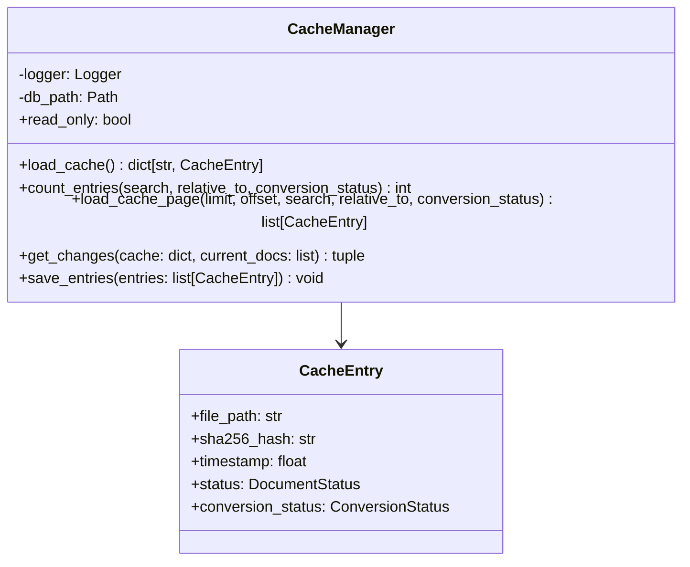

# Cache — Referencia Técnica

API Reference para gestión de caché transaccional.

## Arquitectura



## API Pública

### CacheManager

```python
class CacheManager:
    def __init__(self, db_path: str | Path = "cache.db", *, read_only: bool = False) -> None
    async def __aenter__(self) -> 'CacheManager'
    async def __aexit__(self, *args) -> None
    
    async def load_cache(self) -> dict[str, CacheEntry]
    
    async def count_entries(
        self,
        search: str | None = None,
        *,
        relative_to: str | Path | None = None,
        conversion_status: ConversionStatus | str | None = None,
    ) -> int
    
    async def load_cache_page(
        self,
        limit: int,
        offset: int,
        search: str | None = None,
        *,
        relative_to: str | Path | None = None,
        conversion_status: ConversionStatus | str | None = None,
    ) -> list[CacheEntry]
    
    def get_changes(
        self,
        cache: dict[str, CacheEntry],
        current_docs: list[DocumentMetadata]
    ) -> tuple[list, list, list]
    
    async def save_entries(
        self,
        entries: list[CacheEntry]
    ) -> None
```

Context manager para gestión de caché SQLite (WAL mode).

#### Solo lectura (`read_only=True`, desde 0.12.0)

Para leer la caché que escribe otro proceso (p. ej. la API de doc_organize_web mientras el worker escanea):

- Abre con la URI `file:...?mode=ro`: no ejecuta `PRAGMA journal_mode=WAL`, no crea la tabla ni migra columnas.
- `CacheNotFoundError` (subclase de `CacheError`) si el fichero no existe; no se crea.
- `CacheError` si la caché no tiene el esquema actual (ábrela una vez en escritura para migrarla) o si se llama a
  `save_entries`/`clear`.

```python
from doc_organize import CacheManager, CacheNotFoundError, ConversionStatus

async with CacheManager(layout.cache_db, read_only=True) as cache:
    total = await cache.count_entries("informe", relative_to="/mnt/datos/2024", conversion_status=ConversionStatus.ERROR)
```

#### load_cache

Carga todas las entradas del caché en memoria.

| Retorno | Tipo | Descripción |
|---|---|---|
| | `dict[str, CacheEntry]` | Mapeo `file_path` → `CacheEntry` |

**Operación**:
- Lee tabla `cache_entries` desde SQLite
- Retorna diccionario para búsqueda O(1)

---

#### count_entries (Async)

Cuenta entradas de `cache_entries`, opcionalmente filtradas por `search`.

| Parámetro | Tipo | Descripción |
|---|---|---|
| `search` | `str \| None` | Subcadena a buscar en `file_path` (nombre o carpeta). `None` cuenta todas |
| `relative_to` | `str \| Path \| None` | Raíz escaneada (0.12.0): solo cuenta las entradas que cuelgan de ella y `search` se aplica a la ruta relativa a esa raíz (buscar `mnt` no encuentra el prefijo del montaje) |
| `conversion_status` | `ConversionStatus \| str \| None` | Solo las entradas con ese estado (p. ej. `"error"`) (0.12.0) |

| Retorno | Tipo | Descripción |
|---|---|---|
| | `int` | Número de entradas que coinciden |

**Operación**:
- `SELECT COUNT(*)` sobre `cache_entries`, con `WHERE file_path LIKE ?` si `search`
- Comparación insensible a mayúsculas/tildes (función SQL `py_lower` registrada por conexión)
- Útil para calcular el número de páginas de un listado paginado

---

#### load_cache_page (Async)

Lee una página de `cache_entries`, ordenada por `file_path` para paginación estable.

| Parámetro | Tipo | Descripción |
|---|---|---|
| `limit` | `int` | Número máximo de entradas a devolver |
| `offset` | `int` | Entradas a saltar desde el principio del orden |
| `search` | `str \| None` | Subcadena a buscar en `file_path`. `None` no filtra |
| `relative_to` | `str \| Path \| None` | Igual que en `count_entries` (0.12.0) |
| `conversion_status` | `ConversionStatus \| str \| None` | Igual que en `count_entries` (0.12.0) |

| Retorno | Tipo | Descripción |
|---|---|---|
| | `list[CacheEntry]` | Entradas de la página solicitada |

**Operación**:
- `SELECT ... ORDER BY file_path LIMIT ? OFFSET ?`, con el mismo filtro `search` que `count_entries`
- No sustituye a `load_cache()`: sigue siendo la fuente completa que usan `get_changes()` y la exportación ZIP; `load_cache_page()` es solo para listas largas en la vista web

---

#### get_changes (Síncrono)

Clasifica documentos en new, modified, unchanged.

| Parámetro | Tipo | Descripción |
|---|---|---|
| `cache` | `dict[str, CacheEntry]` | Resultado de `load_cache()` |
| `current_docs` | `list[DocumentMetadata]` | Documentos actuales (escaneados) |

| Retorno | Tipo | Descripción |
|---|---|---|
| `new` | `list[DocumentMetadata]` | Documentos nuevos (no en caché) |
| `modified` | `list[DocumentMetadata]` | Documentos cuyo SHA-256 cambió |
| `unchanged` | `list[DocumentMetadata]` | Documentos sin cambios |

**Clasificación**:
1. Si `file_path` no en caché → `new`
2. Si en caché pero SHA-256 distinto → `modified`
3. Si en caché y SHA-256 igual → `unchanged`

---

#### save_entries (Async)

Guarda/actualiza entradas en caché (upsert transaccional).

| Parámetro | Tipo | Descripción |
|---|---|---|
| `entries` | `list[CacheEntry]` | Entradas a guardar |

**Operación**:
- `INSERT OR REPLACE` transaccional en tabla `cache_entries`
- Retorna cuando transacción está confirmada

**Excepciones**:
- `CacheError` — Errores de base de datos

---

## Contratos

### Entrada

| Parámetro | Validación | Impacto si falla |
|---|---|---|
| Base de datos accesible | Validación al abrir | `CacheError` |
| Documento con SHA-256 | Validación previa (Scanner) | Entrada incompleta en caché |

### Salida

```python
class CacheEntry(BaseModel):
    file_path: str
    sha256_hash: str
    timestamp: float  # fecha de modificación del fichero (Unix) cuando se escaneó
    status: DocumentStatus
    conversion_status: ConversionStatus | None = None
    error_message: str | None = None
    error_retry_count: int = 0
    size_bytes: int | None = None  # 1.1.0 (G25); None en entradas anteriores
```

`timestamp` y `size_bytes` permiten construir un `DocumentMetadata` desde la caché
(`DocumentMetadata.from_cache_entry`, ver [Scanner](scanner.md#documentmetadata-desde-la-cache-110-g25)) y no rehashear
lo que no cambió (`ScanOptions.reuse_unchanged_hashes`). Un `CacheEntry` serializado antes de 1.1.0 (sin
`size_bytes`) se sigue leyendo.

## Schema SQLite

```sql
CREATE TABLE cache_entries (
    file_path TEXT PRIMARY KEY,
    sha256_hash TEXT NOT NULL,
    timestamp REAL NOT NULL,
    status TEXT NOT NULL,
    conversion_status TEXT,
    error_message TEXT,
    error_retry_count INTEGER NOT NULL DEFAULT 0,
    size_bytes INTEGER  -- 1.1.0
);
```

Al abrirla en escritura, una caché anterior gana las columnas que le falten (`ALTER TABLE ... ADD COLUMN`, migración
aditiva). En solo lectura no se migra: una caché sin `size_bytes` se abre igual y esa columna se lee como `None`.

**Pragmas**:
- `PRAGMA journal_mode=WAL` — Write-Ahead Logging para concurrencia

> Corregido en 1.1.0: hasta esta versión, esta página listaba también `PRAGMA synchronous=NORMAL`, que el código nunca
> ha fijado, y omitía las columnas `error_message` y `error_retry_count`.

## Dependencias

| Dependencia | Propósito |
|---|---|
| `core.constants.DEFAULT_CACHE_DB_NAME` | Nombre DB por defecto ("cache.db") |
| `core.models.CacheEntry`, `DocumentMetadata` | Modelos |
| `core.exceptions.CacheError` | Excepciones |
| `utils.hash_utils.hash_file()` | Única fuente de verdad para SHA-256 |
| `utils.logging` | Logging |

## Notas Internas

- **No computa SHA-256**: Delega en `utils.hash_utils.hash_file()`
- **Clasificación local**: `get_changes()` es operación en memoria (CPU, no disco)
- **Limpieza manual**: Entradas obsoletas persisten hasta limpieza manual
- **Escala**: Soporta ~100k-1M entradas sin problemas de rendimiento

## Exportación a Excel

`doc_organize.export.write_cache_xlsx()` (subcomando `export cache-xlsx`, extra `export`) escribe un Excel con
**todas** las entradas de una o varias `cache.db`, ordenadas por `file_path`. Los valores que empiezan por un carácter
disparador de fórmula (`=`, `+`, `-`, `@`) se neutralizan para evitar inyección de fórmulas al abrir el fichero en
Excel o LibreOffice. Ver [Exportación](export.md).

## Ejemplos Relacionados

- [Detectar cambios con caché](../examples/cache-changes.md)
