# Organización Documental — Referencia Técnica

API Reference de `doc_organize.context` (Sub-fase A) y `doc_organize.ai.DomainClassificationClient`/`TaxonomyClassificationClient` (Sub-fase B).

## Arquitectura

```mermaid
classDiagram
    class ContextBuilder {
        +registry: ContextRegistry
        +build(project, documents, candidate_domains, threshold, ai_classification_enabled, ai_classification_client, taxonomy_manifest, taxonomy_classification_client) Context
    }
    class DomainClassifier {
        +candidate_domains: list[str]|None
        +threshold: float
        +classify(documents) tuple
        +score_domain(document, chunks_text, title) tuple
    }
    class MaterialTypeClassifier {
        +material_types: list[str]
        +threshold: float
        +classify_text(title, chunks_text) tuple
    }
    class ContextRegistry {
        +load_context(project) Context
        +save_context(project, context) None
        +get_domain(project, slug) Domain
    }
    class Reorganizer {
        +reorganize(project, context) Path
    }
    class MkDocsGenerator {
        +generate(project, context) Path
    }
    class DomainClassificationClient {
        +config: LiteLLMClassificationConfig
        +classify(chunks_text, title, candidate_domains) DomainClassificationResult
    }
    class TaxonomyClassificationClient {
        +config: LiteLLMTaxonomyClassificationConfig
        +classify(chunks_text, title, candidate_domains, candidate_material_types) TaxonomyClassificationResult
    }

    ContextBuilder --> DomainClassifier
    ContextBuilder --> MaterialTypeClassifier
    ContextBuilder --> ContextRegistry
    ContextBuilder --> DomainClassificationClient
    ContextBuilder --> TaxonomyClassificationClient
```



## ContextBuilder

```python
class ContextBuilder:
    def __init__(self, registry: ContextRegistry | None = None) -> None

    async def build(
        self,
        project: Project,
        documents: list[ConversionResult],
        candidate_domains: list[str] | None = None,
        threshold: float = 0.5,
        ai_classification_enabled: bool = False,
        ai_classification_client: DomainClassificationClient | None = None,
        output_folder_name: str = "organizado",
        taxonomy_manifest: TaxonomyManifest | None = None,
        taxonomy_classification_client: TaxonomyClassificationClient | None = None,
    ) -> Context
```

Orquesta Sub-fase A (siempre) + Sub-fase B (opt-in) y persiste el `Context` resultante.

| Parámetro | Tipo | Descripción |
|---|---|---|
| `documents` | `list[ConversionResult]` | Documentos ya convertidos con éxito |
| `candidate_domains` | `list[str] \| None` | Catálogo predefinido, o `None` para descubrir del contenido. Ignorado si se da `taxonomy_manifest` |
| `threshold` | `float` | Score mínimo (0-1) de la Sub-fase A antes de intentar la Sub-fase B (o el placeholder `sin-clasificar` en modo manifiesto) |
| `ai_classification_enabled` | `bool` | Activa la Sub-fase B — se persiste en `Context.ai_classification_enabled`. En modo manifiesto activa `taxonomy_classification_client` en vez de `ai_classification_client` |
| `ai_classification_client` | `DomainClassificationClient \| None` | Cliente ya configurado para la Sub-fase B de 1 eje; si `enabled=True` sin cliente, la Sub-fase B no se ejecuta. Ignorado si hay `taxonomy_manifest` |
| `taxonomy_manifest` | `TaxonomyManifest \| None` | Manifiesto de taxonomía (ver [TaxonomyManifest](#taxonomymanifest-manifiesto-de-taxonomia)) — activa la clasificación de 2 ejes (dominio + tipo de material) |
| `taxonomy_classification_client` | `TaxonomyClassificationClient \| None` | Cliente ya configurado para la Sub-fase B de 2 ejes (una sola llamada combinada). Sin efecto si `taxonomy_manifest` es `None`, o si `enabled=False` |

**Reglas**: el catálogo de la Sub-fase B es `candidate_domains` si se dio uno, o los
dominios que la Sub-fase A ya descubrió — nunca un dominio nuevo. Un fallo de la
Sub-fase B (`DomainClassificationError`) en un documento no interrumpe el resto
del lote. Con `taxonomy_manifest`, un documento con los tres artefactos completos
**siempre** se reorganiza: si un eje no alcanza `threshold`, se le asigna el slug
placeholder `sin-clasificar` en ese eje en vez de excluirse — `unclassified_documents`
queda reservado a artefactos incompletos. Con `taxonomy_manifest` + Sub-fase B activa,
`TaxonomyClassificationClient.classify()` se invoca **una sola vez por documento** que
sigue en placeholder en algún eje, resolviendo ambos ejes en la misma llamada — pero
solo se aplica la sugerencia al eje que seguía en `sin-clasificar`; un eje ya resuelto
por reglas con confianza nunca se sobreescribe.

---

## DomainClassifier (Sub-fase A)

```python
class DomainClassifier:
    def __init__(self, candidate_domains: list[str] | None = None, threshold: float = 0.5) -> None
    async def classify(self, documents: list[ConversionResult]) -> tuple[dict[str, list[DomainDocument]], list[ConversionResult]]
```

Clasifica por reglas, leyendo `chunks`/`title` del `.json` de conversión
(`domain_classifier.read_conversion_json()`), nunca el `.md`. Dos modos:

- **Catálogo** (`candidate_domains` no vacío): score = fracción de palabras del
  slug encontradas en `title`+`chunks`, con bonus si la carpeta contenedora
  coincide con el slug. Cada entrada de `candidate_domains` se sanea con
  `_slugify()` antes de aceptarse (nunca se usa tal cual como segmento de ruta).
- **Descubrimiento** (`candidate_domains=None`): el slug es la carpeta
  contenedora inmediata del documento, saneada igual.

**Retorno**: `(clasificados, sin_clasificar)` — `sin_clasificar` incluye tanto los
documentos por debajo de `threshold` como los que no tienen los tres artefactos
completos o legibles.

---

## MaterialTypeClassifier (segundo eje, modo manifiesto)

```python
class MaterialTypeClassifier:
    def __init__(self, material_types: list[str], threshold: float = 0.5) -> None
    def classify_text(self, *, title: str | None, chunks_text: str) -> tuple[str | None, float]
```

Mismo algoritmo de puntuación que `DomainClassifier` en modo catálogo (función
compartida `domain_classifier.score_catalog()`), aplicado al catálogo
`TaxonomyManifest.material_types` — sin modo descubrimiento: el manifiesto siempre
declara su catálogo explícitamente. `classify_text()` devuelve `(None, score)` si
el mejor candidato queda por debajo de `threshold`.

Tanto `MaterialTypeClassifier.classify_text()` como `DomainClassifier.score_domain()`
aceptan `extra_keywords: dict[str, list[str]] | None` — mapa slug saneado → palabras
clave adicionales, poblado por `ContextBuilder._classify_with_manifest` desde
`TaxonomyCatalogEntry.keywords` de cada entrada del manifiesto, sumadas a las
derivadas del propio slug antes de puntuar.

---

## TaxonomyManifest (manifiesto de taxonomía)

```python
async def load_taxonomy_manifest(project: Project) -> TaxonomyManifest | None
```

Lee `<project.root_path>/taxonomy_manifest.md`, si existe: el front matter YAML
(delimitado por las dos primeras líneas `---`) se valida como `TaxonomyManifest`;
el resto del fichero es prosa libre (descripción, tablas, diagramas) y no se
parsea. `None` si el proyecto no tiene manifiesto — modo de un eje, sin cambios.

```yaml
---
domains:
  - slug: ciberseguridad
    name: Ciberseguridad
    description: Normas de seguridad de la información
    keywords: [iso27001, ens]
material_types:
  - slug: normativa
    name: Normativa
  - slug: procedimiento
    name: Procedimiento
---

Prosa libre — descripción, tablas, diagramas Mermaid. No se parsea.
```

**Excepciones**: `TaxonomyManifestError` si el fichero existe pero no empieza/cierra
el delimitador de front matter, el YAML no es válido, o no cumple el schema
(`domains`/`material_types` no vacíos, cada entrada con `slug`+`name`).

---

## ContextRegistry

```python
class ContextRegistry:
    async def load_context(self, project: Project) -> Context
    async def save_context(self, project: Project, context: Context) -> None
    async def get_domain(self, project: Project, slug: str) -> Domain
```

Persistencia plana: `<project.root_path>/context.json` (metadatos + resumen de
dominios) + `domains/<slug>/{index.json,DOMAIN.md}` por dominio. Mismo patrón de
concurrencia que `ProjectRegistry` (`asyncio.Lock` + escritura atómica). Al
reconstruir, borra `domains/<slug>/` de cualquier dominio ya no presente. `DOMAIN.md`
solo regenera su sección `## Documentos clasificados` — el resto (editado a mano) se
conserva.

**Excepciones**: `ContextNotFoundError` (sin `context.json` todavía),
`DomainNotFoundError`, `ContextError` (JSON corrupto o con esquema incompatible).

---

## Reorganizer

```python
class Reorganizer:
    async def reorganize(self, project: Project, context: Context) -> Path
```

Copia original + `.md` + `.json` de cada documento clasificado a
`<output_folder_name>/<dominio>/<tipo>/<stem>/`. Antes de copiar, borra la carpeta
de cada dominio vigente (se reconstruye entera) y la de cualquier dominio ya no
presente — sin copias huérfanas entre reconstrucciones. `<tipo>` es
`DomainDocument.material_type` cuando está definido (modo manifiesto), o la
extensión del documento original (modo sin manifiesto, sin cambios).

**Excepciones**: `IncompleteConversionArtifactsError` si a algún documento le falta
un artefacto en disco.

---

## MkDocsGenerator

```python
class MkDocsGenerator:
    async def generate(self, project: Project, context: Context) -> Path
```

Escribe `<project.root_path>/mkdocs.yml` (usando `<output_folder_name>/` como
`docs_dir` directamente, sin copiar el contenido una vez más) + `index.md`, con
`nav` agrupado por dominio — y, si `Context.taxonomy_manifest_used`, también por
`material_type` dentro de cada dominio (mismo nivel de profundidad que la carpeta
física de `Reorganizer`). Además ejecuta `mkdocs build --clean` (si `mkdocs`
está instalado — extra `doc_organize[docs]`) dejando `<project.root_path>/site/`
ya navegable; si no está instalado o el build falla, se loguea un aviso y
`Context.mkdocs_site_built` queda en `False`, sin propagar la excepción. Ver
"Rutas HTTP" para cómo se visualiza ese sitio (`GET .../context/site/...`),
acción independiente de este `generate()`.

---

## DomainClassificationClient (Sub-fase B, `doc_organize.ai`)

```python
class DomainClassificationClient:
    def __init__(self, config: LiteLLMClassificationConfig, *, transport: httpx.AsyncBaseTransport | None = None) -> None
    async def classify(self, *, chunks_text: str, title: str | None, candidate_domains: list[str]) -> DomainClassificationResult

def litellm_classification_config_from_env() -> LiteLLMClassificationConfig
```

Llama `chat/completions` (OpenAI-compatible) de un LiteLLM Proxy pidiendo salida
JSON. `domain` en el resultado **siempre** está en `candidate_domains` o es
`None` — validado en el propio cliente, no solo por instrucción al modelo.
`litellm_classification_config_from_env()` lee
`DOC_ORGANIZE_LITELLM_CLASSIFICATION_BASE_URL`/`_VIRTUAL_KEY` (obligatorias) y
`_MODEL` (opcional). Config propia — no comparte credenciales con
`LiteLLMUsageConfig` (monitorización de uso, ver
[Monitorización de uso IA](ai_usage_monitoring.md)) aunque apunte al mismo proxy.

**Excepciones**: `DomainClassificationAuthError` (401/403), `DomainClassificationConnectionError`
(red/timeout), `DomainClassificationError` (cualquier otro error, incluida una
respuesta que no es el JSON esperado).

---

## TaxonomyClassificationClient (Sub-fase B, manifiesto de taxonomía)

```python
class TaxonomyClassificationClient:
    def __init__(self, config: LiteLLMTaxonomyClassificationConfig, *, transport: httpx.AsyncBaseTransport | None = None) -> None
    async def classify(
        self, *, chunks_text: str, title: str | None, candidate_domains: list[str], candidate_material_types: list[str]
    ) -> TaxonomyClassificationResult

def litellm_taxonomy_classification_config_from_env() -> LiteLLMTaxonomyClassificationConfig
```

Mismo endpoint/patrón que `DomainClassificationClient`, pero resuelve **dominio + tipo de
material en una sola llamada** (`chat/completions`, `response_format: json_object`) — decisión
explícita de la sesión que añadió este cliente, en vez de dos llamadas independientes. `domain`
del resultado siempre está en `candidate_domains` o es `None`; `material_type` siempre está en
`candidate_material_types` o es `None` — cada eje se valida contra su propio catálogo, no solo
por instrucción al modelo. `litellm_taxonomy_classification_config_from_env()` lee
`DOC_ORGANIZE_LITELLM_TAXONOMY_CLASSIFICATION_BASE_URL`/`_VIRTUAL_KEY` (obligatorias) y `_MODEL`
(opcional). Config propia — no comparte credenciales con `LiteLLMClassificationConfig` (1 eje,
ISP) aunque en despliegue ambas apunten al mismo LiteLLM Proxy.

**Excepciones**: `TaxonomyClassificationAuthError` (401/403), `TaxonomyClassificationConnectionError`
(red/timeout), `TaxonomyClassificationError` (cualquier otro error, incluida una respuesta que no
es el JSON esperado).

---

## Modelos (`core.models`)

```python
class DomainStatus(str, Enum):
    DRAFT = "borrador"
    CONFIRMED = "confirmado"

class DomainDocument(BaseModel):
    source_path: str
    markdown_path: str
    json_path: str
    title: str
    document_type: str
    material_type: str | None  # slug del tipo de material (modo manifiesto), o None
    confidence: float
    classified_by: str  # "rules" | "ai"

class Domain(BaseModel):
    slug: str
    name: str
    description: str | None
    status: DomainStatus
    predefined: bool
    documents: list[DomainDocument]

class Context(BaseModel):
    project_name: str
    tenant_id: str
    output_folder_name: str  # default "organizado"
    ai_classification_enabled: bool
    ai_fallback_threshold: float
    ai_classification_model: str | None
    domains: list[Domain]
    unclassified_documents: list[str]
    reorganized: bool
    mkdocs_generated: bool
    taxonomy_manifest_used: bool  # default False
    created_at: str
    updated_at: str

class DomainClassificationResult(BaseModel):
    domain: str | None
    confidence: float
    reasoning: str | None

class LiteLLMClassificationConfig(BaseModel):
    base_url: str
    virtual_key: str
    model: str  # default "claude-classifier"
    timeout_s: float

class TaxonomyClassificationResult(BaseModel):
    domain: str | None
    domain_confidence: float
    material_type: str | None
    material_type_confidence: float
    reasoning: str | None

class LiteLLMTaxonomyClassificationConfig(BaseModel):
    base_url: str
    virtual_key: str
    model: str  # default "claude-classifier"
    timeout_s: float

class TaxonomyCatalogEntry(BaseModel):
    slug: str
    name: str
    description: str | None
    keywords: list[str]

class TaxonomyManifest(BaseModel):
    domains: list[TaxonomyCatalogEntry]        # min 1
    material_types: list[TaxonomyCatalogEntry]  # min 1
```

## Rutas HTTP

Todas bajo `/projects/{name}/context` (página) y `/api/projects/{name}/context`
(JSON), protegidas por `require_project_access`:

| Ruta | Método | Descripción |
|---|---|---|
| `/projects/{name}/context` | `GET` | Página HTML — lista de dominios, o estado vacío si no hay contexto todavía |
| `/api/projects/{name}/context` | `POST` | Construye/reconstruye: `{candidate_domains?, threshold?, ai_classification_enabled?}` → `409` si hay otra operación en curso; `400` si la IA está activada sin el proxy correspondiente configurado (1 eje o 2 ejes según haya o no `taxonomy_manifest.md`), o si el proyecto tiene `taxonomy_manifest.md` y la petición también trae `candidate_domains`. Si existe `taxonomy_manifest.md`, se carga automáticamente — no hace falta pasar nada en el payload para activar el modo manifiesto (ni para que `ai_classification_enabled` use el cliente de 2 ejes) |
| `/api/projects/{name}/context` | `GET` | Devuelve el contexto ya construido — `404` si no existe todavía |
| `/projects/{name}/context/site` | `GET` | Redirige a `.../site/` (barra final — las páginas de mkdocs usan URLs relativas que la necesitan) |
| `/projects/{name}/context/site/{file_path}` | `GET` | Sirve el sitio MkDocs ya construido (`<project.root_path>/site/{file_path}`) — `404` si `mkdocs_site_built` es `False` o si `file_path` no resuelve dentro de `site/`. Acción de solo lectura, independiente de `POST .../context` (nunca se dispara automáticamente tras un build) |

## Dependencias

| Dependencia | Propósito |
|---|---|
| `converter.DocumentConverter.resolve_output_paths()` | Recalcula `markdown_path`/`json_path` desde `cache.db`, sin persistirlos aparte |
| `cache.CacheManager` | Fuente de los documentos ya convertidos con éxito |
| `projects.ScannedFoldersStore` | Carpetas de escaneo guardadas, usadas como `scan_roots` |
| `core.exceptions` | `ContextError`, `DomainClassificationError`, `TaxonomyClassificationError`, `TaxonomyManifestError` y sus subclases |
| `httpx` | Cliente HTTP de `DomainClassificationClient`/`TaxonomyClassificationClient` (ya incluido en el extra `ai`) |
| `pyyaml` (extra `context`) | Serialización de `mkdocs.yml` y parseo del front matter de `taxonomy_manifest.md` |

## Ejemplos Relacionados

- [Desplegar un LiteLLM Proxy](../guides/litellm_proxy_setup.md) (Sub-fase B)
