# Organización Documental — Referencia Técnica

API Reference de `doc_organize.context` (Sub-fase A) y `doc_organize.ai.DomainClassificationClient`/`TaxonomyClassificationClient` (Sub-fase B).

## Arquitectura

```mermaid
classDiagram
    class ContextBuilder {
        +registry: ContextRegistry
        +build(project, documents, candidate_domains, threshold, ai_classification_enabled, ai_classification_client, taxonomy_manifest, taxonomy_classification_client, taxonomy_template_name) Context
    }
    class TaxonomyTemplateRegistry {
        +templates_dir: Path
        +list_templates() list~TaxonomyTemplateSummary~
        +load_template(name) TaxonomyManifest
    }
    class DomainClassifier {
        +candidate_domains: list[str]|None
        +threshold: float
        +classify(documents) tuple
        +score_domain(document, chunks_text, title) tuple
    }
    class MaterialTypeClassifier {
        +material_types: list[str]
        +threshold: float
        +classify_text(title, chunks_text) tuple
    }
    class ContextRegistry {
        +load_context(project) Context
        +save_context(project, context) None
        +get_domain(project, slug) Domain
    }
    class Reorganizer {
        +reorganize(project, context, on_document_copied, on_document_failed) Path
    }
    class SiteGenerator {
        +generate(project, context, build, site_dir, timeout) SiteResult
        +build_site(project, timeout) None
        +delete_site(project, site_dir) None
    }
    class DomainClassificationClient {
        +config: LiteLLMClassificationConfig
        +classify(chunks_text, title, candidate_domains) DomainClassificationResult
    }
    class TaxonomyClassificationClient {
        +config: LiteLLMTaxonomyClassificationConfig
        +classify(chunks_text, title, candidate_domains, candidate_material_types) TaxonomyClassificationResult
    }

    ContextBuilder --> DomainClassifier
    ContextBuilder --> MaterialTypeClassifier
    ContextBuilder --> ContextRegistry
    ContextBuilder --> DomainClassificationClient
    ContextBuilder --> TaxonomyClassificationClient
```



## ContextBuilder

```python
class ContextBuilder:
    def __init__(self, registry: ContextRegistry | None = None) -> None

    async def build(
        self,
        project: Project,
        documents: list[ConversionResult],
        candidate_domains: list[str] | None = None,
        threshold: float = 0.5,
        ai_classification_enabled: bool = False,
        ai_classification_client: DomainClassificationClient | None = None,
        output_folder_name: str = "organizado",
        taxonomy_manifest: TaxonomyManifest | None = None,
        taxonomy_classification_client: TaxonomyClassificationClient | None = None,
        taxonomy_template_name: str | None = None,
        *,
        on_progress: ProgressCallback | None = None,
        cancel_token: CancelToken | None = None,
        ai_max_failures: int | None = None,   # 0.14.0
        ai_max_documents: int | None = None,  # 0.14.0
    ) -> Context
```

Orquesta Sub-fase A (siempre) + Sub-fase B (opt-in) y persiste el `Context` resultante.

| Parámetro | Tipo | Descripción |
|---|---|---|
| `documents` | `list[ConversionResult]` | Documentos ya convertidos con éxito |
| `candidate_domains` | `list[str] \| None` | Catálogo predefinido, o `None` para descubrir del contenido. Ignorado si se da `taxonomy_manifest` |
| `threshold` | `float` | Score mínimo (0-1) de la Sub-fase A antes de intentar la Sub-fase B (o el placeholder `sin-clasificar` en modo manifiesto) |
| `ai_classification_enabled` | `bool` | Activa la Sub-fase B — se persiste en `Context.ai_classification_enabled`. En modo manifiesto activa `taxonomy_classification_client` en vez de `ai_classification_client` |
| `ai_classification_client` | `DomainClassificationClient \| None` | Cliente ya configurado para la Sub-fase B de 1 eje; si `enabled=True` sin cliente, la Sub-fase B no se ejecuta. Ignorado si hay `taxonomy_manifest` |
| `taxonomy_manifest` | `TaxonomyManifest \| None` | Manifiesto de taxonomía (ver [TaxonomyManifest](#taxonomymanifest-manifiesto-de-taxonomia)) — activa la clasificación de 2 ejes (dominio + tipo de material) |
| `taxonomy_classification_client` | `TaxonomyClassificationClient \| None` | Cliente ya configurado para la Sub-fase B de 2 ejes (una sola llamada combinada). Sin efecto si `taxonomy_manifest` es `None`, o si `enabled=False` |
| `ai_max_failures` | `int \| None` | (0.14.0, L-3a) Detiene la Sub-fase B tras este número de errores de conexión **seguidos** (`Context.ai_classification_stopped = "connection"`). `None`: nunca para por eso. `< 1` → `ValueError` |
| `ai_max_documents` | `int \| None` | (0.14.0, L-3b) Tope de documentos enviados a la IA en esta construcción; al alcanzarlo con documentos pendientes, para con `"budget"`. `None`: sin tope. `< 0` → `ValueError` |
| `taxonomy_template_name` | `str \| None` | Nombre de la plantilla de `TaxonomyTemplateRegistry` de la que proviene `taxonomy_manifest`, o `None` si viene de un fichero local o si no hay manifiesto — puramente informativo, se persiste en `Context.taxonomy_template_name` |

**Parada y recuento de la Sub-fase B (0.14.0, L-3a…L-3c)**: un error de autenticación (401/403,
`DomainClassificationAuthError`/`TaxonomyClassificationAuthError`) detiene la Sub-fase B en el acto, con o sin
`ai_max_failures`: con la clave rechazada se hace **exactamente 1 petición** en toda la construcción. Al detenerse
(`"auth"`, `"connection"` o `"budget"`), los documentos pendientes no se leen ni se envían y quedan sin clasificar (o
en `sin-clasificar`); siguen emitiendo su evento de progreso, el `cancel_token` se sigue comprobando entre ellos y el
contexto se construye y persiste con normalidad. El motivo queda en `Context.ai_classification_stopped` y los
recuentos en `Context.ai_documents_sent`, `ai_documents_classified` (al menos un eje asignado) y `ai_documents_failed`,
con `sent = classified + failed + enviados sin asignación`. Una respuesta del servidor (incluido un 5xx) corta la racha
de errores de conexión.

**Reglas**: el catálogo de la Sub-fase B es `candidate_domains` si se dio uno, o los
dominios que la Sub-fase A ya descubrió — nunca un dominio nuevo. Un fallo de la
Sub-fase B (`DomainClassificationError`) en un documento no interrumpe el resto
del lote. Con `taxonomy_manifest`, un documento con los tres artefactos completos
**siempre** se reorganiza: si un eje no alcanza `threshold`, se le asigna el slug
placeholder `sin-clasificar` en ese eje en vez de excluirse — `unclassified_documents`
queda reservado a artefactos incompletos. Con `taxonomy_manifest` + Sub-fase B activa,
`TaxonomyClassificationClient.classify()` se invoca **una sola vez por documento** que
sigue en placeholder en algún eje, resolviendo ambos ejes en la misma llamada — pero
solo se aplica la sugerencia al eje que seguía en `sin-clasificar`; un eje ya resuelto
por reglas con confianza nunca se sobreescribe.

---

## DomainClassifier (Sub-fase A)

```python
class DomainClassifier:
    def __init__(self, candidate_domains: list[str] | None = None, threshold: float = 0.5) -> None
    async def classify(self, documents: list[ConversionResult]) -> tuple[dict[str, list[DomainDocument]], list[ConversionResult]]
```

Clasifica por reglas, leyendo `chunks`/`title` del `.json` de conversión
(`domain_classifier.read_conversion_json()`), nunca el `.md`. Dos modos:

- **Catálogo** (`candidate_domains` no vacío): score = fracción de palabras del
  slug encontradas en `title`+`chunks`, con bonus si la carpeta contenedora
  coincide con el slug. Cada entrada de `candidate_domains` se sanea con
  `_slugify()` antes de aceptarse (nunca se usa tal cual como segmento de ruta).
- **Descubrimiento** (`candidate_domains=None`): el slug es la carpeta
  contenedora inmediata del documento, saneada igual.

**Retorno**: `(clasificados, sin_clasificar)` — `sin_clasificar` incluye tanto los
documentos por debajo de `threshold` como los que no tienen los tres artefactos
completos o legibles.

---

## MaterialTypeClassifier (segundo eje, modo manifiesto)

```python
class MaterialTypeClassifier:
    def __init__(self, material_types: list[str], threshold: float = 0.5) -> None
    def classify_text(self, *, title: str | None, chunks_text: str) -> tuple[str | None, float]
```

Mismo algoritmo de puntuación que `DomainClassifier` en modo catálogo (función
compartida `domain_classifier.score_catalog()`), aplicado al catálogo
`TaxonomyManifest.material_types` — sin modo descubrimiento: el manifiesto siempre
declara su catálogo explícitamente. `classify_text()` devuelve `(None, score)` si
el mejor candidato queda por debajo de `threshold`.

Tanto `MaterialTypeClassifier.classify_text()` como `DomainClassifier.score_domain()`
aceptan `extra_keywords: dict[str, list[str]] | None` — mapa slug saneado → palabras
clave adicionales, poblado por `ContextBuilder._classify_with_manifest` desde
`TaxonomyCatalogEntry.keywords` de cada entrada del manifiesto, sumadas a las
derivadas del propio slug antes de puntuar.

---

## TaxonomyManifest (manifiesto de taxonomía)

```python
async def load_taxonomy_manifest(project: Project) -> TaxonomyManifest | None
```

Lee `<project.root_path>/taxonomy_manifest.md`, si existe: el front matter YAML
(delimitado por las dos primeras líneas `---`) se valida como `TaxonomyManifest`;
el resto del fichero es prosa libre (descripción, tablas, diagramas) y no se
parsea. `None` si el proyecto no tiene manifiesto — modo de un eje, sin cambios.

```yaml
---
domains:
  - slug: ciberseguridad
    name: Ciberseguridad
    description: Normas de seguridad de la información
    keywords: [iso27001, ens]
material_types:
  - slug: normativa
    name: Normativa
  - slug: procedimiento
    name: Procedimiento
---

Prosa libre — descripción, tablas, diagramas Mermaid. No se parsea.
```

**Excepciones**: `TaxonomyManifestError` si el fichero existe pero no empieza/cierra
el delimitador de front matter, el YAML no es válido, o no cumple el schema
(`domains`/`material_types` no vacíos, cada entrada con `slug`+`name`).

---

## TaxonomyTemplateRegistry (biblioteca de plantillas de manifiesto)

```python
class TaxonomyTemplateRegistry:
    def __init__(self, templates_dir: str | Path | None = None) -> None   # None: ~/.doc_organize/taxonomy_templates
    async def list_templates(self) -> list[TaxonomyTemplateSummary]
    async def load_template(self, name: str) -> TaxonomyManifest
    async def save_template(self, name: str, manifest: TaxonomyManifest) -> None
    async def delete_template(self, name: str) -> None
```

Biblioteca de plantillas de `TaxonomyManifest` reutilizables entre proyectos —
mismo formato de fichero que `taxonomy_manifest.md` (front matter YAML + prosa
libre), pero fuera de cualquier `project.root_path`. `load_template(name)` busca
primero en `templates_dir` (plantillas de usuario) y, si no encuentra `name` ahí,
en las plantillas de ejemplo empaquetadas con `doc_organize` (`sgi-iso27001`,
`calidad`, `sgi-integrado`) — una plantilla de usuario con el mismo nombre siempre
tiene prioridad.
`list_templates()` combina ambos orígenes sin duplicar nombres, omitiendo del
listado (no del error) cualquier fichero de usuario con front matter inválido.

`name` se valida contra `^[a-z0-9][a-z0-9-]*$` **antes** de construir ninguna ruta
de fichero — un nombre que no cumpla el patrón (p. ej. con `../`) se rechaza sin
tocar el filesystem, en vez de sanearse en silencio.

**Excepciones**: `TaxonomyTemplateError` si `name` no es un slug válido; no existe
ninguna plantilla con ese nombre en ninguna de las dos ubicaciones; o existe una
plantilla de usuario con ese nombre pero su front matter es inválido (en ese caso
el error se propaga tal cual — nunca cae en silencio a la plantilla empaquetada,
que enmascararía el fichero de usuario roto).

Desde 0.13.0 la carpeta por defecto (`Path.home()`) se calcula al crear el registro, no al importar el módulo, y el
registro usa por dentro las funciones de texto de abajo, sin cambio de comportamiento.

### Plantillas como texto (0.13.0, L-8c)

```python
# doc_organize.context.taxonomy_templates (y doc_organize.context, doc_organize)
def parse_taxonomy_template(text: str, *, source: str = "<texto>") -> TaxonomyManifest
def render_taxonomy_template(manifest: TaxonomyManifest, body: str = "") -> str
def list_builtin_templates() -> list[TaxonomyTemplateSummary]
def load_builtin_template(name: str) -> TaxonomyManifest
```

Para un consumidor que guarda las plantillas fuera del disco (p. ej. en su base de datos), sin carpeta de usuario ni
`Path.home()`:

- `parse_taxonomy_template` valida el front matter con los mismos errores (`TaxonomyTemplateError`) que al cargar una
  plantilla de fichero; `source` es como se nombra la plantilla en los mensajes.
- `render_taxonomy_template` escribe el front matter (y `body` detrás). Ida y vuelta estable:
  `parse_taxonomy_template(render_taxonomy_template(m)) == m`, también con `title`/`description` vacíos y con saltos
  de línea o `---` dentro de los textos (salen escapados entre comillas dobles).
- `list_builtin_templates`/`load_builtin_template` leen las plantillas empaquetadas (`sgi-iso27001`, `calidad`,
  `sgi-integrado`); son síncronas (ficheros pequeños del paquete).

```python
from doc_organize import load_builtin_template, parse_taxonomy_template, render_taxonomy_template

manifest = load_builtin_template("calidad")
text = render_taxonomy_template(manifest, "# Notas de la organización\n")
assert parse_taxonomy_template(text) == manifest
```

---

## ContextRegistry

```python
class ContextRegistry:
    async def load_context(self, project: Project) -> Context
    async def save_context(self, project: Project, context: Context) -> None
    async def get_domain(self, project: Project, slug: str) -> Domain
```

Persistencia plana: `<project.root_path>/context.json` (metadatos + resumen de
dominios) + `domains/<slug>/{index.json,DOMAIN.md}` por dominio. Mismo patrón de
concurrencia que `ProjectRegistry` (`asyncio.Lock` + escritura atómica). Al
reconstruir, borra `domains/<slug>/` de cualquier dominio ya no presente. `DOMAIN.md`
solo regenera su sección `## Documentos clasificados` — el resto (editado a mano) se
conserva.

**Escritura sin seguir enlaces (0.14.0, L-8e)**: `context.json`, `index.json` y `DOMAIN.md` (igual que `index.md`,
`zensical.toml` y `taxonomy_manifest.md`) se escriben en un temporal con nombre aleatorio creado en exclusiva en la
misma carpeta (`tempfile.mkstemp`: `O_CREAT | O_EXCL` y `O_NOFOLLOW` donde existe) y luego `os.replace`. Hasta 0.13.0
el temporal tenía un nombre fijo (`context.tmp`, `index.md.tmp`...) y un enlace puesto con ese nombre desde el recurso
de red desviaba la escritura. El fichero conserva los permisos del que sustituye.

**Excepciones**: `ContextNotFoundError` (sin `context.json` todavía),
`DomainNotFoundError`, `ContextError` (JSON corrupto o con esquema incompatible; desde 0.14.0 también si
`output_folder_name` no es válido —`..`, una ruta absoluta, un nombre reservado como `Conversión`—, L-8f: nunca se
devuelve un contexto que copiaría o borraría fuera de su sitio).

---

## Reorganizer

```python
class Reorganizer:
    async def reorganize(
        self,
        project: Project,
        context: Context,
        on_document_copied: Callable[[int, int, str], Awaitable[None]] | None = None,
        *,
        on_document_failed: Callable[[int, int, str, str], Awaitable[None]] | None = None,  # 0.13.0
    ) -> Path
    @staticmethod
    def check_output_root(output_root: Path) -> None                                       # 0.13.0
    async def delete_output(self, project: Project, context: Context) -> None

def resolve_organized_paths(domain: Domain, project_root: str | Path) -> list[str]         # 0.14.0, L-8d
```

Copia original + `.md` + `.json` (+ `img/<stem>/`) de cada documento clasificado a
`<output_folder_name>/<dominio>/<tipo>/<stem>/`. Antes de copiar, borra la carpeta
de cada dominio vigente (se reconstruye entera) y la de cualquier dominio ya no
presente — sin copias huérfanas entre reconstrucciones. `<tipo>` es
`DomainDocument.material_type` cuando está definido (modo manifiesto), o la
extensión del documento original (modo sin manifiesto, sin cambios).

**Colisiones de nombre (0.14.0, L-8d)**: si dos o más documentos de un dominio comparten `<tipo>` y `<stem>` sin
distinguir mayúsculas (en SMB/Windows «Acta» y «acta» son la misma carpeta; también se ignoran los puntos y espacios
finales y la forma Unicode), **todos** ellos van a `<stem>-<8 hex>/`, con el SHA-256 de su `.md` relativo a la raíz del
proyecto (determinista y sin depender del orden). Sin colisiones, las rutas son idénticas a las de 0.13.0. Hasta 0.13.0
el segundo documento sobrescribía al primero. `img/<stem>/` y los nombres de fichero no cambian.

`resolve_organized_paths(domain, project_root)` (exportada en `doc_organize`) devuelve, en el orden de
`domain.documents`, la ruta POSIX del `.md` copiado relativa a la carpeta reorganizada
(`calidad/pdf/acta-1a2b3c4d/acta.md`). `ContextBuilder.build()` y `reorganize()` la guardan en
`DomainDocument.organized_path` para el consumidor; `Reorganizer` y `SiteGenerator` la recalculan siempre y nunca usan
el valor leído de `index.json`.

`reorganize()` y `delete_output()` vuelven a validar `context.output_folder_name` (`InvalidPathError`), por si se
asignó después de construir el `Context` (L-8f).

**Sin seguir enlaces simbólicos (0.13.0, L-8a)**, con el mismo criterio que la deduplicación desde 0.12.1
(`ensure_no_symlinks` y, en POSIX, descriptores abiertos con `O_NOFOLLOW`; en Windows, comprobación con `lstat`):

- La carpeta reorganizada no puede ser ni pasar por un enlace: `InvalidPathError` antes de tocar nada. Un enlace en el
  lugar de la carpeta de un dominio se quita (el enlace, nunca su destino).
- Un documento con algún tramo enlazado (original, `.md`, `.json`, `img/<stem>/` o algo dentro) falla solo, sin
  copiar el destino del enlace: todo se comprueba antes de copiar, y si la copia falla a medias se borra lo copiado de
  ese documento. Lo mismo con cualquier otro `OSError` al copiarlo (permiso denegado...). El resto sigue.
- Los fallos quedan en `Context.reorganize_failed_documents` (`source_path`, se rehace en cada llamada) y en
  `on_document_failed(index, total, source_path, error)`.
- Consecuencia: una ruta que pase por un enlace del sistema (p. ej. `/tmp` en macOS) falla; hay que pasar rutas reales.

**Excepciones**: `IncompleteConversionArtifactsError` si a algún documento le falta
un artefacto en disco; `InvalidPathError` si la carpeta reorganizada es o pasa por un enlace.

---

## SiteGenerator (0.13.0, L-8)

```python
@dataclass(frozen=True)
class SiteResult:
    config_path: Path    # <root_path>/zensical.toml
    index_path: Path     # <root_path>/<output_folder_name>/index.md
    site_dir: Path       # destino de zensical build
    site_built: bool

class SiteGenerator:
    async def generate(self, project: Project, context: Context, *, build: bool = True,
                       site_dir: Path | None = None, timeout: float | None = None) -> SiteResult
    async def build_site(self, project: Project, *, timeout: float | None = None) -> None
    async def delete_site(self, project: Project, *, site_dir: Path | None = None) -> None
```

Sustituye a `MkDocsGenerator`. Escribe `<project.root_path>/zensical.toml` (usando `<output_folder_name>/` como
`docs_dir` directamente, sin copiar el contenido una vez más) + `index.md`, con `nav` agrupado por dominio — y, si
`Context.taxonomy_manifest_used`, también por `material_type` dentro de cada dominio (mismo nivel de profundidad que
la carpeta física de `Reorganizer`). Con `build=True` ejecuta `zensical build` (el del mismo entorno,
`python -m zensical`, o el del `PATH`) hacia `site_dir`.

- **Errores tipados**: si falta `zensical` (extra `doc_organize[site]`), el build termina con error o supera
  `timeout`, lanza `SiteBuildError` (subclase de `DocOrganizeError`, con la salida de error de Zensical). Nunca
  devuelve un sitio sin construir en silencio. La configuración ya está escrita cuando se lanza.
- **`site_dir`**: por defecto `<root_path>/site`; relativa a `root_path` si no es absoluta. Tiene que colgar de
  `root_path` (lo exige Zensical, que también vacía `site_dir` al construir), y no puede ser la raíz, la carpeta
  reorganizada ni otra carpeta reservada (`RESERVED_OUTPUT_FOLDER_NAMES`), ni pasar por un enlace:
  `InvalidPathError` antes de escribir nada.
- **Configuración mínima**: nombre, carpetas, `nav`, `theme.language = "es"` y `theme.font = false` (sin peticiones a
  Google Fonts). Sin JavaScript propio, `extra_javascript`, plugins ni extensiones Markdown distintas de las de
  Zensical por defecto.
- **Contenido no confiable**: ver [Funcionalidad → Seguridad del sitio](../functional/context.md#seguridad-del-sitio).
  Los textos que escribe esta clase (títulos de documento, nombres de dominio y de proyecto) se escriben sin `<`/`>`
  (pasan a `＜`/`＞`) y con `&` y comillas escapados, porque Zensical los inserta en el HTML sin escapar.
- **Contextos de antes de 0.13.0**: `generate` borra el `mkdocs.yml` que quede; `delete_site` borra `zensical.toml`,
  `mkdocs.yml`, `site_dir` y la caché de Zensical (`.cache/`).

```python
from doc_organize import SiteBuildError, SiteGenerator

try:
    result = await SiteGenerator().generate(project, context, timeout=300)
except SiteBuildError as exc:
    ...  # configuración escrita, sitio sin construir: mostrar exc al administrador
```

`MkDocsGenerator`, alias obsoleto de `SiteGenerator` desde 0.13.0, se retiró en 1.0.0: usa `SiteGenerator`.

---

## DomainClassificationClient (Sub-fase B, `doc_organize.ai`)

```python
class DomainClassificationClient:
    def __init__(self, config: LiteLLMClassificationConfig, *, transport: httpx.AsyncBaseTransport | None = None) -> None
    async def classify(self, *, chunks_text: str, title: str | None, candidate_domains: list[str]) -> DomainClassificationResult

def litellm_classification_config_from_env() -> LiteLLMClassificationConfig
```

Llama `chat/completions` (OpenAI-compatible) de un LiteLLM Proxy pidiendo salida
JSON. `domain` en el resultado **siempre** está en `candidate_domains` o es
`None` — validado en el propio cliente, no solo por instrucción al modelo.
`litellm_classification_config_from_env()` lee
`DOC_ORGANIZE_LITELLM_CLASSIFICATION_BASE_URL`/`_VIRTUAL_KEY` (obligatorias) y
`_MODEL` (opcional). Config propia — no comparte credenciales con
`LiteLLMUsageConfig` (monitorización de uso, ver
[Monitorización de uso IA](ai_usage_monitoring.md)) aunque apunte al mismo proxy.

**Excepciones**: `DomainClassificationAuthError` (401/403), `DomainClassificationConnectionError`
(red/timeout), `DomainClassificationError` (cualquier otro error, incluida una
respuesta que no es el JSON esperado).

---

## TaxonomyClassificationClient (Sub-fase B, manifiesto de taxonomía)

```python
class TaxonomyClassificationClient:
    def __init__(self, config: LiteLLMTaxonomyClassificationConfig, *, transport: httpx.AsyncBaseTransport | None = None) -> None
    async def classify(
        self, *, chunks_text: str, title: str | None, candidate_domains: list[str], candidate_material_types: list[str]
    ) -> TaxonomyClassificationResult

def litellm_taxonomy_classification_config_from_env() -> LiteLLMTaxonomyClassificationConfig
```

Mismo endpoint/patrón que `DomainClassificationClient`, pero resuelve **dominio + tipo de
material en una sola llamada** (`chat/completions`, `response_format: json_object`) — decisión
explícita de la sesión que añadió este cliente, en vez de dos llamadas independientes. `domain`
del resultado siempre está en `candidate_domains` o es `None`; `material_type` siempre está en
`candidate_material_types` o es `None` — cada eje se valida contra su propio catálogo, no solo
por instrucción al modelo. `litellm_taxonomy_classification_config_from_env()` lee
`DOC_ORGANIZE_LITELLM_TAXONOMY_CLASSIFICATION_BASE_URL`/`_VIRTUAL_KEY` (obligatorias) y `_MODEL`
(opcional). Config propia — no comparte credenciales con `LiteLLMClassificationConfig` (1 eje,
ISP) aunque en despliegue ambas apunten al mismo LiteLLM Proxy.

**Excepciones**: `TaxonomyClassificationAuthError` (401/403), `TaxonomyClassificationConnectionError`
(red/timeout), `TaxonomyClassificationError` (cualquier otro error, incluida una respuesta que no
es el JSON esperado).

---

## TaxonomyManifestDraftClient (borrador de manifiesto de taxonomía por IA)

```python
class TaxonomyManifestDraftClient:
    def __init__(self, config: LiteLLMTaxonomyManifestDraftConfig, *, transport: httpx.AsyncBaseTransport | None = None) -> None
    async def propose_manifest(self, *, documents: list[SampledDocument]) -> TaxonomyManifestDraftResult

def litellm_taxonomy_manifest_draft_config_from_env() -> LiteLLMTaxonomyManifestDraftConfig
```

Endpoint nuevo, distinto de la Sub-fase B: `DomainClassificationClient`/`TaxonomyClassificationClient`
**eligen** dentro de un catálogo ya confirmado por el usuario; este cliente **propone el catálogo
mismo** (dominios + tipos de material) a partir de una muestra de documentos ya convertidos —
nunca se aplica directamente, el usuario revisa/edita el borrador devuelto antes de guardarlo a
mano como `taxonomy_manifest.md` (no hay hoy ningún endpoint que persista ese fichero por el
usuario). Independiente de `ContextBuilder`: se invoca directamente desde
`POST .../context/taxonomy-manifest-draft` (ver "Rutas HTTP"), nunca como parte de
`ContextBuilder.build()`.

Mismo endpoint `chat/completions` OpenAI-compatible que los otros dos clientes de IA, pero en una
única llamada para **toda la muestra** (no una por documento). `domains`/`material_types` del
resultado siempre cumplen el schema de `TaxonomyCatalogEntry` y nunca tienen slugs repetidos
dentro del mismo eje — validado en el propio cliente, no solo por instrucción al modelo; un
catálogo vacío en cualquier eje se trata como error (`TaxonomyManifestDraftError`), nunca como un
borrador a medias. Config propia (`LiteLLMTaxonomyManifestDraftConfig`) — no comparte credenciales
con `LiteLLMClassificationConfig`/`LiteLLMTaxonomyClassificationConfig` (ISP, mismo criterio que ya
las separa entre sí), aunque en despliegue las tres puedan apuntar al mismo LiteLLM Proxy.
`litellm_taxonomy_manifest_draft_config_from_env()` lee
`DOC_ORGANIZE_LITELLM_TAXONOMY_MANIFEST_DRAFT_BASE_URL`/`_VIRTUAL_KEY` (obligatorias) y `_MODEL`
(opcional).

La muestra de documentos se selecciona con `context.select_document_sample(documents, sample_size, *, roots=None)`
(`context/taxonomy_manifest_sampler.py`): hasta `sample_size` documentos, repartidos en
round-robin determinista entre carpetas contenedoras (hasta 2 niveles, sin rutas absolutas) para
dar diversidad real en vez de los primeros N alfabéticos de una única carpeta. Un documento cuyo
`.json` de conversión no se puede leer se descarta de la muestra (mismo criterio que
`DomainClassifier`), así que la muestra final puede ser más pequeña que `sample_size`.
Con `roots` (0.14.0, L-3d; las raíces escaneadas del proyecto), la carpeta de cada documento es relativa a la raíz
que lo contiene (gana la más profunda, mismo criterio que `relative_source_path`, G23) y nunca muestra nombres por
encima de ella: un documento en la propia raíz, o fuera de todas, tiene carpeta `""` (el prompt dice `(raíz)`). Sin
`roots`, se envían hasta 2 carpetas contenedoras de `source_path`, como antes (y un documento en la raíz de un montaje
deja ver las carpetas del montaje): **los consumidores multiusuario deben pasar `roots`**.

El borrador estructurado se puede renderizar como el mismo formato de fichero que
`load_taxonomy_manifest()` espera con `context.render_taxonomy_manifest_markdown(manifest, *,
reasoning, sample_document_count, total_document_count)` (`context/taxonomy_manifest.py`) — front
matter YAML + una nota/tabla de prosa indicando que es un borrador generado por IA pendiente de
revisión. No escribe nada en disco; el llamador decide qué hacer con el
texto devuelto.

**Excepciones**: `TaxonomyManifestDraftAuthError` (401/403), `TaxonomyManifestDraftConnectionError`
(red/timeout), `TaxonomyManifestDraftError` (cualquier otro error, incluida una respuesta que no
cumple el schema de catálogo de taxonomía esperado, o un catálogo vacío en algún eje).

---

## Modelos (`core.models`)

```python
class DomainStatus(str, Enum):
    DRAFT = "borrador"
    CONFIRMED = "confirmado"

class DomainDocument(BaseModel):
    source_path: str
    markdown_path: str
    json_path: str
    title: str
    document_type: str
    material_type: str | None  # slug del tipo de material (modo manifiesto), o None
    confidence: float
    classified_by: str  # "rules" | "ai"
    organized_path: str | None  # 0.14.0 (L-8d): .md copiado, relativo a la carpeta reorganizada; None en contextos antiguos

class Domain(BaseModel):
    slug: str
    name: str
    description: str | None
    status: DomainStatus
    predefined: bool
    documents: list[DomainDocument]

class Context(BaseModel):
    project_name: str
    output_folder_name: str  # default "organizado"; validado con validate_output_folder_name desde 0.14.0 (L-8f)
    ai_classification_enabled: bool
    ai_fallback_threshold: float
    ai_classification_model: str | None
    domains: list[Domain]
    unclassified_documents: list[str]
    reorganized: bool
    reorganize_failed_documents: list[str]   # 0.13.0
    site_generated: bool                     # un context.json antiguo con mkdocs_generated se lee aquí
    site_built: bool                         # ídem con mkdocs_site_built
    taxonomy_manifest_used: bool  # default False
    taxonomy_template_name: str | None  # default None — nombre de la plantilla usada, o None (fichero local / sin manifiesto)
    ai_classification_stopped: Literal["auth", "connection", "budget"] | None  # 0.14.0, default None
    ai_documents_sent: int        # 0.14.0, default 0
    ai_documents_classified: int  # 0.14.0, default 0
    ai_documents_failed: int      # 0.14.0, default 0
    created_at: str
    updated_at: str

class DomainClassificationResult(BaseModel):
    domain: str | None
    confidence: float
    reasoning: str | None

class LiteLLMClassificationConfig(BaseModel):
    base_url: str
    virtual_key: str
    model: str  # default "claude-classifier"
    timeout_s: float
    retries: int            # 0.14.0, default 0 — ver «Reintentos» en ai_usage_monitoring.md
    retry_backoff_s: float  # 0.14.0, default 0.5

class TaxonomyClassificationResult(BaseModel):
    domain: str | None
    domain_confidence: float
    material_type: str | None
    material_type_confidence: float
    reasoning: str | None

class LiteLLMTaxonomyClassificationConfig(BaseModel):
    base_url: str
    virtual_key: str
    model: str  # default "claude-classifier"
    timeout_s: float
    retries: int            # 0.14.0, default 0
    retry_backoff_s: float  # 0.14.0, default 0.5

class TaxonomyManifestDraftResult(BaseModel):
    domains: list[TaxonomyCatalogEntry]        # min 1
    material_types: list[TaxonomyCatalogEntry]  # min 1
    reasoning: str | None

class LiteLLMTaxonomyManifestDraftConfig(BaseModel):
    base_url: str
    virtual_key: str
    model: str      # default "claude-classifier"
    timeout_s: float  # default 60.0 (prompt más grande, varios documentos a la vez)
    retries: int            # 0.14.0, default 0
    retry_backoff_s: float  # 0.14.0, default 0.5

class TaxonomyCatalogEntry(BaseModel):
    slug: str
    name: str
    description: str | None
    keywords: list[str]

class TaxonomyManifest(BaseModel):
    title: str | None            # solo relevante en una plantilla compartida
    description: str | None      # solo relevante en una plantilla compartida
    domains: list[TaxonomyCatalogEntry]        # min 1
    material_types: list[TaxonomyCatalogEntry]  # min 1

class TaxonomyTemplateSummary(BaseModel):
    name: str            # slug del fichero, sin extensión — identificador de load_template()
    title: str | None
    description: str | None
```

## Dependencias

| Dependencia | Propósito |
|---|---|
| `converter.DocumentConverter.resolve_output_paths()` | Recalcula `markdown_path`/`json_path` desde `cache.db`, sin persistirlos aparte |
| `cache.CacheManager` | Fuente de los documentos ya convertidos con éxito |
| `projects.ScannedFoldersStore` | Carpetas de escaneo guardadas, usadas como `scan_roots` |
| `core.exceptions` | `ContextError`, `DomainClassificationError`, `TaxonomyClassificationError`, `TaxonomyManifestError`, `TaxonomyTemplateError` y sus subclases |
| `zensical` (extra `site`) | `zensical build` del sitio de contexto (`SiteGenerator`); sin él, `SiteBuildError` |
| `httpx` | Cliente HTTP de `DomainClassificationClient`/`TaxonomyClassificationClient` (ya incluido en el extra `ai`) |
| `pyyaml` (extra `context`) | Parseo y escritura del front matter de `taxonomy_manifest.md`/plantillas de `TaxonomyTemplateRegistry` |

## Ejemplos Relacionados

- [Desplegar un LiteLLM Proxy](../guides/litellm_proxy_setup.md) (Sub-fase B)
