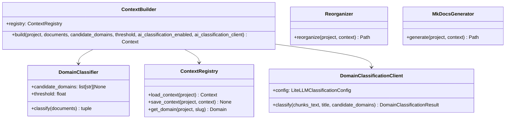

# Organización Documental — Referencia Técnica

API Reference de `doc_organize.context` (Sub-fase A) y `doc_organize.ai.DomainClassificationClient` (Sub-fase B).

## Arquitectura



## ContextBuilder

```python
class ContextBuilder:
    def __init__(self, registry: ContextRegistry | None = None) -> None

    async def build(
        self,
        project: Project,
        documents: list[ConversionResult],
        candidate_domains: list[str] | None = None,
        threshold: float = 0.5,
        ai_classification_enabled: bool = False,
        ai_classification_client: DomainClassificationClient | None = None,
    ) -> Context
```

Orquesta Sub-fase A (siempre) + Sub-fase B (opt-in) y persiste el `Context` resultante.

| Parámetro | Tipo | Descripción |
|---|---|---|
| `documents` | `list[ConversionResult]` | Documentos ya convertidos con éxito |
| `candidate_domains` | `list[str] \| None` | Catálogo predefinido, o `None` para descubrir del contenido |
| `threshold` | `float` | Score mínimo (0-1) de la Sub-fase A antes de intentar la Sub-fase B |
| `ai_classification_enabled` | `bool` | Activa la Sub-fase B — se persiste en `Context.ai_classification_enabled` |
| `ai_classification_client` | `DomainClassificationClient \| None` | Cliente ya configurado; si `enabled=True` sin cliente, la Sub-fase B no se ejecuta |

**Reglas**: el catálogo de la Sub-fase B es `candidate_domains` si se dio uno, o los
dominios que la Sub-fase A ya descubrió — nunca un dominio nuevo. Un fallo de la
Sub-fase B (`DomainClassificationError`) en un documento no interrumpe el resto
del lote.

---

## DomainClassifier (Sub-fase A)

```python
class DomainClassifier:
    def __init__(self, candidate_domains: list[str] | None = None, threshold: float = 0.5) -> None
    async def classify(self, documents: list[ConversionResult]) -> tuple[dict[str, list[DomainDocument]], list[ConversionResult]]
```

Clasifica por reglas, leyendo `chunks`/`title` del `.json` de conversión
(`domain_classifier.read_conversion_json()`), nunca el `.md`. Dos modos:

- **Catálogo** (`candidate_domains` no vacío): score = fracción de palabras del
  slug encontradas en `title`+`chunks`, con bonus si la carpeta contenedora
  coincide con el slug. Cada entrada de `candidate_domains` se sanea con
  `_slugify()` antes de aceptarse (nunca se usa tal cual como segmento de ruta).
- **Descubrimiento** (`candidate_domains=None`): el slug es la carpeta
  contenedora inmediata del documento, saneada igual.

**Retorno**: `(clasificados, sin_clasificar)` — `sin_clasificar` incluye tanto los
documentos por debajo de `threshold` como los que no tienen los tres artefactos
completos o legibles.

---

## ContextRegistry

```python
class ContextRegistry:
    async def load_context(self, project: Project) -> Context
    async def save_context(self, project: Project, context: Context) -> None
    async def get_domain(self, project: Project, slug: str) -> Domain
```

Persistencia plana: `<project.root_path>/context.json` (metadatos + resumen de
dominios) + `domains/<slug>/{index.json,DOMAIN.md}` por dominio. Mismo patrón de
concurrencia que `ProjectRegistry` (`asyncio.Lock` + escritura atómica). Al
reconstruir, borra `domains/<slug>/` de cualquier dominio ya no presente. `DOMAIN.md`
solo regenera su sección `## Documentos clasificados` — el resto (editado a mano) se
conserva.

**Excepciones**: `ContextNotFoundError` (sin `context.json` todavía),
`DomainNotFoundError`, `ContextError` (JSON corrupto o con esquema incompatible).

---

## Reorganizer

```python
class Reorganizer:
    async def reorganize(self, project: Project, context: Context) -> Path
```

Copia original + `.md` + `.json` de cada documento clasificado a
`<output_folder_name>/<dominio>/<tipo>/<stem>/`. Antes de copiar, borra la carpeta
de cada dominio vigente (se reconstruye entera) y la de cualquier dominio ya no
presente — sin copias huérfanas entre reconstrucciones.

**Excepciones**: `IncompleteConversionArtifactsError` si a algún documento le falta
un artefacto en disco.

---

## MkDocsGenerator

```python
class MkDocsGenerator:
    async def generate(self, project: Project, context: Context) -> Path
```

Escribe `<project.root_path>/mkdocs.yml` (usando `<output_folder_name>/` como
`docs_dir` directamente, sin copiar el contenido una vez más) + `index.md`, con
`nav` agrupado por dominio. No ejecuta `mkdocs build` — solo la configuración.

---

## DomainClassificationClient (Sub-fase B, `doc_organize.ai`)

```python
class DomainClassificationClient:
    def __init__(self, config: LiteLLMClassificationConfig, *, transport: httpx.AsyncBaseTransport | None = None) -> None
    async def classify(self, *, chunks_text: str, title: str | None, candidate_domains: list[str]) -> DomainClassificationResult

def litellm_classification_config_from_env() -> LiteLLMClassificationConfig
```

Llama `chat/completions` (OpenAI-compatible) de un LiteLLM Proxy pidiendo salida
JSON. `domain` en el resultado **siempre** está en `candidate_domains` o es
`None` — validado en el propio cliente, no solo por instrucción al modelo.
`litellm_classification_config_from_env()` lee
`DOC_ORGANIZE_LITELLM_CLASSIFICATION_BASE_URL`/`_VIRTUAL_KEY` (obligatorias) y
`_MODEL` (opcional). Config propia — no comparte credenciales con
`LiteLLMUsageConfig` (monitorización de uso, ver
[Monitorización de uso IA](ai_usage_monitoring.md)) aunque apunte al mismo proxy.

**Excepciones**: `DomainClassificationAuthError` (401/403), `DomainClassificationConnectionError`
(red/timeout), `DomainClassificationError` (cualquier otro error, incluida una
respuesta que no es el JSON esperado).

---

## Modelos (`core.models`)

```python
class DomainStatus(str, Enum):
    DRAFT = "borrador"
    CONFIRMED = "confirmado"

class DomainDocument(BaseModel):
    source_path: str
    markdown_path: str
    json_path: str
    title: str
    document_type: str
    confidence: float
    classified_by: str  # "rules" | "ai"

class Domain(BaseModel):
    slug: str
    name: str
    description: str | None
    status: DomainStatus
    predefined: bool
    documents: list[DomainDocument]

class Context(BaseModel):
    project_name: str
    tenant_id: str
    output_folder_name: str  # default "organizado"
    ai_classification_enabled: bool
    ai_fallback_threshold: float
    ai_classification_model: str | None
    domains: list[Domain]
    unclassified_documents: list[str]
    reorganized: bool
    mkdocs_generated: bool
    created_at: str
    updated_at: str

class DomainClassificationResult(BaseModel):
    domain: str | None
    confidence: float
    reasoning: str | None

class LiteLLMClassificationConfig(BaseModel):
    base_url: str
    virtual_key: str
    model: str  # default "claude-classifier"
    timeout_s: float
```

## Rutas HTTP

Todas bajo `/projects/{name}/context` (página) y `/api/projects/{name}/context`
(JSON), protegidas por `require_project_access`:

| Ruta | Método | Descripción |
|---|---|---|
| `/projects/{name}/context` | `GET` | Página HTML — lista de dominios, o estado vacío si no hay contexto todavía |
| `/api/projects/{name}/context` | `POST` | Construye/reconstruye: `{candidate_domains?, threshold?, ai_classification_enabled?}` → `409` si hay otra operación en curso; `400` si la IA está activada sin proxy configurado |
| `/api/projects/{name}/context` | `GET` | Devuelve el contexto ya construido — `404` si no existe todavía |

## Dependencias

| Dependencia | Propósito |
|---|---|
| `converter.DocumentConverter.resolve_output_paths()` | Recalcula `markdown_path`/`json_path` desde `cache.db`, sin persistirlos aparte |
| `cache.CacheManager` | Fuente de los documentos ya convertidos con éxito |
| `projects.ScannedFoldersStore` | Carpetas de escaneo guardadas, usadas como `scan_roots` |
| `core.exceptions` | `ContextError`, `DomainClassificationError` y sus subclases |
| `httpx` | Cliente HTTP del `DomainClassificationClient` (ya incluido en el extra `ai`) |
| `pyyaml` (extra `context`) | Serialización de `mkdocs.yml` |

## Ejemplos Relacionados

- [Desplegar un LiteLLM Proxy](../guides/litellm_proxy_setup.md) (Sub-fase B)
