# Organización Documental — Referencia Técnica

API Reference de `doc_organize.context` (Sub-fase A) y `doc_organize.ai.DomainClassificationClient`/`TaxonomyClassificationClient` (Sub-fase B).

## Arquitectura

```mermaid
classDiagram
    class ContextBuilder {
        +registry: ContextRegistry
        +build(project, documents, candidate_domains, threshold, ai_classification_enabled, ai_classification_client, taxonomy_manifest, taxonomy_classification_client, taxonomy_template_name) Context
    }
    class TaxonomyTemplateRegistry {
        +templates_dir: Path
        +list_templates() list~TaxonomyTemplateSummary~
        +load_template(name) TaxonomyManifest
    }
    class DomainClassifier {
        +candidate_domains: list[str]|None
        +threshold: float
        +classify(documents) tuple
        +score_domain(document, chunks_text, title) tuple
    }
    class MaterialTypeClassifier {
        +material_types: list[str]
        +threshold: float
        +classify_text(title, chunks_text) tuple
    }
    class ContextRegistry {
        +load_context(project) Context
        +save_context(project, context) None
        +get_domain(project, slug) Domain
    }
    class Reorganizer {
        +reorganize(project, context, on_document_copied, on_document_failed) Path
    }
    class SiteGenerator {
        +generate(project, context, build, site_dir, timeout) SiteResult
        +build_site(project, timeout) None
        +delete_site(project, site_dir) None
    }
    class DomainClassificationClient {
        +config: LiteLLMClassificationConfig
        +classify(chunks_text, title, candidate_domains) DomainClassificationResult
    }
    class TaxonomyClassificationClient {
        +config: LiteLLMTaxonomyClassificationConfig
        +classify(chunks_text, title, candidate_domains, candidate_material_types) TaxonomyClassificationResult
    }

    ContextBuilder --> DomainClassifier
    ContextBuilder --> MaterialTypeClassifier
    ContextBuilder --> ContextRegistry
    ContextBuilder --> DomainClassificationClient
    ContextBuilder --> TaxonomyClassificationClient
```



## ContextBuilder

```python
class ContextBuilder:
    def __init__(self, registry: ContextRegistry | None = None) -> None

    async def build(
        self,
        project: Project,
        documents: list[ConversionResult],
        candidate_domains: list[str] | None = None,
        threshold: float = 0.5,
        ai_classification_enabled: bool = False,
        ai_classification_client: DomainClassificationClient | None = None,
        output_folder_name: str = "organizado",
        taxonomy_manifest: TaxonomyManifest | None = None,
        taxonomy_classification_client: TaxonomyClassificationClient | None = None,
        taxonomy_template_name: str | None = None,
        *,
        on_progress: ProgressCallback | None = None,
        cancel_token: CancelToken | None = None,
        ai_max_failures: int | None = None,   # 0.14.0
        ai_max_documents: int | None = None,  # 0.14.0
        ai_enrichment_enabled: bool = False,                          # 1.5.0
        ai_enrichment_client: DocumentEnrichmentClient | None = None, # 1.5.0
    ) -> Context
```

Orquesta Sub-fase A (siempre) + Sub-fase B (opt-in) y persiste el `Context` resultante.

| Parámetro | Tipo | Descripción |
|---|---|---|
| `documents` | `list[ConversionResult]` | Documentos ya convertidos con éxito |
| `candidate_domains` | `list[str] \| None` | Catálogo predefinido, o `None` para descubrir del contenido. Ignorado si se da `taxonomy_manifest` |
| `threshold` | `float` | Score mínimo (0-1) de la Sub-fase A antes de intentar la Sub-fase B (o el placeholder `sin-clasificar` en modo manifiesto) |
| `ai_classification_enabled` | `bool` | Activa la Sub-fase B — se persiste en `Context.ai_classification_enabled`. En modo manifiesto activa `taxonomy_classification_client` en vez de `ai_classification_client` |
| `ai_classification_client` | `DomainClassificationClient \| None` | Cliente ya configurado para la Sub-fase B de 1 eje; si `enabled=True` sin cliente, la Sub-fase B no se ejecuta. Ignorado si hay `taxonomy_manifest` |
| `taxonomy_manifest` | `TaxonomyManifest \| None` | Manifiesto de taxonomía (ver [TaxonomyManifest](#taxonomymanifest-manifiesto-de-taxonomia)) — activa la clasificación de 2 ejes (dominio + tipo de material) |
| `taxonomy_classification_client` | `TaxonomyClassificationClient \| None` | Cliente ya configurado para la Sub-fase B de 2 ejes (una sola llamada combinada). Sin efecto si `taxonomy_manifest` es `None`, o si `enabled=False` |
| `ai_max_failures` | `int \| None` | (0.14.0, L-3a) Detiene la Sub-fase B tras este número de errores de conexión **seguidos** (`Context.ai_classification_stopped = "connection"`). `None`: nunca para por eso. `< 1` → `ValueError` |
| `ai_max_documents` | `int \| None` | (0.14.0, L-3b) Tope de documentos enviados a la IA en esta construcción; al alcanzarlo con documentos pendientes, para con `"budget"`. `None`: sin tope. `< 0` → `ValueError` |
| `taxonomy_template_name` | `str \| None` | Nombre de la plantilla de `TaxonomyTemplateRegistry` de la que proviene `taxonomy_manifest`, o `None` si viene de un fichero local o si no hay manifiesto — puramente informativo, se persiste en `Context.taxonomy_template_name` |
| `ai_enrichment_enabled` | `bool` | (1.5.0) Activa el enriquecimiento por IA — se persiste en `Context.ai_enrichment_enabled`. Ver [Autor, descripción y palabras clave](#autor-descripcion-y-palabras-clave-150) |
| `ai_enrichment_client` | `DocumentEnrichmentClient \| None` | (1.5.0) Cliente ya configurado; sin él (o sin `ai_enrichment_enabled`), no se llama a la IA |

**Parada y recuento de la Sub-fase B (0.14.0, L-3a…L-3c)**: un error de autenticación (401/403,
`DomainClassificationAuthError`/`TaxonomyClassificationAuthError`) detiene la Sub-fase B en el acto, con o sin
`ai_max_failures`: con la clave rechazada se hace **exactamente 1 petición** en toda la construcción. Al detenerse
(`"auth"`, `"connection"` o `"budget"`), los documentos pendientes no se leen ni se envían y quedan sin clasificar (o
en `sin-clasificar`); siguen emitiendo su evento de progreso, el `cancel_token` se sigue comprobando entre ellos y el
contexto se construye y persiste con normalidad. El motivo queda en `Context.ai_classification_stopped` y los
recuentos en `Context.ai_documents_sent`, `ai_documents_classified` (al menos un eje asignado) y `ai_documents_failed`,
con `sent = classified + failed + enviados sin asignación`. Una respuesta del servidor (incluido un 5xx) corta la racha
de errores de conexión.

**Reglas**: el catálogo de la Sub-fase B es `candidate_domains` si se dio uno, o los
dominios que la Sub-fase A ya descubrió — nunca un dominio nuevo. Un fallo de la
Sub-fase B (`DomainClassificationError`) en un documento no interrumpe el resto
del lote. Con `taxonomy_manifest`, un documento con los tres artefactos completos
**siempre** se reorganiza: si un eje no alcanza `threshold`, se le asigna el slug
placeholder `sin-clasificar` en ese eje en vez de excluirse — `unclassified_documents`
queda reservado a artefactos incompletos. Con `taxonomy_manifest` + Sub-fase B activa,
`TaxonomyClassificationClient.classify()` se invoca **una sola vez por documento** que
sigue en placeholder en algún eje, resolviendo ambos ejes en la misma llamada — pero
solo se aplica la sugerencia al eje que seguía en `sin-clasificar`; un eje ya resuelto
por reglas con confianza nunca se sobreescribe.

### Trazabilidad de la clasificación (1.5.0)

Cada `DomainDocument` guarda cómo se llegó a su dominio, y el `Context`, con qué se construyó:

| Campo | Qué guarda |
|---|---|
| `DomainDocument.rules_domain`, `rules_confidence` | Lo que propusieron las reglas (Sub-fase A), **también cuando no alcanzó el umbral y decidió la IA**. En modo de un eje se recalcula para los documentos que clasifica la IA |
| `DomainDocument.ai_domain`, `ai_confidence`, `ai_reasoning` | Dominio que propuso la IA, su confianza y su justificación (hasta 500 caracteres), si se le preguntó por el documento; `None` si no. En modo manifiesto se guardan aunque las reglas ya hubieran decidido el dominio y la IA solo resolviera el tipo de material: entonces `ai_domain` puede no coincidir con el dominio del documento |
| `DomainDocument.material_type_confidence` | Score del eje de tipo de material, de quien lo decidió (reglas o IA); `None` sin manifiesto |
| `Context.ai_classification_model`, `ai_enrichment_model` | Alias de modelo con el que se ejecutó cada fase de IA; `None` si esa fase no llegó a enviar ningún documento |
| `Context.built_with_version` | Versión de doc_organize que construyó el contexto. Las reglas son código, así que esta versión las identifica |

La fecha de clasificación es `Context.updated_at`: todos los documentos de una construcción se clasifican a la vez.

`confidence` es la confianza del **dominio** final: la de las reglas si las reglas lo decidieron, la de la IA si lo
decidió la IA. `classified_by` no basta para saber cuál: en modo manifiesto vale `"ai"` en cuanto la IA resuelve
cualquiera de los dos ejes, también si solo resolvió el tipo de material y el dominio (y `confidence`) siguen siendo
de las reglas. Para saber quién decidió el dominio, comparar `rules_domain` y `ai_domain` con el dominio del documento.

> Corregido antes de publicarse: la primera versión de esta sección decía que `confidence` era siempre la confianza de
> quien indicaba `classified_by`, y no guardaba el dominio que proponía la IA (`ai_domain`).

### Historial del contexto (1.5.0)

`context.json` se sobrescribe en cada construcción. Para no perder qué cambió, `build()` lee el contexto anterior antes
de guardar el nuevo y añade una línea (`ContextBuildRecord`) a `historial_contexto/CONTEXT_HISTORY.jsonl`
(`ProjectLayout.context_history`, junto a `context.json`):

| Campo | Contenido |
|---|---|
| `built_at`, `previous_built_at` | Esta construcción y la anterior con la que se compara (`None` si es la primera o la anterior no se pudo leer: entonces todo cuenta como `added`) |
| `built_with_version`, `ai_classification_model`, `ai_enrichment_model`, `taxonomy_manifest_used` | Con qué se construyó |
| `classified`, `unclassified` | Recuentos |
| `changes` | Un `ContextChange` por documento que entra (`added`), sale (`removed`) o cambia de dominio o de tipo de material (`reclassified`, también de clasificado a sin clasificar y al revés), con el antes, el después y `classified_by` |

Un documento que solo cambia de quién lo clasificó (reglas o IA) sin cambiar de sitio no es un cambio. Un contexto
anterior dañado no impide construir (se avisa y se compara con nada), y un fallo al escribir el historial tampoco: el
contexto ya guardado se mantiene. Eliminar el contexto no borra el historial (`ProjectHistoryCleaner` sí, porque vacía
la raíz entera); `historial_contexto` es un nombre reservado para la carpeta reorganizada.

```python
from doc_organize.context import diff_contexts, list_context_builds  # list_context_builds(path): más recientes primero
from doc_organize.export import load_context_history, write_context_history_xlsx
```

`list_context_builds(path)` ignora con un aviso las líneas dañadas. Para revisarlo fuera:
`write_context_history_xlsx` o `python -m doc_organize export context-xlsx` (ver [Exportación](export.md)).

**Giro y escrituras concurrentes (1.6.0).** Antes de añadir una línea, si el fichero pasaría de 5 MB se gira:
`CONTEXT_HISTORY.jsonl` pasa a `CONTEXT_HISTORY.1.jsonl`, la `.1` a `.2`, y así hasta 4 copias; la más antigua se
borra. `list_context_builds` y `load_context_history` leen el actual y las copias (con `include_rotated=False`, solo el
fichero indicado). `ProjectLayout.context_history_files()` lista los ficheros que existen.

```python
from doc_organize.context import ContextBuilder, ContextHistoryPolicy

builder = ContextBuilder(history_policy=ContextHistoryPolicy(max_bytes=20_000_000, backups=10))
ContextBuilder(history_policy=ContextHistoryPolicy(backups=0))  # sin giro: crece sin límite, como en 1.5.0
```

La escritura y el giro se hacen bajo un bloqueo entre procesos (`CONTEXT_HISTORY.jsonl.lock`, válido en SMB y NFS),
así que dos construcciones del mismo proyecto desde procesos o equipos distintos no pierden ni mezclan líneas. Si otro
proceso mantiene el bloqueo más de 5 s, la construcción se guarda igual y solo se avisa de que no entró en el
historial; un bloqueo de más de 60 s se da por huérfano y se rompe. Las lecturas no toman el bloqueo: si coinciden con
un giro, esa lectura puede omitir o repetir alguna construcción, pero el historial en disco no cambia. Nunca se
escribe, se gira ni se lee a través de un enlace simbólico: si `CONTEXT_HISTORY.jsonl` lo es, la construcción solo avisa
de que no entró en el historial; un fichero de bloqueo que lo sea cuenta como bloqueo ajeno, y si es viejo se rompe el
enlace, no su destino.

### Autor, descripción y palabras clave (1.5.0)

Tras clasificar, cada `DomainDocument` recibe lo que declara su documento original (`read_document_properties`, en
`context/document_properties.py`), siempre y sin red:

| Campo | PDF (diccionario `Info`) | Office OOXML (`docProps/core.xml`) |
|---|---|---|
| `author` | `/Author` | `dc:creator` |
| `description` | `/Subject` | `dc:description`, o `dc:subject` si falta |
| `keywords` | `/Keywords` (separadas por `,` o `;`) | `cp:keywords` |

`/Creator` y `/Producer` no se usan como autor: nombran el programa que generó el PDF. Otros formatos, un original
borrado, dañado o cifrado dejan los campos vacíos sin interrumpir la construcción. Los textos se guardan en una línea y
acotados (500 caracteres; hasta 20 palabras clave de 60).

**Lectura en paralelo (1.6.0).** Los originales se leen de 4 en 4. En una carpeta de red (SMB), leerlos de uno en uno
costaba unos 88 ms por documento; con 4 lecturas a la vez, 28 ms. Para cambiarlo:

```python
from doc_organize.context import ContextBuilder

ContextBuilder(properties_concurrency=8)  # más lecturas a la vez; con un NAS doméstico apenas mejora
ContextBuilder(properties_concurrency=1)  # de una en una, como en 1.5.0
```

PDFium (la librería que lee los PDF) no admite llamadas desde varios hilos a la vez, así que `read_document_properties`
lee los bytes del PDF en paralelo y solo analiza uno cada vez, bajo un cerrojo. Un PDF de más de 16 MB se abre por
ruta, para no cargarlo entero en memoria. `read_document_properties` se puede llamar desde varios hilos. El idioma se
detecta después, de uno en uno. `cancel_token` se comprueba antes de cada lectura.

El cerrojo es el mismo que usa Docling (`docling.utils.locks.pypdfium2_lock`), así que construir el contexto mientras
otro hilo del mismo proceso convierte documentos tampoco llama a PDFium dos veces a la vez; mientras Docling procesa
un PDF, la lectura de propiedades espera. Si tu código usa pypdfium2 directamente en el mismo proceso y en otro hilo,
hazlo también bajo ese cerrojo.

`language` es el idioma principal (ISO 639-1: `es`, `en`, `ca`…) detectado con
[py3langid](https://github.com/adbar/py3langid) en el título y los primeros 4000 caracteres del texto convertido
(`context/language_detection.py`), sin red. Solo se acepta con al menos 40 letras y probabilidad ≥ 0,7; si no, queda en
`None`: con textos cortos el detector se equivoca (un título como «Política de calidad» sale gallego al 33 %). No se
usa el idioma que declaran Word o PDF, que suele ser el del ordenador del autor y no el del texto.

Con `ai_enrichment_enabled=True` y `ai_enrichment_client`, la IA propone descripción y palabras clave **solo para los
documentos clasificados que no las declaran** (una llamada por documento) y solo se rellena lo que falta: lo declarado
nunca se sustituye y el autor nunca sale de la IA. `DomainDocument.ai_filled` dice qué campos rellenó. Usa los mismos
`ai_max_failures` y `ai_max_documents` que la Sub-fase B, con las mismas paradas (`"auth"` en el acto, `"connection"`,
`"budget"`), pero con su propio recuento: **cada fase puede enviar hasta `ai_max_documents`**. El resultado queda en
`Context.ai_enrichment_stopped`, `ai_enrichment_sent`, `ai_enrichment_applied` (al menos un campo rellenado) y
`ai_enrichment_failed`. Emite `ProgressEvent(phase="enrichment")` por documento y comprueba `cancel_token` entre ellos;
no llama a `on_ai_progress`, que sigue siendo solo de la Sub-fase B.

---

### Documentos sin clasificar (1.6.0)

`Context.unclassified_documents` sigue siendo la lista de rutas. Además, `Context.unclassified_details` trae un
`UnclassifiedDocument` por cada uno, en el mismo orden:

| Campo | Contenido |
|---|---|
| `reason` | `"incomplete_artifacts"`: la conversión falló o falta su `.md` o `.json` (o el `.json` no se puede leer). `"below_threshold"`: las reglas no llegaron al umbral y la IA no lo asignó (desactivada, detenida o sin dominio) |
| `title`, `document_type` | Título del `.json` (o nombre del `.md`; `None` si no hay ninguno) y extensión original |
| `markdown_path`, `json_path` | Los artefactos que dejó la conversión, o `None` |
| `rules_domain`, `rules_confidence` | Lo que propusieron las reglas por debajo del umbral; `None` si no propusieron nada |
| `author`, `description`, `keywords` | Lo que declara el original, como en los clasificados. **Nunca de la IA**: el enriquecimiento solo se aplica a los clasificados |
| `language` | Idioma del texto convertido; `None` sin `.json` |

Los originales de los sin clasificar se leen en la misma pasada que los demás, y sus `.json` también en paralelo
(los dos con `properties_concurrency`), así que el coste es el mismo por documento. El detalle se guarda aparte, en `unclassified.json` junto a `context.json`
(ver `ContextRegistry`). Un contexto de 1.5.0 se carga con `unclassified_details=[]`.

```python
context = await ContextRegistry().load_context(project)
for detail in context.unclassified_details:
    print(detail.reason, detail.title, detail.author, detail.rules_domain)
```

### Credenciales redactadas antes de la IA (1.7.0)

`ContextBuilder(ai_redact_credentials=True)` (*keyword-only*, **activado por defecto**) pasa el título y el texto de cada
documento por [`redact_credentials`](#credenciales-doc_organizesecurity-170) antes de enviarlo a la IA, en la
Sub-fase B (un eje y manifiesto) y en el enriquecimiento. Solo cambia lo que **sale**: las reglas, el idioma y lo que
se guarda en `context.json` usan el texto original.

- `Context.ai_redact_credentials` (`bool`, `False` en contextos anteriores) dice si la construcción redactó.
- `Context.credential_findings` (`list[DocumentCredentialFindings]`): por cada documento enviado en el que se redactó algo,
  `source_path` y `rules` (recuento por regla, sumando todas las fases de IA). **Nunca el valor.**
- `ai_redact_credentials=False` envía el texto original (comportamiento de 1.6.0).

`TaxonomyManifestDraftClient` hace lo mismo con la muestra (títulos y extractos) según
`LiteLLMTaxonomyManifestDraftConfig.redact_credentials` (`True` por defecto), porque el consumidor lo llama sin pasar por
`ContextBuilder`.

### Credenciales: `doc_organize.security` (1.7.0)

::: doc_organize.security.credentials
    options:
      members:
        - redact_credentials
        - scan_credentials
        - RedactionResult
        - CredentialFinding
        - REDACTED
        - CREDENTIAL_RULES

## DomainClassifier (Sub-fase A)

```python
class DomainClassifier:
    def __init__(self, candidate_domains: list[str] | None = None, threshold: float = 0.5) -> None
    async def classify(self, documents: list[ConversionResult]) -> tuple[dict[str, list[DomainDocument]], list[ConversionResult]]
```

Clasifica por reglas, leyendo `chunks`/`title` del `.json` de conversión
(`domain_classifier.read_conversion_json()`), nunca el `.md`. Dos modos:

- **Catálogo** (`candidate_domains` no vacío): score = fracción de palabras del
  slug encontradas en `title`+`chunks`, con bonus si la carpeta contenedora
  coincide con el slug. Desde 1.5.0 las dos comparaciones ignoran tildes, diéresis y la
  tilde de la «ñ» (`fold_accents`): «gestión» cuenta para `gestion-calidad`. Cada entrada de `candidate_domains` se sanea con
  `_slugify()` antes de aceptarse (nunca se usa tal cual como segmento de ruta).
- **Descubrimiento** (`candidate_domains=None`): el slug es la carpeta
  contenedora inmediata del documento, saneada igual.

**Retorno**: `(clasificados, sin_clasificar)` — `sin_clasificar` incluye tanto los
documentos por debajo de `threshold` como los que no tienen los tres artefactos
completos o legibles.

---

## MaterialTypeClassifier (segundo eje, modo manifiesto)

```python
class MaterialTypeClassifier:
    def __init__(self, material_types: list[str], threshold: float = 0.5) -> None
    def classify_text(self, *, title: str | None, chunks_text: str) -> tuple[str | None, float]
```

Mismo algoritmo de puntuación que `DomainClassifier` en modo catálogo (función
compartida `domain_classifier.score_catalog()`), aplicado al catálogo
`TaxonomyManifest.material_types` — sin modo descubrimiento: el manifiesto siempre
declara su catálogo explícitamente. `classify_text()` devuelve `(None, score)` si
el mejor candidato queda por debajo de `threshold`.

Tanto `MaterialTypeClassifier.classify_text()` como `DomainClassifier.score_domain()`
aceptan `extra_keywords: dict[str, list[str]] | None` — mapa slug saneado → palabras
clave adicionales, poblado por `ContextBuilder._classify_with_manifest` desde
`TaxonomyCatalogEntry.keywords` de cada entrada del manifiesto, sumadas a las
derivadas del propio slug antes de puntuar.

---

## TaxonomyManifest (manifiesto de taxonomía)

```python
async def load_taxonomy_manifest(project: Project) -> TaxonomyManifest | None
```

Lee `<project.root_path>/taxonomy_manifest.md`, si existe: el front matter YAML
(delimitado por las dos primeras líneas `---`) se valida como `TaxonomyManifest`;
el resto del fichero es prosa libre (descripción, tablas, diagramas) y no se
parsea. `None` si el proyecto no tiene manifiesto — modo de un eje, sin cambios.

```yaml
---
domains:
  - slug: ciberseguridad
    name: Ciberseguridad
    description: Normas de seguridad de la información
    keywords: [iso27001, ens]
material_types:
  - slug: normativa
    name: Normativa
  - slug: procedimiento
    name: Procedimiento
---

Prosa libre — descripción, tablas, diagramas Mermaid. No se parsea.
```

**Excepciones**: `TaxonomyManifestError` si el fichero existe pero no empieza/cierra
el delimitador de front matter, el YAML no es válido, o no cumple el schema
(`domains`/`material_types` no vacíos, cada entrada con `slug`+`name`).

---

## TaxonomyTemplateRegistry (biblioteca de plantillas de manifiesto)

```python
class TaxonomyTemplateRegistry:
    def __init__(self, templates_dir: str | Path | None = None) -> None   # None: ~/.doc_organize/taxonomy_templates
    async def list_templates(self) -> list[TaxonomyTemplateSummary]
    async def load_template(self, name: str) -> TaxonomyManifest
    async def save_template(self, name: str, manifest: TaxonomyManifest) -> None
    async def delete_template(self, name: str) -> None
```

Biblioteca de plantillas de `TaxonomyManifest` reutilizables entre proyectos —
mismo formato de fichero que `taxonomy_manifest.md` (front matter YAML + prosa
libre), pero fuera de cualquier `project.root_path`. `load_template(name)` busca
primero en `templates_dir` (plantillas de usuario) y, si no encuentra `name` ahí,
en las plantillas de ejemplo empaquetadas con `doc_organize` (`sgi-iso27001`,
`calidad`, `sgi-integrado`) — una plantilla de usuario con el mismo nombre siempre
tiene prioridad.
`list_templates()` combina ambos orígenes sin duplicar nombres, omitiendo del
listado (no del error) cualquier fichero de usuario con front matter inválido.

`name` se valida contra `^[a-z0-9][a-z0-9-]*$` **antes** de construir ninguna ruta
de fichero — un nombre que no cumpla el patrón (p. ej. con `../`) se rechaza sin
tocar el filesystem, en vez de sanearse en silencio.

**Excepciones**: `TaxonomyTemplateError` si `name` no es un slug válido; no existe
ninguna plantilla con ese nombre en ninguna de las dos ubicaciones; o existe una
plantilla de usuario con ese nombre pero su front matter es inválido (en ese caso
el error se propaga tal cual — nunca cae en silencio a la plantilla empaquetada,
que enmascararía el fichero de usuario roto).

Desde 0.13.0 la carpeta por defecto (`Path.home()`) se calcula al crear el registro, no al importar el módulo, y el
registro usa por dentro las funciones de texto de abajo, sin cambio de comportamiento.

### Plantillas como texto (0.13.0, L-8c)

```python
# doc_organize.context.taxonomy_templates (y doc_organize.context, doc_organize)
def parse_taxonomy_template(text: str, *, source: str = "<texto>") -> TaxonomyManifest
def render_taxonomy_template(manifest: TaxonomyManifest, body: str = "") -> str
def list_builtin_templates() -> list[TaxonomyTemplateSummary]
def load_builtin_template(name: str) -> TaxonomyManifest
```

Para un consumidor que guarda las plantillas fuera del disco (p. ej. en su base de datos), sin carpeta de usuario ni
`Path.home()`:

- `parse_taxonomy_template` valida el front matter con los mismos errores (`TaxonomyTemplateError`) que al cargar una
  plantilla de fichero; `source` es como se nombra la plantilla en los mensajes.
- `render_taxonomy_template` escribe el front matter (y `body` detrás). Ida y vuelta estable:
  `parse_taxonomy_template(render_taxonomy_template(m)) == m`, también con `title`/`description` vacíos y con saltos
  de línea o `---` dentro de los textos (salen escapados entre comillas dobles).
- `list_builtin_templates`/`load_builtin_template` leen las plantillas empaquetadas (`sgi-iso27001`, `calidad`,
  `sgi-integrado`); son síncronas (ficheros pequeños del paquete).

```python
from doc_organize import load_builtin_template, parse_taxonomy_template, render_taxonomy_template

manifest = load_builtin_template("calidad")
text = render_taxonomy_template(manifest, "# Notas de la organización\n")
assert parse_taxonomy_template(text) == manifest
```

---

## ContextRegistry

```python
class ContextRegistry:
    async def load_context(self, project: Project) -> Context
    async def save_context(self, project: Project, context: Context) -> None
    async def get_domain(self, project: Project, slug: str) -> Domain
```

Persistencia plana: `<project.root_path>/context.json` (metadatos + resumen de
dominios) + `domains/<slug>/{index.json,DOMAIN.md}` por dominio. Mismo patrón de
concurrencia que `ProjectRegistry` (`asyncio.Lock` + escritura atómica). Al
reconstruir, borra `domains/<slug>/` de cualquier dominio ya no presente. `DOMAIN.md`
solo regenera su sección `## Documentos clasificados` — el resto (editado a mano) se
conserva.

**`unclassified.json` (1.6.0)**: `Context.unclassified_details` se guarda aparte, para que `context.json` siga siendo
pequeño aunque haya miles de documentos sin clasificar. Se escribe antes que `context.json`, y al leer manda
`context.json`: se conservan los detalles cuya ruta está en `unclassified_documents`, en su orden. Si sobran o faltan
(un guardado cortado entre los dos ficheros, o un consumidor que editó `unclassified_documents`), se avisa en el log.
Sin el fichero (contexto de 1.5.0), `unclassified_details=[]`. Si el fichero está dañado, `ContextError`, igual que un
`index.json`. `delete_context` lo borra. `get_domain` no lo lee: no lo necesita.

**Escritura sin seguir enlaces (0.14.0, L-8e)**: `context.json`, `index.json` y `DOMAIN.md` (igual que `index.md`,
`zensical.toml` y `taxonomy_manifest.md`) se escriben en un temporal con nombre aleatorio creado en exclusiva en la
misma carpeta (`tempfile.mkstemp`: `O_CREAT | O_EXCL` y `O_NOFOLLOW` donde existe) y luego `os.replace`. Hasta 0.13.0
el temporal tenía un nombre fijo (`context.tmp`, `index.md.tmp`...) y un enlace puesto con ese nombre desde el recurso
de red desviaba la escritura. El fichero conserva los permisos del que sustituye.

**Excepciones**: `ContextNotFoundError` (sin `context.json` todavía),
`DomainNotFoundError`, `ContextError` (JSON corrupto, también `unclassified.json`, o con esquema incompatible; desde 0.14.0 también si
`output_folder_name` no es válido —`..`, una ruta absoluta, un nombre reservado como `Conversión`—, L-8f: nunca se
devuelve un contexto que copiaría o borraría fuera de su sitio).

---

## Reorganizer

```python
class Reorganizer:
    async def reorganize(
        self,
        project: Project,
        context: Context,
        on_document_copied: Callable[[int, int, str], Awaitable[None]] | None = None,
        *,
        on_document_failed: Callable[[int, int, str, str], Awaitable[None]] | None = None,  # 0.13.0
    ) -> Path
    @staticmethod
    def check_output_root(output_root: Path) -> None                                       # 0.13.0
    async def delete_output(self, project: Project, context: Context) -> None

def resolve_organized_paths(domain: Domain, project_root: str | Path) -> list[str]         # 0.14.0, L-8d
```

Copia original + `.md` + `.json` (+ `img/<stem>/`) de cada documento clasificado a
`<output_folder_name>/<dominio>/<tipo>/<stem>/`. Antes de copiar, borra la carpeta
de cada dominio vigente (se reconstruye entera) y la de cualquier dominio ya no
presente — sin copias huérfanas entre reconstrucciones. `<tipo>` es
`DomainDocument.material_type` cuando está definido (modo manifiesto), o la
extensión del documento original (modo sin manifiesto, sin cambios).

**Colisiones de nombre (0.14.0, L-8d)**: si dos o más documentos de un dominio comparten `<tipo>` y `<stem>` sin
distinguir mayúsculas (en SMB/Windows «Acta» y «acta» son la misma carpeta; también se ignoran los puntos y espacios
finales y la forma Unicode), **todos** ellos van a `<stem>-<8 hex>/`, con el SHA-256 de su `.md` relativo a la raíz del
proyecto (determinista y sin depender del orden). Sin colisiones, las rutas son idénticas a las de 0.13.0. Hasta 0.13.0
el segundo documento sobrescribía al primero. `img/<stem>/` y los nombres de fichero no cambian.

`resolve_organized_paths(domain, project_root)` (exportada en `doc_organize`) devuelve, en el orden de
`domain.documents`, la ruta POSIX del `.md` copiado relativa a la carpeta reorganizada
(`calidad/pdf/acta-1a2b3c4d/acta.md`). `ContextBuilder.build()` y `reorganize()` la guardan en
`DomainDocument.organized_path` para el consumidor; `Reorganizer` y `SiteGenerator` la recalculan siempre y nunca usan
el valor leído de `index.json`.

`reorganize()` y `delete_output()` vuelven a validar `context.output_folder_name` (`InvalidPathError`), por si se
asignó después de construir el `Context` (L-8f).

**Sin seguir enlaces simbólicos (0.13.0, L-8a)**, con el mismo criterio que la deduplicación desde 0.12.1
(`ensure_no_symlinks` y, en POSIX, descriptores abiertos con `O_NOFOLLOW`; en Windows, comprobación con `lstat`):

- La carpeta reorganizada no puede ser ni pasar por un enlace: `InvalidPathError` antes de tocar nada. Un enlace en el
  lugar de la carpeta de un dominio se quita (el enlace, nunca su destino).
- Un documento con algún tramo enlazado (original, `.md`, `.json`, `img/<stem>/` o algo dentro) falla solo, sin
  copiar el destino del enlace: todo se comprueba antes de copiar, y si la copia falla a medias se borra lo copiado de
  ese documento. Lo mismo con cualquier otro `OSError` al copiarlo (permiso denegado...). El resto sigue.
- Los fallos quedan en `Context.reorganize_failed_documents` (`source_path`, se rehace en cada llamada) y en
  `on_document_failed(index, total, source_path, error)`.
- Consecuencia: una ruta que pase por un enlace del sistema (p. ej. `/tmp` en macOS) falla; hay que pasar rutas reales.

**Excepciones**: `IncompleteConversionArtifactsError` si a algún documento le falta
un artefacto en disco; `InvalidPathError` si la carpeta reorganizada es o pasa por un enlace.

---

## SiteGenerator (0.13.0, L-8)

```python
@dataclass(frozen=True)
class SiteResult:
    config_path: Path    # <root_path>/zensical.toml
    index_path: Path     # <root_path>/<output_folder_name>/index.md
    site_dir: Path       # destino de zensical build
    site_built: bool
    search_excluded: tuple[str, ...] = ()  # 1.4.0: páginas fuera del buscador (rutas relativas a la carpeta reorganizada)

class SiteGenerator:
    async def generate(self, project: Project, context: Context, *, build: bool = True,
                       site_dir: Path | None = None, timeout: float | None = None) -> SiteResult
    async def build_site(self, project: Project, *, timeout: float | None = None) -> None
    async def delete_site(self, project: Project, *, site_dir: Path | None = None) -> None
```

Sustituye a `MkDocsGenerator`. Escribe `<project.root_path>/zensical.toml` (usando `<output_folder_name>/` como
`docs_dir` directamente, sin copiar el contenido una vez más) + `index.md`, con `nav` agrupado por dominio — y, si
`Context.taxonomy_manifest_used`, también por `material_type` dentro de cada dominio (mismo nivel de profundidad que
la carpeta física de `Reorganizer`). Con `build=True` ejecuta `zensical build` (el del mismo entorno,
`python -m zensical`, o el del `PATH`) hacia `site_dir`.

- **Errores tipados**: si falta `zensical` (extra `doc_organize[site]`), el build termina con error o supera
  `timeout`, lanza `SiteBuildError` (subclase de `DocOrganizeError`). Nunca devuelve un sitio sin construir en
  silencio. La configuración ya está escrita cuando se lanza. Desde 1.4.0 trae `cause` (el motivo en una línea: la
  última de la salida de Zensical, que es la del error) y `output_tail` (los 2000 caracteres finales de esa salida),
  y el mensaje termina en `cause`. Muestra `exc.cause`: recortar `str(exc)` por el principio puede perder el motivo.
- **Límite del buscador (1.4.0)**: Zensical (desde 0.0.71) hace fallar el build entero si una sección del índice de
  búsqueda (el texto entre dos títulos) tiene más posiciones de token de las que admite, y ese máximo depende del
  tamaño del sitio: sin límite práctico hasta 8 192 secciones en total, 65 536 de 8 193 a 16 384, y la mitad cada
  vez que el número de secciones se duplica. Un documento convertido sin títulos (una hoja de cálculo grande, un
  anexo de tablas) es una sola sección. `generate` (también con `build=False`) estima ambos valores y añade
  `search: exclude: true` a la cabecera de la copia en la carpeta reorganizada de las páginas que lo superarían:
  se siguen navegando, no aparecen en el buscador y se devuelven en `SiteResult.search_excluded`. Una página cuya
  cabecera ya define `search` no se toca (se registra un aviso). Requiere `zensical>=0.1.1`.
- **`site_dir`**: por defecto `<root_path>/site`; relativa a `root_path` si no es absoluta. Tiene que colgar de
  `root_path` (lo exige Zensical, que también vacía `site_dir` al construir), y no puede ser la raíz, la carpeta
  reorganizada ni otra carpeta reservada (`RESERVED_OUTPUT_FOLDER_NAMES`), ni pasar por un enlace:
  `InvalidPathError` antes de escribir nada.
- **Configuración mínima**: nombre, carpetas, `nav`, `theme.language = "es"` y `theme.font = false` (sin peticiones a
  Google Fonts). Sin JavaScript propio, `extra_javascript`, plugins ni extensiones Markdown distintas de las de
  Zensical por defecto.
- **Contenido no confiable**: ver [Funcionalidad → Seguridad del sitio](../functional/context.md#seguridad-del-sitio).
  Los textos que escribe esta clase (títulos de documento, nombres de dominio y de proyecto) se escriben sin `<`/`>`
  (pasan a `＜`/`＞`) y con `&` y comillas escapados, porque Zensical los inserta en el HTML sin escapar.
- **Contextos de antes de 0.13.0**: `generate` borra el `mkdocs.yml` que quede; `delete_site` borra `zensical.toml`,
  `mkdocs.yml`, `site_dir` y la caché de Zensical (`.cache/`).

```python
from doc_organize import SiteBuildError, SiteGenerator

try:
    result = await SiteGenerator().generate(project, context, timeout=300)
except SiteBuildError as exc:
    ...  # configuración escrita, sitio sin construir: mostrar exc.cause al administrador
else:
    for page in result.search_excluded:
        ...  # avisar: la página se navega pero no sale en el buscador
```

`MkDocsGenerator`, alias obsoleto de `SiteGenerator` desde 0.13.0, se retiró en 1.0.0: usa `SiteGenerator`.

---

## DomainClassificationClient (Sub-fase B, `doc_organize.ai`)

```python
class DomainClassificationClient:
    def __init__(self, config: LiteLLMClassificationConfig, *, transport: httpx.AsyncBaseTransport | None = None) -> None
    async def classify(self, *, chunks_text: str, title: str | None, candidate_domains: list[str]) -> DomainClassificationResult

def litellm_classification_config_from_env() -> LiteLLMClassificationConfig
```

Llama `chat/completions` (OpenAI-compatible) de un LiteLLM Proxy pidiendo salida
JSON. `domain` en el resultado **siempre** está en `candidate_domains` o es
`None` — validado en el propio cliente, no solo por instrucción al modelo.
`litellm_classification_config_from_env()` lee
`DOC_ORGANIZE_LITELLM_CLASSIFICATION_BASE_URL`/`_VIRTUAL_KEY` (obligatorias) y
`_MODEL` (opcional). Config propia — no comparte credenciales con
`LiteLLMUsageConfig` (monitorización de uso, ver
[Monitorización de uso IA](ai_usage_monitoring.md)) aunque apunte al mismo proxy.

**Excepciones**: `DomainClassificationAuthError` (401/403), `DomainClassificationConnectionError`
(red/timeout), `DomainClassificationError` (cualquier otro error, incluida una
respuesta que no es el JSON esperado).

---

## TaxonomyClassificationClient (Sub-fase B, manifiesto de taxonomía)

```python
class TaxonomyClassificationClient:
    def __init__(self, config: LiteLLMTaxonomyClassificationConfig, *, transport: httpx.AsyncBaseTransport | None = None) -> None
    async def classify(
        self, *, chunks_text: str, title: str | None, candidate_domains: list[str], candidate_material_types: list[str]
    ) -> TaxonomyClassificationResult

def litellm_taxonomy_classification_config_from_env() -> LiteLLMTaxonomyClassificationConfig
```

Mismo endpoint/patrón que `DomainClassificationClient`, pero resuelve **dominio + tipo de
material en una sola llamada** (`chat/completions`, `response_format: json_object`) — decisión
explícita de la sesión que añadió este cliente, en vez de dos llamadas independientes. `domain`
del resultado siempre está en `candidate_domains` o es `None`; `material_type` siempre está en
`candidate_material_types` o es `None` — cada eje se valida contra su propio catálogo, no solo
por instrucción al modelo. `litellm_taxonomy_classification_config_from_env()` lee
`DOC_ORGANIZE_LITELLM_TAXONOMY_CLASSIFICATION_BASE_URL`/`_VIRTUAL_KEY` (obligatorias) y `_MODEL`
(opcional). Config propia — no comparte credenciales con `LiteLLMClassificationConfig` (1 eje,
ISP) aunque en despliegue ambas apunten al mismo LiteLLM Proxy.

**Excepciones**: `TaxonomyClassificationAuthError` (401/403), `TaxonomyClassificationConnectionError`
(red/timeout), `TaxonomyClassificationError` (cualquier otro error, incluida una respuesta que no
es el JSON esperado).

---

## TaxonomyManifestDraftClient (borrador de manifiesto de taxonomía por IA)

```python
class TaxonomyManifestDraftClient:
    def __init__(self, config: LiteLLMTaxonomyManifestDraftConfig, *, transport: httpx.AsyncBaseTransport | None = None) -> None
    async def propose_manifest(self, *, documents: list[SampledDocument]) -> TaxonomyManifestDraftResult

def litellm_taxonomy_manifest_draft_config_from_env() -> LiteLLMTaxonomyManifestDraftConfig
```

Endpoint nuevo, distinto de la Sub-fase B: `DomainClassificationClient`/`TaxonomyClassificationClient`
**eligen** dentro de un catálogo ya confirmado por el usuario; este cliente **propone el catálogo
mismo** (dominios + tipos de material) a partir de una muestra de documentos ya convertidos —
nunca se aplica directamente, el usuario revisa/edita el borrador devuelto antes de guardarlo a
mano como `taxonomy_manifest.md` (no hay hoy ningún endpoint que persista ese fichero por el
usuario). Independiente de `ContextBuilder`: se invoca directamente desde
`POST .../context/taxonomy-manifest-draft` (ver "Rutas HTTP"), nunca como parte de
`ContextBuilder.build()`.

Mismo endpoint `chat/completions` OpenAI-compatible que los otros dos clientes de IA, pero en una
única llamada para **toda la muestra** (no una por documento). `domains`/`material_types` del
resultado siempre cumplen el schema de `TaxonomyCatalogEntry` y nunca tienen slugs repetidos
dentro del mismo eje — validado en el propio cliente, no solo por instrucción al modelo; un
catálogo vacío en cualquier eje se trata como error (`TaxonomyManifestDraftError`), nunca como un
borrador a medias. Config propia (`LiteLLMTaxonomyManifestDraftConfig`) — no comparte credenciales
con `LiteLLMClassificationConfig`/`LiteLLMTaxonomyClassificationConfig` (ISP, mismo criterio que ya
las separa entre sí), aunque en despliegue las tres puedan apuntar al mismo LiteLLM Proxy.
`litellm_taxonomy_manifest_draft_config_from_env()` lee
`DOC_ORGANIZE_LITELLM_TAXONOMY_MANIFEST_DRAFT_BASE_URL`/`_VIRTUAL_KEY` (obligatorias) y `_MODEL`
(opcional).

La muestra de documentos se selecciona con `context.select_document_sample(documents, sample_size, *, roots=None)`
(`context/taxonomy_manifest_sampler.py`): hasta `sample_size` documentos, repartidos en
round-robin determinista entre carpetas contenedoras (hasta 2 niveles, sin rutas absolutas) para
dar diversidad real en vez de los primeros N alfabéticos de una única carpeta. Un documento cuyo
`.json` de conversión no se puede leer se descarta de la muestra (mismo criterio que
`DomainClassifier`), así que la muestra final puede ser más pequeña que `sample_size`.
Con `roots` (0.14.0, L-3d; las raíces escaneadas del proyecto), la carpeta de cada documento es relativa a la raíz
que lo contiene (gana la más profunda, mismo criterio que `relative_source_path`, G23) y nunca muestra nombres por
encima de ella: un documento en la propia raíz, o fuera de todas, tiene carpeta `""` (el prompt dice `(raíz)`). Sin
`roots`, se envían hasta 2 carpetas contenedoras de `source_path`, como antes (y un documento en la raíz de un montaje
deja ver las carpetas del montaje): **los consumidores multiusuario deben pasar `roots`**.

El borrador estructurado se puede renderizar como el mismo formato de fichero que
`load_taxonomy_manifest()` espera con `context.render_taxonomy_manifest_markdown(manifest, *,
reasoning, sample_document_count, total_document_count)` (`context/taxonomy_manifest.py`) — front
matter YAML + una nota/tabla de prosa indicando que es un borrador generado por IA pendiente de
revisión. No escribe nada en disco; el llamador decide qué hacer con el
texto devuelto.

**Excepciones**: `TaxonomyManifestDraftAuthError` (401/403), `TaxonomyManifestDraftConnectionError`
(red/timeout), `TaxonomyManifestDraftError` (cualquier otro error, incluida una respuesta que no
cumple el schema de catálogo de taxonomía esperado, o un catálogo vacío en algún eje).

---

## DocumentEnrichmentClient (descripción y palabras clave por IA, 1.5.0)

```python
class DocumentEnrichmentClient:
    def __init__(self, config: LiteLLMEnrichmentConfig, *, transport: httpx.AsyncBaseTransport | None = None) -> None
    async def enrich(self, *, chunks_text: str, title: str | None) -> DocumentEnrichmentResult

def litellm_enrichment_config_from_env() -> LiteLLMEnrichmentConfig
```

Mismo endpoint y patrón que `DomainClassificationClient` (`chat/completions`, `response_format: json_object`,
`temperature: 0`, primeros 4000 caracteres del contenido). La respuesta se sanea en el cliente: descripción en una
línea (hasta 500 caracteres) y hasta 8 palabras clave sin repetir; un valor que no es texto se descarta. El prompt pide
ignorar instrucciones que aparezcan en el contenido, pero eso no es una garantía: lo devuelto se trata siempre como
texto, nunca se ejecuta ni se usa como ruta. `litellm_enrichment_config_from_env()` lee
`DOC_ORGANIZE_LITELLM_ENRICHMENT_BASE_URL`/`_VIRTUAL_KEY` (obligatorias) y `_MODEL` (opcional). Config propia (ISP).

**Excepciones**: `DocumentEnrichmentAuthError` (401/403), `DocumentEnrichmentConnectionError` (red/timeout),
`DocumentEnrichmentError` (cualquier otro error, incluida una respuesta que no es un objeto JSON).

---

## Modelos (`core.models`)

```python
class DomainStatus(str, Enum):
    DRAFT = "borrador"
    CONFIRMED = "confirmado"

class DomainDocument(BaseModel):
    source_path: str
    markdown_path: str
    json_path: str
    title: str
    document_type: str
    material_type: str | None  # slug del tipo de material (modo manifiesto), o None
    confidence: float
    classified_by: str  # "rules" | "ai"
    rules_domain: str | None              # 1.5.0: propuesta de las reglas, aunque decidiera la IA
    rules_confidence: float | None        # 1.5.0
    ai_domain: str | None                 # 1.5.0: propuesta de la IA, aplicada o no
    ai_confidence: float | None           # 1.5.0: si se preguntó a la IA
    ai_reasoning: str | None              # 1.5.0
    material_type_confidence: float | None  # 1.5.0, modo manifiesto
    organized_path: str | None  # 0.14.0 (L-8d): .md copiado, relativo a la carpeta reorganizada; None en contextos antiguos
    author: str | None          # 1.5.0: declarado en el documento; nunca de la IA
    description: str | None     # 1.5.0: declarada, o de la IA si falta
    keywords: list[str]         # 1.5.0: declaradas, o de la IA si faltan
    language: str | None        # 1.5.0: ISO 639-1 detectado en el texto convertido; None si no es seguro
    ai_filled: list[Literal["description", "keywords"]]  # 1.5.0: lo que rellenó la IA

class UnclassifiedDocument(BaseModel):  # 1.6.0
    source_path: str
    title: str | None
    document_type: str
    markdown_path: str | None
    json_path: str | None
    reason: Literal["incomplete_artifacts", "below_threshold"]  # UnclassifiedReason
    rules_domain: str | None
    rules_confidence: float | None
    author: str | None
    description: str | None   # nunca de la IA
    keywords: list[str]       # nunca de la IA
    language: str | None

class Domain(BaseModel):
    slug: str
    name: str
    description: str | None
    status: DomainStatus
    predefined: bool
    documents: list[DomainDocument]

class Context(BaseModel):
    project_name: str
    output_folder_name: str  # default "organizado"; validado con validate_output_folder_name desde 0.14.0 (L-8f)
    ai_classification_enabled: bool
    ai_fallback_threshold: float
    ai_classification_model: str | None  # desde 1.5.0 lo rellena ContextBuilder (modelo usado en la Sub-fase B)
    ai_enrichment_model: str | None      # 1.5.0
    built_with_version: str | None       # 1.5.0: versión de doc_organize; None en contextos anteriores
    domains: list[Domain]
    unclassified_documents: list[str]
    unclassified_details: list[UnclassifiedDocument]  # 1.6.0: mismo orden; se guarda en unclassified.json
    reorganized: bool
    reorganize_failed_documents: list[str]   # 0.13.0
    site_generated: bool                     # un context.json antiguo con mkdocs_generated se lee aquí
    site_built: bool                         # ídem con mkdocs_site_built
    taxonomy_manifest_used: bool  # default False
    taxonomy_template_name: str | None  # default None — nombre de la plantilla usada, o None (fichero local / sin manifiesto)
    ai_classification_stopped: Literal["auth", "connection", "budget"] | None  # 0.14.0, default None
    ai_documents_sent: int        # 0.14.0, default 0
    ai_documents_classified: int  # 0.14.0, default 0
    ai_documents_failed: int      # 0.14.0, default 0
    ai_enrichment_enabled: bool   # 1.5.0, default False
    ai_enrichment_stopped: Literal["auth", "connection", "budget"] | None  # 1.5.0
    ai_enrichment_sent: int       # 1.5.0, default 0
    ai_enrichment_applied: int    # 1.5.0, default 0
    ai_enrichment_failed: int     # 1.5.0, default 0
    created_at: str
    updated_at: str

class DomainClassificationResult(BaseModel):
    domain: str | None
    confidence: float
    reasoning: str | None

class LiteLLMClassificationConfig(BaseModel):
    base_url: str
    virtual_key: str
    model: str  # default "claude-classifier"
    timeout_s: float
    retries: int            # 0.14.0, default 0 — ver «Reintentos» en ai_usage_monitoring.md
    retry_backoff_s: float  # 0.14.0, default 0.5

class TaxonomyClassificationResult(BaseModel):
    domain: str | None
    domain_confidence: float
    material_type: str | None
    material_type_confidence: float
    reasoning: str | None

class LiteLLMTaxonomyClassificationConfig(BaseModel):
    base_url: str
    virtual_key: str
    model: str  # default "claude-classifier"
    timeout_s: float
    retries: int            # 0.14.0, default 0
    retry_backoff_s: float  # 0.14.0, default 0.5

class TaxonomyManifestDraftResult(BaseModel):
    domains: list[TaxonomyCatalogEntry]        # min 1
    material_types: list[TaxonomyCatalogEntry]  # min 1
    reasoning: str | None

class LiteLLMTaxonomyManifestDraftConfig(BaseModel):
    base_url: str
    virtual_key: str
    model: str      # default "claude-classifier"
    timeout_s: float  # default 60.0 (prompt más grande, varios documentos a la vez)
    retries: int            # 0.14.0, default 0
    retry_backoff_s: float  # 0.14.0, default 0.5

class DocumentEnrichmentResult(BaseModel):  # 1.5.0
    description: str | None
    keywords: list[str]

class LiteLLMEnrichmentConfig(BaseModel):  # 1.5.0
    base_url: str
    virtual_key: str
    model: str  # default "claude-classifier"
    timeout_s: float  # default 30.0
    retries: int            # default 0
    retry_backoff_s: float  # default 0.5

class TaxonomyCatalogEntry(BaseModel):
    slug: str
    name: str
    description: str | None
    keywords: list[str]

class TaxonomyManifest(BaseModel):
    title: str | None            # solo relevante en una plantilla compartida
    description: str | None      # solo relevante en una plantilla compartida
    domains: list[TaxonomyCatalogEntry]        # min 1
    material_types: list[TaxonomyCatalogEntry]  # min 1

class TaxonomyTemplateSummary(BaseModel):
    name: str            # slug del fichero, sin extensión — identificador de load_template()
    title: str | None
    description: str | None
```

## Dependencias

| Dependencia | Propósito |
|---|---|
| `converter.DocumentConverter.resolve_output_paths()` | Recalcula `markdown_path`/`json_path` desde `cache.db`, sin persistirlos aparte |
| `cache.CacheManager` | Fuente de los documentos ya convertidos con éxito |
| `projects.ScannedFoldersStore` | Carpetas de escaneo guardadas, usadas como `scan_roots` |
| `core.exceptions` | `ContextError`, `DomainClassificationError`, `TaxonomyClassificationError`, `TaxonomyManifestError`, `TaxonomyTemplateError` y sus subclases |
| `zensical` (extra `site`) | `zensical build` del sitio de contexto (`SiteGenerator`); sin él, `SiteBuildError` |
| `httpx` | Cliente HTTP de `DomainClassificationClient`/`TaxonomyClassificationClient`/`DocumentEnrichmentClient` (ya incluido en el extra `ai`) |
| `pypdfium2` | (1.5.0) Lee `/Author`, `/Subject` y `/Keywords` de los PDF; ya lo instalaba Docling, ahora es dependencia declarada |
| `py3langid` | (1.5.0) Idioma de cada documento (`DomainDocument.language`); 4,6 MB, solo depende de numpy |
| `pyyaml` (extra `context`) | Parseo y escritura del front matter de `taxonomy_manifest.md`/plantillas de `TaxonomyTemplateRegistry` |

## Ejemplos Relacionados

- [Desplegar un LiteLLM Proxy](../guides/litellm_proxy_setup.md) (Sub-fase B)
