# Organización Documental — Referencia Técnica

API Reference de `doc_organize.context` (Sub-fase A, reglas) y de su uso de la IA (Sub-fase B, con el cliente único `doc_organize.ai.LlmClient`; ver [Cliente único de IA](llm_client.md)).

## 1. Arquitectura y Diseño

```mermaid
classDiagram
    class ContextBuilder {
        +registry: ContextRegistry
        +build(project, documents, candidate_domains, threshold, taxonomy_manifest, llm, ai_scope, enrich, prompts) Context
    }
    class TaxonomyTemplateRegistry {
        +templates_dir: Path
        +list_templates() list~TaxonomyTemplateSummary~
        +load_template(name) TaxonomyManifest
    }
    class DomainClassifier {
        +candidate_domains: list[str]|None
        +threshold: float
        +classify(documents) tuple
        +score_domain(document, chunks_text, title) tuple
    }
    class MaterialTypeClassifier {
        +material_types: list[str]
        +threshold: float
        +classify_text(title, chunks_text) tuple
    }
    class ContextRegistry {
        +load_context(project) Context
        +save_context(project, context) None
        +delete_context(project) None
        +get_domain(project, slug) Domain
    }
    class Reorganizer {
        +reorganize(project, context, on_document_copied, on_document_failed) Path
    }
    class SiteGenerator {
        +generate(project, context, build, site_dir, timeout, redact_credentials, offline, llms_txt, work_dir, include_originals) SiteResult
        +build_site(project, timeout) None
        +delete_site(project, site_dir) None
    }
    class LlmClient {
        +settings: AiSettings
        +complete_json(task, messages, schema, parse) LlmResult
    }

    ContextBuilder --> DomainClassifier
    ContextBuilder --> MaterialTypeClassifier
    ContextBuilder --> ContextRegistry
    ContextBuilder --> LlmClient : classify_document / enrich_document
```



## 2. API Reference

### Autodoc

#### Credenciales: `doc_organize.security` (1.7.0)

::: doc_organize.security.credentials
    options:
      members:
        - redact_credentials
        - scan_credentials
        - RedactionResult
        - CredentialFinding
        - REDACTED

### Contratos

| Función/Clase | Firma simplificada | Descripción | Retorna |
|---|---|---|---|
| `ContextBuilder.build` | `build(project, documents, *, taxonomy_manifest=None, llm=None, ai_scope="off", ...)` | Reglas (siempre) + IA (opt-in); persiste el contexto. Ver [ContextBuilder](#contextbuilder) | `Context` |
| `DomainClassifier.classify` | `classify(documents)` | Clasificación por reglas (Sub-fase A) | `tuple[dict[str, list[DomainDocument]], list[ConversionResult]]` |
| `MaterialTypeClassifier.classify_text` | `classify_text(*, title, chunks_text)` | Tipo de material por reglas | `tuple[str \| None, float]` |
| `AxisRuleScorer.classify` | `classify(text)` | Reglas de los ejes que solo etiquetan | `list[AxisValue]` |
| `load_taxonomy_manifest` | `load_taxonomy_manifest(project)` | Lee `taxonomy_manifest.md`, si existe | `TaxonomyManifest \| None` |
| `migrate_manifest_v1` | `migrate_manifest_v1(text)` | Reescribe un manifiesto de 1.x en formato 2.0 | `str` |
| `inspect_taxonomy_front_matter` | `inspect_taxonomy_front_matter(text)` | Qué ejes se leerán y qué claves se ignoran | `TaxonomyFrontMatterReport` |
| `check_context_freshness` | `check_context_freshness(project, context, entries, *, scanned_at=None)` | Compara el contexto con la caché del último escaneo | `FreshnessReport` |
| `TaxonomyTemplateRegistry.load_template` | `load_template(name)` | Plantilla de usuario o empaquetada | `TaxonomyManifest` |
| `parse_taxonomy_template` / `render_taxonomy_template` | `parse_taxonomy_template(text, *, source="<texto>")` / `render_taxonomy_template(manifest, body="")` | Plantillas como texto | `TaxonomyManifest` / `str` |
| `ContextRegistry.load_context` | `load_context(project)` | Lee el contexto persistido | `Context` |
| `Reorganizer.reorganize` | `reorganize(project, context, on_document_copied=None, *, on_document_failed=None)` | Copia los documentos clasificados a la carpeta reorganizada | `Path` |
| `resolve_organized_paths` | `resolve_organized_paths(domain, project_root)` | Rutas de los `.md` copiados | `list[str]` |
| `SiteGenerator.generate` | `generate(project, context, *, build=True, offline=False, ...)` | Configuración y build del sitio | `SiteResult` |

Parámetros de entrada de `build`: ver la tabla de [ContextBuilder](#contextbuilder). Contrato de salida: los modelos de
abajo.

**Errores y casos especiales**

| Excepción | Cuándo |
|---|---|
| `ValueError` | `ai_scope` o `enrich` sin `llm`; `ai_max_failures < 1`; `ai_max_documents < 0` |
| `AiError` | Fallo de la IA en un documento: no interrumpe el resto del lote |
| `TaxonomyManifestError` | `taxonomy_manifest.md` sin delimitadores, YAML no válido, `schema` distinto de 2 o fuera del schema |
| `TaxonomyTemplateError` | Nombre de plantilla no válido, plantilla inexistente o plantilla de usuario con front matter inválido |
| `ContextNotFoundError`, `DomainNotFoundError`, `ContextError` | `ContextRegistry`: sin `context.json`, dominio inexistente, JSON corrupto o `output_folder_name` no válido |
| `IncompleteConversionArtifactsError` | `Reorganizer`: a algún documento le falta un artefacto en disco |
| `InvalidPathError` | Carpeta reorganizada o `site_dir` que es o pasa por un enlace, o `site_dir` no permitido |
| `SiteBuildError` | Falta `zensical`, el build falla o supera `timeout` |

#### Modelos (`core.models`)

```python
class DomainStatus(str, Enum):
    DRAFT = "borrador"
    CONFIRMED = "confirmado"

class DomainDocument(BaseModel):
    source_path: str
    markdown_path: str
    json_path: str
    title: str
    document_type: str
    material_type: str | None  # slug del tipo de material (modo manifiesto), o None
    confidence: float
    classified_by: str  # "rules" | "ai" (el dominio; quién asignó cada eje, en classification)
    rules_domain: str | None              # 1.5.0: propuesta de las reglas, aunque decidiera la IA
    rules_confidence: float | None        # 1.5.0
    ai_domain: str | None                 # 1.5.0: propuesta de la IA, aplicada o no
    ai_confidence: float | None           # 1.5.0: si se preguntó a la IA
    ai_reasoning: str | None              # 1.5.0
    material_type_confidence: float | None  # 1.5.0, modo manifiesto
    organized_path: str | None  # 0.14.0 (L-8d): .md copiado, relativo a la carpeta reorganizada; None en contextos antiguos
    author: str | None          # 1.5.0: declarado en el documento; nunca de la IA
    description: str | None     # 1.5.0: declarada, o de la IA si falta
    keywords: list[str]         # 1.5.0: declaradas, o de la IA si faltan
    language: str | None        # 1.5.0: ISO 639-1 detectado en el texto convertido; None si no es seguro
    ai_filled: list[Literal["description", "keywords"]]  # 1.5.0: lo que rellenó la IA
    source_sha256: str | None   # 2.0.0: huella del original al construir (check_context_freshness, decisiones)
    version: str | None         # 2.0.0: versión en su grupo (ver versions.md)
    version_group: str | None   # 2.0.0
    is_current: bool | None     # 2.0.0
    classification: DocumentClassification  # 2.0.0: valores de todos los ejes

class AxisValue(BaseModel):  # 2.0.0
    slug: str
    name: str
    confidence: float           # 0-1
    classified_by: Literal["rules", "semantic", "ai", "human"]
    evidence: str | None        # cita literal (IA, M5); no se escribe si es None
    evidence_verified: bool | None

class DocumentClassification(BaseModel):  # 2.0.0
    axes: dict[str, list[AxisValue]]  # clave de eje -> valores; [] = evaluado, sin valor
    def slugs(self, key: str) -> list[str]

class UnclassifiedDocument(BaseModel):  # 1.6.0
    source_path: str
    title: str | None
    document_type: str
    markdown_path: str | None
    json_path: str | None
    reason: Literal["incomplete_artifacts", "below_threshold"]  # UnclassifiedReason
    rules_domain: str | None
    rules_confidence: float | None
    author: str | None
    description: str | None   # nunca de la IA
    keywords: list[str]       # nunca de la IA
    language: str | None
    classification: DocumentClassification  # 2.0.0; vacía en 2.0 (los sin clasificar del modo manifiesto van a «sin-clasificar»)
    source_sha256: str | None  # 2.0.0
    version: str | None        # 2.0.0
    version_group: str | None  # 2.0.0
    is_current: bool | None    # 2.0.0

class Domain(BaseModel):
    slug: str
    name: str
    description: str | None
    status: DomainStatus
    predefined: bool
    documents: list[DomainDocument]

class Context(BaseModel):
    schema_version: int      # 2.0.0: 2; un context.json de 1.x se migra al leerlo
    project_name: str
    taxonomy_axes: list[TaxonomyAxis]  # 2.0.0: ejes usados, sin keywords ni examples; sin manifiesto, solo "domains"
    output_folder_name: str  # default "organizado"; validado con validate_output_folder_name desde 0.14.0 (L-8f)
    ai_fallback_threshold: float         # umbral de las reglas
    built_with_version: str | None       # 1.5.0: versión de doc_organize; None en contextos anteriores
    domains: list[Domain]
    unclassified_documents: list[str]
    unclassified_details: list[UnclassifiedDocument]  # 1.6.0: mismo orden; se guarda en unclassified.json
    reorganized: bool
    reorganize_failed_documents: list[str]   # 0.13.0
    site_generated: bool                     # un context.json antiguo con mkdocs_generated se lee aquí
    site_built: bool                         # ídem con mkdocs_site_built
    taxonomy_manifest_used: bool  # default False
    taxonomy_template_name: str | None  # default None — nombre de la plantilla usada, o None (fichero local / sin manifiesto)
    ai_stats: AiStats                    # 2.0.0: alcance, recuentos y tokens (antes ai_documents_*, ai_enrichment_*...)
    decisions_applied: int               # 2.0.0: decisiones de personas aplicadas (ver decisions.md)
    stale_decisions: list[DecisionIssue]   # 2.0.0
    orphan_decisions: list[DecisionIssue]  # 2.0.0
    excluded_documents: list[str]        # 2.0.0
    versions_mode: Literal["all", "mark", "current_only"]  # 2.0.0 (ver versions.md)
    version_groups: list[DocumentVersionGroup]  # 2.0.0
    superseded_documents: list[str]      # 2.0.0
    ai_provenance: list[PromptProvenance]  # 2.0.0: prompt y modelo por tarea (antes ai_classification_model...)
    ai_redact_credentials: bool          # 1.7.0
    credential_findings: list[DocumentCredentialFindings]  # 1.7.0
    def model_for_task(self, task) -> str | None  # 2.0.0
    created_at: str
    updated_at: str

class AiPhaseStats(BaseModel):  # 2.0.0
    sent: int
    assigned: int
    failed: int
    stopped: Literal["auth", "connection", "budget"] | None
    prompt_tokens: int
    completion_tokens: int
    response_format: Literal["json_schema", "json_object"] | None
    cached: int                  # resueltos con la caché de resultados, sin llamar al modelo

class AiStats(BaseModel):  # 2.0.0
    scope: Literal["off", "unclassified", "missing_axes"]
    enrich: bool
    classification: AiPhaseStats
    enrichment: AiPhaseStats
    semantic: bool               # si se usó la sub-fase semántica
    semantic_classification: AiPhaseStats

class TaxonomyManifestDraftResult(BaseModel):
    domains: list[TaxonomyEntry]        # min 1
    material_types: list[TaxonomyEntry]  # min 1
    profile: ProjectProfile | None       # 2.0.0: perfil inicial propuesto
    reasoning: str | None
    def to_manifest(self) -> TaxonomyManifest   # 2.0.0: ejes domains (folder) y material_types (subfolder)

class DocumentEnrichmentResult(BaseModel):  # 1.5.0
    description: str | None
    keywords: list[str]

class TaxonomyEntry(BaseModel):              # 2.0.0 (antes TaxonomyCatalogEntry)
    slug: str
    name: str
    description: str | None      # ≤ 500 caracteres
    keywords: list[str]
    examples: list[str]

class TaxonomyAxis(BaseModel):               # 2.0.0
    key: str                     # ^[a-z][a-z0-9_]{0,40}$, única en el manifiesto
    name: str
    description: str | None
    multiple: bool               # default False; no en los ejes organizadores
    threshold: float | None      # None = el de la construcción
    rules: bool                  # default True; False = solo IA o semántica
    organizes: Literal["folder", "subfolder"] | None
    entries: list[TaxonomyEntry] # 1-150

class TaxonomyManifest(BaseModel):           # 2.0.0: por ejes
    schema_version: Literal[2]   # "schema" en el YAML
    title: str | None            # solo relevante en una plantilla compartida
    description: str | None      # solo relevante en una plantilla compartida
    axes: list[TaxonomyAxis]     # 1-10; exactamente un folder y un subfolder
    profile: ProjectProfile | None  # 2.0.0: secciones del perfil en el cuerpo del manifiesto
    folder_axis: TaxonomyAxis    # propiedad: el dominio
    subfolder_axis: TaxonomyAxis # propiedad: el tipo de material
    tag_axes: list[TaxonomyAxis] # propiedad: los que solo etiquetan
    def axis(self, key: str) -> TaxonomyAxis | None

class TaxonomyFrontMatterReport(BaseModel):  # 2.0.0
    axes: list[str]
    implicit_axes: list[str]
    ignored_keys: list[str]
    legacy_format: bool

class TaxonomyTemplateSummary(BaseModel):
    name: str            # slug del fichero, sin extensión — identificador de load_template()
    title: str | None
    description: str | None
```

## 3. Componentes y Clases

### ContextBuilder

```python
class ContextBuilder:
    def __init__(
        self,
        registry: ContextRegistry | None = None,
        *,
        history_policy: ContextHistoryPolicy | None = None,  # 1.6.0
        properties_concurrency: int = 4,                      # 1.6.0
        ai_concurrency: int = 1,                              # 2.0.0
    ) -> None

    async def build(
        self,
        project: Project,
        documents: list[ConversionResult],
        *,                                              # 2.0.0: todo lo demás, solo por nombre
        candidate_domains: list[str] | None = None,
        threshold: float = 0.5,
        taxonomy_manifest: TaxonomyManifest | None = None,
        taxonomy_template_name: str | None = None,
        output_folder_name: str = "organizado",
        llm: LlmClient | None = None,                   # 2.0.0
        ai_scope: Literal["off", "unclassified", "missing_axes"] = "off",  # 2.0.0
        enrich: bool = False,                           # 2.0.0
        prompts: PromptRegistry | None = None,          # 2.0.0
        ai_cache: bool | AiResultCache = True,          # 2.0.0
        profile: ProjectProfile | None = None,          # 2.0.0
        decisions: bool | Sequence[ClassificationDecision] = True,  # 2.0.0
        scan_roots: Sequence[str] | None = None,        # 2.0.0
        semantic: bool = False,                         # 2.0.0
        semantic_threshold: float = 0.75,               # 2.0.0
        ai_examples: int = 3,                           # 2.0.0
        example_exclusions: Sequence[str] = (),         # 2.0.0
        versions: Literal["all", "mark", "current_only"] = "all",  # 2.0.0
        on_progress: ProgressCallback | None = None,
        cancel_token: CancelToken | None = None,
        ai_max_failures: int | None = None,             # 0.14.0
        ai_max_documents: int | None = None,            # 0.14.0
        persist: bool = True,                           # 2.0.0
    ) -> Context
```

Orquesta Sub-fase A (reglas, siempre) + Sub-fase B (IA, opt-in) y persiste el `Context` resultante.

| Parámetro | Tipo | Descripción |
|---|---|---|
| `documents` | `list[ConversionResult]` | Documentos ya convertidos con éxito (con `source_sha256`, el contexto puede comprobar su frescura) |
| `candidate_domains` | `list[str] \| None` | Catálogo predefinido, o `None` para descubrir del contenido. Ignorado si se da `taxonomy_manifest` |
| `threshold` | `float` | Score mínimo (0-1) de las reglas para dar un eje por clasificado |
| `taxonomy_manifest` | `TaxonomyManifest \| None` | Manifiesto de taxonomía (ver [TaxonomyManifest](#taxonomymanifest-manifiesto-de-taxonomia)): clasificación por ejes |
| `taxonomy_template_name` | `str \| None` | Plantilla de la que proviene `taxonomy_manifest`, si es de una plantilla (informativo, `Context.taxonomy_template_name`) |
| `llm` | `LlmClient \| None` | (2.0.0) Cliente único de IA. Sin él no se llama a ninguna IA |
| `ai_scope` | `"off" \| "unclassified" \| "missing_axes"` | (2.0.0) `"unclassified"`: la IA clasifica lo que las reglas dejaron sin clasificar en algún eje organizador (la Sub-fase B de 1.x). `"missing_axes"` (con manifiesto): además, los documentos con algún eje que solo etiqueta vacío (también los de `rules: false`). Una llamada por documento con solo los ejes que le faltan; la IA **solo rellena ejes vacíos**, nunca cambia lo que decidieron las reglas. Se guarda en `Context.ai_stats.scope` |
| `enrich` | `bool` | (2.0.0) Describir con IA los documentos que no declaran descripción o palabras clave. Ver [Autor, descripción y palabras clave](#autor-descripcion-y-palabras-clave-150) |
| `prompts` | `PromptRegistry \| None` | (2.0.0) Prompts de cada tarea; por defecto, los de `<raíz>/.doc_organize/prompts/` o los empaquetados |
| `ai_cache` | `bool \| AiResultCache` | (2.0.0) Caché de resultados de IA (por defecto, la del proyecto): reconstruir sin cambios no llama al modelo. Ver [Caché de resultados](llm_client.md#cache-de-resultados) |
| `profile` | `ProjectProfile \| None` | (2.0.0) Perfil del proyecto para el prompt de clasificación. Por defecto, el de `taxonomy_manifest` más el de `<raíz>/.doc_organize/profile.md` (ver [Lo que recibe el modelo](llm_client.md#lo-que-recibe-el-modelo-200-m5)) |
| `decisions` | `bool \| Sequence[ClassificationDecision]` | (2.0.0) Decisiones de personas: `True` (por defecto) las del proyecto, `False` ninguna, o una lista. Se aplican tras las reglas y antes de la IA, con manifiesto. Ver [Decisiones de personas](decisions.md) |
| `semantic` | `bool` | (2.0.0) Sub-fase semántica (embeddings, opt-in): rellena ejes vacíos tras las reglas y antes de la IA, con `classified_by="semantic"`. Necesita `llm` y manifiesto. Ver [Clasificación semántica](semantic.md) |
| `semantic_threshold` | `float` | (2.0.0) Similitud mínima (coseno, 0-1) para asignar un valor en la sub-fase semántica |
| `ai_examples` | `int` | (2.0.0) Con `semantic` y `ai_scope`, ejemplos de documentos parecidos y fiables que recibe la IA (0 = ninguno); con `semantic`, además, preselección en ejes de más de 25 valores. Ver [Ayudas para la IA](semantic.md#ayudas-para-la-ia-ejemplos-y-preseleccion) |
| `example_exclusions` | `Sequence[str]` | (2.0.0) Originales (o claves) que nunca sirven de ejemplo; al evaluar, la referencia |
| `scan_roots` | `Sequence[str] \| None` | (2.0.0) Raíces de escaneo para las claves de los documentos en las decisiones; por defecto, la carpeta común de los originales |
| `versions` | `"all" \| "mark" \| "current_only"` | (2.0.0) Versiones de un mismo documento: `all` (por defecto, como 1.x), `mark` (marca versión y vigente) o `current_only` (solo la vigente entra en el contexto). Ver [Versiones de un documento](versions.md) |
| `ai_max_failures` | `int \| None` | (0.14.0, L-3a) Detiene una fase de IA tras este número de errores de conexión **seguidos** (`AiPhaseStats.stopped = "connection"`). `None`: nunca para por eso. `< 1` → `ValueError` |
| `ai_max_documents` | `int \| None` | (0.14.0, L-3b) Tope de documentos enviados en cada fase de IA; al alcanzarlo con documentos pendientes, para con `"budget"`. `None`: sin tope. `< 0` → `ValueError` |
| `persist` | `bool` | (2.0.0) `False`: devuelve el contexto sin guardarlo ni añadirlo al histórico. Ver [Clasificación de prueba](evaluation.md#clasificacion-de-prueba) |

`ai_scope` o `enrich` sin `llm` lanza `ValueError`.

**Parada y recuento de cada fase de IA (0.14.0, L-3a…L-3c)**: un error de autenticación (401/403, `AiAuthError`)
detiene la fase en el acto, con o sin `ai_max_failures`: con la clave rechazada se hace **exactamente 1 petición** en
toda la fase. Al detenerse (`"auth"`, `"connection"` o `"budget"`), los documentos pendientes no se leen ni se envían y
quedan sin clasificar (o en `sin-clasificar`); siguen emitiendo su evento de progreso, el `cancel_token` se sigue
comprobando entre ellos y el contexto se construye y persiste con normalidad. Desde 2.0.0 los recuentos van en
`Context.ai_stats` (`classification`, `enrichment` y `semantic_classification`: `sent`, `assigned`, `failed`, `stopped`,
`prompt_tokens`, `completion_tokens`, `response_format`, `cached`), con `sent = assigned + failed + enviados sin asignación`. Una respuesta del
servidor (incluido un 5xx) corta la racha de errores de conexión.

**Reglas**: el catálogo de la Sub-fase B es `candidate_domains` si se dio uno, o los
dominios que la Sub-fase A ya descubrió — nunca un dominio nuevo. Un fallo de la
Sub-fase B (`AiError`) en un documento no interrumpe el resto
del lote. Con `taxonomy_manifest`, un documento con los tres artefactos completos
**siempre** se reorganiza: si un eje no alcanza `threshold`, se le asigna el slug
placeholder `sin-clasificar` en ese eje en vez de excluirse — `unclassified_documents`
queda reservado a artefactos incompletos. Con `taxonomy_manifest` + Sub-fase B activa,
`classify_document` se invoca **una sola vez por documento** que
sigue en placeholder en algún eje, resolviendo ambos ejes en la misma llamada — pero
solo se aplica la sugerencia al eje que seguía en `sin-clasificar`; un eje ya resuelto
por reglas con confianza nunca se sobreescribe.

#### Trazabilidad de la clasificación (1.5.0)

Cada `DomainDocument` guarda cómo se llegó a su dominio, y el `Context`, con qué se construyó:

| Campo | Qué guarda |
|---|---|
| `DomainDocument.rules_domain`, `rules_confidence` | Lo que propusieron las reglas (Sub-fase A), **también cuando no alcanzó el umbral y decidió la IA**. En modo de un eje se recalcula para los documentos que clasifica la IA |
| `DomainDocument.ai_domain`, `ai_confidence`, `ai_reasoning` | Dominio que propuso la IA, su confianza y su justificación (hasta 500 caracteres), si se le preguntó por el documento; `None` si no. En modo manifiesto se guardan aunque las reglas ya hubieran decidido el dominio y la IA solo resolviera el tipo de material: entonces `ai_domain` puede no coincidir con el dominio del documento |
| `DomainDocument.material_type_confidence` | Score del eje de tipo de material, de quien lo decidió (reglas o IA); `None` sin manifiesto |
| `Context.ai_provenance` | (2.0.0) Prompt (id, versión, origen, SHA-256) y modelo de cada tarea de IA que llegó a enviar algún documento; `context.model_for_task("classify")` da el modelo. Antes `ai_classification_model`/`ai_enrichment_model` |
| `Context.built_with_version` | Versión de doc_organize que construyó el contexto. Las reglas son código, así que esta versión las identifica |

La fecha de clasificación es `Context.updated_at`: todos los documentos de una construcción se clasifican a la vez.

`confidence` es la confianza del **dominio** final: la de las reglas si las reglas lo decidieron, la de la IA si lo
decidió la IA. `classified_by` no basta para saber cuál: en modo manifiesto vale `"ai"` en cuanto la IA resuelve
cualquiera de los dos ejes, también si solo resolvió el tipo de material y el dominio (y `confidence`) siguen siendo
de las reglas. Para saber quién decidió el dominio, comparar `rules_domain` y `ai_domain` con el dominio del documento.

> Corregido antes de publicarse: la primera versión de esta sección decía que `confidence` era siempre la confianza de
> quien indicaba `classified_by`, y no guardaba el dominio que proponía la IA (`ai_domain`).

#### Historial del contexto (1.5.0)

`context.json` se sobrescribe en cada construcción. Para no perder qué cambió, `build()` lee el contexto anterior antes
de guardar el nuevo y añade una línea (`ContextBuildRecord`) a `historial_contexto/CONTEXT_HISTORY.jsonl`
(`ProjectLayout.context_history`, junto a `context.json`):

| Campo | Contenido |
|---|---|
| `built_at`, `previous_built_at` | Esta construcción y la anterior con la que se compara (`None` si es la primera o la anterior no se pudo leer: entonces todo cuenta como `added`) |
| `built_with_version`, `ai_classification_model`, `ai_enrichment_model`, `taxonomy_manifest_used` | Con qué se construyó (los modelos salen de `Context.ai_provenance` desde 2.0.0) |
| `classified`, `unclassified` | Recuentos |
| `changes` | Un `ContextChange` por documento que entra (`added`), sale (`removed`) o cambia de dominio o de tipo de material (`reclassified`, también de clasificado a sin clasificar y al revés), con el antes, el después y `classified_by`. Desde 2.0.0, uno que sale por ser una versión antigua es `superseded` y uno que excluyó una persona, `excluded` |

Un documento que solo cambia de quién lo clasificó (reglas o IA) sin cambiar de sitio no es un cambio. Un contexto
anterior dañado no impide construir (se avisa y se compara con nada), y un fallo al escribir el historial tampoco: el
contexto ya guardado se mantiene. Eliminar el contexto no borra el historial (`ProjectHistoryCleaner` sí, porque vacía
la raíz entera); `historial_contexto` es un nombre reservado para la carpeta reorganizada.

```python
from doc_organize.context import diff_contexts, list_context_builds  # list_context_builds(path): más recientes primero
from doc_organize.export import load_context_history, write_context_history_xlsx
```

`list_context_builds(path)` ignora con un aviso las líneas dañadas. Para revisarlo fuera:
`write_context_history_xlsx` o `python -m doc_organize export context-xlsx` (ver [Exportación](export.md)).

**Giro y escrituras concurrentes (1.6.0).** Antes de añadir una línea, si el fichero pasaría de 5 MB se gira:
`CONTEXT_HISTORY.jsonl` pasa a `CONTEXT_HISTORY.1.jsonl`, la `.1` a `.2`, y así hasta 4 copias; la más antigua se
borra. `list_context_builds` y `load_context_history` leen el actual y las copias (con `include_rotated=False`, solo el
fichero indicado). `ProjectLayout.context_history_files()` lista los ficheros que existen.

```python
from doc_organize.context import ContextBuilder, ContextHistoryPolicy

builder = ContextBuilder(history_policy=ContextHistoryPolicy(max_bytes=20_000_000, backups=10))
ContextBuilder(history_policy=ContextHistoryPolicy(backups=0))  # sin giro: crece sin límite, como en 1.5.0
```

La escritura y el giro se hacen bajo un bloqueo entre procesos (`CONTEXT_HISTORY.jsonl.lock`, válido en SMB y NFS),
así que dos construcciones del mismo proyecto desde procesos o equipos distintos no pierden ni mezclan líneas. Si otro
proceso mantiene el bloqueo más de 5 s, la construcción se guarda igual y solo se avisa de que no entró en el
historial; un bloqueo de más de 60 s se da por huérfano y se rompe. Las lecturas no toman el bloqueo: si coinciden con
un giro, esa lectura puede omitir o repetir alguna construcción, pero el historial en disco no cambia. Nunca se
escribe, se gira ni se lee a través de un enlace simbólico: si `CONTEXT_HISTORY.jsonl` lo es, la construcción solo avisa
de que no entró en el historial; un fichero de bloqueo que lo sea cuenta como bloqueo ajeno, y si es viejo se rompe el
enlace, no su destino.

#### Autor, descripción y palabras clave (1.5.0)

Tras clasificar, cada `DomainDocument` recibe lo que declara su documento original (`read_document_properties`, en
`context/document_properties.py`), siempre y sin red:

| Campo | PDF (diccionario `Info`) | Office OOXML (`docProps/core.xml`) |
|---|---|---|
| `author` | `/Author` | `dc:creator` |
| `description` | `/Subject` | `dc:description`, o `dc:subject` si falta |
| `keywords` | `/Keywords` (separadas por `,` o `;`) | `cp:keywords` |

`/Creator` y `/Producer` no se usan como autor: nombran el programa que generó el PDF. Otros formatos, un original
borrado, dañado o cifrado dejan los campos vacíos sin interrumpir la construcción. Los textos se guardan en una línea y
acotados (500 caracteres; hasta 20 palabras clave de 60).

**Lectura en paralelo (1.6.0).** Los originales se leen de 4 en 4. En una carpeta de red (SMB), leerlos de uno en uno
costaba unos 88 ms por documento; con 4 lecturas a la vez, 28 ms. Para cambiarlo:

```python
from doc_organize.context import ContextBuilder

ContextBuilder(properties_concurrency=8)  # más lecturas a la vez; con un NAS doméstico apenas mejora
ContextBuilder(properties_concurrency=1)  # de una en una, como en 1.5.0
```

**Una lectura por documento (2.0.0).** Sin IA, el `.json` de conversión de cada documento se lee una sola vez, también
de `properties_concurrency` en `properties_concurrency`: de esa lectura salen la clasificación por reglas, los ejes, el
idioma y, para los sin clasificar, la propuesta de las reglas (antes se leía dos o tres veces y de una en una). Solo se
guarda el resultado, no el texto. Medido en un corpus de 213 documentos con 20 ms por lectura: de 13,1 s a 3,5 s.

**IA en paralelo (2.0.0).** `ContextBuilder(ai_concurrency=4)` hace hasta 4 llamadas a la vez en la Sub-fase B y en el
enriquecimiento (por defecto 1, como en 1.x). Los resultados se aplican en el orden de los documentos, así que el
contexto es el mismo con 1 que con 4. El presupuesto (`ai_max_documents`) se reserva al despachar cada documento y
nunca se supera; al parar por `ai_max_failures` no se envía nada más, pero las llamadas en vuelo terminan (puede haber
hasta `ai_concurrency - 1` fallos de más). Con un proveedor en la nube suele acelerar casi en proporción (38 llamadas de
0,5 s: de 19 s a 5 s con 4); con un modelo local en una sola GPU, las llamadas se encolan en el servidor y apenas
cambia.

PDFium (la librería que lee los PDF) no admite llamadas desde varios hilos a la vez, así que `read_document_properties`
lee los bytes del PDF en paralelo y solo analiza uno cada vez, bajo un cerrojo. Un PDF de más de 16 MB se abre por
ruta, para no cargarlo entero en memoria. `read_document_properties` se puede llamar desde varios hilos. El idioma se
detecta después, de uno en uno. `cancel_token` se comprueba antes de cada lectura.

El cerrojo es el mismo que usa Docling (`docling.utils.locks.pypdfium2_lock`), así que construir el contexto mientras
otro hilo del mismo proceso convierte documentos tampoco llama a PDFium dos veces a la vez; mientras Docling procesa
un PDF, la lectura de propiedades espera. Si tu código usa pypdfium2 directamente en el mismo proceso y en otro hilo,
hazlo también bajo ese cerrojo.

`language` es el idioma principal (ISO 639-1: `es`, `en`, `ca`…) detectado con
[py3langid](https://github.com/adbar/py3langid) en el título y los primeros 4000 caracteres del texto convertido
(`context/language_detection.py`), sin red. Solo se acepta con al menos 40 letras y probabilidad ≥ 0,7; si no, queda en
`None`: con textos cortos el detector se equivoca (un título como «Política de calidad» sale gallego al 33 %). No se
usa el idioma que declaran Word o PDF, que suele ser el del ordenador del autor y no el del texto.

Con `llm` y `enrich=True` (antes `ai_enrichment_enabled` y `ai_enrichment_client`), la IA propone descripción y
palabras clave **solo para los
documentos clasificados que no las declaran** (una llamada por documento) y solo se rellena lo que falta: lo declarado
nunca se sustituye y el autor nunca sale de la IA. `DomainDocument.ai_filled` dice qué campos rellenó. Usa los mismos
`ai_max_failures` y `ai_max_documents` que la Sub-fase B, con las mismas paradas (`"auth"` en el acto, `"connection"`,
`"budget"`), pero con su propio recuento: **cada fase puede enviar hasta `ai_max_documents`**. El resultado queda en
`Context.ai_stats.enrichment` (`assigned` = al menos un campo rellenado). Emite `ProgressEvent(phase="enrichment")` por
documento y comprueba `cancel_token` entre ellos.

#### Documentos sin clasificar (1.6.0)

`Context.unclassified_documents` sigue siendo la lista de rutas. Además, `Context.unclassified_details` trae un
`UnclassifiedDocument` por cada uno, en el mismo orden:

| Campo | Contenido |
|---|---|
| `reason` | `"incomplete_artifacts"`: la conversión falló o falta su `.md` o `.json` (o el `.json` no se puede leer). `"below_threshold"`: las reglas no llegaron al umbral y la IA no lo asignó (desactivada, detenida o sin dominio) |
| `title`, `document_type` | Título del `.json` (o nombre del `.md`; `None` si no hay ninguno) y extensión original |
| `markdown_path`, `json_path` | Los artefactos que dejó la conversión, o `None` |
| `rules_domain`, `rules_confidence` | Lo que propusieron las reglas por debajo del umbral; `None` si no propusieron nada |
| `author`, `description`, `keywords` | Lo que declara el original, como en los clasificados. **Nunca de la IA**: el enriquecimiento solo se aplica a los clasificados |
| `language` | Idioma del texto convertido; `None` sin `.json` |

Los originales de los sin clasificar se leen en la misma pasada que los demás, y sus `.json` también en paralelo
(los dos con `properties_concurrency`), así que el coste es el mismo por documento. El detalle se guarda aparte, en `unclassified.json` junto a `context.json`
(ver `ContextRegistry`). Un contexto de 1.5.0 se carga con `unclassified_details=[]`.

```python
context = await ContextRegistry().load_context(project)
for detail in context.unclassified_details:
    print(detail.reason, detail.title, detail.author, detail.rules_domain)
```

#### Credenciales redactadas antes de la IA (1.7.0)

Desde 2.0.0 la redacción la hace `LlmClient`, el único punto de salida hacia la IA: el texto de cada mensaje pasa por
[`redact_credentials`](#credenciales-doc_organizesecurity-170) antes de enviarlo, en todas las tareas (clasificación,
descripción y borrador de taxonomía). Se controla con `AiSettings.redact_credentials` (**activado por defecto**; en 1.7
era `ContextBuilder(ai_redact_credentials=)` y `LiteLLMTaxonomyManifestDraftConfig.redact_credentials`). Solo cambia lo
que **sale**: las reglas, el idioma y lo que se guarda en `context.json` usan el texto original.

- `Context.ai_redact_credentials` dice si la construcción redactó (`False` en contextos anteriores a 1.7.0).
- `Context.credential_findings` (`list[DocumentCredentialFindings]`): por cada documento enviado en el que se redactó algo,
  `source_path` y `rules` (recuento por regla, sumando todas las fases de IA). **Nunca el valor.** Se anota antes de
  enviar, también si la llamada falla después.
- `AiSettings(redact_credentials=False)` envía el texto original.

### DomainClassifier (Sub-fase A)

```python
class DomainClassifier:
    def __init__(self, candidate_domains: list[str] | None = None, threshold: float = 0.5) -> None
    async def classify(self, documents: list[ConversionResult]) -> tuple[dict[str, list[DomainDocument]], list[ConversionResult]]
```

Clasifica por reglas, leyendo `chunks`/`title` del `.json` de conversión
(`domain_classifier.read_conversion_json()`), nunca el `.md`. Dos modos:

- **Catálogo** (`candidate_domains` no vacío): score = fracción de palabras del
  slug encontradas en `title`+`chunks`, con bonus si la carpeta contenedora
  coincide con el slug. Desde 1.5.0 las dos comparaciones ignoran tildes, diéresis y la
  tilde de la «ñ» (`fold_accents`): «gestión» cuenta para `gestion-calidad`. Cada entrada de `candidate_domains` se sanea con
  `_slugify()` antes de aceptarse (nunca se usa tal cual como segmento de ruta).
- **Descubrimiento** (`candidate_domains=None`): el slug es la carpeta
  contenedora inmediata del documento, saneada igual.

**Retorno**: `(clasificados, sin_clasificar)` — `sin_clasificar` incluye tanto los
documentos por debajo de `threshold` como los que no tienen los tres artefactos
completos o legibles.

### MaterialTypeClassifier (segundo eje, modo manifiesto)

```python
class MaterialTypeClassifier:
    def __init__(self, material_types: list[str], threshold: float = 0.5) -> None
    def classify_text(self, *, title: str | None, chunks_text: str) -> tuple[str | None, float]
```

Mismo algoritmo de puntuación que `DomainClassifier` en modo catálogo (función
compartida `domain_classifier.score_catalog()`), aplicado a las entradas del eje
`organizes: subfolder` del manifiesto — sin modo descubrimiento: el manifiesto siempre
declara su catálogo explícitamente. `classify_text()` devuelve `(None, score)` si
el mejor candidato queda por debajo de `threshold`.

Tanto `MaterialTypeClassifier.classify_text()` como `DomainClassifier.score_domain()`
aceptan `extra_keywords: dict[str, list[str]] | None` — mapa slug saneado → palabras
clave adicionales, poblado por `ContextBuilder._classify_with_manifest` desde
`TaxonomyEntry.keywords` de cada entrada del manifiesto, sumadas a las
derivadas del propio slug antes de puntuar.

### AxisRuleScorer (ejes que solo etiquetan, 2.0.0)

```python
class AxisRuleScorer:
    def __init__(self, axis: TaxonomyAxis, threshold: float) -> None
    def classify(self, text: FoldedText) -> list[AxisValue]
    def terms(self, slug: str) -> tuple[str, ...]
```

Reglas de los ejes sin `organizes` (marcos normativos, sistema de gestión...). Los
ejes organizadores siguen con `score_catalog`, para que carpetas y sitio sean los de 1.x.

- **Términos de una entrada**: el slug como frase (`iso-27001` → «iso 27001»), el
  slug sin un prefijo que comparte con otra entrada («27001»), las palabras clave y el
  nombre, también partido por « - » y paréntesis (una parte de una sola palabra solo
  cuenta si es una sigla: «ENS», «RGPD»).
- **Palabra o frase completa** tras plegar acentos y mayúsculas: «ens» no encaja en
  «ensayos».
- **Dónde busca**: en el título y los primeros 6000 caracteres del texto
  (`TAG_AXIS_TEXT_CHARS`). Un documento largo cita de pasada casi todos los marcos;
  medido en CALIDAD_VD contra la referencia, el F1 del eje de marcos sube de 0,27 a 0,34.
- Los términos que tienen **dos o más entradas** del eje no cuentan («iso»,
  «seguridad»).
- **Confianza por términos distintos encontrados**: 1 → 0,6; 2 → 0,8; 3 o más → 1,0.
  Añadir palabras clave no baja la nota.
- Valores con confianza ≥ `threshold` del eje (o el de la construcción): como mucho 5
  en un eje `multiple`, solo el mejor en los demás; ninguno si el eje es `rules: false`.

Las palabras clave genéricas («datos», «procesos», «servicios») hacen que casi todo
documento de un corpus de sistemas de gestión reciba ese valor: en un eje que solo
etiqueta conviene usar siglas, nombres propios y frases («Esquema Nacional de
Seguridad», «LOPDGDD», «declaración de aplicabilidad»).

### TaxonomyManifest (manifiesto de taxonomía)

```python
async def load_taxonomy_manifest(project: Project) -> TaxonomyManifest | None
```

Lee `<project.root_path>/taxonomy_manifest.md`, si existe: el front matter YAML
(delimitado por las dos primeras líneas `---`) se valida como `TaxonomyManifest`;
el resto del fichero es prosa libre (descripción, tablas, diagramas) y no se
parsea. `None` si el proyecto no tiene manifiesto — modo de un eje, sin cambios.

Formato 2.0 (`schema: 2`): una lista de **ejes**. El eje con `organizes: folder` es el
dominio (carpeta) y el de `organizes: subfolder` el tipo de material (subcarpeta);
exactamente uno de cada. Los demás ejes solo etiquetan.

```yaml
---
schema: 2
axes:
  - key: domains
    name: Dominios
    organizes: folder
    entries:
      - slug: ciberseguridad
        name: Ciberseguridad
        description: Normas de seguridad de la información
        keywords: [iso27001, ens]
  - key: material_types
    name: Tipos de material
    organizes: subfolder
    entries:
      - slug: normativa
        name: Normativa
      - slug: procedimiento
        name: Procedimiento
  - key: normative_frameworks
    name: Marcos normativos
    multiple: true          # varios valores por documento (como mucho 5)
    threshold: 0.5          # opcional; por defecto, el de la construcción
    entries:
      - slug: ens
        name: Esquema Nacional de Seguridad
        keywords: [Esquema Nacional de Seguridad, ENS]
---

Prosa libre — descripción, tablas, diagramas Mermaid. No se parsea.
```

Opciones de un eje: `description`, `multiple` (no en los organizadores), `threshold`,
`rules: false` (solo IA o semántica; no en los organizadores) y `organizes`. Entradas:
`slug`, `name`, `description` (≤ 500 caracteres), `keywords`, `examples`. Límites: 10
ejes, 150 entradas por eje, claves `^[a-z][a-z0-9_]{0,40}$`.

**Formato de 1.x**: se sigue leyendo y se migra en memoria (el fichero no cambia).
`domains` y `material_types` pasan a los ejes organizadores; cada faceta del bloque
`facets:` y cada clave de nivel superior cuyo valor sea una lista de entradas
`{slug, name}` (formato implícito) pasan a un eje de varios valores.

```python
def migrate_manifest_v1(text: str) -> str                                   # 2.0.0
def inspect_taxonomy_front_matter(text: str) -> TaxonomyFrontMatterReport   # 2.0.0
```

`migrate_manifest_v1` reescribe el texto en formato 2.0 conservando el cuerpo, los
campos extra de las entradas y las claves que no se usan; un texto que ya es 2.0 se
devuelve tal cual. `inspect_taxonomy_front_matter` informa de qué ejes se leerán
(`axes`), cuáles salen del formato implícito (`implicit_axes`), qué claves se ignoran
(`ignored_keys`) y si el texto es de 1.x (`legacy_format`), para avisar al autor al
guardar.

**Excepciones**: `TaxonomyManifestError` si el fichero existe pero no empieza/cierra
el delimitador de front matter, el YAML no es válido, declara un `schema` distinto de
2 o no cumple el schema (con el motivo: ejes organizadores, límites, claves repetidas).

### check_context_freshness (frescura del contexto, 2.0.0)

```python
from doc_organize import check_context_freshness
from doc_organize.export import load_cache_entries

entries = await load_cache_entries([cache_db])
report = check_context_freshness(project, context, entries, scanned_at=ultimo_escaneo)
if not report.up_to_date:
    print(f"{len(report.changed)} cambiados, {len(report.added)} nuevos, {len(report.removed)} eliminados")
```

Compara el contexto con la caché del último escaneo, **antes** de reconstruir (`diff_contexts` compara dos contextos
ya construidos). No lee originales ni `.json`, así que se puede llamar en cada carga de una página.

- Para que funcione, el consumidor pasa la huella de cada original al construir:
  `ConversionResult(..., source_sha256=entry.sha256_hash)`. El builder la guarda en `DomainDocument.source_sha256` y
  `UnclassifiedDocument.source_sha256`.
- `FreshnessReport`: `changed` (huella distinta), `added` (convertidos que el contexto no tiene), `removed` (del
  contexto y ya no convertidos: borrados, movidos o que ahora fallan), `unknown` (sin huella: contextos anteriores a
  2.0; reconstruir una vez lo activa), `stale_site` (el `index.html` del sitio es anterior a `Context.updated_at`),
  `scanned_at` (lo que pase quien llama: el informe es tan reciente como la caché) y la propiedad `up_to_date`.
- Un original cuenta como convertido si su entrada tiene la conversión terminada con éxito y no está marcada como
  borrada.

### TaxonomyTemplateRegistry (biblioteca de plantillas de manifiesto)

```python
class TaxonomyTemplateRegistry:
    def __init__(self, templates_dir: str | Path | None = None) -> None   # None: ~/.doc_organize/taxonomy_templates
    async def list_templates(self) -> list[TaxonomyTemplateSummary]
    async def load_template(self, name: str) -> TaxonomyManifest
    async def save_template(self, name: str, manifest: TaxonomyManifest) -> None
    async def delete_template(self, name: str) -> None
```

Biblioteca de plantillas de `TaxonomyManifest` reutilizables entre proyectos —
mismo formato de fichero que `taxonomy_manifest.md` (front matter YAML + prosa
libre), pero fuera de cualquier `project.root_path`. `load_template(name)` busca
primero en `templates_dir` (plantillas de usuario) y, si no encuentra `name` ahí,
en las plantillas de ejemplo empaquetadas con `doc_organize` (`sgi-iso27001`,
`calidad`, `sgi-integrado`) — una plantilla de usuario con el mismo nombre siempre
tiene prioridad.
`list_templates()` combina ambos orígenes sin duplicar nombres, omitiendo del
listado (no del error) cualquier fichero de usuario con front matter inválido.

`name` se valida contra `^[a-z0-9][a-z0-9-]*$` **antes** de construir ninguna ruta
de fichero — un nombre que no cumpla el patrón (p. ej. con `../`) se rechaza sin
tocar el filesystem, en vez de sanearse en silencio.

**Excepciones**: `TaxonomyTemplateError` si `name` no es un slug válido; no existe
ninguna plantilla con ese nombre en ninguna de las dos ubicaciones; o existe una
plantilla de usuario con ese nombre pero su front matter es inválido (en ese caso
el error se propaga tal cual — nunca cae en silencio a la plantilla empaquetada,
que enmascararía el fichero de usuario roto).

Desde 0.13.0 la carpeta por defecto (`Path.home()`) se calcula al crear el registro, no al importar el módulo, y el
registro usa por dentro las funciones de texto de abajo, sin cambio de comportamiento.

#### Plantillas como texto (0.13.0, L-8c)

```python
# doc_organize.context.taxonomy_templates (y doc_organize.context, doc_organize)
def parse_taxonomy_template(text: str, *, source: str = "<texto>") -> TaxonomyManifest
def render_taxonomy_template(manifest: TaxonomyManifest, body: str = "") -> str
def list_builtin_templates() -> list[TaxonomyTemplateSummary]
def load_builtin_template(name: str) -> TaxonomyManifest
```

Para un consumidor que guarda las plantillas fuera del disco (p. ej. en su base de datos), sin carpeta de usuario ni
`Path.home()`:

- `parse_taxonomy_template` valida el front matter con los mismos errores (`TaxonomyTemplateError`) que al cargar una
  plantilla de fichero; `source` es como se nombra la plantilla en los mensajes.
- `render_taxonomy_template` escribe el front matter (y `body` detrás). Ida y vuelta estable:
  `parse_taxonomy_template(render_taxonomy_template(m)) == m`, también con `title`/`description` vacíos y con saltos
  de línea o `---` dentro de los textos (salen escapados entre comillas dobles).
- `list_builtin_templates`/`load_builtin_template` leen las plantillas empaquetadas (`sgi-iso27001`, `calidad`,
  `sgi-integrado`); son síncronas (ficheros pequeños del paquete).

```python
from doc_organize import load_builtin_template, parse_taxonomy_template, render_taxonomy_template

manifest = load_builtin_template("calidad")
text = render_taxonomy_template(manifest, "# Notas de la organización\n")
assert parse_taxonomy_template(text) == manifest
```

### ContextRegistry

```python
class ContextRegistry:
    async def load_context(self, project: Project) -> Context
    async def save_context(self, project: Project, context: Context) -> None
    async def delete_context(self, project: Project) -> None
    async def get_domain(self, project: Project, slug: str) -> Domain
```

Persistencia plana: `<project.root_path>/context.json` (metadatos + resumen de
dominios) + `domains/<slug>/{index.json,DOMAIN.md}` por dominio. Mismo patrón de
concurrencia que `ProjectRegistry` (`asyncio.Lock` + escritura atómica). Al
reconstruir, borra `domains/<slug>/` de cualquier dominio ya no presente. `DOMAIN.md`
solo regenera su sección `## Documentos clasificados` — el resto (editado a mano) se
conserva.

**`unclassified.json` (1.6.0)**: `Context.unclassified_details` se guarda aparte, para que `context.json` siga siendo
pequeño aunque haya miles de documentos sin clasificar. Se escribe antes que `context.json`, y al leer manda
`context.json`: se conservan los detalles cuya ruta está en `unclassified_documents`, en su orden. Si sobran o faltan
(un guardado cortado entre los dos ficheros, o un consumidor que editó `unclassified_documents`), se avisa en el log.
Sin el fichero (contexto de 1.5.0), `unclassified_details=[]`. Si el fichero está dañado, `ContextError`, igual que un
`index.json`. `delete_context` lo borra. `get_domain` no lo lee: no lo necesita.

**Escritura sin seguir enlaces (0.14.0, L-8e)**: `context.json`, `index.json` y `DOMAIN.md` (igual que `index.md`,
`zensical.toml` y `taxonomy_manifest.md`) se escriben en un temporal con nombre aleatorio creado en exclusiva en la
misma carpeta (`tempfile.mkstemp`: `O_CREAT | O_EXCL` y `O_NOFOLLOW` donde existe) y luego `os.replace`. Hasta 0.13.0
el temporal tenía un nombre fijo (`context.tmp`, `index.md.tmp`...) y un enlace puesto con ese nombre desde el recurso
de red desviaba la escritura. El fichero conserva los permisos del que sustituye.

**Excepciones**: `ContextNotFoundError` (sin `context.json` todavía),
`DomainNotFoundError`, `ContextError` (JSON corrupto, también `unclassified.json`, o con esquema incompatible; desde 0.14.0 también si
`output_folder_name` no es válido —`..`, una ruta absoluta, un nombre reservado como `Conversión`—, L-8f: nunca se
devuelve un contexto que copiaría o borraría fuera de su sitio).

### Reorganizer

```python
class Reorganizer:
    async def reorganize(
        self,
        project: Project,
        context: Context,
        on_document_copied: Callable[[int, int, str], Awaitable[None]] | None = None,
        *,
        on_document_failed: Callable[[int, int, str, str], Awaitable[None]] | None = None,  # 0.13.0
    ) -> Path
    @staticmethod
    def check_output_root(output_root: Path) -> None                                       # 0.13.0
    async def delete_output(self, project: Project, context: Context) -> None

def resolve_organized_paths(domain: Domain, project_root: str | Path) -> list[str]         # 0.14.0, L-8d
```

Copia original + `.md` + `.json` (+ `img/<stem>/`) de cada documento clasificado a
`<output_folder_name>/<dominio>/<tipo>/<stem>/`. Antes de copiar, borra la carpeta
de cada dominio vigente (se reconstruye entera) y la de cualquier dominio ya no
presente — sin copias huérfanas entre reconstrucciones. `<tipo>` es
`DomainDocument.material_type` cuando está definido (modo manifiesto), o la
extensión del documento original (modo sin manifiesto, sin cambios).

**Colisiones de nombre (0.14.0, L-8d)**: si dos o más documentos de un dominio comparten `<tipo>` y `<stem>` sin
distinguir mayúsculas (en SMB/Windows «Acta» y «acta» son la misma carpeta; también se ignoran los puntos y espacios
finales y la forma Unicode), **todos** ellos van a `<stem>-<8 hex>/`, con el SHA-256 de su `.md` relativo a la raíz del
proyecto (determinista y sin depender del orden). Sin colisiones, las rutas son idénticas a las de 0.13.0. Hasta 0.13.0
el segundo documento sobrescribía al primero. `img/<stem>/` y los nombres de fichero no cambian.

`resolve_organized_paths(domain, project_root)` (exportada en `doc_organize`) devuelve, en el orden de
`domain.documents`, la ruta POSIX del `.md` copiado relativa a la carpeta reorganizada
(`calidad/pdf/acta-1a2b3c4d/acta.md`). `ContextBuilder.build()` y `reorganize()` la guardan en
`DomainDocument.organized_path` para el consumidor; `Reorganizer` y `SiteGenerator` la recalculan siempre y nunca usan
el valor leído de `index.json`.

`reorganize()` y `delete_output()` vuelven a validar `context.output_folder_name` (`InvalidPathError`), por si se
asignó después de construir el `Context` (L-8f).

**Sin seguir enlaces simbólicos (0.13.0, L-8a)**, con el mismo criterio que la deduplicación desde 0.12.1
(`ensure_no_symlinks` y, en POSIX, descriptores abiertos con `O_NOFOLLOW`; en Windows, comprobación con `lstat`):

- La carpeta reorganizada no puede ser ni pasar por un enlace: `InvalidPathError` antes de tocar nada. Un enlace en el
  lugar de la carpeta de un dominio se quita (el enlace, nunca su destino).
- Un documento con algún tramo enlazado (original, `.md`, `.json`, `img/<stem>/` o algo dentro) falla solo, sin
  copiar el destino del enlace: todo se comprueba antes de copiar, y si la copia falla a medias se borra lo copiado de
  ese documento. Lo mismo con cualquier otro `OSError` al copiarlo (permiso denegado...). El resto sigue.
- Los fallos quedan en `Context.reorganize_failed_documents` (`source_path`, se rehace en cada llamada) y en
  `on_document_failed(index, total, source_path, error)`.
- Consecuencia: una ruta que pase por un enlace del sistema (p. ej. `/tmp` en macOS) falla; hay que pasar rutas reales.

**Excepciones**: `IncompleteConversionArtifactsError` si a algún documento le falta
un artefacto en disco; `InvalidPathError` si la carpeta reorganizada es o pasa por un enlace.

### SiteGenerator (0.13.0, L-8)

```python
@dataclass(frozen=True)
class SiteResult:
    config_path: Path    # <root_path>/zensical.toml
    index_path: Path     # <root_path>/<output_folder_name>/index.md
    site_dir: Path       # destino de zensical build
    site_built: bool
    search_excluded: tuple[str, ...] = ()  # 1.4.0: páginas fuera del buscador (rutas relativas a la carpeta reorganizada)
    credentials_redacted: tuple[str, ...] = ()  # 1.7.0: páginas con credenciales redactadas antes de publicar
    offline: bool = False                       # 2.0.0: generate(offline=True)
    neutralized: tuple[str, ...] = ()           # 2.0.0: con offline, páginas con contenido activo neutralizado
    neutralized_counts: dict[str, int] = {}     # 2.0.0: con offline, lo neutralizado por tipo

class SiteGenerator:
    async def generate(self, project: Project, context: Context, *, build: bool = True,
                       site_dir: Path | None = None, timeout: float | None = None,
                       redact_credentials: bool = True,          # 1.7.0
                       offline: bool = False,                    # 2.0.0
                       llms_txt: bool = False,                   # 2.0.0
                       work_dir: Path | None = None,             # 2.0.0
                       include_originals: bool | None = None,    # 2.0.0
                       ) -> SiteResult
    async def build_site(self, project: Project, *, timeout: float | None = None) -> None
    async def delete_site(self, project: Project, *, site_dir: Path | None = None) -> None
```

Sustituye a `MkDocsGenerator`. Escribe `<project.root_path>/zensical.toml` (usando `<output_folder_name>/` como
`docs_dir` directamente, sin copiar el contenido una vez más) + `index.md`, con `nav` agrupado por dominio — y, si
`Context.taxonomy_manifest_used`, también por `material_type` dentro de cada dominio (mismo nivel de profundidad que
la carpeta física de `Reorganizer`). Con `build=True` ejecuta `zensical build` (el del mismo entorno,
`python -m zensical`, o el del `PATH`) hacia `site_dir`.

- **Errores tipados**: si falta `zensical` (extra `doc_organize[site]`), el build termina con error o supera
  `timeout`, lanza `SiteBuildError` (subclase de `DocOrganizeError`). Nunca devuelve un sitio sin construir en
  silencio. La configuración ya está escrita cuando se lanza. Desde 1.4.0 trae `cause` (el motivo en una línea: la
  última de la salida de Zensical, que es la del error) y `output_tail` (los 2000 caracteres finales de esa salida),
  y el mensaje termina en `cause`. Muestra `exc.cause`: recortar `str(exc)` por el principio puede perder el motivo.
- **Límite del buscador (1.4.0)**: Zensical (desde 0.0.71) hace fallar el build entero si una sección del índice de
  búsqueda (el texto entre dos títulos) tiene más posiciones de token de las que admite, y ese máximo depende del
  tamaño del sitio: sin límite práctico hasta 8 192 secciones en total, 65 536 de 8 193 a 16 384, y la mitad cada
  vez que el número de secciones se duplica. Un documento convertido sin títulos (una hoja de cálculo grande, un
  anexo de tablas) es una sola sección. `generate` (también con `build=False`) estima ambos valores y añade
  `search: exclude: true` a la cabecera de la copia en la carpeta reorganizada de las páginas que lo superarían:
  se siguen navegando, no aparecen en el buscador y se devuelven en `SiteResult.search_excluded`. Una página cuya
  cabecera ya define `search` no se toca (se registra un aviso). Requiere `zensical>=0.1.1`.
- **`site_dir`**: por defecto `<root_path>/site`; relativa a `root_path` si no es absoluta. Tiene que colgar de
  `root_path` (lo exige Zensical, que también vacía `site_dir` al construir), y no puede ser la raíz, la carpeta
  reorganizada ni otra carpeta reservada (`RESERVED_OUTPUT_FOLDER_NAMES`), ni pasar por un enlace:
  `InvalidPathError` antes de escribir nada.
- **Configuración mínima**: nombre, carpetas, `nav`, `theme.language = "es"` y `theme.font = false` (sin peticiones a
  Google Fonts). Sin `offline` (ver [Sitio sin conexión](offline_site.md)) y sin `llms_txt`, ni JavaScript propio, `extra_javascript`, plugins ni extensiones Markdown distintas de las de
  Zensical por defecto.
- **Contenido no confiable**: ver [Funcionalidad → Seguridad del sitio](../functional/context.md#seguridad-del-sitio).
  Los textos que escribe esta clase (títulos de documento, nombres de dominio y de proyecto) se escriben sin `<`/`>`
  (pasan a `＜`/`＞`) y con `&` y comillas escapados, porque Zensical los inserta en el HTML sin escapar.
- **Contextos de antes de 0.13.0**: `generate` borra el `mkdocs.yml` que quede; `delete_site` borra `zensical.toml`,
  `mkdocs.yml`, `site_dir` y la caché de Zensical (`.cache/`).

```python
from doc_organize import SiteBuildError, SiteGenerator

try:
    result = await SiteGenerator().generate(project, context, timeout=300)
except SiteBuildError as exc:
    ...  # configuración escrita, sitio sin construir: mostrar exc.cause al administrador
else:
    for page in result.search_excluded:
        ...  # avisar: la página se navega pero no sale en el buscador
```

`MkDocsGenerator`, alias obsoleto de `SiteGenerator` desde 0.13.0, se retiró en 1.0.0: usa `SiteGenerator`.

#### Páginas por eje (2.0.0)

Con ejes que solo etiquetan (`Context.taxonomy_axes` sin `organizes`), `generate` escribe en la carpeta reorganizada
una página `eje-<clave>.md` por eje (no una por valor: U13) y la añade al `nav` en «Ejes de clasificación» y a
`index.md`. Cada página tiene una tabla con todos los valores del catálogo y su número de documentos y, por cada valor
con documentos, la lista de enlaces a sus páginas. Los nombres se escapan como los del `nav` y los títulos de los
documentos salen redactados si `redact_credentials`. Entran en el buscador salvo que superen su límite (como cualquier
otra página). Al regenerar, se borran las `eje-*.md` de ejes que ya no están. Sin ejes que etiqueten, el sitio es el de
1.x.

### IA: cliente único y servicios (2.0.0)

Los cuatro clientes de 1.x (`DomainClassificationClient`, `TaxonomyClassificationClient`, `DocumentEnrichmentClient`,
`TaxonomyManifestDraftClient`) y sus `*Config` se retiraron en 2.0.0. Todo pasa por `LlmClient` y los servicios
`classify_document`, `enrich_document` y `draft_taxonomy`: ver [Cliente único de IA](llm_client.md) y
[De 1.x a 2.0](../guides/migracion_2_0.md).

## 4. Dependencias y Requisitos

| Dependencia | Propósito | Requerida | Comportamiento sin ella |
|---|---|---|---|
| `converter.DocumentConverter.resolve_output_paths()` | Recalcula `markdown_path`/`json_path` desde `cache.db`, sin persistirlos aparte | Sí (interna) | — |
| `cache.CacheManager` | Fuente de los documentos ya convertidos con éxito | Sí (interna) | — |
| `projects.ScannedFoldersStore` | Carpetas de escaneo guardadas, usadas como `scan_roots` | Sí (interna) | — |
| `core.exceptions` | `ContextError`, `TaxonomyManifestError`, `TaxonomyTemplateError` y, de la IA, `AiError` y sus subclases | Sí (interna) | — |
| `zensical` (extra `site`) | `zensical build` del sitio de contexto (`SiteGenerator`) | No | `SiteBuildError` al construir el sitio |
| `httpx` | Cliente HTTP de `LlmClient` (ya incluido en el extra `ai`) | No (extra `ai`) | Sin IA: `ImportError` al importar `LlmClient` |
| `pypdfium2` | (1.5.0) Lee `/Author`, `/Subject` y `/Keywords` de los PDF; ya lo instalaba Docling, ahora es dependencia declarada | Sí | — |
| `py3langid` | (1.5.0) Idioma de cada documento (`DomainDocument.language`); 4,6 MB, solo depende de numpy | Sí | — |
| `pyyaml` (extra `context`) | Parseo y escritura del front matter de `taxonomy_manifest.md`/plantillas de `TaxonomyTemplateRegistry` | No (extra `context`) | `ImportError` al importar el módulo que la usa |

## 5. Ejemplos Relacionados

- [Desplegar un LiteLLM Proxy](../guides/litellm_proxy_setup.md) (Sub-fase B)
- [Ejemplo: Construir el contexto](../examples/context-build.md): `ContextBuilder.build` por reglas con un manifiesto pequeño sobre documentos ya convertidos, sin Docling ni IA; muestra dominios, el valor `sin-clasificar` y un documento sin clasificar
