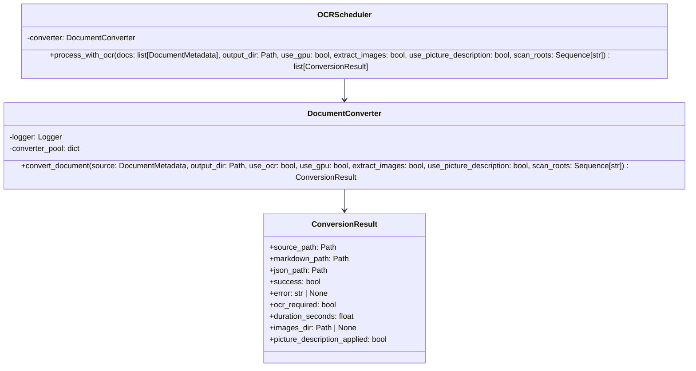

# Converter — Referencia Técnica

API Reference para conversión de documentos.

## Arquitectura



## API Pública

### DocumentConverter

```python
class DocumentConverter:
    async def __aenter__(self) -> 'DocumentConverter'
    async def __aexit__(self, *args) -> None
    
    async def convert_document(
        self,
        source_doc: DocumentMetadata,
        output_dir: Path,
        use_ocr: bool = False,
        use_gpu: bool = False,
        extract_images: bool = False,
        use_picture_description: bool = False,
        scan_roots: Sequence[str] = ()
    ) -> ConversionResult
```

Context manager para conversión de documentos.

| Parámetro | Tipo | Descripción |
|---|---|---|
| `source_doc` | `DocumentMetadata` | Documento a convertir |
| `output_dir` | `Path` | Directorio destino para .md y .json |
| `use_ocr` | `bool` | Usar OCR para documentos sin texto extraíble |
| `use_gpu` | `bool` | Usar GPU para OCR (requiere CUDA) |
| `extract_images` | `bool` | Extrae imágenes embebidas a `img/<stem>/` junto al `.md` y las referencia (`ImageRefMode.REFERENCED`) en vez del placeholder por defecto. Solo tiene efecto real en documentos PDF/imagen |
| `use_picture_description` | `bool` | Genera descripción textual de cada imagen (modelo local `smolvlm_picture_description`) en el `.json`. Solo tiene efecto en documentos PDF/imagen (`StandardPdfPipeline`); se ignora sin error en el resto de formatos |
| `scan_roots` | `Sequence[str]` | Carpetas raíz indicadas por el usuario al escanear. Si `source_doc.full_path` cuelga de alguna, `output_dir` replica esa jerarquía relativa a la raíz (no la ruta absoluta completa del disco de origen). Vacío por defecto: sin ninguna raíz conocida, la salida se aplana a `output_dir/<stem>` |

| Retorno | Tipo | Descripción |
|---|---|---|
| `source_path` | `Path` | Ruta del documento original |
| `markdown_path` | `Path` | Ruta del .md generado (si éxito) |
| `json_path` | `Path` | Ruta del .json generado (si éxito) |
| `success` | `bool` | `True` si conversión completó |
| `error` | `str \| None` | Mensaje de error (si falló) |
| `ocr_required` | `bool` | `True` si necesita segunda pasada con OCR |
| `duration_seconds` | `float` | Duración de conversión |
| `images_dir` | `Path \| None` | Carpeta con las imágenes extraídas (`img/<stem>/`), si `extract_images=True` y el documento tenía alguna |
| `picture_description_applied` | `bool` | `True` si `use_picture_description=True` tuvo efecto real (solo PDF/imagen) |

**Excepciones**:
- No relanza excepciones; devuelve resultado con `success=False`

---

### OCRScheduler

```python
class OCRScheduler:
    async def process_with_ocr(
        self,
        docs: list[DocumentMetadata],
        output_dir: Path,
        use_gpu: bool = False,
        extract_images: bool = False,
        use_picture_description: bool = False,
        scan_roots: Sequence[str] = ()
    ) -> list[ConversionResult]
```

Reconvierte batch de documentos con OCR.

| Parámetro | Tipo | Descripción |
|---|---|---|
| `docs` | `list[DocumentMetadata]` | Documentos que requieren OCR |
| `output_dir` | `Path` | Directorio destino |
| `use_gpu` | `bool` | Usar GPU (EasyOCR + CUDA) |
| `extract_images` | `bool` | Igual que en `convert_document`; propagado desde la primera pasada para que un documento con OCR no pierda esta opción |
| `use_picture_description` | `bool` | Igual que en `convert_document`, propagado desde la primera pasada |
| `scan_roots` | `Sequence[str]` | Igual que en `convert_document`; debe coincidir con la primera pasada para que ambas calculen la misma ruta de salida para un mismo documento |

| Retorno | Tipo | Descripción |
|---|---|---|
| | `list[ConversionResult]` | Resultados con OCR completado |

---

## Contratos

### Entrada

| Parámetro | Validación | Impacto si falla |
|---|---|---|
| Documento válido | Verificación previa (Scanner) | `ConversionError` en resultado |
| Formato soportado | Validación en Docling | `success=False` en resultado |
| Directorio existe | No se valida; usuario responsable | `ConversionError` |

### Salida

```python
@dataclass
class ConversionResult:
    source_path: Path
    markdown_path: Path | None = None
    json_path: Path | None = None
    success: bool = False
    error: str | None = None
    ocr_required: bool = False
    duration_seconds: float = 0.0
    images_dir: Path | None = None
    picture_description_applied: bool = False
```

## Dependencias

| Dependencia | Propósito |
|---|---|
| `docling` | Conversión principal (DocumentConverter) |
| `docling.InputFormat`, `EasyOcrOptions`, `PdfPipelineOptions`, `smolvlm_picture_description` | Configuración de Docling |
| `docling_core.types.doc.base.ImageRefMode` | Modo de referencia de imágenes al exportar Markdown |
| `docling_core.types.doc.document.PictureItem`, `PictureDescriptionData` | Extracción de descripciones de imagen para el `.json` |
| `core.models.ConversionResult`, `DocumentMetadata` | Modelos |
| `core.exceptions.ConversionError` | Excepciones |
| `utils.logging` | Logging |

## Notas Internas

- **Pool de convertidores**: Cachea por `(use_ocr, use_gpu, extract_images, use_picture_description)` para evitar reinicialización
- **Non-blocking**: Usa `asyncio.to_thread()` para I/O CPU-intensivo
- **Detección OCR**: Si `parse_score == NaN`, marca `ocr_required=True`
- **Errores capturados**: Nunca relanza en `convert_document()`
- **`InputFormat.IMAGE`**: configurado explícitamente con las mismas opciones que `InputFormat.PDF` (`StandardPdfPipeline`) — sin esto, docling aplicaba sus valores por defecto (`do_ocr=True`) a imágenes sueltas, ignorando `use_ocr`
- **`extract_images`**: usa `DoclingDocument.save_as_markdown(artifacts_dir=..., image_mode=ImageRefMode.REFERENCED)` con un `artifacts_dir` relativo `img/<stem>` (namespaced por documento, para que dos documentos en el mismo `output_dir` no compartan imágenes); si el documento no genera ninguna imagen, la carpeta vacía se borra y `images_dir` queda `None`
- **`use_picture_description`**: solo tiene efecto si el documento resuelve a `InputFormat.PDF`/`InputFormat.IMAGE` (`StandardPdfPipeline`); el resto de formatos usan `SimplePipeline`, que no tiene ese paso — se acepta el flag sin error pero `picture_description_applied` queda en `False`
- **`scan_roots` / `resolve_output_paths`**: la ruta de salida se calcula relativa a la raíz de escaneo que contiene al documento, nunca replicando la ruta absoluta completa del disco de origen bajo `output_dir` — si ninguna raíz coincide, se aplana a `output_dir/<stem>`. Sin esto, un `output_dir` ubicado en otra rama del árbol de ficheros que la raíz escaneada podía generar una jerarquía duplicada e inexistente al escribir (p.ej. imágenes extraídas de un `.docx`)
- **Mensaje de error vacío**: si la excepción capturada en `convert_document()` no lleva mensaje (`str(exc) == ""`), `ConversionResult.error` usa un texto de respaldo (`"{TipoDeExcepcion} sin mensaje de error"`) en vez de quedar en blanco; el traceback completo igualmente se registra en el log (`exc_info=True`)

## Ejemplos Relacionados

- [Convertir documentos a Markdown](../examples/converter-convert.md)
