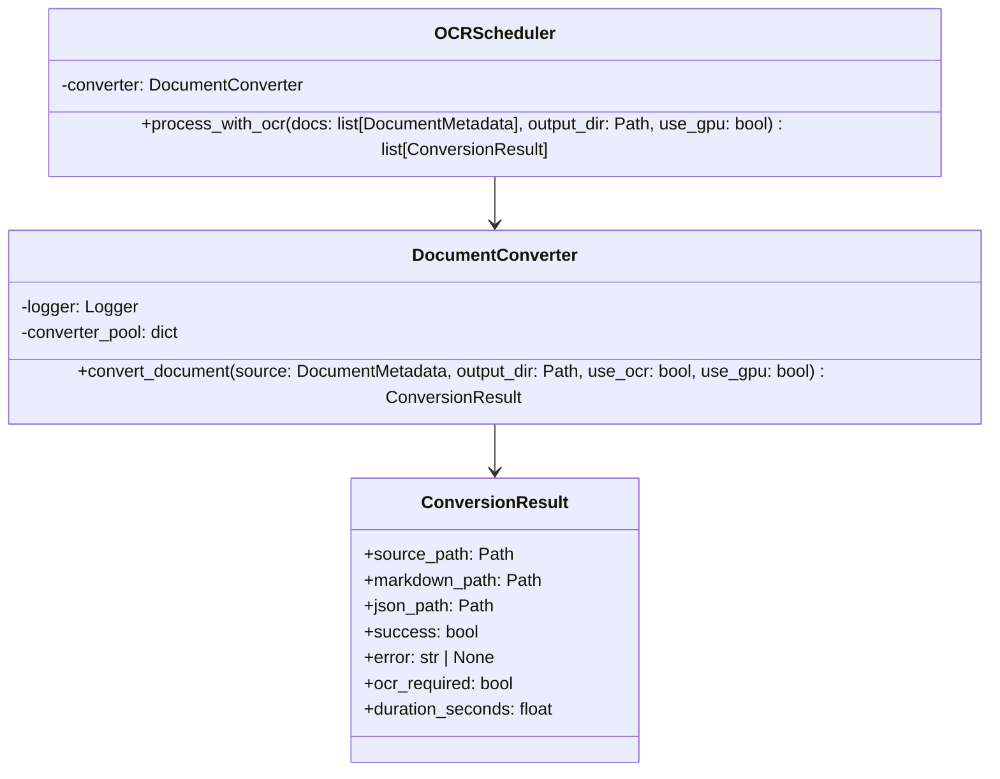

# Converter — Referencia Técnica

API Reference para conversión de documentos.

## Arquitectura



## API Pública

### DocumentConverter

```python
class DocumentConverter:
    async def __aenter__(self) -> 'DocumentConverter'
    async def __aexit__(self, *args) -> None
    
    async def convert_document(
        self,
        source_doc: DocumentMetadata,
        output_dir: Path,
        use_ocr: bool = False,
        use_gpu: bool = False
    ) -> ConversionResult
```

Context manager para conversión de documentos.

| Parámetro | Tipo | Descripción |
|---|---|---|
| `source_doc` | `DocumentMetadata` | Documento a convertir |
| `output_dir` | `Path` | Directorio destino para .md y .json |
| `use_ocr` | `bool` | Usar OCR para documentos sin texto extraíble |
| `use_gpu` | `bool` | Usar GPU para OCR (requiere CUDA) |

| Retorno | Tipo | Descripción |
|---|---|---|
| `source_path` | `Path` | Ruta del documento original |
| `markdown_path` | `Path` | Ruta del .md generado (si éxito) |
| `json_path` | `Path` | Ruta del .json generado (si éxito) |
| `success` | `bool` | `True` si conversión completó |
| `error` | `str \| None` | Mensaje de error (si falló) |
| `ocr_required` | `bool` | `True` si necesita segunda pasada con OCR |
| `duration_seconds` | `float` | Duración de conversión |

**Excepciones**:
- No relanza excepciones; devuelve resultado con `success=False`

---

### OCRScheduler

```python
class OCRScheduler:
    async def process_with_ocr(
        self,
        docs: list[DocumentMetadata],
        output_dir: Path,
        use_gpu: bool = False
    ) -> list[ConversionResult]
```

Reconvierte batch de documentos con OCR.

| Parámetro | Tipo | Descripción |
|---|---|---|
| `docs` | `list[DocumentMetadata]` | Documentos que requieren OCR |
| `output_dir` | `Path` | Directorio destino |
| `use_gpu` | `bool` | Usar GPU (EasyOCR + CUDA) |

| Retorno | Tipo | Descripción |
|---|---|---|
| | `list[ConversionResult]` | Resultados con OCR completado |

---

## Contratos

### Entrada

| Parámetro | Validación | Impacto si falla |
|---|---|---|
| Documento válido | Verificación previa (Scanner) | `ConversionError` en resultado |
| Formato soportado | Validación en Docling | `success=False` en resultado |
| Directorio existe | No se valida; usuario responsable | `ConversionError` |

### Salida

```python
@dataclass
class ConversionResult:
    source_path: Path
    markdown_path: Path | None = None
    json_path: Path | None = None
    success: bool = False
    error: str | None = None
    ocr_required: bool = False
    duration_seconds: float = 0.0
```

## Dependencias

| Dependencia | Propósito |
|---|---|
| `docling` | Conversión principal (DocumentConverter) |
| `docling.InputFormat`, `EasyOcrOptions`, `PdfPipelineOptions` | Configuración de Docling |
| `core.models.ConversionResult`, `DocumentMetadata` | Modelos |
| `core.exceptions.ConversionError` | Excepciones |
| `utils.logging` | Logging |

## Notas Internas

- **Pool de convertidores**: Cachea por `(use_ocr, use_gpu)` para evitar reinicialización
- **Non-blocking**: Usa `asyncio.to_thread()` para I/O CPU-intensivo
- **Detección OCR**: Si `parse_score == NaN`, marca `ocr_required=True`
- **Errores capturados**: Nunca relanza en `convert_document()`

## Ejemplos Relacionados

- [Convertir documentos a Markdown](../examples/converter-convert.md)
