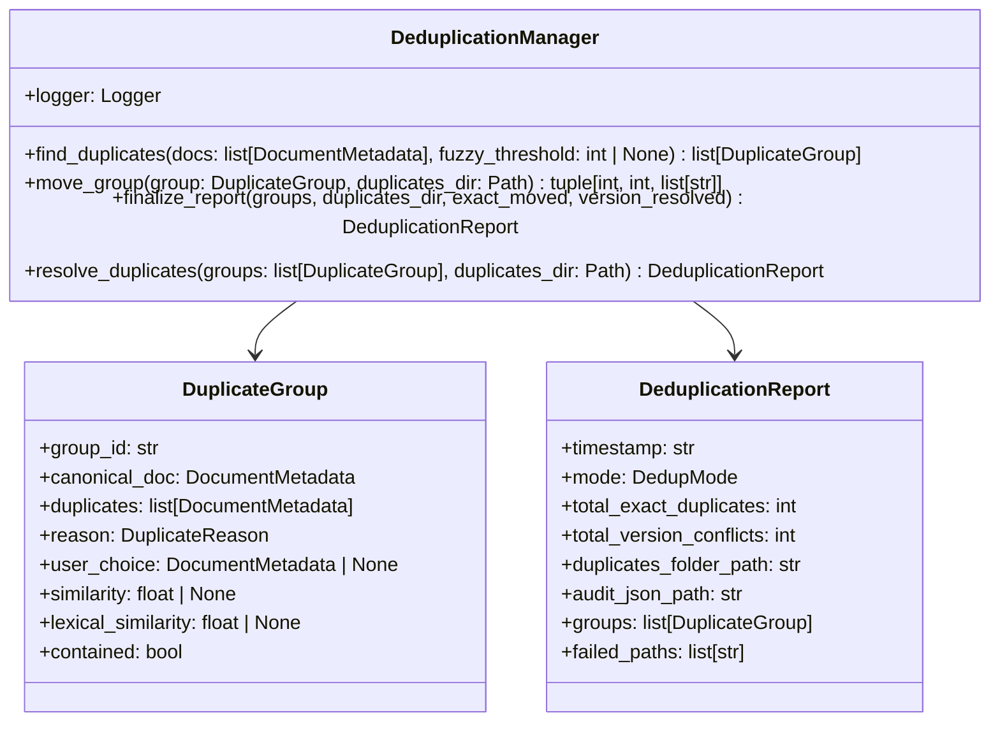

# Deduplicación — Referencia Técnica

API Reference para detección y resolución de duplicados.

## Arquitectura



## API Pública

### DeduplicationManager

```python
class DeduplicationManager:
    def __init__(self, *, io_retries: int = 0, io_retry_backoff_s: float = 1.0) -> None  # 1.1.0

    def find_duplicates(
        self,
        docs: list[DocumentMetadata],
        fuzzy_threshold: int | None = None
    ) -> list[DuplicateGroup]
    
    async def resolve_duplicates(
        self,
        groups: list[DuplicateGroup],
        duplicates_dir: Path,
        started_at: datetime | None = None,
        *,
        report_dir: Path | None = None,
        mode: DedupMode = "move",
        relative_to: Path | None = None,
        conversions: Mapping[str, ConversionResult] | None = None,  # 2.2.0
        conversion_dir: Path | None = None,  # 2.2.0
    ) -> DeduplicationReport

    async def move_group(
        self,
        group: DuplicateGroup,
        duplicates_dir: Path,
        *,
        mode: DedupMode = "move",
        relative_to: Path | None = None,
        conversions: Mapping[str, ConversionResult] | None = None,  # 2.2.0
        conversion_dir: Path | None = None,  # 2.2.0
    ) -> tuple[int, int, list[str]]

    async def finalize_report(
        self,
        groups: list[DuplicateGroup],
        duplicates_dir: Path,
        exact_moved: int,
        version_resolved: int,
        started_at: datetime | None = None,
        failed_paths: list[str] | None = None,
        report_dir: Path | None = None,
        mode: DedupMode = "move",
    ) -> DeduplicationReport

    @staticmethod
    def check_duplicates_dir(duplicates_dir: Path) -> None  # InvalidPathError si es o pasa por un enlace
```

`resolve_duplicates` es `move_group` (un grupo) en bucle más `finalize_report` (escribe `DEDUP_REPORT.json` y añade
una línea a `DEDUP_HISTORY.jsonl`); `ScanCommand.deduplicate_streaming` usa las dos primitivas por separado para emitir
progreso por grupo. `move_group` devuelve `(duplicados_exactos, otros_resueltos, rutas_fallidas)`: los grupos de
nombre parecido y por contenido cuentan en el segundo valor.

Con `io_retries > 0` (1.1.0, G11) cada copia de `mode="copy"` se reintenta ante un `OSError` transitorio; una copia a
medias no se queda en `duplicados/`. Mover no se reintenta: un movimiento a medias entre volúmenes podría dejar el
fichero en los dos sitios. Lo que agota los reintentos queda en `failed_paths`.

`find_duplicates` solo necesita `DocumentMetadata`; desde 1.1.0 se pueden construir desde la caché sin rehashear el
origen con `DocumentMetadata.from_cache_entry` (ver [Scanner](scanner.md#documentmetadata-desde-la-cache-110-g25)).

#### find_duplicates (Síncrono)

Agrupa documentos por duplicado exacto, conflicto de versión y, opcionalmente, similitud
aproximada de nombre.

| Parámetro | Tipo | Descripción |
|---|---|---|
| `docs` | `list[DocumentMetadata]` | Documentos escaneados |
| `fuzzy_threshold` | `int \| None` | Score mínimo RapidFuzz (0-100) para la 3ª pasada; `None` (por defecto) la desactiva — retrocompatible |

| Retorno | Tipo | Descripción |
|---|---|---|
| | `list[DuplicateGroup]` | Grupos de duplicados (incluyendo grupos unitarios) |

**Agrupación**:
1. Por SHA-256 exacto → `reason=exact_duplicate`
2. Por nombre base (sin extensión, sin versión) → `reason=version_conflict`
3. (opcional, si `fuzzy_threshold` no es `None`) Por similitud aproximada de `display_name` entre
   los documentos que no quedaron agrupados en 1-2, usando `rapidfuzz.process.cdist` (vectorizado)
   y componentes conexas del grafo de similitud (score ≥ `fuzzy_threshold`, sin exigir
   transitividad estricta par a par) → `reason=fuzzy_name_match`. Excluido siempre de la
   resolución automática masiva ("Buscar duplicados"); solo se resuelve desde el formulario
   interactivo de "Revisar Duplicados" (elección manual del usuario por grupo).

**Selección de canónico**:
- Documento más antiguo (mínimo `modified_time`) — en grupos `fuzzy_name_match` es una propuesta,
  no se aplica sin que el usuario la confirme (o la sobrescriba) explícitamente

---

#### resolve_duplicates (Async)

Mueve documentos descartados a carpeta de duplicados.

| Parámetro | Tipo | Descripción |
|---|---|---|
| `groups` | `list[DuplicateGroup]` | Grupos de `find_duplicates()` |
| `duplicates_dir` | `Path` | Carpeta destino para duplicados |
| `started_at` | `datetime \| None` | Inicio de la operación, para `duration_seconds` del informe |
| `report_dir` | `Path \| None` | Carpeta de `DEDUP_REPORT.json`/`DEDUP_HISTORY.jsonl` (por defecto, `duplicates_dir`) |
| `mode` | `"move" \| "copy" \| "report_only"` | Mover (por defecto), copiar sin tocar el origen o solo contar |
| `conversions` | `Mapping[str, ConversionResult] \| None` | 2.2.0. Conversión de cada original por `full_path`: en modo `move`, el `.md`, el `.json` y las imágenes del descartado se mueven con él a `duplicados/Conversión/`; en `copy` y `report_only` no se tocan |
| `conversion_dir` | `Path \| None` | 2.2.0. Carpeta de conversión cuya ruta relativa se replica bajo `duplicados/Conversión/` |
| `relative_to` | `Path \| None` | Si se indica, se replica la ruta **relativa** a esta carpeta (`duplicados/2024/a.pdf`) en lugar de la absoluta (`duplicados/mnt/origen/2024/a.pdf`); un documento que no cuelgue de ella queda en `failed_paths` (desde 0.12.1) |

| Retorno | Tipo | Descripción |
|---|---|---|
| | `DeduplicationReport` | Reporte de resolución (incluyendo `DEDUP_REPORT.json`) |

**Proceso**:
1. Para cada grupo, determina canónico (o usa `user_choice` si proporciona)
2. Mueve documentos no-canónicos a `duplicates_dir`, preservando estructura original (la ruta absoluta sin la
   unidad/raíz o, con `relative_to`, la relativa a esa carpeta); un fallo por fichero va a `failed_paths`
3. Escribe `DEDUP_REPORT.json` con auditoría completa (solo la última ejecución)
4. Añade una línea a `DEDUP_HISTORY.jsonl` (histórico acumulado, nunca se sobrescribe)
5. Retorna `DeduplicationReport` con resumen

**Excepciones**:
- `InvalidPathError` — `duplicates_dir` es (o pasa por) un enlace simbólico (desde 0.12.1)
- Un fallo de E/S al mover un fichero no se lanza: la ruta va a `failed_paths` y el lote sigue

---

## Contratos

### Entrada

| Parámetro | Validación | Impacto si falla |
|---|---|---|
| Documento con SHA-256 | Validación previa (Scanner) | Documento no se agrupa |
| Carpeta de duplicados sin enlaces | `check_duplicates_dir()` en `resolve_duplicates()` (se crea si no existe, salvo `report_only`) | `InvalidPathError` |

### Salida

```python
class DuplicateGroup(BaseModel):  # doc_organize.core.models
    group_id: str
    canonical_doc: DocumentMetadata
    duplicates: list[DocumentMetadata]
    reason: DuplicateReason  # exact_duplicate | version_conflict | fuzzy_name_match | same_content | semantic_content_match
    user_choice: DocumentMetadata | None = None
    similarity: float | None = None  # 2.2.0, grupos por contenido parecido
    lexical_similarity: float | None = None  # 2.2.0
    contained: bool = False  # 2.2.0

class DeduplicationReport(BaseModel):  # doc_organize.core.models
    timestamp: str                      # ISO 8601
    mode: DedupMode = "move"            # "move" | "copy" | "report_only"
    total_exact_duplicates: int
    total_version_conflicts: int
    duplicates_folder_path: str
    audit_json_path: str
    groups: list[DuplicateGroup] = []
    started_at: str | None = None
    duration_seconds: float | None = None
    failed_paths: list[str] = []
```

## Dependencias

| Dependencia | Propósito |
|---|---|
| `core.constants.VERSION_SUFFIX_PATTERN` | Detecta sufijos de versión |
| `core.models.DuplicateGroup`, `DeduplicationReport` | Modelos |
| `core.exceptions.InvalidPathError` | `duplicates_dir` enlazado |
| `utils.path_utils.ensure_no_symlinks()` | Rutas absolutas sin resolver ni seguir enlaces |
| `utils.logging` | Logging |
| `rapidfuzz.process.cdist`, `rapidfuzz.fuzz.WRatio`, `rapidfuzz.utils.default_process` | Matriz de scores de similitud de nombre (3ª pasada, vectorizado, con normalización previa) |
| `numpy` (dependencia directa desde 2.2.0) | Extrae, vectorizado, los pares de la matriz de scores por encima del umbral; similitudes por bloques de `ContentDuplicateFinder` |

## Notas Internas

- **Naming**: `_extract_base_name()` normaliza nombres (strip extensión, sufijo versión, lowercase)
- **Movimiento seguro**: las rutas se normalizan sin resolver enlaces (nunca contienen `..`) y no se siguen enlaces
  simbólicos (desde 0.12.1): si algún tramo del origen, de `duplicates_dir` o de la carpeta destino es un enlace, el
  fichero falla (`failed_paths`); `resolve_duplicates()` y `deduplicate_streaming()` rechazan de entrada un
  `duplicates_dir` enlazado (`InvalidPathError`). En POSIX el origen y el destino se abren tramo a tramo con
  `O_NOFOLLOW` y se mueven con `rename` relativo a esos descriptores, así que un enlace puesto justo antes de mover
  tampoco se sigue; en Windows (sin `dir_fd`) queda la comprobación con `lstat`
- **Colisiones**: Si destino existe, añade sufijo con hash de 8 caracteres
- **Auditoría completa**: `DEDUP_REPORT.json` incluye lista de todas las decisiones
- **Histórico incremental**: `DEDUP_HISTORY.jsonl` (una línea JSON por ejecución de
  `resolve_duplicates()`, formato JSON Lines) acumula todas las ejecuciones, a
  diferencia de `DEDUP_REPORT.json` (que solo refleja la última)

## Duplicados por contenido (2.2.0)

`ContentDuplicateFinder` busca duplicados sobre el texto convertido: el mismo contenido en ficheros distintos
(`same_content`, sin IA) y, con la tarea de IA `dedup`, contenido parecido (`semantic_content_match`). Sus grupos llevan
`similarity`, `lexical_similarity` y `contained`, y se resuelven con `move_group`/`resolve_duplicates` pasando
`conversions` (y `conversion_dir`): en modo `move`, la conversión del descartado se mueve con él a
`duplicados/Conversión/`. Guía: [Duplicados por contenido](../guides/duplicados_por_contenido.md).

::: doc_organize.dedup.content
    options:
      show_root_heading: false
      members:
        - ContentDuplicateFinder
        - ContentDocument
        - ContentDuplicateReport
        - exclude_from_context

## Ejemplos Relacionados

- [Deduplicar documentos](../examples/dedup-resolve.md)
- [Duplicados por contenido (2.2.0)](../examples/dedup-resolve.md#duplicados-por-contenido-220): ejemplo reproducible sin IA real
