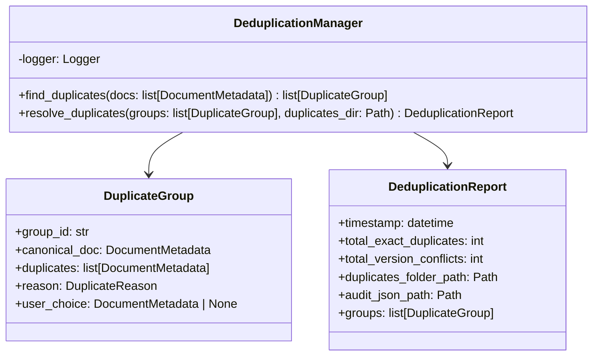

# Deduplicación — Referencia Técnica

API Reference para detección y resolución de duplicados.

## Arquitectura



## API Pública

### DeduplicationManager

```python
class DeduplicationManager:
    def find_duplicates(
        self,
        docs: list[DocumentMetadata]
    ) -> list[DuplicateGroup]
    
    async def resolve_duplicates(
        self,
        groups: list[DuplicateGroup],
        duplicates_dir: Path
    ) -> DeduplicationReport
```

#### find_duplicates (Síncrono)

Agrupa documentos por duplicado exacto y conflicto de versión.

| Parámetro | Tipo | Descripción |
|---|---|---|
| `docs` | `list[DocumentMetadata]` | Documentos escaneados |

| Retorno | Tipo | Descripción |
|---|---|---|
| | `list[DuplicateGroup]` | Grupos de duplicados (incluyendo grupos unitarios) |

**Agrupación**:
1. Por SHA-256 exacto → `reason=exact_duplicate`
2. Por nombre base (sin extensión, sin versión) → `reason=version_conflict`

**Selección de canónico**:
- Documento más antiguo (mínimo `modified_time`)

---

#### resolve_duplicates (Async)

Mueve documentos descartados a carpeta de duplicados.

| Parámetro | Tipo | Descripción |
|---|---|---|
| `groups` | `list[DuplicateGroup]` | Grupos de `find_duplicates()` |
| `duplicates_dir` | `Path` | Carpeta destino para duplicados |

| Retorno | Tipo | Descripción |
|---|---|---|
| | `DeduplicationReport` | Reporte de resolución (incluyendo `DEDUP_REPORT.json`) |

**Proceso**:
1. Para cada grupo, determina canónico (o usa `user_choice` si proporciona)
2. Mueve documentos no-canónicos a `duplicates_dir`, preservando estructura original
3. Escribe `DEDUP_REPORT.json` con auditoría completa
4. Retorna `DeduplicationReport` con resumen

**Excepciones**:
- `ProjectError` — Errores críticos durante movimiento

---

## Contratos

### Entrada

| Parámetro | Validación | Impacto si falla |
|---|---|---|
| Documento con SHA-256 | Validación previa (Scanner) | Documento no se agrupa |
| Carpeta existe | Validación en `resolve_duplicates()` | Error |

### Salida

```python
@dataclass
class DuplicateGroup:
    group_id: str
    canonical_doc: DocumentMetadata
    duplicates: list[DocumentMetadata]
    reason: DuplicateReason  # exact_duplicate | version_conflict
    user_choice: DocumentMetadata | None = None

@dataclass
class DeduplicationReport:
    timestamp: datetime
    total_exact_duplicates: int
    total_version_conflicts: int
    duplicates_folder_path: Path
    audit_json_path: Path
    groups: list[DuplicateGroup]
```

## Dependencias

| Dependencia | Propósito |
|---|---|
| `core.constants.VERSION_SUFFIX_PATTERN` | Detecta sufijos de versión |
| `core.models.DuplicateGroup`, `DeduplicationReport` | Modelos |
| `core.exceptions.ProjectError` | Excepciones |
| `utils.path_utils.is_subpath()`, `safe_path_join()` | Manipulación segura de rutas |
| `utils.logging` | Logging |

## Notas Internas

- **Naming**: `_extract_base_name()` normaliza nombres (strip extensión, sufijo versión, lowercase)
- **Movimiento seguro**: `safe_path_join()` previene path traversal
- **Colisiones**: Si destino existe, añade sufijo con hash de 8 caracteres
- **Auditoría completa**: `DEDUP_REPORT.json` incluye lista de todas las decisiones

## Ejemplos Relacionados

- [Deduplicar documentos](../examples/dedup-resolve.md)
