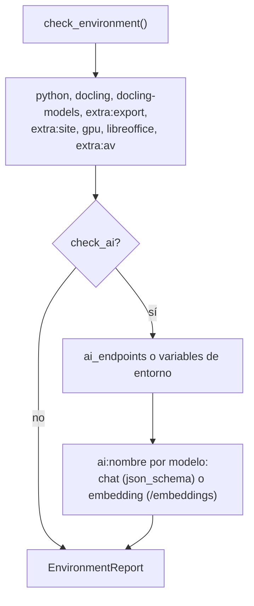

# Diagnóstico del entorno

`check_environment()` (2.0.0) adelanta los fallos de entorno que antes aparecían a mitad de un escaneo o de la
construcción del sitio: falta un extra, Zensical fuera del rango probado, no hay GPU para el OCR, faltan los modelos de
docling o un modelo de IA no responde.

## 1. Arquitectura y Diseño



## 2. API Reference

### Autodoc

::: doc_organize.diagnostics
    options:
      show_root_heading: false
      members:
        - check_environment
        - AiEndpoint

### Contratos

```python
import asyncio

from doc_organize import check_environment

report = asyncio.run(check_environment())
for check in report.checks:
    print(check.status, check.name, check.detail, check.remedy or "")
print("Sin errores" if report.ok else "Hay errores")
```

#### Comprobaciones

| `name` | Qué comprueba | Si falla |
|---|---|---|
| `python` | Python 3.12 o posterior | `error` |
| `docling` | docling instalado y su versión | `error` |
| `docling-models` | Modelos de docling: en `artifacts_path` (o `DOCLING_ARTIFACTS_PATH`) si se indica; si no, en la caché de Hugging Face | `error` si la carpeta indicada está vacía; `warning` si no están en la caché (se descargarán en el primer PDF, con red) |
| `extra:export` | `openpyxl` (Excel de las exportaciones) | `warning` |
| `extra:site` | Zensical dentro del rango probado (`ZENSICAL_TESTED_RANGE`) y, con `build_site=True`, un sitio de una página construido en una carpeta temporal | `warning` si no está o está fuera del rango; `error` si el build falla |
| `gpu` | GPU CUDA para el OCR | `warning`: el OCR irá por CPU |
| `libreoffice` | LibreOffice para los formatos de Office antiguos | `warning` |
| `extra:av` | Transcripción de audio y vídeo | `warning` |
| `ai:<nombre>` | Con `check_ai=True`, cada modelo de IA configurado | ver abajo |
| `ai` | Con `check_ai=True`, si no hay ningún modelo configurado (`ok`: la IA no se usará) o la configuración no vale (p. ej. variables de 1.x) | `error` |

Cada `EnvironmentCheck` trae `name`, `status` (`ok`, `warning` o `error`), `detail` y `remedy`; las de IA, además,
`model` (el alias pedido) y `served_model` (el modelo que dice la respuesta que contestó, si lo dice), y las de
embeddings, `dimension` (2.2.0). `report.ok` es `False` si alguna comprobación dio `error`; los `warning` no cuentan. Los detalles no llevan rutas ni
claves. Sin `check_ai` no se usa la red y nada toca ningún proyecto.

#### Modelos de IA (`check_ai=True`)

Una llamada por modelo con **texto sintético** (nunca nada de un documento) pidiendo la salida `json_schema` estricta:

- responde: `ok`;
- el proxy rechaza el esquema (HTTP 400) pero responde con `json_object`: `warning` (funciona, con menos garantías);
- clave rechazada (401/403), alias que no existe, error de red o sin respuesta en 60 s: `error`.

Un modelo de **embeddings** (`AiEndpoint(kind="embedding")`) se comprueba pidiendo un vector a `/embeddings`: `ok` con
su dimensión, o `error` si la clave, el alias o la respuesta fallan. El de `dedup` (2.2.0) se prueba además con dos
textos largos que solo difieren al final: si los vectores salen iguales, `warning` (el modelo corta el texto antes de
unas 1500 palabras; usa bloques más pequeños, `chunk_words`, o sube el contexto del modelo en el proxy).

Por defecto se comprueban los modelos configurados por variables de entorno: clasificar, describir y diseñar la
taxonomía siempre, y agentes, embeddings y duplicados por contenido si tienen modelo (o clave) propio
(`DOC_ORGANIZE_LITELLM_MODEL_AGENT`, `_MODEL_EMBED`, `_MODEL_DEDUP`). Para otros:

```python
from doc_organize import AiEndpoint, check_environment

endpoint = AiEndpoint(name="clasificacion", base_url="http://localhost:4000", virtual_key=clave, model="mi-alias")
embeddings = AiEndpoint(name="embed", base_url="http://localhost:4000", virtual_key=clave, model="mi-embedding", kind="embedding")
report = await check_environment(check_ai=True, ai_endpoints=[endpoint, embeddings])
```

## 3. Componentes y Clases

| Clase / función | Responsabilidad |
|---|---|
| `check_environment` | Ejecuta las comprobaciones y devuelve un `EnvironmentReport` |
| `AiEndpoint` | Un modelo de IA a comprobar con `check_ai`: dónde está, con qué clave y qué alias (`kind`: `chat` o `embedding`) |
| `EnvironmentReport` / `EnvironmentCheck` | El informe (`checks`, `ok`) y cada comprobación (`name`, `status`, `detail`, `remedy`…) |

## 4. Dependencias y Requisitos

| Dependencia | Propósito |
|---|---|
| `httpx` | Llamadas a los modelos de IA con `check_ai=True` |

Lo que el módulo comprueba (docling, extras, GPU, LibreOffice, Zensical) no es requisito para ejecutarlo: si falta, sale
como `warning` o `error` en el informe (ver «Comprobaciones»).

## 5. Ejemplos Relacionados

- [Diagnosticar el entorno](../examples/diagnostics-check.md): `check_environment` sin IA y con `check_ai` contra un proxy falso (`ok`, `warning` por `json_schema`, clave rechazada y embeddings)
