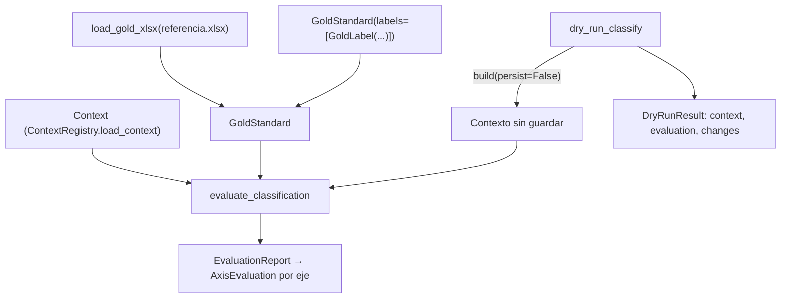

# Evaluación contra una referencia (2.0.0)

Para saber si un cambio de reglas, prompt, perfil o modelo mejora la clasificación hay que medirlo contra una
**referencia**: unos documentos etiquetados a mano con el valor correcto de cada eje. `evaluate_classification` compara
un contexto con ella, eje a eje.

## 1. Arquitectura y Diseño



## 2. API Reference

### Autodoc

::: doc_organize.context.dry_run
    options:
      show_root_heading: false
      members:
        - dry_run_classify
        - DryRunResult
        - DocumentChange

::: doc_organize.context.evaluation
    options:
      show_root_heading: false
      members:
        - evaluate_classification
        - load_gold_xlsx
        - GoldStandard
        - GoldLabel
        - EvaluationReport
        - AxisEvaluation
        - LabelConfusion
        - document_keys
        - common_root

### Contratos

```python
from doc_organize import ContextRegistry, evaluate_classification, load_gold_xlsx

context = await ContextRegistry().load_context(project)
gold = load_gold_xlsx("referencia.xlsx", columns={"domains": "dominio_ok", "material_types": "tipo_ok"})
report = evaluate_classification(context, gold)
print(report.to_markdown())
```

#### La referencia

`load_gold_xlsx(path, *, columns=None, sheet="Referencia", document_column="documento")` lee un Excel con una fila por
documento:

- `documento`: la **clave** del documento, su ruta relativa a la raíz de escaneo (`ENS/plan.pdf`). Un `'` inicial
  (fórmula neutralizada) se quita.
- Una columna por eje (`columns`: eje → columna; por defecto `dominio_ok` y `tipo_ok`, las de la línea base): el valor
  correcto, varios separados por `,` o `;`, o `ninguno` si ningún valor del catálogo encaja (dejar el eje vacío es lo
  correcto). Una celda vacía = documento sin etiquetar en ese eje.

Necesita el extra `export` (`openpyxl`). También se puede construir a mano: `GoldStandard(labels=[GoldLabel(document=...,
axes={"domains": ["calidad"]})])`.

#### Las métricas

`EvaluationReport.axes` tiene un `AxisEvaluation` por eje etiquetado, sobre los documentos etiquetados que están en el
contexto (`matched`; los que no, en `missing_documents`):

| Métrica | Qué es |
|---|---|
| `accuracy` | Documentos con **exactamente** los valores de la referencia (en un eje de varios valores, el mismo conjunto) |
| `coverage` | Documentos con algún valor asignado |
| `precision` / `recall` | Por valores: asignados que son correctos / correctos que se asignaron |
| `accuracy_by_classified_by` | Exactitud según quién clasificó el eje (`rules`, `ai`, `human`, `semantic`; `unclassified` si quedó vacío), con `labelled_by_classified_by` |
| `confusions` | Los 10 errores más frecuentes: valor de la referencia → valor asignado (`ninguno` = vacío) |

Las claves del contexto se calculan con `roots` (raíces de escaneo) o, por defecto, con la carpeta común de todos los
originales, así que una referencia hecha con las rutas del contenedor de la web (`/mnt/...`) vale con un contexto del
equipo y al revés.

## 3. Componentes y Clases

### Clasificación de prueba

`dry_run_classify(project, documents, *, gold=None, only_gold=True, roots=None, builder=None, ai_cache=False,
baseline=None, **opciones_de_build) -> DryRunResult` construye el
contexto como `ContextBuilder.build`, **sin guardarlo** (`build(persist=False)`: ni `context.json` ni histórico) y lo
evalúa contra `gold`. Sirve para comparar reglas, prompts, perfiles o modelos antes de adoptarlos:

```python
from doc_organize import PromptRegistry, dry_run_classify

opciones = {"gold": gold, "taxonomy_manifest": manifest, "llm": llm, "ai_scope": "unclassified", "ai_max_documents": 50}
base = await dry_run_classify(project, documents, **opciones)
nuevo = await dry_run_classify(project, documents, prompts=PromptRegistry(carpeta_con_otro_prompt), **opciones)
print(base.evaluation.to_markdown())
print(nuevo.evaluation.to_markdown())
print(base.context.ai_stats.classification.prompt_tokens, nuevo.context.ai_stats.classification.prompt_tokens)
```

- Con `gold`, solo clasifica los documentos que están en la referencia (`only_gold=False` para todos): el presupuesto
  (`ai_max_documents`) se gasta en lo que se mide.
- Por defecto no usa la caché de IA (`ai_cache=False`), para que las dos configuraciones hagan llamadas de verdad.
- Los documentos de la referencia nunca sirven de ejemplo a la IA (`example_exclusions`): con `only_gold=True` no
  habrá ejemplos; con `only_gold=False`, los del resto del proyecto sí pueden serlo.
- Las decisiones, el perfil y los prompts del proyecto se leen como en una construcción normal; no se escribe nada.
  Pasar `persist` lanza `TypeError`.

`DryRunResult` trae el `context` (con `ai_stats`: llamadas, tokens), la `evaluation` y cuántos `documents` se
clasificaron. Con `baseline=` (el contexto actual, `ContextRegistry.load_context`), `changes` dice qué documentos
cambian de valor y en qué eje (`DocumentChange`: valores antes y después y quién los asignó), para ver qué cambiaría
al adoptar la configuración probada:

```python
actual = await ContextRegistry().load_context(project)
prueba = await dry_run_classify(project, documents, baseline=actual, **opciones)
for cambio in prueba.changes:
    print(cambio.document_key, cambio.axis, cambio.before, "→", cambio.after)
```

Las claves de los documentos son su ruta relativa a la raíz de escaneo (`document_keys`): pasa como `roots` las mismas
raíces que a `build(scan_roots=)` para que no cambien con el corpus.

## 4. Dependencias y Requisitos

| Dependencia | Propósito | Requerida | Comportamiento sin ella |
|---|---|---|---|
| `openpyxl` (extra `export`) | Leer la referencia con `load_gold_xlsx` | No | `load_gold_xlsx` lanza `MissingDependencyError`; la referencia se puede construir a mano con `GoldStandard` |

## 5. Ejemplos Relacionados

- [Ejemplo: Evaluar la clasificación contra una referencia](../examples/evaluation-gold.md): referencia a partir de decisiones (`gold_from_decisions`), métricas y confusiones, y comparación de dos umbrales con `dry_run_classify` sin guardar nada
