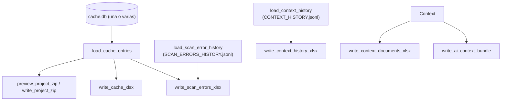

# Exportación — Referencia Técnica

`doc_organize.export` (desde la 0.11.0, tarea L-7): exporta las cachés y los históricos de un proyecto a ZIP y Excel,
y el contexto a Excel y al paquete para IA. Funcionalidad: [Exportación](../functional/export.md).

## 1. Arquitectura y Diseño



## 2. API Reference

### Autodoc

::: doc_organize.export.sources

::: doc_organize.export.zip_export

::: doc_organize.export.xlsx_export

### Contratos

#### API pública

| Nombre | Firma | Devuelve |
|---|---|---|
| `load_cache_entries` | `async (cache_dbs: Iterable[str \| Path])` | `list[CacheEntry]` |
| `load_scan_error_history` | `(history_logs: Iterable[str \| Path])` | `list[ScanErrorReport]`, más recientes primero |
| `preview_project_zip` | `(entries, *, layout=None, conversion_dir=None, dedup_report=None)` | `ExportStats` |
| `write_project_zip` | `(destination, entries, *, layout=None, conversion_dir=None, dedup_report=None, on_progress=None, cancel_token=None)` | `ExportStats` |
| `write_cache_xlsx` | `(destination, entries, *, on_progress=None, cancel_token=None)` | filas escritas |
| `write_scan_errors_xlsx` | `(destination, entries, history, *, on_progress=None, cancel_token=None)` | filas escritas |
| `load_context_history` | `(history_logs: Iterable[str \| Path])` | `list[ContextBuildRecord]`, más recientes primero (1.5.0); con las copias giradas de cada histórico, sin repetir (1.6.0) |
| `write_context_history_xlsx` | `(destination, history, *, on_progress=None, cancel_token=None)` | filas escritas (1.5.0) |
| `write_context_documents_xlsx` | `(destination, context, *, roots=None, on_progress=None, cancel_token=None)` | filas escritas (2.0.0): hoja `Documentos` (una fila por documento, clasificados y sin clasificar con su motivo, su grupo de versiones, versión y si es la vigente, y una columna por cada eje que solo etiqueta, con los nombres de sus valores separados por «; »), hoja `Ejes` (una fila por eje y valor del catálogo con su número de documentos, también los que tienen 0) y hoja `Valores` (una fila por documento, eje y valor: quién lo asignó, confianza y cita). Con `roots` (las raíces de escaneo, como en `document_keys`), las rutas van como la clave relativa del documento y no sale ninguna ruta absoluta |
| `ExportStats` | `file_count`, `total_size_bytes` (modelo Pydantic congelado) | — |
| `CACHE_SNAPSHOT_NAME` | constante `"cache_export.json"` (nombre de la instantánea de la caché en el ZIP) | — |
| `write_ai_context_bundle`, `render_llms_txt`, `AiBundleStats`, `BUNDLE_DOCUMENTS_FOLDER` | Paquete del contexto para IA (2.0.0); ver [Paquete para IA](ai_bundle.md) | — |
| `MissingDependencyError` | `package`, `extra` (en `doc_organize.core.exceptions`) | — |

- `destination`: ruta (se crea o sobrescribe) o fichero binario abierto para escritura. El ZIP admite flujos sin
  `seek`. Si la escritura se cancela o falla, una ruta se borra; un fichero abierto lo descarta el llamador.
- `layout` y `conversion_dir`/`dedup_report` son excluyentes (`ValueError` si se combinan).
- Las escrituras son síncronas. Desde código async: `await asyncio.to_thread(write_project_zip, ...)`; el
  `CancelToken` es seguro entre hilos.
- `on_progress` recibe `ProgressEvent(operation="export")` con fase `started`, `export` (una por fichero del ZIP o
  fila del Excel; en el ZIP `current` es el nombre dentro del archivo) y `done`. Un fallo del callback se registra y no
  para la exportación. El callback corre en el hilo que escribe: con `asyncio.to_thread`, para tocar el event loop
  hay que usar `loop.call_soon_threadsafe`.

#### Uso desde un consumidor async

```python
import asyncio
from pathlib import Path

from doc_organize import CancelToken, ProjectLayout
from doc_organize.export import load_cache_entries, preview_project_zip, write_project_zip

layout = ProjectLayout(Path("/red/Proyecto"), state_root=Path("/local/estado/7"))
cache_dbs = [layout.state_dir / carpeta / "cache.db" for carpeta in ("origen_a", "origen_b")]


async def exportar(destino: Path, token: CancelToken) -> None:
    entries = await load_cache_entries(cache_dbs)
    preview = await asyncio.to_thread(preview_project_zip, entries, layout=layout)
    print(f"{preview.file_count} ficheros, {preview.total_size_bytes} bytes")
    await asyncio.to_thread(write_project_zip, destino, entries, layout=layout, cancel_token=token)
```

#### Formato del ZIP

| Nombre en el ZIP | Origen |
|---|---|
| `Conversión/<ruta relativa>` | `conversion_dir` (o `layout.conversion_dir`), recorrido alfabético, sin enlaces simbólicos |
| `cache_export.json` | `CacheExportSnapshot` con sangría de 2; `export_timestamp` ISO 8601 con microsegundos; entradas ordenadas por `file_path` |
| `duplicados/DEDUP_REPORT.json` | `dedup_report` (o `layout.dedup_report`), si existe |

Compresión `ZIP_DEFLATED`; ZIP64 automático para ficheros de más de 2 GiB.

#### Excel

`openpyxl` en modo `write_only`, importado al escribir. Ese modo guarda el XML de cada hoja en un temporal del
sistema hasta `save()`; si la escritura se cancela o falla, se borran en el momento. Cabeceras exportadas como
constantes: `CACHE_COLUMNS`, `SCAN_ERRORS_CURRENT_COLUMNS`, `SCAN_ERRORS_HISTORY_COLUMNS`, `CONTEXT_BUILDS_COLUMNS` y
`CONTEXT_CHANGES_COLUMNS` (en `doc_organize.export.xlsx_export`).

El Excel del historial del contexto (1.5.0) tiene dos hojas: `Construcciones` (una fila por construcción: fecha, la
construcción con la que se comparó, versión de doc_organize, modelos de IA, clasificados, sin clasificar y número de
cambios) y `Cambios` (una fila por documento: `Entra`, `Sale` o `Cambia`, dominio y tipo de material antes y después,
y quién lo clasificó). Un dominio vacío es que el documento no estaba en ese lado; `(sin clasificar)`, que estaba sin
dominio. Ver [Historial del contexto](context.md#historial-del-contexto-150).

## 3. Componentes y Clases

| Módulo | Responsabilidad |
|---|---|
| `doc_organize.export.sources` | Lee las entradas de las cachés y los históricos (`load_cache_entries`, `load_scan_error_history`, `load_context_history`) |
| `doc_organize.export.zip_export` | ZIP del proyecto (`preview_project_zip`, `write_project_zip`, `ExportStats`) |
| `doc_organize.export.xlsx_export` | Excel de la caché, de los errores de escaneo, del historial del contexto y de los documentos del contexto |
| `doc_organize.export.ai_bundle` | Paquete del contexto para IA; ver [Paquete para IA](ai_bundle.md) |

## 4. Dependencias y Requisitos

| Dependencia | Propósito |
|---|---|
| `doc_organize.cache` | Leer las cachés (`cache/`) |
| `doc_organize.projects.layout` | Rutas del proyecto (`projects/layout`) |
| `doc_organize.context.context_history` | Historial del contexto (desde 1.5.0); carga el paquete `doc_organize.context` (y con él `httpx`), pero no Docling |
| `openpyxl` (extra `export`) | Excel; se importa al escribir y, si falta, `MissingDependencyError`. El ZIP no lo necesita |

## 5. Ejemplos Relacionados

- [Exportar un proyecto a ZIP y Excel](../examples/export-project.md): `load_cache_entries`, vista previa y escritura del ZIP de un proyecto con su progreso, y Excel de la caché con `write_cache_xlsx`
