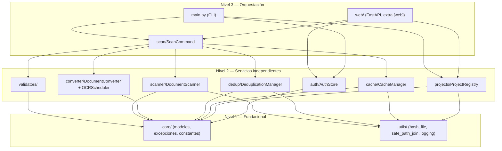

# Arquitectura

`doc_organize` se organiza en tres capas, de fundacional a orquestación (ver
`.github/instructions/architecture.instructions.md` en el repositorio para la
convención completa):

- **Nivel 1 — Fundacional** (`core/`, `utils/`): sin dependencias del resto del
  paquete. Modelos, excepciones, constantes, hashing, validación de rutas.
- **Nivel 2 — Servicios independientes** (`validators/`, `scanner/`, `converter/`,
  `dedup/`, `cache/`, `projects/`, `auth/`): cada uno resuelve una responsabilidad
  del dominio sin depender de los otros módulos de su mismo nivel. Solo dependen
  de Nivel 1.
- **Nivel 3 — Orquestación** (`scan/`, `web/`, `main.py`): coordinan los servicios
  de Nivel 2 sin cambiar sus contratos. `scan/` es compartido por el CLI y la web
  a propósito — ninguno de los dos "posee" la orquestación de escaneo.

## Autenticación web (host no-loopback)

Sesión por cookie (`HttpOnly`, `SameSite=Strict`), no bearer token compartido:
`POST /login` valida usuario+contraseña+tenant contra `AuthStore` y fija la
cookie; `AuthMiddleware` la exige en toda ruta salvo `/login`/`/logout`. Las
conexiones WebSocket (`web/routes/scan.py`) no pasan por el middleware HTTP
(Starlette no lo intercepta para el scope `"websocket"`) y autentican la sesión
explícitamente en el propio handler.

## Referencia

Generada desde los docstrings del código (Google-style).

::: doc_organize.core.models
::: doc_organize.core.exceptions
::: doc_organize.scanner.document_scanner
::: doc_organize.converter.converter
::: doc_organize.converter.ocr_scheduler
::: doc_organize.dedup.deduplication
::: doc_organize.cache.cache_manager
::: doc_organize.projects.project_registry
::: doc_organize.auth.auth_store
::: doc_organize.scan.scan_command
::: doc_organize.web.app
::: doc_organize.web.auth
