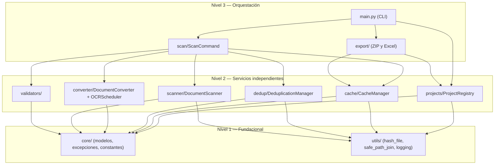

# Arquitectura

`doc_organize` se organiza en tres capas, de fundacional a orquestación (ver
`.github/instructions/architecture.instructions.md` en el repositorio para la
convención completa):

- **Nivel 1 — Fundacional** (`core/`, `utils/`): sin dependencias del resto del
  paquete. Modelos, excepciones, constantes, hashing, validación de rutas.
- **Nivel 2 — Servicios independientes** (`validators/`, `scanner/`, `converter/`,
  `dedup/`, `cache/`, `projects/`): cada uno resuelve una responsabilidad
  del dominio sin depender de los otros módulos de su mismo nivel. Solo dependen
  de Nivel 1.
- **Nivel 3 — Orquestación** (`scan/`, `export/`, `main.py`): coordinan los servicios
  de Nivel 2 sin cambiar sus contratos. `scan/` y `export/` (ZIP y Excel de un proyecto, ver
  [Exportación](export.md)) los comparten el CLI y doc_organize_web.

Desde 1.0.0 la librería no incluye interfaz web ni autenticación (L-11): las da
[doc_organize_web](https://github.com/fmanza/doc_organize_web). Un test de arquitectura
(`tests/unit/test_library_architecture.py`) falla si `src/` vuelve a importar FastAPI,
Starlette, uvicorn, Jinja2 o `python-multipart`, o si reaparecen `doc_organize.web` o
`doc_organize.auth`. Lo que había antes está en el [histórico](../historico/index.md).

## Referencia

Generada desde los docstrings del código (Google-style).

::: doc_organize.core.models
::: doc_organize.core.exceptions
::: doc_organize.scanner.document_scanner
::: doc_organize.converter.converter
::: doc_organize.converter.ocr_scheduler
::: doc_organize.dedup.deduplication
::: doc_organize.cache.cache_manager
::: doc_organize.projects.project_registry
::: doc_organize.scan.scan_command
