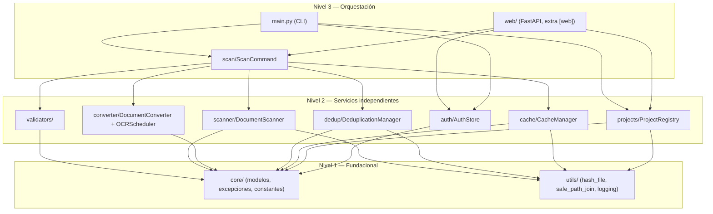

# Arquitectura

`doc_organize` se organiza en tres capas, de fundacional a orquestación (ver
`.github/instructions/architecture.instructions.md` en el repositorio para la
convención completa):

- **Nivel 1 — Fundacional** (`core/`, `utils/`): sin dependencias del resto del
  paquete. Modelos, excepciones, constantes, hashing, validación de rutas.
- **Nivel 2 — Servicios independientes** (`validators/`, `scanner/`, `converter/`,
  `dedup/`, `cache/`, `projects/`, `auth/`): cada uno resuelve una responsabilidad
  del dominio sin depender de los otros módulos de su mismo nivel. Solo dependen
  de Nivel 1.
- **Nivel 3 — Orquestación** (`scan/`, `web/`, `main.py`): coordinan los servicios
  de Nivel 2 sin cambiar sus contratos. `scan/` es compartido por el CLI y la web
  a propósito — ninguno de los dos "posee" la orquestación de escaneo.

## Autenticación web (host no-loopback)

Sesión por cookie (`HttpOnly`, `SameSite=Strict`), no bearer token compartido:
`POST /login` valida usuario+contraseña+tenant contra `AuthStore` y fija la
cookie; `AuthMiddleware` la exige en toda ruta salvo `/login`/`/logout`. Las
conexiones WebSocket (`web/routes/scan.py`) no pasan por el middleware HTTP
(Starlette no lo intercepta para el scope `"websocket"`) y autentican la sesión
explícitamente en el propio handler.

## Roles y gestión de usuarios (rediseño Tenant/Role/User)

Al abrir `AuthStore` por primera vez (CLI o web), si `DEFAULT_TENANT_ID`
("default") no existe se crea de fábrica, en una única transacción, junto con
un rol **global** `admin` (`is_admin=True`) y un usuario `admin`/`admin`
marcado con `must_change_password=True` **e** `is_instance_admin=True` —
`_ensure_default_tenant_bootstrap()`. Mientras esa marca esté activa y el host
no sea loopback, `AuthMiddleware` bloquea toda ruta salvo `/change-password` y
`/logout`; además, esa identidad exacta (`tenant="default"`, `username="admin"`)
ni siquiera puede completar `POST /login` en modo no-loopback mientras
conserve la contraseña de fábrica (`web/routes/auth.py::login_submit`,
`is_factory_admin_account()`) — se rechaza el login en sí, no solo el resto de
rutas tras entrar. `AuthStore.create_tenant()` (para cualquier tenant
adicional) ya NO aprovisiona ningún rol ni usuario: `Role` no está ligado a un
tenant, así que no hay "rol admin de ESE tenant" que crear; su primer usuario
lo da de alta un `is_instance_admin` o `user create` por CLI.

`Role` es global (`name` único en toda la instalación, sin `tenant_id`): un
mismo rol puede asignarse a usuarios de tenants distintos. `is_admin=True` ve
todos los proyectos del tenant *del usuario que lo tiene asignado*; un rol
no-admin solo ve los proyectos listados en `Role.project_names`, interpretados
siempre dentro del tenant de ese usuario. `AuthStore.can_access_project(role_id,
project_name)` es la única fuente de verdad para esa comprobación, usada tanto
por `require_project_access` (`web/dependencies.py`, aplicada por firma en
cada ruta `{name}`-scoped) como por el handler WebSocket de escaneo.

`Role.allowed_scan_roots` se retiró: el acceso de escaneo de un rol no-admin es
ahora **implícito** — la única raíz permitida es `project.root_path` de cada
proyecto en `project_names` (`get_allowed_scan_roots(request, project)`, sin
consulta a `AuthStore`: ya no hay nada configurable que leer). `GET
/api/fs/browse` gana un parámetro `project: str | None` para saber a qué
proyecto ceñirse; sin él, un rol restringido no tiene ninguna raíz permitida
(`403`). Un rol `is_admin` nunca tiene esta restricción.

`User` gana `is_blocked` (sin acceso; `set_user_blocked(..., True)` invalida
todas sus sesiones en la misma transacción, no solo impide logins futuros) e
`is_instance_admin` (nivel de instancia, independiente del `is_admin` del rol:
ve la pantalla cruzada de tenants, crea/elimina tenants, gestiona roles/usuarios
de cualquier tenant, y es el único que puede tocar `InstanceSecretsStore`/
`TaxonomyTemplateRegistry` — recursos de instancia, no de un tenant).

Tres routers de gestión, cada uno con su propia dependencia a nivel de router
(imposible olvidarla en un endpoint nuevo):

- `/api/roles`, `/api/users` (`web/routes/admin.py`): `require_admin_or_instance_admin`
  — basta `is_admin` del propio tenant, o `is_instance_admin` de cualquiera.
  Operan sobre el catálogo global de roles y sobre los usuarios del tenant de
  la sesión.
- `/api/tenants`, `/api/tenants/{tenant_id}/users*` (`web/routes/tenants.py`):
  `require_instance_admin` — alta/baja de tenants (`delete_tenant` exige cero
  usuarios y cero proyectos) y gestión de usuarios de **cualquier** tenant,
  incluida la única vía para tocar `is_instance_admin` de otro usuario.
- `/admin/configuracion-ia`, `/admin/plantillas-taxonomia` (create/editar/
  borrar): `require_instance_admin` — son recursos de instancia, no de un
  tenant, así que un `is_admin` de un solo tenant no basta.

Páginas HTML: `GET /admin/roles` (`admin_roles.html.j2`), `GET /admin/users`
(`admin_users.html.j2`) y `GET /admin/tenants` (`admin_tenants.html.j2`), cada
una con su entrada de menú en el sidebar (`base.html.j2`), condicionada a
`request.state.is_admin`/`is_instance_admin` según corresponda.

`POST /api/users` acepta `must_change_password: bool = False`: si se marca,
el usuario debe cambiar su contraseña en su primer login (`AuthMiddleware`),
igual que el usuario `admin` de fábrica o tras un reseteo de contraseña vía
`PATCH /api/users/{id}`.

## Referencia

Generada desde los docstrings del código (Google-style).

::: doc_organize.core.models
::: doc_organize.core.exceptions
::: doc_organize.scanner.document_scanner
::: doc_organize.converter.converter
::: doc_organize.converter.ocr_scheduler
::: doc_organize.dedup.deduplication
::: doc_organize.cache.cache_manager
::: doc_organize.projects.project_registry
::: doc_organize.auth.auth_store
::: doc_organize.scan.scan_command
::: doc_organize.web.app
::: doc_organize.web.auth
