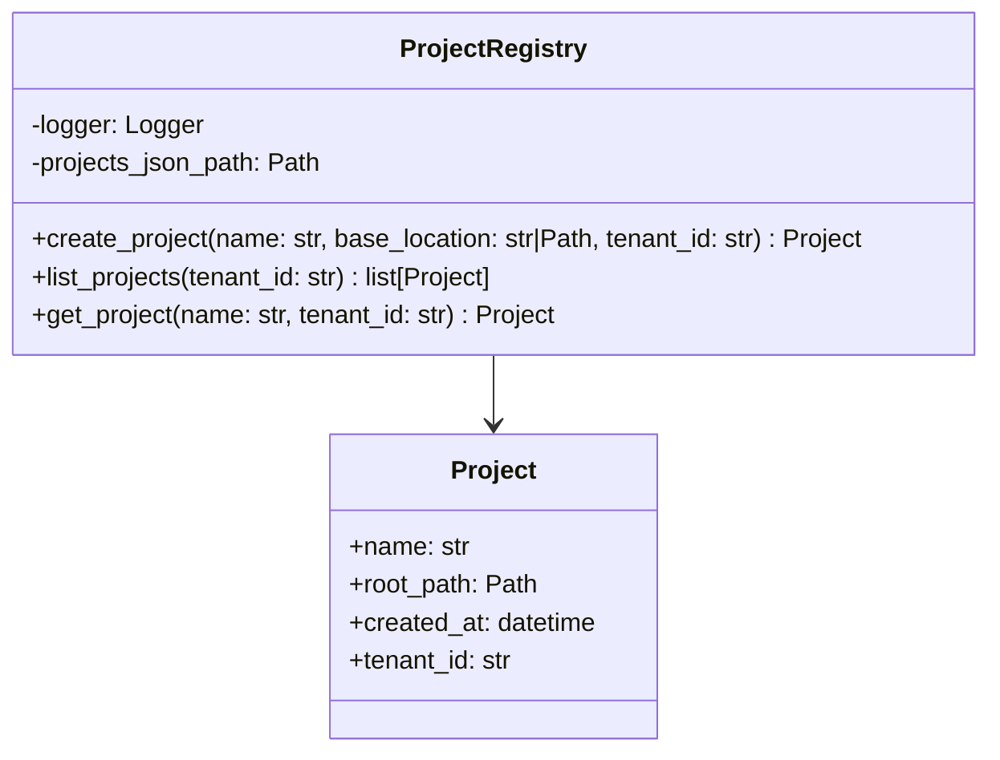

# Projects — Referencia Técnica

API Reference para registro y gestión de proyectos.

## Arquitectura



## API Pública

### ProjectRegistry

```python
class ProjectRegistry:
    async def __aenter__(self) -> 'ProjectRegistry'
    async def __aexit__(self, *args) -> None
    
    async def create_project(
        self,
        name: str,
        base_location: str | Path,
        tenant_id: str = "default"
    ) -> Project
    
    async def list_projects(
        self,
        tenant_id: str = "default"
    ) -> list[Project]
    
    async def get_project(
        self,
        name: str,
        tenant_id: str = "default"
    ) -> Project
```

Context manager para gestión de proyectos (registro + disk).

#### create_project

Crea nuevo proyecto (carpeta + registro).

| Parámetro | Tipo | Descripción |
|---|---|---|
| `name` | `str` | Nombre del proyecto (validado) |
| `base_location` | `str \| Path` | Directorio padre donde crear carpeta |
| `tenant_id` | `str` | ID de tenant (por defecto: "default") |

| Retorno | Tipo | Descripción |
|---|---|---|
| | `Project` | Proyecto creado con `name`, `root_path`, `tenant_id`, `created_at` |

**Proceso**:
1. Valida nombre vía `ProjectValidator.validate_name()`
2. Verifica no existe en registro
3. Crea carpeta `base_location/<name>/`
4. Escribe `project.json` dentro
5. Registra en `~/.doc_organize/projects.json`
6. Rollback si falla en cualquier punto

**Excepciones**:
- `ProjectNameError` — Nombre inválido
- `ProjectAlreadyExistsError` — Nombre duplicado en tenant
- `ProjectError` — Errores de I/O

---

#### list_projects

Lista proyectos de un tenant.

| Parámetro | Tipo | Descripción |
|---|---|---|
| `tenant_id` | `str` | ID de tenant |

| Retorno | Tipo | Descripción |
|---|---|---|
| | `list[Project]` | Proyectos registrados (sin verificar existencia física) |

**Nota**: No verifica que las carpetas existan en disco.

---

#### get_project

Recupera proyecto por nombre.

| Parámetro | Tipo | Descripción |
|---|---|---|
| `name` | `str` | Nombre del proyecto (case-insensitive) |
| `tenant_id` | `str` | ID de tenant |

| Retorno | Tipo | Descripción |
|---|---|---|
| | `Project` | Proyecto si existe |

**Excepciones**:
- `ProjectNotFoundError` — Proyecto no registrado

---

## Contratos

### Entrada

| Parámetro | Validación | Impacto si falla |
|---|---|---|
| Nombre válido | `ProjectValidator.validate_name()` | `ProjectNameError` |
| Nombre único | Búsqueda en registro | `ProjectAlreadyExistsError` |
| Base location existe | Validación al crear | `ProjectError` |

### Salida

```python
@dataclass
class Project:
    name: str
    root_path: Path
    created_at: datetime
    tenant_id: str
```

## Registro de Proyectos

**Ubicación**: `~/.doc_organize/projects.json`

**Formato**:
```json
{
  "projects": [
    {
      "name": "mi_proyecto",
      "root_path": "/home/user/docs/mi_proyecto",
      "created_at": "2024-01-15T10:30:00",
      "tenant_id": "default"
    }
  ]
}
```

**Propiedades**:
- Centralizado (fuera de cualquier proyecto)
- Permite ubicaciones distintas por proyecto
- Escritura atómica vía temp file + `os.replace()`
- Locking async (`asyncio.Lock`) para concurrencia (rara)

## Dependencias

| Dependencia | Propósito |
|---|---|
| `core.constants.PROJECT_NAME_*` | Validación de nombres |
| `core.models.Project` | Modelo |
| `core.exceptions` | Excepciones (ProjectError, etc.) |
| `utils.logging` | Logging |
| `utils.path_utils.safe_path_join()` | Manipulación segura de rutas |
| `validators.project_validator.ProjectValidator` | Validación |

## Notas Internas

- **Único tenant = "default"**: Soporte futuro para multi-tenant vía campo `tenant_id`
- **Ruta absoluta**: Cada proyecto almacena `root_path` absoluta (permite `base_location` distinta por tenant)
- **Rollback automático**: Si creación falla después de crear carpeta, se borra (atomicidad)
- **Case-insensitive**: Búsqueda por nombre ignora mayúsculas

## Ejemplos Relacionados

- [Crear y listar proyectos](../examples/projects-registry.md)
