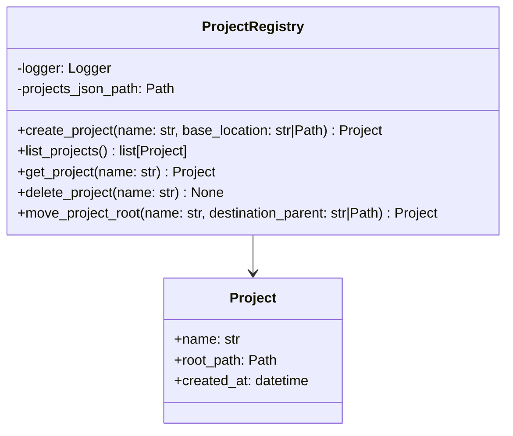

# Projects — Referencia Técnica

API Reference para registro y gestión de proyectos.

## Arquitectura



## API Pública

### ProjectRegistry

```python
class ProjectRegistry:
    async def __aenter__(self) -> 'ProjectRegistry'
    async def __aexit__(self, *args) -> None
    
    async def create_project(self, name: str, base_location: str | Path) -> Project
    async def list_projects(self) -> list[Project]
    async def get_project(self, name: str) -> Project
    async def delete_project(self, name: str) -> None
    async def move_project_root(self, name: str, destination_parent: str | Path) -> Project
```

Context manager para gestión de proyectos (registro + disk).

Desde 1.0.0 no hay `tenant_id` (L-12): el nombre es único en todo el registro. Un `projects.json` antiguo con
`tenant_id` se sigue leyendo (el campo se ignora y desaparece en la siguiente escritura).

#### create_project

Crea nuevo proyecto (carpeta + registro).

| Parámetro | Tipo | Descripción |
|---|---|---|
| `name` | `str` | Nombre del proyecto (validado) |
| `base_location` | `str \| Path` | Directorio padre donde crear carpeta |

| Retorno | Tipo | Descripción |
|---|---|---|
| | `Project` | Proyecto creado con `name`, `root_path`, `created_at` |

**Proceso**:
1. Valida nombre vía `ProjectValidator.validate_name()`
2. Verifica no existe en registro
3. Crea carpeta `base_location/<name>/`
4. Escribe `project.json` dentro
5. Registra en `~/.doc_organize/projects.json`
6. Rollback si falla en cualquier punto

**Excepciones**:
- `ProjectNameError` — Nombre inválido
- `ProjectAlreadyExistsError` — Nombre ya registrado (sin distinguir mayúsculas)
- `ProjectError` — Errores de I/O

---

#### list_projects

Lista los proyectos del registro.

| Retorno | Tipo | Descripción |
|---|---|---|
| | `list[Project]` | Proyectos registrados (sin verificar existencia física) |

**Nota**: No verifica que las carpetas existan en disco.

---

#### get_project

Recupera proyecto por nombre.

| Parámetro | Tipo | Descripción |
|---|---|---|
| `name` | `str` | Nombre del proyecto (case-insensitive) |

| Retorno | Tipo | Descripción |
|---|---|---|
| | `Project` | Proyecto si existe |

**Excepciones**:
- `ProjectNotFoundError` — Proyecto no registrado

---

## Contratos

### Entrada

| Parámetro | Validación | Impacto si falla |
|---|---|---|
| Nombre válido | `ProjectValidator.validate_name()` | `ProjectNameError` |
| Nombre único | Búsqueda en registro | `ProjectAlreadyExistsError` |
| Base location existe | Validación al crear | `ProjectError` |

### Salida

```python
@dataclass
class Project:
    name: str
    root_path: Path
    created_at: datetime
```

## Registro de Proyectos

**Ubicación**: `~/.doc_organize/projects.json`

**Formato**:
```json
{
  "projects": [
    {
      "name": "mi_proyecto",
      "root_path": "/home/user/docs/mi_proyecto",
      "created_at": "2024-01-15T10:30:00"
    }
  ]
}
```

**Propiedades**:
- Centralizado (fuera de cualquier proyecto)
- Permite ubicaciones distintas por proyecto
- Escritura atómica vía temp file + `os.replace()`
- Locking async (`asyncio.Lock`) para concurrencia (rara)

## Dependencias

| Dependencia | Propósito |
|---|---|
| `core.constants.PROJECT_NAME_*` | Validación de nombres |
| `core.models.Project` | Modelo |
| `core.exceptions` | Excepciones (ProjectError, etc.) |
| `utils.logging` | Logging |
| `utils.path_utils.safe_path_join()` | Manipulación segura de rutas |
| `validators.project_validator.ProjectValidator` | Validación |

## Notas Internas

- **Ruta absoluta**: Cada proyecto almacena `root_path` absoluta (permite `base_location` distinta por proyecto)
- **Rollback automático**: Si creación falla después de crear carpeta, se borra (atomicidad)
- **Case-insensitive**: Búsqueda por nombre ignora mayúsculas

#### delete_project

Elimina un proyecto por completo: borra `root_path` en disco y quita la entrada del registro.

| Parámetro | Tipo | Descripción |
|---|---|---|
| `name` | `str` | Nombre del proyecto a eliminar |

**Proceso**: borra primero la carpeta en disco (`shutil.rmtree`) y solo si tiene éxito
quita la entrada del registro — si el borrado físico falla, el proyecto sigue
registrado para poder reintentarlo.

**Excepciones**:
- `ProjectNotFoundError` — No existe ese proyecto
- `ProjectError` — La carpeta no se pudo borrar por completo

---

#### move_project_root

Mueve `root_path` de un proyecto a `<destination_parent>/<name>/`.

| Parámetro | Tipo | Descripción |
|---|---|---|
| `name` | `str` | Nombre del proyecto a mover |
| `destination_parent` | `str \| Path` | Carpeta padre de destino, ya existente |

| Retorno | Tipo | Descripción |
|---|---|---|
| | `Project` | Proyecto actualizado, con el nuevo `root_path` |

**Proceso**: usa `shutil.move` (rename atómico si es el mismo volumen, copiar+borrar si
no) y, si el movimiento físico tiene éxito pero no se puede persistir el registro
actualizado, revierte el movimiento antes de propagar el error.

**Excepciones**:
- `ProjectNotFoundError` — No existe ese proyecto
- `ProjectError` — Destino inexistente, destino ya ocupado, carpeta actual inexistente, o destino igual al actual

---

## Rutas de salida de un documento (`doc_organize.projects.layout`, 0.12.0)

Funciones sin Docling: un consumidor que no convierte (p. ej. la API de doc_organize_web) calcula las mismas rutas
que `DocumentConverter`, que las conserva como alias (`DocumentConverter.resolve_output_paths`/`resolve_images_dir`).

```python
def resolve_output_paths(
    full_path: str, output_dir: Path, scan_roots: Sequence[str] = (), *, include_root_name: bool = False
) -> tuple[Path, Path]          # (.md, .json)
def resolve_images_dir(markdown_path: Path) -> Path   # img/<stem>/ junto al .md
def relative_source_path(full_path: str, scan_roots: Sequence[str] = ()) -> str   # POSIX, nunca absoluta
```

- La salida replica la ruta relativa a la raíz más profunda de `scan_roots` de la que cuelga el documento; si no cuelga
  de ninguna, `output_dir/<stem>`.
- `include_root_name=True` antepone el nombre de esa raíz: con varias raíces, `2024/x/a.pdf` y `2025/x/a.pdf` van a
  `2024/x/a.md` y `2025/x/a.md` en lugar de compartir `x/a.md`. Dos raíces con el mismo nombre (`a/2024`, `b/2024`)
  siguen colisionando. En `ScanCommand` es `ScanOptions.root_name_in_output`; cambiarla en un proyecto ya convertido
  mueve las salidas (usa `force`).
- `relative_source_path` es el `source_path` del JSON de cada documento desde 0.12.0.

## Rutas del contexto y del sitio (`ProjectLayout`, 0.13.0)

Todas cuelgan de la raíz de salidas (`project.root_path`), también con un `state_root` aparte:

| Propiedad / función | Ruta |
|---|---|
| `context_file` | `context.json` |
| `domains_dir` | `domains/` (`<slug>/DOMAIN.md`, `<slug>/index.json`) |
| `taxonomy_manifest_file` | `taxonomy_manifest.md` |
| `site_config_file` | `zensical.toml` |
| `site_dir` | `site/` (destino por defecto de `zensical build`) |
| `site_cache_dir` | `.cache/` (caché que Zensical crea junto a su configuración) |
| `legacy_mkdocs_config_file` | `mkdocs.yml` de antes de 0.13.0 |
| `reorganized_dir(output_folder_name)` | `<output_folder_name>/`, validado |

```python
RESERVED_OUTPUT_FOLDER_NAMES: frozenset[str]
def validate_output_folder_name(name: str) -> str   # InvalidPathError; devuelve el nombre sin espacios a los lados
```

`RESERVED_OUTPUT_FOLDER_NAMES` son los nombres de la raíz que no puede usar `Context.output_folder_name`, porque la
carpeta reorganizada se borra entera al reconstruir o eliminar el contexto: `Conversión`, `duplicados`,
`errores_escaneo`, `historial_escaneo`, `domains`, `site`, `.cache` y los ficheros de la raíz (`context.json`,
`zensical.toml`, `mkdocs.yml`, `taxonomy_manifest.md`, `cache.db`, `folders.json`, `scanned_folders.json`).
`validate_output_folder_name` exige además un nombre simple (letras, dígitos, `_`, `.`, `-` y espacios; ni `.` ni `..`)
y compara sin distinguir mayúsculas, sin puntos ni espacios finales (Windows los quita) y en forma Unicode NFC. doc_organize_web
usa estas rutas y esta validación.

```python
from doc_organize import ProjectLayout, InvalidPathError

layout = ProjectLayout.for_project(project)
layout.reorganized_dir("organizado")    # <root>/organizado
layout.reorganized_dir("site")          # InvalidPathError: reservado
```

## ProjectHistoryCleaner

```python
class ProjectHistoryCleaner:
    async def clear(self, project: Project) -> None
```

Vacía por completo `<project.root_path>` (caché, historial de escaneo/errores/
deduplicación, carpetas guardadas, salida de conversión) y regenera únicamente
`project.json`, dejando el proyecto como recién creado. No toca el registro
(`projects.json`) — a diferencia de `ProjectRegistry.delete_project`, el
proyecto sigue existiendo con el mismo nombre y ubicación.

**Excepciones**: `ProjectError` si `root_path` no existe o algún elemento no se pudo borrar.

## Ejemplos Relacionados

- [Crear y listar proyectos](../examples/projects-registry.md)

## ScannedFoldersStore

```python
class ScannedFoldersStore:
    async def list_folders(self, project: Project) -> list[ScannedFolder]
    async def add_folder(self, project: Project, path: str) -> ScannedFolder
    async def remove_folder(self, project: Project, path: str) -> None
    async def mark_used(self, project: Project, paths: list[str]) -> None
```

Lista persistente por proyecto (`<project.root_path>/scanned_folders.json`) de
las carpetas guardadas para escanear (p. ej. desde el menú Escaneo de doc_organize_web). Mismo patrón de
concurrencia que `ProjectRegistry` (lock en proceso + escritura atómica).

| Método | Descripción | Excepciones |
|---|---|---|
| `add_folder` | Añade `path` (o devuelve la entrada existente si ya estaba) | `InvalidPathError` si no existe o no es carpeta |
| `remove_folder` | Elimina `path` de la lista | `ScannedFolderNotFoundError`, `ScannedFolderInUseError` si `used=True` |
| `mark_used` | Marca `paths` como usadas (crea la entrada si no existía); lo llama el consumidor tras un escaneo correcto | — |

```python
@dataclass
class ScannedFolder:
    path: str
    added_at: str  # ISO 8601
    used: bool  # permanente una vez True
```
