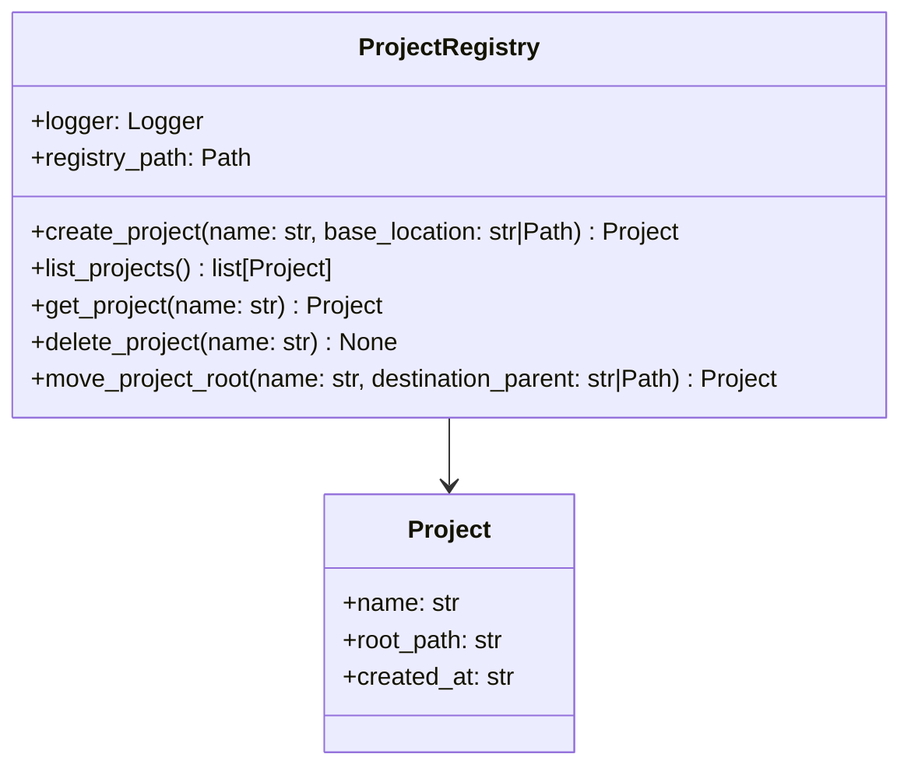

# Projects — Referencia Técnica

API Reference para registro y gestión de proyectos.

## 1. Arquitectura y Diseño



## 2. API Reference

### Autodoc

*No aplica para este módulo.* La API se documenta a mano en «Contratos».

### Contratos

#### ProjectRegistry

```python
class ProjectRegistry:
    def __init__(self, registry_path: str | Path = Path.home() / ".doc_organize" / "projects.json") -> None
    async def __aenter__(self) -> Self
    async def __aexit__(self, *exc_info: object) -> None
    
    async def create_project(self, name: str, base_location: str | Path) -> Project
    async def list_projects(self) -> list[Project]
    async def get_project(self, name: str) -> Project
    async def delete_project(self, name: str) -> None
    async def move_project_root(self, name: str, destination_parent: str | Path) -> Project
```

Context manager para gestión de proyectos (registro + disco). `__aenter__` crea la carpeta padre de `registry_path`.
Las excepciones `ProjectNameError`, `ProjectAlreadyExistsError`, `ScannedFolderNotFoundError` y
`ScannedFolderInUseError` viven en `doc_organize.core.exceptions` (no se exportan en la raíz); las dos primeras heredan
de `ProjectError`.

Desde 1.0.0 no hay `tenant_id` (L-12): el nombre es único en todo el registro. Un `projects.json` antiguo con
`tenant_id` se sigue leyendo (el campo se ignora y desaparece en la siguiente escritura).

##### create_project

Crea nuevo proyecto (carpeta + registro).

| Parámetro | Tipo | Descripción |
|---|---|---|
| `name` | `str` | Nombre del proyecto (validado) |
| `base_location` | `str \| Path` | Directorio padre donde crear carpeta |

| Retorno | Tipo | Descripción |
|---|---|---|
| | `Project` | Proyecto creado con `name` (normalizado), `root_path`, `created_at` |

**Proceso**:
1. Valida nombre vía `ProjectValidator.validate_name()`
2. Verifica no existe en registro
3. Crea carpeta `base_location/<name>/`
4. Escribe `project.json` dentro
5. Registra en `registry_path` (por defecto `~/.doc_organize/projects.json`)
6. Si falla después de crear la carpeta, la borra y relanza el error

**Excepciones**:
- `ProjectNameError` — Nombre inválido
- `ProjectAlreadyExistsError` — Nombre ya registrado (sin distinguir mayúsculas)
- `ProjectError` — `base_location` no existe o no es carpeta, ya hay una carpeta con ese nombre, o falla la creación

---

##### list_projects

Lista los proyectos del registro.

| Retorno | Tipo | Descripción |
|---|---|---|
| | `list[Project]` | Proyectos registrados (sin verificar existencia física) |

**Nota**: No verifica que las carpetas existan en disco.

---

##### get_project

Recupera proyecto por nombre.

| Parámetro | Tipo | Descripción |
|---|---|---|
| `name` | `str` | Nombre del proyecto (case-insensitive) |

| Retorno | Tipo | Descripción |
|---|---|---|
| | `Project` | Proyecto si existe |

**Excepciones**:
- `ProjectNotFoundError` — Proyecto no registrado

---

##### delete_project

Elimina un proyecto por completo: borra `root_path` en disco y quita la entrada del registro.

| Parámetro | Tipo | Descripción |
|---|---|---|
| `name` | `str` | Nombre del proyecto a eliminar |

**Proceso**: borra primero la carpeta en disco y solo si tiene éxito
quita la entrada del registro — si el borrado físico falla, el proyecto sigue
registrado para poder reintentarlo. Desde 1.1.1 también borra en Windows los ficheros
con atributo de solo lectura (p. ej. copias de originales de solo lectura); los enlaces
y *junctions* se quitan sin tocar su destino.

**Excepciones**:
- `ProjectNotFoundError` — No existe ese proyecto
- `ProjectError` — La carpeta no se pudo borrar por completo

---

##### move_project_root

Mueve `root_path` de un proyecto a `<destination_parent>/<name>/`.

| Parámetro | Tipo | Descripción |
|---|---|---|
| `name` | `str` | Nombre del proyecto a mover |
| `destination_parent` | `str \| Path` | Carpeta padre de destino, ya existente |

| Retorno | Tipo | Descripción |
|---|---|---|
| | `Project` | Proyecto actualizado, con el nuevo `root_path` |

**Proceso**: rename atómico si es el mismo volumen; si no, copia y borra el origen
(como `shutil.move`; desde 1.1.1 el borrado también puede con ficheros de solo lectura de Windows) y, si el movimiento físico tiene éxito pero no se puede persistir el registro
actualizado, revierte el movimiento antes de propagar el error.

**Excepciones**:
- `ProjectNotFoundError` — No existe ese proyecto
- `ProjectError` — Destino inexistente, destino ya ocupado, carpeta actual inexistente, o destino igual al actual

---

##### Entrada

| Parámetro | Validación | Impacto si falla |
|---|---|---|
| Nombre válido | `ProjectValidator.validate_name()` | `ProjectNameError` |
| Nombre único | Búsqueda en registro | `ProjectAlreadyExistsError` |
| Base location existe | Validación al crear | `ProjectError` |

##### Salida

```python
class Project(BaseModel):  # doc_organize.core.models
    name: str
    root_path: str    # ruta absoluta
    created_at: str   # ISO 8601
```

##### Registro de Proyectos

**Ubicación**: `~/.doc_organize/projects.json`

**Formato**:
```json
{
  "projects": [
    {
      "name": "mi_proyecto",
      "root_path": "/home/user/docs/mi_proyecto",
      "created_at": "2024-01-15T10:30:00"
    }
  ]
}
```

**Propiedades**:
- Centralizado (fuera de cualquier proyecto)
- Permite ubicaciones distintas por proyecto
- Escritura atómica vía temp file + `os.replace()`
- Locking async (`asyncio.Lock`) para concurrencia (rara)

#### Rutas de salida de un documento (`doc_organize.projects.layout`, 0.12.0)

Funciones sin Docling: un consumidor que no convierte (p. ej. la API de doc_organize_web) calcula las mismas rutas
que `DocumentConverter`, que las conserva como alias (`DocumentConverter.resolve_output_paths`/`resolve_images_dir`).

```python
def resolve_output_paths(
    full_path: str, output_dir: Path, scan_roots: Sequence[str] = (), *, include_root_name: bool = False
) -> tuple[Path, Path]          # (.md, .json)
def resolve_images_dir(markdown_path: Path) -> Path   # img/<stem>/ junto al .md
def relative_source_path(full_path: str, scan_roots: Sequence[str] = ()) -> str   # POSIX, nunca absoluta
```

- La salida replica la ruta relativa a la raíz más profunda de `scan_roots` de la que cuelga el documento; si no cuelga
  de ninguna, `output_dir/<stem>`.
- `include_root_name=True` antepone el nombre de esa raíz: con varias raíces, `2024/x/a.pdf` y `2025/x/a.pdf` van a
  `2024/x/a.md` y `2025/x/a.md` en lugar de compartir `x/a.md`. Dos raíces con el mismo nombre (`a/2024`, `b/2024`)
  siguen colisionando. En `ScanCommand` es `ScanOptions.root_name_in_output`; cambiarla en un proyecto ya convertido
  mueve las salidas (usa `force`).
- `relative_source_path` es el `source_path` del JSON de cada documento desde 0.12.0.

#### Raíz de salidas y raíz de estado (`ProjectLayout`)

```python
@dataclass(frozen=True)
class ProjectLayout:
    output_root: Path
    state_root: Path | None = None

    @classmethod
    def for_project(cls, project: Project, *, state_root: Path | None = None) -> ProjectLayout
```

`output_root` es `project.root_path`; `state_root` separa el estado (caché, historiales, informes) de las salidas. Sin
él, `state_dir` es `output_root`. `separate_state` indica si el estado vive aparte.

| Propiedad | Raíz | Ruta |
|---|---|---|
| `conversion_dir` | salidas | `Conversión/` |
| `duplicates_dir` | salidas | `duplicados/` |
| `cache_db` | estado | `cache.db` |
| `folders_json` | estado | `folders.json` (árbol del último escaneo) |
| `scanned_folders_json` | estado | `scanned_folders.json` |
| `scan_errors_log` | estado | `errores_escaneo/SCAN_ERRORS_HISTORY.jsonl` |
| `scan_history_log` | estado | `historial_escaneo/SCAN_HISTORY.jsonl` |
| `dedup_report_dir` | estado | `duplicados/` (`dedup_report`: `DEDUP_REPORT.json`; `dedup_history`: `DEDUP_HISTORY.jsonl`) |

#### Rutas del contexto y del sitio (`ProjectLayout`, 0.13.0)

Todas cuelgan de la raíz de salidas (`project.root_path`), también con un `state_root` aparte:

| Propiedad / función | Ruta |
|---|---|
| `context_file` | `context.json` |
| `unclassified_file` | `unclassified.json` (1.6.0): detalle de los documentos sin clasificar |
| `domains_dir` | `domains/` (`<slug>/DOMAIN.md`, `<slug>/index.json`) |
| `taxonomy_manifest_file` | `taxonomy_manifest.md` |
| `site_config_file` | `zensical.toml` |
| `site_dir` | `site/` (destino por defecto de `zensical build`) |
| `site_cache_dir` | `.cache/` (caché que Zensical crea junto a su configuración) |
| `legacy_mkdocs_config_file` | `mkdocs.yml` de antes de 0.13.0 |
| `reorganized_dir(output_folder_name)` | `<output_folder_name>/`, validado |
| `context_history` | `historial_contexto/CONTEXT_HISTORY.jsonl` (1.5.0): una línea por construcción del contexto |
| `context_history_files()` | Método (1.6.0): el histórico actual y sus copias giradas (`CONTEXT_HISTORY.1.jsonl`…) que existen, de la más antigua a la actual. Para listar o borrar el historial entero |

```python
RESERVED_OUTPUT_FOLDER_NAMES: frozenset[str]
def validate_output_folder_name(name: str) -> str   # InvalidPathError; devuelve el nombre sin espacios a los lados
```

`RESERVED_OUTPUT_FOLDER_NAMES` son los nombres de la raíz que no puede usar `Context.output_folder_name`, porque la
carpeta reorganizada se borra entera al reconstruir o eliminar el contexto: `Conversión`, `duplicados`,
`errores_escaneo`, `historial_escaneo`, `historial_contexto` (1.5.0), `domains`, `site`, `.cache` y los ficheros de la raíz (`context.json`,
`unclassified.json` (1.6.0), `zensical.toml`, `mkdocs.yml`, `taxonomy_manifest.md`, `cache.db`, `folders.json`, `scanned_folders.json`).
`validate_output_folder_name` exige además un nombre simple (letras, dígitos, `_`, `.`, `-` y espacios; ni `.` ni `..`)
y compara sin distinguir mayúsculas, sin puntos ni espacios finales (Windows los quita) y en forma Unicode NFC. doc_organize_web
usa estas rutas y esta validación.

```python
from doc_organize import ProjectLayout, InvalidPathError

layout = ProjectLayout.for_project(project)
layout.reorganized_dir("organizado")    # <root>/organizado
layout.reorganized_dir("site")          # InvalidPathError: reservado
```

#### ProjectHistoryCleaner

```python
class ProjectHistoryCleaner:
    async def clear(self, project: Project, *, state_root: Path | None = None) -> None
```

Vacía por completo `<project.root_path>` (caché, historial de escaneo/errores/
deduplicación, carpetas guardadas, salida de conversión) y regenera únicamente
`project.json`, dejando el proyecto como recién creado. No toca el registro
(`projects.json`) — a diferencia de `ProjectRegistry.delete_project`, el
proyecto sigue existiendo con el mismo nombre y ubicación. Con `state_root` (raíz de estado separada,
`ProjectLayout.state_root`) también vacía su contenido.

**Excepciones**: `ProjectError` si `root_path` no existe o algún elemento no se pudo borrar.

#### ScannedFoldersStore

```python
class ScannedFoldersStore:
    def __init__(self, registry_path: Path | None = None) -> None  # None: <project.root_path>/scanned_folders.json
    async def list_folders(self, project: Project) -> list[ScannedFolder]
    async def add_folder(self, project: Project, path: str) -> ScannedFolder
    async def remove_folder(self, project: Project, path: str) -> None
    async def mark_used(self, project: Project, paths: list[str]) -> None
```

Lista persistente por proyecto (`<project.root_path>/scanned_folders.json`, o `registry_path`, p. ej.
`ProjectLayout.scanned_folders_json` si el estado vive aparte) de
las carpetas guardadas para escanear (p. ej. desde el menú Escaneo de doc_organize_web). Mismo patrón de
concurrencia que `ProjectRegistry` (lock en proceso + escritura atómica).

| Método | Descripción | Excepciones |
|---|---|---|
| `add_folder` | Añade `path` (o devuelve la entrada existente si ya estaba) | `InvalidPathError` si no existe o no es carpeta |
| `remove_folder` | Elimina `path` de la lista | `ScannedFolderNotFoundError`, `ScannedFolderInUseError` si `used=True` |
| `mark_used` | Marca `paths` como usadas (crea la entrada si no existía); lo llama el consumidor tras un escaneo correcto | — |

```python
class ScannedFolder(BaseModel):  # doc_organize.core.models
    path: str      # ruta absoluta
    added_at: str  # ISO 8601
    used: bool = False  # permanente una vez True
```

## 3. Componentes y Clases

| Clase / función | Responsabilidad |
|---|---|
| `ProjectRegistry` | Context manager para gestión de proyectos (registro + disco) |
| `resolve_output_paths`, `resolve_images_dir`, `relative_source_path` | Rutas de salida de un documento, sin Docling (`doc_organize.projects.layout`) |
| `ProjectLayout` | Rutas del proyecto: raíz de salidas y raíz de estado, contexto y sitio |
| `ProjectHistoryCleaner` | Vacía el proyecto y lo deja como recién creado, sin tocar el registro |
| `ScannedFoldersStore` | Lista persistente por proyecto de las carpetas guardadas para escanear |

### Notas Internas

- **Ruta absoluta**: Cada proyecto almacena `root_path` absoluta (permite `base_location` distinta por proyecto)
- **Rollback automático**: Si creación falla después de crear carpeta, se borra (atomicidad)
- **Case-insensitive**: Búsqueda por nombre ignora mayúsculas

## 4. Dependencias y Requisitos

| Dependencia | Propósito |
|---|---|
| `core.constants.PROJECT_NAME_*` | Validación de nombres |
| `core.models.Project` | Modelo |
| `core.exceptions` | Excepciones (ProjectError, etc.) |
| `utils.logging` | Logging |
| `utils.path_utils.safe_path_join()` | Manipulación segura de rutas |
| `validators.project_validator.ProjectValidator` | Validación |

## 5. Ejemplos Relacionados

- [Crear y listar proyectos](../examples/projects-registry.md)
