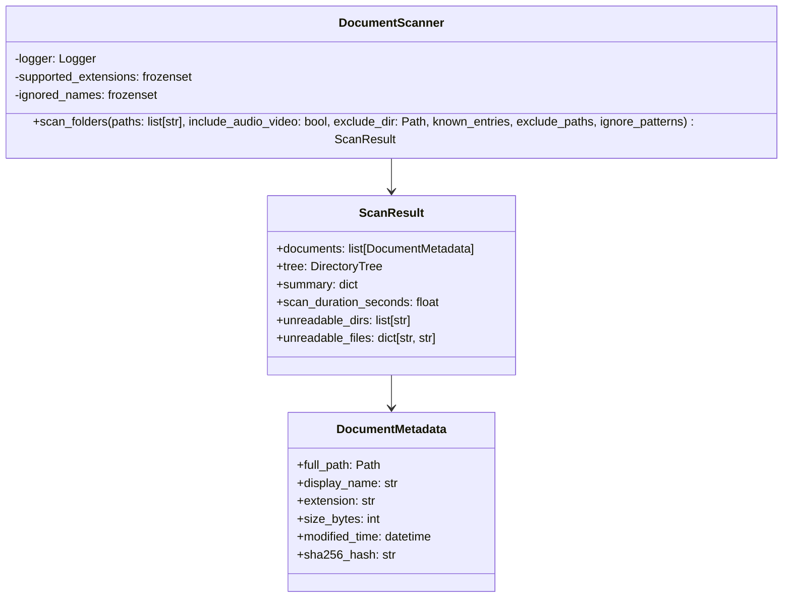

# Scanner — Referencia Técnica

API Reference para escaneo recursivo de documentos.

## Arquitectura



## API Pública

### DocumentScanner

```python
class DocumentScanner:
    def __init__(
        self,
        max_concurrent_hashes: int = 8,
        *,
        io_retries: int = 0,              # 1.1.0
        io_retry_backoff_s: float = 1.0,  # 1.1.0
    ) -> None

    async def scan_folders(
        self,
        paths: list[str],
        include_audio_video: bool = False,
        exclude_dir: Path | None = None,
        *,
        known_entries: Mapping[str, CacheEntry] | None = None,  # 1.1.0
        exclude_paths: Sequence[str | Path] = (),                # 1.3.0
        ignore_patterns: Sequence[str] = (),                     # 1.3.0
    ) -> ScanResult
```

Escanea carpetas recursivamente y calcula el SHA-256 de forma concurrente (hasta `max_concurrent_hashes` a la vez).

| Parámetro | Tipo | Descripción |
|---|---|---|
| `paths` | `list[str]` | Carpetas a escanear (validadas antes con `FolderValidator`) |
| `include_audio_video` | `bool` | Añade las extensiones de audio y vídeo (extra `av`) |
| `exclude_dir` | `Path \| None` | Carpeta (resuelta) que se omite del recorrido, p. ej. la salida del proyecto |
| `known_entries` | `Mapping[str, CacheEntry] \| None` | 1.1.0. Entradas de caché por ruta: si el tamaño y la fecha de modificación coinciden, se reutiliza su hash sin leer el fichero |
| `exclude_paths` | `Sequence[str \| Path]` | 1.3.0. Carpetas o ficheros que no se recorren, ni ellos ni su contenido; un enlace excluido se quita sin seguirlo (ver [Exclusiones](scan.md#exclusiones-exclude_paths-ignore_patterns-g41)) |
| `ignore_patterns` | `Sequence[str]` | 1.3.0. Patrones `fnmatch` sobre el nombre de cada entrada, sin distinguir mayúsculas; no se aplican a las raíces |
| `io_retries` | `int` | 1.1.0. Reintentos ante `OSError` transitorios al listar, leer metadatos y hashear (ver [Escaneo](scan.md#carpetas-de-red-io_retries-document_timeout_s-reuse_unchanged_hashes-g11)) |
| `io_retry_backoff_s` | `float` | 1.1.0. Espera antes del primer reintento; se duplica en cada uno |

| Retorno (`ScanResult`) | Tipo | Descripción |
|---|---|---|
| `documents` | `list[DocumentMetadata]` | Documentos descubiertos, con hash |
| `tree` | `DirectoryTree` | Estructura jerárquica de directorios |
| `summary` | `dict[str, int]` | Documentos por extensión |
| `scan_duration_seconds` | `float` | Duración total en segundos |
| `unreadable_dirs` | `list[str]` | Carpetas que no se pudieron listar (0.12.0) |
| `unreadable_files` | `dict[str, str]` | 1.1.0. Ficheros que no se pudieron leer tras los reintentos (ruta → error) |

**Excepciones**: ninguna por un fichero o una carpeta concretos. Lo que no se puede leer se anota en
`unreadable_dirs`/`unreadable_files` y el escaneo sigue.

> Corregido en 1.1.0: hasta esta versión, esta página documentaba un método `scan(paths, ignore_patterns)` y una
> excepción `DocumentError` que nunca existieron; la firma real siempre fue `scan_folders`.

---

## Contratos

### Entrada

| Parámetro | Validación | Impacto si falla |
|---|---|---|
| Carpeta debe existir | Validación previa (FolderValidator) | `DocumentError` |
| Carpeta debe ser directorio | Validación previa | `DocumentError` |
| Extensiones soportadas | Validación en `constants.SUPPORTED_EXTENSIONS` | Documento ignorado |

### Salida

```python
@dataclass
class DocumentMetadata:
    full_path: Path
    display_name: str
    extension: str
    size_bytes: int
    modified_time: datetime
    sha256_hash: str

@dataclass
class ScanResult:
    documents: list[DocumentMetadata]
    tree: DirectoryTree
    summary: dict
    scan_duration_seconds: float
    unreadable_dirs: list[str]  # 0.12.0: carpetas que no se pudieron listar
    unreadable_files: dict[str, str]  # 1.1.0: ficheros que no se pudieron leer (ruta → error)
```

Una carpeta que no se puede listar (permiso denegado, montaje de red caído) no aborta el escaneo: se registra en
`unreadable_dirs` y su contenido falta de `documents`. Quien compare contra una caché no debe dar esos documentos por
eliminados; `ScanCommand` con `force` no borra sus salidas (0.12.0). Desde 1.1.0 pasa lo mismo con un fichero que se
lista pero no se puede leer (`unreadable_files`). Un fichero borrado durante el escaneo no aparece en ninguno de los
dos: se omite.

Los enlaces simbólicos, y desde 1.1.0 las *junctions* de Windows, no se siguen: aparecen en el árbol como nodo opaco,
sin recorrerlos ni hashearlos. Solo se resuelve la carpeta raíz indicada.

### DocumentMetadata desde la caché (1.1.0, G25)

```python
@classmethod
def from_cache_entry(cls, entry: CacheEntry) -> DocumentMetadata  # ValueError si entry.size_bytes es None
```

Construye los metadatos de un documento con el hash, el tamaño y la fecha de modificación guardados en la caché, sin
leer ni rehashear el fichero. `display_name` es el nombre del fichero y `extension` su sufijo en minúsculas, como los
calcula `DocumentScanner`. Sirve para buscar duplicados desde la caché:

```python
async with CacheManager(cache_db, read_only=True) as cache:
    entries = await cache.load_cache()
docs = [DocumentMetadata.from_cache_entry(e) for e in entries.values() if e.size_bytes is not None]
groups = DeduplicationManager().find_duplicates(docs)
```

Las entradas escritas antes de 1.1.0 no tienen tamaño (`ValueError`); el siguiente escaneo del documento lo rellena.
Antes de mover un duplicado conviene comprobar que el fichero sigue igual (tamaño y fecha), porque la caché puede ser
antigua.

## Dependencias

| Dependencia | Propósito |
|---|---|
| `core.constants.SUPPORTED_EXTENSIONS` | Matriz de extensiones válidas |
| `core.constants.IGNORED_NAMES` | Nombres a ignorar (.git, __pycache__, etc.) |
| `core.models.DocumentMetadata` | Modelo de documento |
| `utils.hash_utils.hash_file()` | Cálculo de SHA-256 |
| `utils.logging` | Logging |

## Rendimiento

- **Hashing concurrente**: Usa `asyncio.TaskGroup` para paralelizar cálculo de SHA-256
- **Memoria**: Carga metadatos en memoria (escalable hasta ~100k documentos)
- **Disk I/O**: Lectura secuencial + paralelización solo de hash

## Ejemplos Relacionados

- [Escanear una carpeta](../examples/scanner-scan.md)
