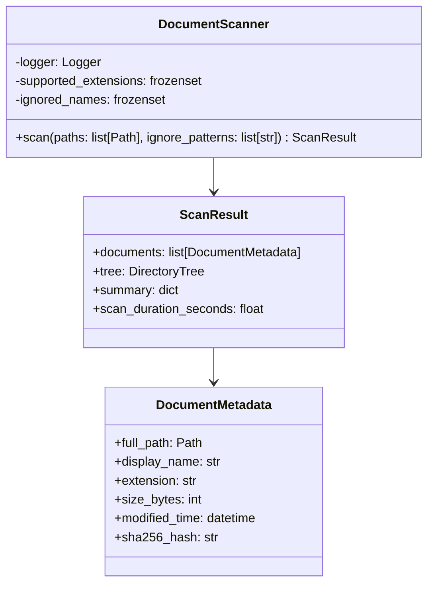

# Scanner — Referencia Técnica

API Reference para escaneo recursivo de documentos.

## Arquitectura



## API Pública

### DocumentScanner

```python
class DocumentScanner:
    async def scan(
        self,
        paths: list[Path],
        ignore_patterns: list[str] = None
    ) -> ScanResult
```

Escanea carpetas recursivamente, calcula SHA-256 concurrente.

| Parámetro | Tipo | Descripción |
|---|---|---|
| `paths` | `list[Path]` | Carpetas a escanear (validadas por `FolderValidator`) |
| `ignore_patterns` | `list[str]` | Patrones adicionales a ignorar (glob) |

| Retorno | Tipo | Descripción |
|---|---|---|
| `documents` | `list[DocumentMetadata]` | Documentos descubiertos |
| `tree` | `DirectoryTree` | Estructura jerárquica de directorios |
| `summary` | `dict` | Conteos: total, soportados, ignorados, errores |
| `scan_duration_seconds` | `float` | Duración total en segundos |

**Excepciones**:
- `DocumentError` — Errores críticos durante escaneo

---

## Contratos

### Entrada

| Parámetro | Validación | Impacto si falla |
|---|---|---|
| Carpeta debe existir | Validación previa (FolderValidator) | `DocumentError` |
| Carpeta debe ser directorio | Validación previa | `DocumentError` |
| Extensiones soportadas | Validación en `constants.SUPPORTED_EXTENSIONS` | Documento ignorado |

### Salida

```python
@dataclass
class DocumentMetadata:
    full_path: Path
    display_name: str
    extension: str
    size_bytes: int
    modified_time: datetime
    sha256_hash: str

@dataclass
class ScanResult:
    documents: list[DocumentMetadata]
    tree: DirectoryTree
    summary: dict
    scan_duration_seconds: float
```

## Dependencias

| Dependencia | Propósito |
|---|---|
| `core.constants.SUPPORTED_EXTENSIONS` | Matriz de extensiones válidas |
| `core.constants.IGNORED_NAMES` | Nombres a ignorar (.git, __pycache__, etc.) |
| `core.models.DocumentMetadata` | Modelo de documento |
| `utils.hash_utils.hash_file()` | Cálculo de SHA-256 |
| `utils.logging` | Logging |

## Rendimiento

- **Hashing concurrente**: Usa `asyncio.TaskGroup` para paralelizar cálculo de SHA-256
- **Memoria**: Carga metadatos en memoria (escalable hasta ~100k documentos)
- **Disk I/O**: Lectura secuencial + paralelización solo de hash

## Ejemplos Relacionados

- [Escanear una carpeta](../examples/scanner-scan.md)
