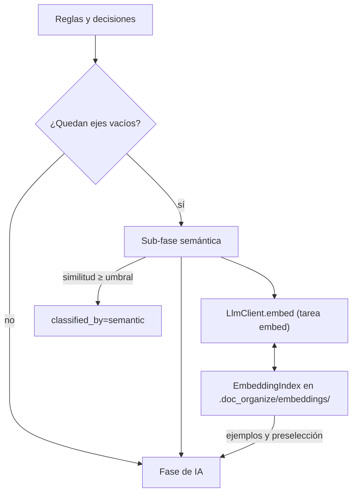

# Clasificación semántica (2.0.0)

Entre las reglas (que buscan palabras) y la IA (que lee el documento y cuesta una llamada por documento), la
**sub-fase semántica** compara significados con embeddings: un vector por documento y uno por valor del catálogo. Es
opcional (D13) y barata: con el índice guardado, reconstruir no vuelve a pedir nada.

## 1. Arquitectura y Diseño



```python
context = await ContextBuilder().build(
    project, documents, taxonomy_manifest=manifest, llm=llm,
    semantic=True,                # tras reglas y decisiones, antes de la IA
    semantic_threshold=0.75,      # similitud mínima (coseno)
    ai_scope="unclassified",      # la IA solo ve lo que siga vacío
)
print(context.ai_stats.semantic_classification)  # textos embebidos, sacados del índice, documentos asignados
```

### Qué hace

- Solo rellena **ejes vacíos**: los que organizan que las reglas dejaron sin clasificar y los que etiquetan sin valor.
  Nunca cambia lo que decidieron las reglas o una persona.
- Compara el extracto del documento (hasta 4000 caracteres) con el texto de cada valor del catálogo:
  `«Eje: Nombre. Descripción. palabras clave»`. Cuanto mejor sea la descripción, mejor funciona.
- En un eje de **un valor**, asigna el más parecido si llega al umbral **y** le saca al segundo al menos
  `SEMANTIC_MARGIN` (0,03): ante un empate no decide.
- En un eje de **varios valores**, todos los que llegan al umbral, hasta 5.
- Lo asignado queda con `classified_by="semantic"` y la similitud como confianza.
- Un fallo del modelo de embeddings no para la construcción: queda en `semantic_classification.failed`.

## 2. API Reference

### Autodoc

::: doc_organize.ai.embeddings
    options:
      show_root_heading: false
      members:
        - EmbeddingIndexInfo
        - embedding_index_info
        - clear_embedding_index

La fase semántica (`doc_organize.context.semantic`) y el índice (`EmbeddingIndex`) son internos: se usan a través
de `ContextBuilder.build(semantic=True)` y de los duplicados por contenido, y pueden cambiar sin aviso.

### Contratos

`ContextBuilder.build(semantic=True, semantic_threshold=..., ai_examples=...)` activa la sub-fase; su resultado queda
en `context.ai_stats.semantic_classification` (ver el ejemplo de la sección 1).

`embedding_index_info(project_root)` dice qué índices hay (uno por modelo), cuántos vectores guarda cada uno, su
dimensión y cuánto ocupa; `clear_embedding_index(project_root, model=None)` borra el de un modelo o todos (la siguiente
construcción con `semantic=True` vuelve a pedir los vectores; no lo llames mientras se construye).

## 3. Componentes y Clases

### Ayudas para la IA: ejemplos y preselección

Con `semantic=True`, la fase de IA también se apoya en los embeddings:

- **Ejemplos** (`ai_examples`, 3 por defecto): cada documento que va a la IA recibe, en el mensaje `user` y antes del
  documento, los documentos más parecidos ya clasificados **con fiabilidad** (un valor decidido por una persona, o
  confianza de al menos 0,9 en un eje que organiza), con sus valores en los ejes que se piden. Son orientativos.
- **Preselección**: en un eje de más de 25 valores, al modelo solo van los 15 más parecidos al documento (un prompt
  más corto y un `enum` más pequeño).

Un ejemplo **nunca** es el propio documento, ni un duplicado suyo (mismo `source_sha256`), ni un documento de
`example_exclusions`: al evaluar, la referencia (`dry_run_classify` la excluye sola). Si no, el modelo vería la
respuesta y la evaluación saldría inflada (B16). El prefijo `system` no cambia entre documentos: los ejemplos van en
`user`.

### El índice

`EmbeddingIndex(project_root, *, model, redacted)` guarda los vectores en
`<raíz>/.doc_organize/embeddings/<huella del modelo>/` (los 16 primeros caracteres del SHA-256 del nombre; `vectors.bin`, números `float32` que desde 2.2.0 se leen con numpy como una matriz, con el mismo formato en disco, e `index.json`). La clave de cada texto es la huella
del modelo, de si se redactó y del texto: cambiar de modelo o de texto da vectores nuevos. Los textos se redactan antes
de enviarlos (`LlmClient.embed`); aun así, el índice deriva del contenido de los documentos: trátalo como `Conversión/`.

Las claves son huellas de texto: el índice no dice a qué documento pertenece cada vector. Los duplicados por contenido
(tarea `dedup`, 2.2.0) guardan sus vectores en el mismo sitio, en el índice de su propio modelo.

## 4. Dependencias y Requisitos

| Dependencia | Propósito | Requerida | Comportamiento sin ella |
|---|---|---|---|
| Cliente de IA (`llm`) | Pedir los vectores (`LlmClient.embed`) | Sí, con `semantic=True` | `ContextBuilder.build` lanza `ValueError` |
| Tarea `embed` en `AiSettings` (un modelo de embeddings en el proxy) | Vectores de documentos y valores del catálogo | Sí | Un fallo del modelo de embeddings queda en `semantic_classification.failed`; la construcción sigue |
| Manifiesto de taxonomía | Catálogo con el que se compara cada documento | Sí | La sub-fase solo corre con `taxonomy_manifest` |

Necesita la tarea `embed` en `AiSettings` (un modelo de embeddings en el proxy) y un manifiesto de taxonomía.

## 5. Ejemplos Relacionados

Pendiente — crear ejemplo en docs/examples/semantic.md
