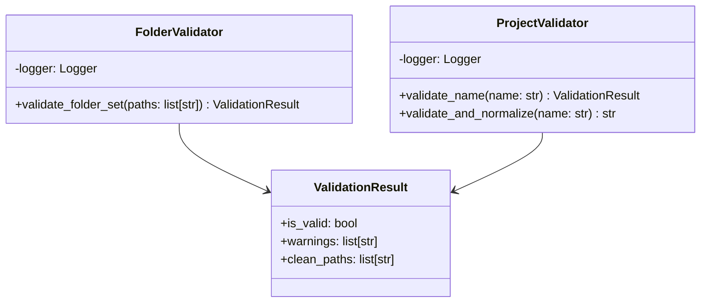

# Validadores — Referencia Técnica

API Reference para validación de carpetas y nombres de proyecto.

## Arquitectura



## API Pública

### FolderValidator

```python
class FolderValidator:
    def validate_folder_set(self, paths: list[str]) -> ValidationResult
```

Valida un conjunto de carpetas y detecta redundancia.

| Parámetro | Tipo | Descripción |
|---|---|---|
| `paths` | `list[str]` | Rutas absolutas o relativas a validar |

| Retorno | Tipo | Descripción |
|---|---|---|
| `is_valid` | `bool` | `True` si todas las carpetas son válidas |
| `warnings` | `list[str]` | Mensajes de redundancias detectadas |
| `clean_paths` | `list[str]` | Rutas resueltas, sin subcarpetas |

**Excepciones**:
- `InvalidPathError` — Si alguna ruta no existe o no es directorio

---

### ProjectValidator

```python
class ProjectValidator:
    def validate_name(self, name: str) -> ValidationResult
    def validate_and_normalize(self, name: str) -> str
```

Valida y normaliza nombres de proyecto.

| Método | Descripción |
|---|---|
| `validate_name(name: str) -> ValidationResult` | Comprueba si nombre es válido |
| `validate_and_normalize(name: str) -> str` | Valida, normaliza (NFC) y retorna |

**Restricciones de nombre**:
- Max 255 caracteres
- Sin caracteres `<>:"\\/\|?*`
- No nombres reservados de Windows (CON, PRN, LPT1, etc.)

**Excepciones**:
- `InvalidNameError` — Si nombre incumple restricciones

## Contratos

### Entrada

| Parámetro | Validación | Impacto si falla |
|---|---|---|
| Ruta debe existir | Comprobación OS | `InvalidPathError` |
| Ruta debe ser directorio | Comprobación OS | `InvalidPathError` |
| Nombre no vacío | Comprobación de length | `InvalidNameError` |

### Salida

```python
@dataclass
class ValidationResult:
    is_valid: bool
    warnings: list[str] = field(default_factory=list)
    clean_paths: list[str] = field(default_factory=list)
```

## Dependencias

| Dependencia | Propósito |
|---|---|
| `pathlib.Path` | Manipulación de rutas (estándar) |
| `doc_organize.core.exceptions` | Excepciones personalizadas |
| `doc_organize.utils.path_utils.is_subpath()` | Detección de subcarpetas |
| `doc_organize.utils.logging` | Logging |

## Ejemplos Relacionados

- [Validar carpetas antes de escanear](../examples/validators-scan.md)
