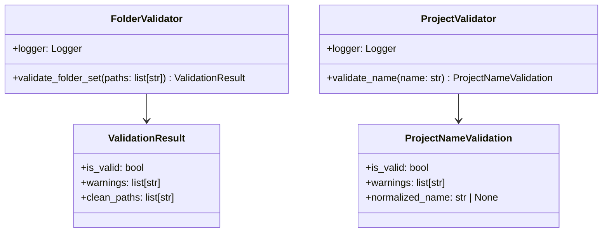

# Validadores — Referencia Técnica

API Reference para validación de carpetas y nombres de proyecto.

## Arquitectura



## API Pública

Los dos validadores son síncronos (no leen contenido de ficheros) y están en `doc_organize.__all__`. Sus modelos de
resultado (`ValidationResult`, `ProjectNameValidation`) viven en `doc_organize.core.models` y no se exportan en la raíz.

### FolderValidator

```python
class FolderValidator:
    def __init__(self) -> None
    def validate_folder_set(self, paths: list[str]) -> ValidationResult
```

Valida un conjunto de carpetas y descarta las que son subcarpeta de otra.

| Parámetro | Tipo | Descripción |
|---|---|---|
| `paths` | `list[str]` | Rutas absolutas o relativas a validar (se expanden con `~` y se resuelven) |

| Campo del retorno | Tipo | Descripción |
|---|---|---|
| `is_valid` | `bool` | `True` si todas existen y son carpetas; `False` solo si `paths` está vacía |
| `warnings` | `list[str]` | Una línea por cada carpeta omitida por redundante |
| `clean_paths` | `list[str]` | Rutas resueltas, sin las subcarpetas de otras de la lista |

Con `paths` vacía devuelve `is_valid=False`, el aviso `"No se proporcionaron carpetas."` y `clean_paths=[]` (no lanza).

**Excepciones**:
- `InvalidPathError` — Si alguna ruta no existe o no es directorio

---

### ProjectValidator

```python
class ProjectValidator:
    def __init__(self) -> None
    def validate_name(self, name: str) -> ProjectNameValidation
```

Valida un nombre de proyecto: lo normaliza a NFC y devuelve el resultado. **No lanza excepciones**: un nombre no
válido devuelve `is_valid=False` con el motivo en `warnings` y `normalized_name=None`.

#### Reglas del nombre

| Regla | Motivo de rechazo |
|---|---|
| No vacío tras `strip()` | `El nombre no puede estar vacío.` |
| Sin espacios al principio ni al final | `El nombre no puede empezar ni terminar en espacio.` |
| Máximo 100 caracteres (`PROJECT_NAME_MAX_LENGTH`) | `El nombre no puede superar los 100 caracteres.` |
| No termina en punto ni es solo puntos | Mensaje específico de cada caso |
| Sin `< > : " / \ \| ? *` ni caracteres de control | `El nombre contiene caracteres no permitidos…` |
| No es un nombre reservado de Windows | `CON`, `PRN`, `AUX`, `NUL`, `COM1-9`, `LPT1-9` (con o sin extensión) |

## Contratos

### Entrada

| Parámetro | Validación | Impacto si falla |
|---|---|---|
| Ruta debe existir | Comprobación OS | `InvalidPathError` |
| Ruta debe ser directorio | Comprobación OS | `InvalidPathError` |
| Nombre de proyecto | Reglas de `ProjectValidator` | `is_valid=False` y motivo en `warnings` |

### Salida

```python
class ValidationResult(BaseModel):  # doc_organize.core.models
    is_valid: bool
    warnings: list[str] = []
    clean_paths: list[str]

class ProjectNameValidation(BaseModel):  # doc_organize.core.models
    is_valid: bool
    warnings: list[str] = []
    normalized_name: str | None = None  # NFC y sin espacios, solo si is_valid
```

## Dependencias

| Dependencia | Propósito |
|---|---|
| `pathlib.Path` | Manipulación de rutas (estándar) |
| `doc_organize.core.exceptions` | `InvalidPathError` (`FolderValidator`) |
| `doc_organize.core.constants` | Longitud máxima, caracteres prohibidos y nombres reservados (`ProjectValidator`) |
| `doc_organize.utils.path_utils.is_subpath()` | Detección de subcarpetas |
| `doc_organize.utils.logging` | Logging |

## Ejemplos Relacionados

- [Validar carpetas antes de escanear](../examples/validators-scan.md)
