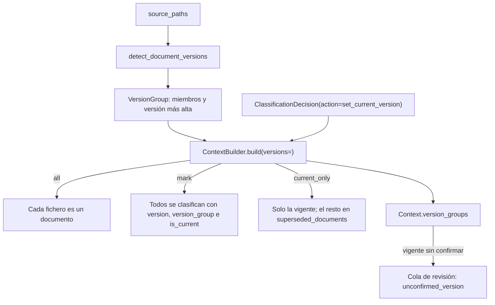

# Versiones de un documento (2.0.0)

Un corpus real tiene `Manual_Calidad_v1.2.docx`, `Manual_Calidad_v1.3.docx` y `Manual_Calidad_v2.docx`: el mismo
documento en tres versiones. La deduplicación solo une ficheros idénticos; sin esto, las tres se clasifican, se publican
y se envían a la IA como documentos distintos.

## 1. Arquitectura y Diseño

### Detección

`detect_document_versions(source_paths, *, across_extensions=False) -> list[VersionGroup]` es **conservadora**: un
grupo mal hecho junta documentos distintos, así que ante la duda no agrupa.

- Solo cuenta un **marcador explícito** en el nombre: `v1.2`, `_v3`, `V3.0`, `ver 3`, `rev2`, `Rev. 4`,
  `versión 1.4`, `ed. 2`, `edición 3`. Entre la palabra y el número, como mucho un punto y un espacio (`Plan_ED_2` no
  es una versión).
- Las **fechas no son versiones** (`Acta_2023` y `Acta_2024` son documentos distintos), ni un número con forma de año
  tras el marcador (`ISO_9001_v2015`), ni un nombre con dos marcadores.
- Dos ficheros son versiones del mismo documento solo si están en la **misma carpeta**, tienen la **misma extensión**
  (`across_extensions=True` para agrupar `.docx` con su `.pdf`) y **el resto del nombre coincide** sin distinguir
  mayúsculas, acentos ni separadores (`Anexo_v1_Contrato_A` y `Anexo_v1_Contrato_B` no se agrupan).
- La vigente propuesta es la **versión más alta**, comparando número a número (`1.10` > `1.9`).

Sobre los 213 nombres de CALIDAD_VD: un grupo, correcto, y ningún falso positivo (puerta de M7).

## 2. API Reference

### Autodoc

::: doc_organize.context.versions
    options:
      show_root_heading: false
      members:
        - detect_document_versions
        - VersionGroup
        - VersionMember

::: doc_organize.core.models
    options:
      show_root_heading: false
      members:
        - DocumentVersionGroup

### Contratos

#### En la construcción

`ContextBuilder.build(..., versions=)`:

| `versions` | Qué hace |
|---|---|
| `"all"` (por defecto) | Como 1.x: cada fichero es un documento |
| `"mark"` | Todos se clasifican; cada uno lleva `version`, `version_group` e `is_current` |
| `"current_only"` | Solo la vigente se clasifica, se publica y va a la IA; las demás quedan en `Context.superseded_documents` |

`Context.version_groups` lista los grupos (`DocumentVersionGroup`: miembros, versiones, vigente y si una persona la
confirmó) y `Context.versions_mode`, el modo. En el historial, un documento que sale por ser una versión antigua es
`superseded`, no `removed`.

## 3. Componentes y Clases

### La vigente la decide una persona

La versión más alta no siempre es la vigente (un borrador `v3` sin aprobar). Una decisión
`ClassificationDecision(action="set_current_version", document_key=...)` la fija; se aplica también sin manifiesto,
porque no depende del catálogo. Si el documento no está en ningún grupo, la decisión queda en `stale_decisions` con
`not_versioned`. Hasta que alguien confirma la vigente, el grupo aparece en la
[cola de revisión](decisions.md#cola-de-revision) con `unconfirmed_version`.

## 4. Dependencias y Requisitos

*No aplica para este módulo.*

## 5. Ejemplos Relacionados

- [Ejemplo: Versiones de un documento](../examples/versions.md): qué agrupa `detect_document_versions` y qué no, `versions="current_only"` y `"mark"`, y la vigente decidida por una persona con `set_current_version`
