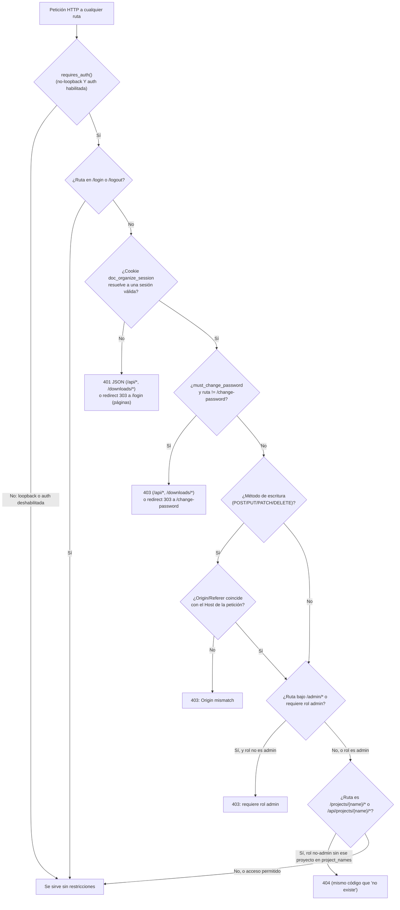

# Acceso a la Aplicación — Autenticación, Sesiones y Multi-tenant

Documento único y autocontenido sobre cómo controla `doc_organize` el acceso a su
interfaz web y a su CLI: qué es una sesión, un tenant, un rol y un usuario; cuándo
la aplicación exige login y cuándo no; y cómo arrancarla y probarla en local, tanto
en el modo por defecto (sin autenticación) como simulando un despliegue expuesto
("producción"). Complementa a [Panel de Administración](admin.md) (gestión de
roles/usuarios desde la web) y a [Inicio rápido](../guides/quick_start.md) (arranque
básico del servidor); aquí se profundiza en el mecanismo de autenticación en sí.

## Objetivo

Que cualquiera que necesite instalar, exponer o depurar `doc_organize` entienda,
sin leer el código fuente, quién puede acceder a qué, bajo qué condiciones, y cómo
verificarlo por sí mismo antes de exponer un servidor a una red que no controla.

## Alcance

✅ Autenticación de la interfaz web (`/login`, `/logout`, `/change-password`)
✅ Modelo de tenants, roles, usuarios y sesiones (`doc_organize.auth`)
✅ Diferencia entre modo **loopback** (uso local de un único usuario, sin login) y
modo **no-loopback** (multi-usuario, con login obligatorio)
✅ Aprovisionamiento de fábrica (automático, sin CLI previa) y por API/UI
(`/admin/roles`, `/admin/users`, `/admin/tenants` — ver [Panel de Administración](admin.md))
✅ Cómo ejecutar el servidor en local para probar ambos modos, y qué verificar antes
de exponerlo en un entorno real
❌ No cubre el control de acceso *dentro* de un proyecto ya autorizado (qué puede
hacer cada rol una vez dentro — eso vive en cada página/endpoint concreto)
❌ No sustituye una revisión de seguridad formal antes de un despliegue expuesto a
Internet — ver "Consideraciones antes de exponer en producción" más abajo

## Definiciones

| Término | Definición |
|---|---|
| **Tenant** | Organización o espacio de trabajo aislado. Agrupa usuarios y proyectos (ya no roles, ver `Role`). Su `id` es un slug derivado del nombre legible (p. ej. "Acme Corp" → `acme-corp`). El tenant `"default"` se crea de fábrica al abrir `AuthStore` por primera vez (CLI o web, sin aprovisionamiento manual) y es el que usan el CLI y la web en modo loopback/sin autenticación |
| **Role** | Conjunto de permisos con nombre, **global** (no ligado a un tenant — puede asignarse a usuarios de tenants distintos). `name` único en toda la instalación. `is_admin=True` ve todos los proyectos del tenant *de quien lo tiene asignado* (presentes y futuros); un rol no-admin solo ve `project_names` de su propio tenant. El acceso de escaneo ya no se declara en el rol: es implícito (ver más abajo) |
| **User** | Pertenece exactamente a un tenant y exactamente a un rol. Nunca serializa su contraseña (hash/salt viven solo en `auth.db`, nunca en el modelo `User`). Puede estar `is_blocked` (sin acceso, sesiones invalidadas al momento) y/o ser `is_instance_admin` (nivel de instancia, independiente del `is_admin` de su rol — ver más abajo) |
| **Session** | Sesión de navegador creada al hacer login, con vida fija (`SESSION_LIFETIME_HOURS`, 24 horas). Su `token` opaco es el valor de la cookie `doc_organize_session` |
| **Modo loopback** | El servidor escucha en `127.0.0.1`, `localhost` o `::1`. Ninguna ruta exige sesión — comportamiento intencional para uso local de un único usuario |
| **Modo no-loopback** | El servidor escucha en cualquier otro host (p. ej. `0.0.0.0`). Toda ruta —páginas HTML incluidas, no solo `/api/*`— exige una sesión válida |
| **`AuthStore`** | Almacén SQLite (WAL) de tenants/roles/usuarios/sesiones, en `~/.doc_organize/auth.db` por defecto (`src/doc_organize/auth/auth_store.py`) |
| **`AuthMiddleware`** | Middleware ASGI que decide, en cada petición HTTP, si exige sesión y la resuelve contra `AuthStore` (`src/doc_organize/web/auth.py`) |
| **Bootstrap de fábrica** | Al abrir `AuthStore` por primera vez (CLI o web), si el tenant `"default"` no existe se crea automáticamente, junto con un rol global `admin` y un usuario `admin`/`admin` (`must_change_password=True`, `is_instance_admin=True`) — sin aprovisionamiento manual previo. Un tenant adicional (`tenant create`, o desde "Tenants y usuarios") ya NO recibe este bootstrap: su primer usuario lo da de alta un `is_instance_admin` |
| **`is_instance_admin`** | Nivel separado del `is_admin` de un rol: solo un usuario con `is_instance_admin=True` ve la pantalla cruzada "Tenants y usuarios", crea/elimina tenants, gestiona roles/usuarios de *cualquier* tenant, y accede a la configuración de IA/plantillas de taxonomía (recursos de instancia, no de un tenant). Se concede/retira desde esa misma pantalla; nunca autoconcedible |

## Modelo de datos (`doc_organize.core.models` + `auth/auth_store.py`)

| Modelo | Campos clave | Notas |
|---|---|---|
| `Tenant` | `id` (slug), `name`, `created_at` | `id` único globalmente |
| `Role` | `id`, `name`, `is_admin`, `project_names`, `created_at` | `name` único **globalmente** (no por tenant). Un rol admin no puede tener `project_names` no vacío. Sin `tenant_id` ni `allowed_scan_roots` (retirados) |
| `User` | `id`, `tenant_id`, `username`, `role_id`, `must_change_password`, `is_blocked`, `is_instance_admin`, `created_at` | `username` único por tenant (case-insensitive). Contraseña: `hashlib.scrypt` (parámetros OWASP) + salt aleatorio, comparación en tiempo constante |
| `Session` | `token`, `user_id`, `tenant_id`, `created_at`, `expires_at` | `token` generado con `secrets.token_urlsafe(32)`, nunca derivado de la contraseña |
| `SecurityConfig` | `bind_host` (def. `127.0.0.1`), `bind_port` (def. `8000`), `require_auth_if_not_loopback` (def. `True`) | Determina si `AuthMiddleware` exige sesión (`requires_auth()` = `require_auth_if_not_loopback and not is_loopback(bind_host)`) |

Límites de validación: `username`/nombre de rol solo letras, dígitos, `.`/`-`/`_`
(rol admite además espacios), máx. 50 caracteres; `tenant_id` (slug) máx. 63
caracteres — constantes en `core/constants.py`.

### Acceso de escaneo implícito (retirada de `Role.allowed_scan_roots`)

Un rol restringido ya no declara una lista de rutas de filesystem escaneables:
su única raíz permitida es `project.root_path` de cada proyecto al que tiene
acceso (`project_names`). Esto acota `add_folder_to_library`/
`remove_folder_from_library` (`web/routes/scan.py`) y el explorador de carpetas
(`GET /api/fs/browse?project=<nombre>`, `web/routes/filesystem.py`) — sin
`?project=`, un rol restringido no tiene ninguna raíz permitida (`403` para
cualquier ruta). Un rol admin sigue sin restricción.

## Flujo de autenticación



Notas sobre el diagrama:

- El primer corte (`requires_auth`) es el más importante: **en loopback, todo el
  árbol de la derecha se salta por completo** — no hay sesión, no hay `tenant_id`
  de sesión (se usa el tenant implícito `"default"`), no hay restricción de rol ni
  de proyecto. Es el modo que usa `python -m doc_organize web` sin flags.
- `/login` (`POST`) es la única escritura que ocurre *antes* de tener sesión, así
  que queda fuera de la comprobación general de Origin/Referer del paso H/I, pero
  tiene su propia comprobación equivalente (login CSRF) — un formulario
  auto-enviado desde otro origen no puede fijar una sesión ajena en el navegador
  de la víctima.
- `require_project_access` (paso M) devuelve `404`, no `403`, para no revelar si
  un proyecto fuera del alcance del rol existe o no (mismo criterio de
  no-enumeración que el resto de la aplicación).
- Los WebSocket (escaneo, deduplicación, construcción de contexto) **no** pasan
  por `AuthMiddleware` — Starlette no llama a `dispatch()` para conexiones
  WebSocket. Se autentican a mano con la misma lógica
  (`authorize_project_websocket()` en `web/dependencies.py`), así que el
  resultado observable es el mismo.

## Seguridad de la sesión

- **Cookie**: `doc_organize_session`, `HttpOnly` (no accesible desde JavaScript),
  `SameSite=Strict`, `Secure` solo si la petición llegó por HTTPS, vida máxima 24
  horas (`SESSION_LIFETIME_HOURS`).
- **Contraseñas**: `hashlib.scrypt` con parámetros recomendados por OWASP + salt
  aleatorio de 16 bytes por usuario; verificación con `secrets.compare_digest`
  (tiempo constante).
- **Rate limiting de login**: `LoginRateLimiter` bloquea 60 segundos
  (`LOGIN_LOCKOUT_SECONDS`) tras 5 fallos consecutivos (`LOGIN_MAX_ATTEMPTS`) para
  el mismo par (tenant, usuario) — mitiga fuerza bruta contra el `admin`/`admin`
  de bootstrap mientras el admin real no ha completado su primer login. Es en
  memoria del proceso: un reinicio del servidor limpia los contadores.
- **No hay token compartido**: la revisión 8 retiró `DOC_ORGANIZE_API_TOKEN` (bearer
  token único para toda la instancia). Toda autenticación es por sesión de usuario
  — no existe ningún secreto compartido que filtrar en logs o en el historial de
  shell.
- **Cambio de contraseña obligatorio**: todo usuario con `must_change_password=True`
  (el admin de bootstrap, o cualquiera a quien un admin le reseteó la contraseña)
  queda bloqueado en toda la aplicación salvo `/change-password` hasta que la
  cambie.

## Control de acceso por proyecto y por operación de escaneo

Una vez autenticado, el acceso a un proyecto concreto depende del rol:

- Rol `is_admin=True`: accede a cualquier proyecto del tenant, presente o futuro,
  y puede escanear cualquier ruta del sistema de ficheros.
- Rol no-admin: solo a los proyectos listados en `Role.project_names`
  (`require_project_access`, `404` si no está en la lista) y solo puede escanear
  dentro de `project.root_path` de cada uno de esos proyectos (acceso implícito,
  `get_allowed_scan_roots`) — sin esto, un rol restringido a ciertos proyectos
  podría eludir esa restricción apuntando un escaneo a cualquier carpeta legible
  por el servidor.

En modo loopback/sin autenticación no se aplica ninguna de estas dos
restricciones (no hay sesión de la que leer un rol).

## Reglas de Negocio

| Regla | Descripción |
|---|---|
| **Loopback nunca exige sesión** | `is_loopback(bind_host)` en `{127.0.0.1, localhost, ::1}` desactiva `AuthMiddleware` por completo, sea cual sea `require_auth_if_not_loopback` |
| **`/login`/`/logout` siempre exentos** | Si no lo estuvieran, nadie podría autenticarse nunca en modo no-loopback |
| **Mismo error para credenciales inválidas, usuario inexistente y usuario bloqueado** | `AuthStore.authenticate()` devuelve `None` en los tres casos — evita revelar si una cuenta existe o está bloqueada |
| **Un rol admin no puede tener restricciones** | `project_names` debe ir vacío si `is_admin=True` (`422` si se incumple) |
| **No se puede dejar un tenant sin ningún admin activo** | Ni borrando, bloqueando, ni quitándole el rol admin al último usuario admin del tenant — **salvo que sea el único usuario que le queda al tenant** (vaciarlo del todo es un estado terminal legítimo, paso previo a `delete_tenant`) — `409` en el resto de casos |
| **No se puede eliminar el último rol `is_admin` del sistema** | La guarda es global (`Role` ya no es por tenant): si desapareciera, ningún tenant podría volver a tener un admin |
| **Resetear una contraseña fuerza `must_change_password=True`** | Nunca se deja una contraseña reseteada por un admin sin que el usuario la cambie en su próximo login |
| **Bloquear invalida sesiones al instante** | `set_user_blocked(..., True)` borra todas las sesiones de ese usuario en la MISMA transacción — no espera a que expiren solas (hasta 24h) |
| **Logout es selectivo** | `DELETE FROM sessions WHERE token = ?` — cerrar una sesión no afecta a otras sesiones del mismo usuario en otros navegadores/dispositivos |
| **Bootstrap de fábrica automático e indivisible, solo para el tenant por defecto** | Al abrir `AuthStore`, si `DEFAULT_TENANT_ID` no existe se crea junto con un rol admin global y un usuario `admin`/`admin` (`is_instance_admin=True`) en una única transacción. Un tenant adicional (`tenant create`) no recibe este bootstrap — ver [Panel de Administración](admin.md#tenants-y-usuarios-admintenants) |
| **La cuenta de fábrica no puede completar el login en modo no-loopback** | Mientras conserve la contraseña de fábrica, `POST /login` la rechaza (`403`) en vez de crear una sesión — hay que cambiarla desde loopback primero (decisión de diseño, ver más abajo) |
| **Un tenant solo se elimina vacío** | Cero usuarios y cero proyectos asociados (`TenantInUseError`, `409`) |
| **`is_instance_admin` nunca se autoconcede, y nunca llega a cero** | Solo otro `is_instance_admin` puede concederlo/retirarlo; retirar el último lanza `InstanceAdminRequiredError` (`409`) |
| **Un rol es global: compartirlo entre tenants es válido, editarlo afecta a todos** | `/admin/roles` muestra, por rol, los usuarios asignados de tu propio tenant (nunca de otro, ver "Aislamiento entre tenants" abajo) — antes de editar un rol, comprueba quién lo usa |

## Cómo ejecutar y probar en local

### 1. Preparar el entorno de desarrollo

```bash
git clone <repo>
cd doc_organize
python -m venv .venv
.venv\Scripts\activate        # Windows
# source .venv/bin/activate   # Linux/macOS

pip install -e ".[dev,web,docs]"
```

Ver [Instalación](../guides/installation.md) para el detalle de cada extra.

### 2. Modo por defecto: loopback, sin login

Es el modo pensado para uso local de un único usuario — no hay nada que
aprovisionar:

```bash
python -m doc_organize web
```

Arranca en `http://127.0.0.1:8000` sin pedir ninguna credencial. Útil para
probar cualquier funcionalidad (escaneo, deduplicación, contexto, panel
`/admin/*`) sin el ruido de la autenticación.

Para comprobar explícitamente que el modo loopback NO exige sesión: entra
directamente a `http://127.0.0.1:8000/admin/roles` con el navegador en una
ventana nueva (sin cookies previas) — debe cargar sin redirigir a `/login`.

### 3. Simular un despliegue expuesto ("producción") en tu propia máquina

Para probar el camino de autenticación completo sin desplegar nada externo,
arranca el servidor en un host no-loopback (`0.0.0.0` sigue siendo tu propia
máquina, solo cambia qué interfaces de red aceptan conexión):

```bash
python -m doc_organize web --host 0.0.0.0 --port 8000
```

Ya no hace falta aprovisionar nada antes: al abrir `auth.db` por primera vez,
`AuthStore` crea de fábrica el tenant `default` con un usuario `admin`/`admin`
(`must_change_password=True`, `is_instance_admin=True`). Pero **esa cuenta no
puede completar el login mientras el servidor esté en modo no-loopback y
conserve la contraseña de fábrica** (decisión de seguridad: alguien podría
adivinarla y tomar la cuenta) — para cambiarla:

```bash
# 1. Arranca en loopback (por defecto) para cambiar la contraseña de fábrica
python -m doc_organize web
# entra en http://127.0.0.1:8000/login con admin/admin, cambia la contraseña
# cuando te redirija a /change-password

# 2. Ahora sí, expón el servidor
python -m doc_organize web --host 0.0.0.0 --port 8000
# entra con admin / la contraseña nueva
```

Casos a verificar manualmente en este modo:

- `http://127.0.0.1:8000/` (o `/admin/roles`, o cualquier página) sin cookies
  → redirige a `/login` (páginas) o `401` (`curl http://127.0.0.1:8000/api/roles`).
- Intentar login con `default` / `admin` / `admin` (la contraseña de fábrica,
  sin cambiar) en modo no-loopback → `403` explícito, nunca crea sesión.
- Login con `default` / `admin` / la contraseña ya cambiada → cookie
  `doc_organize_session` fijada, redirect a `/`.
- Login con la contraseña equivocada 5 veces seguidas → 6º intento devuelve
  `429` durante 60 segundos (los intentos contra la cuenta de fábrica con SU
  contraseña de fábrica no cuentan para este contador, ver regla de negocio
  correspondiente).
- Con el admin de fábrica, `/admin/*` es accesible, incluida "Tenants y
  usuarios" (`is_instance_admin=True` de fábrica). Para probar el caso
  restringido, crea un rol no-admin desde `/admin/roles` (o `POST /api/roles`)
  con `project_names` limitado, asigna un usuario a ese rol, y confirma que
  `/admin/roles` le devuelve `403` y que un proyecto fuera de su lista le
  devuelve `404`.
- Crea un tenant nuevo desde "Tenants y usuarios" (`is_instance_admin`) o con
  `tenant create` — no trae ningún usuario: dalo de alta ahí mismo o con
  `user create --tenant <id>`.
- `POST /logout` → borra la cookie y solo esa sesión (si abriste dos
  navegadores con la misma cuenta, el segundo sigue autenticado).

Usa `--auth-db-path` (en `web`, `tenant create`, `user create` y
`user set-instance-admin`) para apuntar a un fichero de pruebas aislado en vez
de tocar `~/.doc_organize/auth.db`:

```bash
python -m doc_organize web --host 0.0.0.0 --auth-db-path ./tmp/auth.db
python -m doc_organize tenant create "Otra Organización" --auth-db-path ./tmp/auth.db
python -m doc_organize user create bob --tenant otra-organizacion --auth-db-path ./tmp/auth.db
# Escape hatch de migración (ver "Casos Especiales"): conceder is_instance_admin
# a un usuario existente sin editar auth.db a mano.
python -m doc_organize user set-instance-admin bob --tenant otra-organizacion --auth-db-path ./tmp/auth.db
```

### 4. Tests automáticos relacionados

No hace falta un servidor real levantado — la suite usa `httpx.AsyncClient` +
`ASGITransport` contra la app en memoria, con `auth_db_path`/`registry_path`
apuntando a `tmp_path` (aislados entre tests):

```bash
python -m pytest tests/unit/test_web_auth.py -v           # login/logout/sesión/CSRF/bloqueo de fábrica
python -m pytest tests/unit/test_web_admin_routes.py -v   # roles/usuarios vía HTTP, 403/404 por rol
python -m pytest tests/unit/test_web_tenants_routes.py -v # pantalla cruzada, solo is_instance_admin
python -m pytest tests/unit/test_auth_store.py -v          # AuthStore a nivel de clase (bootstrap, migración)
python -m pytest -k "auth" -v                              # cualquier otro test relacionado
```

## Consideraciones antes de exponer en producción

`doc_organize` no incluye, a fecha de esta revisión, un empaquetado ni una guía
de despliegue "de producción" propios (contenedor, `systemd`, balanceo, etc.) —
lo único con una imagen Docker documentada es el LiteLLM Proxy opcional para
clasificación por IA (ver [Desplegar un LiteLLM Proxy](../guides/litellm_proxy_setup.md)),
que es un servicio aparte. Exponer `python -m doc_organize web --host 0.0.0.0`
más allá de tu propia máquina implica, como mínimo:

- **Cambiar la contraseña de fábrica desde loopback antes de exponer el host**:
  el bootstrap de `admin`/`admin` en el tenant `default` ocurre solo, pero esa
  cuenta no puede completar el login en modo no-loopback mientras conserve esa
  contraseña (ver sección anterior) — es un bloqueo aplicado, no solo una
  recomendación.
- **Terminar TLS con un proxy delante** (nginx, Caddy, un balanceador gestionado,
  etc.) — `doc_organize` no termina TLS por sí mismo, y la cookie de sesión solo
  se marca `Secure` cuando la petición ya llega por HTTPS. Si el proxy reenvía
  `X-Forwarded-Proto`, asegúrate de que Uvicorn lo respete (`ProxyHeadersMiddleware`
  o el flag equivalente) para que esa condición se cumpla de verdad.
- **Revisar qué proyectos ve cada rol no-admin** (`project_names`) — su acceso de
  escaneo es implícito a la carpeta de esos proyectos, ya no hay una lista de
  rutas aparte que auditar.
- **Decidir quién más, además del admin de fábrica, debe ser `is_instance_admin`**
  — es quien puede crear/eliminar tenants y tocar configuración de instancia
  (IA, plantillas de taxonomía); considera crear un segundo usuario con ese
  nivel antes de dejar de usar la cuenta de fábrica del día a día.
- Ver también [Panel de Administración](admin.md) para la gestión continua de
  tenants/roles/usuarios una vez expuesto (no hace falta volver a la CLI para
  altas/bajas del día a día).

## Límites y Restricciones

❌ No hay revocación de sesión "en todos los dispositivos a la vez" — solo logout
selectivo del token de la cookie actual (bloquear un usuario sí invalida TODAS
sus sesiones activas, ver regla de negocio correspondiente)
❌ El contador de intentos fallidos de login vive en memoria del proceso — un
reinicio del servidor (o varias réplicas detrás de un balanceador) no comparte
ese estado
❌ No existe hoy una vía para desactivar `require_auth_if_not_loopback` desde la
CLI (`--host` es el único control expuesto); solo es configurable construyendo
`SecurityConfig` a mano (uso en tests)
❌ Sin empaquetado/guía de despliegue de producción propios para la app web (ver
sección anterior)
❌ Un rol es global: no hay forma de "clonar" un rol por tenant sin querer
compartirlo — si dos tenants necesitan permisos parecidos pero independientes,
hay que crear dos roles con nombres distintos a propósito

## Casos Especiales

- **Servidor arrancado en modo no-loopback sin haber cambiado la contraseña de
  fábrica**: arranca sin error y el tenant `default`/usuario `admin` ya existen
  (bootstrap automático), pero el login de esa cuenta se rechaza (`403`) hasta
  que se cambie la contraseña desde loopback — ver "Cómo ejecutar y probar en
  local".
- **Eliminar el tenant `default`**: permitido (sin caso especial en código) si
  está vacío — `_ensure_default_tenant_bootstrap()` lo vuelve a crear de fábrica
  (tenant + usuario `admin`/`admin` nuevo, `must_change_password=True`) la
  siguiente vez que se abra `AuthStore` (CLI o web), así que la instalación
  nunca queda sin ninguna forma de entrar.
- **`auth.db` creada antes del rediseño Tenant/Role/User** (`roles` con
  `tenant_id`, sin `role_scan_roots` retirada, `users` sin `is_blocked`/
  `is_instance_admin`): `AuthStore` migra el esquema de forma idempotente en
  cada apertura — reconstruye `roles` sin `tenant_id` (desambiguando por nombre
  si dos tenants tenían un rol con el mismo nombre), añade las columnas nuevas
  a `users`, y promociona a `is_instance_admin` a los admins del tenant
  `default` (o, si no había ninguno, al usuario más antiguo de toda la
  instalación) — nunca deja una instalación migrada sin ningún
  `is_instance_admin`. Si un tenant *adicional* (no `default`) se queda sin
  ninguno tras migrar, `user set-instance-admin <username> --tenant <id>`
  (CLI) es la vía manual para concedérselo a alguien, sin editar `auth.db` a
  mano.
- **`auth.db` creada antes de la revisión 9** (sin columnas `role_id`/
  `must_change_password`): mismo mecanismo, retro-asignación al rol admin.
- **WebSocket sin cookie válida en modo no-loopback**: se cierra con código 1008
  (`Unauthorized`) en vez de aceptarse sin restricciones — `AuthMiddleware` no
  intercepta este transporte, así que la comprobación se repite a mano
  (`authorize_project_websocket()`).
- **Cambiar `role_id` de un usuario admin al único otro rol admin del tenant**:
  permitido; quitarle el rol admin al *último* usuario admin, no — salvo que
  sea también el único usuario del tenant (`RoleInUseError`, `409` en el resto
  de casos).

## Referencias

- [Panel de Administración](admin.md) — gestión de tenants/roles/usuarios desde
  la web, una vez autenticado
- [Inicio rápido](../guides/quick_start.md) — arranque básico del servidor y
  primer escaneo
- `src/doc_organize/web/auth.py` — `AuthMiddleware`, `LoginRateLimiter`
- `src/doc_organize/auth/auth_store.py` — `AuthStore`, modelo de datos completo,
  `is_factory_admin_account()`
- `src/doc_organize/web/dependencies.py` — `require_admin`,
  `require_admin_or_instance_admin`, `require_instance_admin`,
  `require_project_access`, `authorize_project_websocket`,
  `get_allowed_scan_roots`
- `tests/unit/test_web_auth.py`, `tests/unit/test_web_admin_routes.py`,
  `tests/unit/test_web_tenants_routes.py`, `tests/unit/test_auth_store.py` —
  suites de referencia para reproducir cualquier caso de esta página
