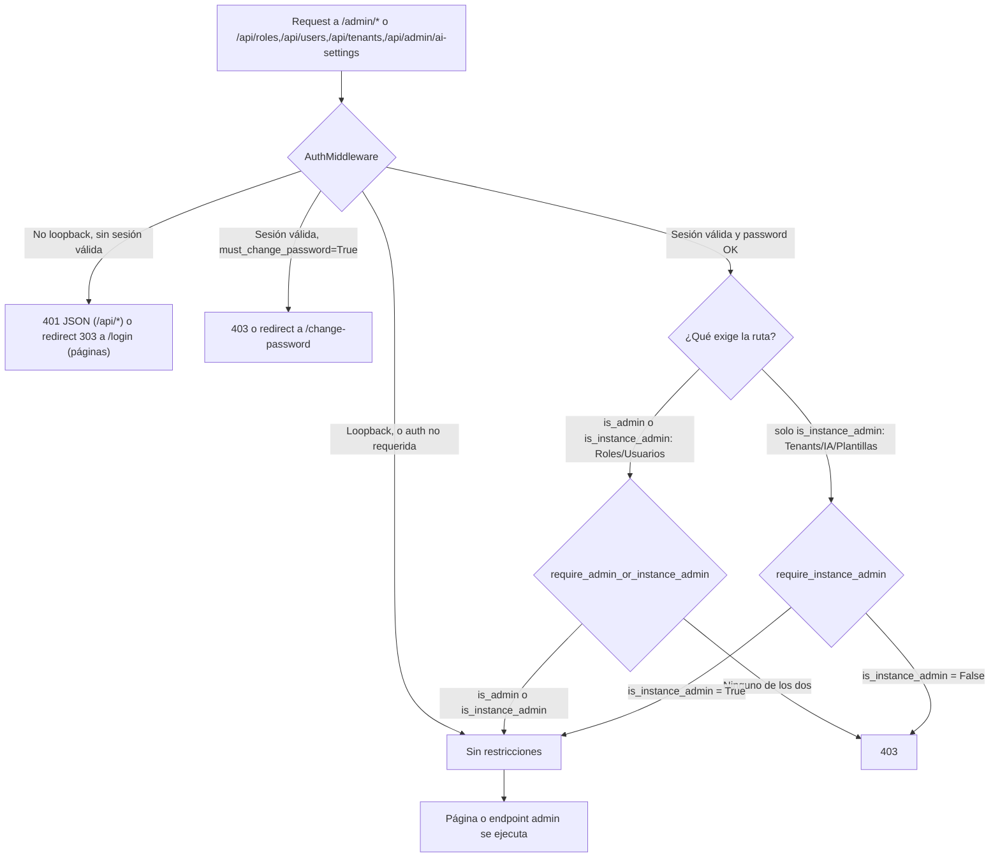
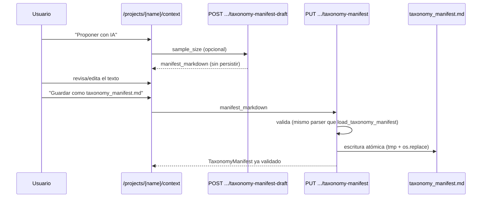

# Panel de Administración (`/admin`)

Documento único y autocontenido sobre el panel `/admin`: qué es, quién puede
usarlo, cómo se accede, y el detalle de sus 5 páginas (Roles, Usuarios,
Tenants y usuarios, Configuración de IA, Plantillas de taxonomía). Incluye
contenido ya cubierto por [Configuración de IA y plantillas](ai_settings.md) y
[Organización documental](context.md) — se duplica aquí a propósito para que
este documento sirva como referencia completa sin tener que saltar de página.

## Objetivo

Centralizar en la interfaz web toda la configuración de instancia que antes
solo era editable a mano (variables `.env`, ficheros de plantilla en disco,
CLI) o que requiere gestión multiusuario (tenants, roles, cuentas). Ningún
parámetro que afecte al comportamiento observable del usuario debería quedar
oculto solo en código o en un fichero editado fuera de la aplicación.

## Alcance

✅ `/admin/roles` — alta/baja de roles (globales) y sus permisos (proyectos)
✅ `/admin/users` — alta/baja de usuarios de tu propio tenant y su rol asignado
✅ `/admin/tenants` — pantalla cruzada: todos los tenants, con sus usuarios,
`is_instance_admin`-only
✅ `/admin/configuracion-ia` — 5 familias de credenciales de IA, cifradas en
reposo, `is_instance_admin`-only
✅ `/admin/plantillas-taxonomia` — biblioteca compartida de catálogos de
taxonomía, `is_instance_admin`-only
✅ Enlace "Proyectos" en el bloque Admin del sidebar — no es una página de
`/admin`, sino un atajo a `/` (crear/mover/vaciar histórico/eliminar
proyectos), ver [Proyectos (atajo desde Admin)](#proyectos-atajo-desde-admin)
❌ No gestiona el contenido de un proyecto ya creado (escaneo, deduplicación,
contexto — eso vive en `/projects/{name}/*`)
❌ No sustituye `.env` — lo complementa: un despliegue que ya configura variables
por entorno sigue funcionando igual sin tocar el panel

## Visión general y acceso

El panel son **5 páginas HTML** servidas con FastAPI + Jinja2
(`src/doc_organize/web/routes/admin.py`, `tenants.py`, `ai_settings.py`,
`context.py`), enlazadas desde un bloque "Admin" en el sidebar
(`templates/base.html.j2`) que se renderiza según `request.state.is_admin`/
`is_instance_admin`. Ese mismo bloque incluye un enlace "Proyectos" que no es
una página de `/admin`, sino un atajo a `/` — ver
[Proyectos (atajo desde Admin)](#proyectos-atajo-desde-admin) más abajo.

| Página | Ruta | Router | Requiere |
|---|---|---|---|
| Roles | `/admin/roles` | `routes/admin.py` | `is_admin` **o** `is_instance_admin` |
| Usuarios | `/admin/users` | `routes/admin.py` | `is_admin` **o** `is_instance_admin` |
| Tenants y usuarios | `/admin/tenants` | `routes/tenants.py` | `is_instance_admin` |
| Configuración IA | `/admin/configuracion-ia` | `routes/ai_settings.py` | `is_instance_admin` |
| Plantillas de taxonomía | `/admin/plantillas-taxonomia` | `routes/context.py` | `is_instance_admin` |

### Proyectos (atajo desde Admin)

El bloque "Admin" del sidebar incluye también un enlace **"Proyectos"** a `/`
(`web/app.py`, no `routes/admin.py`) — no es una página nueva ni una sexta
página de `/admin`: es la misma pantalla de creación/listado de proyectos que
ya usa cualquier usuario para elegir con qué proyecto trabajar, documentada en
[Projects — Registro y Gestión de Proyectos](projects.md). Se enlaza también
desde aquí porque ahí mismo viven las acciones de mantenimiento restringidas a
`is_admin`/`is_instance_admin` (crear, mover, vaciar histórico y eliminar un
proyecto — `/api/projects/*`, con confirmación explícita e irreversibles salvo
"vaciar histórico"). A diferencia de las otras 5 páginas, el acceso a `/` en sí
no exige ningún nivel de administración — solo las acciones destructivas lo
exigen, a nivel de endpoint (`require_admin` en `web/routes/projects.py`).

### Dos niveles de administración (rediseño Tenant/Role/User)

- **`is_admin`** (campo de `Role`): ve/gestiona todos los proyectos **de su
  propio tenant**, y accede a Roles/Usuarios de ese tenant.
- **`is_instance_admin`** (campo de `User`, independiente del rol): además de
  lo anterior, ve la pantalla cruzada de todos los tenants, crea/elimina
  tenants, gestiona roles/usuarios de **cualquier** tenant, y es el único que
  puede tocar recursos *de instancia* (configuración de IA, plantillas de
  taxonomía) — esos dos afectan a todos los tenants del despliegue por igual,
  así que un `is_admin` de un solo tenant no basta. Se concede/retira solo
  desde "Tenants y usuarios"; nunca autoconcedible.

### Quién puede acceder

- **Modo loopback** (la app escucha en `127.0.0.1`/`localhost`/`::1`, o
  `SecurityConfig.require_auth_if_not_loopback=False`): **sin ninguna
  restricción** — cualquiera con acceso a esa máquina ve y usa todo `/admin/*`,
  igual que el resto de la aplicación. Es un comportamiento intencional
  (pensado para uso local de un único usuario), no un descuido. El bloque
  "Admin" del sidebar (`base.html.j2`) refleja este acceso y se muestra
  completo también en este modo, aunque no haya sesión (`AuthMiddleware` no
  fija `request.state.user_id`/`is_admin`/`is_instance_admin` en loopback —
  el sidebar trata esa ausencia como "sin restricción", el mismo criterio que
  ya usan `require_admin`/`require_instance_admin`).
- **Modo no-loopback**: requiere sesión válida (`POST /login`) **y** el nivel
  que exija cada página (tabla de arriba). Sin sesión → 401 JSON (`/api/*`) o
  redirect 303 a `/login` (páginas HTML). Con sesión pero nivel insuficiente →
  403 en ambos casos.
- **Bootstrap**: al abrir `AuthStore` por primera vez (CLI o web) se crea de
  fábrica el tenant `default`, un rol global `admin` (`is_admin=True`) y un
  usuario `admin`/`admin` con `must_change_password=True` **e**
  `is_instance_admin=True` — sin aprovisionamiento manual previo. Mientras esa
  contraseña de fábrica siga activa, esa cuenta ni siquiera puede completar el
  login en modo no-loopback (ver [Acceso a la Aplicación](access.md)). Un
  tenant adicional no recibe este bootstrap: su primer usuario lo da de alta
  un `is_instance_admin` desde "Tenants y usuarios", o `user create` por CLI.
  Con `must_change_password=True` activo, toda la aplicación (incluido
  `/admin/*`) queda bloqueada salvo `/change-password`. Hay un limitador de
  intentos de login (5 intentos / 60s de bloqueo) que mitiga fuerza bruta
  contra cualquier cuenta.

### Flujo de autorización



`require_admin_or_instance_admin`/`require_instance_admin` (`web/dependencies.py`)
son las dependencias FastAPI que aplican esta última comprobación: se declaran
a nivel de router completo en `admin.py`, `tenants.py` y `ai_settings.py`
(imposible olvidarlas en un endpoint nuevo de esos módulos), y por endpoint
individual en `context.py` para los 3 endpoints (ahora `is_instance_admin`-only)
de plantillas de taxonomía (crear/editar/borrar — listar y leer una plantilla
**no** lo son, ver más abajo).

`/admin/roles`, `/admin/users`, `/api/roles*`, `/api/users*` operan sobre el
tenant de la sesión actual (`get_tenant_id(request)`, `"default"` en
loopback/sin auth) para **usuarios** — pero `Role` ya no está ligado a un
tenant: `/api/roles*` opera sobre el catálogo **global** completo (el mismo
que ve la pantalla cruzada). La configuración de IA y la biblioteca de
plantillas de taxonomía también son **de instancia** (una sola, compartida por
todos los tenants), ver sus secciones más abajo.

---

## Roles (`/admin/roles`)

Página de gestión de roles: lista **todos** los roles (globales, no solo los
de tu tenant — ver "Dos niveles de administración" arriba) y ofrece un
formulario de alta. No hay UI de edición (`PATCH`) en esta página, solo alta y
baja — actualizar un rol existente solo es posible vía API.

### Modelo (`Role`, `core/models.py`)

| Campo | Tipo | Descripción |
|---|---|---|
| `name` | `str` (máx. 50) | Nombre del rol, único **globalmente** (no por tenant) |
| `is_admin` | `bool` | Si es `True`, ve todos los proyectos del tenant *del usuario que lo tiene asignado* (presentes y futuros) y accede a `/admin/roles`/`/admin/users` |
| `project_names` | `list[str]` | Proyectos permitidos si `is_admin=False` (se ignora si es admin), interpretados dentro del tenant de cada usuario que lo tiene |

`allowed_scan_roots` se retiró: el acceso de escaneo de un rol no-admin es
ahora implícito (la carpeta de cada proyecto en `project_names`), ver
[Acceso a la Aplicación](access.md).

### Formulario de creación

- Nombre del rol.
- Checkbox "Admin (ve todos los proyectos del tenant)" — al marcarlo,
  deshabilita el resto de campos (un rol admin no puede tener restricciones).
- Checklist de proyectos permitidos (proyectos de tu propio tenant).

### Un rol es global: compartirlo entre tenants

Como `Role` ya no tiene `tenant_id`, nada impide que el mismo rol esté
asignado a usuarios de tenants distintos — la columna "Usuarios asignados"
de esta página, sin embargo, **solo muestra los de tu propio tenant** (nunca
usernames de otro tenant, para no filtrar esa información a un `is_admin` que
no sea también `is_instance_admin`). Antes de editar un rol compartido,
revisa esa columna: un cambio afecta a todos los tenants que lo usan. Un
`is_instance_admin` ve el desglose completo (qué tenant, qué usuario) desde
[Tenants y usuarios](#tenants-y-usuarios-admintenants).

### Endpoints API

| Método | Ruta | Descripción |
|---|---|---|
| `GET` | `/api/roles` | Lista todos los roles (globales) |
| `POST` | `/api/roles` | Crea un rol (`name`, `is_admin`, `project_names`) |
| `GET` | `/api/roles/{role_id}` | Obtiene un rol |
| `PATCH` | `/api/roles/{role_id}` | Actualiza campos opcionales (sin UI dedicada) |
| `DELETE` | `/api/roles/{role_id}` | Borra un rol |

### Reglas de negocio

| Regla | Descripción |
|---|---|
| **Un rol admin no puede tener restricciones** | `project_names` debe ir vacío si `is_admin=True` — validado en `create_role`/`update_role` (422 si se incumple) |
| **No se puede borrar el último rol admin del sistema** | Guarda global (no por tenant): evita dejar la instalación entera sin ningún rol capaz de administrar un tenant — `409` |
| **No se puede borrar un rol en uso** | Si algún usuario (de cualquier tenant) tiene ese `role_id`, `DELETE` responde `409` |

---

## Usuarios (`/admin/users`)

Página de gestión de usuarios: lista los usuarios de **tu propio tenant** (con
el nombre de su rol, si está bloqueado, y si es admin de instancia) y ofrece
un formulario de alta. Igual que en Roles, no hay UI de edición para
rol/contraseña — solo alta y baja desde la página; cambiar de rol, resetear
una contraseña o bloquear/desbloquear es vía API (`PATCH`, con botón dedicado
para bloquear/desbloquear).

### Formulario de creación

- Usuario (máx. 50 caracteres).
- Contraseña.
- Rol (`<select>` con todos los roles — ver "Roles" arriba, es un catálogo global).
- Checkbox "Debe cambiar contraseña" (`must_change_password`).

### Endpoints API

| Método | Ruta | Descripción |
|---|---|---|
| `GET` | `/api/users` | Lista usuarios de tu tenant |
| `POST` | `/api/users` | Crea usuario (`username`, `password`, `role_id`, `must_change_password`) |
| `GET` | `/api/users/{user_id}` | Obtiene un usuario |
| `PATCH` | `/api/users/{user_id}` | Cambia `role_id`, resetea `password` y/o `is_blocked` (no acepta `is_instance_admin` — ver [Tenants y usuarios](#tenants-y-usuarios-admintenants)) |
| `DELETE` | `/api/users/{user_id}` | Borra un usuario |

### Reglas de negocio

- Al resetear la contraseña vía `PATCH`, se fuerza `must_change_password=True`
  automáticamente — nunca se deja una contraseña reseteada por un admin sin
  que el usuario la cambie en su próximo login.
- Con `must_change_password=True`, el usuario afectado queda bloqueado en
  toda la aplicación salvo `/change-password` hasta que la cambie.
- **Bloquear (`is_blocked=true`) invalida de inmediato todas sus sesiones
  activas** (misma transacción que fija el flag) — no espera a que expiren
  solas (hasta 24h). Un usuario bloqueado no puede autenticarse (`authenticate()`
  devuelve el mismo `None` que credenciales inválidas, sin distinguir el motivo).
- No se puede bloquear/quitar el rol admin/eliminar al último admin **activo**
  del tenant, salvo que sea también el único usuario que le queda (vaciar el
  tenant del todo es un estado terminal legítimo) — `409` en el resto de casos.

---

## Tenants y usuarios (`/admin/tenants`)

Pantalla cruzada, exclusiva de `is_instance_admin` (decisión de diseño 3 del
rediseño Tenant/Role/User): lista **todos** los tenants de la instalación, con
sus usuarios por debajo, y permite crear/eliminar tenants y gestionar usuarios
de cualquiera de ellos — no solo el propio.

### Por qué existe aparte de Roles/Usuarios

`/admin/roles`/`/admin/users` ya bastan para el día a día de un `is_admin`
normal (gestionar su propio tenant). Esta pantalla existe para lo que ese
nivel no alcanza: crear un tenant nuevo (`AuthStore.create_tenant()` ya no
aprovisiona ningún usuario, así que hace falta darlo de alta desde algún
sitio), promover a alguien a `is_instance_admin`, o intervenir en un tenant
ajeno (p.ej. desbloquear a su único admin si se quedó fuera).

### La página

Por cada tenant: nombre + id, botón "Eliminar tenant", formulario de alta de
usuario (usuario, contraseña, rol, checkbox "debe cambiar contraseña"), y una
tabla de sus usuarios con: nombre, rol, estado (activo/bloqueado), checkbox
"Admin de instancia" (`is_instance_admin`), y botones Bloquear/Desbloquear y
Eliminar.

### Endpoints API

| Método | Ruta | Descripción |
|---|---|---|
| `GET` | `/api/tenants` | Lista todos los tenants, con recuento de usuarios |
| `POST` | `/api/tenants` | Crea un tenant (`name`) — **sin** usuario automático |
| `DELETE` | `/api/tenants/{tenant_id}` | Borra un tenant (exige cero usuarios y cero proyectos) |
| `GET` | `/api/tenants/{tenant_id}/users` | Lista los usuarios de `tenant_id` |
| `POST` | `/api/tenants/{tenant_id}/users` | Crea un usuario en `tenant_id` (mismo payload que `/api/users`) |
| `PATCH` | `/api/tenants/{tenant_id}/users/{user_id}` | Cambia `role_id`, `password`, `is_blocked` **y/o `is_instance_admin`** |
| `DELETE` | `/api/tenants/{tenant_id}/users/{user_id}` | Borra un usuario de `tenant_id` |

Estos endpoints son las únicas rutas de la aplicación que aceptan
`is_instance_admin` en el payload — `/api/users/{id}` (propio tenant, `admin.py`)
lo ignora si se envía, precisamente para que solo un `is_instance_admin` pueda
concederlo o retirarlo a través de esta pantalla.

### Reglas de negocio

| Regla | Descripción |
|---|---|
| **Un tenant se elimina solo si está vacío** | Cero usuarios y cero proyectos (`ProjectRegistry.list_projects(tenant_id)`) — `409` con el motivo (usuarios o proyectos) en el mensaje |
| **`DEFAULT_TENANT_ID` no es un caso especial** | Se puede eliminar como cualquier otro (vacío); el bootstrap de fábrica lo recrea (con un `admin`/`admin` nuevo) la siguiente vez que se abra `AuthStore` |
| **`is_instance_admin` nunca llega a cero** | Retirarlo al último usuario que lo tiene lanza `InstanceAdminRequiredError` (`409`) — siempre queda alguien capaz de gestionar la instancia |
| **`is_instance_admin` nunca se autoconcede** | Solo alcanzable desde una sesión que ya sea `is_instance_admin` (`require_instance_admin` a nivel de router) |

---

## Configuración de IA (`/admin/configuracion-ia`)

Panel para ver/editar las 5 familias de credenciales y parámetros de IA que,
antes de esta funcionalidad, solo eran configurables editando `.env` a mano.
Exige `is_instance_admin` (no basta `is_admin` de un tenant): es config **de
instancia**, compartida por todos los tenants del despliegue (rediseño
Tenant/Role/User).

### Las 5 familias

Definidas en `web/ai_settings_config.py` (`AI_SETTINGS_FAMILIES`):

| Familia (`key`) | Label | Campos |
|---|---|---|
| `litellm_classification` | Clasificación de dominios por IA (1 eje) | `base_url`, `virtual_key` 🔒, `model` |
| `litellm_taxonomy_classification` | Clasificación por manifiesto de taxonomía (2 ejes) | `base_url`, `virtual_key` 🔒, `model` |
| `litellm_taxonomy_manifest_draft` | Borrador de manifiesto de taxonomía por IA | `base_url`, `virtual_key` 🔒, `model` |
| `litellm_usage` | Monitorización de uso/coste (LiteLLM Proxy) | `base_url`, `virtual_key` 🔒 |
| `github_copilot_usage` | Monitorización de uso (GitHub Copilot Pro) | `username`, `pat` 🔒 |

(🔒 = campo secreto, cifrado en reposo). Cada campo mapea 1:1 con una
variable de entorno `DOC_ORGANIZE_*` (p. ej.
`DOC_ORGANIZE_LITELLM_CLASSIFICATION_VIRTUAL_KEY`), documentada también en
`.env.example`.

### La página

Cada familia se renderiza en su propia sección/formulario, con:

- Badge "✓ Configurado" / "⚠ No configurado".
- Un input por campo (texto si no es secreto, password si lo es), con
  placeholder mostrando el `masked_hint` si ya hay algo guardado.
- Etiqueta indicando el origen del valor actual: `"guardado"` (store),
  `".env"` (entorno) o vacío.
- Botón "Borrar" junto a cada campo secreto ya configurado.
- Botón "Ver líneas .env equivalentes" (modal).
- Aviso si `DOC_ORGANIZE_SECRETS_KEY` no está definida: los campos secretos
  no se pueden guardar, pero sí los no-secretos.

### Endpoints API

| Método | Ruta | Descripción |
|---|---|---|
| `GET` | `/api/admin/ai-settings` | Estado + valores no-secretos de las 5 familias |
| `PUT` | `/api/admin/ai-settings/{family_key}` | Guarda/borra uno o más campos de una familia |

### Precedencia de configuración

Para cada campo, se resuelve en este orden (`resolve_field_value()`):

1. Valor guardado en `InstanceSecretsStore` (panel `/admin/configuracion-ia`)
2. Variable de entorno `DOC_ORGANIZE_*` equivalente
3. Sin configurar

Un valor vacío nunca cuenta como "guardado" (guardar cadena vacía equivale a
borrar el override).

### Cifrado en reposo

Los campos credenciales (`virtual_key`, `pat`) nunca se guardan en claro: se
cifran con [Fernet](https://cryptography.io/en/latest/fernet/) (AES + HMAC)
usando una clave maestra por instalación, `DOC_ORGANIZE_SECRETS_KEY` (32 bytes
en base64 urlsafe), leída del entorno del proceso — mismo criterio que ya usa
`LITELLM_SALT_KEY` para el propio LiteLLM Proxy (ver
[Desplegar un LiteLLM Proxy](../guides/litellm_proxy_setup.md)).

```bash
python -c "import secrets, base64; print(base64.urlsafe_b64encode(secrets.token_bytes(32)).decode())"
```

- Almacén: `InstanceSecretsStore` (`auth/instance_secrets_store.py`) — tabla
  SQLite `instance_secrets` en el mismo fichero `auth.db` que `AuthStore`
  (por defecto `~/.doc_organize/auth.db`), pero tabla propia. Es config **de
  instancia**, no por tenant.
- Campos no-secretos (`base_url`, `model`, `username`) se guardan en texto
  plano en la misma tabla.
- Sin `DOC_ORGANIZE_SECRETS_KEY` definida, el panel sigue funcionando en modo
  "solo campos no-secretos" — guardar una credencial devuelve `400` con un
  mensaje explícito en vez de guardarla en claro como degradación silenciosa.

⚠️ Fija `DOC_ORGANIZE_SECRETS_KEY` una vez y no la cambies después de guardar
credenciales — cambiarla deja ilegibles las que ya estaban cifradas con la
anterior.

### Reglas de negocio

| Regla | Descripción |
|---|---|
| **Nunca se reexpone un secreto ya guardado** | `GET /api/admin/ai-settings` solo devuelve `masked_hint` (últimos 4 caracteres, o `"***"` si el secreto tiene ≤4 caracteres) para campos secretos, nunca el valor |
| **Campo ausente ≠ campo `null`** | En `PUT /api/admin/ai-settings/{family}`, un campo ausente del payload no se toca; `null` explícito borra el override guardado |
| **Familia/campo desconocido** | `404` familia desconocida, `400` campo desconocido dentro de una familia válida |

---

## Plantillas de taxonomía (`/admin/plantillas-taxonomia`)

Biblioteca compartida (entre todos los proyectos de la instalación) de
catálogos de dominios y tipos de material para clasificación documental por
manifiesto de taxonomía (2 ejes). Crear/editar/borrar exige `is_instance_admin`
(config de instancia, mismo criterio que Configuración de IA).

### Modelo

- `TaxonomyManifest` (`core/models.py`): `domains`, `material_types`
  (listas de `TaxonomyCatalogEntry`), más `title`/`description` opcionales
  (solo relevantes en una plantilla compartida, no en el manifiesto de un
  proyecto).
- `TaxonomyCatalogEntry`: `slug`, `name`, `description | None`,
  `keywords: list[str]`.

Ejemplo de fichero de plantilla:

```yaml
---
title: SGI ISO 27001
description: Catálogo de dominios y tipos de material de un SGSI (ISO/IEC 27001).
domains:
  - slug: gobierno-seguridad
    name: Gobierno de la Seguridad
    keywords: [politica, gobierno, roles, objetivos]
material_types:
  - slug: politica
    name: Política
---
```

### Almacenamiento (`TaxonomyTemplateRegistry`)

Cada plantilla es un fichero `<nombre>.md` (mismo formato que
`taxonomy_manifest.md` de un proyecto). Dos ubicaciones, con precedencia:

1. **Biblioteca de usuario**: `~/.doc_organize/taxonomy_templates/` por
   defecto (o ruta alternativa vía `doc_organize web --templates-path`).
2. **Biblioteca empaquetada** (solo lectura): dentro del propio paquete —
   incluye 2 ejemplos (`calidad`, ISO 9001; `sgi-iso27001`, ISO 27001).

Una plantilla de usuario con el mismo nombre que una empaquetada **siempre
gana**. El nombre solo admite minúsculas/dígitos/guiones
(`^[a-z0-9][a-z0-9-]*$`) para evitar path traversal.

### La página

Lista plantillas (nombre, título, descripción) con botones "Editar"/"Eliminar"
por fila, y un formulario de alta/edición con: nombre (slug, deshabilitado al
editar), título, descripción, y dos catálogos dinámicos (Dominios / Tipos de
material) donde cada fila tiene `slug`, `name`, `description`, `keywords`.

### Endpoints API

| Método | Ruta | `is_instance_admin` | Descripción |
|---|---|---|---|
| `GET` | `/api/taxonomy-templates` | No | Lista plantillas — usado también por el selector en la página de contexto de un proyecto |
| `GET` | `/api/taxonomy-templates/{name}` | No | Contenido completo de una plantilla |
| `PUT` | `/api/taxonomy-templates/{name}` | **Sí** | Crea o sobrescribe (misma operación idempotente) |
| `DELETE` | `/api/taxonomy-templates/{name}` | **Sí** | Borra una plantilla de usuario (requiere `{"confirm": true}`; nunca borra una empaquetada) |

Listar/leer una plantilla no exige `is_instance_admin` a propósito: cualquier
usuario con acceso a un proyecto necesita poder poblar el selector al
construir su contexto. Solo crear/editar/borrar lo exigen.

### Uso desde un proyecto

Un proyecto referencia una plantilla por nombre al construir su contexto
(`POST /api/projects/{name}/context` con `taxonomy_template_name`), sin
copiar el fichero. **Precedencia**: si el proyecto ya tiene su propio
`taxonomy_manifest.md`, ese fichero local siempre gana — la plantilla solo se
usa cuando no hay fichero local. Combinar manifiesto (local o plantilla) con
`candidate_domains`, o fichero local con `taxonomy_template_name`, se
rechaza con `400` explícito. Más detalle en
[Organización documental (dominios y contextos)](context.md).

---

## Manifiesto de taxonomía de un proyecto (relacionado, fuera de `/admin`)

No es una página de `/admin` — vive en `/projects/{name}/context` — pero está
estrechamente relacionado con la biblioteca de plantillas de arriba, y su
guardado comparte el mismo mecanismo de cifrado/precedencia de IA que
`/admin/configuracion-ia` (usa la familia `litellm_taxonomy_manifest_draft`).

`taxonomy_manifest.md` es un fichero por **proyecto**
(`<project.root_path>/taxonomy_manifest.md`) que declara el catálogo de 2
ejes para clasificar los documentos de ese proyecto — mismo formato que una
plantilla compartida, pero sin `title`/`description` y con alcance de un
único proyecto.

### Flujo: proponer con IA → revisar → guardar



El endpoint de borrador (`POST .../taxonomy-manifest-draft`) es de solo
lectura (sin lock de operación, no toca el filesystem); el de guardado
(`PUT .../taxonomy-manifest`) sí escribe, y por eso adquiere el mismo lock de
operación por proyecto que ya usan escaneo/deduplicación/construcción de
contexto.

---

## Resumen de endpoints API admin

| Método | Ruta | Requiere | Sección |
|---|---|---|---|
| `GET`/`POST` | `/api/roles` | `is_admin` o `is_instance_admin` (router) | Roles |
| `GET`/`PATCH`/`DELETE` | `/api/roles/{role_id}` | `is_admin` o `is_instance_admin` (router) | Roles |
| `GET`/`POST` | `/api/users` | `is_admin` o `is_instance_admin` (router) | Usuarios |
| `GET`/`PATCH`/`DELETE` | `/api/users/{user_id}` | `is_admin` o `is_instance_admin` (router) | Usuarios |
| `GET`/`POST` | `/api/tenants` | `is_instance_admin` (router) | Tenants y usuarios |
| `DELETE` | `/api/tenants/{tenant_id}` | `is_instance_admin` (router) | Tenants y usuarios |
| `GET`/`POST` | `/api/tenants/{tenant_id}/users` | `is_instance_admin` (router) | Tenants y usuarios |
| `PATCH`/`DELETE` | `/api/tenants/{tenant_id}/users/{user_id}` | `is_instance_admin` (router) | Tenants y usuarios |
| `GET` | `/api/admin/ai-settings` | `is_instance_admin` (router) | Configuración IA |
| `PUT` | `/api/admin/ai-settings/{family_key}` | `is_instance_admin` (router) | Configuración IA |
| `GET` | `/api/taxonomy-templates` | No | Plantillas de taxonomía |
| `GET` | `/api/taxonomy-templates/{name}` | No | Plantillas de taxonomía |
| `PUT`/`DELETE` | `/api/taxonomy-templates/{name}` | `is_instance_admin` (por endpoint) | Plantillas de taxonomía |
| `PUT` | `/api/projects/{name}/context/taxonomy-manifest` | No (`require_project_access`) | Manifiesto de proyecto |
| `POST` | `/api/projects/{name}/context/taxonomy-manifest-draft` | No (`require_project_access`) | Manifiesto de proyecto |

## Tests relacionados

| Archivo | Cubre |
|---|---|
| `tests/unit/test_web_admin_routes.py` | Roles (globales)/usuarios vía HTTP: 403 sin nivel, sin restricciones en loopback, CRUD completo, validaciones de negocio, renderizado de páginas, no-enumeración cross-tenant en "usuarios asignados" |
| `tests/unit/test_web_tenants_routes.py` | Pantalla cruzada: 403 para `is_admin` sin `is_instance_admin`, alta/baja de tenants, gestión de usuarios de cualquier tenant, `is_instance_admin` |
| `tests/unit/test_auth_store.py` | `AuthStore` a nivel de clase: bootstrap de fábrica, migración, `is_blocked`/`is_instance_admin`, guardas de "último admin" |
| `tests/unit/test_web_auth.py` | Bloqueo de login de la cuenta de fábrica en modo no-loopback (decisión de diseño 1) |
| `tests/unit/test_web_ai_settings.py` | Página y API de configuración de IA: enmascarado de secretos, cifrado, precedencia store/entorno |
| `tests/unit/test_ai_settings_config.py` | Lógica pura de `ai_settings_config.py` sin HTTP |
| `tests/unit/test_taxonomy_template_registry.py` | CRUD de `TaxonomyTemplateRegistry` a nivel de clase |
| `tests/unit/test_web_context.py` | Endpoints `/api/taxonomy-templates*` vía HTTP y renderizado de `/admin/plantillas-taxonomia` |
| `tests/unit/test_taxonomy_manifest.py` | `load_taxonomy_manifest`/`save_taxonomy_manifest` a nivel de módulo |

## Referencias

- [Configuración de IA y plantillas](ai_settings.md) — documento original de
  esta funcionalidad, con las notas de la sesión que la introdujo.
- [Organización documental (dominios y contextos)](context.md) — modo
  manifiesto de taxonomía desde la perspectiva de un proyecto.
- [Projects — Registro y Gestión de Proyectos](projects.md) — la página `/`
  enlazada como "Proyectos" desde el sidebar Admin.
- [Desplegar un LiteLLM Proxy](../guides/litellm_proxy_setup.md) — guía
  complementaria para las familias `litellm_*`.
- `.env.example` — variables `DOC_ORGANIZE_*` equivalentes a cada campo.
