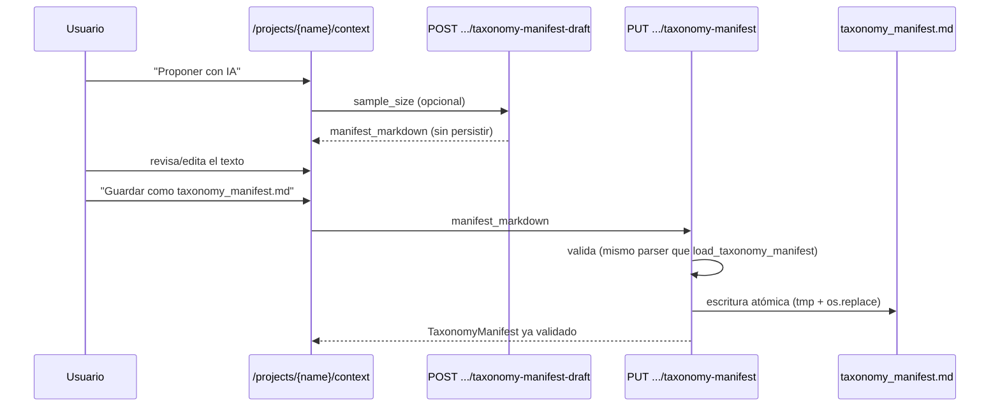

# Configuración de IA y biblioteca de plantillas desde la web

> Para una visión de conjunto de todo el panel `/admin` (incluyendo Roles y
> Usuarios), ver [Panel de Administración](admin.md).

Cierra los huecos detectados en la auditoría de parametrización de 2026-09-10:
antes de esta funcionalidad, las 5 familias de credenciales de IA
(`DOC_ORGANIZE_LITELLM_*`/`DOC_ORGANIZE_GITHUB_*`) solo eran configurables editando
`.env` a mano, y tanto `taxonomy_manifest.md` (por proyecto) como las plantillas de
`TaxonomyTemplateRegistry` (biblioteca compartida) solo se podían crear/editar fuera
de la aplicación.

## Objetivo

Que ningún parámetro que afecte al comportamiento observable del usuario quede
oculto solo en código/`.env`/un fichero editado a mano, sin una vía equivalente
desde la interfaz web.

## Alcance

✅ Panel `/admin/configuracion-ia`: ver/editar las 5 familias de credenciales de IA,
persistidas cifradas en reposo (`InstanceSecretsStore`, `auth/secrets_cipher.py`)
✅ Biblioteca `/admin/plantillas-taxonomia`: crear/editar/borrar plantillas de
`TaxonomyTemplateRegistry` sin tocar `~/.doc_organize/taxonomy_templates/` a mano
✅ `PUT /api/projects/{name}/context/taxonomy-manifest`: guardar el borrador
propuesto por IA (`draft_taxonomy_manifest`) como `taxonomy_manifest.md` del
proyecto, sin salir de la aplicación
❌ No sustituye `.env` — lo complementa: un despliegue que ya configura estas
variables por entorno sigue funcionando exactamente igual sin tocar el panel

## Precedencia de configuración

Para cada campo de las 5 familias de IA, se resuelve en este orden:

1. Valor guardado en `InstanceSecretsStore` (panel `/admin/configuracion-ia`)
2. Variable de entorno `DOC_ORGANIZE_*` equivalente
3. Sin configurar

Implementado en `*_config_from_store_or_env()` (`doc_organize.ai`), función
**nueva** junto a cada `*_config_from_env()` ya existente — esta última no cambia
de comportamiento para quien ya la use directamente.

## Cifrado en reposo

Los campos credenciales (`virtual_key`, `PAT`) nunca se guardan en claro: se cifran
con [Fernet](https://cryptography.io/en/latest/fernet/) usando una clave maestra
por instalación, `DOC_ORGANIZE_SECRETS_KEY` (32 bytes en base64 urlsafe), leída del
entorno del proceso — mismo criterio que ya usa `LITELLM_SALT_KEY` para el propio
LiteLLM Proxy (ver [Desplegar un LiteLLM Proxy](../guides/litellm_proxy_setup.md)).

```bash
python -c "import secrets, base64; print(base64.urlsafe_b64encode(secrets.token_bytes(32)).decode())"
```

Sin `DOC_ORGANIZE_SECRETS_KEY` definida, el panel sigue funcionando en modo
"solo campos no-secretos" (alias de modelo, URL del proxy) — guardar una
credencial devuelve 400 con un mensaje explícito en vez de guardarla en claro
como degradación silenciosa.

⚠️ Fija `DOC_ORGANIZE_SECRETS_KEY` una vez y no la cambies después de guardar
credenciales — cambiarla deja ilegibles las que ya estaban cifradas con la
anterior (mismo trade-off que `LITELLM_SALT_KEY`).

## Alcance de la configuración

De instancia, no por tenant ni por proyecto — mismo criterio que
`TaxonomyTemplateRegistry` (una única biblioteca compartida por toda la
instalación). Ambos paneles nuevos son admin-only (`require_admin`), igual que
`/admin/roles`/`/admin/users`.

## Flujo: proponer y guardar un `taxonomy_manifest.md`



`draft_taxonomy_manifest` sigue siendo de solo lectura (sin lock de operación,
no toca el filesystem); `save_taxonomy_manifest_endpoint` sí escribe, y por eso
adquiere el mismo lock de operación por proyecto que ya usan escaneo/deduplicación/
construcción de contexto (evita solaparse con una construcción de contexto en
curso que esté leyendo el mismo fichero).

## Reglas de Negocio

| Regla | Descripción |
|---|---|
| **Nunca se reexpone un secreto ya guardado** | `GET /api/admin/ai-settings` solo devuelve `masked_hint` (últimos 4 caracteres) para campos secretos, nunca el valor |
| **Campo ausente ≠ campo `null`** | En `PUT /api/admin/ai-settings/{family}`, un campo ausente del payload no se toca; `null` explícito borra el override guardado |
| **Plantilla empaquetada nunca se borra** | `DELETE /api/taxonomy-templates/{name}` solo actúa sobre `templates_dir` (usuario) — un nombre que solo existe empaquetado responde 404, igual que "no existe" |
| **`taxonomy_manifest.md` siempre se valida antes de escribir** | Mismo parser que `load_taxonomy_manifest()`; un YAML/schema inválido nunca llega a tocar el fichero existente |

## Notas de la sesión (2026-09-10/11)

- Origen: auditoría `/audit-code` de parametrización de toda la aplicación —
  inventario completo en el historial de la sesión.
- Durante la implementación se detectaron y corrigieron 2 afirmaciones obsoletas
  encontradas por el camino: `.env.example` documentaba 4 variables
  (`DOC_ORGANIZE_CACHE_DB_PATH`/`_OUTPUT_DIR`/`_WEB_HOST`/`_WEB_PORT`) que el
  código nunca lee (son solo flags de CLI); y ni `.env.example` ni
  `litellm_proxy_setup.md` documentaban `DOC_ORGANIZE_LITELLM_TAXONOMY_MANIFEST_DRAFT_*`
  pese a ser obligatorias para un endpoint ya en producción.

## Criterios de Aceptación

*Pendiente de validación QA*
