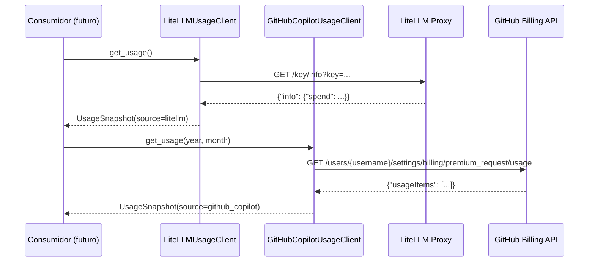

# Monitorización de Uso/Coste de IA — Fase 2

Visibilidad de consumo de IA de dos fuentes externas: gasto en Anthropic enrutado a
través de un **LiteLLM Proxy**, y consumo de **GitHub Copilot Pro** (premium requests).

## Objetivo

Centralizar la lectura de uso/coste de IA de varios clientes en un único paquete
(`doc_organize.ai`), sin mezclar el control de acceso o la inferencia de cada
proveedor. Nace de la fase 2 del proyecto: antes de decidir cómo limitar/facturar
el uso de IA, primero hay que poder verlo.

## Alcance

✅ Consultar spend acumulado de una virtual key de LiteLLM Proxy (Anthropic)  
✅ Consultar consumo de "premium requests" de un plan Copilot Pro individual  
❌ `LiteLLMUsageClient`/`GitHubCopilotUsageClient` (este documento) no enrutan ni
interceptan llamadas de inferencia — son solo lectura de uso/coste. El paquete
`doc_organize.ai` sí ganó un consumidor real de `chat/completions` después
(`DomainClassificationClient`, Sub-fase B de la organización documental por
dominios — ver [Organización documental](context.md)), pero es un cliente
aparte con su propia config (`LiteLLMClassificationConfig`), no una ampliación
de los clientes de este documento  
❌ No calcula presupuestos ni bloquea acceso — solo lectura

## Precondiciones

- **LiteLLM**: un LiteLLM Proxy ya desplegado y accesible por red, con al menos una
  virtual key creada.
- **GitHub Copilot**: un usuario con plan Copilot Individual/Pro comprado a título
  personal, y un Personal Access Token de GitHub con permiso de lectura de
  facturación (scope exacto pendiente de confirmar empíricamente, ver Notas).

## Flujo Principal

Ambos clientes devuelven la misma forma (`UsageSnapshot`), aunque el origen de
datos sea completamente distinto — ver `UsageSource` en la referencia técnica.

## Reglas de Negocio

| Regla | Descripción |
|---|---|
| **Dos fuentes, dos clientes** | `LiteLLMUsageClient` y `GitHubCopilotUsageClient` no comparten config ni credenciales (ISP) |
| **Contrato común** | Ambos exponen `get_usage()` invocable sin argumentos y devuelven `UsageSnapshot` |
| **Coste puede ser `None`** | Copilot Pro no reporta coste en USD salvo overage de cuota — `UsageLineItem.cost_usd` queda `None` en el caso común |
| **Sin lectura implícita de entorno** | Las configs no leen variables de entorno por sí solas; usa `litellm_usage_config_from_env()` / `github_copilot_usage_config_from_env()` explícitamente |

## Límites y Restricciones

❌ No interactúa con el endpoint interno de completions de Copilot (incumpliría sus términos de uso)  
❌ No pagina ni acumula histórico entre snapshots  
❌ No agrega ambas fuentes en un único informe todavía (sin consumidor real que lo necesite)

## Casos Especiales

- **Credencial inválida/expirada** (401/403 de cualquiera de las dos APIs): `UsageSourceAuthError`.
- **Red caída o timeout**: `UsageSourceConnectionError`.
- **Copilot sin overage**: `usageItems` puede venir vacío o con `netAmount` en 0 — no es un error.

## Notas de la sesión (2026-09-07)

- El endpoint `GET /users/{username}/settings/billing/premium_request/usage` está
  verificado contra la documentación oficial de GitHub (Enhanced Billing Platform),
  válido para un plan Copilot comprado a título personal — no requiere organización.
- El scope/permiso exacto de PAT que autoriza ese endpoint **no está documentado
  explícitamente por GitHub** — pendiente de confirmar contra una cuenta real.
- Integrar el endpoint interno de Copilot (vía un proxy no oficial tipo LiteLLM)
  se descartó explícitamente: incumple los términos de uso individuales de Copilot.

## Criterios de Aceptación

*Pendiente de validación QA*
