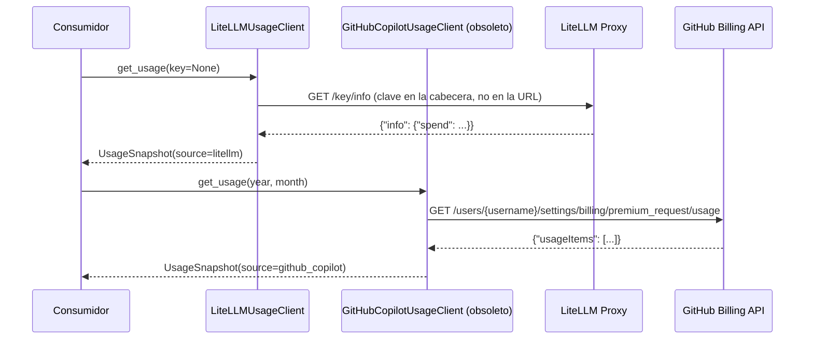

# Monitorización de Uso/Coste de IA — Fase 2

!!! warning "GitHub Copilot obsoleto desde 2.1.0"
    `GitHubCopilotUsageClient`, `GitHubCopilotUsageConfig` y `github_copilot_usage_config_from_env()` emiten
    `DeprecationWarning` y se retiran en 3.0 (también `UsageSourceName.GITHUB_COPILOT`). El uso y el coste de IA se
    consultan en LiteLLM (`LiteLLMUsageClient`), que desde 2.0 enruta todas las tareas de IA. Lo de Copilot de esta
    página queda como referencia hasta entonces. Ver [Hacia 3.0](../guides/migracion_3_0.md).

## 1. Descripción General

Visibilidad del consumo de IA: el gasto acumulado de una virtual key del **LiteLLM Proxy** por el que pasan todas las
tareas de IA de la librería y, hasta 3.0, el consumo de **GitHub Copilot Pro** (premium requests, obsoleto).

Centralizar la lectura de uso/coste de IA en un único paquete (`doc_organize.ai`), sin mezclar el control de acceso
o la inferencia de cada proveedor. Nace de la fase 2 del proyecto: antes de decidir cómo limitar/facturar el uso de
IA, primero hay que poder verlo.

Desde 2.0.0 todas las tareas de IA (clasificar, describir, diseñar la taxonomía, agentes, embeddings y, desde 2.2.0,
duplicados por contenido) pasan por el mismo LiteLLM Proxy, así que su gasto se consulta ahí. Cada tarea puede tener
su propia virtual key (`DOC_ORGANIZE_LITELLM_VIRTUAL_KEY_<TAREA>`) y consultarse por separado con
`get_usage(key=...)`.

### Alcance

✅ Consultar spend acumulado de una virtual key de LiteLLM Proxy  
✅ Consultar consumo de "premium requests" de un plan Copilot Pro individual (obsoleto desde 2.1.0, se retira en 3.0)  
❌ `LiteLLMUsageClient`/`GitHubCopilotUsageClient` (este documento) no enrutan ni
interceptan llamadas de inferencia — son solo lectura de uso/coste. Las llamadas de IA las hace
`LlmClient` (desde 2.0.0, todas las tareas de IA de la organización documental
— ver [Organización documental](context.md)), un cliente
aparte con su propia config (`AiSettings`), no una ampliación
de los clientes de este documento  
❌ No calcula presupuestos ni bloquea acceso — solo lectura

### Precondiciones

- **LiteLLM**: un LiteLLM Proxy ya desplegado y accesible por red, con al menos una
  virtual key creada — ver [Desplegar un LiteLLM Proxy](../guides/litellm_proxy_setup.md).
- **GitHub Copilot** (obsoleto): un usuario con plan Copilot Individual/Pro comprado a título
  personal, y un Personal Access Token de GitHub con permiso de lectura de
  facturación (scope exacto pendiente de confirmar empíricamente, ver Notas).

## 2. Reglas de Negocio

| Regla | Descripción |
|---|---|
| **Dos fuentes, dos clientes** | `LiteLLMUsageClient` y `GitHubCopilotUsageClient` no comparten config ni credenciales (ISP) |
| **Contrato común** | Ambos exponen `get_usage()` invocable sin argumentos y devuelven `UsageSnapshot` |
| **La clave propia no va en la URL** | Sin `key` (o con la misma clave de la cabecera), LiteLLM consulta la clave de la cabecera y no se envía `?key=`; con otra `key`, esa sí va en la URL (y en los logs): se recomienda pasar su hash SHA-256 |
| **Una línea por consulta** | LiteLLM `/key/info` no desglosa por fecha ni modelo: el snapshot trae el spend acumulado de la clave, en USD |
| **Coste puede ser `None`** | Copilot Pro no reporta coste en USD salvo overage de cuota — `UsageLineItem.cost_usd` queda `None` en el caso común |
| **Sin lectura implícita de entorno** | Las configs no leen variables de entorno por sí solas; usa `litellm_usage_config_from_env()` (`DOC_ORGANIZE_LITELLM_BASE_URL`, `DOC_ORGANIZE_LITELLM_VIRTUAL_KEY`) / `github_copilot_usage_config_from_env()` explícitamente |
| **Copilot avisa (2.1.0)** | Crear el cliente o la config de Copilot emite `DeprecationWarning` |

### Límites y Restricciones

❌ No interactúa con el endpoint interno de completions de Copilot (incumpliría sus términos de uso)  
❌ No pagina ni acumula histórico entre snapshots  
❌ No agrega ambas fuentes en un único informe (Copilot se retira en 3.0)

## 3. Casos de Uso

### Flujo principal

Ambos clientes devuelven la misma forma (`UsageSnapshot`), aunque el origen de
datos sea completamente distinto — ver `UsageSource` en la referencia técnica.

### Flujos alternativos y de error

- **Credencial inválida/expirada** (401/403 de cualquiera de las dos APIs): `UsageSourceAuthError`.
- **Red caída o timeout**: `UsageSourceConnectionError`.
- **Cualquier otro error de la API**: `UsageSourceError`.
- **Copilot sin overage**: `usageItems` puede venir vacío o con `netAmount` en 0 — no es un error.

### Notas de la sesión (2026-09-07)

- El endpoint `GET /users/{username}/settings/billing/premium_request/usage` está
  verificado contra la documentación oficial de GitHub (Enhanced Billing Platform),
  válido para un plan Copilot comprado a título personal — no requiere organización.
- El scope/permiso exacto de PAT que autoriza ese endpoint **no está documentado
  explícitamente por GitHub** — pendiente de confirmar contra una cuenta real.
- Integrar el endpoint interno de Copilot (vía un proxy no oficial tipo LiteLLM)
  se descartó explícitamente: incumple los términos de uso individuales de Copilot.

## 4. Criterios de Aceptación

*Pendiente de QA: esta sección se completará cuando el equipo QA valide los criterios.*

## 5. Glosario y Términos

*No aplica para este módulo.*
