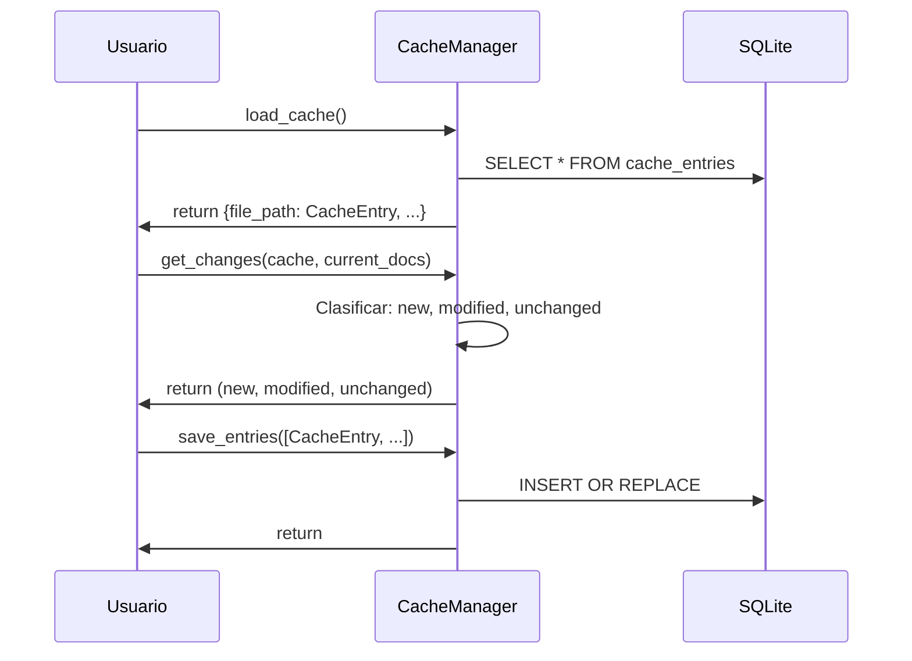

# Cache — Gestión de Hashes y Estados de Conversión

## 1. Descripción General

Caché transaccional SQLite para detectar cambios en documentos.

### Objetivo

Registrar SHA-256 y estado de conversión de cada documento para detectar:
- Documentos **nuevos** (no en caché)
- Documentos **modificados** (mismo archivo, SHA-256 cambió)
- Documentos **sin cambios** (SHA-256 idéntico)

### Precondiciones

- Base de datos SQLite debe ser accesible
- Documentos escaneados con SHA-256 calculado

## 2. Reglas de Negocio

| Regla | Descripción | Impacto si se viola |
|---|---|---|
| **WAL mode** | SQLite con Write-Ahead Log para concurrencia | Las lecturas se bloquearían mientras otro proceso escribe |
| **Transaccional** | `save_entries()` es operación atómica | Un fallo a mitad dejaría la caché con solo parte de las entradas |
| **Clasificación local** | `get_changes()` no accede disco; cálculo en memoria | Detectar cambios repetiría lecturas de disco innecesarias |
| **Única fuente de verdad** | SHA-256 = `utils.hash_utils.hash_file()` | Dos cálculos de hash distintos harían pasar documentos sin cambios por modificados |
| **Páginas ordenables y filtrables** | `load_cache_page` ordena por ruta, fecha, estado, tamaño, reintentos y, desde 1.6.0, tipo MIME, fecha de creación y propietario (sin distinguir mayúsculas); empate por ruta y vacíos al final. Desde 1.6.0 filtra por uno o varios tipos MIME, y `list_mime_types` da los tipos presentes con su recuento | Al paginar se repetirían o se saltarían documentos |

### Límites y Restricciones

❌ No computa SHA-256 (delega en `hash_utils`)  
❌ No valida documentos (solo registra hashes)  
❌ No limpia entradas obsoletas automáticamente  

## 3. Casos de Uso

### Flujo principal

**Paso a paso:**

1. **Carga**: Lee todas las entradas en caché (memoria)
2. **Comparación**: Contrasta SHA-256 actual vs. caché (CPU)
3. **Clasificación**: Categoriza en new, modified, unchanged
4. **Persistencia**: Guarda entradas actualizadas en SQLite (transaccional)

### Flujos alternativos y de error

- **Base de datos corrupta**: Error capturado
- **Entrada sin SHA-256**: Se trata como documento nuevo
- **Archivo eliminado**: Entrada sigue en caché (sin limpiar automáticamente)

## 4. Criterios de Aceptación

*Pendiente de QA: esta sección se completará cuando el equipo QA valide los criterios.*

## 5. Glosario y Términos

| Término | Definición |
|---|---|
| Documento nuevo | No está en la caché |
| Documento modificado | Mismo archivo, SHA-256 cambió |
| Documento sin cambios | SHA-256 idéntico |
