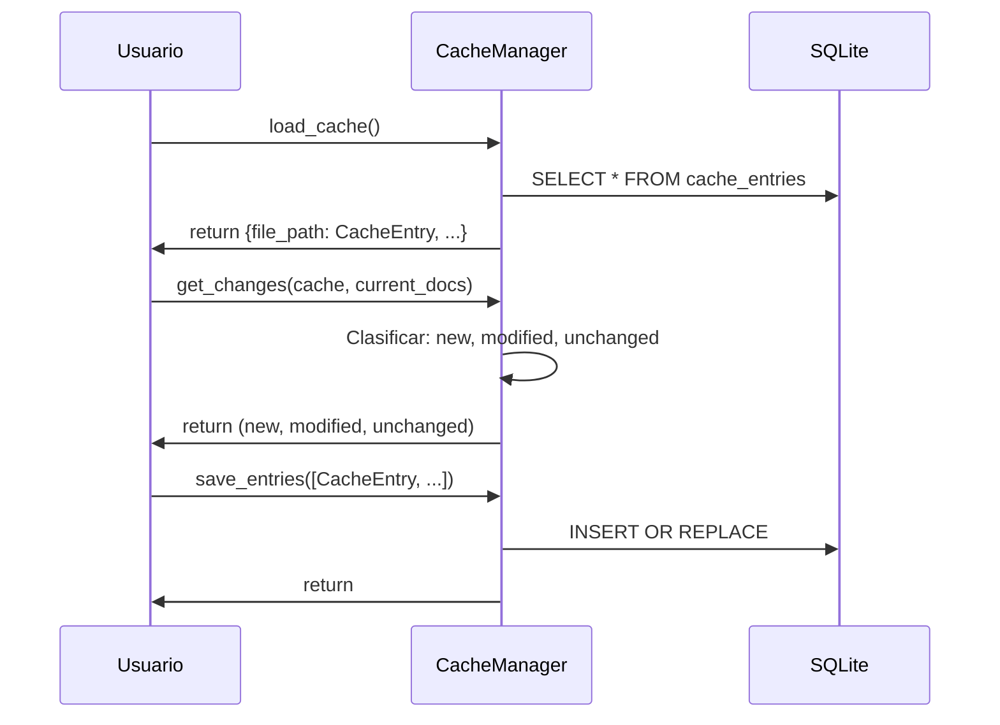

# Cache — Gestión de Hashes y Estados de Conversión

Caché transaccional SQLite para detectar cambios en documentos.

## Objetivo

Registrar SHA-256 y estado de conversión de cada documento para detectar:
- Documentos **nuevos** (no en caché)
- Documentos **modificados** (mismo archivo, SHA-256 cambió)
- Documentos **sin cambios** (SHA-256 idéntico)

## Precondiciones

- Base de datos SQLite debe ser accesible
- Documentos escaneados con SHA-256 calculado

## Flujo Principal

**Paso a paso:**

1. **Carga**: Lee todas las entradas en caché (memoria)
2. **Comparación**: Contrasta SHA-256 actual vs. caché (CPU)
3. **Clasificación**: Categoriza en new, modified, unchanged
4. **Persistencia**: Guarda entradas actualizadas en SQLite (transaccional)

## Reglas de Negocio

| Regla | Descripción |
|---|---|
| **WAL mode** | SQLite con Write-Ahead Log para concurrencia |
| **Transaccional** | `save_entries()` es operación atómica |
| **Clasificación local** | `get_changes()` no accede disco; cálculo en memoria |
| **Única fuente de verdad** | SHA-256 = `utils.hash_utils.hash_file()` |

## Límites y Restricciones

❌ No computa SHA-256 (delega en `hash_utils`)  
❌ No valida documentos (solo registra hashes)  
❌ No limpia entradas obsoletas automáticamente  

## Casos Especiales

- **Base de datos corrupta**: Error capturado
- **Entrada sin SHA-256**: Se trata como documento nuevo
- **Archivo eliminado**: Entrada sigue en caché (sin limpiar automáticamente)

## Criterios de Aceptación

*Pendiente de validación QA*
