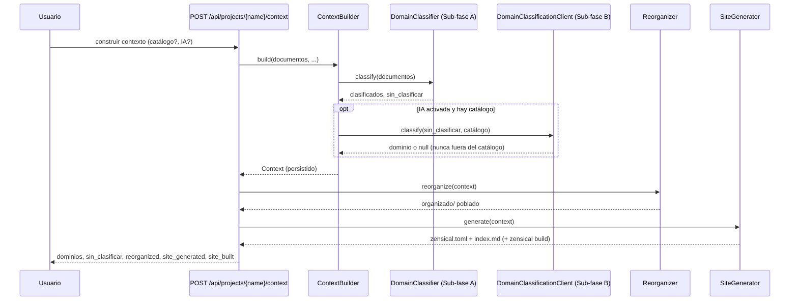

# Organización Documental — Dominios y Contextos

Clasificar los documentos ya convertidos de un proyecto en dominios, copiarlos a
una carpeta reorganizada y generar un sitio navegable con Zensical.

## Objetivo

Sobre un proyecto ya escaneado y convertido, identificar **dominios** (a qué área
temática pertenece cada documento) por reglas — con un fallback opcional por IA —
copiar cada documento (original + `.md` + `.json`) a
`<output_folder_name>/<dominio>/<tipo>/<stem>/` y generar la configuración de un
sitio [Zensical](https://zensical.org/) que lo navegue (con MkDocs hasta 0.12.x).

Opcionalmente, si el proyecto tiene un **manifiesto de taxonomía**
(`taxonomy_manifest.md`, ver más abajo), la clasificación pasa a ser de **2 ejes**
(dominio + tipo de material de origen) y `<tipo>` deja de ser la extensión del
fichero para ser ese tipo de material semántico.

## Precondiciones

- El proyecto tiene documentos ya convertidos con éxito (`cache.db` con entradas
  `conversion_status=success`) — ver [Converter](converter.md).
- Extra `doc_organize[context]` instalado (`pyyaml`, para el manifiesto y las plantillas de taxonomía).
- Para construir el sitio navegable: extra `doc_organize[site]` (`zensical`). Sin él, la configuración se escribe
  igual y `SiteGenerator` lanza `SiteBuildError` al construir.
- Sub-fase B (opcional): un LiteLLM Proxy desplegado — ver
  [Desplegar un LiteLLM Proxy](../guides/litellm_proxy_setup.md).

## Flujo Principal



## Manifiesto de Taxonomía (opcional, 2 ejes)

Un proyecto puede declarar `<project.root_path>/taxonomy_manifest.md` para dirigir
la clasificación con un catálogo propio de **dominios** y **tipos de material de
origen** (p. ej. Normativa, Procedimiento, Política, Evidencia — inspirado en la
organización documental de un SGI). El fichero combina front matter YAML (la parte
que lee la aplicación) con prosa Markdown libre (descripción, tablas, diagramas —
solo para lectura humana, nunca se parsea):

```yaml
---
domains:
  - slug: ciberseguridad
    name: Ciberseguridad
    description: Normas de seguridad de la información
    keywords: [iso27001, ens]
material_types:
  - slug: normativa
    name: Normativa
  - slug: procedimiento
    name: Procedimiento
---

# Taxonomía del SGI

Prosa libre — descripción, tablas, diagramas Mermaid, lo que ayude a quien lo mantenga.
```

Si el fichero existe, `POST .../context` lo carga automáticamente (no hace falta
activar nada en el formulario) y clasifica cada documento en los dos ejes, por
reglas — mismo criterio de puntuación que el modo de un eje (palabras del slug
encontradas en título+contenido, con bonus si la carpeta contenedora coincide). La
copia física y el sitio reflejan el segundo eje:
`<output_folder_name>/<dominio>/<tipo-de-material>/<stem>/`, y el nav de
`zensical.toml` se agrupa `dominio > tipo de material > documentos`.

Con `ai_classification_enabled=True` (y el proxy de clasificación de 2 ejes
configurado, ver más abajo), cada documento que las reglas dejan con el placeholder
`sin-clasificar` en algún eje se reintenta por IA — `TaxonomyClassificationClient`
resuelve dominio + tipo de material **en una sola llamada combinada**, pero solo se
aplica al eje que seguía sin clasificar; un eje que las reglas ya resolvieron con
confianza nunca se sobreescribe, aunque la IA sugiera algo distinto para ese eje en
la misma respuesta.

Si no existe `taxonomy_manifest.md`, todo el comportamiento (clasificación de un
eje, `<tipo>`=extensión, nav plano por dominio) queda exactamente igual que antes.

`GET /projects/{name}/context` refleja el modo manifiesto en la tabla "Contexto": un aviso
"Modo manifiesto de taxonomía activo" cuando `Context.taxonomy_manifest_used`, y cada fila de
dominio se puede desplegar para ver el tipo de material de cada documento
(`DomainDocument.material_type_name`, o una etiqueta derivada del slug si el documento cayó
en el placeholder `sin-clasificar` por no alcanzar el umbral en ese eje).

## Plantillas de Manifiesto (biblioteca compartida entre proyectos)

> La gestión de esta biblioteca (crear/editar/borrar plantillas) se hace desde
> `/admin/plantillas-taxonomia` — ver [Panel de Administración](admin.md).

Además del `taxonomy_manifest.md` propio de un proyecto, `doc_organize` mantiene una
**biblioteca de plantillas** reutilizables entre proyectos — mismo formato de fichero
(front matter YAML + prosa libre), pero fuera de cualquier `project.root_path`:
`~/.doc_organize/taxonomy_templates/<nombre>.md` (gestionada por el usuario; ruta
alternativa vía `doc_organize web --templates-path`), más un par de plantillas de
ejemplo empaquetadas con la propia librería ("sgi-iso27001", "calidad") que sirven de
fallback de solo lectura cuando no hay una plantilla de usuario con ese nombre.

Un proyecto referencia una plantilla por nombre al construir el contexto
(`POST .../context` con `taxonomy_template_name`), sin necesidad de copiar el fichero:

```yaml
---
title: SGI ISO 27001
description: Catálogo de dominios y tipos de material de un SGSI (ISO/IEC 27001).
domains:
  - slug: gobierno-seguridad
    name: Gobierno de la Seguridad
    keywords: [politica, gobierno, roles, objetivos]
material_types:
  - slug: politica
    name: Política
---
```

**Precedencia** (sin ningún mecanismo nuevo de "override"): si el proyecto tiene su
propio `taxonomy_manifest.md`, ese fichero local **siempre gana** — es el override
sin tocar la plantilla compartida. `taxonomy_template_name` solo se usa cuando no hay
fichero local. Combinar un manifiesto (local o de plantilla) con `candidate_domains`,
o un fichero local con `taxonomy_template_name`, se rechaza con `400` explícito — mismo
criterio de "nunca precedencia silenciosa" que ya aplica a `candidate_domains`.

`taxonomy_template_name` no es "sticky": a diferencia de `output_folder_name`, cada
reconstrucción debe repetirlo para seguir usando la misma plantilla (aunque la UI
preselecciona la última usada, leída de `Context.taxonomy_template_name`).

`GET /api/taxonomy-templates` lista las plantillas disponibles (nombre, título,
descripción) — usado por el selector de la página "Contexto" para poblar el
desplegable cuando el proyecto no tiene ya un `taxonomy_manifest.md` local.

Si nunca se usa ninguna plantilla (`taxonomy_template_name` ausente y sin fichero
local), el comportamiento es exactamente el mismo que antes de esta funcionalidad.

## Visualizar el Sitio Generado

`GET /projects/{name}/context/site/` sirve el sitio ya construido
(`<project.root_path>/site/`), como acción de solo lectura totalmente
independiente de construir/reconstruir el contexto: nunca se abre
automáticamente al terminar un `POST`, el usuario decide cuándo verlo (enlace
"ver documentación generada" en la página del proyecto, visible solo cuando
`site_built` es `True`). Al ser un sitio distinto por cada `Project`
(cada uno con su propio `root_path`), la misma ruta sirve el sitio de
cualquier proyecto sin acoplarse a la construcción de ningún otro.

Un contexto construido antes de 0.13.0 (con `mkdocs.yml`) pasa a Zensical al reconstruirlo: se borra `mkdocs.yml`, se
escribe `zensical.toml` y se vuelve a construir `site/`. `context.json` antiguo se sigue leyendo
(`mkdocs_generated`/`mkdocs_site_built` pasan a `site_generated`/`site_built`).

## Seguridad del sitio

Los `.md` del sitio salen de documentos de terceros: son **contenido no confiable**. Comprobado con Zensical 0.0.74
(build real con Markdown hostil):

- **El HTML incrustado en el Markdown llega tal cual al sitio**: `<script>`, atributos `on*` (``) y
  enlaces `javascript:` no se filtran. Es el comportamiento por defecto de Zensical (Python-Markdown), igual que con
  MkDocs; doc_organize no lo cambia ni lo empeora.
- **La configuración generada no añade nada ejecutable**: ni JavaScript propio, ni `extra_javascript`, ni plugins, ni
  extensiones Markdown distintas de las que Zensical activa por defecto. Solo fija nombre, carpetas, `nav`, idioma y
  `font = false` (sin peticiones a Google Fonts).
- **Lo que escribe doc_organize sí se neutraliza**: Zensical inserta sin escapar las etiquetas del `nav` y
  `site_name`, y el tema mete el título de cada página en `<title>` deshaciendo las entidades (`striptags`). Por eso
  los títulos de documento y los nombres de dominio y de proyecto se escriben sin `<`/`>` (pasan a `＜`/`＞`) y con
  `&` y comillas escapados: un título como `</title><script>…` no se ejecuta.
- **El tema por defecto** usa su propio JavaScript (navegación, búsqueda) y carga Mermaid desde `unpkg.com` cuando una
  página tiene un bloque de código `mermaid`.

Quien sirva el sitio debe tratarlo como contenido de terceros: servirlo desde **otro origen** que la aplicación (sin
sus cookies), o con una cabecera `Content-Security-Policy` restrictiva (por ejemplo `sandbox`, que deja el sitio en un
origen opaco). La web integrada (congelada, se retira en 1.0.0) lo sirve en el mismo origen, como hacía con MkDocs.

## Reorganizar sin seguir enlaces simbólicos

Desde 0.13.0, `Reorganizer` no sigue enlaces simbólicos (ni uniones de Windows), con el mismo criterio que la
deduplicación desde 0.12.1:

- La carpeta reorganizada no puede ser ni pasar por un enlace: la reorganización falla entera antes de tocar nada.
- Un documento con algún tramo enlazado (el original, el `.md`, el `.json` o sus imágenes) falla solo, sin copiar el
  destino del enlace ni dejar copias parciales; el resto sigue. Los fallos quedan en
  `Context.reorganize_failed_documents` y la página "Contexto" los avisa.
- Una ruta que pase por un enlace del sistema (p. ej. `/tmp` en macOS) falla: hay que trabajar con rutas reales.

## Reglas de Negocio

| Regla | Descripción |
|---|---|
| **Fuente de clasificación** | El `.json` de conversión (`chunks`/`title`), nunca el `.md` — ya troceado por sección, sin reparsear Markdown |
| **Nunca inventa dominios** | Con catálogo predefinido, un documento solo se asigna a un dominio de ese catálogo — ni las reglas ni la IA crean uno nuevo |
| **IA es fallback, nunca primera pasada** | Sub-fase B solo se intenta con documentos que la Sub-fase A deja por debajo del umbral de confianza, y opt-in explícito (`ai_classification_enabled`, `False` por defecto) |
| **Copiar, nunca mover** | `Reorganizer` copia los tres artefactos (original + `.md` + `.json`); la fuente original nunca se toca |
| **Reconstrucción limpia** | Cada `POST` reconstruye desde cero: dominios/documentos ya no vigentes se eliminan de `context.json` y de `organizado/`, sin copias huérfanas |
| **Estado honesto ante fallo parcial** | Si la reorganización o la generación del sitio fallan a mitad, `context.json` persiste `reorganized`/`site_generated=false` — nunca se reporta éxito falso. `SiteGenerator` lanza `SiteBuildError` si no puede construir el sitio, nunca lo deja sin construir en silencio |
| **Una operación a la vez** | `POST /api/projects/{name}/context` se rechaza con `409` si hay un escaneo, deduplicación u otra construcción de contexto en curso para el mismo proyecto |
| **Manifiesto y catálogo simple son excluyentes** | Un proyecto con `taxonomy_manifest.md` no puede combinar `candidate_domains` en la misma petición — `400` explícito, nunca precedencia silenciosa |
| **Fichero local, catálogo simple y plantilla son excluyentes entre sí** | Cualquier combinación de `taxonomy_manifest.md` local, `candidate_domains` y `taxonomy_template_name` en la misma petición se rechaza con `400` explícito — el fichero local, si existe, siempre gana sobre una plantilla, nunca precedencia silenciosa |
| **Modo manifiesto nunca excluye por completo** | Con manifiesto activo (fichero local o plantilla), un documento con los tres artefactos completos siempre se reorganiza — si un eje (dominio o tipo de material) no alcanza el umbral, se le asigna el slug `sin-clasificar` en ese eje en vez de dejarlo fuera |

## Límites y Restricciones

❌ No pagina los documentos del proyecto — carga todo `cache.db` en memoria (aceptable para el volumen típico de un proyecto; a revisar si se vuelve un cuello de botella)  
❌ Dos documentos distintos con el mismo nombre de fichero (`stem`) en el mismo dominio/tipo se sobrescriben entre sí en `organizado/` — sin desambiguación todavía  
❌ La Sub-fase B nunca se ejecuta en CI de este repo (queda fuera de alcance del despliegue Docker documentado, que es solo para desarrollo local)

## Casos Especiales

- **Documento con algún artefacto incompleto** (original, `.md` o `.json` ausente):
  la Sub-fase A lo manda a "sin clasificar" sin interrumpir el resto del lote;
  si de algún modo llega a `Reorganizer` con un artefacto ausente, se levanta
  `IncompleteConversionArtifactsError` (no se reorganiza a medias).
- **IA activada sin proxy configurado**: `POST` devuelve `400` con un mensaje
  explícito — `DOC_ORGANIZE_LITELLM_CLASSIFICATION_BASE_URL`/`_VIRTUAL_KEY` sin
  definir (modo de 1 eje), o `DOC_ORGANIZE_LITELLM_TAXONOMY_CLASSIFICATION_BASE_URL`/
  `_VIRTUAL_KEY` sin definir (modo manifiesto, 2 ejes) — nunca un error genérico.
- **IA sugiere un dominio o tipo de material fuera del catálogo**: se descarta y se
  trata como "no encaja en ninguno" en ese eje — validado en
  `DomainClassificationClient`/`TaxonomyClassificationClient`, no solo por
  instrucción al modelo.
- **Fallo de red/autenticación con el proxy** durante la Sub-fase B: el
  documento afectado queda sin clasificar (en el eje que la IA no llegó a
  resolver); no interrumpe el resto del lote.
- **`taxonomy_manifest.md` con front matter inválido** (no empieza/cierra con
  `---`, YAML roto, o catálogo `domains`/`material_types` vacío o ausente):
  `POST` devuelve `400` con el motivo exacto, no un error genérico.
- **`taxonomy_template_name` que no existe, con nombre inválido, o cuya plantilla de
  usuario tiene el front matter roto**: `POST` devuelve `400` con el motivo exacto
  (`TaxonomyTemplateError`) — un fichero de plantilla de usuario roto nunca cae en
  silencio a la plantilla empaquetada del mismo nombre (enmascararía el error).

## Criterios de Aceptación

*Pendiente de validación QA*
