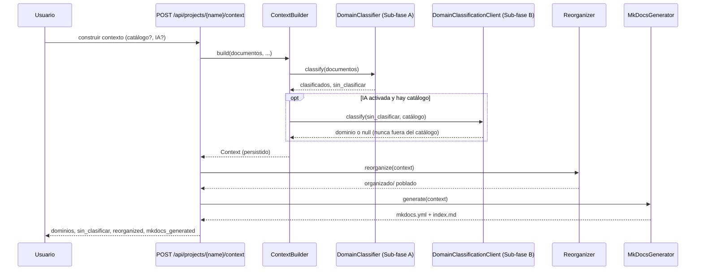

# Organización Documental — Dominios y Contextos

Clasificar los documentos ya convertidos de un proyecto en dominios, copiarlos a
una carpeta reorganizada y generar un sitio MkDocs navegable.

## Objetivo

Sobre un proyecto ya escaneado y convertido, identificar **dominios** (a qué área
temática pertenece cada documento) por reglas — con un fallback opcional por IA —
copiar cada documento (original + `.md` + `.json`) a
`<output_folder_name>/<dominio>/<tipo>/<stem>/` y generar la configuración de un
sitio [MkDocs](https://www.mkdocs.org/) que lo navegue.

Opcionalmente, si el proyecto tiene un **manifiesto de taxonomía**
(`taxonomy_manifest.md`, ver más abajo), la clasificación pasa a ser de **2 ejes**
(dominio + tipo de material de origen) y `<tipo>` deja de ser la extensión del
fichero para ser ese tipo de material semántico.

## Precondiciones

- El proyecto tiene documentos ya convertidos con éxito (`cache.db` con entradas
  `conversion_status=success`) — ver [Converter](converter.md).
- Extra `doc_organize[context]` instalado (`pyyaml`, para generar `mkdocs.yml`).
- Sub-fase B (opcional): un LiteLLM Proxy desplegado — ver
  [Desplegar un LiteLLM Proxy](../guides/litellm_proxy_setup.md).

## Flujo Principal



## Manifiesto de Taxonomía (opcional, 2 ejes)

Un proyecto puede declarar `<project.root_path>/taxonomy_manifest.md` para dirigir
la clasificación con un catálogo propio de **dominios** y **tipos de material de
origen** (p. ej. Normativa, Procedimiento, Política, Evidencia — inspirado en la
organización documental de un SGI). El fichero combina front matter YAML (la parte
que lee la aplicación) con prosa Markdown libre (descripción, tablas, diagramas —
solo para lectura humana, nunca se parsea):

```yaml
---
domains:
  - slug: ciberseguridad
    name: Ciberseguridad
    description: Normas de seguridad de la información
    keywords: [iso27001, ens]
material_types:
  - slug: normativa
    name: Normativa
  - slug: procedimiento
    name: Procedimiento
---

# Taxonomía del SGI

Prosa libre — descripción, tablas, diagramas Mermaid, lo que ayude a quien lo mantenga.
```

Si el fichero existe, `POST .../context` lo carga automáticamente (no hace falta
activar nada en el formulario) y clasifica cada documento en los dos ejes, por
reglas — mismo criterio de puntuación que el modo de un eje (palabras del slug
encontradas en título+contenido, con bonus si la carpeta contenedora coincide). La
copia física y el sitio MkDocs reflejan el segundo eje:
`<output_folder_name>/<dominio>/<tipo-de-material>/<stem>/`, y el nav de
`mkdocs.yml` se agrupa `dominio > tipo de material > documentos`.

Si no existe `taxonomy_manifest.md`, todo el comportamiento (clasificación de un
eje, `<tipo>`=extensión, nav plano por dominio) queda exactamente igual que antes.

`GET /projects/{name}/context` refleja el modo manifiesto en la tabla "Contexto": un aviso
"Modo manifiesto de taxonomía activo" cuando `Context.taxonomy_manifest_used`, y cada fila de
dominio se puede desplegar para ver el tipo de material de cada documento
(`DomainDocument.material_type_name`, o una etiqueta derivada del slug si el documento cayó
en el placeholder `sin-clasificar` por no alcanzar el umbral en ese eje).

## Visualizar el Sitio Generado

`GET /projects/{name}/context/site/` sirve el sitio MkDocs ya construido
(`<project.root_path>/site/`), como acción de solo lectura totalmente
independiente de construir/reconstruir el contexto: nunca se abre
automáticamente al terminar un `POST`, el usuario decide cuándo verlo (enlace
"ver documentación generada" en la página del proyecto, visible solo cuando
`mkdocs_site_built` es `True`). Al ser un sitio distinto por cada `Project`
(cada uno con su propio `root_path`), la misma ruta sirve el sitio de
cualquier proyecto sin acoplarse a la construcción de ningún otro.

## Reglas de Negocio

| Regla | Descripción |
|---|---|
| **Fuente de clasificación** | El `.json` de conversión (`chunks`/`title`), nunca el `.md` — ya troceado por sección, sin reparsear Markdown |
| **Nunca inventa dominios** | Con catálogo predefinido, un documento solo se asigna a un dominio de ese catálogo — ni las reglas ni la IA crean uno nuevo |
| **IA es fallback, nunca primera pasada** | Sub-fase B solo se intenta con documentos que la Sub-fase A deja por debajo del umbral de confianza, y opt-in explícito (`ai_classification_enabled`, `False` por defecto) |
| **Copiar, nunca mover** | `Reorganizer` copia los tres artefactos (original + `.md` + `.json`); la fuente original nunca se toca |
| **Reconstrucción limpia** | Cada `POST` reconstruye desde cero: dominios/documentos ya no vigentes se eliminan de `context.json` y de `organizado/`, sin copias huérfanas |
| **Estado honesto ante fallo parcial** | Si la reorganización o la generación de MkDocs fallan a mitad, `context.json` persiste `reorganized`/`mkdocs_generated=false` — nunca se reporta éxito falso |
| **Una operación a la vez** | `POST /api/projects/{name}/context` se rechaza con `409` si hay un escaneo, deduplicación u otra construcción de contexto en curso para el mismo proyecto |
| **Manifiesto y catálogo simple son excluyentes** | Un proyecto con `taxonomy_manifest.md` no puede combinar `candidate_domains` en la misma petición — `400` explícito, nunca precedencia silenciosa |
| **Modo manifiesto nunca excluye por completo** | Con manifiesto activo, un documento con los tres artefactos completos siempre se reorganiza — si un eje (dominio o tipo de material) no alcanza el umbral, se le asigna el slug `sin-clasificar` en ese eje en vez de dejarlo fuera |

## Límites y Restricciones

❌ No pagina los documentos del proyecto — carga todo `cache.db` en memoria (aceptable para el volumen típico de un proyecto; a revisar si se vuelve un cuello de botella)  
❌ Dos documentos distintos con el mismo nombre de fichero (`stem`) en el mismo dominio/tipo se sobrescriben entre sí en `organizado/` — sin desambiguación todavía  
❌ La Sub-fase B nunca se ejecuta en CI de este repo (queda fuera de alcance del despliegue Docker documentado, que es solo para desarrollo local)

## Casos Especiales

- **Documento con algún artefacto incompleto** (original, `.md` o `.json` ausente):
  la Sub-fase A lo manda a "sin clasificar" sin interrumpir el resto del lote;
  si de algún modo llega a `Reorganizer` con un artefacto ausente, se levanta
  `IncompleteConversionArtifactsError` (no se reorganiza a medias).
- **IA activada sin proxy configurado**: `POST` devuelve `400` con un mensaje
  explícito (`DOC_ORGANIZE_LITELLM_CLASSIFICATION_BASE_URL`/`_VIRTUAL_KEY` sin
  definir), no un error genérico.
- **IA sugiere un dominio fuera del catálogo**: se descarta y se trata como "no
  encaja en ninguno" — validado en `DomainClassificationClient`, no solo por
  instrucción al modelo.
- **Fallo de red/autenticación con el proxy** durante la Sub-fase B: el
  documento afectado queda sin clasificar; no interrumpe el resto del lote.
- **`taxonomy_manifest.md` con front matter inválido** (no empieza/cierra con
  `---`, YAML roto, o catálogo `domains`/`material_types` vacío o ausente):
  `POST` devuelve `400` con el motivo exacto, no un error genérico.
- **Sub-fase B (IA) con manifiesto activo**: sin efecto en este ciclo — la
  clasificación de 2 ejes es solo por reglas; `ai_classification_enabled` se
  ignora mientras haya `taxonomy_manifest.md`.

## Criterios de Aceptación

*Pendiente de validación QA*
