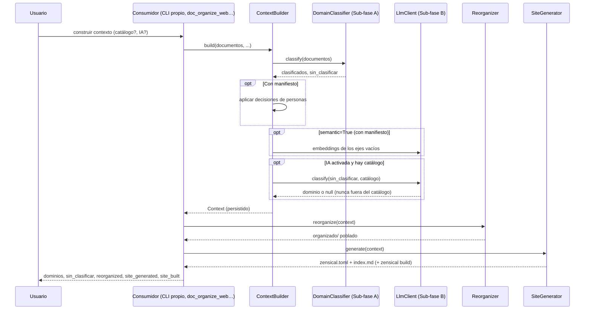

# Organización Documental — Dominios y Contextos

Clasificar los documentos ya convertidos de un proyecto en dominios, copiarlos a
una carpeta reorganizada y generar un sitio navegable con Zensical.

## Objetivo

Sobre un proyecto ya escaneado y convertido, identificar **dominios** (a qué área
temática pertenece cada documento) por reglas — con un fallback opcional por IA —
copiar cada documento (original + `.md` + `.json`) a
`<output_folder_name>/<dominio>/<tipo>/<stem>/` y generar la configuración de un
sitio [Zensical](https://zensical.org/) que lo navegue (con MkDocs hasta 0.12.x).

Opcionalmente, si el proyecto tiene un **manifiesto de taxonomía**
(`taxonomy_manifest.md`, ver más abajo), la clasificación pasa a ser de **2 ejes**
(dominio + tipo de material de origen) y `<tipo>` deja de ser la extensión del
fichero para ser ese tipo de material semántico.

Desde 2.0.0 la clasificación con manifiesto pasa por fases, cada una solo rellena lo que la anterior dejó vacío:
**reglas** → **decisiones de personas** → **semántica** con embeddings (opcional) → **IA** (opcional). También se
pueden marcar o filtrar las **versiones** de un mismo documento y **describir** con IA los documentos que no declaran
descripción. La revisión por personas, la evaluación contra una referencia y los agentes que proponen están en
[Revisión y calidad de la clasificación](revision_clasificacion.md).

## Precondiciones

- El proyecto tiene documentos ya convertidos con éxito (`cache.db` con entradas
  `conversion_status=success`) — ver [Converter](converter.md).
- Extra `doc_organize[context]` instalado (`pyyaml`, para el manifiesto y las plantillas de taxonomía).
- Para construir el sitio navegable: extra `doc_organize[site]` (`zensical>=0.1.1` desde 1.4.0). Sin él, la
  configuración se escribe igual y `SiteGenerator` lanza `SiteBuildError` al construir.
- Las páginas con una sección demasiado grande para el índice de búsqueda de Zensical (típicamente documentos
  convertidos sin títulos, como hojas de cálculo grandes) se construyen y se navegan, pero se sacan del buscador del
  sitio; `SiteResult.search_excluded` dice cuáles (ver [API → SiteGenerator](../api/context.md#sitegenerator-0130-l-8)).
- Sub-fase B (opcional): un LiteLLM Proxy desplegado — ver
  [Desplegar un LiteLLM Proxy](../guides/litellm_proxy_setup.md) — y un `LlmClient` configurado (variables
  `DOC_ORGANIZE_LITELLM_*` de 2.0, `settings_from_env()`).
- Sub-fase semántica (opcional, 2.0.0): un modelo de embeddings para la tarea `embed` del mismo proxy.

## Flujo Principal



## Manifiesto de Taxonomía (opcional, 2 ejes)

Un proyecto puede declarar `<project.root_path>/taxonomy_manifest.md` para dirigir
la clasificación con un catálogo propio de **dominios** y **tipos de material de
origen** (p. ej. Normativa, Procedimiento, Política, Evidencia — inspirado en la
organización documental de un SGI). El fichero combina front matter YAML (la parte
que lee la aplicación) con prosa Markdown libre (descripción, tablas, diagramas —
solo para lectura humana, nunca se parsea):

```yaml
---
schema: 2
axes:
  - key: domains
    name: Dominios
    organizes: folder
    entries:
      - slug: ciberseguridad
        name: Ciberseguridad
        description: Normas de seguridad de la información
        keywords: [iso27001, ens]
  - key: material_types
    name: Tipos de material
    organizes: subfolder
    entries:
      - slug: normativa
        name: Normativa
      - slug: procedimiento
        name: Procedimiento
---

# Taxonomía del SGI

Prosa libre — descripción, tablas, diagramas Mermaid, lo que ayude a quien lo mantenga.
```

Desde 2.0.0 el manifiesto es una lista de **ejes** (`schema: 2`): el de
`organizes: folder` es el dominio y el de `organizes: subfolder` el tipo de material.
Se pueden declarar más ejes que solo etiquetan (marcos normativos, sistema de
gestión...), con `multiple: true` si un documento puede tener varios valores. Un
manifiesto de 1.x (`domains:` y `material_types:` en el nivel superior, con o sin
`facets:` o ejes implícitos) se sigue leyendo: se migra al leerlo, sin tocar el
fichero (`migrate_manifest_v1` lo reescribe si se quiere). Formato completo en la
[API del contexto](../api/context.md#taxonomymanifest-manifiesto-de-taxonomia).

Si el fichero existe, el consumidor lo carga (`load_taxonomy_manifest`, que devuelve `None` si no hay
fichero) y lo pasa a la construcción, que clasifica cada documento en los dos ejes, por
reglas — mismo criterio de puntuación que el modo de un eje (palabras del slug
encontradas en título+contenido, con bonus si la carpeta contenedora coincide). La
copia física y el sitio reflejan el segundo eje:
`<output_folder_name>/<dominio>/<tipo-de-material>/<stem>/`, y el nav de
`zensical.toml` se agrupa `dominio > tipo de material > documentos`.

Con `llm=LlmClient(...)` y `ai_scope="unclassified"` (ver la guía del proxy), cada documento que las reglas dejan con
el placeholder `sin-clasificar` en algún eje se reintenta por IA — `classify_document`
resuelve dominio + tipo de material **en una sola llamada combinada**, pero solo se
aplica al eje que seguía sin clasificar; un eje que las reglas ya resolvieron con
confianza nunca se sobreescribe, aunque la IA sugiera algo distinto para ese eje en
la misma respuesta. Con `ai_scope="missing_axes"`, la IA también rellena los ejes que solo etiquetan (marcos
normativos, temas...) que quedaron vacíos, con la misma regla: nunca cambia lo que ya tiene valor. Cada valor de la IA
lleva su cita; si la cita no está en el documento, el valor queda por debajo del umbral para revisarlo.

Si no existe `taxonomy_manifest.md`, todo el comportamiento (clasificación de un
eje, `<tipo>`=extensión, nav plano por dominio) queda exactamente igual que antes.

El contexto dice si se construyó en modo manifiesto (`Context.taxonomy_manifest_used`) y el tipo de material de
cada documento (`DomainDocument.material_type_name`, o una etiqueta derivada del slug si el documento cayó en el
placeholder `sin-clasificar` por no alcanzar el umbral en ese eje), para que una interfaz lo muestre.

## Plantillas de Manifiesto (biblioteca compartida entre proyectos)

> La biblioteca se gestiona con `TaxonomyTemplateRegistry` (crear, editar y borrar plantillas); el panel
> `/admin/plantillas-taxonomia` de la web integrada se retiró en 1.0.0 (ver el
> [histórico](../historico/web-admin.md)).

Además del `taxonomy_manifest.md` propio de un proyecto, `doc_organize` mantiene una
**biblioteca de plantillas** reutilizables entre proyectos — mismo formato de fichero
(front matter YAML + prosa libre), pero fuera de cualquier `project.root_path`:
`~/.doc_organize/taxonomy_templates/<nombre>.md` (gestionada por el usuario; ruta
alternativa con `TaxonomyTemplateRegistry(templates_dir)`), más tres plantillas de
ejemplo empaquetadas con la propia librería ("sgi-iso27001", "sgi-integrado", "calidad") que sirven de
fallback de solo lectura cuando no hay una plantilla de usuario con ese nombre.

Un proyecto usa una plantilla por nombre al construir el contexto, sin necesidad de copiar el fichero: el
consumidor la carga (`TaxonomyTemplateRegistry.load_template(nombre)`) y la pasa como manifiesto, con
`taxonomy_template_name` para que el contexto recuerde de dónde vino:

```yaml
---
schema: 2
title: SGI ISO 27001
description: Catálogo de dominios y tipos de material de un SGSI (ISO/IEC 27001).
axes:
  - key: domains
    name: Dominios
    organizes: folder
    entries:
      - slug: gobierno-seguridad
        name: Gobierno de la Seguridad
        keywords: [politica, gobierno, roles, objetivos]
  - key: material_types
    name: Tipos de material
    organizes: subfolder
    entries:
      - slug: politica
        name: Política
---
```

**Precedencia** (sin ningún mecanismo nuevo de "override"): si el proyecto tiene su
propio `taxonomy_manifest.md`, ese fichero local **siempre gana** — es el override
sin tocar la plantilla compartida. `taxonomy_template_name` solo se usa cuando no hay
fichero local. Combinar un manifiesto (local o de plantilla) con `candidate_domains`,
o un fichero local con `taxonomy_template_name`, lo debe rechazar el consumidor con un error explícito — criterio de
"nunca precedencia silenciosa" (ver Reglas de Negocio).

`taxonomy_template_name` no es "sticky": a diferencia de `output_folder_name`, cada
reconstrucción debe repetirlo para seguir usando la misma plantilla (una interfaz
puede preseleccionar la última usada, leída de `Context.taxonomy_template_name`).

`TaxonomyTemplateRegistry.list_templates()` lista las plantillas disponibles (nombre,
título, descripción), p. ej. para poblar un selector cuando el proyecto no tiene ya un
`taxonomy_manifest.md` local.

Si nunca se usa ninguna plantilla (`taxonomy_template_name` ausente y sin fichero
local), el comportamiento es exactamente el mismo que antes de esta funcionalidad.

## Visualizar el Sitio Generado

El sitio ya construido queda en `<project.root_path>/site/` (`ProjectLayout.site_dir`) cuando
`Context.site_built` es `True`. La librería no lo sirve: abrirlo o publicarlo es cosa del
consumidor (doc_organize_web lo sirve aislado, ver [Seguridad del sitio](#seguridad-del-sitio)).
Cada `Project` tiene su propio sitio bajo su `root_path`, sin acoplarse a ningún otro.

Un contexto construido antes de 0.13.0 (con `mkdocs.yml`) pasa a Zensical al reconstruirlo: se borra `mkdocs.yml`, se
escribe `zensical.toml` y se vuelve a construir `site/`. `context.json` antiguo se sigue leyendo
(sus claves `mkdocs_generated`/`mkdocs_site_built` se leen como `site_generated`/`site_built`; las propiedades
`Context.mkdocs_generated`/`mkdocs_site_built` se retiraron en 1.0.0).

### Tamaño del sitio (1.7.1)

Desde 1.7.1 la configuración generada activa `navigation.prune`: cada página lleva en el menú solo la sección abierta
(su dominio), no el árbol entero. Antes, el tamaño del sitio crecía con el cuadrado del número de documentos (2600
documentos en 20 dominios: ~1,9 GB; con `navigation.prune`, ~170 MB). Con un dominio muy grande, sus páginas siguen
llevando todos los documentos de ese dominio.

## Seguridad del sitio

Los `.md` del sitio salen de documentos de terceros: son **contenido no confiable**. Comprobado con Zensical 0.0.74
(build real con Markdown hostil):

- **El HTML incrustado en el Markdown llega tal cual al sitio**: `<script>`, atributos `on*` (``) y
  enlaces `javascript:` no se filtran. Es el comportamiento por defecto de Zensical (Python-Markdown), igual que con
  MkDocs; doc_organize no lo cambia ni lo empeora.
- **La configuración generada no añade nada ejecutable**: ni JavaScript propio, ni `extra_javascript`, ni plugins, ni
  extensiones Markdown distintas de las que Zensical activa por defecto. Solo fija nombre, carpetas, `nav`, idioma,
  `font = false` (sin peticiones a Google Fonts) y `navigation.prune` (1.7.1, solo HTML).
- **Lo que escribe doc_organize sí se neutraliza**: Zensical inserta sin escapar las etiquetas del `nav` y
  `site_name`, y el tema mete el título de cada página en `<title>` deshaciendo las entidades (`striptags`). Por eso
  los títulos de documento y los nombres de dominio y de proyecto se escriben sin `<`/`>` (pasan a `＜`/`＞`) y con
  `&` y comillas escapados: un título como `</title><script>…` no se ejecuta.
- **El tema por defecto** usa su propio JavaScript (navegación, búsqueda) y carga Mermaid desde `unpkg.com` cuando una
  página tiene un bloque de código `mermaid`.

**Sitio sin conexión (2.0.0)**: `SiteGenerator.generate(offline=True)` construye un sitio para abrirse desde el disco
sin nada de terceros (Mermaid y el resto de recursos van empaquetados), **siempre neutraliza** las páginas de los
documentos (HTML escapado, enlaces `javascript:` e imágenes remotas desactivados) y, desde 2.0.0rc3, no publica los
originales ni el `.json` de cada documento. `check_site_offline()` lo comprueba y `write_site_zip()` lo empaqueta en un
ZIP reproducible (rechaza un sitio que no pase la comprobación). El sitio normal no cambia. Con `llms_txt=True` el
sitio lleva también un `llms.txt` para herramientas de IA.

Quien sirva el sitio debe tratarlo como contenido de terceros: servirlo desde **otro origen** que la aplicación (sin
sus cookies), o con una cabecera `Content-Security-Policy` restrictiva (por ejemplo `sandbox`, que deja el sitio en un
origen opaco).

## Credenciales en el texto (1.7.0)

Los documentos de oficina llevan a veces contraseñas, tokens o un `client_secret` en claro. Antes de que su texto salga
de la aplicación o se publique, el **valor** se sustituye por `«REDACTADO»` (la clave se conserva: el texto sigue
diciendo que había una contraseña):

| Dónde | Qué se redacta | Cómo se desactiva |
|---|---|---|
| Todo lo que sale hacia la IA (`LlmClient`: clasificación, descripción, diseño de taxonomía, agentes y embeddings) | Texto de cada mensaje | `AiSettings(redact_credentials=False)` |
| Sitio (`SiteGenerator.generate`) | Páginas de la carpeta reorganizada y títulos del `nav` | `generate(redact_credentials=False)` |
| Paquete para IA (`write_ai_context_bundle`, 2.0.0) | Títulos, descripciones y textos | `write_ai_context_bundle(redact=False)` |

Está **activado por defecto** en los tres. `Conversión/` y los originales no se tocan; `context.json` guarda el título
y el texto originales (lo que se publica en el sitio sale redactado). El contexto resume lo redactado en
`credential_findings` (documento y recuento por regla) y el sitio lista las páginas tocadas en
`SiteResult.credentials_redacted`, **sin el valor** en ningún caso.

Reglas: claves privadas PEM, `client_secret`, contraseña (`password`, `contraseña`, `clave`…), `token`/`api_key`/`secret`,
usuario y contraseña en una URL, JWT, claves de acceso de AWS, tokens de GitHub y claves `sk-…`. No se tocan marcadores
evidentes (`xxxxxx`, `***`, `<…>`, `${VAR}`), URL ni valores ya redactados; en las reglas por palabra clave el valor
tiene que tener algún carácter que no sea letra, así que **una contraseña solo de letras no se detecta**. Es una red de
seguridad, no una garantía: el aviso de privacidad de la IA sigue valiendo.

## Reorganizar sin seguir enlaces simbólicos

Desde 0.13.0, `Reorganizer` no sigue enlaces simbólicos (ni uniones de Windows), con el mismo criterio que la
deduplicación desde 0.12.1:

- La carpeta reorganizada no puede ser ni pasar por un enlace: la reorganización falla entera antes de tocar nada.
- Un documento con algún tramo enlazado (el original, el `.md`, el `.json` o sus imágenes) falla solo, sin copiar el
  destino del enlace ni dejar copias parciales; el resto sigue. Los fallos quedan en
  `Context.reorganize_failed_documents`, para que el consumidor los avise.
- Una ruta que pase por un enlace del sistema (p. ej. `/tmp` en macOS) falla: hay que trabajar con rutas reales.

## Reglas de Negocio

| Regla | Descripción |
|---|---|
| **Fuente de clasificación** | El `.json` de conversión (`chunks`/`title`), nunca el `.md` — ya troceado por sección, sin reparsear Markdown |
| **Nunca inventa dominios** | Con catálogo predefinido, un documento solo se asigna a un dominio de ese catálogo — ni las reglas ni la IA crean uno nuevo |
| **IA es fallback, nunca primera pasada** | Sub-fase B solo se intenta con documentos que la Sub-fase A deja por debajo del umbral de confianza, y opt-in explícito (`ai_scope="unclassified"`, o `"missing_axes"` para rellenar también los ejes que solo etiquetan; por defecto `"off"`). La IA solo rellena ejes vacíos |
| **Las personas mandan (2.0.0)** | Con manifiesto, las decisiones de personas (`decisions.json`) se aplican tras las reglas y antes de la semántica y la IA; la que no se puede aplicar queda en `Context.stale_decisions`/`orphan_decisions` |
| **Semántica opcional (2.0.0)** | Con `semantic=True` y manifiesto, los ejes vacíos se rellenan por parecido con embeddings (`classified_by="semantic"`), antes de la IA |
| **Versiones (2.0.0)** | `versions="all"` (por defecto) no cambia nada; `"mark"` marca versión y vigente; `"current_only"` solo clasifica, publica y envía a la IA la vigente (la más alta o la que decidió una persona) |
| **Caché de IA (2.0.0)** | Reconstruir sin cambios (mismo documento, prompt, modelo, catálogo y redacción) no vuelve a llamar al modelo |
| **Cita verificada (2.0.0)** | Cada valor que asigna la IA lleva su cita; si no aparece en el documento, el valor queda por debajo del umbral para revisarlo |
| **Copiar, nunca mover** | `Reorganizer` copia los tres artefactos (original + `.md` + `.json`); la fuente original nunca se toca |
| **Reconstrucción limpia** | Cada construcción reconstruye desde cero: dominios/documentos ya no vigentes se eliminan de `context.json` y de `organizado/`, sin copias huérfanas |
| **Estado honesto ante fallo parcial** | Si la reorganización o la generación del sitio fallan a mitad, `context.json` persiste `reorganized`/`site_generated=false` — nunca se reporta éxito falso. `SiteGenerator` lanza `SiteBuildError` si no puede construir el sitio, nunca lo deja sin construir en silencio |
| **Una operación a la vez** | La librería no bloquea: evitar un escaneo, una deduplicación u otra construcción de contexto simultáneos sobre el mismo proyecto es responsabilidad del consumidor (doc_organize_web encola las ejecuciones) |
| **Manifiesto y catálogo simple son excluyentes** | Con `taxonomy_manifest`, `ContextBuilder.build()` clasifica por el manifiesto; rechazar que además llegue `candidate_domains` (en vez de ignorarlo en silencio) es responsabilidad del consumidor |
| **Fichero local, catálogo simple y plantilla son excluyentes entre sí** | El fichero local `taxonomy_manifest.md`, si existe, gana sobre una plantilla; rechazar cualquier combinación de los tres en la misma petición es responsabilidad del consumidor |
| **Sin clasificar, con su motivo (1.6.0)** | Cada documento sin clasificar queda en `Context.unclassified_details` con su motivo (artefactos incompletos o por debajo del umbral), lo que propusieron las reglas y lo que declara el original. La IA no los enriquece. Se guarda en `unclassified.json`, aparte de `context.json` |
| **`created_at` es la primera construcción (1.6.0)** | Reconstruir solo cambia `updated_at`; `created_at` vuelve a empezar si se borra el contexto o el anterior no se puede leer |
| **Historial acotado y seguro (1.6.0)** | `CONTEXT_HISTORY.jsonl` gira a los 5 MB y conserva 4 copias; dos construcciones del mismo proyecto desde procesos o equipos distintos no pierden líneas (bloqueo entre procesos, válido en SMB y NFS). La regla «una operación a la vez» sigue valiendo para el resto del contexto |
| **Propiedades en paralelo (1.6.0)** | Los originales se leen de 4 en 4 (`properties_concurrency`), sin llamar nunca a PDFium dos veces a la vez |
| **Modo manifiesto nunca excluye por completo** | Con manifiesto activo (fichero local o plantilla), un documento con los tres artefactos completos siempre se reorganiza — si un eje (dominio o tipo de material) no alcanza el umbral, se le asigna el slug `sin-clasificar` en ese eje en vez de dejarlo fuera |

## Límites y Restricciones

❌ No pagina los documentos del proyecto — carga todo `cache.db` en memoria (aceptable para el volumen típico de un proyecto; a revisar si se vuelve un cuello de botella)  
❌ Dos documentos distintos con el mismo nombre de fichero (`stem`) en el mismo dominio/tipo se sobrescriben entre sí en `organizado/` — sin desambiguación todavía  
❌ La Sub-fase B nunca se ejecuta en CI de este repo (queda fuera de alcance del despliegue Docker documentado, que es solo para desarrollo local)

## Casos Especiales

- **Documento con algún artefacto incompleto** (original, `.md` o `.json` ausente):
  la Sub-fase A lo manda a "sin clasificar" sin interrumpir el resto del lote;
  si de algún modo llega a `Reorganizer` con un artefacto ausente, se levanta
  `IncompleteConversionArtifactsError` (no se reorganiza a medias).
- **IA sin configurar**: `settings_from_env()` devuelve `None` si no hay `DOC_ORGANIZE_LITELLM_BASE_URL` (sin IA), y
  lanza `AiConfigurationError` si falta `DOC_ORGANIZE_LITELLM_VIRTUAL_KEY` o si quedan variables de 1.x definidas
  (el mensaje da la equivalente de 2.0), para que una actualización sin reconfigurar no deje la IA desactivada en
  silencio. Pedir IA, descripción o semántica sin cliente de IA (`llm`) lanza `ValueError`.
- **IA sugiere un dominio o tipo de material fuera del catálogo**: se descarta y se
  trata como "no encaja en ninguno" en ese eje — validado en
  los servicios de `doc_organize.ai` (`classify_document`), no solo por
  instrucción al modelo.
- **Fallo de red/autenticación con el proxy** durante la Sub-fase B: el
  documento afectado queda sin clasificar (en el eje que la IA no llegó a
  resolver). Un 401/403 detiene la fase de IA en el acto (`stopped="auth"`); con `ai_max_failures`, también tras
  ese número de errores de conexión seguidos (`stopped="connection"`), y con `ai_max_documents` al llegar al tope
  (`stopped="budget"`). Los pendientes no se envían y la construcción termina con normalidad.
- **`taxonomy_manifest.md` con front matter inválido** (no empieza/cierra con
  `---`, YAML roto, sin eje de dominio o de tipo de material, o fuera de los límites):
  `TaxonomyManifestError` con el motivo exacto, no un error genérico.
- **`taxonomy_template_name` que no existe, con nombre inválido, o cuya plantilla de
  usuario tiene el front matter roto**: `TaxonomyTemplateError` con el motivo exacto — un fichero de plantilla de usuario roto nunca cae en
  silencio a la plantilla empaquetada del mismo nombre (enmascararía el error).

## Criterios de Aceptación

*Pendiente de validación QA*
