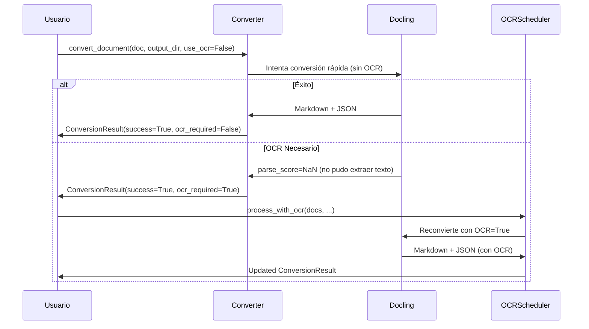

# Converter — Conversión a Markdown/JSON

## 1. Descripción General

Conversión de documentos a formatos legibles y accesibles.

### Objetivo

Transformar documentos (PDF, DOCX, etc.) a Markdown + JSON estructurado usando **Docling**, con soporte para OCR diferido cuando un documento no se puede procesar por vía rápida.

### Precondiciones

- Documentos válidos (escaneados y listados)
- Formato soportado por Docling
- Espacio en disco suficiente para outputs (Markdown + JSON)

## 2. Reglas de Negocio

| Regla | Descripción | Impacto si se viola |
|---|---|---|
| **Dos fases** | Intento rápido primero; OCR solo si necesario | Se aplicaría OCR también a documentos que ya tienen texto |
| **No bloquea** | Usa `asyncio.to_thread()` para I/O CPU-intensivo | La aplicación dejaría de responder mientras convierte |
| **Pool de convertidores** | Cachea por `(use_ocr, use_gpu, extract_images, use_picture_description)` para eficiencia | Se volverían a cargar los modelos de Docling en cada documento |
| **Errores capturados** | Los fallos de un documento no se relanzan: van en `ConversionResult` (salvo `ModelsNotAvailableError`, que es de configuración) | Un documento en uso o sin permiso abortaría el resto del lote |
| **Formatos ampliados** | `SUPPORTED_EXTENSIONS` cubre además html/htm/xhtml, csv, odt/ods/odp, adoc/asciidoc/asc, epub, eml, txt (siempre activos, sin flag); audio/vídeo son opt-in vía `include_audio_video` (requieren el extra `[av]` + `ffmpeg`) | Los documentos en esos formatos no se convertirían |
| **OCR de imágenes sueltas** | `use_ocr` gobierna también `InputFormat.IMAGE` (png/jpg/tiff/bmp), no solo PDF | Las imágenes escaneadas saldrían sin texto aunque se pida OCR |
| **Extracción de imágenes** | `extract_images=True` guarda las imágenes embebidas en `img/<stem>/` junto al `.md` y las referencia, en vez del placeholder `<!-- image -->`. Namespaced por documento: dos documentos en la misma carpeta no comparten imágenes | Las imágenes de dos documentos de la misma carpeta se pisarían |
| **Descripción de imágenes (RAG)** | `use_picture_description=True` añade `image_descriptions` a los chunks del `.json` (modelo local `smolvlm`), solo para documentos PDF/imagen | Pendiente de verificación |
| **`source_path` del `.json`** | Desde 0.12.0, ruta del documento relativa a la carpeta escaneada (`Informes/a.pdf`), sin rutas del servidor; `json_source_path="absolute"` (o `ScanOptions(json_source_path="absolute")`) guarda la ruta completa, como antes | El `.json` revelaría rutas del servidor |
| **Varias carpetas escaneadas** | La salida replica la ruta relativa a su carpeta. Con varias carpetas, `ScanOptions(root_name_in_output=True)` antepone el nombre de cada una (`2024/x/a.md`) para que no colisionen; sin ella, el escaneo avisa si dos documentos irían al mismo `.md` | Dos documentos de carpetas distintas se sobrescribirían en el mismo `.md` |
| **Sin red** | `ScanOptions(artifacts_path=..., allow_model_downloads=False)`: Docling lee los modelos de esa carpeta y, si falta alguno, el escaneo para con `ModelsNotAvailableError` en vez de descargarlo | Docling descargaría modelos de Internet en un entorno que lo prohíbe |

### Límites y Restricciones

❌ No crea carpetas de destino (usuario debe crearlas)  
❌ No verifica permisos de escritura anticipadamente  
❌ `extract_images`/`use_picture_description` no tienen efecto en documentos DOCX/XLSX/PPTX/HTML/etc. (pipeline sin esos pasos) — se aceptan sin error, pero no producen imágenes/descripciones  
❌ Audio/vídeo (`include_audio_video`) requieren el extra `[av]` (Whisper) y el binario `ffmpeg` del sistema; sin ellos, el escaneo se rechaza con un mensaje explícito antes de empezar (una interfaz puede consultarlo antes con `detect_av_status()`)  

## 3. Casos de Uso

### Flujo principal

**Paso a paso:**

1. **Entrada**: Documento + directorio salida
2. **Conversión rápida**: Docling extrae texto sin OCR
3. **Detección OCR**: Si es PDF/imagen y `parse_score=NaN`, marcar como `ocr_required=True` (docx, xlsx, pptx, html… nunca requieren OCR)
4. **Si OCR requerido**: `OCRScheduler` reconvierte con OCR (segunda pasada)
5. **Salida**: Markdown (legible) + JSON (estructura)

### Flujos alternativos y de error

- **Documento corrupto**: Error capturado, `success=False`
- **Formato no soportado**: Error capturado, `success=False`
- **OCR necesario**: `success=True, ocr_required=True` (no es error)
- **GPU no disponible**: Fallback a CPU automático

## 4. Criterios de Aceptación

*Pendiente de QA: esta sección se completará cuando el equipo QA valide los criterios.*

## 5. Glosario y Términos

*No aplica para este módulo.*
