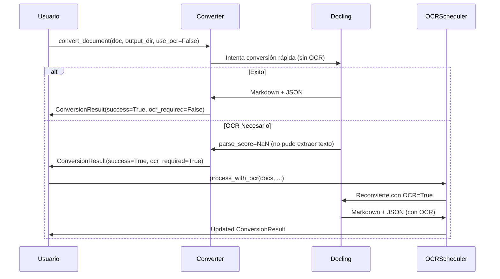

# Converter — Conversión a Markdown/JSON

Conversión de documentos a formatos legibles y accesibles.

## Objetivo

Transformar documentos (PDF, DOCX, etc.) a Markdown + JSON estructurado usando **Docling**, con soporte para OCR diferido cuando un documento no se puede procesar por vía rápida.

## Precondiciones

- Documentos válidos (escaneados y listados)
- Formato soportado por Docling
- Espacio en disco suficiente para outputs (Markdown + JSON)

## Flujo Principal

**Paso a paso:**

1. **Entrada**: Documento + directorio salida
2. **Conversión rápida**: Docling extrae texto sin OCR
3. **Detección OCR**: Si `parse_score=NaN`, marcar como `ocr_required=True`
4. **Si OCR requerido**: `OCRScheduler` reconvierte con OCR (segunda pasada)
5. **Salida**: Markdown (legible) + JSON (estructura)

## Reglas de Negocio

| Regla | Descripción |
|---|---|
| **Dos fases** | Intento rápido primero; OCR solo si necesario |
| **No bloquea** | Usa `asyncio.to_thread()` para I/O CPU-intensivo |
| **Pool de convertidores** | Cachea por `(use_ocr, use_gpu, extract_images, use_picture_description)` para eficiencia |
| **Errores capturados** | Nunca relanza; devuelve error en `ConversionResult` |
| **Formatos ampliados** | `SUPPORTED_EXTENSIONS` cubre además html/htm/xhtml, csv, odt/ods/odp, adoc/asciidoc/asc, epub, eml, txt (siempre activos, sin flag); audio/vídeo son opt-in vía `include_audio_video` (requieren el extra `[av]` + `ffmpeg`) |
| **OCR de imágenes sueltas** | `use_ocr` gobierna también `InputFormat.IMAGE` (png/jpg/tiff/bmp), no solo PDF |
| **Extracción de imágenes** | `extract_images=True` guarda las imágenes embebidas en `img/<stem>/` junto al `.md` y las referencia, en vez del placeholder `<!-- image -->`. Namespaced por documento: dos documentos en la misma carpeta no comparten imágenes |
| **Descripción de imágenes (RAG)** | `use_picture_description=True` añade `image_descriptions` a los chunks del `.json` (modelo local `smolvlm`), solo para documentos PDF/imagen |

## Límites y Restricciones

❌ No crea carpetas de destino (usuario debe crearlas)  
❌ No verifica permisos de escritura anticipadamente  
❌ `extract_images`/`use_picture_description` no tienen efecto en documentos DOCX/XLSX/PPTX/HTML/etc. (pipeline sin esos pasos) — se aceptan sin error, pero no producen imágenes/descripciones  
❌ Audio/vídeo (`include_audio_video`) requieren el extra `[av]` (Whisper) y el binario `ffmpeg` del sistema; sin ellos, el escaneo se rechaza con un mensaje explícito antes de empezar (CLI) o el checkbox aparece deshabilitado (web)  

## Casos Especiales

- **Documento corrupto**: Error capturado, `success=False`
- **Formato no soportado**: Error capturado, `success=False`
- **OCR necesario**: `success=True, ocr_required=True` (no es error)
- **GPU no disponible**: Fallback a CPU automático

## Criterios de Aceptación

*Pendiente de validación QA*
